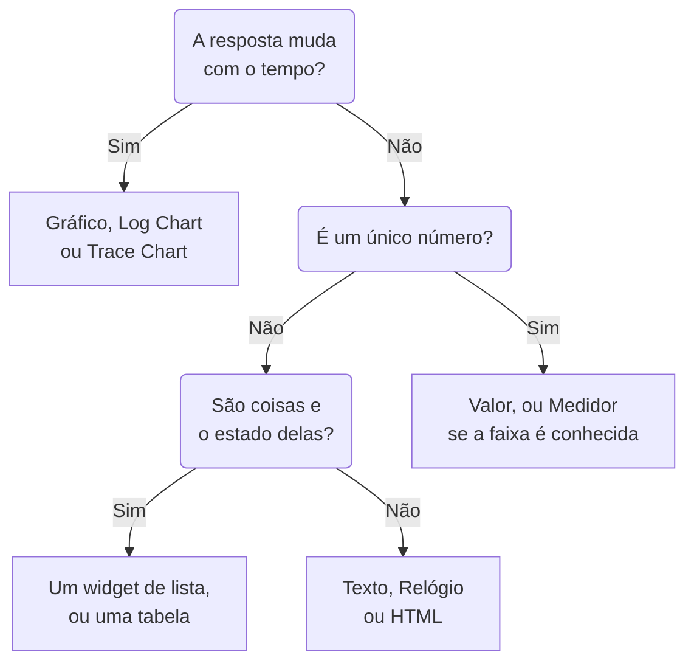

# Widgets de painel

Um widget é um bloco de um painel. Esta página lista cada widget do catálogo **Adicionar widget**, o que ele mostra e as configurações que importam, nos mesmos grupos do catálogo. Para colocar widgets na grade e salvá-los, veja [Criar um painel](/docs/dashboards/authoring).

:::cards
- [Qual widget devo usar?](#qual-widget-devo-usar): Escolha pela pergunta que o bloco responde.
- [Gráficos e números](#gráficos-e-números): Gráfico, Valor, Medidor e Tabela, a partir de uma consulta de métricas.
- [Logs, traces e segurança](#logs-traces-e-segurança): Gráficos de volume, fluxos ao vivo e listas.
- [Ordenar listas e tabelas](#ordenar-listas-e-tabelas): Ordene por uma coluna e defina a ordem que todos veem.
- [Quando um widget não pode ser mostrado](#quando-um-widget-não-pode-ser-mostrado): O que um widget quebrado mostra, e como corrigi-lo.
:::

## Qual widget devo usar?

Comece pela pergunta que o bloco precisa responder:

| A pergunta | O widget |
| --- | --- |
| Como uma métrica mudou ao longo do tempo? | **Gráfico** |
| Quantos logs, de qual severidade, ao longo do tempo? | **Gráfico de registros** |
| Quão rápidas são as requisições, e quantas falham, ao longo do tempo? | **Gráfico de traços** |
| Qual é um número específico agora? | **Valor**, ou **Medidor** quando ele tem uma faixa conhecida |
| Quais hosts, serviços ou endpoints se destacam? | **Tabela** ou **Tabela de traços** |
| O que está acontecendo agora? | **Fluxo de registros**, **Lista de traços**, **Lista de incidentes** ou **Lista de alertas** |
| Todos os nossos sites estão no ar? | **Lista de monitores** |
| Estamos mantendo a confiabilidade que prometemos? | **SLO** ou **Lista de SLOs** |
| Em que estado estão nossos clusters e hosts? | Um widget do grupo Infraestrutura |
| Onde no mundo está a nossa rede, e o que está fora do ar? | **Mapa de rede** |
| Um título, uma nota, a hora em outro escritório? | **Texto** ou **Relógio** |
| Dados guardados fora do OneUptime? | Um widget do grupo Fontes de dados externas |
| Algo que nenhum widget cobre? | **HTML**, depois de ter certeza de que nenhum outro widget faz isso |



A maioria dos painéis mistura alguns: um gráfico no topo, um ou dois valores ao lado, um título de texto e uma ou duas listas embaixo.

## Gráficos e números

Estes quatro widgets leem uma consulta de métricas, montada como o explorador de métricas monta: escolha uma métrica e uma agregação, adicione filtros de atributos e agrupe por um atributo para obter uma série por valor.

### Gráfico

Uma série temporal de uma ou mais consultas de métricas no intervalo de tempo do painel. **Chart Type** a desenha como gráfico de linhas, de barras, de áreas, de áreas empilhadas ou de pizza. **Additional Queries** sobrepõe mais métricas nos mesmos eixos, e **Formulas** as combina com `+`, `-`, `*`, `/`, `%`, `^` e parênteses, como em `(1 - a) * 100`. As configurações de exibição de cada consulta adicionam uma legenda e uma unidade, uma cor, linhas de aviso e críticas, e uma taxa por segundo para contadores que só crescem.

Use-o quando a forma da linha conta a história: latência, erros, vazão ou tamanho de uma fila.

### Valor

Um número grande com um minigráfico: o valor da consulta no intervalo de tempo inteiro, somado para uma soma ou uma contagem, o maior para um máximo, o menor para um mínimo, e a média nos outros casos. Uma seta compara a segunda metade do intervalo com a primeira, cada metade calculada da mesma forma, colorida conforme **Trend Direction**: se um valor maior é melhor ou pior, ou deduzido do nome da métrica. Aponte para a seta para ver o valor de cada metade, e para o minigráfico para ler o valor e a hora de qualquer ponto. **Warning Threshold** deixa o fundo amarelo e **Critical Threshold** vermelho quando o valor os atinge.

Use-o quando um número responde à pergunta: a taxa de erros, a latência P95 ou as requisições atendidas hoje.

### Medidor

Um mostrador entre um mínimo e um máximo, 0 e 100 se você não os definir, com uma zona amarela a partir de **Warning Threshold** e uma zona vermelha a partir de **Critical Threshold**.

Use-o quando o valor vive numa faixa conhecida: uso de CPU ou de disco em porcentagem, ou a capacidade de uma fila.

### Tabela

Valores de métricas como linhas. **Group By Attributes** dá uma linha por valor, como uma por `host.name`; sem isso, cada linha é um intervalo de tempo. **Metrics & Columns** define as colunas: métricas, e fórmulas sobre elas, como a disponibilidade em porcentagem. Quando você agrupa, **Reduce across time** transforma a série de cada linha em um único valor: o último valor, a média, a soma, o mínimo ou o máximo.

Ative **Colorir por limites** em uma coluna para colorir seus valores: um valor que atinge o **Limite de aviso** fica âmbar, com um triângulo, e um que atinge o **Limite crítico** fica vermelho e em negrito, com um círculo. Uma coluna de porcentagem começa em 80 e 90. Para uma coluna em que os valores baixos são o problema, como o espaço livre em disco, escolha **Menor é pior** em **Direção**.

Os limites leem o número que a tabela mostra, então uma métrica de uso enviada como fração de 1, como `system.cpu.utilization`, é mostrada e comparada como porcentagem. Em **Cores dos limites**, **Fundo colorido** preenche a célula inteira em vez de colorir o número.

Use-a para um detalhamento em vez de uma tendência: os hosts mais barulhentos, os erros por serviço, as requisições por endpoint.

## Texto, relógio e HTML

Estes widgets não precisam de fonte de dados.

### Texto

Uma linha ou um bloco de texto, para um título, uma nota ou links para os seus runbooks. Ative **Markdown** para desenhar títulos, links, listas, código e tabelas; caso contrário, o texto aparece como foi digitado, em negrito, itálico ou sublinhado, se quiser.

### Relógio

A hora atual em qualquer fuso horário, em dígitos ou num mostrador analógico, com um rótulo como "Escritório de Sydney". Sem fuso horário, mostra o de cada pessoa que o vê. Adicione um por escritório para ver quem está acordado.

### HTML

Seu próprio HTML, CSS e JavaScript, desenhado como um widget. As configurações dele são o corpo HTML, uma folha de estilos opcional, um script opcional e três chaves de permissão.

Use-o quando precisar de algo que nenhum widget nativo cobre: um selo de terceiros incorporado, uma tabela vinda de uma API interna, uma legenda personalizada ou um conjunto de links estilizados para as suas próprias ferramentas.

#### O que ele pode e não pode fazer

O widget é renderizado num frame isolado (sandbox), na sua própria origem isolada. Dentro desse frame, o seu código pode fazer praticamente qualquer coisa: montar o DOM, rodar temporizadores, buscar dados de qualquer URL, desenhar num canvas.

O que ele não pode fazer é alcançar a página do OneUptime ao redor. Ele não tem acesso ao DOM do painel, aos cookies, ao armazenamento local nem à sessão da API, e não pode fazer a aba do navegador navegar para outro lugar. Isso vale tanto para um painel privado quanto para um compartilhado publicamente.

Duas consequências que vale conhecer antes de colar algo:

- Um `fetch` a partir do widget é uma requisição entre origens, vinda de uma origem opaca, então o servidor que você chama precisa permiti-la com CORS. Chamar a API do OneUptime daqui não é suportado.
- O widget começa transparente. Defina um fundo em `body` no seu CSS se quiser que ele preencha o cartão. No tema escuro, o texto dele começa claro e o elemento `<html>` dele tem a classe `dark`: comece uma regra CSS com `html.dark` para estilizar só o tema escuro.

#### Usar as variáveis do painel

Escreva `{{variableName}}` em qualquer lugar do HTML, do CSS ou do JavaScript e isso é substituído pelo valor atual daquela variável antes de o widget ser renderizado. Escolher um novo valor renderiza o widget de novo. Um marcador que nomeia uma variável inexistente fica como está.

Os scripts recebem os mesmos valores, mais o intervalo de tempo do painel, em `window.ONEUPTIME`:

```javascript title="window.ONEUPTIME"
window.ONEUPTIME.variables.environment; // current value, or "" if unset
window.ONEUPTIME.startDate; // ISO 8601 string, start of the dashboard's time range
window.ONEUPTIME.endDate; // ISO 8601 string, end of it
```

O widget recarrega sempre que o painel é atualizado, então um widget que busca os próprios dados acompanha o intervalo de atualização.

#### Permissões

**Run JavaScript** (ligado por padrão) executa o seu script. Desligue-o para renderizar só a marcação e os estilos: o script fica então totalmente fora do widget, em vez de apenas bloqueado.

**Open links in a new tab** (ligado por padrão) permite que os links e `window.open` abram uma aba do navegador. Os links sempre abrem numa nova aba; o widget nunca consegue fazer o próprio painel navegar.

**Allow forms to submit** (desligado por padrão) permite que um `<form>` dentro do widget seja enviado.

Quem pode editar o painel decide o que este widget executa, e todos que veem o painel o executam: num painel público, isso inclui visitantes anônimos. Trate o acesso de edição a um painel com um widget HTML como trataria o acesso a qualquer outro código que você publica.

## Logs, traces e segurança

| Widget | O que mostra | Configurações que importam |
| --- | --- | --- |
| **Gráfico de registros** | O volume de logs ao longo do tempo, uma série por severidade, como barras, linhas ou áreas. | Severidades, texto que o corpo contém, filtros de atributos. |
| **Fluxo de registros** | As linhas de log mais recentes que correspondem a um filtro. | Severidade, texto que o corpo contém, filtros de atributos como `@service.name:checkout`, quantas linhas. |
| **Gráfico de traços** | Número de requisições, número de erros ou tempo de resposta (médio, mínimo, máximo, de P50 a P99) ao longo do tempo. | A métrica, quais spans contar, e um atributo pelo qual dividir as séries. |
| **Lista de traços** | Os traces mais recentes, com a duração e o status. | Status, quantas linhas. |
| **Tabela de traços** | Os principais nomes de span, status ou valores de atributo por número de requisições, com os tempos de resposta mediano, médio, mínimo e máximo. | Pelo que agrupar as linhas, e quais spans contar. |
| **Eventos de segurança** | Os eventos de segurança mais recentes, com severidade, classe de evento e host. | Severidades, classes de evento, texto que a mensagem contém. |
| **Fluxo de eventos de segurança** | Um fluxo de eventos de segurança da origem, passando pela classe de evento, até a severidade. | Severidades, quantos eventos. |

Os widgets de traces contam só os spans raiz, como faz o explorador de traces, a menos que você inclua os spans filhos nas configurações deles. Um padrão comum é um gráfico de latência no topo com uma lista de traces lentos embaixo.

## Incidentes, alertas e monitores

| Widget | O que mostra | Filtros |
| --- | --- | --- |
| **Lista de incidentes** | Incidentes com o estado e a severidade deles. | Não resolvidos, reconhecidos ou resolvidos; severidade, estado, monitores e rótulos. |
| **Lista de alertas** | Alertas com o estado e a severidade deles. | Não resolvidos, reconhecidos ou resolvidos; severidade, estado, monitores e rótulos. |
| **Lista de monitores** | Monitores com o status atual deles. | Operacionais ou não, status, tipo de monitor e rótulos, ou uma **Variável de rótulo** que as pessoas escolhem na barra de ferramentas. |

Como a maioria dos widgets de lista, estes três podem desenhar uma colmeia de células coloridas por status em vez de uma tabela: escolha isso em **Modo de visualização**. Eles mostram o estado atual, seja qual for o intervalo de tempo do painel.

## Objetivos de nível de serviço

### SLO

Um único objetivo de nível de serviço, desenhado como um único número ou como uma linha ao longo do tempo.

**Configurações**: qual SLO, ou o SLO escolhido numa variável do painel; qual dos seus três números (SLI, Error Budget Remaining ou Burn Rate); a exibição Tile ou Gráfico; e um título opcional.

- **Tile** mostra o número atual, mais uma segunda linha quando houver: a meta abaixo do SLI, os minutos restantes abaixo do orçamento de erros. Uma etiqueta de status colore o conjunto.
- **Gráfico** desenha o mesmo número ao longo do intervalo de tempo do painel, com a meta marcada como uma linha tracejada na série do SLI. O histórico é gravado a cada poucos minutos pelo worker de avaliação, então um SLO recém-criado aparece vazio no gráfico até ser avaliado pela primeira vez.

Use-o quando o painel responde a "estamos cumprindo o que prometemos?" e não a "o que está acontecendo agora?".

O widget SLO funciona em [painéis públicos](/docs/dashboards/sharing). O que é publicado são os números principais do SLO (nome, meta, SLI atual, orçamento de erros restante, taxa de consumo e status), seja qual for o que o widget desenha. A definição dele continua privada: os monitores que ele observa, os rótulos, a descrição, a consulta e o agendamento da avaliação nunca são enviados a um visitante público. Um widget Tile publica só esses números atuais; um widget Gráfico publica também o histórico da única série que desenha, e nada mais.

### SLO List

Cada SLO com o status, o SLI, o orçamento de erros e a taxa de consumo, começando pelo que tem menos orçamento restante. Filtre-a por status ou rótulos, ou por uma **Variável de rótulo** que as pessoas escolhem na barra de ferramentas. [Métricas e painéis de SLO](/docs/slo/metrics) mostra os dois widgets de SLO em ação.

## Infraestrutura

Cada um destes widgets lista os recursos que um agente ou um coletor informa ao OneUptime. Restrinja-os por cluster, host ou namespace nos filtros, e mostre-os como lista ou como colmeia.

| Grupo | Widgets | Alimentado por |
| --- | --- | --- |
| **Hosts** | **Hosts**, com o status de conexão, o sistema operacional, a CPU e a memória | Qualquer coletor OpenTelemetry que envie `host.name` |
| **Kubernetes** | **Pods**, **Nós**, **Namespaces**, **Implantações**, **StatefulSets**, **DaemonSets**, **Tarefas**, **CronJobs** | O [Agente Kubernetes](/docs/monitor/kubernetes-agent) |
| **Docker** | **Hosts**, **Contêineres**, **Imagens**, **Redes**, **Volumes** | O agente Docker |
| **Docker Swarm** | **Nós**, **Serviços** | O agente Docker Swarm |
| **Podman** | **Hosts**, **Contêineres**, **Imagens**, **Redes**, **Volumes** | O agente Podman |
| **Proxmox** | **Nós**, **Convidados** | O agente Proxmox |
| **VMware** | **Hosts**, **Máquinas virtuais** | O agente VMware, ou um vCenter que você conecte |
| **Ceph** | **OSDs**, como uma parede colorida por estado, e **Pools** | O agente Ceph |
| **Arrays de armazenamento** | **Volumes**, e **Hardware** como uma parede colorida por status | O agente de arrays de armazenamento |

Use-os para ter uma página que mistura o estado da sua infraestrutura com a telemetria das cargas de trabalho que rodam nela.

### Network Map

Seus sites de rede desenhados no mapa-múndi, cada um fixado na própria latitude e longitude e colorido pelo status de monitor consolidado nele. Sites próximos compartilham um marcador com a contagem impressa dentro; um marcador que representa exatamente um site abre esse site quando você clica nele.

O mapa se enquadra nos sites que desenhou: uma rede dentro de um único país preenche o quadro com esse país, e uma espalhada por vários continentes abre no mundo todo. Não há controles de zoom nem de deslocamento: um bloco de painel é uma imagem, e a página Network Map, em Network, é onde se percorre a hierarquia.

Acima do mapa ele mostra quantos sites estão fora do ar, porque um ponto vermelho de dois pixels entre duzentos verdes não é algo que alguém leia à distância de um painel. Abaixo, uma linha de cobertura diz o que o mapa não está mostrando: os sites sem coordenadas, e se o limite de linhas foi atingido.

**Configurações**: título, visualização em mapa ou em lista, número máximo de sites desenhados, se os nomes dos sites são impressos, e filtros por tipo de site e por status. Os nomes dos sites somem automaticamente quando o mapa fica cheio demais para serem lidos; a dica de ferramenta continua nomeando cada marcador.

Um site só aparece se tiver coordenadas. Adicione a latitude e a longitude no site (ou importe-as de um CSV) para fixá-lo.

## Fontes de dados externas

O grupo Fontes de dados externas desenha um **Gráfico**, um **Valor**, um **Medidor** ou uma **Tabela** a partir de um sistema que não pertence ao OneUptime: Prometheus, PostgreSQL, MySQL, SQL Server, ClickHouse, Loki, Elasticsearch ou qualquer API REST. Você conecta o sistema uma vez, depois escreve a consulta de cada widget na própria linguagem desse sistema. [Fontes de dados externas](/docs/dashboards/data-sources) mostra como.

## Ordenar listas e tabelas

Clique no cabeçalho de uma coluna para ordenar uma lista ou uma tabela por ela: um primeiro clique ordena como diz a tabela abaixo, o clique seguinte ao contrário, e o próximo devolve o widget à própria ordem. Na coluna pela qual o widget já está ordenado, um clique inverte a ordem. Uma seta marca a coluna pela qual as linhas estão ordenadas.

| Coluna | Primeiro clique | Clique seguinte |
| --- | --- | --- |
| Um status, um estado ou uma gravidade | Piores primeiro | Melhores primeiro |
| Um horário | Mais recentes primeiro | Mais antigos primeiro |
| Um número | Maiores primeiro | Menores primeiro |
| Texto | De A a Z | De Z a A |

O pior segue a ordem do seu próprio projeto: o status de um monitor pela prioridade, a gravidade e o estado de um incidente ou alerta pela ordem em que você os mantém, e um recurso fora do ar, não pronto ou desligado antes de um saudável. A fase de um pod ordena Failed, depois Unknown, depois Pending, depois Running e Succeeded. O SLI e o orçamento de erros de um SLO, e o VMID de um convidado do Proxmox, ordenam os menores primeiro.

A lista inteira é ordenada, não só as linhas na tela: uma lista que mostra 25 linhas, ordenada com os piores primeiro, mostra os 25 piores de todos. Linhas empatadas mantêm a ordem do próprio widget. Uma coluna pela qual uma lista não pode ser ordenada por inteiro, como a mensagem de um evento de segurança, não ordena.

### A sua própria ordenação

A sua ordenação é só sua: o seu navegador a lembra para aquele widget naquele painel, então uma recarga ou a reinicialização de uma tela de parede a mantém, e ninguém mais a vê. O clique que devolve o widget à própria ordem esquece a sua ordenação, e o widget passa a seguir a própria ordem, mesmo quando um editor a muda depois.

### A ordem que todos veem

Para definir a ordem em que um widget abre para todos, edite-o e escolha a ordem em **Ordenar**, ou clique no cabeçalho de uma coluna na sua **Live Preview**, e depois clique em **Salvar alterações**. Você vê a nova ordem na hora; quem ordenou o widget do seu jeito mantém a própria ordenação.

Os modelos de painel abrem as listas de hosts, nós, pods, serviços do Swarm e dispositivos de rede com os piores primeiro.

Pela API e pelo Terraform, a ordem é o `arguments.sort` do widget: uma coluna e uma direção, por exemplo `status:desc`. Um widget de lista recusa uma coluna que não tem, e o erro lista as ordenações que ele tem.

## Em um painel público

Um [painel público](/docs/dashboards/sharing) desenha a maioria dos widgets para os visitantes, e cada um mostra só o que foi configurado para mostrar. Alguns não podem ser mostrados sem uma sessão conectada:

- **Gráfico de registros**, **Gráfico de traços**, **Tabela de traços**, **Eventos de segurança** e **Fluxo de eventos de segurança** dizem, no lugar deles, que não estão disponíveis em painéis públicos.
- Os widgets de Fontes de dados externas ficam totalmente fora de um painel público, porque as configurações deles são a própria consulta.

## Quando um widget não pode ser mostrado

Um widget que não pode ser desenhado mostra **Não foi possível mostrar este widget** no próprio lugar, e o resto do painel continua funcionando. Isso acontece quando o OneUptime não tem nenhum widget daquele tipo (um que foi removido, escrito errado quando o painel foi criado pela API, ou adicionado por uma versão mais nova), ou quando o widget falha ao ser desenhado, por exemplo porque as configurações salvas dele estão incompletas.

Se você pode editar o painel, clique em **Editar widget** nele. O painel muda para o modo de edição com as configurações desse widget abertas: corrija-as, ou clique em **Excluir widget**, e depois em **Salvar alterações**. Um widget que falhou ao ser desenhado também oferece **Tentar novamente**, e é desenhado de novo na próxima atualização automática ou quando você muda o intervalo de tempo.

Os visitantes de um painel público só ficam sabendo que o widget não pôde ser mostrado.

## Próximos passos

:::cards
- [Variáveis e filtros de painel](/docs/dashboards/variables): Deixe as pessoas apontarem os widgets para um serviço, um host ou um cliente.
- [Fontes de dados externas](/docs/dashboards/data-sources): Mostre Prometheus, SQL, Loki e outros ao lado dos seus próprios dados.
- [Criar um painel](/docs/dashboards/authoring): Adicione, organize e salve widgets.
- [Compartilhamento e painéis públicos](/docs/dashboards/sharing): Compartilhe o painel fora da sua equipe.
:::
