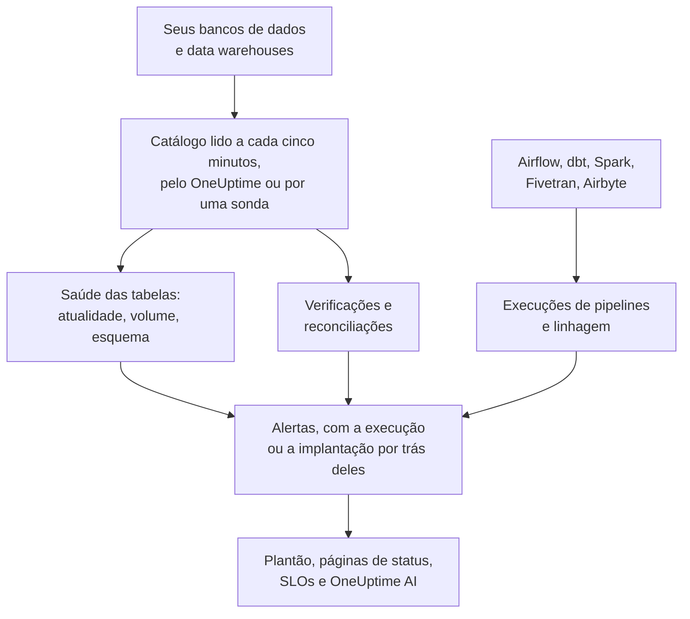

# Observabilidade de dados

A Observabilidade de dados acompanha as tabelas das quais a sua empresa depende, em PostgreSQL, MySQL, SQL Server, Oracle, MongoDB, Redshift, Snowflake, BigQuery, ClickHouse, Databricks e Athena, e avisa quando os dados delas estão atrasados, ausentes, errados ou quebrados, antes que as pessoas que os usam percebam. Ela aprende sozinha o ritmo de cada tabela, lê o catálogo de cada banco de dados e nunca uma linha, e liga cada problema de dados à execução de pipeline, à implantação ou à tabela a montante que está por trás dele.

Ela responde a quatro perguntas:

:::cards
- [Os dados estão atualizados?](/docs/data-observability/table-health): A última alteração, as linhas, o tamanho e as colunas de cada tabela, lidos a cada cinco minutos, com alertas quando uma tabela atrasa, encolhe ou muda de forma.
- [Os dados estão corretos?](/docs/data-observability/checks): Verificações do que uma tabela contém, reconciliações entre uma tabela e a sua cópia, e os testes do dbt, com alertas quando eles falham.
- [De onde eles vêm, e o que alimentam?](/docs/data-observability/lineage-and-pipelines): Linhagem a partir dos seus pipelines, do dbt, do Fivetran, do Airbyte, das views e do próprio histórico de consultas dos bancos de dados, para que um problema abra um só alerta.
- [As pessoas que os usam podem confiar neles?](/docs/data-observability/data-products): Produtos de dados com um SLA de atualização, em páginas de status e acompanhados como um SLO, com um selo "data as of".
:::

## Como funciona

1. **Conecte um banco de dados** com um login somente leitura. Um banco de dados que a Segurança de dados já conhece passa a ser observado sem que você precise fazer nada, assim como cada dataset do BigQuery que a sua conexão com o Google Cloud encontrou. Um banco de dados em uma rede privada é lido por uma sonda que você executa lá.
2. **A cada cinco minutos** o OneUptime lê o catálogo e as estatísticas de cada banco de dados: cada tabela e view, as suas colunas, linhas e tamanho, e quando ela mudou pela última vez. Nenhuma tabela é varrida e nenhuma linha é lida.
3. **O ritmo de cada tabela é aprendido**: com que frequência ela costuma mudar. Uma tabela que sai do seu ritmo está atrasada; uma cujas linhas despencam, ou cujas colunas mudam, também avisa.
4. **Alertas recomendados** transformam cada um desses sinais em um monitor que você escolhe ter, e as verificações que você adiciona leem o que uma tabela contém.
5. **Linhagem** diz quais tabelas alimentam quais, para que um alerta em uma tabela cuja origem quebrou primeiro seja uma consequência dessa origem: um só problema, não dez.

## O que a torna diferente

- **Ela faz parte do resto do OneUptime.** Um alerta de dados é um alerta comum: ele aciona quem está de plantão, abre incidentes, aparece em páginas de status e entra no cálculo dos SLOs. Os serviços que os seus traces mostram escrevendo em uma tabela, e as implantações deles, aparecem ao lado de cada alerta de tabela.
- **Nada para configurar por tabela.** Ritmos, agendamentos e durações habituais de execução são aprendidos a partir do que cada tabela e cada pipeline fazem, e um monitor recomendado para um banco de dados cobre todas as tabelas dele, inclusive as criadas depois.
- **Um alerta por causa.** Um alerta cuja tabela a montante, pipeline ou banco de dados já tem um alerta aberto entra nesse alerta como consequência dele, já confirmado, para que uma carga com falha acione alguém uma única vez.
- **O OneUptime AI conhece os seus dados.** As investigações de alertas de dados partem de quem escreve na tabela, das execuções e das tabelas a montante; pelo Pergunte à IA, pelo Slack, pelo Microsoft Teams e por agentes de IA, é possível perguntar se uma tabela está atualizada; e uma verificação pode ser escrita a partir de uma frase. Veja [OneUptime AI e a API](/docs/data-observability/ai-and-api).

## Antes de começar

- **Uma função que possa configurá-la.** As funções Proprietário do projeto, Administrador do projeto e Administrador de telemetria conectam bancos de dados. Quem pode editar ativos de dados adiciona verificações, reconciliações e produtos de dados; a função Visualizador lê o que ela encontrou. Veja [Referência de permissões](/docs/permissions/reference).
- **Um login somente leitura em cada banco de dados.** [Conectar um banco de dados](/docs/data-observability/connect) lista o mínimo de que cada mecanismo precisa.

## Início rápido

:::steps
### Conecte um banco de dados

Abra **Observabilidade de dados**, vá para **Bancos de dados** e escolha **Connect a Database**. Escolha o mecanismo e informe uma string de conexão somente leitura, ou o nome da variável de ambiente de onde a sua sonda a lê. [Conectar um banco de dados](/docs/data-observability/connect) mostra o login de cada mecanismo.

### Veja as tabelas dele

Em até cinco minutos as tabelas dele aparecem em **Tabelas**, cada uma com as suas linhas, o seu tamanho e quando mudou pela última vez. A atualidade de uma tabela é conhecida assim que ela muda duas vezes: **Fresh** enquanto mantém o seu ritmo, **Late** quando o perde.

### Adicione os alertas recomendados

Em **Bancos de dados**, escolha **Recommended Alerts** para o banco de dados e adicione os que você quiser: uma tabela atrasada, uma cujas linhas caem bruscamente ou ficam anormalmente baixas, uma cujas colunas mudam, e um banco de dados que para de reportar. Cada um é um monitor comum: plantão, proprietários, janelas de manutenção e páginas de status funcionam como em qualquer outro.
:::

## Próximos passos

:::cards
- [Conectar um banco de dados](/docs/data-observability/connect): O login com o menor privilégio de cada mecanismo, e sondas para redes privadas.
- [Saúde das tabelas](/docs/data-observability/table-health): Atualidade, volume, mudanças de esquema, tabelas não utilizadas e as métricas que cada tabela grava.
- [Verificações e reconciliações](/docs/data-observability/checks): Regras sobre os valores de uma tabela, a comparação de uma tabela com a sua cópia, e os testes do dbt.
- [Linhagem e pipelines](/docs/data-observability/lineage-and-pipelines): OpenLineage, dbt, Fivetran e Airbyte, e um alerta por causa.
- [Produtos de dados](/docs/data-observability/data-products): SLAs de atualização para as pessoas que usam os dados, em páginas de status e como SLOs.
- [OneUptime AI e a API](/docs/data-observability/ai-and-api): Investigações, uma verificação a partir de uma frase, a atualidade para agentes de IA, e cada endpoint.
:::
