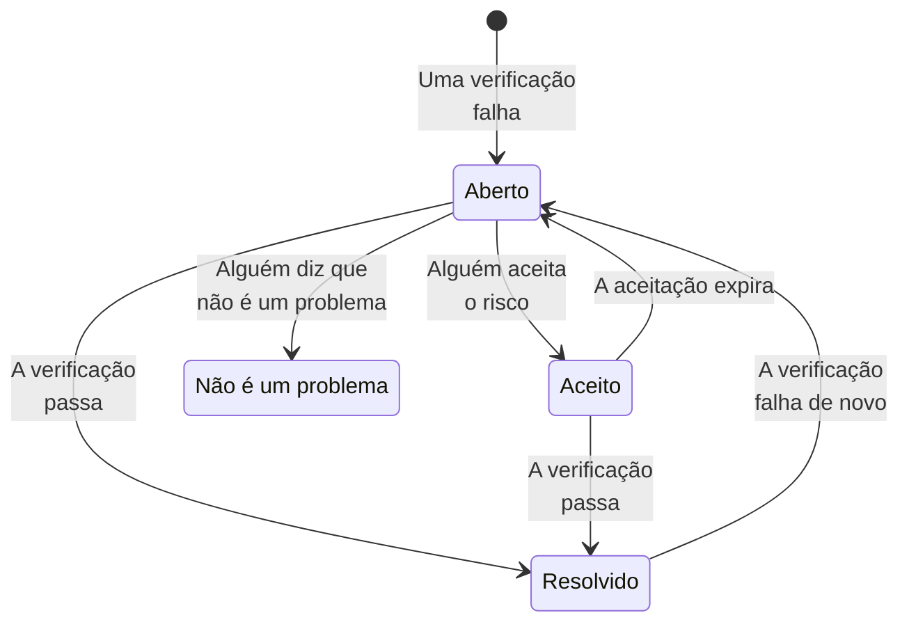

# Verificações e problemas da Segurança de dados

A Segurança de dados executa 34 verificações em cada repositório, em nove grupos. Uma verificação lê o que se sabe sobre um repositório - como ele está configurado, o que foi encontrado nele, quem pode acessá-lo, onde ele fica - e passa, falha ou não consegue determinar. Uma verificação que falha abre um problema nesse repositório, e o problema se fecha sozinho quando a verificação passa. Esta página lista cada verificação, como a gravidade e a pontuação de risco de um problema são calculadas e o que acontece com um problema ao longo da vida dele. Os eventos de segurança, Network Flows e o cofre de endereços de segurança são do próprio OneUptime, guardados para a sua segurança: declarados, nunca varridos nem verificados (veja [Repositórios que o OneUptime guarda para a sua segurança](/docs/data-security/compliance#repositórios-que-o-oneuptime-guarda-para-a-sua-segurança)).

:::cards
- [Como uma verificação decide](#como-uma-verificação-decide): Passa, falha ou não consegue determinar, e o quão grave é uma falha.
- [Todas as verificações](#todas-as-verificações): Todas as 34, com o que cada uma verifica e como corrigir.
- [Pontuação de risco](#pontuação-de-risco): Como os problemas são ordenados dentro de uma gravidade.
- [O que acontece com um problema](#o-que-acontece-com-um-problema): Aberto, resolvido, aceito, não é um problema, como cada um foi resolvido e as correções acompanhadas até a produção.
- [A análise do OneUptime AI](#a-análise-do-oneuptime-ai): Se um problema é real, o que põe em risco, o que a correção quebraria e o caminho mais curto para a correção.
- [Corrigir daqui](#corrigir-daqui): Feche uma exposição, ou ative uma proteção que falta, com um clique.
- [Problemas com uma só causa](#problemas-com-uma-só-causa): Os problemas que um mesmo erro causou, agrupados, e sua causa corrigida uma só vez.
:::

## Como uma verificação decide

Cada verificação lê fatos sobre um repositório e responde de uma de quatro formas:

| Resposta | O que significa | O que acontece com o problema |
| --- | --- | --- |
| Passa | A verificação não encontra nada de errado. | Um problema aberto ou aceito é resolvido. |
| Falha | A verificação encontra o problema e diz o que viu em uma frase: a evidência do problema. | Um problema abre, ou o que está aberto é atualizado. |
| Não consegue determinar | Um fato não pôde ser lido: uma permissão que a função não tem, uma chamada que falhou. | Nada muda: um problema aberto continua aberto, porque ninguém pode concluir que um problema foi corrigido quando o OneUptime não conseguiu olhar. |
| Não se aplica | O tipo do repositório não tem essa configuração. | Um problema aberto é resolvido. |

### A gravidade acompanha os dados

O mesmo problema importa mais em dados mais sensíveis. Cada verificação dá uma gravidade para cada nível de sensibilidade, e um problema recebe a do seu repositório: um bucket público de números de cartão é Crítico, um bucket público de imagens do site é só Baixo. Um traço significa nenhum problema. A sensibilidade de um repositório vem das descobertas dele (veja [Tipos de dados sensíveis](/docs/data-security/data-types#sensibilidade)), então as amostras de conteúdo deixam as gravidades corretas.

Algumas verificações definem a gravidade a partir do que viram. **Há segredos armazenados nele** é Alto em qualquer repositório, e Crítico em um repositório que é público ou está compartilhado com outras contas.

## Todas as verificações

A gravidade é dada para os dados de sensibilidade Restrito, Confidencial, Interno e Público, nessa ordem. A página de cada problema mostra a correção completa para o seu próprio repositório - os passos no console, o comando da CLI e, quando cabe, o Terraform - com o nome e a região do repositório preenchidos.

### Exposição

| Verificação | Executada em | O que verifica | Gravidade | Como corrigir |
| --- | --- | --- | --- | --- |
| Qualquer pessoa na internet pode lê-lo (`public-read`) | Armazenamento de objetos, Data warehouse, Pesquisa | A política, a ACL ou os vínculos do IAM do repositório permitem que qualquer pessoa leia os dados dele sem fazer login. | Crítico / Crítico / Alto / Baixo | Remova toda concessão a entidades principais anônimas ou a todas as autenticadas. Os arquivos que precisam ser públicos devem ficar em um repositório marcado como **Público por design** que não contenha mais nada. |
| Qualquer pessoa na internet pode alterá-lo (`public-write`) | Armazenamento de objetos, Data warehouse, Pesquisa | A política, a ACL ou os vínculos do IAM do repositório permitem que qualquer pessoa grave ou exclua os dados dele. | Crítico / Crítico / Crítico / Alto | Remova toda concessão de gravação ou exclusão a entidades principais anônimas ou a todas as autenticadas. |
| O acesso público não está bloqueado (`public-access-not-blocked`) | AWS S3 Bucket | O S3 Block Public Access não está totalmente ativado para o bucket ou para a conta dele, então uma única mudança de política pode torná-lo público. | Alto / Médio / Baixo / — | Ative as quatro configurações do Block Public Access para o bucket. |
| O banco de dados aceita conexões da internet (`internet-reachable`) | Banco de dados, Data warehouse, Pesquisa, Cache | O banco de dados tem um endpoint público ou o acesso de rede público ativado. | Alto / Alto / Médio / Baixo | Desative o endpoint público e acesse o banco de dados por uma rede privada ou por um bastion. |
| O firewall dele deixa entrar qualquer endereço (`open-to-all-addresses`) | Banco de dados, Data warehouse, Pesquisa, Cache | Uma regra de firewall ou uma rede autorizada permite 0.0.0.0/0 ou o intervalo de endereços inteiro. | Crítico / Crítico / Alto / Médio | Substitua a regra que permite tudo pelos endereços ou redes que precisam de acesso. |
| Um snapshot dele pode ser restaurado por qualquer pessoa (`snapshot-public`) | Banco de dados, Snapshot | Um snapshot de banco de dados está compartilhado publicamente, então qualquer conta de nuvem pode restaurar uma cópia completa. | Crítico / Crítico / Crítico / Alto | Torne o snapshot privado. |
| Um snapshot dele está compartilhado com outras contas (`snapshot-shared-externally`) | Banco de dados, Snapshot | Um snapshot de banco de dados está compartilhado com contas fora das que você conectou. | Alto / Alto / Médio / Baixo | Pare de compartilhar o snapshot com as contas que não deveriam tê-lo. |
| Contas fora da sua organização podem acessá-lo (`shared-with-external-accounts`) | Todo repositório, exceto telemetria | A política do repositório concede acesso a contas, locatários ou projetos que não estão conectados ao OneUptime. | Alto / Alto / Médio / Baixo | Revise cada entidade principal externa e remova as que não precisam de acesso. |

### Criptografia

| Verificação | Executada em | O que verifica | Gravidade | Como corrigir |
| --- | --- | --- | --- | --- |
| Os dados dele não são criptografados em repouso (`not-encrypted-at-rest`) | Todo repositório, exceto telemetria | A criptografia do armazenamento está desativada. | Alto / Médio / Baixo / — | Ative a criptografia em repouso. Uma instância RDS não pode ser criptografada no lugar: restaure uma cópia criptografada do snapshot dela. |
| Os dados Restritos não estão sob a sua própria chave (`no-customer-managed-key`) | Todo repositório, exceto telemetria | O repositório contém dados Restritos, mas é criptografado com a chave padrão do provedor, não com uma gerenciada pelo cliente. | Médio / — / — / — | Criptografe o repositório com uma chave que você gerencia no seu serviço de chaves. |
| Conexões sem criptografia são permitidas (`encryption-in-transit-not-enforced`) | Todo repositório, exceto telemetria | O repositório aceita conexões que não usam TLS. | Alto / Médio / Baixo / — | Exija TLS em toda conexão. No S3, negue toda requisição em que `aws:SecureTransport` é falso. |
| Ele aceita TLS anterior ao 1.2 (`weak-tls`) | Todo repositório, exceto telemetria | A versão mínima do TLS é 1.0 ou 1.1. | Médio / Médio / Baixo / — | Defina a versão mínima do TLS como 1.2 ou posterior. |

### Recuperação

| Verificação | Executada em | O que verifica | Gravidade | Como corrigir |
| --- | --- | --- | --- | --- |
| Ele não tem backups, ou os mantém por menos de 7 dias (`no-backups`) | Banco de dados, Data warehouse | Os backups automáticos estão desativados, ou são mantidos por menos de 7 dias. | Alto / Médio / Baixo / — | Ative os backups automáticos e mantenha-os por pelo menos 7 dias. |
| A recuperação point-in-time está desativada (`no-point-in-time-recovery`) | AWS DynamoDB Table, Azure Cosmos DB Account | A tabela ou o banco de dados não pode ser restaurado para um momento anterior a um erro. | Médio / Baixo / — / — | Ative a recuperação point-in-time. |
| Ele pode ser excluído em um único passo (`deletion-protection-off`) | Banco de dados, Data warehouse | A proteção contra exclusão está desativada. | Médio / Baixo / — / — | Ative a proteção contra exclusão. |
| Arquivos excluídos ou sobrescritos não podem ser recuperados (`deleted-data-not-recoverable`) | Armazenamento de objetos | O versionamento e a exclusão reversível estão ambos desativados. | Médio / Baixo / — / — | Ative o versionamento ou a exclusão reversível. |

### Visibilidade

| Verificação | Executada em | O que verifica | Gravidade | Como corrigir |
| --- | --- | --- | --- | --- |
| Ninguém saberia quem o leu (`access-not-logged`) | Todo repositório, exceto telemetria | As leituras do repositório não são registradas: não há logs de acesso nem logs de auditoria de acesso a dados. | Alto / Médio / Baixo / — | Ative o registro de acesso ou de auditoria para leituras: logs de acesso ao servidor do S3 ou eventos de dados do CloudTrail, logs de diagnóstico StorageRead do Azure, logs de auditoria Data Access do Cloud Storage. |

### Acesso

| Verificação | Executada em | O que verifica | Gravidade | Como corrigir |
| --- | --- | --- | --- | --- |
| Qualquer pessoa com a chave da conta pode ler tudo (`shared-key-access`) | Azure Storage Account | A conta de armazenamento permite o acesso por chave compartilhada, que ignora o Microsoft Entra ID e não deixa trilha de auditoria por pessoa. | Médio / Baixo / — / — | Migre os aplicativos para o Microsoft Entra ID e depois desative o acesso por chave da conta de armazenamento. |
| Os objetos podem ter as próprias regras de acesso (`object-acls-enabled`) | AWS S3 Bucket, Google Cloud Storage Bucket | As ACLs de objeto estão ativadas, então um objeto pode ser tornado público enquanto o bucket parece privado. | Baixo / Baixo / — / — | No S3, defina Object Ownership como Bucket owner enforced. No Cloud Storage, ative o acesso uniforme no nível do bucket. |
| Mais de 25 identidades podem ler dados Restritos (`many-readers`) | Todo repositório, exceto telemetria | Mais identidades do que a maioria das equipes consegue revisar têm acesso de leitura ao repositório. | Médio / — / — / — | Abra a página **Quem pode acessar** do repositório e remova o acesso que não é usado ou é mais amplo do que o necessário. |
| Identidades sem uso há 90 dias ainda podem acessá-lo (`unused-access`) | Todo repositório, exceto telemetria | Funções e usuários que não são usados há 90 dias ainda têm acesso aos dados sensíveis do repositório. | Médio / Baixo / — / — | Abra a página **Quem pode acessar** do repositório, onde eles aparecem marcados como **Sem uso há 90 dias**, e remova o acesso de que cada um não precisa mais. |

### Higiene de dados

| Verificação | Executada em | O que verifica | Gravidade | Como corrigir |
| --- | --- | --- | --- | --- |
| Há segredos armazenados nele (`secrets-stored`) | Todo repositório, exceto telemetria | Senhas, chaves de API, tokens ou chaves privadas foram encontrados nos dados do repositório. | Alto / Alto / Alto / Alto | Faça a rotação de cada segredo encontrado, tratando-o como vazado. Mova os segredos para um gerenciador de segredos e exclua-os do repositório. |
| Há códigos de segurança de cartão armazenados (`card-security-codes-stored`) | Todo repositório, exceto telemetria | Foram encontrados códigos CVV ou CVC. O PCI DSS proíbe guardá-los depois que um pagamento é autorizado, criptografados ou não. | Crítico / Crítico / Crítico / Crítico | Pare o código que os grava, exclua os códigos armazenados e confira se nenhum continua nos backups. |
| Há números de cartão armazenados de forma legível (`card-numbers-readable`) | Todo repositório, exceto telemetria | Foram encontrados números de cartão completos em forma legível. O PCI DSS exige que eles sejam ilegíveis onde quer que sejam armazenados. | Alto / Alto / Alto / Alto | Tokenize os números de cartão com o seu provedor de pagamentos, ou criptografe-os no nível do campo, e exclua as cópias legíveis. |
| Há senhas armazenadas em texto simples (`plaintext-passwords`) | Todo repositório, exceto telemetria | Um campo de senha contém valores que não são hashes de senha (bcrypt, argon2, scrypt ou PBKDF2). | Crítico / Crítico / Crítico / Crítico | Faça o hash das senhas com bcrypt, scrypt ou argon2, migre as armazenadas e faça todas as contas redefinirem a senha. |
| Dados de produção foram copiados para um repositório que não é de produção (`production-data-in-non-production`) | Todo repositório, exceto telemetria | Valores encontrados em um repositório de produção também foram encontrados aqui, em um repositório de desenvolvimento, teste ou staging. | Alto / Médio / — / — | Substitua a cópia por dados mascarados ou sintéticos, e exclua os dados reais do repositório que não é de produção. |
| Dados sensíveis que ninguém usou em 90 dias (`stale-sensitive-data`) | Todo repositório, exceto telemetria | O repositório contém dados sensíveis e não teve leituras nem gravações por 90 dias. | Médio / Baixo / — / — | Confirme que os dados não são mais necessários, e depois arquive-os com uma data de retenção, ou exclua-os. |
| Uma nova coluna contém dados pessoais (`new-personal-data-column`) | Todo repositório, exceto telemetria | Uma coluna adicionada nos últimos 14 dias tem um nome que diz que ela contém dados pessoais. | Alto / Alto / Médio / Médio | Confirme que a coluna deve conter esses dados, e registre o motivo. Se não deve, exclua a coluna ou pare de escrever nela. |
| Este repositório sensível não tem proprietário (`no-owner`) | Todo repositório | O repositório contém dados sensíveis e não tem proprietário. | Médio / Baixo / — / — | Adicione um proprietário na página **Proprietários** do repositório, ou uma regra de proprietário que corresponda às tags dele. |

### Telemetria

| Verificação | Executada em | O que verifica | Gravidade | Como corrigir |
| --- | --- | --- | --- | --- |
| Dados sensíveis estão chegando à sua telemetria (`sensitive-data-in-telemetry`) | Telemetria | Logs, traces, métricas, exceções, replays ou conversas de IA carregam dados sensíveis que nenhuma regra mascara na ingestão. | Alto / Médio / Baixo / — | Pressione **Limpar** em cada descoberta para mascarar os dados na ingestão, e depois corrija o código que os grava. |
| Segredos estão chegando à sua telemetria (`secrets-in-telemetry`) | Telemetria | Senhas, chaves de API ou tokens aparecem em logs, traces, métricas, exceções ou conversas de IA. | Crítico / Crítico / Crítico / Crítico | Faça a rotação do segredo primeiro, depois pressione **Limpar** e corrija o código que o grava. |

### Residência

| Verificação | Executada em | O que verifica | Gravidade | Como corrigir |
| --- | --- | --- | --- | --- |
| Os dados estão armazenados fora das regiões em que podem ficar (`residency-violation`) | Todo repositório, exceto telemetria | A região do repositório, ou uma região para a qual os dados dele são replicados, viola uma regra de residência. | Alto / Alto / Médio / — | Mova os dados para uma região permitida, ou pare de copiá-los para a outra. Se a transferência for legal, aceite o problema e registre o motivo. |

### IA

| Verificação | Executada em | O que verifica | Gravidade | Como corrigir |
| --- | --- | --- | --- | --- |
| Dados sensíveis estão sendo enviados a um provedor de IA (`sensitive-data-to-ai`) | Conversas de IA | As conversas de IA registradas no OneUptime levam dados sensíveis a um provedor de modelos. | Crítico / Alto / Baixo / — | Remova os valores sensíveis antes que os prompts sejam enviados, ou envie essas chamadas para um modelo que você hospeda. |
| Há dados Restritos em um repositório usado para IA (`sensitive-data-in-ai-store`) | Todo repositório, exceto telemetria | Um repositório marcado com tag como dados de treinamento ou de recuperação de IA contém dados Restritos. | Alto / Médio / — / — | Remova ou mascare os dados Restritos antes que eles sejam usados para treinar ou fundamentar um modelo. |

## Pontuação de risco

A gravidade diz o quão grave é um problema. A pontuação de risco, de 0 a 100, ordena os problemas de uma mesma gravidade, a partir do que torna o mesmo problema pior:

```text
risk = severity + 10 × exposure + 6 × volume + 5 × activity + 4 × production, at most 100
```

| Fator | Pontos |
| --- | --- |
| Gravidade | 75 para Crítico, 50 para Alto, 25 para Médio, 0 para Baixo |
| Exposição | 10 para Público, 8 para Outras contas, 6 para Acessível pela internet, 3 para Desconhecido, 0 para Privado |
| Volume | Até 6, pelos registros sensíveis estimados do repositório em escala logarítmica: 1 para 10 registros, 3 para 1.000, 5 para um milhão, 6 para dez milhões ou mais |
| Atividade | 5 quando o Security Operations viu detecções no repositório na última semana |
| Produção | 4 para um repositório em produção |

Os extras somam no máximo 25 pontos, então um problema nunca fica com pontuação abaixo de um problema de gravidade menor. Um bucket público de produção com um milhão de registros de dados Restritos tem pontuação 75 + 10 + 5 + 4 = 94 para um problema Crítico. Cada problema lista os fatores que aumentaram a sua pontuação, com os pontos de cada um, e o repositório mostra a pontuação do seu pior problema aberto.

O ambiente de um repositório - Produção, Staging, Desenvolvimento, Teste ou Desconhecido - vem das tags dele (`env`, `environment`, `stage`, `tier` e similares) ou, sem nenhuma, das palavras no nome dele, como `prod`, `staging`, `dev` ou `qa`. Defina-o no repositório quando nenhum dos dois o indica.

## O que acontece com um problema



O OneUptime abre, atualiza e resolve problemas à medida que as verificações rodam. O que uma pessoa faz com um problema é decidir o que acontece a seguir:

| Status | Como chega lá | O que vem depois |
| --- | --- | --- |
| **Aberto** | A verificação dele falha no repositório agora. | Ele conta na Visão geral, no resumo do repositório e na conformidade, até a verificação passar. |
| **Resolvido** | A verificação dele passou em uma execução posterior, não se aplica mais ou foi desativada, ou o repositório dele foi arquivado. Uma pessoa também pode escolher **Marcar como resolvido**: o repositório é verificado de novo na hora. | Ele diz como foi resolvido (veja abaixo). Ele abre de novo se a verificação falhar de novo, e o problema conta quantas vezes foi reaberto. |
| **Aceito** | Uma pessoa escolheu **Aceitar o risco**, com um **Motivo** e uma data em **Aceito até**, no máximo daqui a um ano. | Ele fica fechado até essa data e depois abre de novo se a verificação ainda falhar. Aceite-o de novo então, se o motivo ainda for válido. |
| **Não é um problema** | Uma pessoa escolheu **Não é um problema** e disse por quê em **Motivo**: a detecção estava errada. | Continua fechado, mesmo enquanto a verificação falha, e guarda o motivo. **Reabrir** o devolve para Aberto. |

As funções Membro de segurança, Administrador de segurança, Administrador do projeto e Proprietário do projeto podem mudar o status de um problema e **Atribuir** o problema a uma pessoa ou a uma equipe. Cada mudança é gravada na **Linha do tempo** do problema: quando ele abriu, cada mudança de gravidade, cada mudança de status e quem a fez, as reverificações pedidas e o que as integrações fizeram.

Um problema que abre de novo mantém o seu histórico. Os riscos aceitos são examinados de novo todos os dias, então uma aceitação expira na hora certa mesmo quando nada foi varrido.

### Como foi resolvido

Um problema resolvido diz como foi resolvido, no topo da página dele e na lista de problemas, que pode ser filtrada por isso em **Resolução**:

| Resolução | O que significa |
| --- | --- |
| **Corrigido no código** | O pull request de uma correção de código foi entregue, e a nova versão do serviço não grava mais os dados. O problema diz qual foi e quando: "Corrigido no pull request #482, implantado na versão 2.4.1, verificado". |
| **Corrigido no código de infraestrutura** | Um pull request para o Terraform, CloudFormation ou Bicep que declara o repositório de dados passou pelo merge, e o repositório passou na verificação assim que a mudança foi aplicada. |
| **Corrigido daqui** | Uma ação de resposta ([Corrigir daqui](#corrigir-daqui)) alterou o repositório, e a verificação dele passou depois. |
| **Contido na ingestão** | Toda descoberta de um problema de telemetria é ocultada por uma regra de limpeza antes de ser armazenada. Isso não é uma correção: o código continua gravando os dados, no stdout e em todos os outros lugares para onde o serviço envia sua telemetria. O problema diz isso em âmbar, com o que a regra alterou na última semana, e oferece **Corrigir o código**. |
| **Verificação aprovada** | A verificação dele passa sem nenhuma mudança feita pelo OneUptime. |
| **Resolvido por uma pessoa** | Alguém escolheu **Marcar como resolvido**. O repositório é verificado de novo na hora, e o problema abre de novo se a verificação ainda falhar. |
| **Não é mais verificado** | A verificação dele foi desativada ou não se aplica mais ao repositório. |
| **Repositório arquivado** | O repositório dele sumiu da origem. |

A Visão geral conta os problemas corrigidos na origem separadamente dos vazamentos apenas contidos na ingestão, e **Na sua telemetria** mantém à vista uma descoberta contida, com a marca **Limpo**, até o código parar de gravá-la.

### Correções acompanhadas até a produção

Um pull request que o OneUptime AI abriu para um problema (**Corrigir com IA**, ou um só pull request para um [grupo de problemas](#problemas-com-uma-só-causa)) ainda não corrigiu nada quando passa pelo merge. O OneUptime o acompanha até que a produção comprove a correção:

- **Um vazamento no código.** O OneUptime espera um deploy registrado do serviço que contenha o merge e então observa a nova versão dele. Onde uma regra de limpeza oculta os dados, a regra não pode alterar nenhum valor nessa versão; onde nenhuma regra faz isso, nenhuma entrada dessa versão pode conter os dados nos lugares em que foram encontrados. A nova versão também precisa rodar por um dia e enviar pelo menos tantos logs ou spans quanto a antiga enviou na hora em que o vazamento foi visto pela última vez. Então o problema fica **Corrigido no código**. Um único valor alterado, ou uma única entrada que ainda contém os dados, significa que a correção não deteve o vazamento, e de uma versão que envia pouco demais em uma semana não dá para concluir nada. Os deploys são associados pelo commit: registre-os com `oneuptime deploy` ou envie `vcs.ref.head.revision` (veja [Deploys e alterações](/docs/telemetry/change-events)).
- **A configuração de um repositório de dados.** Quando o pull request passa pelo merge, os repositórios dele são lidos de novo na hora. Cada problema cuja verificação passa depois disso fica **Corrigido no código de infraestrutura**. Quando um repositório ainda falha na verificação ao ser lido de novo um dia depois do merge, a correção ficou **mesclada, não aplicada**: os proprietários do repositório e a pessoa que pediu o pull request recebem um e-mail, uma única vez, e as linhas do tempo do problema e do repositório registram isso. Geralmente o que falta é um apply.
- **A regra de limpeza é mantida.** Depois de uma correção de código verificada, a regra de limpeza que conteve o vazamento continua, então uma regressão fica oculta assim que chega. O problema diz que a regra não alterou nada desde a correção e oferece **Remover regra**.
- **Uma regressão.** Uma correção verificada continua sendo observada depois: quando uma regra mantida volta a alterar valores, ou a varredura encontra os dados de novo, o problema abre de novo e diz qual versão os trouxe de volta. Ele fica aberto até ser corrigido de novo, mesmo enquanto uma regra oculta os dados.

Cada etapa fica na **Linha do tempo** do problema e na do repositório, e Resultados de IA conta as correções verificadas por tipo (veja [Como a OneUptime AI está se saindo](/docs/ai/ai-sre#como-a-oneuptime-ai-está-se-saindo)).

## A análise do OneUptime AI

Enquanto **Trabalhar em problemas novos** estiver ativado em **Segurança de dados → IA**, o OneUptime AI analisa sozinho cada problema novo ou reaberto de gravidade Crítica ou Alta, antes que alguém o abra; suas regras de IA de Segurança de dados podem escolher outros problemas. Qualquer problema pode ser analisado na sua página com **Analisar problema**. A análise abre a **Visão geral** do problema, em **Análise do OneUptime AI**, e responde a partir do que a Segurança de dados sabe:

- se ele é real: **Real**, **Provavelmente intencional**, **Provavelmente uma detecção errada** ou **Não é possível dizer**, e por quê;
- o que põe em risco: os dados e cerca de quantos registros, quem consegue alcançá-los, cópias deles em outros repositórios e os casos de segurança sobre eles;
- o que a correção quebraria: os serviços vistos usando o repositório, as identidades que usaram seu acesso nos últimos 90 dias e as concessões que a correção remove e que algo ainda usa;
- o caminho mais curto para a correção: o que o contém agora, o código que declara o repositório e quem deve fazer isso.

Cada linha nomeia os fatos em que se baseia, listados abaixo dela por um botão como **Mostrar os 3 fatos em que se baseia**. Uma linha que não se baseia em nenhum fato é descartada, um veredito cujo motivo não se baseia em nenhum é **Não é possível dizer**, e um repositório de dados restritos nunca é **Provavelmente intencional** só pela palavra do OneUptime AI. Uma linha que se baseia em algo que você não pode ler, como quem consegue alcançar o repositório, fica oculta para você, e diz isso.

O OneUptime AI nunca muda o problema: o status e a gravidade ficam com a verificação dele e com você. Para **Provavelmente intencional**, ele oferece **Aceitar o risco** com o motivo redigido, e **Público por design** para um repositório público; para **Provavelmente uma detecção errada**, **Não é um problema** com o motivo redigido. Nada muda até você escolher.

A análise fica guardada no problema, com uma entrada na **Linha do tempo** dele a cada vez que é escrita, no idioma que a maioria dos membros do seu projeto escolheu (**Analisar novamente** a escreve no seu). Ela só é escrita de novo quando muda aquilo em que se baseia, então abrir o problema não pergunta nada ao OneUptime AI; **Analisar novamente** pergunta mesmo assim. **Problemas** filtra e mostra os problemas por **Veredito do OneUptime AI**. O que ela envia, e nunca envia, está em [OneUptime AI na Segurança de dados](/docs/data-security/ai). Com a IA desativada, não há análise.

## Corrigir daqui

Um problema aberto que uma única mudança nas configurações de um repositório corrige - um bucket público, um snapshot compartilhado, um bucket cujos arquivos excluídos não podem ser recuperados - pode ser corrigido a partir da página dele. Acima dos passos no console, **Corrigir daqui** oferece a mudança que o corrige:

| O problema | O repositório dele | O botão | O que ele muda |
| --- | --- | --- | --- |
| `public-read`, `public-write` ou `public-access-not-blocked` | Um bucket do S3, uma conta de armazenamento do Azure ou um bucket do Cloud Storage | **Bloquear acesso público** | Ativa as quatro configurações do Block Public Access do bucket, desativa o acesso anônimo a blobs da conta de armazenamento ou impõe a prevenção de acesso público do bucket |
| `snapshot-public` ou `snapshot-shared-externally` | Um snapshot do RDS, um banco de dados RDS, ou um cluster Aurora ou DocumentDB | **Revogar compartilhamento** | Para de compartilhar o snapshot, ou cada snapshot manual compartilhado do banco de dados, com todos e com contas fora das que você conectou |
| `deleted-data-not-recoverable` | Um bucket do S3 ou um bucket do Cloud Storage | **Ativar o versionamento** | Guarda a versão anterior de cada objeto sobrescrito ou excluído, até que uma regra de ciclo de vida a remova |
| `deleted-data-not-recoverable` | Uma conta de armazenamento do Azure | **Ativar a exclusão reversível** | Guarda blobs e contêineres excluídos por 14 dias, para que possam ser restaurados |
| `object-acls-enabled` | Um bucket do S3 | **Desativar as ACLs de objeto** | Define Object Ownership como Bucket owner enforced, para que só a política do bucket decida quem o lê |
| `object-acls-enabled` | Um bucket do Cloud Storage | **Ativar o acesso uniforme** | Ativa o acesso uniforme no nível do bucket, para que só a política do IAM do bucket decida quem o lê |
| `encryption-in-transit-not-enforced` ou `weak-tls` | Uma conta de armazenamento do Azure | **Exigir transferência segura** | Ativa a transferência segura e define a versão mínima do TLS como 1.2, para que a conta aceite só HTTPS com TLS 1.2 ou posterior |
| `no-point-in-time-recovery` | Uma tabela do DynamoDB | **Ativar a recuperação pontual** | Permite restaurar a tabela a qualquer segundo dos últimos 35 dias |

Ele pergunta primeiro, dizendo o que muda, o que para de funcionar e quanto custa. Ele muda as configurações do repositório, nunca os dados dele, e não muda nada que já esteja como deveria. Um repositório marcado como **Público por design** nunca é bloqueado.

Ele age pela conexão de nuvem do repositório, então a conexão precisa de **Resposta de segurança de dados** ativada e do comando de configuração dela executado de novo (veja [Configurar a Segurança de dados](/docs/data-security/setup#deixe-a-segurança-de-dados-fechar-uma-exposição)). Até lá, o painel diz o que ativar. O repositório é verificado de novo logo depois, e o problema se resolve sozinho quando a verificação dele passa. A **Linha do tempo** do problema e a **Linha do tempo** do repositório dizem o que foi feito, e quem fez.

## Problemas com uma só causa

Um módulo do Terraform que desativa os logs de acesso cria quarenta buckets com quarenta problemas. A segurança de dados reúne os problemas que um mesmo erro causou, para que a causa seja corrigida uma só vez.

**Agrupar por causa** em **Problemas** mostra cada grupo acima da lista: "40 problemas, uma só causa: o módulo static-site", o que sua verificação encontra, quantos estão corrigidos e quantos restam. Seus repositórios de dados se abrem abaixo dele, cada um com um link para o seu problema, e os filtros da lista os restringem como restringem as linhas. Os problemas sem grupo aparecem abaixo dos grupos. O agrupamento começa ativado quando um grupo tem cinco problemas, e o seu navegador guarda a sua escolha.

São os fatos que formam um grupo, nunca o OneUptime AI. Problemas de uma mesma verificação, em repositórios de dados de uma mesma nuvem, formam um grupo quando seus repositórios compartilham um destes fatos, do mais forte ao mais fraco:

| Fato | Onde é lido |
| --- | --- |
| O código que os declara | Um arquivo de um repositório conectado com o nome do módulo ou da stack que suas tags nomeiam |
| A stack deles | A tag própria da stack do CloudFormation, ou uma tag que nomeia uma stack |
| Uma tag | Uma tag que nomeia o módulo, a stack ou o componente que os criou, como `module` ou `component` |
| Quem os criou | A identidade que os criou segundo o log de alterações da nuvem, para repositórios cujas tags não nomeiam nada do que os criou |
| Um padrão de nome | Uma parte dos nomes deles que poucos outros repositórios têm, como `static-site-*` |

Um grupo tem pelo menos dois problemas, um problema está em no máximo um grupo, e um problema fica no seu grupo enquanto seu repositório de dados compartilha o fato do grupo. Enquanto **Trabalhar em problemas novos** estiver ativado em **Segurança de dados → IA**, o OneUptime AI dá nome a cada grupo a partir dos seus fatos, como "o módulo static-site desativa os logs de acesso", e um nome que diz algo que os fatos não dizem não é mantido. Caso contrário, o grupo leva o nome do seu fato.

**Corrigir a causa** em um grupo diz o que muda, o que fica de fora e por quê, antes que algo mude:

- **Um só pull request**, para os repositórios de dados declarados como código: o OneUptime AI altera o módulo ou arquivo que os declara, no repositório que você confirmar, em vez de cada repositório de dados. O pull request lista cada repositório de dados e cada problema que corrige, e aparece em **Código** e na **Linha do tempo** de cada problema. Ele exige o mesmo que **Corrigir com IA**: permissão para alterar problemas de segurança de dados e um repositório em que o OneUptime AI possa trabalhar.
- **Uma só aprovação**, para os repositórios de dados criados no console: a mudança que [Corrigir daqui](#corrigir-daqui) faz, em cada um deles pela sua conexão de nuvem. Ela exige permissão para editar repositórios de dados.
- **Deixados de fora**: um repositório marcado como **Público por design** nunca é bloqueado. Um repositório cuja análise diz que a correção tiraria um acesso que algo ainda usa espera você marcar **Corrigir mesmo assim**. Um repositório que nenhuma conexão de nuvem deixa a segurança de dados alterar fica para o seu console, com o motivo.

Quando um grupo tem os dois tipos de repositório, um só clique faz as duas partes, e qualquer uma pode ficar de fora. Cada problema se resolve sozinho assim que sua verificação passa, e o grupo diz quantos restam até não restar nenhum. Um grupo com todos os problemas corrigidos fica na lista por sete dias.

O OneUptime AI propõe a correção de cada grupo como dizem suas regras de IA de segurança de dados: sem regras, o pull request espera por você em **Segurança de dados → IA**, e uma regra cuja **Correção** é **Sem perguntar** o abre sozinha. Uma mudança pelas conexões de nuvem sempre espera por você. Em um caso de segurança de dados, a etapa **Fix the code with AI** de um playbook pede o pull request do grupo do caso. Um problema de um grupo diz isso em **Análise do OneUptime AI**, com **Corrigir a causa**.

Só quem lê os problemas de segurança de dados de todo o projeto vê os grupos: um grupo nomeia repositórios de dados que uma leitura limitada a rótulos não pode alcançar.

## Onde os dados de um problema de telemetria foram encontrados

Um problema de telemetria - **Dados sensíveis estão chegando à sua telemetria** ou **Segredos estão chegando à sua telemetria** - nomeia em sua evidência cada tipo de dado que nenhuma regra de limpeza mascara, por exemplo "2 kinds of sensitive data are not scrubbed: IP address, Ireland PPS number." Sua página mostra onde cada um está, em **Onde foi encontrado**:

- **O que e onde.** Cada tipo de dado com sua sensibilidade e o lugar da telemetria em que ele está: um atributo como `attributes.user.pps`, o corpo de uma linha de log, a mensagem de uma exceção, um prompt. Abaixo, quantos dos valores amostrados corresponderam, quando uma varredura o viu pela última vez e suas amostras mascaradas. O serviço, ou o aplicativo RUM, leva aos seus registros, traços, métricas, exceções ou reproduções de sessões.
- **As entradas em que os dados foram vistos.** **Mostrar as entradas em que foram vistos** mostra exatamente as entradas em que a última varredura encontrou os dados - cada varredura guarda até 10 delas com a descoberta - ou, para uma descoberta de antes de as varreduras as guardarem, as entradas gravadas na hora que essa varredura leu. Cada uma mostra sua linha - uma linha de log, o atributo de um span, a mensagem de uma exceção, um prompt - recortada ao redor dos dados, que aparecem destacados, com cada valor sensível mascarado como as amostras de uma descoberta, e diz o que é a entrada (uma linha de log e sua gravidade, um span e seu nome, uma exceção e seu tipo, uma chamada de IA, uma sessão, o ponto de dados de uma métrica e sua métrica), quando foi gravada e qual serviço a enviou. Cada uma abre onde o OneUptime já a mostra: **Abrir o traço** centraliza a visão do traço no span, **Abrir em Registros** abre essa mesma linha no explorador de logs, acima das linhas do span dela nos minutos ao redor, **Abrir exceção** mostra o grupo da exceção, **Abrir a reprodução da sessão** reproduz a sessão e **Abrir em Métricas** abre o explorador de métricas na métrica do ponto, agrupada pelo atributo em que os dados estão. As três primeiras entradas aparecem, o resto está a um clique, e a primeira descoberta mostra suas entradas quando a página abre. Quando a retenção da telemetria não as mantém mais, a descoberta diz isso e mostra suas amostras mascaradas no lugar.
- **Limpar.** Ao lado de cada descoberta ainda não mascarada, **Limpar** cria a regra que a mascara na ingestão (veja [Limpar](/docs/data-security/telemetry#limpar)). Onde nenhuma regra consegue mascará-la, como no nome de uma métrica ou nos detalhes da própria sessão, ele diz por quê. No nome de uma métrica, **Descartar esta métrica** pode parar de armazenar essas métricas até que o código seja corrigido (veja [Descartar esta métrica](/docs/data-security/telemetry#descartar-esta-métrica)). Uma descoberta já limpa continua na lista, marcada como **Limpo** (**Descartadas** no nome de uma métrica), para você ver o que falta. O problema se resolve sozinho assim que toda descoberta por trás dele for limpa e o repositório for verificado novamente.

**Segurança de dados > Na sua telemetria** lista as descobertas da telemetria de todos os serviços, primeiro as que nenhuma regra mascara. O botão **Mostrar entradas** de cada linha abre as mesmas entradas ao lado da lista, com **Limpar** abaixo delas, para quem pode ler amostras mascaradas.

A lista contém as descobertas que a verificação conta: as de confiança pelo menos média que corresponderam a um valor, ou que uma pessoa confirmou, vistas nos últimos 30 dias e não marcadas como não sensíveis. Aqui um valor nunca é mostrado por completo: abra a entrada para vê-lo, o que exige a mesma permissão de ler essa telemetria em qualquer outro lugar. Assim, as entradas são mostradas a quem pode ler amostras mascaradas - Membros de segurança e acima - e pode ler os logs, traços, métricas, exceções ou sessões desse serviço; os Visualizadores de segurança veem o que foi encontrado e onde, sem amostras nem entradas. Um valor que é só um valor de teste, um valor que o projeto permite ou um que uma regra de limpeza já mascarou na ingestão não é uma correspondência.

## Configurações das verificações

**Segurança de dados → Configurações → Verificações** lista cada verificação por grupo, com o que ela procura e a gravidade que uma falha recebe para cada sensibilidade. Cada verificação pode ser ajustada para o projeto, e cada mudança é salva na hora:

- **O interruptor dela** desativa a verificação, quando ela não se encaixa na sua forma de trabalhar. Os problemas abertos e aceitos dela são resolvidos, e dizem que a verificação não é mais executada.
- **A gravidade dela** é **Por sensibilidade**, como vem por padrão, ou uma única gravidade que toda falha da verificação recebe, seja o que for que o repositório dela contenha.

Para silenciar uma verificação em um único repositório, aceite o risco no problema desse repositório, ou marque o problema como não sendo um problema. Para uma descoberta que está errada, e não um problema que não importa, marque a descoberta como não sensível (veja [Tipos de dados sensíveis](/docs/data-security/data-types#não-sensível-e-nunca-sensível)).

**Verificar agora** em um repositório lê a configuração dele de novo e executa as verificações dele. **Varrer agora** amostra o conteúdo dele, e as verificações dele rodam quando a varredura termina.

## Próximos passos

:::cards
- [Integrações da Segurança de dados](/docs/data-security/integrations): Casos de segurança, alertas e e-mails aos proprietários quando um problema abre.
- [Fluxos de dados, acesso e residência](/docs/data-security/flows-access-residency): O acesso, as cópias e as regiões que várias verificações leem.
- [Conformidade da Segurança de dados](/docs/data-security/compliance): Os requisitos de estruturas de conformidade dos quais cada verificação é evidência.
:::
