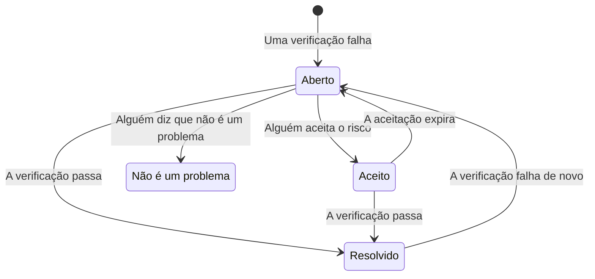

# Verificações e problemas da Segurança de dados

A Segurança de dados executa 32 verificações em cada repositório, em nove grupos. Uma verificação lê o que se sabe sobre um repositório - como ele está configurado, o que foi encontrado nele, quem pode acessá-lo, onde ele fica - e passa, falha ou não consegue determinar. Uma verificação que falha abre um problema nesse repositório, e o problema se fecha sozinho quando a verificação passa. Esta página lista cada verificação, como a gravidade e a pontuação de risco de um problema são calculadas e o que acontece com um problema ao longo da vida dele.

:::cards
- [Como uma verificação decide](#como-uma-verificação-decide): Passa, falha ou não consegue determinar, e o quão grave é uma falha.
- [Todas as verificações](#todas-as-verificações): Todas as 32, com o que cada uma verifica e como corrigir.
- [Pontuação de risco](#pontuação-de-risco): Como os problemas são ordenados dentro de uma gravidade.
- [O que acontece com um problema](#o-que-acontece-com-um-problema): Aberto, resolvido, aceito, não é um problema.
- [Corrigir daqui](#corrigir-daqui): Bloqueie um bucket público, ou pare de compartilhar um snapshot, com um clique.
:::

## Como uma verificação decide

Cada verificação lê fatos sobre um repositório e responde de uma de quatro formas:

| Resposta | O que significa | O que acontece com o problema |
| --- | --- | --- |
| Passa | A verificação não encontra nada de errado. | Um problema aberto ou aceito é resolvido. |
| Falha | A verificação encontra o problema e diz o que viu em uma frase: a evidência do problema. | Um problema abre, ou o que está aberto é atualizado. |
| Não consegue determinar | Um fato não pôde ser lido: uma permissão que a função não tem, uma chamada que falhou. | Nada muda: um problema aberto continua aberto, porque ninguém pode concluir que um problema foi corrigido quando o OneUptime não conseguiu olhar. |
| Não se aplica | O tipo do repositório não tem essa configuração. | Um problema aberto é resolvido. |

### A gravidade acompanha os dados

O mesmo problema importa mais em dados mais sensíveis. Cada verificação dá uma gravidade para cada nível de sensibilidade, e um problema recebe a do seu repositório: um bucket público de números de cartão é Crítico, um bucket público de imagens do site é só Baixo. Um traço significa nenhum problema. A sensibilidade de um repositório vem das descobertas dele (veja [Tipos de dados sensíveis](/docs/data-security/data-types#sensibilidade)), então as amostras de conteúdo deixam as gravidades corretas.

Algumas verificações definem a gravidade a partir do que viram. **Há segredos armazenados nele** é Alto em qualquer repositório, e Crítico em um repositório que é público ou está compartilhado com outras contas.

## Todas as verificações

A gravidade é dada para os dados de sensibilidade Restrito, Confidencial, Interno e Público, nessa ordem. A página de cada problema mostra a correção completa para o seu próprio repositório - os passos no console, o comando da CLI e, quando cabe, o Terraform - com o nome e a região do repositório preenchidos.

### Exposição

| Verificação | Executada em | O que verifica | Gravidade | Como corrigir |
| --- | --- | --- | --- | --- |
| Qualquer pessoa na internet pode lê-lo (`public-read`) | Armazenamento de objetos, Data warehouse, Pesquisa | A política, a ACL ou os vínculos do IAM do repositório permitem que qualquer pessoa leia os dados dele sem fazer login. | Crítico / Crítico / Alto / Baixo | Remova toda concessão a entidades principais anônimas ou a todas as autenticadas. Os arquivos que precisam ser públicos devem ficar em um repositório marcado como **Público por design** que não contenha mais nada. |
| Qualquer pessoa na internet pode alterá-lo (`public-write`) | Armazenamento de objetos, Data warehouse, Pesquisa | A política, a ACL ou os vínculos do IAM do repositório permitem que qualquer pessoa grave ou exclua os dados dele. | Crítico / Crítico / Crítico / Alto | Remova toda concessão de gravação ou exclusão a entidades principais anônimas ou a todas as autenticadas. |
| O acesso público não está bloqueado (`public-access-not-blocked`) | AWS S3 Bucket | O S3 Block Public Access não está totalmente ativado para o bucket ou para a conta dele, então uma única mudança de política pode torná-lo público. | Alto / Médio / Baixo / — | Ative as quatro configurações do Block Public Access para o bucket. |
| O banco de dados aceita conexões da internet (`internet-reachable`) | Banco de dados, Data warehouse, Pesquisa, Cache | O banco de dados tem um endpoint público ou o acesso de rede público ativado. | Alto / Alto / Médio / Baixo | Desative o endpoint público e acesse o banco de dados por uma rede privada ou por um bastion. |
| O firewall dele deixa entrar qualquer endereço (`open-to-all-addresses`) | Banco de dados, Data warehouse, Pesquisa, Cache | Uma regra de firewall ou uma rede autorizada permite 0.0.0.0/0 ou o intervalo de endereços inteiro. | Crítico / Crítico / Alto / Médio | Substitua a regra que permite tudo pelos endereços ou redes que precisam de acesso. |
| Um snapshot dele pode ser restaurado por qualquer pessoa (`snapshot-public`) | Banco de dados, Snapshot | Um snapshot de banco de dados está compartilhado publicamente, então qualquer conta de nuvem pode restaurar uma cópia completa. | Crítico / Crítico / Crítico / Alto | Torne o snapshot privado. |
| Um snapshot dele está compartilhado com outras contas (`snapshot-shared-externally`) | Banco de dados, Snapshot | Um snapshot de banco de dados está compartilhado com contas fora das que você conectou. | Alto / Alto / Médio / Baixo | Pare de compartilhar o snapshot com as contas que não deveriam tê-lo. |
| Contas fora da sua organização podem acessá-lo (`shared-with-external-accounts`) | Todo repositório, exceto telemetria | A política do repositório concede acesso a contas, locatários ou projetos que não estão conectados ao OneUptime. | Alto / Alto / Médio / Baixo | Revise cada entidade principal externa e remova as que não precisam de acesso. |

### Criptografia

| Verificação | Executada em | O que verifica | Gravidade | Como corrigir |
| --- | --- | --- | --- | --- |
| Os dados dele não são criptografados em repouso (`not-encrypted-at-rest`) | Todo repositório, exceto telemetria | A criptografia do armazenamento está desativada. | Alto / Médio / Baixo / — | Ative a criptografia em repouso. Uma instância RDS não pode ser criptografada no lugar: restaure uma cópia criptografada do snapshot dela. |
| Os dados Restritos não estão sob a sua própria chave (`no-customer-managed-key`) | Todo repositório, exceto telemetria | O repositório contém dados Restritos, mas é criptografado com a chave padrão do provedor, não com uma gerenciada pelo cliente. | Médio / — / — / — | Criptografe o repositório com uma chave que você gerencia no seu serviço de chaves. |
| Conexões sem criptografia são permitidas (`encryption-in-transit-not-enforced`) | Todo repositório, exceto telemetria | O repositório aceita conexões que não usam TLS. | Alto / Médio / Baixo / — | Exija TLS em toda conexão. No S3, negue toda requisição em que `aws:SecureTransport` é falso. |
| Ele aceita TLS anterior ao 1.2 (`weak-tls`) | Todo repositório, exceto telemetria | A versão mínima do TLS é 1.0 ou 1.1. | Médio / Médio / Baixo / — | Defina a versão mínima do TLS como 1.2 ou posterior. |

### Recuperação

| Verificação | Executada em | O que verifica | Gravidade | Como corrigir |
| --- | --- | --- | --- | --- |
| Ele não tem backups, ou os mantém por menos de 7 dias (`no-backups`) | Banco de dados, Data warehouse | Os backups automáticos estão desativados, ou são mantidos por menos de 7 dias. | Alto / Médio / Baixo / — | Ative os backups automáticos e mantenha-os por pelo menos 7 dias. |
| A recuperação point-in-time está desativada (`no-point-in-time-recovery`) | AWS DynamoDB Table, Azure Cosmos DB Account | A tabela ou o banco de dados não pode ser restaurado para um momento anterior a um erro. | Médio / Baixo / — / — | Ative a recuperação point-in-time. |
| Ele pode ser excluído em um único passo (`deletion-protection-off`) | Banco de dados, Data warehouse | A proteção contra exclusão está desativada. | Médio / Baixo / — / — | Ative a proteção contra exclusão. |
| Arquivos excluídos ou sobrescritos não podem ser recuperados (`deleted-data-not-recoverable`) | Armazenamento de objetos | O versionamento e a exclusão reversível estão ambos desativados. | Médio / Baixo / — / — | Ative o versionamento ou a exclusão reversível. |

### Visibilidade

| Verificação | Executada em | O que verifica | Gravidade | Como corrigir |
| --- | --- | --- | --- | --- |
| Ninguém saberia quem o leu (`access-not-logged`) | Todo repositório, exceto telemetria | As leituras do repositório não são registradas: não há logs de acesso nem logs de auditoria de acesso a dados. | Alto / Médio / Baixo / — | Ative o registro de acesso ou de auditoria para leituras: logs de acesso ao servidor do S3 ou eventos de dados do CloudTrail, logs de diagnóstico StorageRead do Azure, logs de auditoria Data Access do Cloud Storage. |

### Acesso

| Verificação | Executada em | O que verifica | Gravidade | Como corrigir |
| --- | --- | --- | --- | --- |
| Qualquer pessoa com a chave da conta pode ler tudo (`shared-key-access`) | Azure Storage Account | A conta de armazenamento permite o acesso por chave compartilhada, que ignora o Microsoft Entra ID e não deixa trilha de auditoria por pessoa. | Médio / Baixo / — / — | Migre os aplicativos para o Microsoft Entra ID e depois desative o acesso por chave da conta de armazenamento. |
| Os objetos podem ter as próprias regras de acesso (`object-acls-enabled`) | AWS S3 Bucket, Google Cloud Storage Bucket | As ACLs de objeto estão ativadas, então um objeto pode ser tornado público enquanto o bucket parece privado. | Baixo / Baixo / — / — | No S3, defina Object Ownership como Bucket owner enforced. No Cloud Storage, ative o acesso uniforme no nível do bucket. |
| Mais de 25 identidades podem ler dados Restritos (`many-readers`) | Todo repositório, exceto telemetria | Mais identidades do que a maioria das equipes consegue revisar têm acesso de leitura ao repositório. | Médio / — / — / — | Abra a página **Quem pode acessar** do repositório e remova o acesso que não é usado ou é mais amplo do que o necessário. |

### Higiene de dados

| Verificação | Executada em | O que verifica | Gravidade | Como corrigir |
| --- | --- | --- | --- | --- |
| Há segredos armazenados nele (`secrets-stored`) | Todo repositório, exceto telemetria | Senhas, chaves de API, tokens ou chaves privadas foram encontrados nos dados do repositório. | Alto / Alto / Alto / Alto | Faça a rotação de cada segredo encontrado, tratando-o como vazado. Mova os segredos para um gerenciador de segredos e exclua-os do repositório. |
| Há códigos de segurança de cartão armazenados (`card-security-codes-stored`) | Todo repositório, exceto telemetria | Foram encontrados códigos CVV ou CVC. O PCI DSS proíbe guardá-los depois que um pagamento é autorizado, criptografados ou não. | Crítico / Crítico / Crítico / Crítico | Pare o código que os grava, exclua os códigos armazenados e confira se nenhum continua nos backups. |
| Há números de cartão armazenados de forma legível (`card-numbers-readable`) | Todo repositório, exceto telemetria | Foram encontrados números de cartão completos em forma legível. O PCI DSS exige que eles sejam ilegíveis onde quer que sejam armazenados. | Alto / Alto / Alto / Alto | Tokenize os números de cartão com o seu provedor de pagamentos, ou criptografe-os no nível do campo, e exclua as cópias legíveis. |
| Há senhas armazenadas em texto simples (`plaintext-passwords`) | Todo repositório, exceto telemetria | Um campo de senha contém valores que não são hashes de senha (bcrypt, argon2, scrypt ou PBKDF2). | Crítico / Crítico / Crítico / Crítico | Faça o hash das senhas com bcrypt, scrypt ou argon2, migre as armazenadas e faça todas as contas redefinirem a senha. |
| Dados de produção foram copiados para um repositório que não é de produção (`production-data-in-non-production`) | Todo repositório, exceto telemetria | Valores encontrados em um repositório de produção também foram encontrados aqui, em um repositório de desenvolvimento, teste ou staging. | Alto / Médio / — / — | Substitua a cópia por dados mascarados ou sintéticos, e exclua os dados reais do repositório que não é de produção. |
| Dados sensíveis que ninguém usou em 90 dias (`stale-sensitive-data`) | Todo repositório, exceto telemetria | O repositório contém dados sensíveis e não teve leituras nem gravações por 90 dias. | Médio / Baixo / — / — | Confirme que os dados não são mais necessários, e depois arquive-os com uma data de retenção, ou exclua-os. |
| Este repositório sensível não tem proprietário (`no-owner`) | Todo repositório | O repositório contém dados sensíveis e não tem proprietário. | Médio / Baixo / — / — | Adicione um proprietário na página **Proprietários** do repositório, ou uma regra de proprietário que corresponda às tags dele. |

### Telemetria

| Verificação | Executada em | O que verifica | Gravidade | Como corrigir |
| --- | --- | --- | --- | --- |
| Dados sensíveis estão chegando à sua telemetria (`sensitive-data-in-telemetry`) | Telemetria | Logs, traces, exceções, replays ou conversas de IA carregam dados sensíveis que nenhuma regra de limpeza mascara. | Alto / Médio / Baixo / — | Pressione **Limpar** em cada descoberta para mascarar os dados na ingestão, e depois corrija o código que os grava. |
| Segredos estão chegando à sua telemetria (`secrets-in-telemetry`) | Telemetria | Senhas, chaves de API ou tokens aparecem em logs, traces, exceções ou conversas de IA. | Crítico / Crítico / Crítico / Crítico | Faça a rotação do segredo primeiro, depois pressione **Limpar** e corrija o código que o grava. |

### Residência

| Verificação | Executada em | O que verifica | Gravidade | Como corrigir |
| --- | --- | --- | --- | --- |
| Os dados estão armazenados fora das regiões em que podem ficar (`residency-violation`) | Todo repositório, exceto telemetria | A região do repositório, ou uma região para a qual os dados dele são replicados, viola uma regra de residência. | Alto / Alto / Médio / — | Mova os dados para uma região permitida, ou pare de copiá-los para a outra. Se a transferência for legal, aceite o problema e registre o motivo. |

### IA

| Verificação | Executada em | O que verifica | Gravidade | Como corrigir |
| --- | --- | --- | --- | --- |
| Dados sensíveis estão sendo enviados a um provedor de IA (`sensitive-data-to-ai`) | Conversas de IA | As conversas de IA registradas no OneUptime levam dados sensíveis a um provedor de modelos. | Crítico / Alto / Baixo / — | Remova os valores sensíveis antes que os prompts sejam enviados, ou envie essas chamadas para um modelo que você hospeda. |
| Há dados Restritos em um repositório usado para IA (`sensitive-data-in-ai-store`) | Todo repositório, exceto telemetria | Um repositório marcado com tag como dados de treinamento ou de recuperação de IA contém dados Restritos. | Alto / Médio / — / — | Remova ou mascare os dados Restritos antes que eles sejam usados para treinar ou fundamentar um modelo. |

## Pontuação de risco

A gravidade diz o quão grave é um problema. A pontuação de risco, de 0 a 100, ordena os problemas de uma mesma gravidade, a partir do que torna o mesmo problema pior:

```text
risk = severity + 10 × exposure + 6 × volume + 5 × activity + 4 × production, at most 100
```

| Fator | Pontos |
| --- | --- |
| Gravidade | 75 para Crítico, 50 para Alto, 25 para Médio, 0 para Baixo |
| Exposição | 10 para Público, 8 para Outras contas, 6 para Acessível pela internet, 3 para Desconhecido, 0 para Privado |
| Volume | Até 6, pelos registros sensíveis estimados do repositório em escala logarítmica: 1 para 10 registros, 3 para 1.000, 5 para um milhão, 6 para dez milhões ou mais |
| Atividade | 5 quando o Security Operations viu detecções no repositório na última semana |
| Produção | 4 para um repositório em produção |

Os extras somam no máximo 25 pontos, então um problema nunca fica com pontuação abaixo de um problema de gravidade menor. Um bucket público de produção com um milhão de registros de dados Restritos tem pontuação 75 + 10 + 5 + 4 = 94 para um problema Crítico. Cada problema lista os fatores que aumentaram a sua pontuação, com os pontos de cada um, e o repositório mostra a pontuação do seu pior problema aberto.

O ambiente de um repositório - Produção, Staging, Desenvolvimento, Teste ou Desconhecido - vem das tags dele (`env`, `environment`, `stage`, `tier` e similares) ou, sem nenhuma, das palavras no nome dele, como `prod`, `staging`, `dev` ou `qa`. Defina-o no repositório quando nenhum dos dois o indica.

## O que acontece com um problema



O OneUptime abre, atualiza e resolve problemas à medida que as verificações rodam. O que uma pessoa faz com um problema é decidir o que acontece a seguir:

| Status | Como chega lá | O que vem depois |
| --- | --- | --- |
| **Aberto** | A verificação dele falha no repositório agora. | Ele conta na Visão geral, no resumo do repositório e na conformidade, até a verificação passar. |
| **Resolvido** | A verificação dele passou em uma execução posterior, não se aplica mais ou foi desativada. Uma pessoa também pode escolher **Marcar como resolvido**: o repositório é verificado de novo na hora. | Ele abre de novo se a verificação falhar de novo, e o problema conta quantas vezes foi reaberto. |
| **Aceito** | Uma pessoa escolheu **Aceitar o risco**, com um **Motivo** e uma data em **Aceito até**, no máximo daqui a um ano. | Ele fica fechado até essa data e depois abre de novo se a verificação ainda falhar. Aceite-o de novo então, se o motivo ainda for válido. |
| **Não é um problema** | Uma pessoa escolheu **Não é um problema**: a descoberta estava errada. | Ele fica fechado, mesmo enquanto a verificação falha. **Reabrir** o devolve para Aberto. |

As funções Security Member, Security Admin, Project Admin e Project Owner podem mudar o status de um problema e **Atribuir** o problema a uma pessoa ou a uma equipe. Cada mudança é gravada na **Linha do tempo** do problema: quando ele abriu, cada mudança de gravidade, cada mudança de status e quem a fez, as reverificações pedidas e o que as integrações fizeram.

Um problema que abre de novo mantém o seu histórico. Os riscos aceitos são examinados de novo todos os dias, então uma aceitação expira na hora certa mesmo quando nada foi varrido.

## Corrigir daqui

Um problema aberto sobre um bucket público ou um snapshot compartilhado pode ser corrigido a partir da página dele. Acima dos passos no console, **Corrigir daqui** oferece a mudança que o corrige:

| O problema | O repositório dele | O botão | O que ele muda |
| --- | --- | --- | --- |
| `public-read`, `public-write` ou `public-access-not-blocked` | Um bucket do S3, uma conta de armazenamento do Azure ou um bucket do Cloud Storage | **Bloquear acesso público** | Ativa as quatro configurações do Block Public Access do bucket, desativa o acesso anônimo a blobs da conta de armazenamento ou impõe a prevenção de acesso público do bucket |
| `snapshot-public` ou `snapshot-shared-externally` | Um snapshot do RDS, um banco de dados RDS, ou um cluster Aurora ou DocumentDB | **Revogar compartilhamento** | Para de compartilhar o snapshot, ou cada snapshot manual compartilhado do banco de dados, com todos e com contas fora das que você conectou |

Ele pergunta primeiro, dizendo o que muda e o que para de funcionar. Ele muda como o repositório é compartilhado, nunca os dados dele, e não muda nada que já esteja fechado. Um repositório marcado como **Público por design** nunca é bloqueado.

Ele age pela conexão de nuvem do repositório, então a conexão precisa de **Resposta de segurança de dados** ativada e do comando de configuração dela executado de novo (veja [Configurar a Segurança de dados](/docs/data-security/setup#deixe-a-segurança-de-dados-fechar-uma-exposição)). Até lá, o painel diz o que ativar. O repositório é verificado de novo logo depois, e o problema se resolve sozinho quando a verificação dele passa. A **Linha do tempo** do problema e a **Linha do tempo** do repositório dizem o que foi feito, e quem fez.

## Configurações das verificações

**Segurança de dados → Configurações → Verificações** lista cada verificação por grupo, com o que ela procura e a gravidade que uma falha recebe para cada sensibilidade. Cada verificação pode ser ajustada para o projeto, e cada mudança é salva na hora:

- **O interruptor dela** desativa a verificação, quando ela não se encaixa na sua forma de trabalhar. Os problemas abertos e aceitos dela são resolvidos, e dizem que a verificação não é mais executada.
- **A gravidade dela** é **Por sensibilidade**, como vem por padrão, ou uma única gravidade que toda falha da verificação recebe, seja o que for que o repositório dela contenha.

Para silenciar uma verificação em um único repositório, aceite o risco no problema desse repositório, ou marque o problema como não sendo um problema. Para uma descoberta que está errada, e não um problema que não importa, marque a descoberta como não sensível (veja [Tipos de dados sensíveis](/docs/data-security/data-types#não-sensível-e-nunca-sensível)).

**Verificar agora** em um repositório lê a configuração dele de novo e executa as verificações dele. **Varrer agora** amostra o conteúdo dele, e as verificações dele rodam quando a varredura termina.

## Próximos passos

:::cards
- [Integrações da Segurança de dados](/docs/data-security/integrations): Casos de segurança, alertas e e-mails aos proprietários quando um problema abre.
- [Fluxos de dados, acesso e residência](/docs/data-security/flows-access-residency): O acesso, as cópias e as regiões que várias verificações leem.
- [Conformidade da Segurança de dados](/docs/data-security/compliance): Os requisitos de estruturas de conformidade dos quais cada verificação é evidência.
:::
