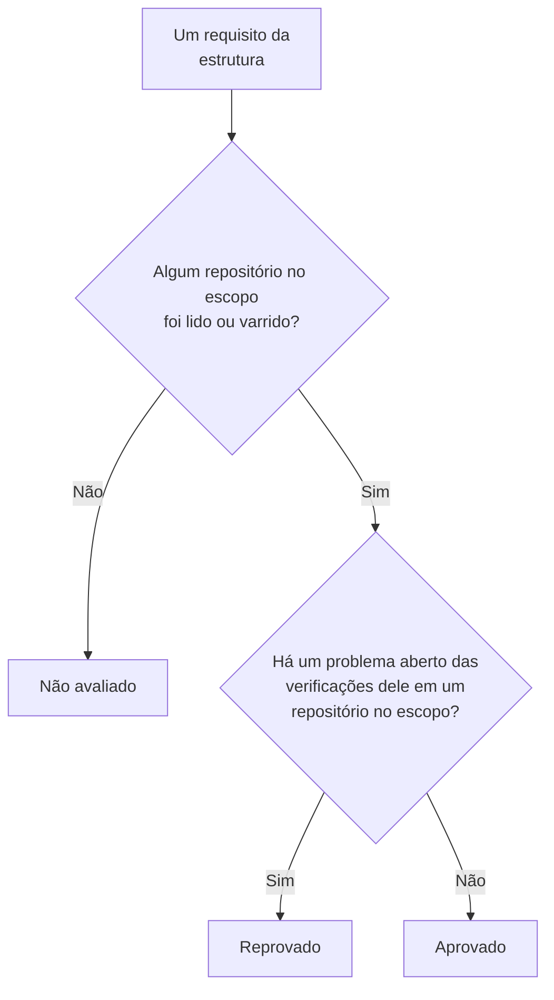

# Conformidade da Segurança de dados

A Segurança de dados pontua nove estruturas de conformidade a partir do que as varreduras dela encontraram. Cada estrutura cobre os repositórios de que tratam as regras dela - o RGPD, os repositórios que guardam dados pessoais; o PCI DSS, os repositórios em que foram encontrados dados de cartão; o SOC 2, todo repositório - e cada um dos requisitos dela é atendido ou não pelas verificações que servem de evidência para ele. **Segurança de dados → Conformidade** mostra a pontuação de cada estrutura, quantos repositórios ela cobre e cada requisito com quantos problemas abertos o reprovam. Uma pontuação é evidência para uma auditoria, não um certificado: ela diz o que o OneUptime consegue ver dos repositórios que lê.

:::cards
- [As estruturas de conformidade](#as-estruturas-de-conformidade): As nove, e quais repositórios cada uma cobre.
- [Como uma estrutura é pontuada](#como-uma-estrutura-é-pontuada): Requisitos aprovados, reprovados e não avaliados.
- [Requisitos e as suas verificações](#requisitos-e-as-suas-verificações): Cada requisito, e as verificações que são evidência para ele.
- [Registro das atividades de tratamento](#registro-das-atividades-de-tratamento): O Artigo 30 do RGPD, escrito a partir dos seus repositórios.
:::

## As estruturas de conformidade

| Estrutura | Nome completo | Repositórios no escopo |
| --- | --- | --- |
| RGPD | Regulamento Geral sobre a Proteção de Dados da UE | Repositórios que guardam dados pessoais. |
| CCPA | California Consumer Privacy Act, com as alterações do CPRA | Repositórios que guardam informações pessoais. |
| HIPAA | HIPAA Security Rule | Repositórios que guardam dados de saúde. |
| PCI DSS | PCI DSS v4.0 | Repositórios em que foram encontrados números de cartão. |
| SOC 2 | SOC 2 Trust Services Criteria | Todo repositório de dados. |
| ISO 27001 | ISO/IEC 27001:2022 | Todo repositório de dados. |
| NIST CSF | NIST Cybersecurity Framework 2.0 | Todo repositório de dados. |
| LGPD | Lei Geral de Proteção de Dados do Brasil | Repositórios que guardam dados pessoais de pessoas no Brasil. |
| DPDP | Digital Personal Data Protection Act da Índia, de 2023 | Repositórios que guardam dados pessoais de pessoas na Índia. |

## Quais repositórios uma estrutura cobre

O escopo de um repositório vem dos dados encontrados nele, então ele muda à medida que as varreduras encontram mais:

- **SOC 2, ISO 27001 e NIST CSF** são estruturas de segurança: cobrem todo repositório, seja o que for que ele guarde.
- **RGPD, CCPA, HIPAA e PCI DSS** cobrem os repositórios que guardam um tipo de dados que elas protegem. Dados pessoais trazem o RGPD e a CCPA, dados de saúde também a HIPAA, e números de cartão, códigos de segurança de cartão e datas de validade de cartão trazem o PCI DSS. Um repositório que guarda só segredos ou documentos da empresa não está em nenhuma delas.
- **LGPD e DPDP** são leis próprias de países: cobrem os repositórios que guardam dados pessoais de pessoas no Brasil ou na Índia, lidos a partir de tipos de dados que pertencem a esse país, como um CPF brasileiro ou um número Aadhaar indiano.

[Tipos de dados sensíveis](/docs/data-security/data-types#tipos-de-dados-integrados) lista cada tipo de dados, com o seu país.

## Como uma estrutura é pontuada

- **Um requisito é aprovado** quando nenhum problema aberto das verificações mapeadas para ele está em um repositório do escopo da estrutura, e **é reprovado** quando algum está.
- **Ele não é avaliado** enquanto nenhum repositório no escopo teve a configuração lida ou o conteúdo varrido.
- **Dois requisitos são atendidos pela própria Segurança de dados**: o Artigo 30 do RGPD, registros das atividades de tratamento, e o A.5.12 da ISO 27001, classificação da informação. Eles são aprovados assim que todo repositório no escopo foi lido ou varrido, e reprovados enquanto algum não foi.
- **A pontuação** é a parcela dos requisitos avaliados de uma estrutura que são aprovados, como uma porcentagem inteira. Uma estrutura sem nada avaliado não tem pontuação.

Só os problemas abertos contam. Um problema cujo risco foi aceito, ou que não é um problema, não reprova os seus requisitos, então um risco aceito é uma decisão que a sua auditoria pode ver no problema: quem o aceitou, por quê e até quando.

## Requisitos e as suas verificações

### RGPD

| Requisito | O que exige | Verificações |
| --- | --- | --- |
| Art. 5(1)(c) | Minimização dos dados | `production-data-in-non-production`, `stale-sensitive-data`, `sensitive-data-in-telemetry`, `sensitive-data-to-ai`, `sensitive-data-in-ai-store` |
| Art. 5(1)(e) | Limitação da conservação | `stale-sensitive-data` |
| Art. 25 | Proteção de dados desde a concepção e por padrão | `production-data-in-non-production`, `stale-sensitive-data`, `sensitive-data-in-telemetry`, `sensitive-data-to-ai`, `sensitive-data-in-ai-store` |
| Art. 28 | Operadores | `sensitive-data-to-ai` |
| Art. 30 | Registros das atividades de tratamento | Atendido pela própria Segurança de dados |
| Art. 32 | Segurança do tratamento | `public-read`, `public-write`, `public-access-not-blocked`, `internet-reachable`, `open-to-all-addresses`, `snapshot-public`, `snapshot-shared-externally`, `shared-with-external-accounts`, `not-encrypted-at-rest`, `no-customer-managed-key`, `encryption-in-transit-not-enforced`, `weak-tls`, `no-backups`, `no-point-in-time-recovery`, `deletion-protection-off`, `deleted-data-not-recoverable`, `access-not-logged`, `shared-key-access`, `object-acls-enabled`, `many-readers`, `secrets-stored`, `plaintext-passwords`, `secrets-in-telemetry` |
| Arts. 44-49 | Transferências para países terceiros | `residency-violation` |

### CCPA

| Requisito | O que exige | Verificações |
| --- | --- | --- |
| 1798.100(c) | Coleta limitada ao necessário | `production-data-in-non-production`, `stale-sensitive-data`, `sensitive-data-in-telemetry`, `sensitive-data-to-ai`, `sensitive-data-in-ai-store` |
| 1798.150 | Procedimentos de segurança razoáveis | `public-read`, `public-write`, `public-access-not-blocked`, `internet-reachable`, `open-to-all-addresses`, `snapshot-public`, `snapshot-shared-externally`, `shared-with-external-accounts`, `shared-key-access`, `object-acls-enabled`, `many-readers` |

### HIPAA

| Requisito | O que exige | Verificações |
| --- | --- | --- |
| 164.308(a)(7) | Plano de contingência | `no-backups`, `no-point-in-time-recovery`, `deletion-protection-off`, `deleted-data-not-recoverable` |
| 164.312(a)(1) | Controle de acesso | `public-read`, `public-write`, `public-access-not-blocked`, `internet-reachable`, `open-to-all-addresses`, `snapshot-public`, `snapshot-shared-externally`, `shared-with-external-accounts`, `shared-key-access`, `object-acls-enabled`, `many-readers` |
| 164.312(a)(2)(iv) | Criptografia e descriptografia | `not-encrypted-at-rest`, `no-customer-managed-key` |
| 164.312(b) | Controles de auditoria | `access-not-logged` |
| 164.312(e)(1) | Segurança da transmissão | `encryption-in-transit-not-enforced`, `weak-tls` |

### PCI DSS

| Requisito | O que exige | Verificações |
| --- | --- | --- |
| 3.3.1 | Os dados de autenticação sensíveis não são guardados depois da autorização | `card-security-codes-stored` |
| 3.4.1 | Os números de cartão são mascarados quando exibidos | `card-numbers-readable`, `sensitive-data-in-telemetry` |
| 3.5.1 | Os números de cartão ficam ilegíveis onde quer que sejam armazenados | `not-encrypted-at-rest`, `no-customer-managed-key`, `card-numbers-readable` |
| 4.2.1 | Criptografia forte protege os dados de cartão em trânsito | `encryption-in-transit-not-enforced`, `weak-tls` |
| 7.2 | O acesso é definido e atribuído conforme a necessidade | `public-read`, `public-write`, `public-access-not-blocked`, `internet-reachable`, `open-to-all-addresses`, `snapshot-public`, `snapshot-shared-externally`, `shared-with-external-accounts`, `shared-key-access`, `object-acls-enabled`, `many-readers` |
| 8.3.2 | Os fatores de autenticação ficam ilegíveis quando armazenados | `plaintext-passwords` |
| 10.2 | Os logs de auditoria registram o acesso aos dados de cartão | `access-not-logged` |

### SOC 2

| Requisito | O que exige | Verificações |
| --- | --- | --- |
| A1.2 | Backup e recuperação | `no-backups`, `no-point-in-time-recovery`, `deletion-protection-off`, `deleted-data-not-recoverable` |
| CC6.1 | Segurança do acesso lógico | `public-read`, `public-write`, `public-access-not-blocked`, `internet-reachable`, `open-to-all-addresses`, `snapshot-public`, `snapshot-shared-externally`, `shared-with-external-accounts`, `not-encrypted-at-rest`, `no-customer-managed-key`, `shared-key-access`, `object-acls-enabled`, `many-readers`, `secrets-stored`, `plaintext-passwords`, `secrets-in-telemetry` |
| CC6.7 | Transmissão de informações | `encryption-in-transit-not-enforced`, `weak-tls` |
| CC7.2 | Monitoramento dos componentes do sistema | `access-not-logged` |

### ISO 27001

| Requisito | O que exige | Verificações |
| --- | --- | --- |
| A.5.9 | Inventário de informações e outros ativos associados | `no-owner` |
| A.5.12 | Classificação da informação | Atendido pela própria Segurança de dados |
| A.5.15 | Controle de acesso | `public-read`, `public-write`, `public-access-not-blocked`, `internet-reachable`, `open-to-all-addresses`, `snapshot-public`, `snapshot-shared-externally`, `shared-with-external-accounts`, `shared-key-access`, `object-acls-enabled`, `many-readers` |
| A.5.34 | Privacidade e proteção de PII | `production-data-in-non-production`, `stale-sensitive-data`, `sensitive-data-in-telemetry`, `sensitive-data-to-ai`, `sensitive-data-in-ai-store` |
| A.8.11 | Mascaramento de dados | `production-data-in-non-production`, `stale-sensitive-data`, `sensitive-data-in-telemetry`, `sensitive-data-to-ai`, `sensitive-data-in-ai-store` |
| A.8.12 | Prevenção de vazamento de dados | `secrets-stored`, `secrets-in-telemetry` |
| A.8.13 | Backup das informações | `no-backups`, `no-point-in-time-recovery`, `deletion-protection-off`, `deleted-data-not-recoverable` |
| A.8.15 | Registro em logs | `access-not-logged` |
| A.8.24 | Uso de criptografia | `not-encrypted-at-rest`, `no-customer-managed-key`, `encryption-in-transit-not-enforced`, `weak-tls`, `plaintext-passwords` |

### NIST CSF

| Requisito | O que exige | Verificações |
| --- | --- | --- |
| ID.AM-07 | Inventários de dados e metadados são mantidos | `no-owner` |
| PR.AA-05 | As permissões de acesso são gerenciadas | `public-read`, `public-write`, `public-access-not-blocked`, `internet-reachable`, `open-to-all-addresses`, `snapshot-public`, `snapshot-shared-externally`, `shared-with-external-accounts`, `shared-key-access`, `object-acls-enabled`, `many-readers` |
| PR.DS-01 | Os dados em repouso são protegidos | `not-encrypted-at-rest`, `no-customer-managed-key`, `secrets-stored`, `secrets-in-telemetry` |
| PR.DS-02 | Os dados em trânsito são protegidos | `encryption-in-transit-not-enforced`, `weak-tls` |
| PR.DS-11 | Backups dos dados são mantidos e testados | `no-backups`, `no-point-in-time-recovery`, `deletion-protection-off`, `deleted-data-not-recoverable` |
| DE.CM-09 | Os dados e o seu uso são monitorados | `access-not-logged` |

### LGPD

| Requisito | O que exige | Verificações |
| --- | --- | --- |
| Art. 6 | Necessidade e limitação da finalidade | `production-data-in-non-production`, `stale-sensitive-data`, `sensitive-data-in-telemetry`, `sensitive-data-to-ai`, `sensitive-data-in-ai-store` |
| Art. 33 | Transferência internacional de dados | `residency-violation` |
| Art. 46 | Medidas de segurança | `public-read`, `public-write`, `public-access-not-blocked`, `internet-reachable`, `open-to-all-addresses`, `snapshot-public`, `snapshot-shared-externally`, `shared-with-external-accounts`, `not-encrypted-at-rest`, `no-customer-managed-key`, `shared-key-access`, `object-acls-enabled`, `many-readers` |

### DPDP

| Requisito | O que exige | Verificações |
| --- | --- | --- |
| Sec. 8(5) | Salvaguardas de segurança razoáveis | `public-read`, `public-write`, `public-access-not-blocked`, `internet-reachable`, `open-to-all-addresses`, `snapshot-public`, `snapshot-shared-externally`, `shared-with-external-accounts`, `not-encrypted-at-rest`, `no-customer-managed-key`, `shared-key-access`, `object-acls-enabled`, `many-readers` |
| Sec. 8(7) | Eliminação quando a finalidade é cumprida | `production-data-in-non-production`, `stale-sensitive-data`, `sensitive-data-in-telemetry`, `sensitive-data-to-ai`, `sensitive-data-in-ai-store` |
| Sec. 16 | Transferência para fora da Índia | `residency-violation` |

## Registro das atividades de tratamento

O Artigo 30 do RGPD pede que você mantenha um registro das suas atividades de tratamento. A Segurança de dados escreve a parte dele que trata de onde os dados pessoais são guardados: uma linha para cada repositório que guarda dados pessoais.

| Coluna | De onde vem |
| --- | --- |
| Repositório, tipo, provedor e região | Discovery |
| Ambiente | As tags ou o nome do repositório, ou o que você definiu |
| Sensibilidade, categorias e tipos de dados | O que as varreduras encontraram, ou a sensibilidade que você definiu |
| Proprietários | Os proprietários do repositório, pessoas e os membros das equipes dele |
| Finalidade | O que você escreve em **Finalidade** no repositório: por que ele guarda dados pessoais |
| Retenção | O que você escreve em **Retenção** no repositório: por quanto tempo os dados ficam nele |
| Estruturas de conformidade | As estruturas que os tipos de dados dele trazem para o escopo |

Preencha **Finalidade** e **Retenção** nas **Configurações** de cada repositório: são as duas coisas que nenhuma varredura consegue saber. O registro e as pontuações também são fornecidos pela API da Segurança de dados, em `/data-security/record-of-processing` e `/data-security/compliance`, para quem pode ler repositórios de dados (veja [Integrações da Segurança de dados](/docs/data-security/integrations#api-terraform-e-mcp)).

## Próximos passos

:::cards
- [Verificações e problemas da Segurança de dados](/docs/data-security/checks-and-issues): As verificações por trás de cada requisito, e como corrigi-las.
- [Fluxos de dados, acesso e residência](/docs/data-security/flows-access-residency): Regras de residência, para as transferências do RGPD, da LGPD e da DPDP.
- [Tipos de dados sensíveis](/docs/data-security/data-types): Os tipos de dados que trazem um repositório para o escopo de uma estrutura.
:::
