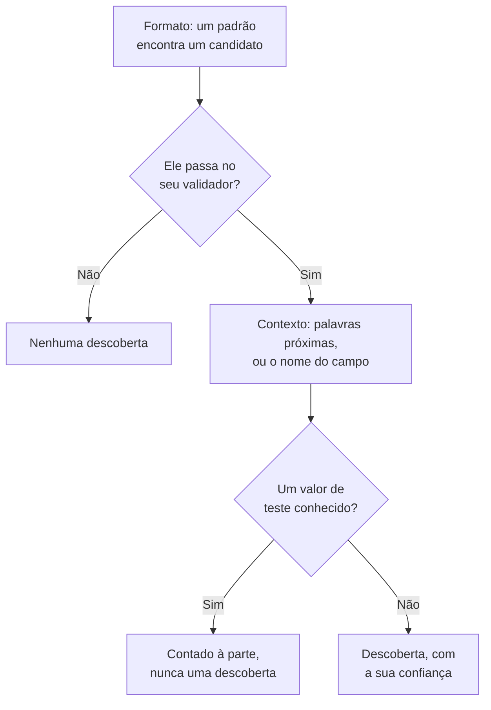

# Tipos de dados sensíveis

A Segurança de dados conhece 143 tipos de dados sensíveis: números de cartão, contas bancárias, documentos nacionais de identidade de 43 países, identificadores de saúde, chaves e tokens de API, e as categorias especiais de dados pessoais. Cada um tem uma categoria, uma sensibilidade e, quando pertence a um país, esse país. Esta página diz como um valor é encontrado e lista cada tipo de dados, para que você saiba por que algo foi encontrado e decida o que fazer a respeito.

:::cards
- [Como um valor é encontrado](#como-um-valor-é-encontrado): Formato, validador, contexto, valores de teste, confiança.
- [Campos e colunas](#campos-e-colunas): Como uma coluna ou um atributo inteiro é avaliado.
- [Cada tipo de dados](#tipos-de-dados-integrados): Todos os 143, por categoria.
- [Seus próprios tipos de dados](#seus-próprios-tipos-de-dados): IDs de funcionário, números de apólice e a caixa Testar.
:::

## Como um valor é encontrado

Toda varredura - uma linha de log, uma célula de CSV, uma linha de banco de dados, os primeiros bytes de um objeto - executa os mesmos passos:

1. **Formato.** Cada tipo de dados tem padrões que encontram candidatos: dezesseis dígitos, `AKIA` e dezesseis letras, uma palavra, um `@` e um domínio. Um padrão nunca corresponde dentro de um token mais longo, então um número de cartão não é encontrado dentro de uma sequência mais longa de dígitos.
2. **Validador.** Um candidato precisa passar nas regras próprias do seu tipo: uma soma de verificação (Luhn para cartões, mod 97 para IBANs, Verhoeff para números Aadhaar, o dígito verificador da maioria dos documentos nacionais de identidade), uma data real, um prefixo conhecido, aleatoriedade suficiente para um segredo. Um candidato que falha não é descoberta alguma. Valores fictícios como `000000000` e `123456789` falham em todos os tipos numéricos.
3. **Contexto.** Palavras próximas de um candidato - por padrão, até 64 caracteres antes dele e 32 depois - que dizem o que ele é aumentam a sua confiança em um nível, e o mesmo faz um campo cujo nome aponta para o tipo. Palavras que dizem que ele é outra coisa, como um número de pedido ou de rastreamento, a diminuem em um nível. Um número sem soma de verificação e com um formato comum, como um número de passaporte ou uma conta bancária, só conta ao lado de palavras que o nomeiam.
4. **Valores de teste conhecidos.** Números de cartão de teste publicados (como o `4242 4242 4242 4242` do Stripe), IBANs de exemplo, endereços em `example.com` e em outros domínios reservados, endereços IP de documentação, os IDs de exemplo que a documentação governamental publica, chaves de modo de teste como `sk_test_` e chaves fictícias são contados à parte. Eles nunca geram uma descoberta, então um repositório cheio deles é lido como um ambiente de teste, não como um vazamento.
5. **Confiança.** O que resta é uma descoberta, tão certa quanto as suas evidências permitem.

| Confiança | O que significa |
| --- | --- |
| **Alto** | O valor passou no seu validador, e as palavras ao redor dele ou o campo em que está dizem o que ele é - ou, para um campo, a maioria dos seus valores é desse tipo. |
| **Médio** | O valor passou no seu validador sem nada ao redor que o confirme, ou o nome do campo diz o que ele contém e alguns valores concordam. |
| **Baixo** | O formato corresponde, mas nada o confirma. |

Só as descobertas com confiança Alto e Médio contam: elas tornam um repositório sensível e podem abrir um problema. As descobertas com confiança Baixo são listadas no repositório, recolhidas, para que uma pessoa as avalie.

Quando dois tipos de dados reivindicam os mesmos caracteres, vence a descoberta mais certa: a de maior confiança, depois a do detector cujas próprias regras provam mais, depois a correspondência mais longa.

Um valor longo é lido em janelas de 64 KB que se sobrepõem em 4 KB, para que um valor seja encontrado inteiro onde quer que esteja, e no máximo 4 MB de um mesmo valor são lidos.

## Campos e colunas

Uma coluna, um campo JSON ou um atributo de log é avaliado como um todo. O nome dele sugere um tipo de dados, e os valores amostrados dele o comprovam. A parcela dos valores que contêm o tipo decide o quão certa é a descoberta:

| Valores que contêm o tipo | Confiança |
| --- | --- |
| 60% ou mais | Alto |
| 25% ou mais | Alto quando o nome do campo aponta para o tipo, Médio caso contrário |
| Menos | Médio quando o nome do campo aponta para o tipo, Baixo caso contrário: alguns e-mails em uma coluna de outra coisa |

Um campo cujos valores têm em média mais de 80 caracteres é texto livre - notas, mensagens, descrições - e não se espera que contenha um único tipo. As descobertas dele mantêm a confiança que cada correspondência obteve sozinha, e dizem que foram encontradas em texto livre. Até 1.000 valores de um campo são classificados, e até 16 KB de cada um.

O nome de um campo é dividido em palavras - `customerEmail`, `customer_email` e `customer-email` são todos "customer email" - e a dica de nome de um tipo corresponde quando as palavras dela aparecem nessa ordem, lado a lado: "date of birth" corresponde a `customer_date_of_birth`, não a `birth_city`. Só a última parte de um caminho com pontos é o nome próprio do campo, junto com a parte anterior quando a última é uma palavra genérica como `number`, `id` ou `value`: `customer.address.city` não é um endereço, e `card.number` continua sendo um número de cartão.

Alguns tipos de dados não podem ser identificados pelos valores: nenhum padrão distingue o nome de uma pessoa do nome de uma rua, ou uma religião de qualquer outra palavra. Esses tipos são encontrados só pelo nome do campo, quando o campo tem valores: Nome de pessoa, Nome de usuário, Gênero, Nacionalidade, Informações de saúde, Origem racial ou étnica, Crença religiosa, Orientação sexual, Opinião política, Filiação sindical, Dados biométricos, Dados genéticos e Antecedentes criminais. Um nome, um nome de usuário, um gênero ou uma nacionalidade é então Alto quando 60% ou mais dos valores se parecem com um, e Médio caso contrário.

Um campo cujo nome diz que contém uma senha - `password`, `passwordHash`, `pwd`, não `password_changed_at` - deveria conter um hash: bcrypt, argon2, scrypt, PBKDF2 ou outro esquema que um repositório provavelmente usa. Valores vazios, valores fictícios como `********` e valores criptografados são deixados de lado. Quando, no resto, há mais valores que não são hashes do que valores que são, o campo contém as próprias senhas, que nenhum padrão consegue ver, e o repositório falha em [Há senhas armazenadas em texto simples](/docs/data-security/checks-and-issues#higiene-de-dados).

## Sensibilidade

| Sensibilidade | O que significa |
| --- | --- |
| **Restrito** | Há dano se vazar: segredos, números de cartão, registros de saúde, documentos governamentais. |
| **Confidencial** | Dados pessoais, e documentos marcados como confidenciais. |
| **Interno** | Os dados da própria empresa, não destinados a pessoas de fora. |
| **Público** | Nada sensível foi encontrado. |

Um repositório é tão sensível quanto o tipo de dados mais sensível encontrado nele com confiança de pelo menos Médio. Valores de teste e descobertas marcadas como não sensíveis não contam nada, e um repositório em que nada foi encontrado é Público. Para tratar um repositório como mais ou menos sensível do que as descobertas dele dizem, defina você mesmo a sensibilidade dele nas **Configurações** do repositório: as verificações passam a usar essa sensibilidade.

## Categorias

| Categoria | O que abrange | Dados pessoais |
| --- | --- | --- |
| Segredos e credenciais | Senhas, chaves de API, tokens e chaves privadas que desbloqueiam outros sistemas. | Não |
| Financeiro | Números de cartão, contas bancárias, IBANs e carteiras de criptomoedas. | Sim |
| Saúde | Números de prontuário médico, identificadores de saúde, diagnósticos e prescrições. | Sim |
| Identificação governamental | Números de identidade nacional, fiscais, de passaporte e de seguridade social. | Sim |
| Categoria especial | O que o Artigo 9 do RGPD mais protege: etnia, religião, orientação sexual, política, filiação sindical, dados biométricos e genéticos. | Sim |
| Contato e identidade | Quem alguém é e como contatar essa pessoa: e-mail, telefone, endereço, data de nascimento, endereço IP. | Sim |
| Confidencial da empresa | Documentos marcados como confidenciais, somente para uso interno ou protegidos por sigilo legal. | Não |

Dados pessoais são dados sobre uma pessoa, no sentido do RGPD, da CCPA, da LGPD e da DPDP. Um repositório que contém só segredos e documentos da empresa fica fora do escopo de uma estrutura de conformidade de privacidade, nunca do de uma de segurança (veja [Conformidade da Segurança de dados](/docs/data-security/compliance)).

## Tipos de dados integrados

Um tipo de dados que pertence a um país o nomeia, como um código ISO 3166-1: as regras de residência e as estruturas de conformidade ligadas a um país o leem (veja [Residência](/docs/data-security/flows-access-residency#regras-de-residência)). O ID é o nome pelo qual a API e as descobertas se referem ao tipo.

### Contato e identidade

| Tipo de dados | ID | O que é | Sensibilidade | País |
| --- | --- | --- | --- | --- |
| Endereço de e-mail | `email-address` | O endereço de e-mail de uma pessoa. | Confidencial | — |
| Número de telefone | `phone-number` | Um número de telefone em formato internacional ou nacional. | Confidencial | — |
| Nome de pessoa | `person-name` | O nome, o sobrenome ou o nome completo de uma pessoa, encontrado pelo nome do campo. | Confidencial | — |
| Endereço | `postal-address` | Um endereço: um número, um nome de rua e um tipo de logradouro. | Confidencial | — |
| Código postal | `postal-code` | Um código postal. Sozinho, ele restringe onde alguém mora. | Interno | — |
| Data de nascimento | `date-of-birth` | Uma data ao lado de palavras que dizem que ela é a data de nascimento de alguém. | Confidencial | — |
| Endereço IP | `ip-address` | Um endereço IPv4 ou IPv6 público, que o RGPD trata como dado pessoal. | Confidencial | — |
| Endereço MAC | `mac-address` | O endereço de hardware de uma placa de rede, que identifica um dispositivo. | Confidencial | — |
| ID de publicidade | `advertising-id` | Um ID de publicidade móvel (IDFA, GAID, AAID) que rastreia um dispositivo. | Confidencial | — |
| Localização precisa | `geolocation` | Uma latitude e uma longitude precisas o bastante para encontrar um prédio. | Confidencial | — |
| Nome de usuário | `username` | O nome de login ou de conta de uma pessoa, encontrado pelo nome do campo. | Confidencial | — |
| Gênero | `gender` | O gênero ou o sexo de uma pessoa, encontrado pelo nome do campo. | Confidencial | — |
| Nacionalidade | `nationality` | A nacionalidade ou a cidadania de uma pessoa, encontrada pelo nome do campo. | Confidencial | — |
| Número de identificação do veículo | `vehicle-identification-number` | Um VIN de 17 caracteres com um dígito verificador válido. | Confidencial | — |

### Identificação governamental

| Tipo de dados | ID | O que é | Sensibilidade | País |
| --- | --- | --- | --- | --- |
| Número de Seguro Social dos EUA | `us-ssn` | Um número de Seguro Social dos EUA. | Restrito | US |
| ID de contribuinte dos EUA (ITIN) | `us-itin` | Um Individual Taxpayer Identification Number dos EUA. | Restrito | US |
| ID de empregador dos EUA (EIN) | `us-ein` | Um Employer Identification Number dos EUA, ao lado de palavras que o indicam. | Confidencial | US |
| Número de passaporte dos EUA | `us-passport` | Um número de passaporte dos EUA, ao lado de palavras que o indicam. | Restrito | US |
| Número da carteira de motorista dos EUA | `us-drivers-license` | Um número de carteira de motorista dos EUA, ao lado de palavras que o indicam. | Restrito | US |
| Número do National Insurance do Reino Unido | `uk-nino` | Um número do National Insurance do Reino Unido. | Restrito | GB |
| Número de passaporte do Reino Unido | `uk-passport` | Um número de passaporte do Reino Unido, ao lado de palavras que o indicam. | Restrito | GB |
| Número da carteira de motorista do Reino Unido | `uk-driving-licence` | Um número de carteira de motorista do Reino Unido, com 16 caracteres. | Restrito | GB |
| Número do Social Insurance do Canadá | `ca-sin` | Um Social Insurance Number canadense com um dígito verificador válido. | Restrito | CA |
| CURP do México | `mx-curp` | Uma Clave Única de Registro de Población mexicana. | Restrito | MX |
| RFC do México | `mx-rfc` | Um ID fiscal mexicano do Registro Federal de Contribuyentes. | Restrito | MX |
| CPF do Brasil | `br-cpf` | Um número do Cadastro de Pessoas Físicas brasileiro. | Restrito | BR |
| CNPJ do Brasil | `br-cnpj` | Um número de registro de empresa brasileiro (CNPJ). | Confidencial | BR |
| CUIT / CUIL da Argentina | `ar-cuit` | Um código de identificação fiscal ou trabalhista argentino. | Restrito | AR |
| RUT do Chile | `cl-rut` | Um Rol Único Tributario chileno com um dígito verificador válido. | Restrito | CL |
| DNI da Espanha | `es-dni` | Um número de documento nacional de identidade espanhol com a sua letra de controle. | Restrito | ES |
| NIE da Espanha | `es-nie` | Um número de identidade de estrangeiro espanhol com a sua letra de controle. | Restrito | ES |
| NIF de Portugal | `pt-nif` | Um número de identificação fiscal português. | Restrito | PT |
| Número de seguridade social da França (NIR) | `fr-nir` | Um número INSEE francês com a sua chave de dois dígitos. | Restrito | FR |
| ID fiscal da Alemanha | `de-tax-id` | Uma Steuerliche Identifikationsnummer alemã. | Restrito | DE |
| Codice fiscale da Itália | `it-codice-fiscale` | Um código fiscal italiano com um caractere de controle válido. | Restrito | IT |
| BSN dos Países Baixos | `nl-bsn` | Um número de serviço ao cidadão neerlandês que passa no teste do onze. | Restrito | NL |
| Número nacional da Bélgica | `be-national-number` | Um número do registro nacional belga. | Restrito | BE |
| PESEL da Polônia | `pl-pesel` | Um número de identificação nacional polonês. | Restrito | PL |
| Número de identidade pessoal da Suécia | `se-personnummer` | Um personnummer sueco com um dígito verificador válido. | Restrito | SE |
| Número de identidade nacional da Noruega | `no-fodselsnummer` | Um fødselsnummer norueguês com os dois dígitos verificadores. | Restrito | NO |
| Número CPR da Dinamarca | `dk-cpr` | Um número de registro civil dinamarquês, ao lado de palavras que o indicam. | Restrito | DK |
| Código de identidade pessoal da Finlândia | `fi-hetu` | Um henkilötunnus finlandês com o seu caractere de controle. | Restrito | FI |
| Número PPS da Irlanda | `ie-ppsn` | Um Personal Public Service Number irlandês. | Restrito | IE |
| Número AHV da Suíça | `ch-ahv` | Um número de seguridade social suíço (AHV / AVS). | Restrito | CH |
| CNP da Romênia | `ro-cnp` | Um código numérico pessoal romeno. | Restrito | RO |
| EGN da Bulgária | `bg-egn` | Um número civil uniforme búlgaro. | Restrito | BG |
| OIB da Croácia | `hr-oib` | Um número de identificação pessoal croata. | Restrito | HR |
| AMKA da Grécia | `gr-amka` | Um número de seguridade social grego. | Restrito | GR |
| Número de identidade da Turquia | `tr-tckn` | Um número T.C. Kimlik turco. | Restrito | TR |
| Número de identidade de Israel | `il-teudat-zehut` | Um número Teudat Zehut israelense. | Restrito | IL |
| Número de identidade da África do Sul | `za-id` | Um número de identidade sul-africano com uma data e um dígito verificador válidos. | Restrito | ZA |
| Emirates ID dos EAU | `ae-emirates-id` | Um número de carteira de identidade dos Emirados Árabes Unidos. | Restrito | AE |
| ID nacional da Arábia Saudita | `sa-national-id` | Um número de ID nacional ou de iqama saudita. | Restrito | SA |
| Número Aadhaar da Índia | `in-aadhaar` | Um número Aadhaar de 12 dígitos que passa na verificação de Verhoeff. | Restrito | IN |
| PAN da Índia | `in-pan` | Um Permanent Account Number indiano. | Restrito | IN |
| Número de identidade de residente da China | `cn-resident-id` | Um número de carteira de identidade de residente chinesa, com 18 caracteres. | Restrito | CN |
| My Number do Japão | `jp-my-number` | Um número individual japonês com um dígito verificador válido. | Restrito | JP |
| Número de registro de residente da Coreia do Sul | `kr-rrn` | Um número de registro de residente coreano. | Restrito | KR |
| NRIC / FIN de Singapura | `sg-nric` | Um número de carteira de identidade ou de identificação de estrangeiro de Singapura. | Restrito | SG |
| Número da carteira de identidade de Hong Kong | `hk-hkid` | Um número de carteira de identidade de Hong Kong com o seu dígito verificador. | Restrito | HK |
| ID nacional de Taiwan | `tw-national-id` | Um número de identificação nacional taiwanês. | Restrito | TW |
| ID nacional da Tailândia | `th-national-id` | Um número de identificação de cidadão tailandês. | Restrito | TH |
| Número MyKad da Malásia | `my-mykad` | Um número de carteira de identidade malaio. | Restrito | MY |
| NIK da Indonésia | `id-nik` | Um número de identidade populacional indonésio. | Restrito | ID |
| Tax file number da Austrália | `au-tfn` | Um tax file number australiano com uma verificação válida. | Restrito | AU |
| Número IRD da Nova Zelândia | `nz-ird` | Um número do Inland Revenue da Nova Zelândia com um dígito verificador válido. | Restrito | NZ |
| SNILS da Rússia | `ru-snils` | Um número de conta de seguro russo com o seu número de controle. | Restrito | RU |
| INN da Rússia | `ru-inn` | Um número de identificação de contribuinte russo. | Restrito | RU |
| Número de passaporte | `passport-number` | Um número de passaporte de qualquer país, ao lado de palavras que o indicam. | Restrito | — |

### Financeiro

| Tipo de dados | ID | O que é | Sensibilidade | País |
| --- | --- | --- | --- | --- |
| Número de cartão | `credit-card-number` | Um número de cartão de pagamento que passa na verificação de Luhn e pertence a uma bandeira de cartão. | Restrito | — |
| Código de segurança do cartão | `card-verification-code` | Um CVV ou CVC, que o PCI DSS proíbe guardar depois que um pagamento é autorizado. | Restrito | — |
| Data de validade do cartão | `card-expiration-date` | A data de validade de um cartão, ao lado de palavras que a indicam. | Confidencial | — |
| IBAN | `iban` | Um número internacional de conta bancária que passa na verificação mod-97. | Restrito | — |
| Número de conta bancária | `bank-account-number` | Um número de conta bancária, ao lado de palavras que o indicam. | Restrito | — |
| Código SWIFT / BIC | `swift-bic` | O código SWIFT ou BIC de um banco, ao lado de palavras que o indicam. | Interno | — |
| Número de roteamento bancário dos EUA | `us-bank-routing-number` | Um número de roteamento ABA com uma soma de verificação válida, ao lado de palavras que o indicam. | Interno | US |
| Sort code do Reino Unido | `uk-sort-code` | Um sort code bancário do Reino Unido, ao lado de palavras que o indicam. | Interno | GB |
| IFSC da Índia | `in-ifsc` | Um Indian Financial System Code que identifica uma agência bancária. | Interno | IN |
| BSB da Austrália | `au-bsb` | Um número bank-state-branch australiano, ao lado de palavras que o indicam. | Interno | AU |
| Endereço de Bitcoin | `bitcoin-address` | Um endereço de Bitcoin com uma soma de verificação válida. | Confidencial | — |
| Endereço de Ethereum | `ethereum-address` | Um endereço de Ethereum, ao lado de palavras que o indicam. | Confidencial | — |

### Saúde

| Tipo de dados | ID | O que é | Sensibilidade | País |
| --- | --- | --- | --- | --- |
| Número do NHS do Reino Unido | `uk-nhs-number` | Um número do National Health Service do Reino Unido com um dígito verificador válido. | Restrito | GB |
| ID de beneficiário do Medicare dos EUA | `us-medicare-mbi` | Um Medicare Beneficiary Identifier dos EUA. | Restrito | US |
| Número do Medicare da Austrália | `au-medicare-number` | Um número de cartão do Medicare australiano com um dígito verificador válido. | Restrito | AU |
| Número do seguro de saúde da Alemanha | `de-health-insurance-number` | Uma Krankenversichertennummer alemã com um dígito verificador válido. | Restrito | DE |
| Número de prontuário médico | `medical-record-number` | O número do prontuário médico de um paciente, ao lado de palavras que o indicam. | Restrito | — |
| ID de beneficiário de plano de saúde | `health-plan-id` | Um número de beneficiário ou de apólice de seguro de saúde, ao lado de palavras que o indicam. | Restrito | — |
| Código de diagnóstico (ICD-10) | `diagnosis-code` | Um código de diagnóstico ICD-10, ao lado de palavras que o indicam. | Restrito | — |
| Código de medicamento (NDC) | `drug-code` | Um National Drug Code dos EUA, ao lado de palavras que o indicam. | Confidencial | — |
| Número DEA dos EUA | `us-dea-number` | O número da Drug Enforcement Administration de um prescritor, com um dígito verificador válido. | Confidencial | US |
| ID de prestador dos EUA (NPI) | `us-npi` | Um National Provider Identifier. Ele identifica um prestador de serviços de saúde, não um paciente. | Interno | US |
| Informações de saúde | `health-information` | Diagnósticos, condições, medicamentos e outros detalhes de saúde, encontrados pelo nome do campo. | Restrito | — |

### Segredos e credenciais

| Tipo de dados | ID | O que é | Sensibilidade | País |
| --- | --- | --- | --- | --- |
| ID de chave de acesso da AWS | `aws-access-key-id` | A metade pública de uma chave de acesso da AWS. Com o seu segredo, ela assina requisições à AWS. | Restrito | — |
| Chave de acesso secreta da AWS | `aws-secret-access-key` | A metade secreta de uma chave de acesso da AWS, ao lado de palavras que a indicam. | Restrito | — |
| Chave de API do Google | `google-api-key` | Uma chave de API do Google Cloud ou do Maps. | Restrito | — |
| Chave de conta de serviço do Google | `google-service-account-key` | Um arquivo de chave de conta de serviço do Google Cloud com a sua chave privada. | Restrito | — |
| Segredo de cliente OAuth do Google | `google-oauth-client-secret` | Um segredo de cliente OAuth do Google. | Restrito | — |
| Chave de conta de armazenamento do Azure | `azure-storage-account-key` | Uma chave de conta de armazenamento do Azure ou uma string de conexão que contém uma. | Restrito | — |
| Token SAS do Azure | `azure-sas-token` | Uma assinatura de acesso compartilhado do Azure, que concede acesso sem login. | Restrito | — |
| Segredo de cliente do Azure | `azure-client-secret` | Um segredo de cliente de aplicativo do Microsoft Entra ID. | Restrito | — |
| Token do GitHub | `github-token` | Um token do GitHub de acesso pessoal, OAuth, de app ou refinado. | Restrito | — |
| Token do GitLab | `gitlab-token` | Um token de acesso pessoal do GitLab. | Restrito | — |
| Token do Slack | `slack-token` | Um token de bot, de usuário ou de app do Slack. | Restrito | — |
| URL de webhook do Slack | `slack-webhook-url` | Um webhook de entrada do Slack, que permite que qualquer pessoa publique em um canal. | Restrito | — |
| Chave secreta do Stripe | `stripe-secret-key` | Uma chave secreta ou restrita de produção do Stripe, que pode movimentar dinheiro. | Restrito | — |
| Chave de API do Twilio | `twilio-api-key` | Um SID de chave de API do Twilio com o segredo. | Restrito | — |
| Chave de API do SendGrid | `sendgrid-api-key` | Uma chave de API do SendGrid. | Restrito | — |
| Chave de API do Mailgun | `mailgun-api-key` | Uma chave de API do Mailgun. | Restrito | — |
| Chave de API do Mailchimp | `mailchimp-api-key` | Uma chave de API do Mailchimp. | Restrito | — |
| Chave de API da OpenAI | `openai-api-key` | Uma chave de API da OpenAI, que gasta o crédito da conta. | Restrito | — |
| Chave de API da Anthropic | `anthropic-api-key` | Uma chave de API da Anthropic. | Restrito | — |
| Token do Hugging Face | `huggingface-token` | Um token do Hugging Face. | Restrito | — |
| Token do npm | `npm-token` | Um token de acesso do npm, que pode publicar pacotes. | Restrito | — |
| Token do PyPI | `pypi-token` | Um token de upload do PyPI. | Restrito | — |
| Token do Docker Hub | `docker-hub-token` | Um token de acesso pessoal do Docker Hub. | Restrito | — |
| Token do Shopify | `shopify-token` | Um token de acesso ou de app do Shopify. | Restrito | — |
| Token do Square | `square-token` | Um token de acesso ou segredo do Square. | Restrito | — |
| Token de acesso do Braintree | `braintree-access-token` | Um token de acesso de produção do Braintree. | Restrito | — |
| Token da DigitalOcean | `digitalocean-token` | Um token de acesso pessoal da DigitalOcean. | Restrito | — |
| Chave de API do New Relic | `new-relic-api-key` | Uma chave de API de usuário do New Relic. | Restrito | — |
| Chave de API do Datadog | `datadog-api-key` | Uma chave de API ou de aplicativo do Datadog, ao lado de palavras que a indicam. | Restrito | — |
| Token do HashiCorp Vault | `vault-token` | Um token de serviço do HashiCorp Vault. | Restrito | — |
| Token do Terraform Cloud | `terraform-cloud-token` | Um token de API do Terraform Cloud ou Enterprise. | Restrito | — |
| Token de API da Atlassian | `atlassian-api-token` | Um token de API da Atlassian. | Restrito | — |
| Chave de API do Linear | `linear-api-key` | Uma chave de API do Linear. | Restrito | — |
| JSON web token | `json-web-token` | Um JWT assinado, muitas vezes um token de sessão ou de acesso. | Restrito | — |
| Chave privada | `private-key` | Um bloco de chave privada PEM, OpenSSH ou PGP. | Restrito | — |
| Senha em uma URL | `password-in-url` | Uma URL que contém um nome de usuário e uma senha, como uma string de conexão de banco de dados. | Restrito | — |
| Senha em uma string de conexão | `connection-string-password` | Um valor de Password= ou Pwd= em uma string de conexão. | Restrito | — |
| Cabeçalho Authorization | `authorization-header` | Uma credencial Basic ou Bearer copiada de um cabeçalho HTTP Authorization. | Restrito | — |
| Senha ou segredo | `generic-secret` | Um valor atribuído a uma senha, um segredo, uma chave de API ou um token, que parece aleatório o bastante para ser real. | Restrito | — |
| Chave privada de Bitcoin | `bitcoin-private-key` | Uma chave privada de Bitcoin no formato de importação de carteira, com uma soma de verificação válida. | Restrito | — |

### Categoria especial

| Tipo de dados | ID | O que é | Sensibilidade | País |
| --- | --- | --- | --- | --- |
| Origem racial ou étnica | `racial-or-ethnic-origin` | Raça ou etnia, encontrada pelo nome do campo. | Restrito | — |
| Crença religiosa | `religious-belief` | Religião ou crença, encontrada pelo nome do campo. | Restrito | — |
| Orientação sexual | `sexual-orientation` | Orientação sexual, encontrada pelo nome do campo. | Restrito | — |
| Opinião política | `political-opinion` | Opiniões políticas ou filiação partidária, encontradas pelo nome do campo. | Restrito | — |
| Filiação sindical | `trade-union-membership` | Filiação sindical, encontrada pelo nome do campo. | Restrito | — |
| Dados biométricos | `biometric-data` | Impressões digitais, modelos faciais, impressões de voz e outros dados biométricos, encontrados pelo nome do campo. | Restrito | — |
| Dados genéticos | `genetic-data` | Dados de DNA e de genoma, encontrados pelo nome do campo. | Restrito | — |
| Antecedentes criminais | `criminal-record` | Condenações e infrações penais (Artigo 10 do RGPD), encontradas pelo nome do campo. | Restrito | — |

### Confidencial da empresa

| Tipo de dados | ID | O que é | Sensibilidade | País |
| --- | --- | --- | --- | --- |
| Documento protegido por sigilo legal | `privileged-document` | Um documento marcado como protegido pelo sigilo entre advogado e cliente ou por sigilo legal. | Restrito | — |
| Documento marcado como confidencial | `confidential-document` | Um documento marcado como confidencial, estritamente confidencial ou segredo comercial. | Confidencial | — |
| Documento marcado como interno | `internal-document` | Um documento marcado como somente para uso interno ou não destinado à distribuição. | Interno | — |

## Seus próprios tipos de dados

Adicione um tipo de dados para o que só a sua empresa tem: um ID de funcionário, um número de apólice, um código de projeto. Acesse **Segurança de dados → Configurações → Tipos de dados** e adicione-o em **Seus tipos de dados**. Ele é varrido exatamente como os integrados, em buckets, bancos de dados e telemetria, a partir da próxima varredura.

:::steps
### Diga o que ele é

Dê a ele um **Nome**, como ID de funcionário, uma **Categoria** e uma **Sensibilidade**: o quão sensível é um repositório que o contém. Uma **Descrição** diz o que ele é, para quem lê uma descoberta dele.

### Diga como ele é encontrado

Informe um **Padrão**: uma expressão regular JavaScript para um valor, como `EMP-\d{6}`. Adicione os **Nomes de campo** que o contêm, como `employee id`, e as **Palavras-chave** que, perto de um valor, confirmam que ele é desse tipo. Deixe o padrão vazio para encontrar o tipo só pelos nomes de campo.

### Teste-o

Cole um texto de exemplo em **Testar** para ver o que o seu tipo de dados encontra nele. Ele executa o próprio código do scanner sobre o texto, no seu navegador: o texto nunca é enviado ao OneUptime, e só os primeiros 64 KB dele são testados.
:::

Em **Mais campos**, **Ignorar maiúsculas e minúsculas** faz o padrão corresponder independentemente de as letras serem maiúsculas ou minúsculas, **Exige uma palavra-chave** só conta um valor quando há uma palavra-chave perto dele ou quando o nome do campo diz que ele é desse tipo, e **Soma de verificação** exige que um valor passe em uma verificação: **Nenhum**, **Luhn** (o dígito verificador dos números de cartão), **Mod97** (os dígitos verificadores de um IBAN) ou **Verhoeff** (o dígito verificador de um número Aadhaar).

Um padrão é verificado quando você o salva: ele precisa compilar, não corresponder a texto vazio e rodar em tempo proporcional ao texto. Ele é executado por um mecanismo de correspondência que nunca faz backtracking, então nenhum padrão consegue travar uma varredura, seja como for escrito. Um tipo aceita no máximo 50 palavras-chave e 50 nomes de campo.

Um valor do seu tipo é Médio sozinho e Alto com uma palavra-chave próxima quando passa em uma soma de verificação, e Baixo sozinho e Médio com uma palavra-chave quando não tem nenhuma. Em uma coluna, quem decide é a parcela de valores que correspondem, como em todo tipo.

## Não sensível, e nunca sensível

Uma varredura pode encontrar algo que não é o que parece: uma coluna de números de pedido que passam na verificação de Luhn, o seu próprio endereço de suporte em cada linha de log. Diga isso ao OneUptime, e ele para de contar:

- **Marque a descoberta como não sensível.** Na página **Conteúdo** do repositório, escolha **Marcar como não sensível** na descoberta e diga por quê. Ela deixa de contar para a sensibilidade do repositório e para as verificações dele, e o repositório é verificado de novo na hora. A descoberta continua no repositório, marcada, com o seu motivo, para que a próxima pessoa veja o que foi decidido.
- **Adicione o valor a Nunca sensível**, nas configurações da Segurança de dados, para um valor que nunca é uma descoberta em lugar nenhum, como `support@yourcompany.com`. Os valores são comparados depois que o scanner os normaliza, ignorando maiúsculas e minúsculas.
- **Desative um tipo de dados integrado.** Em **Tipos de dados integrados**, em **Segurança de dados → Configurações → Tipos de dados**, cada tipo de dados tem um interruptor, que salva no momento em que é acionado. Nenhuma varredura do projeto procura um tipo que está desativado.

## Próximos passos

:::cards
- [Verificações e problemas da Segurança de dados](/docs/data-security/checks-and-issues): O que a sensibilidade de um repositório muda nos problemas dele.
- [Dados sensíveis na telemetria](/docs/data-security/telemetry): Os tipos de dados encontrados nos seus logs, traces e prompts.
- [Conformidade da Segurança de dados](/docs/data-security/compliance): As estruturas de conformidade que cada tipo de dados coloca no escopo.
:::
