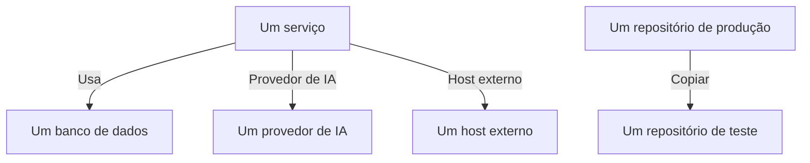

# Fluxos de dados, acesso e residência

Saber o que um repositório guarda é metade do trabalho. A Segurança de dados também descobre para onde esses dados vão - quais serviços usam o repositório, quais provedores de IA e hosts externos os dados alcançam, e para onde foram copiados -, quem pode acessar cada repositório e se ele fica nas regiões em que pode ficar. Tudo isso vem de evidências que o OneUptime já tem: os seus traces, as próprias configurações de acesso da sua nuvem e as impressões digitais do que as varreduras encontraram.

:::cards
- [Fluxos de dados](#fluxos-de-dados): Serviços, provedores de IA, hosts externos e cópias.
- [Quem pode acessar um repositório](#quem-pode-acessar-um-repositório): Cada concessão que a sua nuvem informa, e o quão exposto o repositório está.
- [Regras de residência](#regras-de-residência): As regiões em que cada tipo de dado pode ficar.
:::

## Fluxos de dados

| Fluxo | O que significa | De onde vem |
| --- | --- | --- |
| **Usa** | Um serviço se comunica com um repositório. | O mapa de serviços, que o OneUptime monta a partir dos spans de cliente dos seus serviços a cada dez minutos. Cada banco de dados nele é ligado ao seu repositório pelo nome, pelo endereço ou pelo endpoint, então um banco de dados que nenhuma outra origem lista vira um repositório próprio. |
| **Provedor de IA** | Um serviço envia dados a um provedor de IA. | As chamadas de IA nos traces do serviço dos últimos 7 dias, que nomeiam o provedor que alcançam. |
| **Host externo** | Um serviço chama um host fora dos seus sistemas. | Os serviços remotos do mapa de serviços, pelo endereço em que são chamados. |
| **Copiar** | Um repositório guarda valores de outro. | Impressões digitais dos valores que cada varredura encontrou: dois repositórios compartilham dados quando as impressões digitais deles de um mesmo tipo de dados se sobrepõem em metade ou mais. |

Um fluxo carrega os tipos de dados que a sua origem guarda, e a sensibilidade deles. Um fluxo é confirmado quando uma varredura provou que os dados estão lá, e não só que existe um caminho até eles: uma cópia sempre é confirmada, e um fluxo para um provedor de IA é confirmado quando as conversas de IA do serviço contêm dados Confidenciais ou Restritos. Um fluxo que não é visto de novo por 30 dias é descartado.

Duas verificações leem os fluxos. [Dados de produção foram copiados para um repositório que não é de produção](/docs/data-security/checks-and-issues#higiene-de-dados) falha no destino de uma cópia. Uma cópia parte do repositório de produção quando só um dos dois está em produção e, caso contrário, do repositório que o OneUptime encontrou primeiro. [Dados sensíveis estão sendo enviados a um provedor de IA](/docs/data-security/checks-and-issues#ia) falha nas conversas de IA de um serviço quando elas contêm dados sensíveis, e nomeia os provedores que elas alcançaram.

### Como as impressões digitais continuam privadas

Uma cópia é encontrada sem os valores de nenhum dos dois repositórios. Para cada tipo de dados que uma varredura encontra com confiança Alto, ela resume os valores que leu como um MinHash: 128 posições, cada uma o menor resultado de uma função de hash sobre os valores, dos quais só os 16 bits menos significativos são mantidos. Dois resumos coincidem em aproximadamente tantas posições quanto os seus dois conjuntos de valores se sobrepõem, então comparar resumos estima quanto de um repositório está no outro.

- **Os valores passam por hash com uma chave própria do projeto** (HMAC-SHA256), então ninguém sem a chave pode testar um valor conhecido contra um resumo, e os resumos de dois projetos nunca podem ser comparados.
- **Só 16 bits de cada mínimo saem da varredura.** Nenhum valor, nem o hash de um valor, pode ser recuperado de um resumo.
- **Um resumo é sobre um tipo de dados, não sobre um campo.** Um repositório tem um para cada tipo de dados encontrado nele com confiança Alto, e nada mais.

## Quem pode acessar um repositório

A leitura da configuração transforma as próprias configurações de acesso de cada nuvem - políticas e ACLs de bucket, atribuições de função do Azure, vínculos do IAM do Google Cloud, compartilhamentos de snapshot - em uma única lista de quem pode acessar o repositório, na página **Quem pode acessar** dele:

| Coluna | O que diz |
| --- | --- |
| **Entidade principal** | Quem ou o que tem acesso, como a nuvem o nomeia: `*`, um ID de conta, um ARN, um e-mail, uma conta de serviço. |
| **Tipo de entidade principal** | Público, Conta, Função, Usuário, Grupo, Entidade de serviço, Conta de serviço ou Serviço. |
| **Nível de acesso** | Leitura, Gravação ou Administrador. |
| **Concedido via** | O que concede o acesso: uma política de bucket, uma ACL, uma atribuição de função, um vínculo do IAM ou um compartilhamento de snapshot. |
| **Externo** | A entidade principal está fora das contas, assinaturas e projetos conectados ao OneUptime. |
| **Público** | A entidade principal é qualquer pessoa na internet. |

A lista é lida de novo a cada leitura da configuração, e uma concessão que a nuvem não informa mais é removida. [Mais de 25 identidades podem ler dados Restritos](/docs/data-security/checks-and-issues#acesso) conta os leitores nela. Os serviços que usam um repositório são os fluxos **Usa** dele.

A partir do que ela lê, todo repositório recebe uma exposição:

| Exposição | O que significa |
| --- | --- |
| **Público** | Qualquer pessoa na internet pode lê-lo. |
| **Outras contas** | Contas fora das que você conectou podem acessá-lo. |
| **Acessível pela internet** | O endpoint de rede dele aceita conexões da internet. |
| **Privado** | Só as suas próprias contas e redes o acessam. |
| **Desconhecido** | O OneUptime não conseguiu ler o suficiente da configuração dele para saber. |

Público prevalece sobre compartilhado, e compartilhado prevalece sobre acessível: um bucket público que também está compartilhado com outra conta é Público. A exposição soma pontos à [pontuação de risco](/docs/data-security/checks-and-issues#pontuação-de-risco) de um problema.

## Regras de residência

Uma regra de residência diz onde um tipo de dado pode ficar. Adicione uma em **Segurança de dados → Configurações → Regras de residência**:

| Campo | O que faz |
| --- | --- |
| **Nome** | O que a regra é, como Dados pessoais da UE ficam na UE. |
| **Regiões permitidas** | As regiões em que esses dados podem ser armazenados e copiados, escritas como a sua nuvem as nomeia. Uma regra sem nenhuma não verifica nada. |
| **Categorias de dados** | As categorias de dados que ela cobre. Vazio cobre todo tipo de dado pessoal. |
| **Dados sobre pessoas em** | Só dados sobre pessoas nestes países, como códigos ISO 3166-1, por exemplo `DE` ou `IN`. Vazio cobre dados sobre pessoas de qualquer lugar. |
| **Descrição** | Para que serve a regra, como Os dados dos nossos clientes da UE ficam armazenados só na UE. |
| **Habilitado** | Se os repositórios são verificados em relação à regra. |

Um repositório viola uma regra quando guarda dados que a regra cobre, e a própria região dele, ou uma região para a qual os dados dele são copiados, não corresponde a nenhuma das regiões permitidas. As cópias são as regiões para as quais os dados de um repositório são replicados: a replicação do S3, a cópia com redundância geográfica de uma conta de armazenamento, as réplicas de um banco de dados. O repositório então falha em [Os dados estão armazenados fora das regiões em que podem ficar](/docs/data-security/checks-and-issues#residência), com a região e a regra que ele violou.

### Regiões e curingas

Um `*` em uma região permitida representa quaisquer caracteres, maiúsculas e minúsculas são iguais, e o padrão precisa corresponder à região inteira:

| Região permitida | Corresponde a | Não corresponde a |
| --- | --- | --- |
| `eu-*` (AWS) | `eu-west-1`, `eu-central-1` | `us-east-1`, `us-eu-1` |
| `europe-*` (Google Cloud) | `europe-west1`, `europe-north1` | `us-central1` |
| `westeurope` (Azure) | `westeurope` | `northeurope` |

Liste um padrão para cada nuvem que você usa: `eu-*`, `europe-*`, `westeurope` e `northeurope` juntos mantêm os dados na Europa nas três.

### De quem são os dados que um repositório guarda

O OneUptime descobre de quem são os dados de um repositório a partir dos próprios dados. Um tipo de dados que pertence a um país diz que as pessoas dele estão nesse país: um número de identificação fiscal alemão diz `DE`, um número Aadhaar indiano `IN`, um número do NHS do Reino Unido `GB`. O repositório lista esses países como os países dos titulares dos dados, e uma regra limitada a pessoas de alguns países cobre só os repositórios que guardam os dados delas. [Tipos de dados sensíveis](/docs/data-security/data-types#tipos-de-dados-integrados) nomeia o país de cada tipo de dados que tem um.

## Próximos passos

:::cards
- [Verificações e problemas da Segurança de dados](/docs/data-security/checks-and-issues): Cada verificação que esses fluxos, concessões e regras alimentam.
- [Conformidade da Segurança de dados](/docs/data-security/compliance): Como a residência e o acesso contam para o RGPD, a LGPD e a DPDP.
- [Topologia](/docs/telemetry/topology): O mapa de serviços de onde vêm os fluxos.
:::
