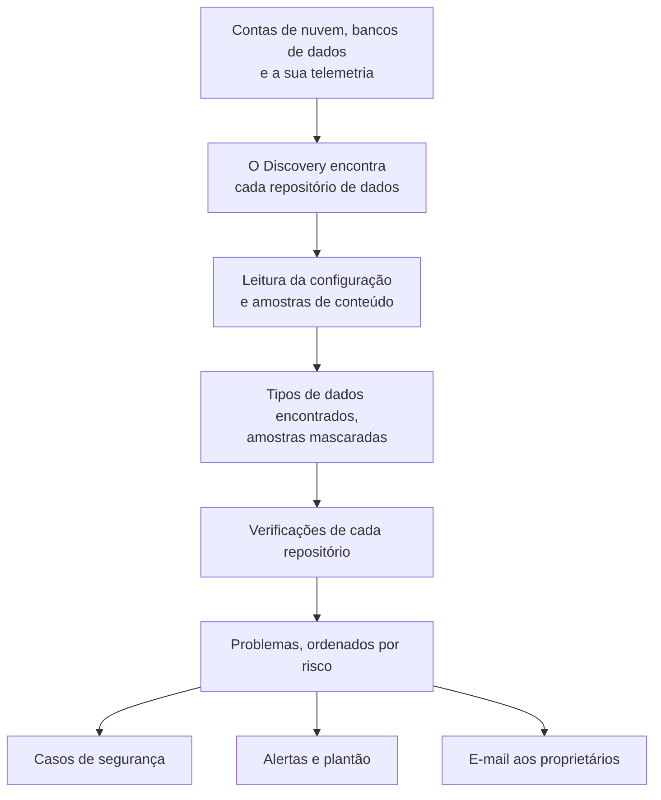

# Segurança de dados

A Segurança de dados encontra os dados sensíveis que a sua empresa guarda - em buckets na nuvem, bancos de dados e data warehouses, e na telemetria que você envia ao OneUptime - e diz o que há de errado na forma como eles são guardados. Ela encontra os repositórios sozinha, lê como cada um está configurado, coleta amostras do que ele contém e abre um problema para cada falha, classificado por risco.

Ela responde a quatro perguntas:

:::cards
- [Onde estão os nossos dados sensíveis?](/docs/data-security/data-types): 143 tipos de dados, de números de cartão e documentos nacionais de identidade a chaves de API, encontrados em buckets, tabelas e telemetria.
- [Eles estão expostos?](/docs/data-security/checks-and-issues): 32 verificações de cada repositório: acesso público, criptografia, backups, logs, segredos e cópias.
- [Quem pode acessá-los, e para onde eles vão?](/docs/data-security/flows-access-residency): Quem pode ler cada repositório, quais serviços o usam e quais provedores de IA e hosts os dados dele alcançam.
- [Eles atendem às nossas regras?](/docs/data-security/compliance): Regras de residência, e nove estruturas de conformidade pontuadas a partir do que as varreduras encontraram.
:::

## Como funciona

1. O **Discovery** encontra os repositórios que o OneUptime já conhece: o seu inventário de nuvem, os bancos de dados que o produto Database monitora, os bancos de dados com que os seus serviços se comunicam no mapa de serviços e a telemetria de cada serviço. Você só adiciona um repositório manualmente quando nenhuma origem o lista.
2. **A leitura da configuração** pergunta a cada nuvem como cada repositório está configurado: quem pode acessá-lo e como ele é criptografado, copiado em backup e registrado em logs. Ela lê configurações, nunca dados.
3. **As amostras de conteúdo** leem um pouco do que um repositório contém, onde você permitir: alguns objetos de cada tipo em um bucket, algumas linhas de cada tabela, os registros mais recentes da telemetria de cada serviço.
4. A **Classificação** encontra valores sensíveis nas amostras e guarda contagens e amostras mascaradas, nunca um valor.
5. As **Verificações** decidem o que há de errado com cada repositório e o quão grave isso é para os dados que ele contém. Cada verificação que falha abre um problema, que se fecha sozinho quando a verificação passa.

## O que a torna diferente

- **A sua telemetria é um repositório de dados.** Os logs, traces, exceções, replays de sessão e conversas de IA de cada serviço são verificados como um bucket, a cada hora. Um endereço de e-mail em uma linha de log é uma descoberta, e **Limpar** passa a mascará-lo na ingestão daí em diante. Veja [Dados sensíveis na telemetria](/docs/data-security/telemetry).
- **Os fluxos vêm do tráfego real.** O mapa de serviços diz qual serviço usa qual banco de dados, as chamadas de IA nomeiam o provedor que alcançam, e as cópias de dados de produção são encontradas comparando impressões digitais. Veja [Fluxos de dados, acesso e residência](/docs/data-security/flows-access-residency).
- **As evidências são sempre mascaradas.** Uma descoberta guarda contagens e no máximo três amostras mascaradas, como `j***@e******.com`, mascaradas dentro do scanner antes que qualquer coisa saia dele. Desative as amostras e ela guarda apenas contagens.
- **O scanner é de código aberto.** O padrão, a soma de verificação, as palavras de contexto e os valores de teste de cada tipo de dados estão no código-fonte do OneUptime, então você pode ler exatamente o que gera uma descoberta. O mesmo código roda nos workers do OneUptime, em uma sonda e na caixa **Testar**.
- **Ela funciona com o resto do OneUptime.** Um problema Crítico abre um caso de segurança sobre o repositório, para que o [Security Operations](/docs/telemetry/security-cases) o trate como qualquer outra ameaça. Ela pode gerar um alerta que aciona quem estiver de plantão, e envia e-mail aos proprietários do repositório. Veja [Integrações da Segurança de dados](/docs/data-security/integrations).
- **O OneUptime AI ajuda a corrigir.** **Explicar com IA** diz ao proprietário de um repositório o que está errado e como corrigir isso na própria nuvem, e **Corrigir com IA** abre um pull request no seu código de infraestrutura.

## Antes de começar

- **Uma função que possa configurá-la.** As funções Project Owner, Project Admin e Security Admin alteram as configurações da Segurança de dados. A função Security Member trata problemas e varre repositórios, e a função Security Viewer lê o que ela encontrou. As outras funções não veem nada disso, a menos que a equipe delas receba as permissões: quais buckets guardam números de cartão é exatamente o que um invasor quer saber. Veja [Funções](/docs/permissions/reference#funções).
- **Uma conta de nuvem para ler, ou um banco de dados.** A Segurança de dados lê uma conta de nuvem por meio de uma [conexão de nuvem](/docs/telemetry/cloud-accounts), e um banco de dados que você executa por meio de uma string de conexão somente leitura. A telemetria não precisa de nada: ela é varrida a cada hora.

## Início rápido

:::steps
### Conecte uma conta de nuvem

Acesse **Nuvem → Conectar** e escolha a sua nuvem. Se a conta já estiver conectada, escolha **Editar** na conexão dela. [Conectar uma conta de nuvem](/docs/telemetry/cloud-accounts) explica o passo a passo de cada nuvem.

### Escolha o nível de segurança de dados

Em **Mais campos**, defina **Segurança de dados** como **Somente configuração** para verificar como cada repositório está configurado, ou como **Configuração e amostras de conteúdo** para também encontrar os dados sensíveis dentro deles. O comando que o formulário mostra muda conforme a sua escolha: execute-o no shell da sua nuvem, como o formulário indica. [Configurar a Segurança de dados](/docs/data-security/setup) lista exatamente o que cada nível concede, e [Conectar uma conta de nuvem](/docs/telemetry/cloud-accounts#segurança-de-dados) mostra o comando de cada nível.

### Revise os problemas

Abra **Segurança de dados**. Os repositórios aparecem em **Repositórios de dados** à medida que são descobertos, a cada 15 minutos, e a configuração de uma conexão é lida em até uma hora. Os problemas abrem em **Problemas** assim que uma leitura ou uma varredura termina, cada um com a sua pontuação de risco, e a **Visão geral** mostra os cinco de maior risco. Cada problema diz o que está errado, por que isso importa e como corrigir, com os comandos para a sua nuvem.
:::

## O que conta como repositório de dados

| Onde | Repositórios | Amostras de conteúdo |
| --- | --- | --- |
| AWS | AWS S3 Bucket, AWS RDS Instance, AWS Aurora Cluster, AWS RDS Snapshot, AWS DynamoDB Table, AWS Redshift Cluster, AWS DocumentDB Cluster, AWS OpenSearch Domain, AWS ElastiCache Cluster, AWS EFS File System | AWS S3 Bucket |
| Azure | Azure Storage Account, Azure SQL Database, Azure Cosmos DB Account, Azure PostgreSQL Server, Azure MySQL Server | Azure Storage Account |
| Google Cloud | Google Cloud Storage Bucket, Google Cloud SQL Instance, Google BigQuery Dataset, Google Firestore Database, Google Spanner Instance, Google Bigtable Instance | Google Cloud Storage Bucket, Google BigQuery Dataset |
| Bancos de dados que você executa | PostgreSQL, MySQL, MongoDB, SQL Server, Oracle, Redis, Elasticsearch | PostgreSQL, MySQL |
| OneUptime | Logs, traces, exceções, replays de sessão, conversas de IA | Logs, traces, exceções, replays de sessão, conversas de IA |

Cada repositório recebe as verificações que se aplicam ao seu tipo. Um repositório cujo conteúdo não pode ser amostrado continua sendo verificado: um bucket público ou um banco de dados sem criptografia é um problema, seja o que for que ele contenha.

Um repositório é arquivado, com o seu histórico, assim que a origem dele deixa de listá-lo: **Repositórios arquivados**, no fim do menu da Segurança de dados, o guarda. Ele volta sozinho se a origem voltar a listá-lo.

A **Linha do tempo** de um repositório diz o que aconteceu com ele, e quem fez: quando foi encontrado ou adicionado, cada mudança nas suas configurações e nos seus proprietários, quando foi arquivado ou voltou, e cada exposição fechada a partir de um problema ou de um playbook.

## Com que frequência ela é executada

| O quê | Quando |
| --- | --- |
| Encontrar novos repositórios | A cada 15 minutos |
| Ler a configuração de uma conexão de nuvem | Uma vez por dia, e em até uma hora depois que o CloudTrail registra uma mudança no acesso, na criptografia, nos backups ou no compartilhamento de um repositório da AWS |
| Amostrar o conteúdo de um repositório | A cada 24 horas, ou com a frequência que **Varrer a cada (horas)** indicar |
| Amostrar a telemetria de cada serviço | A cada hora, a última hora dela |
| Verificar todos os repositórios de novo | Depois de cada leitura e varredura, depois que você muda qualquer coisa de que uma verificação depende, e uma vez por dia |

**Varrer agora** em um repositório amostra o conteúdo dele na hora, e **Verificar agora** lê a configuração dele de novo.

## Próximos passos

:::cards
- [Configurar a Segurança de dados](/docs/data-security/setup): Os três níveis, as permissões que cada um concede e a varredura dos seus próprios bancos de dados.
- [Tipos de dados sensíveis](/docs/data-security/data-types): Como um valor é encontrado, e cada tipo de dados que a Segurança de dados conhece.
- [Verificações e problemas da Segurança de dados](/docs/data-security/checks-and-issues): Cada verificação, a pontuação de risco e o que acontece com um problema.
- [Integrações da Segurança de dados](/docs/data-security/integrations): Casos de segurança, alertas, proprietários, fluxos de trabalho e o OneUptime AI.
:::
