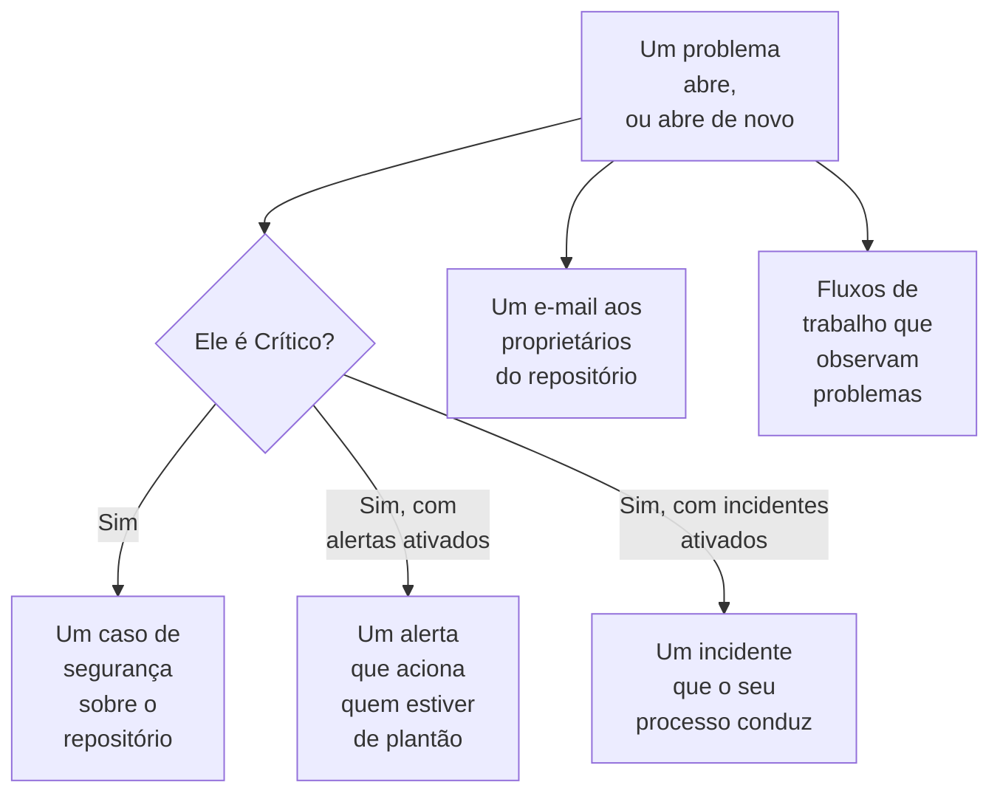

# Integrações da Segurança de dados

A Segurança de dados não tem um sistema de acionamento nem uma fila de segurança próprios. Ela entrega o que encontra às partes do OneUptime que já fazem isso: um problema Crítico vira um caso de segurança, ela pode acionar quem estiver de plantão ou declarar um incidente, e todo problema novo é enviado por e-mail aos proprietários do repositório. Fluxos de trabalho, o OneUptime AI, a API, o Terraform e o servidor MCP alcançam tudo o que ela guarda.

:::cards
- [Security Operations](#security-operations): Um caso de segurança para cada repositório com um problema Crítico.
- [Foi uma violação de dados?](#foi-uma-violação-de-dados): Cada exposição Crítica avaliada: por quanto tempo, quem podia lê-la, de quem eram os dados e as leis sobre violações de dados que podem se aplicar.
- [Alertas e plantão](#alertas-e-plantão): Acione quem estiver de plantão quando um problema Crítico abrir.
- [Incidentes](#incidentes): Declare um incidente para uma violação que o seu processo de incidentes deve tratar.
- [Proprietários](#proprietários): Analise um problema, abra um pull request que o corrija, ou pergunte ao Pergunte à IA sobre seus dados e deixe que ele aja, com a sua aprovação.
- [OneUptime AI](#oneuptime-ai): Explique um problema, abra um pull request que o corrige, ou pergunte sobre os seus dados no Pergunte à IA.
- [Fechar uma exposição](#fechar-uma-exposição): Bloqueie o acesso público ou pare de compartilhar, a partir de um problema ou de um playbook, e ative uma proteção que falta a partir de um problema.
:::

## Como funciona

Cada um deles roda quando uma avaliação abre um problema, ou o abre de novo. Cada um é de melhor esforço: o problema já está aberto e na linha do tempo dele, então uma integração que falha é registrada em log e ignorada, nunca repetida a ponto de gerar um segundo caso ou um segundo acionamento. O que cada um fez é gravado na **Linha do tempo** do problema, e a página do problema tem links para o caso, o alerta e o incidente que ele originou.

| Configuração | Padrão | O que faz |
| --- | --- | --- |
| **Abrir casos de segurança** | Ativado | Um problema Crítico abre um caso de segurança, agrupado por repositório. |
| **Gerar alertas** | Desativado | Um problema Crítico gera um alerta, que aciona quem estiver de plantão. |
| **Severidade do alerta** | Vazio | A severidade desses alertas. Vazio é a mais grave do projeto. |
| **Declarar incidentes** | Desativado | Um problema Crítico declara um incidente, que o seu processo de incidentes conduz. |
| **Severidade do incidente** | Vazio | A severidade desses incidentes. Vazio é a mais grave do projeto. |
| **Notificar proprietários** | Ativado | Todo problema novo é enviado por e-mail aos proprietários do repositório dele. |

## Security Operations

Todo repositório é uma entidade própria no Security Operations, do tipo **Repositório de dados**. Com **Abrir casos de segurança** ativado, um problema Crítico é enviado ao Security Operations como uma detecção sobre o repositório:

- a origem dela é **Segurança de dados**, e a regra dela recebe o nome da verificação, como `Data Security: public-read`;
- ela é Crítica, então o caso que ela abre fica na prioridade Crítica do projeto;
- ela é agrupada pelo repositório: um segundo problema Crítico no mesmo repositório entra no caso aberto sobre ele em vez de abrir outro.

A partir daí o caso é tratado como qualquer outro: atribuído, anotado, fechado e respondido pelos playbooks do projeto. As detecções do repositório contam para o risco dele em [Risco de entidades](/docs/telemetry/security-entity-risk), como as de qualquer entidade. Veja [Casos de segurança e playbooks](/docs/telemetry/security-cases).

Qualquer caso de segurança, seja lá o que o tenha aberto, mostra os dados em risco no seu **Impacto**: os repositórios com dados sensíveis de que o caso trata, e cada repositório que os usuários e funções dele podem alcançar, o mais sensível primeiro, com o que cada um contém, cerca de quantos registros, o quão exposto está e quantas identidades podem alcançá-lo. Uma sessão de função assumida que o caso nomeia conta como a função dela, e um endereço de e-mail como os usuários de nuvem a que ele pertence. A leitura usa as próprias permissões de quem lê, então uma função que não pode ler a Segurança de dados vê que essa parte ficou de fora.

## Foi uma violação de dados?

Uma exposição Crítica de um repositório com dados de sensibilidade **Restrito** ou **Confidencial** - aberto a qualquer pessoa na internet, compartilhado com contas de fora da sua, ou um snapshot que outros podem restaurar - tem o seu caso avaliado por conta própria, assim que o caso é aberto. Qualquer outro caso sobre um repositório de dados é avaliado quando uma pessoa aciona **Avaliar esta exposição** na **Visão geral** dele. Código simples calcula a avaliação a partir do que o OneUptime registrou, e a calcula de novo cada vez que ela é lida:

- **Por quanto tempo ficou aberto**: desde a mudança no log da sua nuvem que expôs o repositório, quando uma foi registrada nos 30 dias antes de a exposição ser encontrada, ou, caso contrário, pelo menos desde que a Segurança de dados a encontrou; até quando a própria resposta da Segurança de dados a fechou, uma mudança a fechou ou uma verificação a encontrou fechada.
- **Quem podia lê-lo**: se o repositório registrava as leituras. Onde não registrava, a avaliação diz "As leituras não foram registradas. Considere que os dados foram lidos." Ela conta as contas de fora da sua empresa que podiam ler o repositório, e quantas delas usaram o próprio acesso enquanto ele estava aberto, sem nunca nomeá-las.
- **De quem eram os dados**: o que o repositório contém, cerca de quantos registros, a quem eles se referem e onde moram os titulares, segundo os dados e segundo o que uma pessoa informa.
- **Os segredos a trocar**: cada segredo encontrado no repositório enquanto ele estava aberto, pelo tipo e pelo local onde foi encontrado, nunca o valor dele.
- **As leis sobre violações de dados que podem se aplicar**: cada linha da tabela de leis sobre violações de dados do OneUptime, com o que ela exige, de quem, o prazo dela contado a partir de quando a Segurança de dados encontrou a exposição, e o que uma pessoa ainda verifica antes que ela se aplique.

A tabela cobre os artigos 33 e 34 do GDPR, os artigos 33 e 34 do UK GDPR, a Breach Notification Rule da HIPAA, o requisito 12.10.1 do PCI DSS, a LGPD do Brasil, as DPDP Rules e as diretivas do CERT-In da Índia, e as leis sobre violações de dados da Califórnia, do Colorado, da Flórida, de Nova York, do Texas e de Washington. Cada linha tem um link para o texto da própria lei, a sua fonte, e diz o dia em que foi verificada com base nele pela última vez. O que a tabela não cobre - outro país, outro estado dos EUA, onde a sua organização está estabelecida, os seus contratos - a avaliação diz em palavras simples.

O OneUptime AI redige a avaliação conforme as suas regras de IA da Segurança de dados permitem, ou quando uma pessoa pede: o que isso significa, uma notificação ao órgão regulador, uma notificação aos titulares afetados e um resumo interno (veja [OneUptime AI na Segurança de dados](/docs/data-security/ai)). Cada rascunho é confrontado com os fatos da avaliação: um número ou uma lei que nenhum deles contém o descarta. Nada é enviado a lugar nenhum: uma notificação é um texto que uma pessoa edita e copia, e a avaliação e cada rascunho dizem que não são aconselhamento jurídico.

Os leitores do caso que também podem ler o repositório e as descobertas dele veem a avaliação, já que ela nomeia o que o repositório contém. Avaliar, redigir, editar uma notificação e informar onde moram os titulares também exigem permissão para editar o caso. Veja [Foi uma violação de dados?](/docs/telemetry/security-cases#foi-uma-violação-de-dados) para os cartões do caso.

## Alertas e plantão

Com **Gerar alertas** ativado, um problema Crítico gera um alerta, chamado "Data Security:" seguido do título do problema e do repositório. O alerta aciona quem estiver de plantão pelas próprias regras dele, como qualquer outro alerta (veja [Alertas](/docs/alerts/index) e [Plantão](/docs/on-call/index)). Um problema tem no máximo um alerta aberto por vez, por mais que seja avaliado. **Severidade do alerta** define a severidade do alerta; deixada vazia, é a mais grave do projeto.

Um alerta termina junto com o problema dele: assim que o problema deixa de estar aberto - a verificação dele passa, ou uma pessoa o marca como resolvido, aceita o risco dele ou diz que não é um problema - o alerta é resolvido, e a **Linha do tempo** do problema registra isso. Um problema que abre de novo gera um novo alerta.

Os alertas vêm desativados por padrão porque um caso de segurança é onde a maioria das equipes quer ver primeiro uma descoberta de segurança de dados. Ative-os quando um bucket público de números de cartão deve acordar alguém.

## Incidentes

Com **Declarar incidentes** ativado, um problema Crítico declara um incidente, chamado como o alerta dele, para uma violação que o seu processo de incidentes deve tratar: plantão, canais do workspace, páginas de status e um postmortem (veja [Incidentes](/docs/incidents/index)). Um problema tem no máximo um incidente aberto por vez. **Severidade do incidente** define a severidade do incidente; deixada vazia, é a mais grave do projeto.

A Segurança de dados nunca resolve um incidente, mesmo depois que o problema dele é resolvido: um incidente pode ter uma página de status e um postmortem, então quem o conduz é quem o fecha. Um caso de segurança é o outro caminho para um incidente: **Declarar incidente** no caso abre um incidente vinculado a ele (veja [Declarar um incidente](/docs/telemetry/security-cases#declarar-um-incidente)).

## Proprietários

Os proprietários de um repositório são pessoas e equipes, na página **Proprietários** do repositório. É para eles que um problema existe: eles recebem o e-mail, e **Este repositório sensível não tem proprietário** falha em um repositório sensível que não tem nenhum.

Com **Notificar proprietários** ativado, cada avaliação que abre problemas em um repositório envia aos proprietários dele um único e-mail - as pessoas que são proprietárias e os membros das equipes que são, até 50 - com um título que diz quantos problemas novos o repositório tem, como "Data Security: 2 new issues on orders-db". Ele lista a gravidade e o título de cada problema novo e a sensibilidade do repositório, e leva ao repositório. Ele nunca contém uma amostra.

Enquanto o OneUptime AI trabalha sozinho nos problemas novos, o e-mail espera a análise dele, por até 10 minutos, e dá a cada problema analisado mais duas linhas: o veredito e o porquê, e o caminho mais curto para a correção. Cada proprietário recebe as linhas que pode ler: um proprietário que não pode ler o problema não recebe nenhuma, e uma linha que se baseia em algo que ele não pode ler fica de fora.

### Regras de proprietário e regras de rótulos

As regras definem proprietários e rótulos por você, à medida que os repositórios são encontrados:

| Regra | Onde | O que faz |
| --- | --- | --- |
| **Regras de proprietário** | **Segurança de dados → Regras → Regras de proprietário** | Adiciona usuários e equipes proprietários a todo repositório que corresponde |
| **Regras de Rótulos** | **Segurança de dados → Regras → Regras de Rótulos** | Adiciona rótulos a todo repositório que corresponde |

Uma regra corresponde a um repositório pelos rótulos dele, por um padrão do nome ou da descrição dele, ou por **Padrão de tag de nuvem**: um padrão comparado com cada uma das tags de nuvem do repositório, escritas `key=value`. `^team=payments$` corresponde a todo repositório com a tag `team=payments`, e `^env=` a todo repositório com uma tag `env`. Um repositório novo recebe as regras do projeto no momento em que é encontrado, e o **Notificar proprietários** de uma regra de proprietário diz se os proprietários que ela adiciona são avisados. [Regras de rótulos e proprietários](/docs/configuration/label-and-owner-rules) diz como cada regra corresponde e quando as regras rodam.

### Proprietários que o OneUptime AI propõe

Um repositório sem proprietários pode recebê-los do OneUptime AI. Ele lê o que já aponta para um proprietário - as tags de nuvem do repositório, os serviços que o usam, os proprietários do código do arquivo que o declara, e quem o alterou ou adicionou - e propõe a partir disso equipes e pessoas do seu próprio projeto. Nada muda até que uma pessoa aprove em **Proprietários para revisar**, em **Repositórios de dados** ou em **Segurança de dados → IA**, e os proprietários adicionados são avisados como qualquer proprietário. Quando os proprietários de três ou mais repositórios se apoiam em uma tag ou em um começo de nome, ele também propõe a regra de proprietário que mantém com proprietário o próximo repositório como esses, que entra nas **Regras de proprietário** depois de aprovada. [OneUptime AI na Segurança de dados](/docs/data-security/ai) diz o que ele envia e quando roda.

## Fluxos de trabalho

**Repositório de dados** e **Problema de segurança de dados** são gatilhos de fluxo de trabalho, cada um com **Ao criar**, **Ao atualizar**, **Ao criar ou atualizar** e **Ao excluir**. Escolha-os no painel **Adicionar gatilho**, em **Recursos do OneUptime**.

- **Problema de segurança de dados → Ao criar** roda quando um problema abre pela primeira vez. Leia a gravidade dele em um bloco **Se / Senão**, e publique os Críticos em um canal ou abra um ticket no seu rastreador.
- **Problema de segurança de dados → Ao atualizar**, com **Campos a observar** definido como o status dele, roda quando um problema é resolvido, aceito ou abre de novo.
- **Repositório de dados → Ao criar** roda quando o Discovery encontra um repositório, por exemplo para avisar uma equipe sobre cada bucket novo.

Veja [Gatilhos de fluxo de trabalho](/docs/workflows/triggers) para os campos que cada gatilho repassa.

## Pull requests

Um vazamento sai mais barato de corrigir antes do merge. Em um repositório conectado em **Código** com as revisões de produção ativadas, a revisão de cada pull request tem uma seção **Dados sensíveis**, lida do diff dele: código que grava dados pessoais ou um segredo na telemetria, em um log, em um span, em uma métrica, na mensagem de uma exceção, no relatório de um rastreador de erros ou no usuário de uma sessão gravada, código de infraestrutura que torna público um repositório de dados ou desativa a criptografia, os backups ou o log dele, e migrações que adicionam colunas para dados pessoais, senhas ou dados de cartão. Cada ponto nomeia a verificação da Segurança de dados em que a alteração falharia depois de implantada, e os seus próprios tipos de dados são lidos pelas dicas de nome deles, como as varreduras os leem. Veja [Revisão de produção de pull requests](/docs/ai/ai-agent#revisão-de-produção-de-pull-requests).

O que a Segurança de dados sabe deixa esses pontos mais precisos, no comentário de um repositório privado e, no Código, para quem pode ler as descobertas da Segurança de dados: onde a telemetria do serviço conteve o mesmo tipo de dado nos últimos 7 dias - ou, para o código de um aplicativo web ou móvel, os replays de sessão da aplicação RUM dele - a regra de limpeza que o mascara na ingestão, e o repositório de dados que um recurso é, com a sensibilidade dele. Para uma migração, só em um repositório privado, o ponto nomeia o repositório de dados em que a tabela está, o que ele contém, se ele é acessível de fora ou não é criptografado em repouso, e as colunas da tabela em que o mesmo tipo de dado já foi encontrado. Um repositório marcado como **Público por design** não gera ponto por ser público. O comentário de um repositório público só diz o que o diff mostra.

**Vazamentos detectados antes do merge**, em **Configurações do projeto → IA → Resultados de IA**, conta os vazamentos que as revisões detectaram em pull requests, corrigidos ali ou ainda não, ao lado dos problemas que as varreduras abriram nas mesmas verificações depois que o código foi implantado.

## OneUptime AI

Duas ações em um problema pedem ajuda ao OneUptime AI. As duas enviam ao OneUptime AI o título e a gravidade do problema, o nome, o tipo, a região e o ID de nuvem do repositório, a sensibilidade e os tipos de dados dele, cada um pelo seu nome (os seus próprios pelo nome que você deu a eles), a evidência, por que a verificação importa e a correção para a nuvem do repositório - nunca as amostras de uma descoberta. As duas rodam sob os interruptores e limites de OneUptime AI do projeto. O que cada uma envia, o que nunca envia e o modelo em que roda estão em [OneUptime AI na Segurança de dados](/docs/data-security/ai).

- **Analisar problema**, no topo da página do problema, faz o OneUptime AI escrever sua análise: se o problema é real, o que põe em risco, o que a correção quebraria e o caminho mais curto para a correção (veja [Verificações e problemas da Segurança de dados](/docs/data-security/checks-and-issues)). Ela também envia quem consegue alcançar o repositório - cada concessão e aproximadamente quando foi usada pela última vez, e os serviços vistos usando-o -, as cópias dos seus dados em outros repositórios, seus casos de segurança, a ação de resposta que corrige o problema, o repositório de código e os arquivos que declaram o repositório de dados, e quantos proprietários ele tem, nunca quem são. A análise fica guardada no problema, e o veredito na **Linha do tempo** do problema. Nem o que foi enviado nem a resposta ficam em **Configurações do projeto → IA → Registros de IA**, que qualquer Membro do projeto e Visualizador pode ler: essa linha diz apenas que a chamada foi feita e quanto custou. Qualquer pessoa que possa ler o problema pode pedir, e **Explicar com IA** pela API e pelo servidor MCP responde com a mesma análise.
- **Corrigir com IA** pede ao OneUptime AI que corrija o problema no seu código de infraestrutura - Terraform, CloudFormation, Bicep ou similares - com a menor mudança que faz a verificação passar, e que abra um pull request. Ele precisa que o repositório de código com o código de infraestrutura do repositório de dados esteja conectado em **Código**: escolha-o em **Repositório** quando você puder pedir em vários. O pull request aparece em **Código** (veja [Código](/docs/ai/ai-agent)). Membros de segurança e funções acima podem pedir, em um repositório que possam alterar em **Código**, como exige pedir à IA ali: uma função de segurança sozinha não lê nem altera nenhum repositório, então dê também à equipe deles **Read Code Repository** e **Edit Code Repository**. Quando a IA não pode trabalhar agora (está desligada, o projeto ficou sem créditos de IA, atingiu seus limites diários ou nenhum Runner está online), Corrigir com IA diz o que corrigir e não inicia nada. Para um problema na telemetria de um serviço, ele primeiro mostra um só pull request para todos os vazamentos do serviço, com onde seus registros dizem que cada um é escrito - nunca um valor -, e onde os dados são escritos em mais de três lugares ele adiciona, em vez disso, uma etapa de ocultação com um teste: veja [Corrigir no código](/docs/data-security/telemetry#corrigir-no-código).

O OneUptime AI também trabalha por conta própria em cada novo problema, como suas regras de IA permitem: veja [OneUptime AI na segurança de dados](/docs/data-security/ai).

### Pergunte à IA

**Pergunte à IA** lê a Segurança de dados e age nela com a sua aprovação. Em qualquer página de Segurança de dados, pergunte quais repositórios guardam números de cartão, o que corrigir primeiro ou quais repositórios uma função poderia alcançar se vazasse; na página de um repositório ou de um problema, ele lê esse registro primeiro. Ele lê com estas ferramentas, executadas com as suas próprias permissões:

| Ferramenta | O que lê |
| --- | --- |
| `query_data_stores` | Os repositórios, os de maior risco primeiro, por sensibilidade, tipo de dados, exposição, provedor ou nome - ou um repositório com o que foi encontrado onde, quem pode acessá-lo e os problemas abertos dele |
| `query_data_security_issues` | Os problemas, os de maior risco primeiro, por status, gravidade, repositório ou verificação - ou um problema com a evidência dele e a correção para a nuvem dele |
| `query_data_store_access` | Quem pode acessar um repositório, ou todo repositório que uma entidade principal pode acessar |

Elas leem tipos de dados, locais e contagens, nunca as amostras de uma descoberta, mascaradas ou não. Mais duas leem aquilo em que o OneUptime AI trabalha: `query_data_security_proposals` lista o que ele propõe, e os tipos de dados que ele encontrou e que as varreduras ainda não procuram, cada um com como foi comprovado e os campos em que está, nunca um valor; `draft_data_security_rule` redige uma regra a partir da sua frase e diz quais repositórios ela abrange hoje. Ela não salva nada.

Pergunte à IA faz o que os botões da Segurança de dados fazem, cada um fazendo exatamente a alteração que o seu botão faz, como você e com as suas permissões:

| Ação | O que faz | Pergunta antes |
| --- | --- | --- |
| `scrub_data_security_finding` | **Limpar** em uma descoberta na telemetria: a regra de limpeza comprovada e precisa dela | Em **Perguntar antes de agir**, e em todos os modos quando algo lê o que ela oculta |
| `judge_data_security_finding` | **Confirmar**, ou **Não sensível** com o seu motivo, e o mesmo para as descobertas parecidas | **Não sensível** em todos os modos; **Confirmar** em todos os modos quando um problema crítico aciona alguém no seu projeto |
| `change_data_security_issue` | **Aceitar o risco** com o seu motivo e uma data final, **Não é um problema** com o seu motivo, **Reabrir** ou **Atribuir** | **Aceitar o risco** e **Não é um problema** em todos os modos |
| `set_data_store_owners` | Adiciona ou remove os proprietários de um repositório | Em todos os modos |
| `save_data_security_rule` | Salva uma regra de residência, de proprietário ou de rótulos redigida a partir da sua frase, e aplica uma regra de proprietário ou de rótulos aos repositórios que ela abrange hoje | Em todos os modos |
| `respond_on_data_store` | Uma ação de resposta pela conexão de nuvem do repositório, como **Bloquear acesso público** | Em todos os modos |
| `fix_data_security_issue_with_ai` | **Corrigir com IA**: um pull request que alguém revisa e mescla. Uma correção que já está a caminho não é iniciada duas vezes | Em **Perguntar antes de agir** |
| `decide_data_security_proposal` | **Aprovar** ou **Dispensar** o que o OneUptime AI propõe. Um tipo de dado encontrado é adicionado pelo formulário dele em **Configurações → Tipos de dados**, então aqui ele só pode ser recusado | Em todos os modos |

Cada ação mostra primeiro um cartão que diz, em palavras simples, o que muda, o que para de funcionar e quanto custa. Em **Perguntar antes de agir**, você permite ou pula cada ação. Em **Execução automática**, as ações acima que perguntam em todos os modos continuam esperando por você: elas mudam quem pode alcançar os seus dados, fazem uma descoberta ou um problema deixar de contar, mudam quem é avisado sobre um repositório ou deixariam o OneUptime AI aprovar a própria proposta. Nomes de repositórios, locais de descobertas e evidências vêm das suas nuvens e de qualquer um que escreva nelas, então Pergunte à IA nunca age porque esse texto pede, e cada ação é verificada de novo, com as suas permissões, quando é executada.

## Fechar uma exposição

Duas mudanças fecham a exposição de um repositório de nuvem, cada uma pela conexão de nuvem do repositório com **Resposta de segurança de dados** ativada (veja [Configurar a Segurança de dados](/docs/data-security/setup#deixe-a-segurança-de-dados-fechar-uma-exposição)), e outras seis ativam uma configuração que protege um repositório, só a partir do problema dele:

- **Bloquear acesso público**, em um bucket do S3, uma conta de armazenamento do Azure ou um bucket do Cloud Storage.
- **Revogar compartilhamento**, em um snapshot do RDS, ou nos snapshots manuais compartilhados de um banco de dados RDS, de um cluster Aurora ou de um cluster DocumentDB.
- **Ativar o versionamento**, **Ativar a exclusão reversível**, **Desativar as ACLs de objeto**, **Ativar o acesso uniforme**, **Exigir transferência segura** e **Ativar a recuperação pontual**, nos repositórios que [Corrigir daqui](/docs/data-security/checks-and-issues#corrigir-daqui) lista.

Uma pessoa executa uma delas a partir de um problema aberto que ela corrige, com **Corrigir daqui** (veja [Verificações e problemas da Segurança de dados](/docs/data-security/checks-and-issues#corrigir-daqui)). Um playbook do Security Operations as executa como etapas da categoria **Conter**, **Bloquear o acesso público a repositórios de dados** e **Revogar o compartilhamento do repositório de dados**: em cada repositório de dados de que o caso trata, no máximo 10, cada uma uma etapa que começa com **Requer aprovação** ativado. Um repositório marcado como **Público por design** nunca é bloqueado. De qualquer forma, o feed do repositório diz o que foi feito, e o repositório é verificado de novo na hora, então o problema se resolve quando a mudança surte efeito.

O modelo de playbook **Fechar uma exposição de dados** responde aos casos que a Segurança de dados abre: ele envia e-mail aos proprietários do repositório, bloqueia o acesso público e revoga o compartilhamento depois que uma pessoa aprova cada etapa, e adiciona ao caso a checklist da resposta como tarefas - quem leu os dados enquanto estavam expostos, se é uma violação que você precisa notificar, quais segredos trocar e o que escrever quando o caso for fechado. Adicione-o em **Criar a partir de modelo** nos playbooks do projeto. O cartão **Foi uma violação de dados?** do caso responde a cada uma dessas tarefas (veja [Foi uma violação de dados?](#foi-uma-violação-de-dados)).

## API, Terraform e MCP

Tudo o que a Segurança de dados guarda é um registro da API do OneUptime, lido com as mesmas permissões que no painel (veja a [Referência da API](/docs/api-reference/api-reference)):

| Registros | Caminho da API |
| --- | --- |
| Repositórios de dados, as linhas do tempo deles, as descobertas deles, quem pode acessá-los e cada identidade que pode | `/data-store`, `/data-store-feed`, `/data-store-finding`, `/data-store-access`, `/data-security-identity` |
| Problemas, as linhas do tempo deles, os pull requests vinculados a eles e fluxos de dados | `/data-security-issue`, `/data-security-issue-feed`, `/data-security-issue-pull-request`, `/data-security-flow` |
| Varreduras | `/data-security-scan` |
| Tipos de dados personalizados, configurações das verificações, configurações de conformidade e regras de residência | `/data-security-custom-data-type`, `/data-security-check-setting`, `/data-security-compliance-setting`, `/data-security-residency-rule` |
| As configurações do projeto | `/data-security-setting` |
| Proprietários, regras de proprietário e regras de rótulos | `/data-store-owner-user`, `/data-store-owner-team`, `/data-store-owner-rule`, `/data-store-label-rule` |
| O que o OneUptime AI propõe para um problema, e por que ele agiu ou não em um | `/data-security-ai-proposal`, `/data-security-ai-decision` |

Algumas respostas são calculadas no momento do pedido, em vez de armazenadas. Cada uma é um `POST`:

| Caminho | O que faz |
| --- | --- |
| `/data-security/overview` | Os números da Visão geral: repositórios por sensibilidade e categoria, problemas abertos por gravidade, os problemas de maior risco e os últimos 30 dias deles |
| `/data-security/compliance` | A pontuação e os requisitos de cada estrutura de conformidade |
| `/data-security/resource-scope` | Os repositórios de dados de um recurso - um cluster do Kubernetes, um host do Docker ou do Podman, um banco de dados, um serviço ou um recurso de nuvem - e de qual recurso eles seguem os interruptores de conformidade |
| `/data-security/resource-compliance` | As estruturas de conformidade de um recurso: as pontuações delas para os repositórios dele, e o que está desativado para ele |
| `/data-security/record-of-processing` | O registro das atividades de tratamento do RGPD, uma linha para cada repositório que guarda dados pessoais. Um repositório que o OneUptime guarda para a sua segurança tem um objeto `declared`: a sua própria finalidade e retenção, e quem pode lê-lo |
| `/data-store/<id>/declared` | O que o registro diz de um repositório que o OneUptime guarda para a sua segurança: o que ele guarda, por quê, por quanto tempo e quem pode lê-lo |
| `/data-store/<id>/scan-now` | **Varrer agora**: amostra o conteúdo do repositório na hora |
| `/data-store/<id>/check-now` | **Verificar agora**: lê a configuração do repositório de novo e executa as verificações dele |
| `/data-store-finding/<id>/scrub` | **Limpar** em uma descoberta de telemetria |
| `/data-store-finding/<id>/drop-metric-impact` | O que **Descartar esta métrica** descartaria para uma descoberta no nome de uma métrica: quantas métricas, e os monitores, painéis, SLOs e regras de gravação que as leem |
| `/data-store-finding/<id>/drop-metric` | **Descartar esta métrica**: uma regra de pipeline de métricas que descarta para sempre os novos pontos de dados dessas métricas do serviço. Recebe `{"confirmDataLoss": true}` |
| `/data-security-issue/<id>/explain` | **Explicar com IA**: a análise de um problema pelo OneUptime AI, como **Analisar problema** a escreve. Ela devolve a análise guardada no problema quando nada em que se baseia mudou e, caso contrário, escreve uma nova; `{"force": true}` escreve uma nova, como **Analisar novamente** |
| `/data-security-issue/<id>/analysis` | A análise guardada no problema, como você pode lê-la. Ela nunca pergunta ao OneUptime AI |
| `/data-security-issue/<id>/fix-with-ai` | **Corrigir com IA** em um problema |
| `/data-store/<id>/response-actions` | Quais ações de resposta o repositório pode receber agora, e por que não |
| `/data-store/<id>/respond` | Uma ação de resposta no repositório, como **Bloquear acesso público** ou **Ativar o versionamento**, com o problema a partir do qual foi executada |
| `/data-security-ai-proposal/<id>/approve` | **Aprovar** em uma mudança que o OneUptime AI propõe, que a faz com as suas próprias permissões. Recebe o `expectedPlanFingerprint` da proposta que foi mostrada a você e recusa uma que mudou desde então |
| `/data-security-ai-proposal/<id>/dismiss` | **Dispensar proposta**, com `{"reason": "..."}`, que vai para a linha do tempo do problema |
| `/data-security-ai-proposal/<id>/undo` | **Desfazer** em uma mudança que o OneUptime AI fez: ela é revertida, e o repositório é verificado de novo |
| `/security-case/<id>/exposure-assessment` | A avaliação da exposição de um caso de segurança, como você pode lê-la: o que o código simples calcula sobre o repositório de que o caso trata, e o texto redigido pelo OneUptime AI |
| `/security-case/<id>/exposure-assessment/assess` | **Avaliar esta exposição**: inicia a avaliação do caso, do repositório que `{"dataStoreId": "..."}` indica quando o caso trata de mais de um |
| `/security-case/<id>/exposure-assessment/draft` | **Redigir com o OneUptime AI**: o OneUptime AI redige cada parte que nenhuma pessoa editou. Nada é enviado |
| `/security-case/<id>/exposure-assessment/edit` | Uma parte nas palavras de uma pessoa, como `{"part": "regulatorNotice", "markdown": "..."}`, que nunca é redigida de novo |
| `/security-case/<id>/exposure-assessment/people` | Onde moram os titulares dos dados, como `{"places": ["EEA", "GB"]}`; uma lista vazia desfaz a resposta |

O [provedor do Terraform](/docs/terraform/index) tem um recurso para cada tipo de registro que você cria - repositórios de dados que você mesmo adiciona, tipos de dados personalizados, configurações das verificações, configurações de conformidade, regras de residência, regras de proprietário e de rótulos - com o nome do registro, como `oneuptime_residency_rule`.

O [servidor MCP](/docs/ai/mcp-server) tem ferramentas de criar, obter, listar, atualizar, excluir e contar para estes registros: Data Store, Data Store Finding, Data Store Access Entry, Data Security Identity, Data Flow, Data Security Issue, Data Security Scan, Custom Data Type, Check Setting, Compliance Setting, Residency Rule e Data Security Setting. Um assistente de IA pode então perguntar quais repositórios guardam números de cartão, ou o que está aberto em um bucket, com as suas permissões. Ele também tem [as ações do Pergunte à IA](#pergunte-à-ia), uma chamada cada, e cada uma faz exatamente a alteração que o seu botão faz, como você. O servidor MCP não pode mostrar um cartão a ninguém, então uma ação sobre a qual o Pergunte à IA pergunta em todos os modos é recusada lá: a resposta diz por quê e nomeia a página do OneUptime em que você faz a alteração. Também é recusada ali uma escrita em um destes registros que faz a mesma alteração, como o `status` de um problema mudado para `Accepted` por meio de `update_data_security_issue`, um tipo de dados desativado ou um local deixado fora das varreduras de um repositório; qualquer outro campo muda como antes.

## Próximos passos

:::cards
- [Casos de segurança e playbooks (SOAR)](/docs/telemetry/security-cases): Trate os casos que a Segurança de dados abre.
- [Regras de rótulos e proprietários](/docs/configuration/label-and-owner-rules): Como as regras correspondem, e quando rodam.
- [Gatilhos de fluxo de trabalho](/docs/workflows/triggers): Execute um fluxo de trabalho quando um problema abrir ou um repositório for encontrado.
- [Verificações e problemas da Segurança de dados](/docs/data-security/checks-and-issues): O que cada problema significa, e como corrigi-lo.
:::
