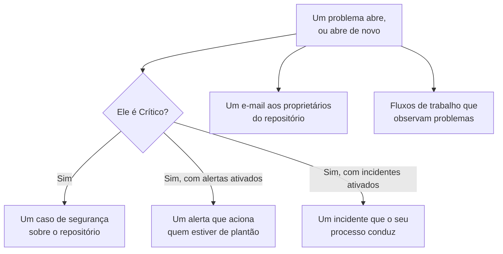

# Integrações da Segurança de dados

A Segurança de dados não tem um sistema de acionamento nem uma fila de segurança próprios. Ela entrega o que encontra às partes do OneUptime que já fazem isso: um problema Crítico vira um caso de segurança, ela pode acionar quem estiver de plantão ou declarar um incidente, e todo problema novo é enviado por e-mail aos proprietários do repositório. Fluxos de trabalho, o OneUptime AI, a API, o Terraform e o servidor MCP alcançam tudo o que ela guarda.

:::cards
- [Security Operations](#security-operations): Um caso de segurança para cada repositório com um problema Crítico.
- [Alertas e plantão](#alertas-e-plantão): Acione quem estiver de plantão quando um problema Crítico abrir.
- [Incidentes](#incidentes): Declare um incidente para uma violação que o seu processo de incidentes deve tratar.
- [Proprietários](#proprietários): Quem é proprietário de cada repositório, definido manualmente ou por regras, e o e-mail que recebem.
- [OneUptime AI](#oneuptime-ai): Explique um problema, abra um pull request que o corrige, ou pergunte sobre os seus dados no Pergunte à IA.
- [Fechar uma exposição](#fechar-uma-exposição): Bloqueie o acesso público ou pare de compartilhar, a partir de um problema ou de um playbook.
:::

## Como funciona

Cada um deles roda quando uma avaliação abre um problema, ou o abre de novo. Cada um é de melhor esforço: o problema já está aberto e na linha do tempo dele, então uma integração que falha é registrada em log e ignorada, nunca repetida a ponto de gerar um segundo caso ou um segundo acionamento. O que cada um fez é gravado na **Linha do tempo** do problema, e a página do problema tem links para o caso, o alerta e o incidente que ele originou.

| Configuração | Padrão | O que faz |
| --- | --- | --- |
| **Abrir casos de segurança** | Ativado | Um problema Crítico abre um caso de segurança, agrupado por repositório. |
| **Gerar alertas** | Desativado | Um problema Crítico gera um alerta, que aciona quem estiver de plantão. |
| **Severidade do alerta** | Vazio | A severidade desses alertas. Vazio é a mais grave do projeto. |
| **Declarar incidentes** | Desativado | Um problema Crítico declara um incidente, que o seu processo de incidentes conduz. |
| **Severidade do incidente** | Vazio | A severidade desses incidentes. Vazio é a mais grave do projeto. |
| **Notificar proprietários** | Ativado | Todo problema novo é enviado por e-mail aos proprietários do repositório dele. |

## Security Operations

Todo repositório é uma entidade própria no Security Operations, do tipo **Repositório de dados**. Com **Abrir casos de segurança** ativado, um problema Crítico é enviado ao Security Operations como uma detecção sobre o repositório:

- a origem dela é **Segurança de dados**, e a regra dela recebe o nome da verificação, como `Data Security: public-read`;
- ela é Crítica, então o caso que ela abre fica na prioridade Crítica do projeto;
- ela é agrupada pelo repositório: um segundo problema Crítico no mesmo repositório entra no caso aberto sobre ele em vez de abrir outro.

A partir daí o caso é tratado como qualquer outro: atribuído, anotado, fechado e respondido pelos playbooks do projeto. As detecções do repositório contam para o risco dele em [Risco de entidades](/docs/telemetry/security-entity-risk), como as de qualquer entidade. Veja [Casos de segurança e playbooks](/docs/telemetry/security-cases).

## Alertas e plantão

Com **Gerar alertas** ativado, um problema Crítico gera um alerta, chamado "Data Security:" seguido do título do problema e do repositório. O alerta aciona quem estiver de plantão pelas próprias regras dele, como qualquer outro alerta (veja [Alertas](/docs/alerts/index) e [Plantão](/docs/on-call/index)). Um problema tem no máximo um alerta aberto por vez, por mais que seja avaliado. **Severidade do alerta** define a severidade do alerta; deixada vazia, é a mais grave do projeto.

Um alerta termina junto com o problema dele: assim que o problema deixa de estar aberto - a verificação dele passa, ou uma pessoa o marca como resolvido, aceita o risco dele ou diz que não é um problema - o alerta é resolvido, e a **Linha do tempo** do problema registra isso. Um problema que abre de novo gera um novo alerta.

Os alertas vêm desativados por padrão porque um caso de segurança é onde a maioria das equipes quer ver primeiro uma descoberta de segurança de dados. Ative-os quando um bucket público de números de cartão deve acordar alguém.

## Incidentes

Com **Declarar incidentes** ativado, um problema Crítico declara um incidente, chamado como o alerta dele, para uma violação que o seu processo de incidentes deve tratar: plantão, canais do workspace, páginas de status e um postmortem (veja [Incidentes](/docs/incidents/index)). Um problema tem no máximo um incidente aberto por vez. **Severidade do incidente** define a severidade do incidente; deixada vazia, é a mais grave do projeto.

A Segurança de dados nunca resolve um incidente, mesmo depois que o problema dele é resolvido: um incidente pode ter uma página de status e um postmortem, então quem o conduz é quem o fecha. Um caso de segurança é o outro caminho para um incidente: **Declarar incidente** no caso abre um incidente vinculado a ele (veja [Declarar um incidente](/docs/telemetry/security-cases#declarar-um-incidente)).

## Proprietários

Os proprietários de um repositório são pessoas e equipes, na página **Proprietários** do repositório. É para eles que um problema existe: eles recebem o e-mail, e **Este repositório sensível não tem proprietário** falha em um repositório sensível que não tem nenhum.

Com **Notificar proprietários** ativado, cada avaliação que abre problemas em um repositório envia aos proprietários dele um único e-mail - as pessoas que são proprietárias e os membros das equipes que são, até 50 - com um título que diz quantos problemas novos o repositório tem, como "Data Security: 2 new issues on orders-db". Ele lista a gravidade e o título de cada problema novo e a sensibilidade do repositório, e leva ao repositório. Ele nunca contém uma amostra.

### Regras de proprietário e regras de rótulos

As regras definem proprietários e rótulos por você, à medida que os repositórios são encontrados:

| Regra | Onde | O que faz |
| --- | --- | --- |
| **Regras de proprietário** | **Segurança de dados → Regras → Regras de proprietário** | Adiciona usuários e equipes proprietários a todo repositório que corresponde |
| **Regras de Rótulos** | **Segurança de dados → Regras → Regras de Rótulos** | Adiciona rótulos a todo repositório que corresponde |

Uma regra corresponde a um repositório pelos rótulos dele, por um padrão do nome ou da descrição dele, ou por **Padrão de tag de nuvem**: um padrão comparado com cada uma das tags de nuvem do repositório, escritas `key=value`. `^team=payments$` corresponde a todo repositório com a tag `team=payments`, e `^env=` a todo repositório com uma tag `env`. Um repositório novo recebe as regras do projeto no momento em que é encontrado, e o **Notificar proprietários** de uma regra de proprietário diz se os proprietários que ela adiciona são avisados. [Regras de rótulos e proprietários](/docs/configuration/label-and-owner-rules) diz como cada regra corresponde e quando as regras rodam.

## Fluxos de trabalho

**Repositório de dados** e **Problema de segurança de dados** são gatilhos de fluxo de trabalho, cada um com **Ao criar**, **Ao atualizar**, **Ao criar ou atualizar** e **Ao excluir**. Escolha-os no painel **Adicionar gatilho**, em **Recursos do OneUptime**.

- **Problema de segurança de dados → Ao criar** roda quando um problema abre pela primeira vez. Leia a gravidade dele em um bloco **Se / Senão**, e publique os Críticos em um canal ou abra um ticket no seu rastreador.
- **Problema de segurança de dados → Ao atualizar**, com **Campos a observar** definido como o status dele, roda quando um problema é resolvido, aceito ou abre de novo.
- **Repositório de dados → Ao criar** roda quando o Discovery encontra um repositório, por exemplo para avisar uma equipe sobre cada bucket novo.

Veja [Gatilhos de fluxo de trabalho](/docs/workflows/triggers) para os campos que cada gatilho repassa.

## OneUptime AI

Duas ações em um problema pedem ajuda ao OneUptime AI. As duas enviam ao OneUptime AI o título e a gravidade do problema, o nome, o tipo, a região e o ID de nuvem do repositório, a sensibilidade e os tipos de dados dele, a evidência, por que a verificação importa e a correção para a nuvem do repositório - nunca as amostras de uma descoberta. As duas rodam sob os interruptores e limites de OneUptime AI do projeto.

- **Explicar com IA** escreve, para o proprietário do repositório, o que está errado, o que pode acontecer e os passos exatos para corrigir isso na nuvem dele. A explicação fica guardada na **Linha do tempo** do problema. Qualquer pessoa que pode ler a Segurança de dados pode pedir.
- **Corrigir com IA** pede ao OneUptime AI que corrija o problema no seu código de infraestrutura - Terraform, CloudFormation, Bicep ou similares - com a menor mudança que faz a verificação passar, e que abra um pull request. Ele precisa que o repositório de código com o código de infraestrutura do repositório de dados esteja conectado em **Código**: escolha-o em **Repositório** quando o projeto tiver vários. O pull request aparece em **Código** (veja [Código](/docs/ai/ai-agent)). Security Members e funções acima podem pedir.

### Pergunte à IA

O **Pergunte à IA** também lê a Segurança de dados. Em qualquer página da Segurança de dados, pergunte quais repositórios guardam números de cartão, o que corrigir primeiro ou quais repositórios uma função poderia acessar se vazasse; na página de um repositório ou de um problema, ele lê esse registro primeiro. Ele responde com três ferramentas de leitura, executadas com as suas próprias permissões:

| Ferramenta | O que lê |
| --- | --- |
| `query_data_stores` | Os repositórios, os de maior risco primeiro, por sensibilidade, tipo de dados, exposição, provedor ou nome - ou um repositório com o que foi encontrado onde, quem pode acessá-lo e os problemas abertos dele |
| `query_data_security_issues` | Os problemas, os de maior risco primeiro, por status, gravidade, repositório ou verificação - ou um problema com a evidência dele e a correção para a nuvem dele |
| `query_data_store_access` | Quem pode acessar um repositório, ou todo repositório que uma entidade principal pode acessar |

Elas leem tipos de dados, locais e contagens, nunca as amostras de uma descoberta, mascaradas ou não. O Pergunte à IA não muda nada na Segurança de dados.

## Fechar uma exposição

Duas mudanças fecham a exposição de um repositório de nuvem, cada uma pela conexão de nuvem do repositório com **Resposta de segurança de dados** ativada (veja [Configurar a Segurança de dados](/docs/data-security/setup#deixe-a-segurança-de-dados-fechar-uma-exposição)):

- **Bloquear acesso público**, em um bucket do S3, uma conta de armazenamento do Azure ou um bucket do Cloud Storage.
- **Revogar compartilhamento**, em um snapshot do RDS, ou nos snapshots manuais compartilhados de um banco de dados RDS, de um cluster Aurora ou de um cluster DocumentDB.

Uma pessoa executa uma delas a partir de um problema aberto que ela corrige, com **Corrigir daqui** (veja [Verificações e problemas da Segurança de dados](/docs/data-security/checks-and-issues#corrigir-daqui)). Um playbook do Security Operations as executa como etapas da categoria **Conter**, **Bloquear o acesso público a repositórios de dados** e **Revogar o compartilhamento do repositório de dados**: em cada repositório de dados de que o caso trata, no máximo 10, cada uma uma etapa que começa com **Requer aprovação** ativado. Um repositório marcado como **Público por design** nunca é bloqueado. De qualquer forma, o feed do repositório diz o que foi feito, e o repositório é verificado de novo na hora, então o problema se resolve quando a mudança surte efeito.

## API, Terraform e MCP

Tudo o que a Segurança de dados guarda é um registro da API do OneUptime, lido com as mesmas permissões que no painel (veja a [Referência da API](/docs/api-reference/api-reference)):

| Registros | Caminho da API |
| --- | --- |
| Repositórios de dados, as linhas do tempo deles, as descobertas deles e quem pode acessá-los | `/data-store`, `/data-store-feed`, `/data-store-finding`, `/data-store-access` |
| Problemas, as linhas do tempo deles e fluxos de dados | `/data-security-issue`, `/data-security-issue-feed`, `/data-security-flow` |
| Varreduras | `/data-security-scan` |
| Tipos de dados personalizados, configurações das verificações e regras de residência | `/data-security-custom-data-type`, `/data-security-check-setting`, `/data-security-residency-rule` |
| As configurações do projeto | `/data-security-setting` |
| Proprietários, regras de proprietário e regras de rótulos | `/data-store-owner-user`, `/data-store-owner-team`, `/data-store-owner-rule`, `/data-store-label-rule` |

Algumas respostas são calculadas no momento do pedido, em vez de armazenadas. Cada uma é um `POST`:

| Caminho | O que faz |
| --- | --- |
| `/data-security/overview` | Os números da Visão geral: repositórios por sensibilidade e categoria, problemas abertos por gravidade, os problemas de maior risco e os últimos 30 dias deles |
| `/data-security/compliance` | A pontuação e os requisitos de cada estrutura de conformidade |
| `/data-security/record-of-processing` | O registro das atividades de tratamento do RGPD, uma linha para cada repositório que guarda dados pessoais |
| `/data-store/<id>/scan-now` | **Varrer agora**: amostra o conteúdo do repositório na hora |
| `/data-store/<id>/check-now` | **Verificar agora**: lê a configuração do repositório de novo e executa as verificações dele |
| `/data-store-finding/<id>/scrub` | **Limpar** em uma descoberta de telemetria |
| `/data-security-issue/<id>/explain` | **Explicar com IA** em um problema |
| `/data-security-issue/<id>/fix-with-ai` | **Corrigir com IA** em um problema |
| `/data-store/<id>/response-actions` | Quais ações de resposta o repositório pode receber agora, e por que não |
| `/data-store/<id>/respond` | **Bloquear acesso público** ou **Revogar compartilhamento** no repositório, com o problema a partir do qual foi executado |

O [provedor do Terraform](/docs/terraform/index) tem um recurso para cada tipo de registro que você cria - repositórios de dados que você mesmo adiciona, tipos de dados personalizados, configurações das verificações, regras de residência, regras de proprietário e de rótulos - com o nome do registro, como `oneuptime_residency_rule`.

O [servidor MCP](/docs/ai/mcp-server) tem ferramentas de criar, obter, listar, atualizar, excluir e contar para estes registros: Data Store, Data Store Finding, Data Store Access Entry, Data Flow, Data Security Issue, Data Security Scan, Custom Data Type, Check Setting, Residency Rule e Data Security Setting. Um assistente de IA pode então perguntar quais repositórios guardam números de cartão, ou o que está aberto em um bucket, com as suas permissões.

## Próximos passos

:::cards
- [Casos de segurança e playbooks (SOAR)](/docs/telemetry/security-cases): Trate os casos que a Segurança de dados abre.
- [Regras de rótulos e proprietários](/docs/configuration/label-and-owner-rules): Como as regras correspondem, e quando rodam.
- [Gatilhos de fluxo de trabalho](/docs/workflows/triggers): Execute um fluxo de trabalho quando um problema abrir ou um repositório for encontrado.
- [Verificações e problemas da Segurança de dados](/docs/data-security/checks-and-issues): O que cada problema significa, e como corrigi-lo.
:::
