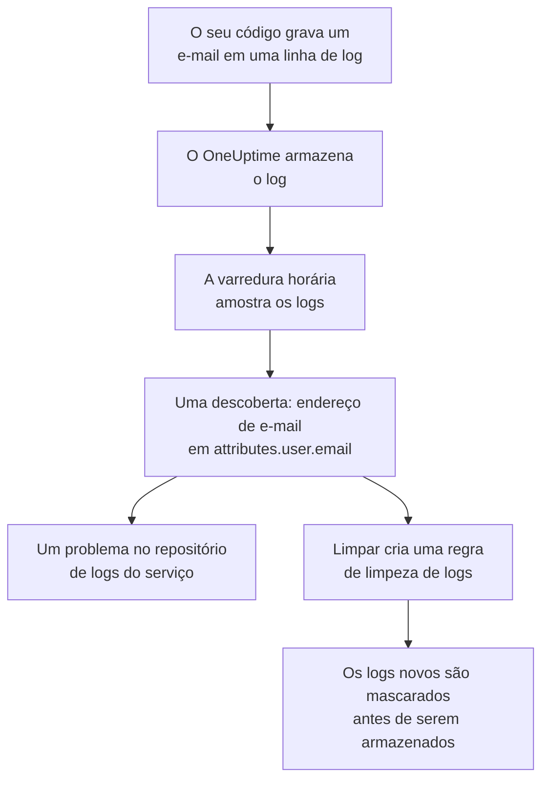

# Dados sensíveis na telemetria

A telemetria guarda tudo o que o seu código grava: um endereço de e-mail em uma linha de log, um número de cartão em um atributo de span, um token em um stack trace, a pergunta de um cliente em um prompt, o endereço IP de um usuário no rótulo de uma métrica. A Segurança de dados trata os logs, traces, métricas, exceções e conversas de IA de cada serviço, e as sessões de cada aplicação RUM, como repositórios de dados próprios. Ela coleta amostras deles a cada hora, encontra dados sensíveis neles como faz em um bucket, e **Limpar** transforma uma descoberta em uma regra que passa a ocultar esses dados na ingestão daí em diante, no serviço em que foram encontrados.

Não há nada a configurar: a telemetria de cada serviço é varrida a cada hora, a menos que **Varrer telemetria** esteja desativado nas configurações do projeto. Para deixar de fora os logs, os traces ou outro sinal de um serviço, desative **Varrer conteúdo** nas **Configurações** desse repositório: a partir da próxima varredura, nada dele é lido.

:::cards
- [O que é lido](#o-que-é-lido): Os atributos, corpos, mensagens e prompts de cada sinal.
- [Como uma varredura coleta amostras](#como-uma-varredura-coleta-amostras): Os registros mais recentes de cada serviço, a cada hora.
- [Limpar](#limpar): Oculte uma descoberta na ingestão, no serviço em que foi encontrada.
- [Descartar esta métrica](#descartar-esta-métrica): Pare de armazenar as métricas cujos nomes contêm dados sensíveis.
- [O que conta como limpo](#o-que-conta-como-limpo): Quando uma regra de limpeza já cobre uma descoberta.
:::

## Como funciona

Uma descoberta coberta por uma regra de limpeza é marcada como limpa: o que resta desses dados são dados antigos aguardando o fim da retenção, não um vazamento que continua. As duas verificações de telemetria contam só o que nenhuma regra cobre, então o problema delas se resolve assim que toda descoberta estiver limpa (veja [Verificações de telemetria](/docs/data-security/checks-and-issues#telemetria)).

## O que é lido

| Repositório | O que é lido | Para onde uma descoberta aponta |
| --- | --- | --- |
| Logs | Todo atributo, e o corpo | `attributes.<key>`, `body` |
| Traces | Todo atributo de span, e os atributos de todo evento de span | `attributes.<key>`, `events.<event>.<key>` |
| Exceções | A mensagem, o stack trace e os atributos | `message`, `stackTrace`, `attributes.<key>` |
| Conversas de IA | Os prompts e as respostas de toda chamada de IA, nas chaves em que as convenções GenAI os colocam, e todos os outros atributos | A chave em que estão, como `gen_ai.input.messages` ou `gen_ai.prompt[].content` |
| Replays de sessão | Os atributos dos spans e logs de uma aplicação RUM, os atributos das sessões dela, os traits que `identify()` deu aos usuários dela e a referência de usuário que lhe foi informada | `spans.attributes.<key>`, `logs.attributes.<key>`, `sessions.attributes.<key>`, `sessions.identifiedUserTraits.<key>`, `sessions.identifiedUserLabel` |
| Métricas | Todo atributo de um ponto de dados, entre eles os do seu recurso, e os nomes das métricas | `attributes.<key>`, `attributes.resource.<key>`, `name` |

As chaves numeradas são reunidas em um único local: `gen_ai.prompt.3.content` é `gen_ai.prompt[].content`, então as vinte mensagens de um chat são uma descoberta, não vinte. Os atributos que o próprio OneUptime adiciona, que começam com `oneuptime.`, não são lidos.

### Métricas

Os atributos de uma métrica são os rótulos das suas séries. Eles são os mesmos em todos os pontos de dados de uma série, então uma métrica que grava mil pontos por minuto pode ter só três valores, e um rótulo que vaza o e-mail de um usuário acrescenta uma série, não um ponto. Por isso uma métrica é amostrada pelas suas séries, não pelos seus pontos:

- **Um ponto de cada série.** Cada métrica é lida no minuto mais recente em que gravou na última hora: um ponto de dados de cada uma de até 100 séries desse minuto, seja qual for a frequência com que a métrica é enviada, de modo que uma série movimentada nunca toma o lugar de uma tranquila. Um valor é classificado uma vez, por mais séries que o repitam, então uma descoberta conta os valores distintos no seu local.
- **As métricas novas primeiro, depois as outras em revezamento.** As métricas que um serviço gravou, e quando cada uma gravou pela primeira vez no último dia, são conhecidas pelo agregado por minuto que a tabela de métricas mantém, nunca pelos pontos dela. Cada varredura lê as métricas mais movimentadas de um serviço, as mais propensas a ter muitas séries. Depois vêm as métricas que ele começou a gravar nas últimas 2 horas, já que um vazamento novo costuma vir de código novo, e então as próximas das outras métricas dele, em uma ordem fixa, a partir de onde a última varredura parou. As métricas novas ocupam no máximo metade dessas vezes, então as outras sempre mantêm as delas.
- **Cada métrica dentro de um tempo definido.** Uma varredura dá a cada serviço 10 das suas leituras, menos quando o projeto tem mais de 10 serviços. As leituras que um serviço deixa sem usar, por ter menos métricas, vão uma a uma para os serviços que ainda têm métricas esperando a vez, então nenhuma se perde e nenhum serviço recebe menos que a sua parte. As 5 métricas mais movimentadas de um serviço ocupam 5 das suas leituras, e o resto lê as outras métricas em revezamento: em um serviço de M métricas que recebe r leituras em revezamento, cada uma é lida pelo menos uma vez a cada M ÷ r horas, arredondado para cima. São 60 horas para um serviço de 300 métricas que recebe só as suas 5, e 11 horas quando outros dois serviços de 300 métricas compartilham o seu projeto, pois cada um recebe então 28 ou 29. Enquanto ele continuar começando métricas novas a cada hora, esse tempo é no máximo o dobro.
- **O intervalo próprio de cada métrica.** As métricas são lidas juntas, cada uma pelo seu próprio intervalo da chave primária da tabela. Uma métrica cujo minuto mais recente contém mais de 16.384 pontos, como uma rotulada com o e-mail de cada usuário, é lida à parte, e a leitura para nos primeiros pontos dela, então ela não custa mais do que qualquer outra métrica.

Uma descoberta nomeia o atributo, como `attributes.user.email`, ou `name` para dados no nome de uma métrica. As entradas dela são os pontos de dados em que foi encontrada: cada uma mostra a sua métrica e o valor do atributo, mascarado, e abre em **Métricas** nessa métrica, agrupada por esse atributo. Quando o nome de uma métrica contém dados sensíveis, o nome também é mascarado, e a entrada abre as métricas do serviço em vez disso.

### Por que a gravação de um replay nunca é lida

A gravação de um replay de sessão guarda o texto das páginas que as pessoas viram. Assisti-la exige uma permissão própria, e uma descoberta lida dela mostraria texto mascarado da página a todos que podem ler a Segurança de dados. Por isso um replay é lido só pelos seus atributos: os spans, os logs e os detalhes da sessão ao lado da gravação. O gravador já mascara no navegador o que grava, e as regras de limpeza de logs também rodam sobre as gravações (veja [Replay de sessão](/docs/telemetry/session-replay)).

### Conversas de IA

O prompt de uma chamada de IA carrega o chat inteiro anterior à mensagem mais recente da pessoa, então até 16.384 caracteres de cada valor de uma chamada de IA são lidos. Quando as conversas de IA contêm dados sensíveis, mais duas coisas acontecem: o provedor de IA para o qual as chamadas foram é um fluxo desses dados, e [Dados sensíveis estão sendo enviados a um provedor de IA](/docs/data-security/checks-and-issues#ia) falha no repositório.

As conversas de uma [ferramenta de IA da empresa](/docs/telemetry/ai-company-tools) ficam de fora. Só Proprietários do projeto e Administradores do projeto podem lê-las, e uma descoberta fica onde todos que leem a Segurança de dados podem lê-la, então os spans desses serviços nunca são lidos, e as conversas de IA deles são informadas como não lidas.

## Como uma varredura coleta amostras

A cada hora, os registros mais recentes de cada sinal na última hora são lidos e classificados campo a campo, como os de qualquer outro repositório (veja [Campos e colunas](/docs/data-security/data-types#campos-e-colunas)):

| Limite | Valor |
| --- | --- |
| Registros de cada serviço e sinal | **Tamanho da amostra de telemetria**, 500 por padrão, nunca mais de 1.000 |
| Serviços ou aplicações RUM lidos por sinal | Os 200 mais movimentados |
| Registros em uma leitura | 5.000, divididos entre os serviços; 500 para chamadas de IA |
| Caracteres do corpo de um log, da mensagem de uma exceção ou de um stack trace | 8.192 |
| Caracteres do valor de um atributo | 4.096 |
| Caracteres de um valor de uma chamada de IA | 16.384 |
| Atributos de um registro | 128; 64 para uma chamada de IA |
| Eventos de um span, e atributos de um evento | 16 e 32 |
| Locais de um repositório | 500 |
| Métricas lidas em uma varredura | 100, divididas entre os serviços, pelo menos uma de cada; 10 de cada serviço, metade entre as mais movimentadas dele e metade entre as novas e as outras, em revezamento, e as leituras que um serviço deixa sem usar vão para os outros, em revezamento |
| Uma métrica nova | Uma cujo primeiro ponto das últimas 24 horas chegou nas últimas 2 horas |
| Séries de uma métrica | Um ponto de dados de cada uma, do seu minuto mais recente, no máximo 100 |

Todo valor é encurtado dentro do banco de dados, então nenhum valor longo sai dele, e cada leitura para depois de 30 segundos. Uma leitura que falha vira um aviso nos repositórios a que se destinava; a varredura continua com a próxima.

Para deixar algo de fora, adicione-o às **Exclusões da varredura** do repositório: um local com o nome completo (`attributes.http.url`), tudo o que está abaixo de um local (`attributes.http`), ou uma chave de atributo com o nome sozinho (`http.url`).

## Limpar

**Limpar** em uma descoberta cria a regra que passa a ocultar esse tipo de dados nesse local daí em diante, ou aponta para a regra habilitada que já faz isso:

:::steps
### Abra a descoberta

Abra o problema - **Onde foi encontrado** lista cada descoberta por trás dele - ou **Segurança de dados > Na sua telemetria**, onde **Mostrar entradas** abre, ao lado da lista, as entradas em que uma descoberta foi encontrada.

### Pressione Limpar

Clique em **Limpar**. Uma caixa de diálogo diz o que a regra faria antes de qualquer coisa ser criada: de quem são os registros que ela altera, o que faz com o que encontra e o que lê os valores que ela ocultaria. Clique em **Limpar** nela para criar a regra. O OneUptime cria uma regra de limpeza de logs para os logs e para os logs de uma aplicação RUM, uma regra de limpeza de traces para spans, exceções e chamadas de IA, na parte do registro em que a descoberta está, e uma regra de pipeline de métricas para o atributo de uma métrica.

### Corrija o código também

A regra oculta os dados novos antes que sejam armazenados. Os dados já armazenados ficam até o fim da retenção, então corrija o código que os grava: a descoberta nomeia o serviço e o atributo.
:::

A regra recebe o nome do que oculta, como "Data Security: Email address in log attributes of checkout", e aparece junto com as suas outras regras de limpeza (veja [Filtros de descarte e regras de limpeza](/docs/telemetry/drop-filters-and-scrub-rules#mascarar-dados-sensíveis)). Ela é uma destas:

| Descoberta | Regra que Limpar cria |
| --- | --- |
| Endereço de e-mail, número de cartão, número de Seguro Social dos EUA, número de telefone ou endereço IP | O padrão integrado desse tipo. Números de cartão, números de Seguro Social e números de telefone são mascarados, o resto é suprimido por inteiro. |
| Um valor sob uma chave que parece sensível, como `password` ou `token` | Uma regra **Chaves de atributos sensíveis**, que suprime o valor inteiro de todo atributo desse tipo |
| Qualquer outro tipo de dados que um padrão consegue encontrar | Uma regra **Regex personalizado** feita a partir dos próprios padrões do tipo de dados, que suprime todo valor com esse formato |
| Qualquer tipo de dados no atributo de uma métrica | Uma regra de pipeline de métricas **Ocultar Atributo** para o serviço, que substitui por `[REDACTED]` os valores do atributo com o formato do tipo de dados, ou todo valor do atributo quando nenhum padrão encontra o tipo de dados |

Uma regra de logs ou de traces vale para o serviço em que a descoberta foi encontrada: ela limpa os logs ou spans desse serviço, e os dos outros serviços ficam como estão, então nada do que lê os deles muda. A coluna **Escopo** da lista de regras de limpeza diz para qual serviço uma regra vale. Uma descoberta nas gravações de sessão de uma aplicação RUM cria uma regra para todos os serviços e aplicativos do projeto, já que as regras de logs também limpam as gravações, e a caixa de diálogo diz isso. Se o serviço não existir mais, **Limpar** diz isso e não cria nenhuma regra.

A caixa de diálogo nomeia, cada um como um link, os monitores, os painéis com seus widgets, as visualizações salvas, as regras de gravação e os SLOs que leem os valores que a regra ocultaria, e o que acontece com eles: um filtro em um valor oculto deixa de corresponder, e um agrupamento por ele não mostra mais os valores reais. Ela também diz o que os [Eventos de segurança](/docs/telemetry/security-events) perderiam ao ler esses registros: com os endereços IP ocultos, seus eventos não conseguem indicar o endereço a bloquear. O que você não pode ver é contado, nunca nomeado. A caixa de diálogo nunca impede a regra: ela diz, e você decide. Os formulários das regras de limpeza mostram o mesmo antes de uma regra ser salva ou ativada.

Algumas descobertas não podem ser limpas por uma regra, e **Limpar** diz por quê. O atributo de uma métrica sempre pode ser limpo, já que a regra dele pode ocultar todo valor do atributo:

- Um tipo de dados encontrado só pelos nomes de campo, como o nome de uma pessoa: nenhum padrão consegue encontrá-lo. Renomeie o atributo para uma chave que uma regra de chaves sensíveis oculta, ou pare de enviá-lo.
- Um tipo de dados que só se distingue de outros valores pelas palavras ao redor, como um número de roteamento bancário: uma regra ocultaria muito mais do que esse tipo de dados.
- Uma marcação de documento: ocultar a palavra não ocultaria o documento.
- Um dos seus próprios tipos de dados: adicione você mesmo uma regra de limpeza personalizada com o padrão dele.
- Os detalhes da própria sessão (`sessions.*`): a ingestão de replays de sessão não executa regras de limpeza.
- O nome de uma métrica (`name`): quem o define é o código que cria a métrica, e uma regra de pipeline só consegue renomear uma métrica por inteiro. Renomeie a métrica e envie como atributo o que varia no nome dela. Até lá, **Descartar esta métrica** pode parar de armazenar essas métricas.

**Limpar** cria a regra em seu nome, com as suas próprias permissões: Proprietários do projeto e Administradores do projeto podem pressioná-lo, assim como uma equipe que pode criar regras de limpeza de logs, regras de limpeza de traces para spans, exceções e chamadas de IA, e regras de pipeline de métricas para métricas.

## Descartar esta métrica

Nenhuma regra tira os dados do nome de uma métrica, então, até que o código que dá nome à métrica seja corrigido, os dados continuam chegando. **Descartar esta métrica** em uma descoberta no nome de uma métrica para de armazenar as métricas cujos nomes os contêm, ao custo dos dados delas, por isso só acontece quando você pede:

- **As métricas de um serviço.** Cria uma regra de pipeline de métricas **Descartar** para o serviço da descoberta: cada ponto de dados novo de uma métrica cujo nome contém esse tipo de dado é descartado antes de ser armazenado. O filtro dela é o padrão que **Limpar** usa para o tipo, então um tipo que nenhum padrão consegue encontrar, como o nome de uma pessoa, não pode ser descartado, e a caixa de diálogo diz por quê.
- **Dito antes de ser feito.** A caixa de diálogo diz que esses pontos de dados se perdem para sempre, quantas das métricas do serviço gravadas no último dia têm um nome assim, o que as lê e por isso deixa de receber dados novos, que o que já está armazenado permanece até o fim da sua retenção, e como desfazer. Nada é descartado até você marcar que entende.
- **O que as lê, e o que acontece com isso.** A caixa de diálogo nomeia, cada um como um link, cada monitor, cada painel com os widgets dele que leem essas métricas, cada SLO de métrica do serviço e cada regra de gravação de métricas que as lê. Os monitores não podem mais alertar sobre os valores delas, os widgets deixam de mostrar dados novos, os SLOs deixam de contar eventos novos delas, e as métricas de saída das regras de gravação não as incluem mais. Sob cada regra de gravação, ela também nomeia o que lê a métrica de saída da regra, e o que lê as deles por sua vez, até três métricas de saída adiante na cadeia. O link de um widget abre o painel dele nesse widget. O que você não pode ver é contado, nunca nomeado.
- **Em seu nome, e registrado.** A regra é criada com a sua própria permissão de criar regras de pipeline de métricas: Proprietários do projeto e Administradores do projeto podem criá-la, assim como uma equipe que pode criar regras de pipeline de métricas. Os registros de auditoria guardam quem a criou.
- **Desfeito ao excluir a regra.** A regra recebe o nome do que descarta, como "Data Security: drop metrics named with Email address", e aparece junto às suas outras regras de pipeline de métricas em **Métricas → Configurações → Regras de pipeline**. Exclua-a ou desative-a, e essas métricas voltam a ser armazenadas a partir de então. O que foi descartado nesse meio-tempo não volta.

A descoberta passa então a ser marcada como **Descartadas**, e conta como limpa: nada mais desses dados é armazenado.

## O que conta como limpo

Uma descoberta só é marcada como limpa quando a ingestão executaria sobre ela uma regra habilitada e a regra encontraria o tipo de dados dela:

- **Os registros certos.** As regras de logs cobrem os logs e os logs de uma aplicação RUM. As regras de traces cobrem spans, exceções e chamadas de IA: uma exceção é uma cópia do evento de exceção do seu span, então as regras que limpam eventos também a limpam.
- **A parte certa.** Os **Campos a depurar** da regra incluem a parte do registro em que a descoberta está, ou a regra os deixa no padrão.
- **O serviço certo.** Uma regra de logs ou de traces para um serviço cobre apenas as descobertas desse serviço. Uma regra sem serviço cobre as de todos os serviços.
- **Um padrão que encontra o tipo.** Um **Tipo de padrão** integrado encontra o próprio tipo de dados: **Endereço de e-mail** encontra endereços de e-mail, **Número do cartão de crédito** números de cartão, **SSN (Número de Seguro Social)** números de Seguro Social dos EUA, **Número de telefone** números de telefone e **Endereço IP** endereços IP. **Chaves de atributos sensíveis** cobre todo valor sob uma chave que parece sensível, seja qual for o valor.
- **Os seus próprios padrões personalizados nunca contam.** Um **Regex personalizado** só cobre uma descoberta quando é exatamente o padrão que **Limpar** cria para o tipo dela. Uma descoberta guarda só amostras mascaradas, nas quais nenhum padrão pode ser testado, então o OneUptime não conseguiria provar que o seu padrão oculta os dados, e uma descoberta dada como limpa por engano é um vazamento que ninguém olha.
- **O atributo de uma métrica.** Uma regra de pipeline de métricas **Ocultar Atributo** ou **Remover Atributo** da chave desse atributo, para o serviço da descoberta ou para o projeto inteiro, cobre a descoberta quando não tem filtro, ou quando tem exatamente o filtro que **Limpar** cria. Um filtro escrito por você nunca conta, pelo mesmo motivo.
- **O nome de uma métrica.** Uma regra de pipeline de métricas **Descartar** para o serviço da descoberta ou para o projeto inteiro cobre a descoberta quando tem exatamente o filtro que **Descartar esta métrica** cria, ou nenhum filtro, caso em que não armazena nenhuma métrica do serviço. Uma regra assim sem filtro cobre todas as descobertas nessas métricas.

Uma regra desativada, ou que não limpa nada, nunca conta. A cobertura é calculada de novo depois de cada varredura, então uma regra que você adiciona ou remove manualmente muda o que está marcado como limpo em até uma hora.

## Próximos passos

:::cards
- [Filtros de descarte e regras de limpeza](/docs/telemetry/drop-filters-and-scrub-rules): Cada opção das regras de limpeza, e as regras que você mesmo escreve.
- [Verificações e problemas da Segurança de dados](/docs/data-security/checks-and-issues): As duas verificações de telemetria e as verificações de IA.
- [Fluxos de dados, acesso e residência](/docs/data-security/flows-access-residency): Os provedores de IA e os hosts para os quais os seus serviços enviam dados.
:::
