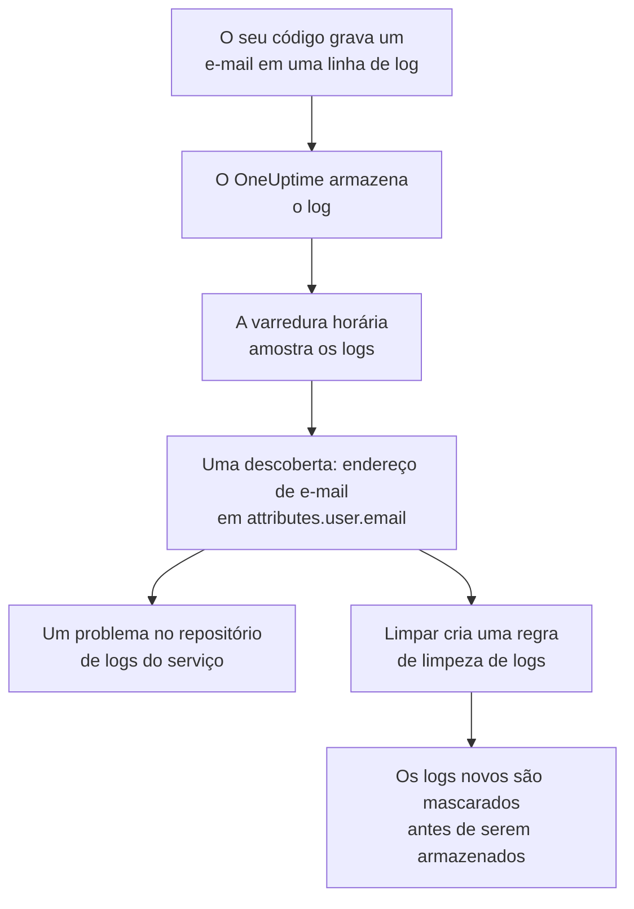

# Dados sensíveis na telemetria

A telemetria guarda tudo o que o seu código grava: um endereço de e-mail em uma linha de log, um número de cartão em um atributo de span, um token em um stack trace, a pergunta de um cliente em um prompt. A Segurança de dados trata os logs, traces, exceções e conversas de IA de cada serviço, e as sessões de cada aplicação RUM, como repositórios de dados próprios. Ela coleta amostras deles a cada hora, encontra dados sensíveis neles como faz em um bucket, e **Limpar** transforma uma descoberta em uma regra de limpeza que passa a mascarar esses dados na ingestão daí em diante.

Não há nada a configurar: a telemetria de cada serviço é varrida a cada hora, a menos que **Varrer telemetria** esteja desativado nas configurações do projeto.

:::cards
- [O que é lido](#o-que-é-lido): Os atributos, corpos, mensagens e prompts de cada sinal.
- [Como uma varredura coleta amostras](#como-uma-varredura-coleta-amostras): Os registros mais recentes de cada serviço, a cada hora.
- [Limpar](#limpar): Mascare uma descoberta na ingestão, com um clique.
- [O que conta como limpo](#o-que-conta-como-limpo): Quando uma regra de limpeza já cobre uma descoberta.
:::

## Como funciona

Uma descoberta coberta por uma regra de limpeza é marcada como limpa: o que resta desses dados são dados antigos aguardando o fim da retenção, não um vazamento que continua. As duas verificações de telemetria contam só o que nenhuma regra cobre, então o problema delas se resolve assim que toda descoberta estiver limpa (veja [Verificações de telemetria](/docs/data-security/checks-and-issues#telemetria)).

## O que é lido

| Repositório | O que é lido | Para onde uma descoberta aponta |
| --- | --- | --- |
| Logs | Todo atributo, e o corpo | `attributes.<key>`, `body` |
| Traces | Todo atributo de span, e os atributos de todo evento de span | `attributes.<key>`, `events.<event>.<key>` |
| Exceções | A mensagem, o stack trace e os atributos | `message`, `stackTrace`, `attributes.<key>` |
| Conversas de IA | Os prompts e as respostas de toda chamada de IA, nas chaves em que as convenções GenAI os colocam, e todos os outros atributos | A chave em que estão, como `gen_ai.input.messages` ou `gen_ai.prompt[].content` |
| Replays de sessão | Os atributos dos spans e logs de uma aplicação RUM, os atributos das sessões dela, os traits que `identify()` deu aos usuários dela e a referência de usuário que lhe foi informada | `spans.attributes.<key>`, `logs.attributes.<key>`, `sessions.attributes.<key>`, `sessions.identifiedUserTraits.<key>`, `sessions.identifiedUserLabel` |

As chaves numeradas são reunidas em um único local: `gen_ai.prompt.3.content` é `gen_ai.prompt[].content`, então as vinte mensagens de um chat são uma descoberta, não vinte. Os atributos que o próprio OneUptime adiciona, que começam com `oneuptime.`, não são lidos.

### Por que a gravação de um replay nunca é lida

A gravação de um replay de sessão guarda o texto das páginas que as pessoas viram. Assisti-la exige uma permissão própria, e uma descoberta lida dela mostraria texto mascarado da página a todos que podem ler a Segurança de dados. Por isso um replay é lido só pelos seus atributos: os spans, os logs e os detalhes da sessão ao lado da gravação. O gravador já mascara no navegador o que grava, e as regras de limpeza de logs também rodam sobre as gravações (veja [Replay de sessão](/docs/telemetry/session-replay)).

### Conversas de IA

O prompt de uma chamada de IA carrega o chat inteiro anterior à mensagem mais recente da pessoa, então até 16.384 caracteres de cada valor de uma chamada de IA são lidos. Quando as conversas de IA contêm dados sensíveis, mais duas coisas acontecem: o provedor de IA para o qual as chamadas foram é um fluxo desses dados, e [Dados sensíveis estão sendo enviados a um provedor de IA](/docs/data-security/checks-and-issues#ia) falha no repositório.

As conversas de uma [ferramenta de IA da empresa](/docs/telemetry/ai-company-tools) ficam de fora. Só Project Owners e Project Admins podem lê-las, e uma descoberta fica onde todos que leem a Segurança de dados podem lê-la, então os spans desses serviços nunca são lidos, e as conversas de IA deles são informadas como não lidas.

## Como uma varredura coleta amostras

A cada hora, os registros mais recentes de cada sinal na última hora são lidos e classificados campo a campo, como os de qualquer outro repositório (veja [Campos e colunas](/docs/data-security/data-types#campos-e-colunas)):

| Limite | Valor |
| --- | --- |
| Registros de cada serviço e sinal | **Tamanho da amostra de telemetria**, 500 por padrão, nunca mais de 1.000 |
| Serviços ou aplicações RUM lidos por sinal | Os 200 mais movimentados |
| Registros em uma leitura | 5.000, divididos entre os serviços; 500 para chamadas de IA |
| Caracteres do corpo de um log, da mensagem de uma exceção ou de um stack trace | 8.192 |
| Caracteres do valor de um atributo | 4.096 |
| Caracteres de um valor de uma chamada de IA | 16.384 |
| Atributos de um registro | 128; 64 para uma chamada de IA |
| Eventos de um span, e atributos de um evento | 16 e 32 |
| Locais de um repositório | 500 |

Todo valor é encurtado dentro do banco de dados, então nenhum valor longo sai dele, e cada leitura para depois de 30 segundos. Uma leitura que falha vira um aviso nos repositórios a que se destinava; a varredura continua com a próxima.

Para deixar algo de fora, adicione-o às **Exclusões da varredura** do repositório: um local com o nome completo (`attributes.http.url`), tudo o que está abaixo de um local (`attributes.http`), ou uma chave de atributo com o nome sozinho (`http.url`).

## Limpar

**Limpar** em uma descoberta cria a regra de limpeza que passa a ocultar esse tipo de dados nesse local daí em diante, ou aponta para a regra habilitada que já faz isso:

:::steps
### Abra a descoberta

Abra o repositório de telemetria - os **Registros** de um serviço, por exemplo - e a descoberta.

### Pressione Limpar

Clique em **Limpar**. O OneUptime cria uma regra de limpeza de logs para os logs e para os logs de uma aplicação RUM, e uma regra de limpeza de traces para spans, exceções e chamadas de IA, na parte do registro em que a descoberta está.

### Corrija o código também

A regra mascara os dados novos antes que sejam armazenados. Os dados já armazenados ficam até o fim da retenção, então corrija o código que os grava: a descoberta nomeia o serviço e o atributo.
:::

A regra recebe o nome do que oculta, como "Data Security: Email address in attributes.user.email", e aparece junto com as suas outras regras de limpeza (veja [Filtros de descarte e regras de limpeza](/docs/telemetry/drop-filters-and-scrub-rules#mascarar-dados-sensíveis)). Ela é uma destas:

| Descoberta | Regra que Limpar cria |
| --- | --- |
| Endereço de e-mail, número de cartão, número de Seguro Social dos EUA, número de telefone ou endereço IP | O padrão integrado desse tipo. Números de cartão, números de Seguro Social e números de telefone são mascarados, o resto é suprimido por inteiro. |
| Um valor sob uma chave que parece sensível, como `password` ou `token` | Uma regra **Sensitive Attribute Keys**, que suprime o valor inteiro de todo atributo desse tipo |
| Qualquer outro tipo de dados que um padrão consegue encontrar | Uma regra **Regex personalizado** feita a partir dos próprios padrões do tipo de dados, que suprime todo valor com esse formato |

Algumas descobertas não podem ser limpas por uma regra, e **Limpar** diz por quê:

- Um tipo de dados encontrado só pelos nomes de campo, como o nome de uma pessoa: nenhum padrão consegue encontrá-lo. Renomeie o atributo para uma chave que uma regra de chaves sensíveis oculta, ou pare de enviá-lo.
- Um tipo de dados que só se distingue de outros valores pelas palavras ao redor, como um número de roteamento bancário: uma regra ocultaria muito mais do que esse tipo de dados.
- Uma marcação de documento: ocultar a palavra não ocultaria o documento.
- Um dos seus próprios tipos de dados: adicione você mesmo uma regra de limpeza personalizada com o padrão dele.
- Os detalhes da própria sessão (`sessions.*`): a ingestão de replays de sessão não executa regras de limpeza.

**Limpar** cria a regra em seu nome, com as suas próprias permissões: Project Owners e Project Admins podem pressioná-lo, assim como uma equipe que pode criar regras de limpeza de logs, e regras de limpeza de traces para spans, exceções e chamadas de IA.

## O que conta como limpo

Uma descoberta só é marcada como limpa quando a ingestão executaria sobre ela uma regra habilitada e a regra encontraria o tipo de dados dela:

- **Os registros certos.** As regras de logs cobrem os logs e os logs de uma aplicação RUM. As regras de traces cobrem spans, exceções e chamadas de IA: uma exceção é uma cópia do evento de exceção do seu span, então as regras que limpam eventos também a limpam.
- **A parte certa.** Os **Campos a depurar** da regra incluem a parte do registro em que a descoberta está, ou a regra os deixa no padrão.
- **Um padrão que encontra o tipo.** Um **Tipo de padrão** integrado encontra o próprio tipo de dados: **Endereço de e-mail** encontra endereços de e-mail, **Número do cartão de crédito** números de cartão, **SSN (Número de Seguro Social)** números de Seguro Social dos EUA, **Número de telefone** números de telefone e **Endereço IP** endereços IP. **Sensitive Attribute Keys** cobre todo valor sob uma chave que parece sensível, seja qual for o valor.
- **Os seus próprios padrões personalizados nunca contam.** Um **Regex personalizado** só cobre uma descoberta quando é exatamente o padrão que **Limpar** cria para o tipo dela. Uma descoberta guarda só amostras mascaradas, nas quais nenhum padrão pode ser testado, então o OneUptime não conseguiria provar que o seu padrão oculta os dados, e uma descoberta dada como limpa por engano é um vazamento que ninguém olha.

Uma regra desativada, ou que não limpa nada, nunca conta. A cobertura é calculada de novo depois de cada varredura, então uma regra que você adiciona ou remove manualmente muda o que está marcado como limpo em até uma hora.

## Próximos passos

:::cards
- [Filtros de descarte e regras de limpeza](/docs/telemetry/drop-filters-and-scrub-rules): Cada opção das regras de limpeza, e as regras que você mesmo escreve.
- [Verificações e problemas da Segurança de dados](/docs/data-security/checks-and-issues): As duas verificações de telemetria e as verificações de IA.
- [Fluxos de dados, acesso e residência](/docs/data-security/flows-access-residency): Os provedores de IA e os hosts para os quais os seus serviços enviam dados.
:::
