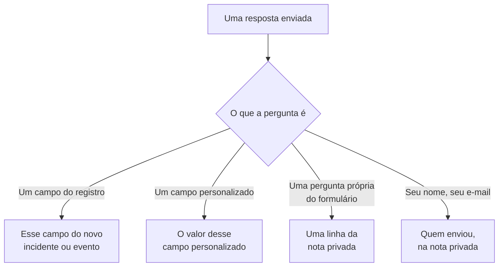

# Criar um formulário

A página **Construir** de um formulário é onde você decide o que ele pergunta e qual a aparência da página dele. As perguntas ficam à esquerda, na ordem em que a página pública as mostra; **Adicionar uma pergunta**, à direita, lista tudo o que você pode adicionar. Acima das perguntas, recolhida, fica a [marca](#marca) do formulário: o logotipo e o favicon dele. Os conjuntos de respostas com nome a partir dos quais as pessoas podem começar o formulário — cada um dos quais também pode tornar uma pergunta obrigatória, opcional ou oculta para o seu próprio caso — ficam na página **Modelos** dele: consulte [Modelos](#modelos).

:::cards
- [O editor](#o-editor): Adicione, edite, mova e salve perguntas.
- [O que você pode adicionar](#o-que-você-pode-adicionar): As suas próprias perguntas, os campos do registro, os campos personalizados e o remetente.
- [Perguntas ocultas](#perguntas-ocultas): Respondidas por um modelo, nunca pela pessoa que envia.
- [Modelos](#modelos): Um formulário, e um link, para cada caso que a sua equipe relata com frequência.
:::

## Para onde vai cada resposta

Cada resposta também fica guardada com o envio, na página **Envios** do formulário. Um campo que o formulário não pergunta, ou que fica vazio, é preenchido pelas [configurações Ao enviar](/docs/forms/on-submit) do formulário.

## O editor

:::steps
### Adicionar uma pergunta

Escolha o que adicionar em **Adicionar uma pergunta**. A nova pergunta é inserida depois da selecionada, ou no final, e fica selecionada.

### Editá-la onde está

Selecione um cartão para editá-lo: a pergunta, o texto de ajuda, o tipo de resposta e as opções, se ela é obrigatória ou oculta, e os botões para duplicá-la ou excluí-la. **Concluído** fecha o cartão.

### Colocá-la no lugar

Arraste um cartão pela alça para movê-lo, ou use **Mover para cima** e **Mover para baixo** no cartão selecionado — em um celular, ou pelo teclado.

### Salvar o formulário

**Salvar alterações** salva todas as alterações de uma vez. Até você salvar, o editor diz **Alterações não guardadas** e oferece **Descartar alterações**, e o navegador pergunta antes de você sair da página.
:::

- **O cabeçalho do formulário** mostra o nome e a descrição dele como a página pública mostrará. **Editar nome e descrição** os altera.
- **As perguntas** são cartões. Cada um mostra a pergunta como as pessoas a verão, com um selo que diz a que ela está vinculada — **Incidente · Gravidade**, **Campo personalizado · Region**, **Remetente · E-mail**, ou o tipo de resposta para uma pergunta própria do formulário. Um asterisco vermelho marca uma pergunta obrigatória, e um selo **Oculto** uma pergunta [oculta](#perguntas-ocultas).
- **Limites.** Um formulário pode ter até 50 perguntas. Quem pode ler um formulário, mas não editá-lo, vê o editor somente para leitura.

## Marca

**Marca**, recolhida acima das perguntas, é a aparência da página do formulário: o seu logotipo no topo da página, acima do nome do formulário, e o seu favicon na aba do navegador enquanto o formulário estiver aberto. Até você enviar os seus, o formulário mostra o logotipo e o favicon do OneUptime.

Recolhida, a seção lista **Logotipo** e **Favicon** — marcados como definidos assim que o formulário tem os seus — e diz quais do OneUptime ainda valem. Expanda-a para ver os dois como a página os mostra: o logotipo como fica no topo da página, e o favicon em uma aba do navegador ao lado do nome do formulário, que é o título da aba.

**Editar marca** os altera em uma única caixa de diálogo:

| Campo | O que é |
| --- | --- |
| **Logotipo** | Mostrado no topo da página do formulário, acima do nome dele, no lugar do logotipo do OneUptime. Uma imagem PNG, JPEG, GIF, WebP ou SVG de até 512 KB. Remova-o para voltar ao logotipo do OneUptime. |
| **Logo Alt Text** | O que o logotipo diz, lido pelos leitores de tela: normalmente o nome da sua organização. Pedido assim que há um logotipo. Deixe-o vazio e os leitores de tela pulam o logotipo — o nome do formulário vem logo depois de qualquer forma. Remover o logotipo também o apaga. |
| **Favicon** | O ícone na aba do navegador enquanto o formulário estiver aberto, no lugar do favicon do OneUptime. Uma imagem PNG, JPEG, GIF, WebP, SVG ou ICO de até 128 KB; um PNG, SVG ou ICO quadrado funciona melhor. Remova-o para voltar ao favicon do OneUptime. |

O logotipo mantém a altura do logotipo do OneUptime que ele substitui, e um largo é ajustado à largura da página. Cada imagem é verificada quando é salva — pelo painel, pela API, pelo Terraform ou por um fluxo de trabalho: ela precisa ter sido enviada no próprio projeto do formulário, ser de um dos tipos acima e não passar do seu limite. Um logotipo que não é uma dessas imagens é recusado com "The logo must be a PNG, JPEG, GIF, WebP or SVG image.", um grande demais com "The logo must be 512 KB or smaller.", e um cujo envio não existe mais — ou que foi enviado em outro projeto — com "The logo's file could not be found. Upload the logo again." Um favicon é recusado do mesmo jeito, com "The favicon must be a PNG, JPEG, GIF, WebP, SVG or ICO image.", "The favicon must be 128 KB or smaller." e "The favicon's file could not be found. Upload the favicon again."

**Pré-visualização** mostra o logotipo como a página mostra. Quem pode ler um formulário, mas não editá-lo, vê a marca dele sem **Editar marca**. O logotipo e o favicon só chegam à página do formulário dentro do próprio formulário — consulte [Partilha e segurança](/docs/forms/sharing-and-security#o-que-protege-um-formulário).

## O que você pode adicionar

**Adicionar uma pergunta** lista quatro grupos: **Perguntas** próprias do formulário, **Campos do incidente** ou **Campos da manutenção programada** do que o formulário cria, **Campos personalizados** e **Remetente**.

### Perguntas próprias do formulário

| Tipo de resposta | O que o remetente informa |
| --- | --- |
| **Resposta curta** | Uma linha de texto. |
| **Parágrafo** | Várias linhas de texto. |
| **Texto formatado** | Texto com formatação e links. |
| **Número** | Um número. |
| **Lista pendente** | Uma escolha de uma lista. |
| **Seleção múltipla** | Qualquer número de escolhas de uma lista. |
| **Caixa de verificação** | Uma caixa para marcar, como uma confirmação. |
| **Data** | Um dia. |
| **Data e hora** | Um dia e um horário. |

Uma lista suspensa ou de seleção múltipla lista as **Opções** que você der a ela, cada uma com uma cor opcional (o botão ao lado de uma opção abre um conjunto de cores com nome, com **Cor personalizada** para um código exato), de uma a 100. Mudar uma pergunta entre **Lista pendente** e **Seleção múltipla** mantém as opções dela; uma pergunta que passa a ser de um desses tipos começa com duas opções que você pode renomear, e uma que deixa de ser as perde. **Duplicar** copia uma pergunta própria do formulário logo abaixo dela.

As respostas a essas perguntas ficam guardadas com o envio e são listadas na nota privada do que o formulário cria — elas não preenchem nenhum campo. Para preencher um campo, adicione o próprio campo, a partir dos dois grupos seguintes.

### Campos do que o formulário cria

Os campos de um incidente, ou de um evento de manutenção programada, que um remetente pode responder. A resposta se torna o valor do campo.

| Campo do incidente | Respondido com |
| --- | --- |
| **Título** | Uma linha, de até 500 caracteres. |
| **Descrição** | Texto formatado, de até 20.000 caracteres. |
| **Gravidade** | Uma das suas gravidades de incidente. |
| **Monitores** | Qualquer um dos monitores que você oferecer — os monitores afetados do incidente. |
| **Rótulos** | Qualquer um dos rótulos que você oferecer. |
| **Início do impacto** | Uma data e um horário: quando o problema começou, segundo a lembrança do remetente. |

| Campo da manutenção programada | Respondido com |
| --- | --- |
| **Título** | Uma linha, de até 100 caracteres. |
| **Descrição** | Texto formatado, de até 20.000 caracteres. |
| **Começa em** | Uma data e um horário. Sempre perguntado e sempre obrigatório. |
| **Termina em** | Uma data e um horário depois de **Começa em**. Sempre perguntado e obrigatório. |
| **Monitores** | Qualquer um dos monitores que você oferecer. |
| **Páginas de status** | Qualquer uma das páginas de status que você oferecer. |
| **Rótulos** | Qualquer um dos rótulos que você oferecer. |

Cada campo só pode ser perguntado uma vez; a lista marca os que já estão no formulário com **Adicionado**. Um campo que o formulário não pergunta — ou que fica vazio — é preenchido pelas [configurações Ao enviar](/docs/forms/on-submit) do formulário.

**Opções oferecidas.** Uma página pública não deve listar todo o seu projeto para desconhecidos, então um campo respondido escolhendo registros oferece apenas os que você escolher. **Monitores**, **Rótulos** e **Páginas de status** listam exatamente as opções que você oferece, e não são perguntados até você oferecer pelo menos uma. **Gravidade** oferece todas as gravidades de incidente, a menos que você a restrinja, já que as gravidades não são secretas. Respostas fora das opções oferecidas são recusadas.

### Campos personalizados

Os seus campos personalizados de incidente — ou de manutenção programada, em um formulário de manutenção — cada um uma pergunta cuja resposta se torna o valor do campo. A pergunta recebe o tipo e as opções do campo personalizado, e começa com o nome dele como pergunta e a descrição como texto de ajuda, que você pode alterar.

Um formulário só pergunta os campos personalizados que você adicionar a ele, seja o que for que **Mostrar na criação** diga: cada campo que um formulário pergunta mostra o nome, a descrição e as opções dele para qualquer pessoa com o link. Quando um campo personalizado é excluído, a pergunta dele continua no formulário mas deixa de ser feita, e o cartão diz isso — exclua a pergunta. Um campo criado de novo com o mesmo nome é um campo novo: adicione-o de novo.

Um campo personalizado que copia o seu valor de um campo personalizado de monitor diz isso no cartão: quando o incidente ou evento tem monitores que concordam em um valor para ele, esse valor substitui a resposta do remetente.

### Remetente

**O seu nome** e **O seu e-mail** perguntam quem está enviando. Eles ficam guardados com o envio e são citados na nota privada, para que a sua equipe possa dar retorno, e nunca são mostrados no próprio incidente ou evento. O OneUptime nunca envia e-mails ao remetente. Deixe-os de fora, ou torne-os opcionais, para aceitar envios anônimos.

O e-mail precisa ser um único endereço comum, como `ada@example.com` — nem um nome com o endereço entre sinais de menor e maior, nem uma lista de endereços. Nome e e-mail têm até 100 caracteres cada.

## As perguntas de um novo formulário

Um novo formulário começa com as perguntas que ele quase sempre deveria fazer, para que funcione no momento em que é criado: o **Título**, obrigatório; a **Descrição**; em um formulário de manutenção, **Começa em** e **Termina em**; e **O seu nome** e **O seu e-mail**, obrigatórios. O texto delas fica no idioma do seu painel. Altere, oculte ou remova-as como quiser — exceto o início e o fim de um evento de manutenção, sem os quais nenhum evento pode ser programado. Quando as suas próprias perguntas dizem tudo, oculte a **Descrição** em vez de deixar uma caixa em que ninguém deveria escrever: consulte [Perguntas ocultas](#perguntas-ocultas).

## Perguntas obrigatórias

**Obrigatório** significa que o formulário não pode ser enviado sem uma resposta. Uma resposta só com espaços, tabulações ou quebras de linha conta como nenhuma resposta, e uma **Caixa de verificação** obrigatória precisa estar marcada. O servidor verifica de novo cada pergunta obrigatória quando o formulário é enviado, então uma solicitação feita sem a página também precisa cumpri-las.

Uma pergunta que não é obrigatória pode ficar vazia: o campo dela é então preenchido pelas configurações Ao enviar, como se o formulário não a tivesse perguntado.

## Perguntas ocultas

Ative **Oculto** em um cartão e a pergunta deixa de ser mostrada no formulário. Ninguém a recebe, então ela nunca é obrigatória, e um envio não pode respondê-la — a solicitação nem é lida para ela. Só o [modelo](#modelos) a partir do qual um envio começa a responde, e ela fica sem resposta quando o remetente não começa de nenhum modelo, ou começa de um que a deixa vazia. Um modelo também pode perguntar uma pergunta oculta mesmo assim, para o seu próprio caso: consulte [Como um modelo pergunta cada pergunta](#como-um-modelo-pergunta-cada-pergunta).

Oculte uma pergunta quando a resposta dela cabe à sua equipe decidir, não ao remetente:

- **A descrição do incidente**, quando as perguntas que você adicionou dizem tudo. Oculta, ela não convida mais ninguém a escrever ali; dê a cada modelo o texto padrão que você envia para o caso dele, ou deixe os incidentes começarem sem descrição.
- **Um campo personalizado que os seus fluxos de trabalho ou regras leem**, como um tipo de notificação, definido por cada modelo.
- **Uma pergunta própria do formulário** cuja resposta só a sua equipe precisa na nota privada.

Uma pergunta oculta mantém o lugar, o rótulo e as configurações dela, para que você possa mostrá-la de novo a qualquer momento. Um campo sem o qual o destino do formulário não pode ser criado — o **Começa em** e o **Termina em** de um evento de manutenção — não pode ser ocultado. A resposta a uma pergunta oculta é verificada e armazenada exatamente como uma resposta digitada seria, e guardada com o envio.

## Modelos

A página **Modelos** de um formulário guarda conjuntos de respostas com nome a partir dos quais as pessoas podem começar o formulário — um para cada caso que a sua equipe relata com frequência, como **Falha da aplicação**, **Manutenção planejada** ou **Serviço restaurado** — para que um formulário, e um link, sirvam a todos.

:::steps
### Adicionar um modelo

Clique em **Adicionar modelo**. O editor tem duas partes. **Perguntas** lista cada pergunta do formulário com a forma como este modelo a pergunta — consulte [Como um modelo pergunta cada pergunta](#como-um-modelo-pergunta-cada-pergunta). **Respostas** as lista de novo, incluindo as ocultas e nenhuma obrigatória: preencha o que o modelo deve responder, e deixe o resto para a pessoa que envia. Uma resposta a uma pergunta que o modelo não pergunta indica isso logo abaixo — ela é usada como está.

### Escolher o padrão

**Padrão** o torna o modelo com que o formulário abre. Só um modelo pode ser o padrão, e um formulário cujo único modelo é o padrão é simplesmente um formulário pré-preenchido.

### Partilhar o link dele

**Copiar link** copia o link próprio do modelo, que abre o formulário preenchido com ele. Consulte [Partilha e segurança](/docs/forms/sharing-and-security#um-link-para-cada-modelo).
:::

Cada modelo lista o que preenche e as perguntas que faz do seu jeito, como **Data da manutenção programada · Oculto**, e tem **Editar**, **Duplicar** — uma cópia logo depois dele, com um nome como **Falha da aplicação 2** —, **Mover para cima** e **Mover para baixo**, para a ordem em que o formulário os lista, e **Excluir**.

Na página pública, um formulário com modelos os lista acima das suas perguntas, sob **Começar a partir de um modelo**. Escolher um preenche o formulário e faz as perguntas como esse modelo as faz; o remetente ainda pode mudar qualquer resposta antes de enviar, e escolher outro recomeça o formulário a partir dele. A página abre com o modelo que o link dela indica, senão com o padrão, senão com nenhum. **Pré-visualização** também lista os modelos e abre no padrão.

> [!IMPORTANT]
> Todos que abrem o link veem o nome de cada modelo e as respostas dele às perguntas que ele faz — é assim que a página se preenche sozinha. As respostas de um modelo a perguntas que ele não faz nunca saem do servidor, então guarde qualquer coisa interna em uma pergunta oculta.

Cada resposta de cada modelo é verificada em relação à sua pergunta quando os modelos são salvos — uma opção que a pergunta oferece, um registro que o formulário oferece, um texto que cabe —, assim como cada pergunta que um modelo faz do seu jeito, e o salvamento é recusado com uma mensagem que indica o modelo e o problema, venha ele do painel, da API ou do Terraform. O nome de um modelo tem até 100 caracteres e é único no formulário, e um formulário tem até 50 modelos. Se mais tarde você mudar as perguntas, a resposta de um modelo a uma pergunta que você removeu, ou que não se encaixa mais nela, simplesmente não é usada, e o próximo salvamento desse modelo a descarta. Salvar os outros modelos nunca é recusado por isso: o que um modelo já guardava não é verificado de novo.

### Como um modelo pergunta cada pergunta

Casos diferentes precisam de perguntas diferentes: uma queda precisa da aplicação afetada e não de uma janela de manutenção, uma manutenção planejada precisa da janela. Em vez de criar um formulário para cada caso, deixe cada modelo fazer as perguntas do formulário do seu jeito. Nas **Perguntas** de um modelo, cada pergunta tem uma destas opções:

| Opção | Quando alguém começa a partir do modelo |
| --- | --- |
| **Padrão do formulário** | A pergunta é feita como o formulário a faz — obrigatória, opcional ou oculta, como diz o cartão dela no editor. O seletor diz qual, como **Padrão do formulário (Oculto)**, e acompanha o cartão quando você o altera. |
| **Obrigatório** | A pergunta é feita, e o formulário não pode ser enviado sem uma resposta. |
| **Opcional** | A pergunta é feita, e pode ficar vazia. |
| **Oculto** | A pergunta não é feita. A própria resposta do modelo, se ele tiver uma, é a resposta, como para uma pergunta que o formulário oculta. |

Assim, um único formulário de incidente pode atender aos dois casos:

| Pergunta | Falha da aplicação | Manutenção planejada |
| --- | --- | --- |
| Nome da aplicação | Obrigatório | Obrigatório |
| Instalações afetadas | Obrigatório | Opcional |
| Data da manutenção programada | Oculto | Obrigatório |

Toda pergunta começa em **Padrão do formulário**, assim como toda pergunta que você adicionar ao formulário depois, em todos os modelos. O **Começa em** e o **Termina em** de um evento de manutenção são sempre perguntados e sempre obrigatórios: nenhum modelo pode mudá-los. Um modelo pode ocultar todas as outras perguntas e respondê-las ele mesmo: o link dele é então um formulário de um único botão, **Enviar** — útil para um caso como **Serviço restaurado**.

A página segue o modelo que o remetente escolhe: escolher outro desenha o formulário de novo com as perguntas desse modelo, e **Pré-visualização** faz o mesmo. O servidor aplica a cada envio as perguntas que o modelo indicado por ele faz, seja quem for que o enviou: uma pergunta que o modelo exige precisa ser respondida, e uma que ele oculta não é lida da solicitação — a própria resposta do modelo é usada. Um envio que não indica nenhum modelo, ou indica um excluído desde então, segue as configurações do próprio formulário. Uma pergunta que o formulário oculta só é mostrada à página pública quando um modelo a pergunta.

## Quando o editor sinaliza uma pergunta

Um cartão com algo errado diz o quê, em âmbar:

| O cartão diz | O que está errado |
| --- | --- |
| **Este campo personalizado foi eliminado, por isso a pergunta não é feita. Elimine a pergunta.** | A página pública deixa a pergunta de fora. |
| **Escolha pelo menos uma opção para oferecer, ou a pergunta não é feita.** | Um campo respondido escolhendo registros não oferece nenhum: escolha os monitores, rótulos ou páginas de status que ele oferece. |
| **Adicione pelo menos uma opção.** | Uma lista suspensa ou de seleção múltipla não tem nada para escolher. |
| **Escreva a pergunta.** | A pergunta não tem texto. |

O formulário não pode ser salvo enquanto uma pergunta tiver um dos três últimos: **Salvar alterações** diz qual pergunta e o que está errado, e a pré-visualização deixa essa pergunta de fora. Salvar também verifica as perguntas como um todo, e é recusado com uma mensagem que indica o problema quando, por exemplo, duas perguntas pedem o mesmo campo, ou um formulário de manutenção não pergunta quando a manutenção começa e termina — venham as perguntas do editor, da API, do Terraform ou de um fluxo de trabalho.

## Pré-visualização

**Pré-visualização** abre o formulário exatamente como as pessoas o veem no link dele — o mesmo logotipo, as mesmas perguntas, campos, opções e verificações, a lista de modelos, e só as perguntas que o modelo escolhido faz — e deixa você preenchê-lo. Nada do que você digitar ali é enviado: **Enviar** só verifica as suas respostas, e **Preencher novamente** recomeça. A pré-visualização mostra as perguntas como estão no editor, salvas ou não, e diz quando deixa uma pergunta sinalizada de fora.

## O que o remetente vê

A página pública mostra o logotipo do formulário — o logotipo do OneUptime até você enviar o seu —, depois o nome e a descrição do formulário, os modelos dele se tiver algum, as perguntas que ele faz — como o modelo escolhido as faz, ou as que ele não oculta quando nenhum modelo é escolhido — e **Enviar**, e a aba do navegador mostra o nome do formulário e o favicon dele. Ela fica no idioma do remetente quando o OneUptime o tem — o idioma que ele escolheu por último no OneUptime naquele navegador, ou então o que o navegador dele pede — e em inglês caso contrário. As suas perguntas, opções e textos de ajuda são mostrados como você os escreveu.

Depois de enviar, a página diz "Obrigado — sua resposta foi enviada." e dá o número do que foi criado — "Seu número de referência é INC-42." —, seguido da mensagem de agradecimento do formulário, se você escreveu uma na página **Partilhar**. **Enviar outra resposta** abre um formulário vazio. O remetente não recebe nenhum e-mail nem tem como voltar ao incidente ou ao evento.

## Limites de tamanho

| Resposta | Limite |
| --- | --- |
| O **Título** de um incidente | 500 caracteres, sem contar os espaços nas duas pontas. |
| O **Título** de um evento de manutenção | 100 caracteres. |
| **Descrição** | 20.000 caracteres. |
| Qualquer outra resposta de texto | 10.000 caracteres. |
| Uma resposta de seleção múltipla | 100 escolhas. |
| **O seu nome**, **O seu e-mail** | 100 caracteres cada. |

Um envio que passa de um limite, deixa de fora uma resposta obrigatória ou dá uma resposta que não se encaixa na pergunta é recusado com uma mensagem que diz qual, e nada é criado. Respostas a perguntas que o formulário não faz são ignoradas.

## Próximos passos

:::cards
- [O que um envio cria](/docs/forms/on-submit): Como as respostas e as configurações Ao enviar se tornam um incidente ou um evento de manutenção.
- [Partilha e segurança](/docs/forms/sharing-and-security): Partilhar o link, um link para cada modelo, e o que os protege.
- [Configurações e automação de incidentes](/docs/incidents/settings): Campos personalizados e modelos de incidente.
:::
