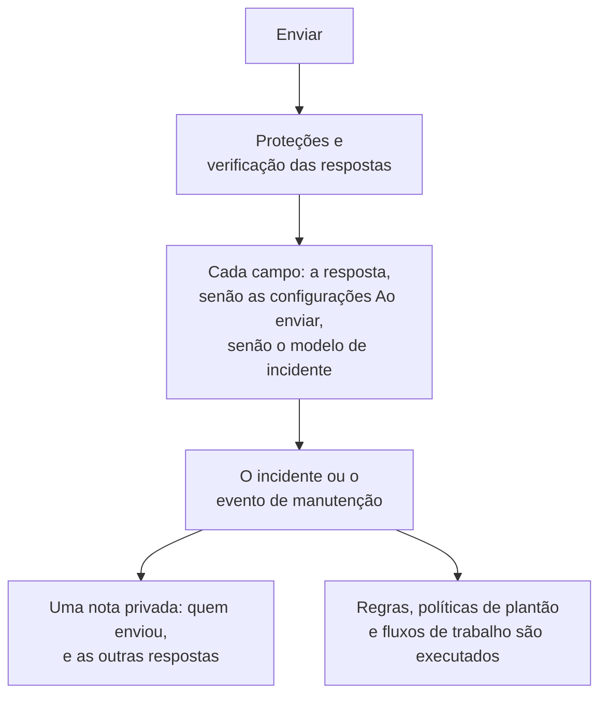

# O que um envio cria

Cada envio por um formulário cria um registro no seu projeto: um **incidente** ou um **evento de manutenção programada**. A página **Ao enviar** de um formulário mostra qual, e como cada campo do novo registro é preenchido — por uma resposta, por um valor padrão, por uma configuração que sempre se aplica, ou pelo modelo de incidente. **Editar definições** altera os valores padrão e o que sempre se aplica.

:::cards
- [Como um envio se torna um incidente](#como-um-envio-se-torna-um-incidente): Cada campo do novo incidente, e de onde vem o valor dele.
- [Como um envio se torna um evento de manutenção programada](#como-um-envio-se-torna-um-evento-de-manutenção-programada): O mesmo, para uma solicitação de manutenção.
- [As configurações Ao enviar](#as-configurações-ao-enviar): Valores padrão, o que é sempre anexado, proprietários e publicação.
- [A nota privada](#a-nota-privada): Quem enviou, e as respostas que nenhum campo guarda.
:::

## O que acontece ao enviar

Um envio que falha em uma verificação não cria nada. Consulte [O que protege um formulário](/docs/forms/sharing-and-security#o-que-protege-um-formulário).

## O que cada envio cria

O cartão **O que cada envio cria** guarda a escolha que você fez quando criou o formulário:

- **Incidente** — cada envio declara um incidente, então a sua equipe de plantão é avisada na hora. Use-o para relatos de problemas.
- **Manutenção programada** — cada envio programa um evento de manutenção. Use-o para solicitações de mudança e de manutenção.

Escolher a outra opção pede a sua confirmação, porque o formulário muda com ela:

- O título, a descrição, os monitores e os rótulos continuam vinculados: os dois tipos de registro os têm.
- Qualquer outra pergunta vinculada — uma gravidade, uma escolha de página de status, um campo personalizado do tipo anterior — se torna uma pergunta própria do formulário, com o mesmo texto, cuja resposta é listada na nota privada.
- As configurações Ao enviar recomeçam do zero, já que as configurações de um incidente e as de um evento são diferentes.
- Um formulário que agora cria eventos de manutenção pergunta quando a manutenção começa e termina.

As perguntas são salvas na hora, junto com a mudança. Confira-as na página **Construir**.

## Como um envio se torna um incidente

O cartão lista cada campo do novo incidente e de onde vem o valor dele:

| Campo | Vem de |
| --- | --- |
| **Título** | A resposta à pergunta **Título**. Quando o formulário não a faz, ou ela fica vazia: o **Título predefinido**, ou então o nome do formulário. |
| **Descrição** | A resposta à pergunta **Descrição**. Quando ela não é feita ou fica vazia, a descrição do modelo de incidente, se o formulário tiver um modelo. |
| **Gravidade** | A escolha do remetente, quando o formulário a pede. Senão, a configuração **Gravidade** do formulário, ou então a gravidade do modelo de incidente. |
| **Monitores** | Os monitores que o remetente escolheu, junto com os que as configurações sempre anexam. Sem nenhum dos dois, os do modelo de incidente. |
| **Rótulos** | Os rótulos que o remetente escolheu, junto com os que as configurações sempre adicionam. Sem nenhum dos dois, os do modelo de incidente. |
| **Início do impacto** | A resposta a **Início do impacto**, quando o formulário a faz. |
| **Incidente Modelo** | A configuração **Incidente Modelo** do formulário. Ela preenche tudo o que as respostas e as configurações deixam sem definir. |
| **Políticas de plantão** | As políticas que as configurações indicam, executadas para cada incidente que o formulário declara. Sem nenhuma, as do modelo de incidente. |
| **Proprietários** | As pessoas e equipes que as configurações indicam, junto com os proprietários do modelo. Elas são avisadas de cada incidente. |
| **Campos personalizados** | A resposta de cada pergunta de campo personalizado — a menos que o campo copie o seu valor de um campo personalizado de monitor e os monitores do incidente tenham um; o modelo preenche o resto. |
| **Páginas de status** | Nunca mostrado nas páginas de status, e os assinantes não são avisados, até que alguém da sua equipe o publique. |
| **Outras respostas** | Listadas em uma nota privada no incidente, com quem enviou. |

> [!IMPORTANT]
> **Sem gravidade, sem incidente.** Um incidente precisa de uma gravidade. Quando o formulário não pede uma e as configurações dele não indicam nenhuma — ou a que indicavam foi excluída — e o modelo dele também não define nenhuma, a linha **Gravidade** avisa você, e cada envio é recusado com "Este formulário não pode criar um incidente porque não tem uma gravidade. Avise a equipe que o compartilhou." Escolha uma gravidade em **Editar definições**, ou um modelo que defina uma.

### O modelo de incidente

Escolha um **Incidente Modelo** nas configurações e cada incidente que o formulário declara é declarado a partir dele, do jeito que o servidor aplica um modelo em qualquer lugar — consulte [Como um modelo é aplicado](/docs/incidents/settings#como-um-modelo-é-aplicado). As respostas e as configurações do formulário vêm primeiro, e o modelo preenche todo o resto: o estado inicial, a descrição, a gravidade, os recursos afetados, as políticas de plantão, os proprietários, os rótulos, os valores dos campos personalizados e uma mudança de status de monitor.

> [!WARNING]
> **Cuidado com os monitores.** Declarar um incidente em um monitor por meio de um formulário afeta o monitor exatamente como declarar um incidente nele manualmente: o monitoramento ativo do monitor é pausado até que o incidente seja resolvido, e o **Alterar status do monitor para** de um modelo muda o status do monitor na hora — em cada página de status que lista o monitor, mesmo enquanto o próprio incidente está oculto. Com um formulário, qualquer pessoa com o link pode fazer isso. Anexe monitores por meio de um formulário só quando cada envio deva pausá-los.

### Como o incidente fica

Um incidente declarado por meio de um formulário é um incidente comum, com algumas configurações próprias:

- **Oculto das páginas de status.** **Visível na página de status** fica desativado, assim como **Notificar assinantes da página de status**. Até que um responder o publique, nada do incidente chega a uma página de status ou a um assinante — exceto a mudança de status de monitor de um modelo, descrita acima.
- **Declarado por ninguém.** O remetente não é um usuário do OneUptime, então nenhum usuário fica registrado como quem declarou o incidente.
- **Os proprietários dele são avisados.** Os proprietários que as configurações e o modelo indicam são adicionados assim que os canais do Slack e do Microsoft Teams do incidente existem, e são notificados — a notificação **Incidente criado** do incidente espera até que eles sejam os proprietários dele, para chegar a eles e não aos proprietários do projeto.
- **Uma nota privada registra o envio** — consulte [A nota privada](#a-nota-privada).

Tudo o que é executado para um novo incidente também é executado para estes: as regras de privacidade, de proprietários, de rótulos, de plantão e de runbooks, as políticas de plantão e os fluxos de trabalho **On Create Incident**. As regras de plantão correspondem aos incidentes de um formulário como a quaisquer outros — inclusive pelo título e pela descrição, que o remetente escreveu.

:::steps
#### Leia o que o remetente escreveu

O título e a descrição aparecem nas páginas de status depois que o incidente é publicado.

#### Publique o incidente

Ative **Visível na página de status** na página **Configurações** do incidente.

#### Avise os assinantes, se eles devem saber

Como o incidente foi declarado com **Notificar assinantes da página de status** desativado, publicá-lo não envia a notificação "incidente criado". Para avisar os assinantes, publique uma nota pública com **Notificar assinantes da página de status** marcado — consulte [Publicar uma nota pública](/docs/incidents/notes-owners-and-feed#publicar-uma-nota-pública).
:::

## Como um envio se torna um evento de manutenção programada

| Campo | Vem de |
| --- | --- |
| **Título** | A resposta à pergunta **Título**. Quando o formulário não a faz, ou ela fica vazia: o **Título predefinido**, ou então o nome do formulário. |
| **Descrição** | A resposta à pergunta **Descrição**. |
| **Começa em**, **Termina em** | As respostas a **Começa em** e **Termina em**, que todo formulário de manutenção pergunta e exige. O fim precisa ser depois do início. |
| **Monitores** | Os monitores que o remetente escolheu, junto com os que as configurações sempre anexam. |
| **Páginas de status** | As páginas de status que o remetente escolheu, junto com as que as configurações indicam. |
| **Rótulos** | Os rótulos que o remetente escolheu, junto com os que as configurações sempre adicionam. |
| **Proprietários** | As pessoas e equipes que as configurações indicam. Elas são proprietárias de cada evento que o formulário programa. |
| **Mostrar nas páginas de status** | **Não**, a menos que as configurações o ativem. |
| **Notificar assinantes** | **Não**, a menos que as configurações o ativem. |
| **Campos personalizados** | A resposta de cada pergunta de campo personalizado — a menos que o campo copie o seu valor de um campo personalizado de monitor e os monitores do evento tenham um. |
| **Outras respostas** | Listadas em uma nota privada no evento, com quem enviou. |

O evento começa no estado **Scheduled** do seu projeto e avança como qualquer outro: fica em andamento quando começa e termina quando acaba.

Um envio é a solicitação de alguém, e uma solicitação é revisada antes de ser publicada. Então, a menos que você mude isso, o evento fica fora das páginas de status dele até que alguém da sua equipe o mostre, e os assinantes dele não são avisados quando ele é criado, começa ou termina. **Mostrar nas páginas de status** e **Notificar assinantes**, na etapa **Publicação** das configurações, mudam isso para cada evento que o formulário programa — ative-os só quando você confiar em todos que têm o link.

## As configurações Ao enviar

**Editar definições** abre as configurações em etapas: **Próximo** avança, e **Salvar alterações** fica na última etapa. Cada etapa já vem preenchida, então a lista de etapas ao lado do formulário abre qualquer uma delas, inclusive a última: altere uma configuração na etapa dela, depois abra a última etapa e salve.

| Etapa | Formulário de incidente | Formulário de manutenção |
| --- | --- | --- |
| **Valores predefinidos** | **Título predefinido**, **Gravidade**, **Incidente Modelo** | **Título predefinido** |
| **Associar sempre** | **Monitores**, **Rótulos**, **Políticas de plantão** | **Monitores**, **Páginas de status**, **Rótulos** |
| **Proprietários** | **Proprietários** | **Proprietários** |
| **Publicação** | — | **Mostrar nas páginas de status**, **Notificar assinantes** |

**Proprietários** é um único seletor para pessoas e equipes: **Adicionar proprietário** abre uma única lista de busca com ambos, e cada escolha aparece como um chip que você pode remover. Tudo o que as configurações indicam precisa pertencer ao projeto do formulário, e os proprietários precisam ser membros dele. Um registro excluído depois de ter sido escolhido é ignorado quando um envio é criado, e o resto continua valendo.

## A nota privada

Cada envio deixa uma nota privada no que criou:

> Submitted through the form **Report a Problem** by Ada Lovelace (<ada@example.com>).
>
> **Which office are you in?**\
> Berlin

Ela indica o formulário e o remetente — "Submitted anonymously through the form **Report a Problem**." quando o formulário não perguntou quem é —, depois, quando o envio começou a partir de um dos modelos do formulário, diz qual: "Started from the template **Application Outage**." — e então lista as respostas às perguntas próprias do formulário, cada uma sob a sua pergunta, na ordem do formulário. As respostas às perguntas vinculadas já estão no registro: o título, a gravidade, os campos personalizados dele. Por ser privada, a nota nunca chega a uma página de status, mas é publicada nos canais do Slack e do Microsoft Teams do registro como qualquer outra nota.

O endereço é um link que escreve exatamente para esse endereço — no painel, no Slack e no e-mail para os proprietários.

## Perguntas ocultas e modelos

Uma [pergunta oculta](/docs/forms/building#perguntas-ocultas) é respondida pelo [modelo](/docs/forms/building#modelos) a partir do qual o envio começou — nunca pela solicitação —, e a resposta dela vai exatamente para onde iria uma digitada: uma **Descrição** oculta se torna a descrição do incidente, um campo personalizado oculto o valor dele, uma pergunta própria do formulário oculta uma linha da nota privada. Um envio que não começou de nenhum modelo deixa as perguntas ocultas sem resposta, e os campos delas são preenchidos pelas configurações Ao enviar, como para qualquer pergunta deixada vazia. Um modelo excluído enquanto alguém estava com o formulário aberto não impede o envio dessa pessoa: ele é criado como ela respondeu, sem as respostas ocultas do modelo.

Um modelo pode fazer as perguntas do formulário [do seu jeito](/docs/forms/building#como-um-modelo-pergunta-cada-pergunta), e o servidor aplica ao envio as perguntas como o modelo indicado por ele as faz. Uma pergunta que o modelo oculta é respondida pelo modelo, como uma pergunta oculta, mesmo quando o formulário a faz; uma que o modelo faz é lida da solicitação, mesmo quando o formulário a oculta; e uma que o modelo exige precisa ser respondida, ou o envio é recusado e nada é criado.

As respostas que um modelo preencheu na página passam a ser do remetente assim que ele envia: o servidor pega as respostas que a solicitação envia para as perguntas que a página faz, seja o que for que o modelo dizia.

## Texto que um remetente escreve

Um envio vai direto para lugares onde o texto pode agir por conta própria — canais do Slack e do Microsoft Teams, o navegador de cada responder, os e-mails dos proprietários — e ninguém o lê antes. Então, antes de o registro ser criado:

| O que o remetente escreve | O que é armazenado |
| --- | --- |
| Uma menção, como \<!channel\>, \<!here\> ou \<@U0123ABC\>, no título, na descrição ou em qualquer resposta de texto | **Menções não avisam ninguém.** Tudo o que o Slack lê como uma menção recebe um caractere invisível depois do sinal de abertura. Ela é lida igual em todo lugar, mas nenhuma ferramenta de chat age sobre ela. |
| Uma imagem, na descrição ou em uma resposta **Texto formatado** | **Imagens viram links.** Cada imagem vira um link para o mesmo endereço, então nada é carregado de onde o remetente escolheu até que um responder clique nele. |
| Um bloco de código cuja linguagem é `mermaid`, escrito de qualquer forma | **Diagramas viram código.** Ele é armazenado como código simples, então mostra o seu texto em vez de desenhar um diagrama. |
| Sintaxe de imagem ou um bloco de diagrama no título | **O título é texto simples.** Eles também recebem o caractere invisível, então onde quer que o título vá parar — um episódio, uma mensagem de chat, um modelo de nota — ele não carrega nada e não desenha nada. Os caracteres invisíveis contam para o limite do título. |

Todo o resto — os links, o restante do Markdown, as escolhas de listas suspensas, os números, as datas, uma caixa marcada — é armazenado como o remetente informou, e o envio mantém o nome e o e-mail do remetente como digitados.

## Próximos passos

:::cards
- [Criar um formulário](/docs/forms/building): As perguntas que alimentam esses campos, as perguntas ocultas e os modelos.
- [Configurações e automação de incidentes](/docs/incidents/settings): Modelos de incidente e campos personalizados.
- [Notas, responsáveis e feed de incidentes](/docs/incidents/notes-owners-and-feed): Notas privadas, notas públicas e proprietários.
- [Partilha e segurança](/docs/forms/sharing-and-security): Quem pode enviar, e com que frequência.
:::
