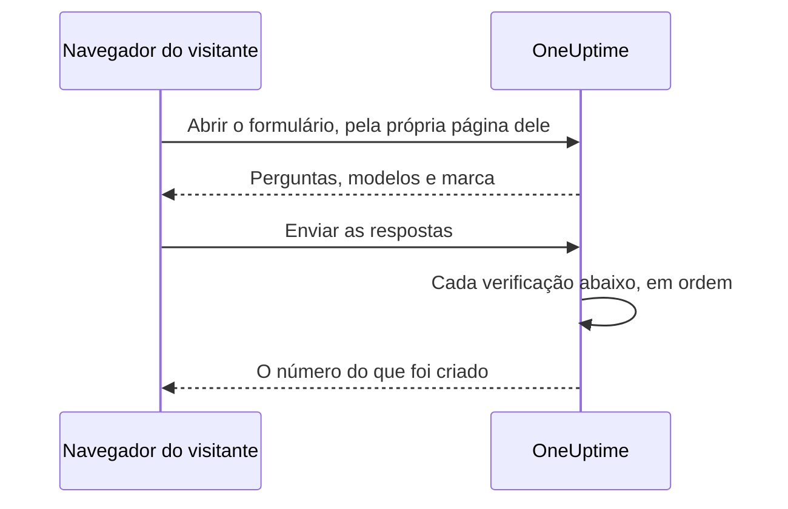

# Partilha e segurança

Um formulário está aberto a qualquer pessoa que tenha o link dele, e cada envio pode acionar a sua equipe de plantão ou colocar uma janela de manutenção no seu calendário. Esta página trata da página **Partilhar** do formulário — o link, desativar o formulário, a mensagem depois do envio e a lista de IPs permitidos — e de todas as outras verificações pelas quais uma solicitação passa no caminho. Ela também explica como servir o formulário no seu próprio domínio.

:::cards
- [Partilhar o link](#partilhar-o-link): Copie-o, abra-o e redefina-o quando ele se espalhar demais.
- [Um link para cada modelo](#um-link-para-cada-modelo): Um favorito por caso, um único formulário por trás de todos.
- [Domínios personalizados](#domínios-personalizados): Sirva o formulário no seu próprio domínio, com um certificado gratuito.
- [O que protege um formulário](#o-que-protege-um-formulário): Cada verificação pela qual uma solicitação passa, em ordem.
- [Solução de problemas](#solução-de-problemas): O que cada mensagem na página do formulário significa, e o que fazer.
:::

## A página Partilhar

| Cartão | O que ele contém |
| --- | --- |
| **Status** | **Aceita envios** — se o link do formulário funciona. |
| **Link de compartilhamento** | Cada endereço em que o formulário responde, cada um com **Copiar link**, e **Redefinir link**. |
| **Depois de enviar** | A **Mensagem de agradecimento** que as pessoas veem depois de enviar, abaixo do número do que o formulário criou. |
| **Mais configurações** | A **Lista de IPs permitidos**, recolhida até você abri-la. |

## Partilhar o link

O cartão **Link de compartilhamento** lista cada endereço em que o formulário responde: primeiro os seus [domínios personalizados](#domínios-personalizados), depois o seu link no OneUptime, como `https://oneuptime.com/accounts/form/<share-key>`:

- Cada endereço abre o formulário numa nova aba, do jeito que as pessoas o veem, e **Copiar link** ao lado o copia.
- Um domínio personalizado que ainda não funciona é marcado como **Ainda não ativo**, com o motivo. Sem domínio personalizado, uma linha abaixo do link oferece **Adicionar um domínio personalizado**.
- **Redefinir link** dá ao formulário um novo link, depois que você confirma. O link antigo para de funcionar na hora e mostra a mensagem de indisponível, então todos com quem você o partilhou precisam do novo. Use-o quando um link se espalhou mais do que devia. Os domínios personalizados do formulário não levam chave nenhuma, e continuam funcionando.

Qualquer pessoa com o link pode abrir o formulário e enviá-lo, sem uma conta do OneUptime e sem fazer login. Estar com a sessão iniciada não muda nada: o OneUptime só sabe quem enviou pelo nome e pelo e-mail digitados no formulário. Então trate o link como um número de telefone da sua equipe de plantão. Partilhe-o onde as pessoas que devem usá-lo vão encontrá-lo — uma página da intranet, um runbook de suporte, uma mensagem fixada em um chat — e não em um site público, a menos que você queira envios de qualquer pessoa.

O link traz uma chave aleatória própria, não o ID do formulário. Em uma instalação auto-hospedada, ele é servido pelo seu próprio host do OneUptime, e só funciona no endereço que `HTTP_PROTOCOL` e `HOST` configuram: aberto com outro nome do servidor, ou pelo endereço IP dele, as solicitações do formulário são recusadas como vindas de outro site.

Links para os antigos formulários de incidente, `/accounts/incident-form/<share-key>`, abrem o mesmo formulário no novo endereço dele.

### Um link para cada modelo

Cada um dos [modelos](/docs/forms/building#modelos) do formulário tem um link próprio: o link do formulário com `?template=` e o id do modelo, como `https://oneuptime.com/accounts/form/<share-key>?template=<template-id>`. **Copiar link** na página **Modelos** do formulário o copia. Ele abre o formulário com esse modelo preenchido, então uma equipe pode salvar um favorito por caso enquanto você mantém um único formulário. Quando o remetente escolhe outro modelo, o endereço no navegador dele acompanha, então o link que ele copia é o formulário como ele o vê. Num [domínio personalizado](#domínios-personalizados), o link de um modelo é o domínio com o mesmo `?template=`, como `https://report.acme.com/?template=<template-id>`, e **Redefinir link** o deixa funcionando.

O link de um modelo é o link do formulário: funciona enquanto o formulário estiver em **Aceita envios**, e **Redefinir link** o retira junto com o resto. Um link que indica um modelo que você excluiu abre o formulário como se não indicasse nenhum — com o modelo padrão, se houver um.

### Desativar um formulário

Para parar de aceitar envios sem excluir o formulário, desative **Aceita envios**. O link passa a mostrar "Este formulário não está disponível. Ele pode ter sido desativado ou o link pode estar desatualizado.", e o cartão **Link de compartilhamento** lembra você de que o formulário está desativado. Ative-o de novo e o mesmo link volta a funcionar. Os domínios personalizados do formulário mostram a mesma mensagem enquanto ele está desativado.

### A mensagem de agradecimento

Depois de um envio, a página diz "Obrigado — sua resposta foi enviada." e dá o número do que foi criado, e depois a sua **Mensagem de agradecimento**, em Markdown. Use-a para dizer o que acontece a seguir, e a quem recorrer quando algo for urgente. Sem ela, a página mostra só a mensagem padrão.

Uma imagem na descrição ou na mensagem de agradecimento do formulário é mostrada a todos que abrem o link enquanto o formulário estiver em **Aceita envios**. Desative o formulário, ou tire a imagem, e a imagem volta a ser privada, a menos que outra coisa que todos veem ainda a contenha.

## Domínios personalizados

Por padrão, um formulário é servido no seu link, no endereço do próprio OneUptime. Para servi-lo num domínio seu, como `report.acme.com`, abra a página **Domínios personalizados** do formulário, logo depois de **Partilhar** no seu menu lateral. Ela funciona como os [domínios personalizados de uma página de status](/docs/status-pages/branding-and-domains#domínios-personalizados).

Colocar o formulário no seu próprio domínio leva três etapas, e só as duas primeiras são com você:

1. **Adicionar o domínio**: um subdomínio e um dos seus domínios verificados.
2. **Adicionar o registro CNAME dele** no seu provedor de DNS. A caixa de diálogo **Configuração de DNS** abre com o registro assim que você adiciona o domínio.
3. **O certificado SSL gratuito é emitido automaticamente** assim que o registro é encontrado. Não há botão para apertar.

Quando o domínio está no ar, o cartão **Link de compartilhamento** o lista acima do link do formulário. Os dois abrem o mesmo formulário.

### Adicionar um domínio

Clique em **Criar: Domínio do formulário**. A caixa de diálogo é uma página só:

- **Subdomínio**: só o rótulo, com o texto de exemplo `report (leave blank for root)`. Digite apenas `report`, não o nome de host completo. Deixe em branco ou digite `@` para usar o domínio raiz.
- **Domínio**: um dos domínios verificados em **Configurações do projeto** > **Avançado** > **Domínios**, onde você prova com um registro TXT que um domínio é seu. O link **Adicionar um domínio** ao lado do campo abre essa página numa nova aba.
- **Mais campos**: recolhido. Abra-o só para usar um certificado seu: ative **Carregar Certificado Personalizado** e cole o **Certificado** e a sua **Chave privada do certificado**.

Clique de novo em **Criar: Domínio do formulário** para adicioná-lo. A caixa de diálogo fecha e a **Configuração de DNS** do novo domínio abre. O nome de um domínio e o seu formulário ficam fixos assim que ele é adicionado, então **Editar** muda apenas o seu certificado: para mudar qualquer um dos dois, adicione o novo domínio e exclua o antigo.

Um domínio mostra uma única página de status, um único painel ou um único formulário, então um nome que qualquer um deles já tenha, em qualquer projeto, é recusado: "report.acme.com is already in use: a domain can show only one status page, dashboard or form. Choose another subdomain, or remove report.acme.com where it is used first."

### Configuração de DNS e Verificar agora

A caixa de diálogo **Configuração de DNS** mostra o registro a adicionar no seu provedor de DNS, cada campo com um botão de copiar: **Tipo** `CNAME`, **Nome** o domínio completo que você adicionou, e **Valor** o registro CNAME da sua instalação. Para um domínio raiz, muitos provedores de DNS não permitem um registro CNAME: use no lugar o registro ALIAS, ANAME ou CNAME achatado do seu provedor, com o mesmo valor.

O OneUptime verifica cada domínio não verificado a cada 15 minutos, e quando encontra o registro pede o certificado gratuito da Let's Encrypt do domínio na mesma verificação. Para verificar na hora, clique em **Verificar agora**. Enquanto um domínio não está no ar, a sua linha tem uma ação **Configuração de DNS** que abre a mesma caixa de diálogo, onde **Verificar agora** também pede de novo um certificado que falhou ou expirou, no máximo uma vez por domínio a cada 15 minutos. A renovação é automática, bem antes de o certificado expirar.

A coluna **Status** diz em que ponto cada domínio está no caminho até o HTTPS, nos mesmos oito estados dos domínios de uma página de status: veja [Ler a coluna Status do domínio](/docs/status-pages/branding-and-domains#ler-a-coluna-status-do-domínio). Quando um pedido falhou, o motivo está na linha de baixo: em geral um registro CAA do seu domínio que não permite `letsencrypt.org` ou, numa instalação auto-hospedada, um servidor que a Let's Encrypt não consegue alcançar na porta 80.

Depois que um certificado gratuito foi pedido para um domínio, a sua linha mostra **Reissue SSL**, que pede à Let's Encrypt um certificado totalmente novo antes da renovação automática, uma vez a cada 24 horas por domínio. O formulário continua no ar com o certificado atual nesse meio-tempo. Um certificado que você carregou é você quem renova: edite o domínio e cole o novo.

### O que o domínio mostra

Um domínio mostra o seu formulário na raiz, como `https://report.acme.com`, e nada mais do OneUptime: nenhuma página de login e nenhum outro formulário. Qualquer outro endereço no domínio abre o formulário na raiz, mantendo a sua query, então o link de um modelo também funciona ali. A página é do formulário: o logotipo dele ou nenhum, nunca o do OneUptime, o nome dele como título da aba, no tema claro e sem as análises do OneUptime. O captcha, os arquivos e a mensagem de agradecimento funcionam ali como no link, e cada verificação de [O que protege um formulário](#o-que-protege-um-formulário) vale, com o domínio como página própria do formulário.

- **Redefinir link** muda apenas o link do formulário no OneUptime: os seus domínios não levam chave nenhuma, então continuam funcionando.
- Desativar **Aceita envios** fecha o formulário também nos seus domínios, com a mensagem de indisponível.
- Excluir o formulário exclui os seus domínios, e **Duplicar formulário** não copia nenhum deles. Um domínio excluído deixa de mostrar o formulário na hora.

### Numa instalação auto-hospedada

Os formulários usam o registro CNAME das páginas de status: `STATUS_PAGE_CNAME_RECORD` em `config.env`, ou `statusPage.cnameRecord` no chart do Helm. Para dar aos domínios de formulários um destino próprio, defina `FORM_CNAME_RECORD`: em `config.env` para o Docker Compose, ou com o `extraEnv` do chart inteiro no Helm. Sem nenhum dos dois, a página **Domínios personalizados** diz que os domínios personalizados não estão ativados em vez de mostrar um registro, e o OneUptime não verifica domínios de formulários nem pede certificados para eles.

O servidor precisa responder na porta 80, onde a Let's Encrypt verifica cada domínio. Uma instalação sem chave de conta da Let's Encrypt, `LETS_ENCRYPT_ACCOUNT_KEY` (`letsEncrypt.accountKey` no chart do Helm), não pede certificados: o domínio de um formulário fica no ar assim que o seu registro é verificado, servido com o HTTPS do seu próprio proxy ou com um certificado que você carregar. Com o captcha ativado, uma chave de site que lista os nomes de host em que funciona precisa listar também os domínios do formulário.

### Quem pode gerenciar os domínios

Os proprietários e administradores do projeto, e qualquer pessoa com **Edit Form**, podem adicionar os domínios de um formulário, verificá-los, reemitir os seus certificados e excluí-los. As permissões só para os domínios de um formulário também podem, como **Edit Form Domain**: a [Visão geral dos formulários](/docs/forms/index#permissões) as lista. Quem pode ler um formulário vê os seus domínios, o **Status** deles e o registro em **Configuração de DNS**; para essas pessoas, **Verificar agora** e **Reissue SSL** ficam bloqueados e dizem qual permissão é preciso ter. Uma chave de API funciona do mesmo jeito em `/form-domain`: `verify-cname`, `order-ssl` e `reissue-ssl` precisam de **Edit Form Domain** ou **Edit Form**.

## O que protege um formulário

Cada solicitação passa por estas verificações, nesta ordem:

1. A solicitação precisa vir da própria página do formulário, não de outro site — consulte [Solicitações de outros sites](#solicitações-de-outros-sites).
2. Ela precisa estar dentro dos limites de taxa.
3. O formulário precisa existir, estar em **Aceita envios** e pertencer a um projeto em um plano que inclua formulários.
4. Ela precisa vir de um endereço da **Lista de IPs permitidos**, quando o formulário tiver uma.
5. Um envio precisa passar pelo captcha, quando a instância tiver o captcha ativado.
6. Cada resposta precisa estar dentro dos limites de tamanho e se encaixar na pergunta — consulte [Criar um formulário](/docs/forms/building#limites-de-tamanho).
7. O que as respostas e as configurações formam precisa poder ser criado: um incidente precisa de uma gravidade, um evento de um fim depois do início.
8. Um envio precisa caber na cota por hora do formulário — consulte [Limites de taxa](#limites-de-taxa).
9. Os arquivos precisam caber na cota por hora de arquivos do formulário, logo antes de serem guardados.

O logotipo e o favicon de um formulário fazem parte do formulário: eles são enviados dentro da resposta que o abre, em base64, só depois de ela passar pelas quatro primeiras verificações, e nunca a partir de um endereço próprio. Ninguém consegue obtê-los sem o formulário, e nenhum arquivo pode ser obtido pelo id dele por meio de um formulário; os próprios arquivos continuam privados. Um formulário só mostra imagens enviadas no próprio projeto dele: um arquivo de outro projeto é recusado quando o formulário é salvo, e nunca é enviado à página dele.

### Lista de IPs permitidos

Para limitar um formulário às suas próprias redes:

:::steps
1. Abra a página **Partilhar** do formulário.
2. Abra **Mais configurações** e clique em **Editar lista de IPs permitidos**.
3. Informe uma rede por linha e salve. O cartão então as lista sob **Lista de IPs permitidos**.
:::

Cada linha é uma destas:

| Entrada | Exemplo | Observação |
| --- | --- | --- |
| Um endereço IPv4 | `203.0.113.7` | |
| Um endereço IPv6 | `2001:db8::7` | Corresponde não importa como esteja escrito, em maiúsculas ou com os zeros por extenso. |
| Um intervalo IPv4, em notação CIDR | `10.0.0.0/8` | Intervalos IPv6 não são suportados — liste cada endereço IPv6 em uma linha própria. |

Um endereço IPv4 precisa ser escrito como tal: escrito do jeito IPv6, como `::ffff:203.0.113.7`, ele é recusado. A lista é verificada sempre que é salva — pelo painel, pela API, pelo Terraform ou por um fluxo de trabalho —, e uma linha que nunca poderia corresponder é recusada com uma mensagem que a indica. Deixe a lista vazia para permitir todas as redes. Assim que ela tiver uma entrada, uma solicitação cujo endereço não possa ser determinado é recusada.

No OneUptime Cloud, definir a lista de IPs permitidos requer o plano **Scale** — tanto quando um formulário é criado com uma pela API como quando é editado —, assim como a lista de IPs permitidos de um [painel público](/docs/dashboards/sharing). Esvaziá-la funciona em todos os planos. Na hospedagem própria, alterá-la faz parte da Enterprise Edition: na Community Edition, uma lista já definida continua valendo e só pode ser removida.

### Solicitações de outros sites

Um navegador diz a um servidor qual página enviou uma solicitação. Quando a página de outro site faz o navegador de um visitante abrir ou enviar um formulário, a solicitação é recusada com "This form can only be used from its own page." — antes que qualquer limite de taxa a conte, e seja qual for o link, então a resposta não diz nada sobre quais formulários existem.

Uma solicitação é recusada quando o cabeçalho `Sec-Fetch-Site` dela está presente e diz algo diferente de `same-origin` ou `none`, ou quando o cabeçalho `Origin` dela está presente e não é o seu endereço do OneUptime — `HTTP_PROTOCOL` e `HOST`, com a porta quando `HOST` tem uma. Um envio também precisa ser enviado como JSON (`application/json`); um enviado como campos de formulário de uma página web, ou como texto simples, é recusado com "The request must be a JSON object holding the form's answers in "data".". Ler um formulário também requer o cabeçalho que a página do formulário adiciona a cada solicitação que faz, `X-OneUptime-Form: 1`: uma página não consegue fazer um navegador adicionar um cabeçalho sem um script, e o script de outro site que adiciona um se denuncia pelo `Origin` dele.

### Limites de taxa

Abrir um formulário e enviá-lo são limitados por endereço de rede, e o envio também é limitado por formulário:

- **Abrir um formulário** — por formulário a partir de um endereço, e por endereço em todos os formulários, com folga para um escritório inteiro abrir o link ao mesmo tempo. Passando de qualquer um deles, a página mostra "Muitas solicitações. Tente novamente mais tarde." Se o limitador de taxa não puder ser alcançado, os formulários ainda abrem.
- **Enviar, por endereço** — por formulário a partir de um endereço, e por endereço em todos os formulários. Passando de qualquer um deles, o remetente vê "Muitos relatos enviados da sua rede. Aguarde alguns minutos e tente novamente." Todos atrás de um mesmo endereço — uma rede de escritório, um gateway de VPN — compartilham esses limites, e todo envio conta, mesmo um que depois é recusado por uma resposta errada.
- **Enviar, por formulário** — quantos registros um formulário pode criar em uma hora, de todos os endereços juntos, então mesmo envios de muitos endereços ao mesmo tempo só podem acionar você um número limitado de vezes por hora. Só conta um envio que passou por todas as outras verificações, logo antes de o registro dele ser criado. Passando desse limite, todos veem "Este formulário está recebendo envios demais no momento. Tente novamente mais tarde." até a janela acabar. **Redefinir link** começa o novo link com uma cota nova.
- **Arquivos, por formulário** — quantos megabytes de arquivos um formulário pode receber em uma hora, de todos os endereços juntos. Só contam os arquivos de um envio que passou em todas as outras verificações, logo antes de serem guardados. Acima disso, um envio com arquivos é recusado com "Este formulário está recebendo arquivos demais no momento. Tente novamente mais tarde." até a janela terminar; um envio sem arquivos continua passando.

Todo limite responde `429` com um cabeçalho `Retry-After`, em segundos, e a página diz ao remetente quando tentar de novo. As janelas são fixas, não móveis. Cada limite por endereço também conta juntos os endereços de um mesmo /64 IPv6, com dez vezes o seu número. Se o limitador de taxa não puder ser alcançado, os envios são recusados em vez de passarem sem contagem: a API responde `503`, e o remetente vê "Não é possível aceitar envios no momento. Tente novamente em alguns minutos."

Em uma instalação auto-hospedada, estas variáveis de ambiente do app do OneUptime alteram os limites:

| Variável | Padrão | O que define |
| --- | --- | --- |
| `FORM_RATE_LIMIT_WINDOW_SECONDS` | `60` | A janela para abrir formulários, em segundos. |
| `FORM_RATE_LIMIT_PER_FORM_AND_IP_PER_WINDOW` | `120` | Quantas vezes um endereço pode abrir um formulário por janela. |
| `FORM_RATE_LIMIT_PER_IP_PER_WINDOW` | `600` | Quantas vezes um endereço pode abrir formulários por janela, em todos os formulários. |
| `FORM_SUBMIT_RATE_LIMIT_WINDOW_SECONDS` | `900` | A janela para os limites de envio por endereço, em segundos. |
| `FORM_SUBMIT_RATE_LIMIT_PER_FORM_AND_IP_PER_WINDOW` | `10` | Envios a um formulário a partir de um endereço por janela. |
| `FORM_SUBMIT_RATE_LIMIT_PER_IP_PER_WINDOW` | `30` | Envios a partir de um endereço por janela, em todos os formulários. |
| `FORM_SUBMIT_RATE_LIMIT_PER_FORM_WINDOW_SECONDS` | `3600` | A janela para o limite por formulário, em segundos. |
| `FORM_SUBMIT_RATE_LIMIT_PER_FORM_PER_WINDOW` | `60` | Registros que um formulário pode criar por janela, de todos os endereços juntos. |
| `FORM_SUBMIT_FILE_RATE_LIMIT_WINDOW_SECONDS` | `3600` | A janela do limite de arquivos por formulário, em segundos. |
| `FORM_SUBMIT_FILE_RATE_LIMIT_MEGABYTES_PER_FORM_PER_WINDOW` | `200` | Megabytes de arquivos que um formulário pode receber por janela, de todos os endereços juntos. |

Cada variável também lê o seu nome antigo, com `INCIDENT_FORM_` na frente em vez de `FORM_` — como `INCIDENT_FORM_SUBMIT_RATE_LIMIT_PER_FORM_PER_WINDOW` —, então uma instalação que ajustou os formulários de incidente mantém os seus limites; o novo nome prevalece quando os dois estão definidos. Nem o `config.env` nem os valores do chart do Helm os repassam: adicione-os você mesmo ao ambiente do contêiner `app` — com `app.extraEnv`, ou o `extraEnv` do chart inteiro, no chart do Helm, ou em um `docker-compose.override.yml` para o Docker Compose. `TRUSTED_PROXY_HOPS` decide qual endereço os limites por endereço contam.

### Captcha

Quando a sua instância do OneUptime tem o hCaptcha ativado, o formulário mostra um captcha, e um envio que não passou por ele é recusado. Não existe uma configuração por formulário. Uma instalação auto-hospedada ativa o captcha com `CAPTCHA_ENABLED`, `CAPTCHA_SITE_KEY` e `CAPTCHA_SECRET_KEY` — as mesmas configurações que protegem o cadastro. Sem ele, os limites de taxa e a lista de IPs permitidos seguram a carga.

## Solução de problemas

:::details O link diz que o formulário não está disponível
"Este formulário não está disponível. Ele pode ter sido desativado ou o link pode estar desatualizado." A página dá a mesma resposta seja qual for o motivo, então nunca diz a um desconhecido se um formulário existe:

- **Aceita envios** está desativado na página **Partilhar**.
- O link foi substituído com **Redefinir link**. Partilhe o novo.
- O formulário foi excluído.
- No OneUptime Cloud, o projeto está abaixo do plano **Growth**, ou a assinatura dele não foi paga.
- O link foi cortado quando foi copiado.
:::

:::details O domínio do formulário não mostra o formulário
Abra a página **Domínios personalizados** do formulário e leia a coluna **Status** do domínio: até que o seu registro seja verificado e o seu certificado esteja pronto, um navegador mostra um aviso de certificado, ou nada. Um domínio que não está mais na página, porque foi excluído ele ou o seu formulário, mostra uma página de não encontrado, e um cujo domínio principal não está mais verificado mostra a mensagem de indisponível. Numa instalação auto-hospedada, verifique se o registro aponta para o seu servidor OneUptime e se o servidor responde nas portas 80 e 443.
:::

:::details O formulário só pode ser aberto a partir de uma rede permitida
"Este formulário só pode ser aberto a partir de uma rede permitida." O endereço do remetente não está na **Lista de IPs permitidos** do formulário: adicione a rede dele, ou esvazie a lista. Em uma instalação auto-hospedada atrás de um proxy ou de um balanceador de carga, verifique o `TRUSTED_PROXY_HOPS` — quando ele está baixo demais, o OneUptime vê o endereço do seu proxy em vez do endereço do remetente. A página diz o mesmo quando o formulário foi aberto em um endereço diferente do do seu próprio OneUptime: abra o link exatamente como o cartão **Link de compartilhamento** o mostra.
:::

:::details Envios demais
"Muitos relatos enviados da sua rede. Aguarde alguns minutos e tente novamente." Todos atrás de um mesmo endereço compartilham os limites por endereço, o que importa durante uma grande queda, quando muitas pessoas relatam ao mesmo tempo. A página diz quando tentar de novo. "Este formulário está recebendo envios demais no momento. Tente novamente mais tarde." é, em vez disso, a cota por formulário: não tem a ver com a rede do remetente, e os relatos voltam a ser aceitos quando a janela acaba. Se os envios não forem genuínos porque o link se espalhou mais do que devia, **Redefinir link** interrompe o link antigo na hora.
:::

:::details Os envios não podem ser aceitos agora
"Não é possível aceitar envios no momento. Tente novamente em alguns minutos." O limitador de taxa não pôde ser alcançado, então os envios são recusados em vez de passarem sem contagem. Abrir o formulário continua funcionando. Em uma instalação auto-hospedada, verifique se o Valkey, o cache em que o limitador de taxa conta, está no ar e acessível a partir do app do OneUptime.
:::

:::details Este formulário não pode criar um incidente porque não tem gravidade
O formulário não pede uma gravidade, as configurações dele não indicam nenhuma — ou a que indicavam foi excluída — e o modelo de incidente dele também não define nenhuma. Escolha uma gravidade na página **Ao enviar** do formulário. Consulte [Sem gravidade, sem incidente](/docs/forms/on-submit#como-um-envio-se-torna-um-incidente).
:::

:::details Um envio é recusado
A mensagem diz o que está errado: falta uma resposta obrigatória ou ela só tem espaços, uma resposta é longa demais ou não se encaixa na pergunta, o endereço de e-mail não é um único endereço comum, ou uma janela de manutenção termina antes de começar. "A verificação do captcha falhou. Tente novamente." significa que o captcha não foi resolvido, ou expirou: resolva-o de novo. Em uma instalação auto-hospedada em que todo envio falha no captcha, verifique se `CAPTCHA_SITE_KEY` e `CAPTCHA_SECRET_KEY` estão ambos definidos.
:::

:::details Uma pergunta não está no formulário
O editor sinaliza as perguntas que deixa fora do formulário público — um campo personalizado que foi excluído, por exemplo —, e **Pré-visualização** diz quando deixa uma de fora. Consulte [Quando o editor sinaliza uma pergunta](/docs/forms/building#quando-o-editor-sinaliza-uma-pergunta). Uma pergunta com o selo **Oculto** fica de fora de propósito: só os modelos a respondem. Consulte [Perguntas ocultas](/docs/forms/building#perguntas-ocultas). Uma pergunta também pode estar no formulário para um modelo e fora dele para outro: cada modelo pode ocultar uma pergunta, ou fazer uma que o formulário oculta. Abra **Editar** do modelo e confira as **Perguntas** dele. Consulte [Como um modelo pergunta cada pergunta](/docs/forms/building#como-um-modelo-pergunta-cada-pergunta).
:::

:::details Um modelo não preenche uma pergunta
A resposta de um modelo só é usada enquanto ainda se encaixa na pergunta: uma opção que a pergunta ainda oferece, um registro que o formulário ainda oferece, um texto que não é longo demais. Edite o modelo, responda à pergunta de novo e salve-o. Consulte [Modelos](/docs/forms/building#modelos).
:::

:::details O incidente ou evento não está na página de status
É de propósito: os incidentes de um formulário são declarados ocultos, e os eventos de manutenção ficam ocultos a menos que as configurações de **Publicação** do formulário digam o contrário. Consulte [O que um envio cria](/docs/forms/on-submit).
:::

:::details Ninguém foi acionado
O incidente de um formulário executa as políticas de plantão que as configurações e o modelo dele indicam, e o que as suas regras de plantão adicionam, como qualquer outro incidente. Sem nenhuma delas, ninguém é acionado. Adicione uma política de plantão na página **Ao enviar** do formulário, ou escreva uma regra de plantão que corresponda aos incidentes dele — por um rótulo que o formulário sempre adiciona, por exemplo.
:::

## Próximos passos

:::cards
- [Visão geral dos formulários](/docs/forms/index): Para que servem os formulários, as permissões e a API.
- [Criar um formulário](/docs/forms/building): As perguntas, as perguntas ocultas e os modelos.
- [O que um envio cria](/docs/forms/on-submit): O incidente ou evento que cada envio cria.
:::
