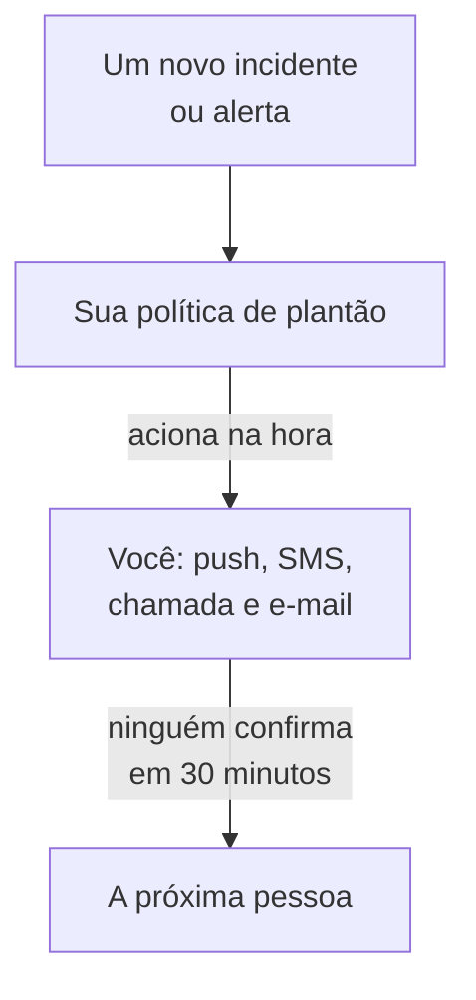

# Ser acionado por telefone, SMS ou push

Ao final deste guia, você é acionado no celular a cada novo incidente e a cada novo alerta do seu projeto, por notificação push, SMS ou ligação; se ninguém confirmar em 30 minutos, a próxima pessoa é acionada, e um acionamento de teste que você confirmou mostra que funciona. O guia segue a configuração guiada **Acionar a pessoa certa quando algo quebrar** e leva cerca de 10 minutos.

## O que você precisa

- Um projeto do qual você é proprietário: só o proprietário pode ativar SMS e chamadas, e só o proprietário ou um administrador pode criar uma política de plantão.
- Seu celular.
- Os membros da equipe que você quer acionar, já adicionados ao projeto: [Convidar pessoas](/docs/permissions/inviting-people) mostra como.

:::tabs
@tab OneUptime Cloud
As notificações push são gratuitas em todos os planos. SMS e chamadas são pagos com o saldo do projeto, que começa em 0.00 USD, e adicionar um número de telefone envia um SMS, então antes o saldo precisa estar acima de 1.00 USD. O saldo adicionado é cobrado no cartão do projeto. O plano Free comporta uma só pessoa e uma só regra de escalonamento: só você é acionado, e o acionamento se repete em vez de chegar a outra pessoa.
@tab Auto-hospedado
Seu servidor precisa conseguir enviar e-mails, SMS e chamadas. O administrador principal dele configura tudo isso em `/admin/setup`, com um teste para cada um, como mostra o [Guia de auto-hospedagem](/docs/installation/self-hosting-guide). As notificações push chegam ao app pelo relay push do OneUptime, sem nada para configurar.
:::

## Passos

:::steps
### Abrir a configuração guiada

Na página **Início** do seu projeto, clique em **Configure uma política de plantão**, na lista **Boas-vindas ao OneUptime 👋**. A página inicial de um projeto novo começa perguntando **O que você quer fazer primeiro?**: marque **Acionar a pessoa certa quando algo quebrar** e clique em **Continuar**. Se o passo não aparecer ou já estiver feito, pressione `Ctrl+K` (`Cmd+K` no Mac), digite `get paged` e escolha **Acionar a pessoa certa quando algo quebrar**.

### Instalar o app no celular

Instale o OneUptime On-Call pela App Store ou pelo Google Play e faça login: assim o app registra seu celular para as notificações push. De volta à configuração, clique em **Verificar de novo**: **App móvel ou navegador**, em **Como devemos contatar você?**, agora mostra seu celular.

### Ativar SMS e chamadas

Projetos novos começam com SMS e chamadas desativados. Se você é o proprietário do projeto, clique em **Ativar SMS e chamadas**; qualquer outra pessoa vê quem pode fazer isso. No OneUptime Cloud, se o saldo for de 1.00 USD ou menos, clique em **Adicionar saldo**, informe de 20 a 1.000 USD em **Valor (USD)** e clique em **Recarregar**.

### Adicionar seu número de telefone

Digite seu número de celular com o código do país em **Seu número de telefone**, por exemplo `+15551234567`, e clique em **Enviar um código por SMS**. Informe o código recebido por SMS e clique em **Verificar**: os acionamentos também ligam para esse mesmo número. Clique em **Continuar**. Para ser acionado só pelo app e por e-mail, deixe o número em branco e clique em **Continuar** direto.

### Escolher quem mais é acionado

Em **Quem mais está de plantão?**, você já está em **Acionados primeiro**. Clique em **Adicionar membros da equipe** para acionar outras pessoas junto com você e depois em **Salvar e continuar**. Num projeto que ainda não tem nenhuma política de plantão, isso cria a `Default on-call policy`, que aciona todos vocês a cada novo incidente e a cada novo alerta. Num projeto que já tem uma, escolha-a em **Política de plantão** e adicione as pessoas em **Adicionar à primeira regra de escalonamento**. Se ainda não for possível contatar alguém, o passo fica aberto em **Um acionamento chega até eles?**: clique em **Enviar lembrete de configuração** para essa pessoa e depois em **Continuar**.

### Decidir o que acontece se ninguém responder

Em **E se ninguém responder?**, mantenha **Acionar outra pessoa**, escolha quem em **Acionados em seguida** e deixe **Minutos de espera** em `30` ou mude o valor. Clique em **Salvar e continuar**. No plano Free, o passo oferece em vez disso **Acionar as mesmas pessoas de novo**, com **Vezes para acionar de novo** em `2`.

### Enviar um acionamento de teste

Em **Enviar uma chamada de teste**, clique em **Testar esta política**. Escolha uma **Gravidade** e clique em **Enviar chamada de teste**. Quem está na primeira regra de escalonamento da política é acionado como seria num incidente real, e cada mensagem diz TEST. Nenhum incidente é criado, e nenhuma página de status nem nenhum assinante é avisado.

### Confirmar o acionamento de teste

Abra o link do SMS ou do e-mail e confirme o acionamento ali, ou pressione 1 durante a ligação. O app mostra que o acionamento chegou, mas não consegue confirmar um teste. Depois clique em **Concluído** na caixa de diálogo e em **Continuar**.
:::

## Verificar se funcionou

- O passo de teste diz quem confirmou o acionamento, como e em quanto tempo.
- A configuração termina em **O acionamento está configurado**, com o que foi salvo: **Quem é acionado**, **Se ninguém responder** e **Testado**. Um problema na própria política, como alguém que ela não consegue contatar, aparece em **Requer atenção**.
- Em **Início**, a lista marca o passo **Configure uma política de plantão** como feito. Se era o último passo, a lista desaparece.

Se a política aciona outra pessoa, você também pode ver o escalonamento: clique em **Abrir a política de plantão** no resumo e depois em **Testar esta política**. Ative **Percorrer todos os níveis de escalonamento**, envie o teste e não confirme o primeiro acionamento: a próxima pessoa é acionada em até 2 minutos.

## O que pode dar errado

:::details Não aparece o botão Enviar um código por SMS
O SMS está desativado ou não pode ser enviado, e o passo diz por quê. Só um proprietário do projeto, ou alguém que gerencia a cobrança, vê **Ativar SMS e chamadas**. No OneUptime Cloud, um saldo de 1.00 USD ou menos esconde o campo. Num servidor auto-hospedado que não consegue enviar SMS, o administrador principal dele vê **Configurar SMS e chamadas**, que abre o Admin Dashboard para adicionar o Twilio, como mostra [Integração do Twilio](/docs/self-hosted/twilio-integration).
:::

:::details Ao adicionar saldo, aparece que nenhum método de pagamento foi encontrado
O saldo adicionado é cobrado no cartão do projeto. Adicione um em **Configurações do projeto → Cobrança e faturas → Cobrança** com **Adicionar método de pagamento** e depois adicione saldo de novo. Até lá, o app e o e-mail continuam acionando você.
:::

:::details Auto-hospedado: o número é recusado porque nenhuma conta do Twilio está configurada
Só o administrador principal é avisado com antecedência de que o servidor não consegue enviar SMS. Peça a ele que configure SMS e chamadas em `/admin/setup`. Enquanto isso, clique em **Continuar**: o app e o e-mail continuam acionando você.
:::

:::details O código ou o acionamento de teste nunca chega
Verifique primeiro o código do país do número. Depois de um acionamento de teste, feche a caixa de diálogo com **Concluído** e clique em **Não recebi**: aparece o que verificar, e **Abrir meus métodos de notificação** lista todas as formas de contatar você. Num servidor auto-hospedado, envie um SMS de teste em `/admin/setup` e execute `npm run doctor` no servidor.
:::

## Próximos passos

:::cards
- [Agendamentos de plantão](/docs/on-call/schedules): Monte rodízios, para que cada acionamento chegue a quem está de plantão. No Cloud, a partir do plano Growth.
- [Regras de escalonamento](/docs/on-call/escalation-rules): Adicione níveis, equipes e agendamentos à política.
- [Como me contatar](/docs/notifications/on-call-rules): Escolha qual método chega a você primeiro, e quando.
- [Publicar uma página de status](/docs/guides/status-page): Conte aos seus clientes o que está acontecendo, no seu próprio domínio.
:::
