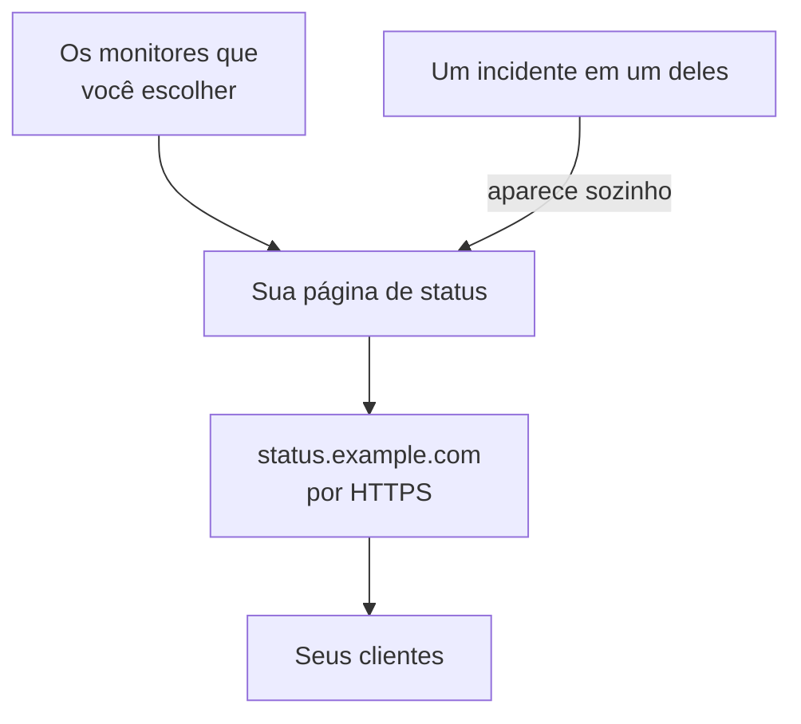

# Publicar uma página de status

Ao final deste guia, seus clientes abrem uma página de status num endereço seu, como `status.example.com`, por HTTPS. Ela mostra os monitores que você escolher, com o status e o tempo de atividade deles, e um incidente em um deles aparece nela automaticamente. O guia segue a configuração guiada **Publique uma página de status** e depois adiciona seu domínio em **Domínios personalizados**, na própria página de status: cerca de 15 minutos, mais o tempo que seu provedor de DNS levar.

## O que você precisa

- Pelo menos um monitor: uma página de status mostra monitores. Se você ainda não tem nenhum, a configuração guiada oferece antes **Configurar um monitor**.
- A função de proprietário ou de administrador do projeto: criar a página exige permissão para criar páginas de status, e adicionar seu domínio, permissão para adicionar e verificar os domínios do projeto.
- Um domínio que você controla, e acesso aos registros DNS dele no seu provedor de DNS.

:::tabs
@tab OneUptime Cloud
Todos os planos incluem um domínio personalizado e o certificado SSL gratuito dele. O plano Free tem uma página de status por projeto: se você já tem uma, abra os **Domínios personalizados** dela e comece no passo que adiciona seu domínio. Uma página de status nova é pública; torná-la privada exige o plano Growth.
@tab Auto-hospedado
Seu servidor precisa de um nome de host próprio, com um registro A que aponte para ele, como `oneuptime.example.com`, respondendo nas portas 80 e 443. Defina-o como `STATUS_PAGE_CNAME_RECORD` no `config.env` (`statusPage.cnameRecord` no chart do Helm), no lugar do valor de exemplo que está lá. Os certificados gratuitos também precisam de `LETS_ENCRYPT_ACCOUNT_KEY` (`letsEncrypt.accountKey`): uma chave privada criada com openssl e codificada em base64. Reinicie o OneUptime depois de mudá-los. **Adicionar domínio personalizado** verifica o servidor primeiro e lista o que ainda falta.
:::

## Passos

:::steps
### Abrir a configuração guiada

Na página **Início** do seu projeto, clique em **Publique uma página de status**, na lista **Boas-vindas ao OneUptime 👋**. A página inicial de um projeto novo começa perguntando **O que você quer fazer primeiro?**: marque **Informar meus clientes com uma página de status** e clique em **Continuar**. Se o passo não aparecer ou já estiver feito, pressione `Ctrl+K` (`Cmd+K` no Mac), digite `status page` e escolha **Publique uma página de status**.

### Dar um nome e escolher o que ela mostra

Em **Dê um nome e escolha o que ela mostra**, mantenha o **Nome da página de status** sugerido ou digite o seu. Em **O que ela mostra**, marque os monitores que seus clientes devem ver, ou clique em **Selecionar tudo**. Clique em **Criar a página de status**. A partir deste momento, a página é pública no link dela e mostra só os monitores que você marcou.

### Ver o que seus clientes veem

Em **É isto que seus clientes veem**, abra o endereço em **Link público**: seus monitores aparecem com o status deles. De volta à configuração, clique em **Parece bom**.

### Abrir Domínios personalizados

A configuração termina num resumo. Em **Deixe com a sua cara (opcional)**, clique em **Seu próprio domínio**. Os **Domínios personalizados** da página de status se abrem.

### Adicionar seu domínio

Clique em **Adicionar domínio personalizado**. Em **Domínio**, digite o endereço que seus clientes vão abrir, como `status.example.com`, e clique em **Continuar**. A **Configuração de DNS** abre com os registros a adicionar.

### Adicionar os registros DNS

No seu provedor de DNS, adicione cada registro que a **Configuração de DNS** lista, com o **Tipo**, o **Nome** e o **Valor** dele: um registro CNAME que aponta o endereço para o OneUptime e, na primeira vez que o projeto usa este domínio, um registro TXT que mostra que o domínio é do projeto. Se o seu provedor acrescenta o domínio a cada nome automaticamente, digite só a parte antes dele, como `status`, e `@` para o próprio domínio.

### Verificar os registros

Mantenha a **Configuração de DNS** aberta e clique em **Verificar agora**. Embaixo de cada registro, ela diz o que consultou e o que voltou. O registro TXT vem primeiro: até ele ser encontrado, o domínio não é adicionado, então clique em **Verificar agora** de novo até que seja. Assim que o registro CNAME é encontrado, a caixa de diálogo diz **Seu registro CNAME está verificado.** e um certificado SSL gratuito é emitido, geralmente em até 15 minutos.
:::

## Verificar se funcionou

- Abra `https://status.example.com`, trocando pelo seu endereço: sua página de status abre sem aviso de certificado.
- Em **Domínios personalizados**, o **Status** do domínio diz **Certificado emitido, renovado automaticamente.** Por um tempo, mesmo com a página já abrindo, ele pode dizer **Emitindo um certificado gratuito, geralmente em até 15 minutos.**
- Em **Início**, a lista marca o passo **Publique uma página de status** como feito: ele fica feito assim que uma página de status mostra um monitor. Se era o último passo, a lista desaparece.

Não é preciso mais nada: o OneUptime renova o certificado sozinho. Assim que o domínio aparece na lista, o OneUptime consulta o registro CNAME dele a cada 15 minutos e o verifica quando o registro está no ar, mesmo que você feche a **Configuração de DNS**.

## O que pode dar errado

:::details O domínio não está na lista depois de fechar a Configuração de DNS
A **Configuração de DNS** foi fechada antes de o registro TXT dela ser encontrado, então o domínio nunca foi adicionado. Clique em **Adicionar domínio personalizado**, digite o mesmo endereço, clique em **Continuar** e depois em **Verificar agora** até a caixa de diálogo encontrar os dois registros.
:::

:::details O domínio fica em "Aguardando o DNS"
Abra a **Configuração de DNS** pela linha do domínio e clique em **Verificar agora**: ela diz o que encontrou. Verifique se o nome do registro é o endereço completo, como `status.example.com`, e se o valor dele é o que a **Configuração de DNS** mostra. Se o nome responde com um endereço, ele tem um registro A, ou seu provedor de DNS o passa por um proxy: substitua o registro A, ou coloque o nome em DNS only. Para um domínio raiz, como `example.com`, use o registro ALIAS, ANAME ou de achatamento de CNAME do seu provedor.
:::

:::details A coluna Status diz que não foi possível emitir um certificado gratuito
Um registro CAA no seu domínio que deixa de fora `letsencrypt.org` bloqueia o certificado. Num servidor auto-hospedado, o Let's Encrypt precisa alcançar o servidor na porta 80. Corrija a causa: o OneUptime continua tentando sozinho, e **Verificar agora** na **Configuração de DNS** pede de novo, no máximo uma vez a cada 15 minutos por domínio.
:::

:::details Auto-hospedado: o servidor não está pronto para domínios personalizados
**Adicionar domínio personalizado** diz **Este servidor ainda não está pronto para domínios personalizados**, com uma linha para cada coisa que ainda falta e o que mudar: as configurações em [O que você precisa](#o-que-você-precisa). Sem `LETS_ENCRYPT_ACCOUNT_KEY`, um domínio verificado diz **Verificado. Usa o HTTPS do seu próprio proxy.**: sirva o HTTPS dele pelo seu próprio proxy. [Marca e domínios da página de status](/docs/status-pages/branding-and-domains#antes-de-começar) tem os detalhes.
:::

## Próximos passos

:::cards
- [Marca e domínios da página de status](/docs/status-pages/branding-and-domains): Seu logotipo, suas cores, os links do cabeçalho e o rodapé.
- [Assinantes e comunicados](/docs/status-pages/subscribers): Deixe os clientes se inscreverem, e publique comunicados.
- [Visão geral da manutenção programada](/docs/scheduled-maintenance/index): Avise os clientes sobre trabalhos planejados antes que eles comecem.
- [Ser acionado por telefone, SMS ou push](/docs/guides/paging): Seja acionado quando um desses monitores cair.
:::
