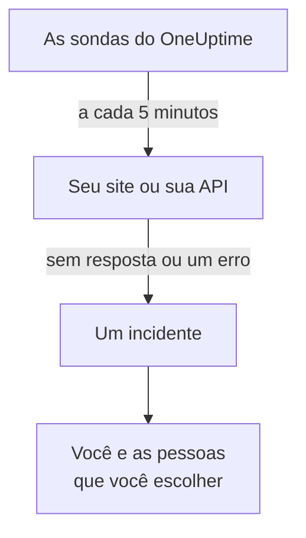

# Saber quando seu site ou sua API cai

Ao final deste guia, o OneUptime verifica seu site ou sua API a cada 5 minutos e, quando não há resposta ou a resposta é um erro, abre um incidente e avisa você; um acionamento de teste que você confirmou mostra que a mensagem chega até você. O guia segue a configuração guiada **Saber quando meu site ou API cair** e leva cerca de 5 minutos.

## O que você precisa

- Um projeto do OneUptime em que você possa criar monitores: um proprietário, um administrador ou um membro pode fazer isso. Para criar uma conta e um projeto, siga a primeira parte do [Início rápido](/docs/introduction/quickstart#criar-um-projeto).
- O endereço a verificar, como `https://example.com`. Para uma API, escolha um endpoint que responda a um `GET` simples, sem chave, como um health check: uma resposta como `401` conta como queda.

:::tabs
@tab OneUptime Cloud
O endereço é verificado por sondas em várias regiões, então ele precisa estar acessível pela internet. O plano Free comporta 10 monitores ativos.
@tab Auto-hospedado
O endereço é verificado pela própria sonda do seu servidor, então precisa estar acessível a partir dali. Para receber e-mails, o servidor precisa conseguir enviar e-mail: o administrador principal dele configura isso em `/admin/setup`, como mostra o [Guia de auto-hospedagem](/docs/installation/self-hosting-guide). O administrador principal não se torna proprietário do que cria, então, para receber os e-mails, ele se adiciona na página **Proprietários** do monitor.
:::

## Passos

:::steps
### Abrir a configuração guiada

A página **Início** de um projeto novo começa perguntando **O que você quer fazer primeiro?**: marque **Saber quando meu site ou API cair** e clique em **Continuar**. Depois clique em **Crie seu primeiro monitor**, na lista **Boas-vindas ao OneUptime 👋**. Se a lista não mostrar esse passo, pressione `Ctrl+K` (`Cmd+K` no Mac), digite `website down` e escolha **Saber quando meu site ou API cair**.

### Digitar o endereço

Em **O que devemos verificar?**, digite o endereço em **Endereço do site ou da API**. Para um endpoint de API, marque **Este é um endpoint de API**. Clique em **Começar a verificar**: as sondas verificam o endereço na hora, e uma frase diz o que elas encontraram. Clique em **Continuar**.

### Escolher quem é avisado

Em **Quem deve ser avisado?**, o que você vê depende do projeto:

- Se ainda não há nenhuma política de plantão nem regra de plantão, você já está em **Quem é acionado**. Clique em **Adicionar membros da equipe** para incluir pessoas que já estão no projeto e depois em **Salvar e continuar**. Isso cria a `Default on-call policy`, que aciona todos vocês a cada novo incidente e a cada novo alerta do projeto.
- Se já há uma política ou regra de plantão, as próprias regras do projeto decidem quem é acionado: clique em **Continuar**.
- Como membro, você não pode configurar acionamentos, então aparece que você vai receber e-mails como proprietário do monitor: clique em **Continuar**.

### Enviar um teste para você mesmo

Em **Envie um teste**, clique em **Enviar uma chamada de teste para mim**. Escolha uma **Gravidade** e clique em **Enviar chamada de teste**. O teste chega até você como um acionamento real chegaria, e cada mensagem diz TEST. Nenhum incidente é criado.

### Confirmar o acionamento de teste

Abra o link do e-mail e confirme o acionamento ali. Um número de telefone verificado também funciona, assim que SMS e chamadas estiverem ativados no projeto: abra o link do SMS, ou pressione 1 durante a ligação. Depois clique em **Concluído** na caixa de diálogo e em **Continuar**.
:::

## Verificar se funcionou

- A configuração termina no resumo, com o que foi salvo: **Verificado**, **Quando ele cai**, **Quem é avisado** e **Testado**.
- Clique em **Abrir o monitor** e depois em **Mostrar a cadeia**, no cartão **Quando cair** dele: isso mostra a cadeia que vai do monitor até as pessoas que ele alcança, e diz **Nada interrompe a cadeia.** quando nada a interromperia.
- Em **Início**, a lista marca o passo **Crie seu primeiro monitor** como feito assim que chega a primeira verificação. Se era o último passo, a lista desaparece.

Para configurar outro endereço depois, abra a configuração de novo e clique em **Verificar outro endereço**.

## O que pode dar errado

:::details A primeira verificação nunca termina
Uma frase que diz que nenhum local verifica o endereço significa que o monitor não tem nenhuma sonda; uma que continua dizendo que está verificando significa que a sonda dele não está conectada. Abra **Monitores → Configurações → Sondas** para ver o status de cada sonda. Num servidor auto-hospedado, o administrador principal verifica a sonda do servidor em `/admin/setup`. Depois abra o monitor, adicione uma sonda conectada a ele e abra a configuração de novo.
:::

:::details O site funciona, mas o monitor diz que ele está fora do ar
O monitor conta como queda a falta de resposta ou uma resposta fora da faixa de 200 a 399. Um firewall que bloqueia as sondas parece falta de resposta: no OneUptime Cloud, libere os endereços listados em [Endereços IP](/docs/configuration/ip-addresses); num servidor auto-hospedado, libere a máquina em que a sonda roda. Para mudar a regra, veja [Monitor de site](/docs/monitor/website-monitor) ou [Monitor de API](/docs/monitor/api-monitor).
:::

:::details Não dá para confirmar o acionamento de teste
Não chegou nenhuma mensagem pela qual confirmá-lo, o que num servidor auto-hospedado geralmente significa que ele ainda não consegue enviar e-mails: o passo diz isso, e o administrador principal dele vê **Configurar o e-mail**. Configure o e-mail e clique em **Enviar outro teste**, ou clique em **Pular o teste** e volte depois. Depois de um teste, feche a caixa de diálogo com **Concluído** e clique em **Não recebi**: aparece o que verificar.
:::

## Próximos passos

:::cards
- [Ser acionado por telefone, SMS ou push](/docs/guides/paging): Seja acionado no celular, e acione a próxima pessoa se ninguém responder.
- [Publicar uma página de status](/docs/guides/status-page): Mostre o monitor aos seus clientes, no seu próprio domínio.
- [Critérios e status](/docs/monitor/criteria-and-statuses): Decida exatamente quando um monitor conta como fora do ar.
:::
