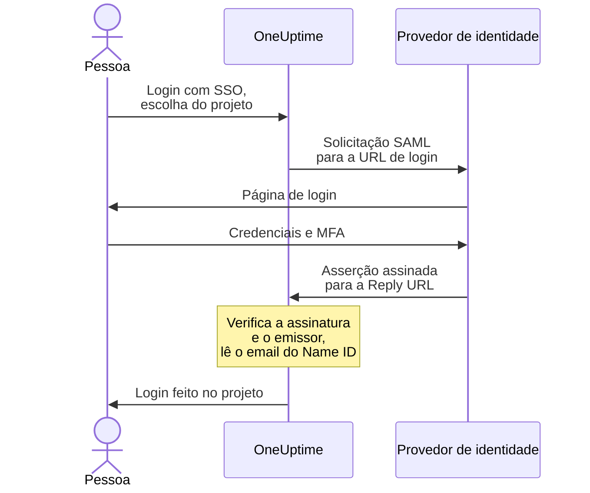

# SSO

O single sign-on (SSO) permite que as pessoas do seu projeto façam login no OneUptime com o provedor de identidade (IdP) da sua organização, via SAML 2.0 ou OpenID Connect. Você gerencia acesso, senhas e autenticação multifator em um só lugar, e pode exigir SSO de todos no projeto.

> [!NOTE]
> **Edição:** o SSO, incluindo "Require SSO to sign in", faz parte de todas as edições do OneUptime: as instalações auto-hospedadas o têm na Community Edition, sem precisar de licença. No OneUptime Cloud, ele está disponível a partir do plano **Scale**. Consulte [Edição Enterprise](/docs/self-hosted/enterprise) para ver o que cada edição inclui.

:::cards
- [Configurar um provedor SAML](#configurar-o-sso): Criá-lo no OneUptime e dar duas URLs ao seu IdP.
- [Guias de provedores de identidade](#guias-de-provedores-de-identidade): Keycloak, Microsoft Entra ID e Okta, passo a passo.
- [OpenID Connect](#openid-connect-oidc): Fazer login por meio de um app OIDC.
- [Exigir SSO](#exigir-sso-no-seu-projeto): Tornar o SSO a única forma de entrar no projeto.
:::

## Como funciona o login SAML

Um provedor SAML conecta um projeto a um aplicativo no seu provedor de identidade. Quem faz login escolhe o projeto na página **Login com SSO** do OneUptime, faz login no seu IdP e volta com a sessão iniciada.



O OneUptime lê apenas algumas informações da asserção que seu IdP envia:

| Da asserção | O que o OneUptime faz com isso |
| --- | --- |
| Assinatura | Verifica com o **Certificado público** do provedor. A resposta deve ser assinada e não pode estar criptografada. |
| Issuer | Deve corresponder exatamente ao **Emissor** do provedor. |
| Audience | Precisa ser o **Identificador (Entity ID)** do provedor. Uma resposta que o seu IdP criou para outro aplicativo é recusada. |
| Recipient e Destination | Precisam ser a **URL de resposta** do provedor, o endereço para o qual a resposta foi enviada. |
| `NotBefore` e `NotOnOrAfter` | A resposta só é aceita enquanto eles permitem, e no máximo 10 minutos depois de emitida, com 3 minutos de folga para relógios que não coincidem. |
| Name ID | O endereço de email da pessoa. Deve ser um endereço de email válido. |
| Atributos de nome | O nome da pessoa, usado quando o OneUptime cria a conta dela: um nome de exibição (`displayName`, ou `http://schemas.microsoft.com/identity/claims/displayname`), ou um nome e um sobrenome (`firstName` e `lastName`, ou as declarações `givenname` e `surname` que o Microsoft Entra ID envia por padrão). Opcional. |
| `http://schemas.microsoft.com/identity/claims/objectidentifier` | O ID de objeto da pessoa, que o Microsoft Entra ID envia por padrão. O primeiro login pelo provedor vincula a conta a ele, e um login posterior que indique o endereço de email da conta com outro ID de objeto é recusado. Opcional. |

Cada resposta faz o login uma única vez. Enviada de novo, por exemplo ao voltar no navegador depois do login, ela é recusada: faça o login de novo.

Quem faz login pela primeira vez entra nas **Equipes** do provedor, que decidem o que a pessoa pode fazer: veja [Funções e equipes dos usuários de SSO](#funções-e-equipes-dos-usuários-de-sso).

> [!NOTE]
> No OneUptime Cloud, na primeira vez que alguém faz login no projeto com um dos provedores SAML ou OIDC dele, o OneUptime envia um link por email em vez de fazer o login. A pessoa abre o link, confirma que o single sign-on do projeto pode fazer o login dela e continua. O link vale por 24 horas. Isso acontece uma vez por projeto, e de novo se a pessoa sair do projeto e voltar. Quem você convida e tem o login gerenciado pelo SSO não recebe esse email, já tenha ou não uma conta OneUptime: se escolher um dos provedores do projeto na página que o convite abre, a pessoa faz o login imediatamente, porque o link do convite já provou que a caixa de correio é dela. As instalações auto-hospedadas fazem o login imediatamente. No OneUptime Cloud, todo login que não é concluído direto recebe esta mesma resposta, tenha ou não o endereço uma conta: quem ainda não tem conta também recebe o e-mail, e a conta é criada quando a pessoa confirma, enquanto uma conta bloqueada ou um administrador do OneUptime não recebe e-mail. Uma instalação auto-hospedada recusa esses dois casos com uma única mensagem.

No OneUptime Cloud, quem entra no projeto pelo SSO ocupa um assento, assim como alguém que você convida. Se o seu plano inclui um número fixo de assentos e todos estão ocupados, novas pessoas não podem entrar pelo SSO até que um assento fique livre.

## Configurar o SSO

Você precisa de permissão para adicionar provedores de SSO — **Proprietário do projeto**, **Administrador do projeto** ou **Create Project SSO** — e, no OneUptime Cloud, do plano **Scale**. Para o lado do seu provedor de identidade, veja os [guias de provedores de identidade](#guias-de-provedores-de-identidade).

:::steps
1. **Abrir as configurações do projeto**

   - Abra seu projeto no OneUptime
   - Vá para **Configurações do projeto** > **Segurança** > **SSO**

2. **Criar a configuração de SSO**

   - Clique em **Adicionar provedor SAML**
   - Informe um **Nome** para a configuração de SSO (por exemplo, "Keycloak SAML" ou "Okta SAML")
   - Informe a **URL de login** do seu provedor de identidade
   - Informe o **Emissor** (Entity ID) do seu provedor de identidade
   - Cole o **Certificado público** do seu provedor de identidade
   - Na etapa **Login**, **Equipes** começa com a equipe de membros do seu projeto: quem faz login pela primeira vez entra nessas equipes. Só são aceitas equipes para as quais você poderia convidar alguém: uma equipe que dá mais acesso do que você tem é indicada em **Equipes**
   - Todo o resto já vem preenchido em **Mais campos**: o **Método de assinatura** (`RSA-SHA256`), o **Método de digest** (`SHA256`) e uma descrição ("Sign in with" seguido do nome). Altere-os apenas se o seu provedor de identidade exigir

3. **Obter os metadados de SSO do OneUptime**
   - Ao salvar, abre-se a caixa de diálogo **Configuração de SSO**. Você pode abri-la de novo com o botão **Ver configuração SSO**
   - Copie o **Identificador (Entity ID)**, como `https://oneuptime.com/<project-id>/<provider-id>` — ele é necessário na configuração do seu IdP
   - Copie a **URL de resposta (URL do Assertion Consumer Service)**, como `https://oneuptime.com/identity/idp-login/<project-id>/<provider-id>` — ela é necessária na configuração do seu IdP
   - Um provedor novo começa desligado. Quando seu IdP tiver esses dois valores, edite o provedor e ative **Habilitado**

4. **Testar o provedor**
   - Abra o link do cartão **Link de login SSO** e escolha o provedor na página que abrir. Você é levado à página de login do seu provedor de identidade e volta ao OneUptime com o login feito
   - Quando funcionar, você pode [exigir SSO](#exigir-sso-no-seu-projeto) no projeto
:::

## Guias de provedores de identidade

Escolha seu provedor de identidade. Cada guia obtém os valores do IdP, cria o provedor no OneUptime e depois dá ao IdP o **Identificador (Entity ID)** e a **URL de resposta** do OneUptime.

:::tabs
@tab Keycloak
O Keycloak é uma solução de código aberto bastante usada para gestão de identidade e acesso. Você precisa de uma instância do Keycloak em execução com um realm, e de acesso de administrador ao Keycloak e ao OneUptime.

:::steps
1. **Reunir os valores do seu realm**

   - **URL de login**: `https://<your-keycloak-domain>/auth/realms/<your-realm>/protocol/saml`
   - **Emissor**: `https://<your-keycloak-domain>/auth/realms/<your-realm>`
   - **Certificado**: o certificado de assinatura do realm. Abra `https://<your-keycloak-domain>/auth/realms/<your-realm>/protocol/saml/descriptor` e copie o valor de `X509Certificate`, ou abra **Realm settings** > **Keys** e clique em **Certificate** na chave RS256

   O Keycloak 17 e versões posteriores servem essas URLs sem o prefixo `/auth`. Coloque o certificado entre as próprias linhas, assim:

   ```text
   -----BEGIN CERTIFICATE-----
   MIICnzCCAYcCBgFyPZ8QFzANBgkqhkiG.......
   -----END CERTIFICATE-----
   ```

2. **Criar o provedor no OneUptime**

   Vá para **Configurações do projeto** > **Segurança** > **SSO**, clique em **Adicionar provedor SAML** e preencha:
   - **Nome**: um nome descritivo (por exemplo, `my-project-oneuptime`)
   - **URL de login** e **Emissor**: os valores acima
   - **Certificado público**: o certificado, entre as próprias linhas `BEGIN CERTIFICATE` e `END CERTIFICATE`
   - **Método de assinatura** e **Método de digest**: já definidos em **Mais campos** (`RSA-SHA256` e `SHA256`)

   Salve e copie o **Identificador (Entity ID)** e a **URL de resposta (URL do Assertion Consumer Service)** da caixa de diálogo que abrir.

3. **Criar o cliente do Keycloak**

   No Keycloak, abra **Clients** no seu realm e crie um cliente, ou edite um existente:
   - **Client Protocol** (tipo de cliente): `saml`
   - **Client ID**: o **Identificador (Entity ID)** do OneUptime
   - **Root URL** e **Valid Redirect URIs**: a URL do seu OneUptime
   - **Assertion Consumer Service POST Binding URL**: a **URL de resposta (URL do Assertion Consumer Service)** do OneUptime

4. **Ajustar as configurações do cliente**

   - Defina **Name ID Format** como `email` e ative **Force Name ID Format**, para que o Keycloak sempre envie o email como Name ID
   - Na aba **Keys** do cliente, desative **Client signature required** (em **Signing keys config**): o OneUptime não assina suas solicitações de entrada

5. **Ativar o provedor e testá-lo**

   No OneUptime, edite o provedor e ative **Habilitado**; depois abra o link do cartão **Link de login SSO** e escolha o provedor. Você deve ser levado à página de login do Keycloak e voltar ao OneUptime.
:::
@tab Microsoft Entra ID
O Microsoft Entra ID (antes Azure AD / Active Directory) é o serviço de identidade em nuvem da Microsoft. Você precisa de um tenant que dê suporte a aplicativos empresariais com SSO SAML, e de acesso de administrador ao Entra ID e ao OneUptime. No OneUptime Cloud, se a galeria de aplicativos do Microsoft Entra listar o OneUptime, adicione-o a partir dela: ele já vem com as declarações que o OneUptime lê e com os padrões das URLs dele.

:::steps
1. **Criar um aplicativo empresarial no Entra ID**

   - Entre no [Microsoft Entra admin center](https://entra.microsoft.com)
   - Vá para **Identity** > **Applications** > **Enterprise applications** e clique em **+ New application**
   - Pela galeria: procure o OneUptime, selecione-o e clique em **Create**
   - Caso contrário: clique em **+ Create your own application**, informe um nome (por exemplo, "OneUptime"), selecione **Integrate any other application you don't find in the gallery (Non-gallery)** e clique em **Create**

2. **Copiar os valores SAML do Entra ID**

   - No aplicativo, vá para **Single sign-on** e selecione **SAML**
   - Em **SAML Certificates**, baixe o **Certificate (Base64)**, abra o arquivo em um editor de texto e copie o conteúdo
   - Em **Set up OneUptime**, copie a **Login URL** e o **Microsoft Entra Identifier** (**Azure AD Identifier** em tenants mais antigos)

3. **Criar o provedor no OneUptime**

   Vá para **Configurações do projeto** > **Segurança** > **SSO**, clique em **Adicionar provedor SAML** e preencha:
   - **Nome**: um nome descritivo (por exemplo, `Azure AD SAML`)
   - **URL de login**: a **Login URL**
   - **Emissor**: o **Microsoft Entra Identifier**
   - **Certificado público**: o certificado Base64, incluindo as linhas `BEGIN CERTIFICATE` e `END CERTIFICATE`
   - **Método de assinatura** e **Método de digest**: já definidos em **Mais campos** (`RSA-SHA256` e `SHA256`)

   Salve e copie o **Identificador (Entity ID)** e a **URL de resposta (URL do Assertion Consumer Service)** da caixa de diálogo que abrir.

4. **Dar ao Entra ID as URLs do OneUptime**

   Em **Basic SAML Configuration**, clique em **Edit** e defina:
   - **Identifier (Entity ID)**: o **Identificador (Entity ID)** do OneUptime
   - **Reply URL (Assertion Consumer Service URL)**: a **URL de resposta** do OneUptime

   Clique em **Save**.

5. **Enviar o email como Name ID**

   Em **Attributes & Claims**, clique em **Edit**. O aplicativo da galeria já vem com isto configurado: confira.
   - Defina **Unique User Identifier (Name ID)** como o endereço de email do usuário: `user.mail`, ou `user.userprincipalname` quando esse for o endereço de email
   - Defina o **Name identifier format** como `Email address`
   - Mantenha as declarações padrão do Entra ID: contas novas recebem o nome da pessoa a partir de `givenname` e `surname`, e a conta é vinculada ao ID de objeto da pessoa, `objectidentifier`. Opcionalmente, adicione uma declaração chamada `http://schemas.microsoft.com/identity/claims/displayname` com o atributo de origem `user.displayname`, para dar às contas novas o nome de exibição em vez disso. O OneUptime ignora as outras declarações

6. **Atribuir usuários e grupos**

   Em **Users and groups** do aplicativo, clique em **+ Add user/group**, selecione os usuários e grupos que terão acesso por SSO e clique em **Assign**.

7. **Ativar o provedor e testá-lo**

   No OneUptime, edite o provedor e ative **Habilitado**; depois abra o link do cartão **Link de login SSO** e escolha o provedor. Você deve ser levado à página de login da Microsoft e voltar ao OneUptime.
:::
@tab Okta
O Okta é uma plataforma de identidade muito usada, com SSO SAML. Você precisa de uma organização do Okta com acesso de administrador, e de acesso de administrador ao OneUptime. No OneUptime Cloud, se a Okta Integration Network listar o OneUptime, adicione-o a partir dela: ele faz o login das pessoas pela página **Login com SSO** do OneUptime e pelo painel do Okta delas, cria uma conta para elas no primeiro login e pede dois IDs em vez das URLs do OneUptime.

:::steps
1. **Adicionar o OneUptime ao Okta**

   - No Okta Admin Console, vá para **Applications** > **Applications**
   - Pela Okta Integration Network: clique em **Browse App Catalog**, procure o OneUptime e clique em **Add Integration**. O Okta pede o **OneUptime Project ID** e o **OneUptime SSO Provider ID** antes que o OneUptime possa mostrá-los: por enquanto, informe `0` nos dois; você os substitui na etapa 4. Clique em **Done** e continue na etapa 2
   - Caso contrário, clique em **Create App Integration**, selecione **SAML 2.0** e clique em **Next**, informe "OneUptime" como **App name** e clique em **Next**
   - O Okta pede as URLs do OneUptime antes de mostrar as dele. Por enquanto, informe o endereço do seu OneUptime (por exemplo `https://oneuptime.com`) como **Single sign-on URL** e como **Audience URI (SP Entity ID)**: você substitui as duas na etapa 4
   - Defina **Name ID format** como `EmailAddress` e **Application username** como `Email`
   - Clique em **Next**, selecione **I'm an Okta customer adding an internal app** e clique em **Finish**

2. **Copiar os valores SAML do Okta**

   Na aba **Sign On** do aplicativo, em **SAML Signing Certificates**, encontre o certificado ativo:
   - Clique em **Actions** > **View IdP metadata** e copie a **URL de login** (Identity Provider Single Sign-On URL) e o **Emissor** (Identity Provider Issuer)
   - Clique em **Actions** > **Download certificate**, abra o arquivo `.cert` em um editor de texto e copie o conteúdo

3. **Criar o provedor no OneUptime**

   Vá para **Configurações do projeto** > **Segurança** > **SSO**, clique em **Adicionar provedor SAML** e preencha:
   - **Nome**: um nome descritivo (por exemplo, `Okta SAML`)
   - **URL de login** e **Emissor**: os valores do Okta
   - **Certificado público**: o certificado, incluindo as linhas `BEGIN CERTIFICATE` e `END CERTIFICATE`
   - **Método de assinatura** e **Método de digest**: já definidos em **Mais campos** (`RSA-SHA256` e `SHA256`)

   Salve e copie o **Identificador (Entity ID)** e a **URL de resposta (URL do Assertion Consumer Service)** da caixa de diálogo que abrir.

4. **Dar ao Okta as URLs do OneUptime**

   Para o aplicativo da Okta Integration Network, na aba **General**, clique em **Edit** em **App Settings** e defina:
   - **OneUptime Project ID** e **OneUptime SSO Provider ID**: os dois IDs que estão no **Identificador (Entity ID)** do OneUptime, `https://oneuptime.com/<project-id>/<provider-id>`

   Clique em **Save** e confira se **Application username format** é `Email` na aba **Sign On**.

   Para o seu próprio aplicativo, na aba **General**, clique em **Edit** em **SAML Settings** e em **Next**, e defina:
   - **Single sign-on URL**: a **URL de resposta (URL do Assertion Consumer Service)** do OneUptime
   - **Audience URI (SP Entity ID)**: o **Identificador (Entity ID)** do OneUptime

   Opcionalmente, adicione as declarações de atributo `firstName`, com o valor `user.firstName`, e `lastName`, com o valor `user.lastName`, para que contas novas recebam o nome da pessoa. Clique em **Next** e depois em **Finish**.

5. **Atribuir pessoas**

   Na aba **Assignments**, clique em **Assign** > **Assign to People** ou **Assign to Groups**, selecione quem terá acesso por SSO, clique em **Assign** para cada um e depois em **Done**.

6. **Ativar o provedor e testá-lo**

   No OneUptime, edite o provedor e ative **Habilitado**; depois abra o link do cartão **Link de login SSO** e escolha o provedor. Você deve ser levado à página de login do Okta e voltar ao OneUptime.
:::
@tab Outro
O SSO do OneUptime usa SAML 2.0 e funciona com qualquer provedor de identidade compatível:

:::steps
1. Obtenha a **URL de login** (o endpoint de SSO dele), o **Emissor** (o Entity ID dele) e o **Certificado público** (o certificado de assinatura X.509 dele) do seu provedor de identidade. Se o seu IdP só os mostra depois que um aplicativo existe, crie o aplicativo com o endereço do seu OneUptime como URLs provisórias.
2. No OneUptime, crie o provedor com esses valores e copie o **Identificador (Entity ID)** e a **URL de resposta (URL do Assertion Consumer Service)** da caixa de diálogo **Configuração de SSO** (ou de **Ver configuração SSO**).
3. No aplicativo SAML do seu provedor de identidade, defina a **Assertion Consumer Service URL / Reply URL** e o **Entity ID / Audience URI** com os valores do OneUptime, e o **Name ID Format** como endereço de email.
4. O **Método de assinatura** (`RSA-SHA256`) e o **Método de digest** (`SHA256`) já estão definidos em **Mais campos**; altere-os apenas se o seu provedor de identidade assinar de outra forma
5. Ative **Habilitado** no provedor e teste-o com o link do cartão **Link de login SSO**.
:::
:::

## OpenID Connect (OIDC)

Um projeto também pode fazer login por meio de um provedor OpenID Connect, como Google Workspace, Okta, Microsoft Entra ID, Auth0 ou Keycloak. Você precisa de permissão para adicionar provedores OIDC (**Proprietário do projeto**, **Administrador do projeto** ou **Create Project OIDC**) e, no OneUptime Cloud, do plano **Scale**.

:::steps
1. Registre no seu provedor de identidade um app (um cliente OIDC) que possa usar o fluxo authorization code com PKCE, e copie a **URL do Emissor**, o **Client ID** e o **Client Secret** dele.
2. No OneUptime, vá para **Configurações do projeto** > **Segurança** > **SSO**. Abaixo dos provedores SAML, clique em **Adicionar provedor OIDC**.
3. Informe um **Nome** (o que as pessoas veem na página de login), a **URL do Emissor**, o **Client ID** e o **Client Secret**. Você também pode colar a URL de descoberta do provedor em **URL do Emissor**.
4. Na etapa **Login**, **Equipes** começa com a equipe de membros do seu projeto: quem faz login pela primeira vez entra nessas equipes. Todo o resto já vem preenchido em **Mais campos**: a **URL de descoberta** (o emissor seguido de `/.well-known/openid-configuration`), os **Escopos** (`openid email profile`), os nomes das declarações `email` e `name`, e uma descrição ("Sign in with" seguido do nome). Altere-os apenas se o seu provedor exigir. Só são aceitas equipes para as quais você poderia convidar alguém: uma equipe que dá mais acesso do que você tem é indicada em **Equipes**.
5. Salve. A caixa de diálogo **Configuração OIDC** abre com a **Redirect URI**: adicione-a às URIs de redirecionamento permitidas do seu app. Um provedor novo começa desligado, então depois edite-o e ative **Habilitado**.
6. Abra o link do cartão **Link de login SSO** e escolha o provedor, para fazer login por ele antes de exigir SSO no projeto.
:::

## Sair também do provedor de identidade

Sair do OneUptime deixa a pessoa conectada no provedor de identidade, então, em um computador compartilhado, como uma tela do NOC ou um quiosque, a próxima pessoa que escolhe o provedor na página de entrada entra como quem saiu. Em um provedor SAML ou OIDC, ative **Sair também do provedor de identidade** em **Mais campos** para que sair do OneUptime também encerre a sessão no provedor. Vem desativado: em um notebook pessoal, também encerraria a sessão da pessoa em todos os outros apps que usam o provedor. Vale para as pessoas que entram em um navegador depois de ativado; o app para celular sai apenas do OneUptime.

:::tabs
@tab SAML
Informe a URL de saída do seu provedor de identidade como **URL de saída** do provedor, em **Mais campos**: sem ela, a opção não pode ser ativada. Depois, informe ao seu provedor de identidade a **URL de Single Logout** da caixa de diálogo **Configuração de SSO** e o certificado com que o OneUptime assina suas solicitações de saída, em **Baixar certificado de assinatura** na mesma caixa de diálogo.

| Provedor de identidade | URL de saída | Onde ficam a URL de Single Logout e o certificado |
| --- | --- | --- |
| Okta | **Identity Provider Single Logout URL**, em **View SAML setup instructions** na guia **Sign On** | Na guia **General**, edite **SAML Settings**, clique em **Show Advanced Settings** e selecione **Allow application to initiate Single Logout**. Defina **Single Logout URL** como a URL de Single Logout e **SP Issuer** como o identificador (Entity ID), e envie o certificado como **Signature Certificate**. |
| Microsoft Entra ID | **Logout URL**, em **Set up OneUptime** | Em **Basic SAML Configuration**, defina **Logout Url (Optional)** como a URL de Single Logout. O Entra ID não precisa de certificado. |
| Keycloak | O endpoint SAML do realm, o mesmo da URL de login | Na guia **Advanced** do cliente, defina **Logout Service Redirect Binding URL** como a URL de Single Logout. Mantenha **Front channel logout** ativado. O Keycloak não precisa de certificado enquanto **Client signature required** estiver desativado, como configurado acima. |

Depois de sair por lá, o provedor de identidade devolve o navegador à URL de Single Logout, que abre a página de entrada ou informa que o provedor de identidade não confirmou a saída. Quando a pessoa sai no provedor de identidade, ou de outro app que o usa, um provedor de identidade que envia solicitações de saída aos seus apps, como o Keycloak e o Microsoft Entra ID, também a tira do OneUptime. O OneUptime só aceita uma solicitação assinada pelo provedor de identidade.
@tab OpenID Connect
O navegador passa pela saída do provedor assim que o OneUptime encerra a sessão, e o provedor o devolve à página de entrada do OneUptime. Registre essa página no seu provedor: a caixa de diálogo **Configuração OIDC** a mostra como URI de redirecionamento após sair, que os provedores chamam de post-logout redirect URI. Um provedor cujo documento de descoberta não nomeia nenhum `end_session_endpoint`, como o Google, não pode ativá-la.

| Provedor de identidade | Onde registrar o URI de redirecionamento após sair |
| --- | --- |
| Okta | Na guia **General** da integração, clique em **Edit** em **General Settings** e adicione-o a **Sign-out redirect URIs**. |
| Microsoft Entra ID | No registro do aplicativo, em **Authentication**, adicione-o aos **Redirect URIs** da plataforma **Web**. A **Front-channel logout URL** é outra configuração, que o OneUptime não usa. |
| Auth0 | Nas **Settings** do aplicativo, adicione-o a **Allowed Logout URLs**. Um tenant criado antes de 14 de novembro de 2023 também precisa ativar **RP-Initiated Logout End Session Endpoint Discovery** nas configurações **Advanced**, para que o documento de descoberta nomeie um `end_session_endpoint`. |
| Keycloak | Nas configurações do cliente, adicione-o a **Valid post logout redirect URIs** (Keycloak 19 e posteriores). |

Um provedor em que ele não está registrado mostra a própria página de erro depois que alguém sai do OneUptime, em vez de devolver a pessoa; mesmo assim, ela saiu do OneUptime.
:::

## Funções e equipes dos usuários de SSO

O OneUptime não mapeia funções nem grupos do seu provedor de identidade. O que alguém pode fazer depende das equipes em que está: um provedor adiciona os recém-chegados às **Equipes** dele, e você gerencia as equipes e suas permissões no OneUptime, como descreve [Usuários, equipes e permissões](/docs/permissions/index). Para manter a participação nas equipes alinhada ao seu provedor de identidade, use o [SCIM](/docs/identity/scim). Cada equipe em que alguém entra ao fazer login é registrada na página **Registros de auditoria** dessa equipe, como uma alteração feita pela pessoa que fez login.

As equipes de um provedor decidem o que as pessoas que fazem login com ele podem fazer, por isso um provedor só é salvo com equipes para as quais quem o salva poderia convidar alguém. Cada salvamento as verifica de novo: um provedor cujas equipes dão mais acesso do que você tem só pode ser alterado por alguém cujo acesso as cubra, como um Proprietário do projeto. Provedores salvos antes dessa verificação continuam fazendo o login das pessoas nas equipes deles. Quem pode editar um provedor sempre pode desativá-lo, para que ele possa ser interrompido na hora.

## Domínios

**Login com SSO** pede um endereço de e-mail e oferece os provedores que atendem ao domínio desse endereço. Ele não lê nenhuma conta: um endereço com conta no seu projeto e um sem conta nenhuma recebem a mesma resposta, então a página não diz nada sobre quem tem conta. Para ser oferecido ali, um provedor lista os domínios que atende:

1. Adicione o seu domínio em **Configurações do projeto** > **Avançado** > **Domínios**, clique em **Verificar domínio** na linha dele e adicione o registro TXT exibido ao DNS do domínio. Assim que o registro é encontrado, o domínio está verificado.
2. Edite o provedor e escolha o domínio em **Domínios**, na etapa **Login**. Só os domínios verificados do projeto são listados.

**Login com SSO** passa então a oferecer o provedor a qualquer endereço desse domínio, seja quem for que o digite. O domínio precisa corresponder exatamente: `acme.com` não cobre `eu.acme.com`, então adicione cada domínio com que as pessoas fazem login.

Os provedores configurados antes de os domínios existirem receberam os domínios verificados do projeto na atualização do OneUptime: cada domínio que o projeto tinha verificado, a não ser que outro projeto também o tivesse verificado. Escolha você mesmo esse domínio, se for seu. Um domínio que foi adicionado mas nunca verificado não foi dado a nenhum provedor.

Um provedor que não indica nenhum domínio verificado não é oferecido a ninguém ali. A coluna **Domínios** dele mostra **Nenhum domínio verificado**, e um aviso acima dos seus provedores o nomeia e diz o que fazer. Enquanto o projeto não tiver nenhum domínio verificado, **Verificar um domínio** no aviso abre **Domínios**.

Quem tem o e-mail em outro domínio, como um prestador de serviços, também não encontra nenhum provedor ali. Compartilhe com essa pessoa o link de login SSO do seu projeto: copie-o do cartão **Link de login SSO** abaixo dos seus provedores. Ele lista os provedores do projeto e não pede nenhum endereço de e-mail, então não diz nada sobre quem tem conta. Um login iniciado no seu provedor de identidade também funciona, seja qual for o domínio.

## Exigir SSO no seu projeto

Configurar um provedor não impede ninguém de fazer login com senha. Para que o SSO seja a única forma de entrar no projeto, use o interruptor **Exigir SSO para entrar** em **Configurações do projeto** > **Segurança** > **SSO**, abaixo dos seus provedores:

:::steps
1. Teste primeiro o seu provedor com o link do cartão **Link de login SSO**.
2. Ative **Exigir SSO para entrar**. O OneUptime pede confirmação antes de salvar: a partir daí, todos no projeto, inclusive você, precisam fazer login com SSO para abri-lo, e quem fez login com senha fica sem acesso ao projeto até fazer login com SSO.
3. Clique em **Exigir SSO** para confirmar. O interruptor salva na hora; não há um botão de salvar separado.
:::

Ativar **Exigir SSO para entrar** exige um provedor que faça o login das pessoas no projeto: um dos provedores SAML ou OIDC dele que esteja ligado, ou um provedor global ligado que faça login no projeto. Sem nenhum, o OneUptime recusa e pede que você primeiro ative um provedor para o projeto e o teste. Se você escolher um provedor que o projeto exige, ele precisa ser um desses, e o mesmo é pedido quando você exige outro provedor depois.

Um salvamento que envia **Exigir SSO para entrar** ligado quando ele já está ligado, ou que indica o provedor que o projeto já exige, é verificado da mesma forma — a API, o Terraform e outras ferramentas costumam enviar todas as configurações a cada salvamento. Assim, enquanto o projeto não tiver nenhum provedor que faça login, ou se o provedor exigido tiver sido desligado desde então, esse salvamento é recusado com as mesmas palavras, não importa o que mais ele altere: primeiro ligue um provedor, exija outro ou desligue **Exigir SSO para entrar**.

Um projeto novo segue a mesma regra. Ele ainda não tem provedor próprio, então criá-lo com **Exigir SSO para entrar** já ligado — só um administrador mestre pode — exige um provedor global ligado que faça login em todos os projetos, e sem ele a criação é recusada com as mesmas palavras. Crie o projeto, configure e teste o provedor dele e depois ligue o interruptor.

Enquanto o servidor inteiro exigir SSO (**Admin** > **Configurações** > **Login único** > **Exigir SSO para entrar**), criar qualquer projeto também exige um provedor global assim; caso contrário, ninguém, nem quem o criou, conseguiria abrir o projeto. Sem ele, a criação de um projeto é recusada, e a mensagem pede que um administrador do servidor ligue um. Administradores mestres continuam podendo criar projetos.

Desligar **Exigir SSO para entrar** salva assim que você muda o interruptor e deixa os membros voltarem com a senha na hora — a menos que alguém o ligue de novo nesse mesmo instante; nesse caso, um servidor de aplicação pode levar até um minuto para acompanhar. Podem alterá-lo os Proprietários do projeto e Administradores do projeto e os membros com a permissão **Edit Project**; os demais veem o interruptor bloqueado, com a permissão de que precisariam.

> [!NOTE]
> No OneUptime Cloud, exigir SSO requer o plano **Scale**, e desligar funciona em qualquer plano. Abaixo do Scale, **Configurações do projeto** > **Segurança** > **SSO** mostra a oferta do plano; um projeto que um teste do Scale deixou exigindo SSO também encontra ali **Exigir SSO para entrar**, abaixo da oferta, para poder desligá-lo. Ligá-lo de novo requer o **Scale**.

### Gerenciar o login dos seus membros com SSO

Exigir SSO mantém os dados do seu projeto atrás do seu provedor de identidade, mas seus membros ainda podem definir no OneUptime uma senha, chaves de acesso e a autenticação de dois fatores, que seu projeto nunca pede. Enquanto **Exigir SSO para entrar** está ligado, um segundo interruptor abaixo dele, **Gerenciar o login com SSO**, impede isso.

O login de uma pessoa é gerenciado pelo SSO quando todos os projetos de que ela faz parte, incluindo qualquer projeto para o qual foi convidada, exigem SSO e têm **Gerenciar o login com SSO** ligado. Ela então não pode definir senha, chave de acesso, chave de segurança, aplicativo autenticador, códigos de backup nem autenticação de dois fatores, **Esqueceu a senha?** não lhe envia nenhum link, e o **Perfil do usuário** dela mostra seu provedor de identidade em vez de oferecer essas configurações. Nada muda no login: a senha dela ainda faz seu login no OneUptime, e seu projeto pede SSO como antes.

A regra é verificada todas as vezes, então:

- **Alguém em um projeto que não gerencia o login**: assim que a pessoa é membro de um projeto, ou é convidada para um, que não exige SSO ou não tem **Gerenciar o login com SSO** ligado, ela recebe suas configurações de volta, e o **Perfil do usuário** dela mostra esse projeto como o motivo. Se ela sair dele, o login dela volta a ser gerenciado. Uma conta pode pertencer a muitas organizações, então uma organização nunca decide pelos projetos de outra.
- **Projetos com provedores diferentes**: alguém em dois projetos que gerenciam o login, cada um com o próprio provedor de identidade, é gerenciado, e o perfil dele mostra os dois provedores.
- **Os administradores mestres** sempre mantêm suas próprias configurações.
- **O que as pessoas configuraram antes** é mantido, sem uso pelo seu projeto, até ser limpo: pelos Proprietários do projeto (veja abaixo), ou por um administrador do servidor na página **Autenticação** da pessoa no Admin Dashboard, com **Limpar configurações de login**.

**Gerenciar o login com SSO** salva assim que você muda o interruptor, não exclui nada, e desligá-lo devolve a todos suas configurações na hora. Quem pode alterar **Exigir SSO para entrar** pode alterá-lo, nos mesmos planos. Com **Exigir SSO para entrar** desligado, ele fica oculto e não muda nada.

### Limpar o que seus membros salvaram antes

Enquanto **Gerenciar o login com SSO** está ligado, os Proprietários do projeto veem abaixo dele quantos de seus membros ainda têm uma senha ou a autenticação de dois fatores salva no OneUptime. **Limpar configurações de login** exclui, depois de pedir confirmação, as senhas deles com qualquer link de redefinição ou de login, as chaves de acesso, chaves de segurança, aplicativos autenticadores e códigos de backup, desliga a autenticação de dois fatores e encerra as sessões que eles abriram sem SSO. Não dá para desfazer.

Uma conta pode pertencer a muitas organizações, então você só pode limpar as configurações das pessoas pelas quais sua organização é responsável. Sua organização são os projetos dos quais você é proprietário: as configurações de uma pessoa só são limpas quando todos os projetos de que ela faz parte, incluindo qualquer projeto para o qual foi convidada, são projetos dos quais você é **Proprietário do projeto** e têm **Gerenciar o login com SSO** ligado. Todos os outros mantêm suas configurações:

- alguém que é membro de um projeto, ou foi convidado para um, do qual você não é proprietário ou que não gerencia o login com SSO;
- alguém apenas convidado para o seu projeto, que ainda não entrou nele;
- os administradores mestres, e você: altere as suas no seu **Perfil do usuário**.

Cada pessoa cujas configurações são limpas recebe um e-mail com o que foi removido e avisando que agora entra com SSO, e os registros de auditoria dos seus projetos registram a limpeza como sua. Só um **Proprietário do projeto** pode limpar, conectado ao painel: nunca com uma chave de API.

## Desligar ou excluir um provedor

| O que você altera | Pessoas que fizeram login com o provedor |
| --- | --- |
| Desligá-lo ou excluí-lo | Fazem login com SSO de novo na próxima solicitação, onde o SSO é exigido |
| Um novo certificado ou client secret, outras URLs, um novo nome ou outras equipes | Continuam com o login feito |
| Ligá-lo | Podem fazer login com ele na hora |

Desligar ou excluir um provedor SAML ou OIDC encerra os logins que ele concedeu. Em um projeto que exige SSO, por conta própria ou porque o servidor inteiro exige:

- Quem fez login com ele precisa fazer login com SSO de novo na próxima solicitação, e as páginas que tem abertas deixam de receber atualizações ao vivo na hora.
- Um cliente MCP que alguém conectou depois de fazer login com ele deixa de funcionar no projeto. Conecte-o de novo depois de fazer login com SSO.
- Ligar o provedor de novo não traz esses logins de volta: as pessoas fazem login com ele de novo.

Alterar qualquer outra coisa em um provedor mantém todos com o login feito: um novo certificado ou client secret, outras URLs, um novo nome ou outras equipes. Os logins foram verificados quando foram feitos, e o próximo login usa as novas configurações.

Enquanto o projeto exigir SSO, o OneUptime mantém uma forma de entrar: você não pode desligar nem excluir o último provedor com que as pessoas conseguem fazer login no projeto, contando os provedores globais que fazem login nele, nem o provedor que o projeto exige. Desligue primeiro **Exigir SSO para entrar**.

Ligar um provedor permite fazer login com ele na hora.

Quando o servidor inteiro exige SSO (**Admin** > **Configurações** > **Login único** > **Exigir SSO para entrar**), cada projeto mantém uma forma de entrar da mesma maneira, mesmo um que não exige SSO por conta própria: ligue primeiro outro provedor para ele.

Os provedores globais seguem a mesma regra: uma alteração em um deles, ou nos projetos anexados a ele, que deixaria sem provedor um projeto que exige SSO é recusada, indicando o projeto. Veja [SSO global](/docs/identity/global-sso#desligar-ou-excluir-um-provedor).

Onde nem o projeto nem o servidor exigem SSO, desligar um provedor impede novos logins com ele. Quem já fez login continua com o login feito, assim como quem fez login com senha.

## Provedores que ficam abaixo do plano Scale

Um provedor SAML ou OIDC que um projeto ainda tem continua fazendo o login das pessoas depois que um teste do Scale termina ou o plano é reduzido. Por isso, abaixo do Scale, a página **SSO** lista os provedores do projeto abaixo da oferta (**Provedores SAML ainda configurados**, **Provedores OIDC ainda configurados**):

- **Desativar** interrompe um provedor na hora. O OneUptime pergunta antes.
- **Excluir** remove o provedor.

Adicionar um provedor, alterar um ou ligá-lo de novo requer o **Scale**. Quem pode fazer cada coisa é o mesmo que no Scale: desligar um provedor exige permissão para editá-lo, e excluí-lo, permissão para excluí-lo.

Enquanto o projeto ainda exigir SSO, a página **SSO** dele também mostra **Exigir SSO para entrar**: desligue-o antes de desligar o último provedor. Até lá, o último provedor com que as pessoas conseguem fazer login não pode ser desligado nem excluído, para que ninguém fique sem acesso ao projeto.

A página **Login único** de uma página de status lista os provedores dela da mesma forma, nas abas **SAML** e **OIDC**. Enquanto a página de status ainda exigir SSO, as duas abas também mostram **Exigir SSO para entrar**: desligue-o antes de desligar os provedores dela, ou os usuários privados dela não conseguirão fazer login de jeito nenhum.

## Solução de problemas

:::details "SSO Config not found"
O provedor está desligado, ou o link é de um provedor que não existe mais. Um provedor novo começa desligado: edite-o e ative **Habilitado**.
:::

:::details "No teams added."
A pessoa ainda não está no projeto, e o provedor não tem **Equipes** em que colocá-la. Edite o provedor e escolha pelo menos uma equipe, como a equipe de membros do seu projeto.
:::

:::details "Issuer URL does not match"
O emissor na asserção do seu IdP não é o **Emissor** do provedor. Copie-o de novo do seu IdP — a URL do realm do Keycloak, o **Microsoft Entra Identifier** ou o Identity Provider Issuer do Okta — para que os dois correspondam exatamente.
:::

:::details "SAML Audience does not match"
A resposta foi criada para outro aplicativo: a audience dela não é o **Identificador (Entity ID)** deste provedor. No seu IdP, defina o entity ID do aplicativo como o **Identificador (Entity ID)** de **Ver configuração SSO**: o **Client ID** no Keycloak, o **Identifier (Entity ID)** no Entra ID, a **Audience URI (SP Entity ID)** no Okta. Um IdP configurado apenas com o endereço do OneUptime como entity ID, como `https://oneuptime.com`, continua funcionando.
:::

:::details "SAML Recipient does not match"
A resposta foi enviada para outro endereço: o recipient dela não é a **URL de resposta** deste provedor. No seu IdP, defina a reply URL do aplicativo como a **URL de resposta (URL do Assertion Consumer Service)** de **Ver configuração SSO**: a **Assertion Consumer Service POST Binding URL** no Keycloak, a **Reply URL (Assertion Consumer Service URL)** no Entra ID, a **Single sign-on URL** no Okta. "SAML Destination does not match" tem a mesma causa e a mesma solução.
:::

:::details "SAML response has expired"
A resposta chegou ao OneUptime mais tarde do que o seu IdP permite, ou mais de 10 minutos depois de emitida: faça o login de novo. Se continuar acontecendo, o relógio do seu IdP ou do servidor do OneUptime está errado; o OneUptime aceita até 3 minutos de diferença entre eles. "SAML response is not valid yet" é o mesmo problema ao contrário.
:::

:::details "SAML response was already used"
Cada resposta do seu IdP faz o login uma única vez. Voltar no navegador depois do login, ou recarregar a página pela qual o seu IdP passou você, envia a mesma resposta de novo: faça o login de novo, pelo OneUptime ou pelo seu IdP.
:::

:::details "This account is linked to someone else."
O Microsoft Entra ID fez o login de alguém com o endereço de email de uma conta que está vinculada, por meio deste provedor, a outro ID de objeto: outra pessoa tem agora esse endereço no Entra ID, ou a conta do Entra ID da pessoa foi criada de novo. O OneUptime recusa o login, para que quem ficar com o endereço depois não possa usar a conta. Se a conta for dessa pessoa, remova-a do projeto e adicione-a de novo: o próximo login dela vincula a conta ao novo ID de objeto.
:::

:::details O login falha com um erro de assinatura ou de certificado
Cole o certificado de assinatura atual do IdP em **Certificado público**, incluindo as linhas `BEGIN CERTIFICATE` e `END CERTIFICATE`. No Entra ID, baixe o certificado **Base64**, não o bruto; no Okta, o certificado de assinatura ativo; no Keycloak, o certificado do realm certo.
:::

:::details "Encrypted SAML Responses are not supported"
O OneUptime não descriptografa asserções. Desative a criptografia de asserções do aplicativo no seu IdP, para que ele envie uma asserção assinada e não criptografada.
:::

:::details "SAML response did not include a valid email address"
O OneUptime lê o endereço de email do Name ID. Defina o Name ID como o email do usuário: **Name ID Format** `email` com **Force Name ID Format** no Keycloak, o **Unique User Identifier (Name ID)** no Entra ID, ou **Name ID format** `EmailAddress` e **Application username** `Email` no Okta. O endereço precisa corresponder à conta do OneUptime da pessoa.
:::

:::details Entra ID: AADSTS700016
O **Identifier (Entity ID)** no Entra ID não corresponde ao do OneUptime. Copie-o de novo de **Ver configuração SSO**; os dois valores precisam ser idênticos.
:::

:::details Okta: 404 ou uma audiência que não corresponde
A **Single sign-on URL** no Okta precisa ser exatamente a **URL de resposta** do OneUptime, e a **Audience URI**, exatamente o **Identificador (Entity ID)** do OneUptime. Confira se as duas substituíram os valores provisórios.
:::

:::details O usuário não está atribuído ao aplicativo
O Entra ID e o Okta só fazem o login de pessoas atribuídas ao aplicativo. Atribua o usuário, ou um grupo de que ele faça parte.
:::

:::details Keycloak: loop de redirecionamento
Confira se **Valid Redirect URIs** e **Assertion Consumer Service POST Binding URL** estão definidos como acima, no cliente do realm certo.
:::

## Próximos passos

:::cards
- [SSO global](/docs/identity/global-sso): Um único provedor de identidade para todos os projetos de uma instância auto-hospedada.
- [SCIM](/docs/identity/scim): Deixe seu provedor de identidade adicionar e remover pessoas automaticamente.
- [Usuários, equipes e permissões](/docs/permissions/index): O que as equipes em que os recém-chegados entram permitem que eles façam.
:::
