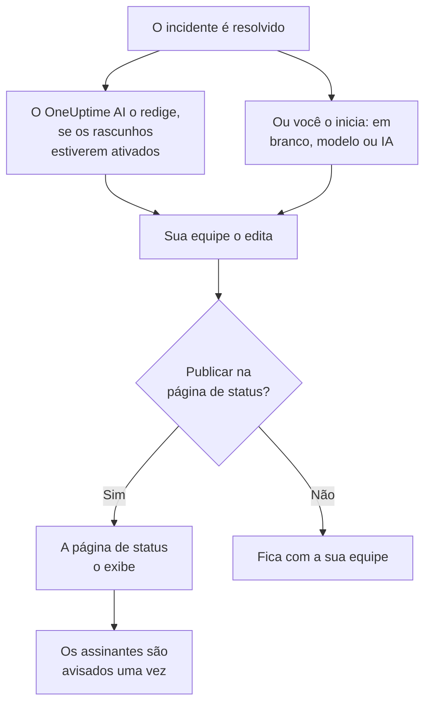

# Post-mortems

Um post-mortem é o relatório depois de um incidente: o que aconteceu, por quê, quanto custou aos seus usuários e o que muda agora. No OneUptime você o escreve no próprio incidente. Ele pode começar a partir do seu próprio modelo ou de um rascunho do OneUptime AI, e pode ser publicado na sua página de status como a atualização final do incidente.

:::cards
- [Escrever um post-mortem](#escrever-um-post-mortem): Na página Post-mortem do incidente, em cinco etapas.
- [Começar com um modelo ou um rascunho da IA](#começar-com-um-modelo-ou-um-rascunho-da-ia): O seu roteiro, ou um que o OneUptime AI preenche.
- [Publicá-lo na sua página de status](#publicá-lo-na-sua-página-de-status): Mostrá-lo aos clientes e avisar os assinantes uma vez.
- [Post-mortems de episódios](#post-mortems-de-episódios): Um único relatório para um grupo de incidentes.
:::

## Como um post-mortem é montado

Um post-mortem tem três partes, todas no incidente: a nota, escrita em Markdown; os anexos dela, como capturas de tela e relatórios; e se ele está na sua página de status. Elas ficam na página **Post-mortem** do incidente, em **Investigação** no menu lateral dele.

## Escrever um post-mortem

:::steps
### Abrir o post-mortem

Abra o incidente e clique em **Post-mortem**, em **Investigação** no menu lateral dele. O cartão **Nota da análise pós-incidente** mostra a nota, os anexos e se o post-mortem está na página de status.

### Clicar em Editar nota do post-mortem

O diálogo **Editar nota do post-mortem** abre na primeira etapa, **Post-mortem**.

### Escrever a nota e anexar arquivos

Escreva a **Nota da análise pós-incidente** em Markdown: o que aconteceu, o impacto, como foi resolvido e as ações de acompanhamento. Adicione capturas de tela, relatórios ou linhas do tempo em **Anexos da análise pós-incidente**.

### Escolher se publica

Clique em **Próximo**. Na etapa **Página de status**, **Publicar na Página de status** começa desligado, então o post-mortem fica com a sua equipe. Para mostrá-lo aos clientes, veja [Publicá-lo na sua página de status](#publicá-lo-na-sua-página-de-status).

### Salvar o post-mortem

Clique em **Salvar alterações**. O cartão mostra a nota e os anexos.
:::

Cada alteração da nota fica registrada no feed do incidente, e é publicada no canal do Slack ou do Microsoft Teams do incidente se ele tiver um. Enquanto o post-mortem não estiver publicado, nenhum assinante da página de status fica sabendo dele.

Escrever um post-mortem exige o papel Project Owner, Project Admin, Project Member, Incident Admin ou Incident Member, ou um papel personalizado com a permissão Edit Incident. Quem pode ler o incidente pode ler o post-mortem dele.

## Começar com um modelo ou um rascunho da IA

Dois botões do cartão preenchem a nota para você: **Generate with AI**, e **Aplicar modelo** assim que o projeto tiver um modelo de post-mortem. Os dois abrem o mesmo editor de **Editar nota do post-mortem**, com a nota preenchida e o resto do post-mortem como estava. Nada é salvo até você clicar em **Salvar alterações**, então leia a nota e corrija-a antes.

### Aplicar um modelo

**Aplicar modelo** aparece assim que o projeto tem um modelo de post-mortem. Os modelos são criados em **Incidentes → Configurações → Modelos de post-mortem**: veja [Modelos de post-mortem](/docs/incidents/settings#modelos-de-post-mortem). No OneUptime Cloud, os modelos exigem o plano Growth.

Clique em **Aplicar modelo**, escolha um em **Selecionar Modelo** no diálogo **Aplicar modelo de post-mortem** e clique em **Aplicar modelo**. Um projeto com um único modelo já o traz selecionado.

### Gerá-lo com IA

Clique em **Generate with AI**. O diálogo **Generate Postmortem with AI** oferece um roteiro em **Selecionar Modelo**: **Standard Postmortem**, **Detailed Technical Postmortem** ou **Brief Postmortem**, e depois os seus próprios modelos de post-mortem. **Template Preview** mostra o roteiro, e você pode alterá-lo antes de gerar.

Clique em **Generate with AI** no final do diálogo. O OneUptime AI lê o incidente (a descrição, a causa raiz e a correção, a linha do tempo de estados, as notas públicas e privadas, as mensagens do canal do Slack ou do Microsoft Teams dele, e o que foi dito nas [chamadas dele](/docs/workspace-connections/video-calls#transcrições-de-chamadas)) e escreve o post-mortem no seu roteiro. Depois o editor abre com o resultado.

Gerar exige que a IA esteja ligada para o projeto, em **Configurações do projeto → IA → AI Features**, e um provedor de LLM: veja [Provedores de LLM](/docs/ai/llm-provider). Também exige o papel Project Owner ou Project Admin, ou um papel personalizado com a permissão Edit Incident: outros papéis podem escrever o post-mortem, mas não gerá-lo.

### Deixar o OneUptime AI redigi-lo quando um incidente é resolvido

Com **Redigir um post-mortem quando um incidente é resolvido** ligado, o OneUptime AI redige o post-mortem sempre que um incidente é resolvido, salva-o como nota e o publica no feed do incidente para a sua equipe revisar. A chave fica em **Incidentes → IA → Configurações**, e vem ligada em projetos novos.

- Ele nunca substitui uma nota que já foi escrita.
- Ele nunca escreve em um post-mortem já publicado, onde o rascunho chegaria à página de status sem revisão.
- Ele exige que a IA esteja ligada para o projeto, e para pelo resto do dia assim que o projeto atinge os seus limites diários de IA. Veja [Post-mortem automático](/docs/ai/ai-sre#post-mortem-automático).
- Quando a transcrição da chamada do incidente ainda está a caminho no momento em que o incidente é resolvido, ele espera até que o OneUptime AI a leia, para que o rascunho inclua o que foi dito na chamada: até seis horas enquanto o Zoom ou o Google Meet prepara a transcrição. Veja [Gravar e transcrever todas as chamadas](/docs/workspace-connections/video-calls#gravar-e-transcrever-todas-as-chamadas).

## Publicá-lo na sua página de status

Um post-mortem publicado é a atualização final do incidente para os seus clientes: a página de status exibe a nota, em destaque na linha do tempo do incidente, com os anexos para baixar.

:::steps
### Abrir a etapa Página de status

Clique em **Editar nota do post-mortem** e depois em **Próximo** para chegar à etapa **Página de status**.

### Ligar Publicar na Página de status

Ligue **Publicar na Página de status**. Aparecem mais dois campos: **Notificar assinantes**, que vem ligado, e **Análise pós-incidente publicada em**, que marca o momento atual.

### Decidir quem é avisado, e quando ele aparece

Desligue **Notificar assinantes** para publicar sem avisar os assinantes. Altere **Análise pós-incidente publicada em** para mostrar outro horário ao lado do post-mortem.

### Publicar

Clique em **Salvar alterações**. O cartão agora mostra **Análise pós-incidente visível na Página de status?**, **Notificar assinantes**, **Status de notificação do assinante** e **Análise pós-incidente publicada em**.
:::

O que decide se os clientes o veem, e se ficam sabendo:

- **O incidente precisa estar na página de status.** Uma página de status só mostra um post-mortem em um incidente que ela mostra: **Visível na página de status** ligado, e o incidente não privado.
- **A nota precisa dizer algo.** Um post-mortem publicado com a nota vazia não é exibido, e ninguém é avisado.
- **Os assinantes são avisados uma vez**, na primeira vez que a página de status mostra o post-mortem. Salvá-lo de novo, ou editá-lo enquanto está publicado, atualiza a página sem avisar ninguém. Tirá-lo e publicá-lo de novo os avisa de novo. Um publicado enquanto o incidente está oculto é enviado quando o incidente fica visível.
- **Notificar assinantes é lido quando a notificação sai.** Ligá-lo depois que o post-mortem foi publicado não envia nada.

**Status de notificação do assinante** mostra se a notificação saiu, e oferece **Tentar novamente** quando falhou. Veja [O post-mortem](/docs/status-pages/subscribers#o-post-mortem) para cada caso, e [Tentar novamente e reenviar](/docs/status-pages/subscribers#tentar-novamente-e-reenviar).

**Análise pós-incidente publicada em** é também o momento em que o post-mortem conta como publicado para a medição **Tempo até o post-mortem**: veja [Medições prontas](/docs/incidents/settings#medições-prontas).

## Post-mortems de episódios

Um episódio de incidentes também tem uma página **Post-mortem**, em **Investigação**: um único relatório para todos os incidentes do episódio. Clique em **Editar post-mortem** para escrevê-lo. **Aplicar modelo** e **Generate with AI** funcionam como em um incidente, e a IA lê o episódio e os incidentes membros dele.

O post-mortem de um episódio é só a nota: não tem anexos, e nenhuma página de status o exibe. O OneUptime AI não redige um sozinho quando um episódio é resolvido. Gerá-lo exige o papel Project Owner ou Project Admin, ou um papel personalizado com a permissão Edit Incident Episode.

Alertas e eventos de manutenção programada não têm post-mortem.

## Pela API

Um post-mortem é um conjunto de campos do incidente, lidos e escritos por `/api/incident` como o resto do incidente:

| Campo | O que é |
| --- | --- |
| `postmortemNote` | A nota, em Markdown. |
| `showPostmortemOnStatusPage` | Se o post-mortem está publicado nas suas páginas de status. Começa como `false`. |
| `notifySubscribersOnPostmortemPublished` | Se os assinantes são avisados quando ele é publicado. Começa como `true`. |
| `postmortemPostedAt` | O horário que a página de status mostra ao lado dele. |

Escrever `showPostmortemOnStatusPage` como `true` sobre uma `postmortemNote` já escrita publica o post-mortem, como o diálogo faz.

## Solução de problemas

:::details Aplicar modelo não aparece no cartão
O projeto ainda não tem um modelo de post-mortem, ou o seu papel não pode lê-los. Crie um em **Incidentes → Configurações → Modelos de post-mortem**. No OneUptime Cloud, os modelos exigem o plano Growth.
:::

:::details Generate with AI diz que a IA está desligada, ou que falta permissão
Ligue a IA em **Configurações do projeto → IA → AI Features**. Gerar exige o papel Project Owner ou Project Admin, ou um papel personalizado com a permissão Edit Incident, mesmo para quem pode editar o post-mortem.
:::

:::details O post-mortem não está na página de status
Verifique três coisas: **Publicar na Página de status** está ligado, a nota não está vazia, e o incidente aparece na página de status (**Visível na página de status** ligado, e não privado).
:::

:::details Os assinantes não foram avisados do post-mortem
**Notificar assinantes** estava desligado na publicação, ou o incidente está oculto: nesse caso ele é enviado assim que o incidente fica visível. **Status de notificação do assinante** no cartão diz qual foi.
:::

:::details Nenhum rascunho da IA apareceu quando o incidente foi resolvido
O incidente já tinha uma nota, o post-mortem já estava publicado, ou **Redigir um post-mortem quando um incidente é resolvido** está desligado. A IA precisa estar ligada para o projeto, e o projeto não pode ter atingido os seus limites diários de IA. Quando a transcrição da chamada do incidente está a caminho, o rascunho chega assim que o OneUptime AI a lê.
:::

## Próximos passos

:::cards
- [Visão geral dos incidentes](/docs/incidents/index): As outras páginas do incidente, da declaração à resolução.
- [Configurações e automação de incidentes](/docs/incidents/settings): Os modelos de post-mortem e a medição do tempo até o post-mortem.
- [Assinantes e comunicados](/docs/status-pages/subscribers): Tudo o que uma página de status diz aos seus assinantes.
- [AI SRE](/docs/ai/ai-sre): O que o OneUptime AI faz sozinho depois de um incidente.
:::
