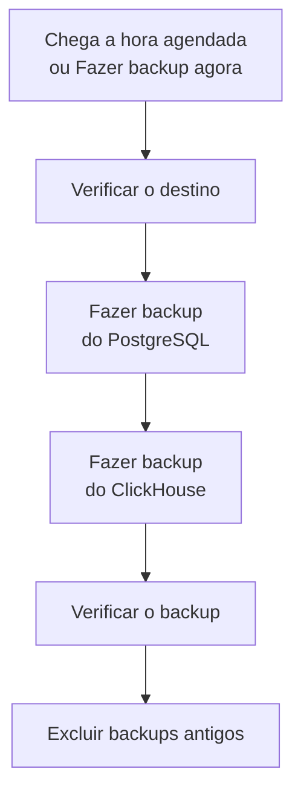

# Backups

Faça backup de um OneUptime auto-hospedado em um armazenamento seu, com agendamento, e restaure-o pelo Admin Dashboard. Um backup contém o PostgreSQL, com seus projetos, monitores, incidentes, páginas de status e usuários, e o ClickHouse, com seus logs, traces e métricas. Os backups são mantidos por quantos dias você escolher, os mais antigos são excluídos para você, e qualquer backup pode ser restaurado no próprio local. Os backups fazem parte da Edição Enterprise.

:::cards
- [Configurar backups](#configurar-backups): Escolha um destino, teste-o e defina um agendamento.
- [Destinos](#destinos): O que cada destino recomendado pede.
- [Restaurar um backup](#restaurar-um-backup): O que é substituído e como os dados atuais ficam protegidos.
- [Mudar para um novo servidor](#mudar-para-um-novo-servidor): Restaure os backups de uma instalação em outra.
:::

## Como um backup funciona



- **Consistente.** O PostgreSQL é exportado em uma única transação, então o dump é o banco de dados como estava em um momento, enquanto o OneUptime continua funcionando. O ClickHouse faz backup de cada tabela como ela estava quando leu suas partes.
- **Direto para o destino.** A saída do `pg_dump` é enviada ao armazenamento à medida que é escrita, e o ClickHouse grava o próprio backup no armazenamento. Nada é gravado no disco do servidor, qualquer que seja o tamanho dos dados.
- **Verificado.** Antes que o backup conte, o `pg_restore` lê o dump de volta a partir do destino, e o registro que o ClickHouse mantém do próprio backup é encontrado lá. O SHA-256 do dump é guardado com o backup, e uma restauração o verifica antes de substituir qualquer coisa. Um backup que falha ou é cancelado exclui o que gravou, então o destino só contém backups completos.
- **Criptografado.** Os backups chegam ao armazenamento por HTTPS, a menos que você informe um endpoint `http://`. Amazon S3, Google Cloud Storage, Azure Blob Storage e Cloudflare R2 criptografam tudo o que armazenam; em outro armazenamento, ative a criptografia em repouso do bucket. As credenciais do destino são armazenadas criptografadas e nunca mais são exibidas.
- **Um de cada vez.** Apenas um backup ou restauração é executado por vez em toda a instalação. Os outros esperam a sua vez.

Cada backup é uma pasta própria dentro da pasta do destino (`oneuptime/backups/`, a menos que você escolha outra), com o nome da hora em que começou, em UTC:

```text
oneuptime/backups/20261024T020000Z-3f2a9c1b/manifest.json
oneuptime/backups/20261024T020000Z-3f2a9c1b/postgres.dump
oneuptime/backups/20261024T020000Z-3f2a9c1b/clickhouse/
```

O `manifest.json` é gravado por último: ele diz o que o backup contém e qual versão do OneUptime o fez.

## Antes de começar

- **A Edição Enterprise**, com uma licença que inclua backups. Os backups são executados durante o período de avaliação e o de carência. Sem licença, nenhum backup novo é feito, e restaurar e excluir backups continua funcionando. Veja [Edição Enterprise](/docs/self-hosted/enterprise).
- **Um administrador principal.** Os backups são configurados no Admin Dashboard.
- **Um bucket ou contêiner só para backups**, e credenciais que possam ler, gravar, listar e excluir nele.
- **Um destino que o ClickHouse também alcance.** O ClickHouse grava o próprio backup no armazenamento, então a rede dele precisa alcançar o armazenamento, assim como a do OneUptime.
- **Para restaurar o PostgreSQL, um usuário do banco de dados que possa criar bancos de dados.** Uma restauração grava em um novo banco de dados ao lado do ativo. O PostgreSQL que vem com o OneUptime se conecta como superusuário, que pode fazer isso.

## Configurar backups

:::steps
### Abrir a página de backups

No Admin Dashboard, vá para **Configurações → Backups** e clique em **Configurar backups**.

### Escolher para onde vão os backups

Escolha um dos destinos recomendados. O que cada um pede está em [Destinos](#destinos).

### Preencher a conexão

Preencha o que o destino pede. Uma pasta, uma região e as configurações que a maioria deixa como estão ficam em **Mais campos**, e **Guia de configuração** abre a seção do destino nesta página.

### Testar o destino

Clique em **Testar o destino**. O OneUptime grava, lê, lista e exclui um pequeno arquivo de teste, verifica se o `pg_dump` consegue fazer backup do seu PostgreSQL e pede ao ClickHouse que grave um backup de teste das definições das tabelas dele. Nada é salvo, e uma verificação que falha diz o que mudar.

### Escolher quando os backups são executados

Escolha **Com que frequência** e a hora em **Às (UTC)**, e para backups semanais o **Dia da semana**. **Manter backups por (dias)** é 30, a menos que você mude. Desative **Fazer backup do ClickHouse também** para fazer backup apenas do PostgreSQL.

### Começar a fazer backup

Clique em **Começar a fazer backup**. O primeiro backup é executado no próximo horário agendado, e **Fazer backup agora** inicia um na hora.
:::

A página então mostra como estão os backups: quando o último foi executado, qual era o tamanho e quanto tempo levou, e quando o próximo será executado. Um backup em andamento mostra a etapa em que está, e **Ver etapas** mostra cada etapa enquanto ela é executada.

## Destinos

| Destino | Armazenamento | Entra com |
| --- | --- | --- |
| [Amazon S3](#amazon-s3) | Amazon S3 | Uma chave de acesso |
| [Cloudflare R2](#cloudflare-r2) | Armazenamento compatível com S3 | Um token de API do R2 |
| [Backblaze B2](#backblaze-b2) | Armazenamento compatível com S3 | Uma chave de aplicativo |
| [Wasabi](#wasabi) | Armazenamento compatível com S3 | Uma chave de acesso |
| [MinIO](#minio) | Armazenamento compatível com S3 | Uma chave de acesso |
| [Google Cloud Storage](#google-cloud-storage) | Google Cloud Storage | Uma chave HMAC |
| [Azure Blob Storage](#azure-blob-storage) | Azure Blob Storage | Um token SAS ou uma chave de acesso |
| [Outro armazenamento compatível com S3](#outro-armazenamento-compatível-com-s3) | Armazenamento compatível com S3 | Uma chave de acesso |

Uma chave para o Amazon S3 ou outro armazenamento compatível com S3 precisa de `s3:PutObject`, `s3:GetObject`, `s3:ListBucket`, `s3:DeleteObject` e `s3:AbortMultipartUpload` na pasta, e de nada mais:

```json
{
  "Version": "2012-10-17",
  "Statement": [
    {
      "Effect": "Allow",
      "Action": "s3:ListBucket",
      "Resource": "arn:aws:s3:::my-backups"
    },
    {
      "Effect": "Allow",
      "Action": [
        "s3:PutObject",
        "s3:GetObject",
        "s3:DeleteObject",
        "s3:AbortMultipartUpload"
      ],
      "Resource": "arn:aws:s3:::my-backups/oneuptime/backups/*"
    }
  ]
}
```

### Amazon S3

| Campo | O que inserir |
| --- | --- |
| **Bucket** | O bucket em que os backups são gravados. Use-o somente para backups. |
| **Região** | A região do bucket. Começa em `us-east-1`. |
| **ID da chave de acesso** | Uma chave de acesso com as permissões acima. |
| **Chave de acesso secreta** | O segredo da chave. |
| **Pasta** | Em **Mais campos**. Se ficar vazio, os backups vão para `oneuptime/backups/`. |

O Amazon S3 criptografa todo arquivo que armazena, e o OneUptime pede isso a ele (SSE-S3) para cada arquivo que grava.

### Cloudflare R2

Insira como **Endpoint** o endereço da API S3 da sua conta, `https://<account-id>.r2.cloudflarestorage.com`, nas configurações do bucket no R2. Depois insira o **Bucket**, e o **ID da chave de acesso** e a **Chave de acesso secreta** de um token de API do R2 que possa ler e gravar objetos nele. Ler backups de volta do R2 não custa nada.

### Backblaze B2

Insira como **Endpoint** o endpoint S3 do bucket, mostrado na página Buckets dele no Backblaze, como `https://s3.us-west-004.backblazeb2.com`. Depois insira o **Bucket**, e o ID e a chave de uma chave de aplicativo como **ID da chave de acesso** e **Chave de acesso secreta**. A região é obtida do endpoint.

### Wasabi

Insira como **Endpoint** a URL de serviço da região do bucket, como `https://s3.us-east-1.wasabisys.com`, depois o **Bucket** e uma chave de acesso. A região é obtida do endpoint.

### MinIO

Insira como **Endpoint** o endereço da API S3 do seu servidor MinIO, como `https://minio.example.com:9000`, depois o **Bucket** e uma chave de acesso cuja política possa ler, gravar, listar e excluir nele. O OneUptime e o ClickHouse precisam alcançar o endereço.

### Google Cloud Storage

Insira o **Bucket**, e a **Chave de acesso HMAC** e o **Segredo HMAC** de uma conta de serviço com o papel Storage Object Admin no bucket. Crie a chave nas configurações do Cloud Storage, na guia Interoperabilidade. O OneUptime e o ClickHouse alcançam o bucket pela API compatível com S3 do Cloud Storage.

### Azure Blob Storage

Insira a **Conta de armazenamento** e o **Contêiner**, e escolha em **Entrar com** como entrar: um **Token SAS** com permissões de leitura, adição, criação, gravação, exclusão e listagem no contêiner, ou uma **Chave de acesso** da conta de armazenamento. Um token SAS pode ser limitado ao contêiner, então é a escolha mais segura. **Nuvem** e **Pasta** ficam em **Mais campos**.

### Outro armazenamento compatível com S3

Para Ceph, DigitalOcean Spaces, Hetzner Object Storage e qualquer armazenamento com uma API S3, insira o endereço S3 dele como **Endpoint**, depois o **Bucket** e uma chave de acesso. **Região**, em **Mais campos**, só é necessária se o armazenamento pedir uma. Se ficar vazia, é obtida do endpoint, ou é `us-east-1`.

## Agendamento e retenção

| Configuração | O que faz |
| --- | --- |
| **Com que frequência** | **A cada hora**, **A cada 6 horas**, **A cada 12 horas**, **Todos os dias** ou **Toda semana**. Todos os dias atende à maioria das instalações. |
| **Às (UTC)** | A hora em que os backups começam, em UTC, com o seu próprio horário ao lado. A cada 6 ou 12 horas conta a partir dela: às `02:00`, os backups a cada 6 horas são executados às 02:00, 08:00, 14:00 e 20:00. Os backups a cada hora são executados na hora cheia. |
| **Dia da semana** | O dia em que os backups semanais são executados. |
| **Manter backups por (dias)** | De 1 a 3650 dias. 30, a menos que você mude. |
| **Fazer backup do ClickHouse também** | Ativado, a menos que você o desative. O backup do PostgreSQL é sempre feito. |

Depois de cada backup, os backups iniciados há mais de **Manter backups por (dias)** são excluídos, no destino e da lista, exceto o backup bem-sucedido mais recente, que é mantido por mais antigo que seja. Desativar os backups, ou uma licença que expira, nunca deixa você sem um backup para restaurar.

**Desativar backups agendados**, no menu do cartão de status, interrompe o agendamento. **Fazer backup agora** continua funcionando, e nenhum backup é excluído. **Ativar** inicia o agendamento de novo.

## Restaurar um backup

:::warning O que uma restauração substitui
Uma restauração substitui os dados atuais pelos do backup. Tudo o que mudou desde que o backup foi feito é perdido, a menos que você faça backup dos dados atuais primeiro.
:::

:::steps
### Escolher o backup

Na tabela **Backups**, clique em **Restaurar** no backup para o qual voltar. O OneUptime verifica o backup primeiro: se os arquivos dele estão no destino e inalterados, qual versão do OneUptime o fez e se este servidor pode restaurá-lo.

### Escolher o que restaurar

Marque **PostgreSQL: projetos, monitores, incidentes, usuários**, **ClickHouse: logs, traces, métricas** ou ambos. A caixa de diálogo mostra quantos projetos, usuários e monitores o backup contém e quantos existem agora.

### Proteger os dados atuais

**Fazer backup dos dados atuais primeiro** está marcado: a restauração começa com um backup dos dados que ela substitui, para que você possa voltar a eles. Desmarque apenas se você tiver outra cópia, porque sem ela a restauração não pode ser desfeita.

### Confirmar

Digite `restore` e clique em **Restaurar**.
:::

Uma restauração é executada etapa por etapa, e a página mostra cada uma:

| Etapa | O que acontece |
| --- | --- |
| **Verificar o backup** | Os arquivos do backup estão lá, e esta instalação pode restaurá-lo. |
| **Fazer backup dos dados atuais** | Um backup dos dados atuais, a menos que você o tenha desmarcado. |
| **Restaurar o PostgreSQL** | O backup é restaurado em um novo banco de dados ao lado do ativo, e verificado. |
| **Restaurar o ClickHouse** | A telemetria ativa é deixada de lado, e a do backup é restaurada no lugar dela. |
| **Mudar para os dados restaurados** | O banco de dados restaurado recebe o nome do ativo, em um instante. |
| **Atualizar os dados restaurados** | As migrações de banco de dados desta versão são executadas nos dados restaurados. |
| **Limpar** | O que foi deixado de lado é removido. |

O OneUptime continua funcionando com os dados atuais até a troca, e nada do que ele usa muda antes disso. Uma restauração que falha ou é cancelada antes da troca deixa tudo como estava, e uma que falha durante a troca recoloca o que tinha deixado de lado. A telemetria que chega enquanto o ClickHouse é restaurado não é armazenada. Depois que o PostgreSQL é restaurado, você pode ser desconectado: entre com uma conta que esteja no backup.

:::details A restauração diz que o backup foi feito com outro ENCRYPTION_SECRET
As credenciais que o OneUptime armazena, como a chave de um destino, são criptografadas com `ENCRYPTION_SECRET`. Defina o `ENCRYPTION_SECRET` com que o backup foi feito antes de restaurar, ou essas credenciais não poderão ser lidas depois.
:::

## Mudar para um novo servidor

:::steps
### Instalar o OneUptime no novo servidor

Instale a Edição Enterprise, na versão que fez os backups ou em uma mais recente.

### Configurar o mesmo destino

Em **Configurações → Backups**, configure o destino em que estão os seus backups. A página encontra os backups que já estão lá e os lista, prontos para restaurar. **Encontrar backups**, no menu do cartão de status, procura de novo.

### Restaurar o backup mais recente

Restaure-o como acima. Um backup feito por uma versão mais antiga do OneUptime é atualizado para esta versão. Um backup feito por uma versão mais recente pode ser restaurado depois que você atualizar.
:::

## Quando um backup falha

O cartão de status mostra **O último backup falhou**, com o erro, e **Ver etapas** mostra a etapa em que ele parou e por quê. Cada administrador principal também recebe um e-mail, no máximo uma vez a cada 12 horas enquanto os backups continuarem falhando. Uma restauração que falha é sempre informada por e-mail.

## Solução de problemas

:::details O ClickHouse não alcança o destino
O ClickHouse se conecta ao armazenamento por conta própria. Deixe a rede dele alcançar o endereço do destino, assim como a do OneUptime, e teste o destino de novo.
:::

:::details O pg_dump está ausente ou é antigo demais
A imagem Enterprise traz `pg_dump` e `pg_restore` 16, 17 e 18, que fazem backup do PostgreSQL 18 e de todas as versões anteriores. Em outra imagem, instale as ferramentas cliente do PostgreSQL ou defina `BACKUP_POSTGRES_BIN_DIR` como o diretório que as contém. O `pg_dump` precisa ser pelo menos tão novo quanto o seu servidor PostgreSQL.
:::

:::details Restaurar o PostgreSQL requer uma alteração
Uma restauração cria um banco de dados, e o usuário do banco de dados do OneUptime precisa ter permissão para isso. Execute isto no PostgreSQL como superusuário, com o seu `DATABASE_USERNAME` no lugar de `oneuptime`, e restaure de novo:

```sql
ALTER USER oneuptime CREATEDB;
```
:::

:::details Um backup está em um destino anterior
Depois que você muda o destino, os backups feitos no antigo continuam na lista, marcados como **Em um destino anterior**. Configure esse destino de novo para restaurar um deles, ou exclua-o da lista: os arquivos dele ficam onde estão.
:::

## Próximos passos

:::cards
- [Edição Enterprise](/docs/self-hosted/enterprise): Licenças e o que a Edição Enterprise acrescenta.
- [Atualização](/docs/installation/upgrading): Faça backup antes de cada atualização.
- [Docker Compose](/docs/installation/docker-compose): Execute o OneUptime em um único servidor.
:::
