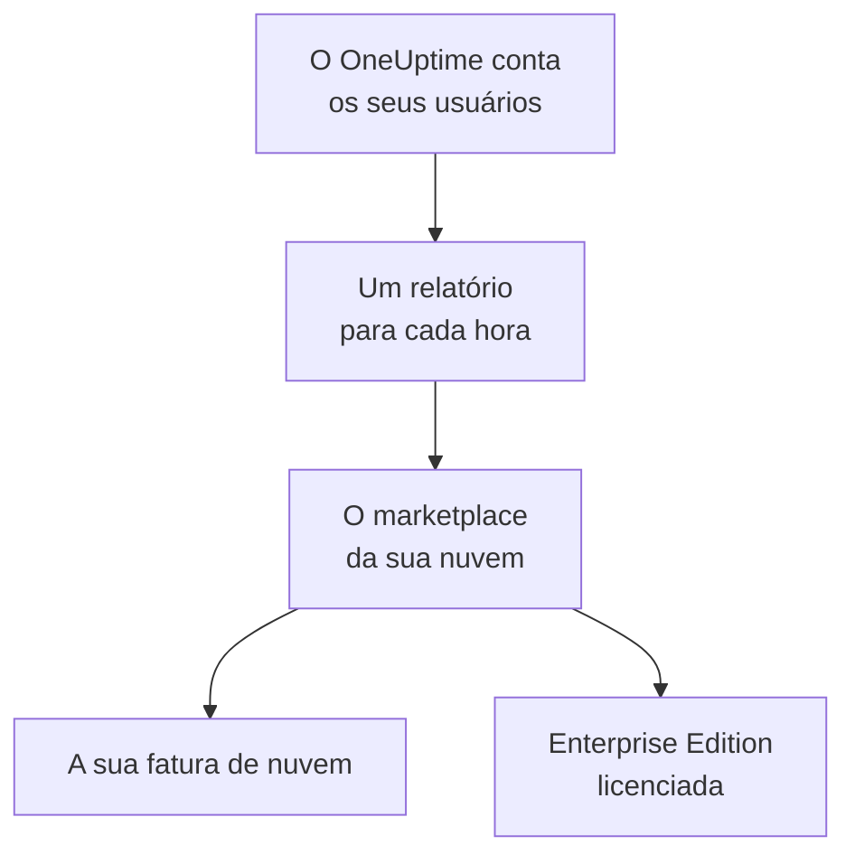

# Marketplaces de nuvem

Execute no seu próprio cluster Kubernetes o OneUptime Enterprise comprado no AWS Marketplace, no Microsoft Marketplace ou no Google Cloud Marketplace. O marketplace cobra por hora cada usuário da sua instalação na sua fatura de nuvem, e a sua assinatura licencia a Enterprise Edition: não há chave de licença para ativar.

:::cards
- [Instalar o OneUptime](#instalar-o-oneuptime): No Amazon EKS, no Azure Kubernetes Service ou no Google Kubernetes Engine.
- [Como funciona a cobrança](#como-funciona-a-cobrança): USD 0.10 por usuário por hora, com um relatório a cada hora.
- [Atualização](#atualização): Como uma nova versão chega ao seu cluster.
- [Solução de problemas](#solução-de-problemas): Quando o rótulo da edição avisa sobre o marketplace.
:::

## Como funciona

O OneUptime conta os seus usuários a cada 15 minutos e envia ao marketplace em que você o comprou um único relatório por hora, com o maior número de usuários que viu naquela hora. O marketplace acrescenta a hora à sua fatura de nuvem. Cada relatório que ele aceita também informa ao OneUptime que a sua assinatura está ativa, e é isso que mantém a Enterprise Edition licenciada.



| | AWS | Microsoft | Google Cloud |
| --- | --- | --- | --- |
| Listagem | Ainda não é pública: [fale conosco](https://oneuptime.com/enterprise/demo) | [OneUptime Enterprise](https://marketplace.microsoft.com/en-us/product/oneupitme.oneuptime-enterprise) | Ainda não é pública: [fale conosco](https://oneuptime.com/enterprise/demo) |
| Roda em | Amazon EKS | Azure Kubernetes Service (AKS) | Google Kubernetes Engine (GKE) |
| Você instala com | O Helm, a partir do registro da listagem | O portal do Azure | O console do Google Cloud |
| O OneUptime envia os relatórios com | A função do IAM da conta de serviço do OneUptime no Kubernetes | A identidade gerenciada que o Azure dá à instalação | O segredo de relatórios que o Google Cloud Marketplace cria para a implantação |
| Novas versões | Você atualiza com o Helm | As versões secundárias são instaladas para você | Você atualiza manualmente |

## Antes de começar

- **Um cluster Kubernetes** na nuvem do marketplace, com pelo menos 3 nós de 4 vCPUs e 16 GiB de memória, uma StorageClass padrão e suporte a serviços `LoadBalancer`. O OneUptime executa o próprio PostgreSQL, ClickHouse e Valkey no cluster; dimensione-os com [Dimensionamento e planejamento de capacidade](/docs/installation/sizing).
- **Um nome de domínio** para o OneUptime, como `oneuptime.example.com`, que você possa apontar para o balanceador de carga do cluster.
- **HTTPS de saída** do cluster para o marketplace, para que o OneUptime possa informar o número de usuários: `metering.marketplace.<region>.amazonaws.com` e `sts.<region>.amazonaws.com` na AWS, `marketplaceapi.microsoft.com` no Azure, `servicecontrol.googleapis.com` e `oauth2.googleapis.com` no Google Cloud.

## Instalar o OneUptime

### AWS Marketplace

Na AWS, o OneUptime informa o número de usuários com uma função do IAM que o EKS dá à conta de serviço do Kubernetes dele (funções do IAM para contas de serviço). O AWS Marketplace só aceita o uso vindo do EKS quando ele é assinado dessa forma.

:::steps
1. Assine o OneUptime Enterprise no AWS Marketplace; depois escolha **Continue to Configuration**, selecione a versão e escolha **Continue to Launch**.
2. Dê ao cluster um provedor OIDC do IAM, se ele ainda não tiver um, e crie a conta de serviço `oneuptime` com uma função do IAM que tenha a política `AWSMarketplaceMeteringFullAccess`, com os comandos abaixo. Execute-os no lugar do comando `eksctl` da etapa 1 das **General launch instructions** da página de lançamento: esse comando associa uma função que você teria de criar antes.
3. Faça o login do Helm no registro da listagem e instale o chart com os comandos da etapa 2 das **General launch instructions**. No comando `helm install`, defina `serviceAccount.name` como `oneuptime`, `host` como o seu nome de domínio e `httpProtocol` como `https` se houver um certificado na frente do OneUptime.
4. [Abra o OneUptime](#abrir-o-oneuptime).
:::

```bash
eksctl utils associate-iam-oidc-provider --cluster <cluster> --approve
eksctl create iamserviceaccount --name oneuptime --namespace oneuptime --cluster <cluster> \
  --attach-policy-arn arn:aws:iam::aws:policy/AWSMarketplaceMeteringFullAccess \
  --approve --override-existing-serviceaccounts
```

Guarde os valores da etapa 3 em um arquivo e passe-o em cada `helm upgrade`:

```yaml title="values.yaml"
host: oneuptime.example.com
httpProtocol: https
serviceAccount:
  name: oneuptime
```

### Microsoft Marketplace

No Azure, o OneUptime é um aplicativo Kubernetes: o AKS o instala como uma extensão de cluster e lhe dá a identidade gerenciada com que ele informa o número de usuários.

:::steps
1. Abra o OneUptime Enterprise no Microsoft Marketplace pelo portal do Azure, ou abra o seu cluster AKS e selecione **Extensions + applications** > **Add**; depois escolha o plano e selecione **Create**.
2. Escolha a assinatura e o grupo de recursos, e se vai instalar num cluster AKS existente ou criar um novo.
3. Na etapa **OneUptime**, insira um nome para a instalação, o seu nome de domínio e o protocolo dele.
4. Selecione **Review + create** e depois **Create**. A instalação leva alguns minutos e está concluída quando **Extensions + applications** mostra o estado de provisionamento dela como **Succeeded**.
5. [Abra o OneUptime](#abrir-o-oneuptime).
:::

Os medidores personalizados funcionam em clusters AKS, e não no Kubernetes habilitado para Azure Arc, por isso o OneUptime Enterprise do Microsoft Marketplace só pode ser instalado no AKS.

### Google Cloud Marketplace

No Google Cloud, o Marketplace executa um implantador que instala o OneUptime no namespace que você escolher, junto com um segredo de relatórios, com que o OneUptime informa o número de usuários.

:::steps
1. Abra o OneUptime Enterprise no Google Cloud Marketplace pelo console do Google Cloud e selecione **Configure**.
2. Escolha o cluster GKE e o namespace, e insira um nome para a instalação, o seu nome de domínio e o protocolo dele.
3. Selecione **Deploy**. A implantação leva alguns minutos e está concluída quando o aplicativo aparece como pronto em **Kubernetes Engine** > **Applications**.
4. [Abra o OneUptime](#abrir-o-oneuptime).
:::

## Abrir o OneUptime

O OneUptime começa migrando o próprio banco de dados, o que leva alguns minutos numa instalação nova. Depois aponte o seu nome de domínio para o balanceador de carga dele:

```bash
kubectl get service --namespace <namespace>
```

O serviço cujo nome termina em `-nginx` tem um `EXTERNAL-IP`: crie para o seu nome de domínio um registro DNS que aponte para ele. Abra o nome de domínio e cadastre-se. A primeira conta de uma instalação nova passa a ser o administrador master dela, que pode abrir o painel do administrador em `/admin`.

Em até uma hora, o rótulo da edição mostra a Enterprise Edition, licenciada pelo seu marketplace. Os administradores master veem o rótulo da edição no cabeçalho do painel do administrador e no rodapé do Dashboard.

## Como funciona a cobrança

| O quê | Como funciona |
| --- | --- |
| Preço | USD 0.10 por usuário por hora, cerca de USD 73 por usuário por mês. |
| Quem conta | Todas as pessoas com um login do OneUptime na instalação. Os assinantes de páginas de status e as pessoas que entram numa página de status privada não contam. |
| Quando | O OneUptime conta os seus usuários a cada 15 minutos e envia um único relatório por hora, com o maior número de usuários que viu naquela hora. Uma hora em que o OneUptime não estava em execução não é cobrada. |
| Onde | Na sua fatura da AWS, do Azure ou do Google Cloud, pelo marketplace. |
| Não incluído | O próprio cluster: a sua nuvem cobra os nós, os discos e os balanceadores de carga dele como de costume. |

Cada instalação é cobrada separadamente, então uma instalação de homologação também é cobrada. Para preços anuais, descontos por volume ou um preço para instalações fora de produção, peça a [sales@oneuptime.com](mailto:sales@oneuptime.com) uma oferta privada, que você aceita no marketplace.

Quando um relatório não pode ser enviado, por um problema de rede ou uma indisponibilidade do marketplace, o OneUptime o envia de novo na próxima execução. Cada relatório carrega uma chave da hora a que se refere, então uma hora nunca é cobrada duas vezes.

## Como funciona o licenciamento

A sua assinatura do marketplace é a sua licença. Cada relatório que o marketplace aceita licencia todos os recursos enterprise, para todos os usuários, pelas próximas 72 horas. Uma chave de licença do OneUptime também funciona na mesma instalação: a instalação usa a melhor das duas.

| O que acontece | O que o rótulo da edição mostra |
| --- | --- |
| O marketplace aceita os relatórios de cada hora | A Enterprise Edition, licenciada pelo seu marketplace. |
| Nenhum relatório foi aceito nas últimas 72 horas | **Enterprise Edition (Marketplace Reports Failing)**: todos os recursos enterprise continuam funcionando durante um período de carência de 30 dias. |
| O marketplace diz que a instalação não tem assinatura, ou o período de carência termina | **Enterprise Edition (Marketplace Subscription Ended)**: os recursos enterprise param, como acontece quando uma [licença expira](/docs/self-hosted/enterprise#quando-uma-licença-expira-ou-está-ausente). |

O marketplace recusa uma assinatura cancelada ou suspensa, ou uma instalação que não é a que você comprou. O monitoramento, os alertas, os incidentes, o plantão e as páginas de status continuam funcionando em todos os casos, e nada é excluído. Assine de novo, e o próximo relatório aceito volta a licenciar a Enterprise Edition, sem reiniciar.

## Atualização

| Marketplace | Como uma nova versão chega ao seu cluster |
| --- | --- |
| AWS Marketplace | Cada nova versão do OneUptime é uma nova versão da listagem. Execute `helm upgrade` com o chart do registro da listagem, a nova versão e o seu arquivo de valores. |
| Microsoft Marketplace | O AKS instala para você as novas versões secundárias e de correção. Uma nova versão principal espera até que você a aceite. Você pode desativar as atualizações automáticas na página da instalação em **Extensions + applications**. |
| Google Cloud Marketplace | O Google Cloud Marketplace mantém uma implantação na versão que instalou e nunca a atualiza. Fale com o [suporte](https://oneuptime.com/support) antes de passar uma implantação para uma nova versão. |

O OneUptime migra o próprio banco de dados quando a nova versão inicia. Leia as [notas de atualização](/docs/installation/upgrading) antes de passar para uma nova versão principal.

Atualize pelo marketplace. Uma instalação do marketplace não se compara com as versões do OneUptime no GitHub: as versões que o seu marketplace oferece são aquelas para as quais você deve atualizar.

## Configurações e escalonamento

A sua fatura não muda com a escala: o OneUptime é cobrado por usuário. Mais réplicas ou nós maiores só mudam o que a sua nuvem cobra pelo cluster.

| Marketplace | Onde ficam as suas configurações |
| --- | --- |
| AWS Marketplace | No seu arquivo de valores. Todas as configurações do [chart do Helm](https://artifacthub.io/packages/helm/oneuptime/oneuptime) funcionam, exceto os operadores incluídos. |
| Microsoft Marketplace | Nas configurações da instalação, na página dela em **Extensions + applications** ou com `az k8s-extension update --configuration-settings`. Cada configuração é um valor do chart, como `autoscaling.enabled=true`. |
| Google Cloud Marketplace | Nos campos do formulário da implantação. Altere qualquer outra coisa com `kubectl`, nos próprios recursos da implantação. |

- **Escale o OneUptime** com as configurações de réplicas e de escalonamento automático do chart (`deployment.replicaCount`, `autoscaling.enabled` e as substituições próprias de cada serviço), e os nós com o autoscaler do seu cluster.
- **Mantenha as configurações do marketplace como a listagem as define**: `enterpriseMarketplace` e, na AWS, `serviceAccount`. Sem elas, o OneUptime não consegue enviar os relatórios, e a Enterprise Edition não fica licenciada.
- **Os operadores KEDA, CloudNativePG e Altinity ClickHouse não estão incluídos**, porque um marketplace só distribui as imagens da própria listagem. Para armazenamentos de dados com alta disponibilidade, aponte o OneUptime para serviços gerenciados com `externalPostgres`, `externalRedis` e `externalClickhouse`.

A cobrança não depende de quantas réplicas estão em execução: só uma execução envia relatórios por vez, e cada hora tem um único relatório.

## Solução de problemas

:::details O rótulo da edição mostra Enterprise Edition (Marketplace Reports Failing)
O OneUptime não consegue enviar os relatórios ao marketplace. Cada linha que ele registra no log sobre isso começa com `OneUptime Enterprise marketplace billing`; uma linha que diz que o uso "cannot be reported" indica o que está faltando. As causas mais comuns:

- **AWS:** a conta de serviço `oneuptime` não tem uma função do IAM, ou a função não tem a política `AWSMarketplaceMeteringFullAccess` (`AWSMarketplaceMeteringRegisterUsage` não basta). Associe a política à função, ou crie a função com o comando `eksctl` da seção [AWS Marketplace](#aws-marketplace) e depois reinicie os pods do OneUptime com `kubectl rollout restart deployment --namespace oneuptime`.
- **Azure:** a instalação não é o aplicativo do Microsoft Marketplace, por exemplo porque foi instalada com o Helm, então não tem uma identidade nem um plano com que enviar os relatórios. Instale-a pelo portal do Azure.
- **Google Cloud:** o segredo de relatórios da implantação foi excluído ou substituído.
- **Todos os marketplaces:** um firewall ou proxy bloqueia o HTTPS de saída descrito em [Antes de começar](#antes-de-começar).

O uso fica guardado enquanto você corrige o problema e é cobrado assim que o OneUptime volta a conseguir enviar os relatórios. O uso com mais de 30 dias não é cobrado.
:::

:::details O rótulo da edição mostra Enterprise Edition (Marketplace Subscription Ended)
O marketplace recusou a instalação: a assinatura foi cancelada ou suspensa, ou a instalação não é a que foi comprada no marketplace. Verifique a assinatura no marketplace e assine de novo; o próximo relatório aceito volta a licenciar a Enterprise Edition. O mesmo rótulo aparece quando os relatórios continuaram falhando durante todo o período de carência.
:::

:::details Os pods ficam pendentes depois da instalação
Os bancos de dados do OneUptime precisam de volumes persistentes. Dê ao cluster uma StorageClass padrão: no Amazon EKS, instale o complemento do driver Amazon EBS CSI.
:::

## Próximos passos

:::cards
- [Edição Enterprise](/docs/self-hosted/enterprise): O que a Enterprise Edition acrescenta, e o que para quando uma licença expira.
- [Atualização](/docs/installation/upgrading): As notas de atualização de cada versão.
- [Dimensionamento e planejamento de capacidade](/docs/installation/sizing): Dimensione os armazenamentos de dados para a sua telemetria.
- [Arquitetura](/docs/self-hosted/architecture): O que roda no seu cluster.
- [Agente Kubernetes](/docs/telemetry/kubernetes-agent#instale-como-complemento-do-amazon-eks): Também gratuito no AWS Marketplace, como complemento do Amazon EKS, para clusters que enviam dados ao OneUptime.
:::
