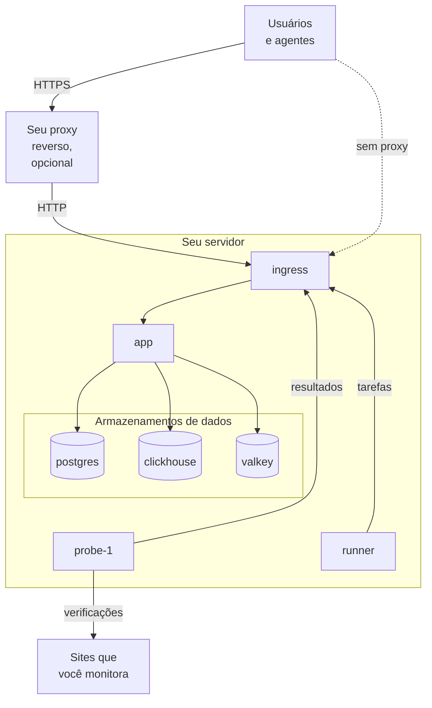

# Docker Compose

Execute uma instância completa e gratuita do OneUptime em um único servidor Linux com o Docker Compose. Esta página leva você de um servidor recém-criado a uma instância em funcionamento e depois trata de HTTPS, do reforço para produção, de backups, de atualizações e da remoção. Para trabalhar no próprio código do OneUptime, veja [Desenvolvimento local](/docs/installation/local-development).

:::cards
- [Instalar o OneUptime](#instalar-o-oneuptime): De um servidor recém-criado à sua primeira conta, em cinco passos.
- [Configurar HTTPS](#configurar-https): Deixe o OneUptime obter um certificado ou coloque seu próprio proxy na frente.
- [Checklist de produção](#checklist-de-produção): O que resolver antes que chegue o tráfego real.
- [Atualizar o OneUptime](#atualizar-o-oneuptime): Passe para a versão mais recente.
:::

## Como funciona

O Docker Compose executa cada parte do OneUptime como um contêiner no seu servidor. Todo o tráfego entra pelo contêiner `ingress`, que o encaminha para o `app`. O app guarda os dados no PostgreSQL, no ClickHouse e no Valkey. Uma sonda incluída executa as verificações dos seus monitores e envia os resultados pelo ingress.



| Serviço | Imagem | O que faz |
| --- | --- | --- |
| `ingress` | `oneuptime/nginx` | Recebe todo o tráfego nas portas 80 e 443 e o encaminha para o app. Serve HTTPS quando o OneUptime gerencia o certificado. |
| `app` | `oneuptime/app` | O painel, a API, as páginas de status, a ingestão de telemetria e os workers em segundo plano. |
| `probe-1` | `oneuptime/probe` | Uma sonda global que executa as verificações dos seus monitores. Ela usa a rede do host. |
| `runner` | `oneuptime/runner` | O Runner da instância, que executa correções de código com IA. Ele usa a rede do host. |
| `postgres` | `postgres:15` | Configuração e estado: monitores, incidentes, usuários. Armazenados no volume `postgres`. |
| `clickhouse` | `clickhouse/clickhouse-server:26.7` | Telemetria: logs, métricas, traces e exceções. Armazenada no volume `clickhouse`. |
| `valkey` | `valkey/valkey:9.1-alpine` | Cache e filas. Não guarda nada em disco. |

> [!NOTE]
> O serviço `valkey` executa o [Valkey](https://valkey.io), o fork com licença BSD do Redis 7.2, configurado pelas configurações `VALKEY_*` do `config.env`. Qualquer servidor que fale o protocolo do Redis funciona — aponte `VALKEY_HOST` para um Redis gerenciado se preferir. Essas configurações se chamavam `REDIS_*` até a 13.0.0; os nomes antigos ainda são lidos, o contêiner ainda responde ao nome de host `redis` e o `npm run update` não os reescreve, então um `config.env` antigo não precisa de alterações.

Para produção em grande escala, ou quando você precisar de alta disponibilidade, use o [chart do Helm](https://artifacthub.io/packages/helm/oneuptime/oneuptime) no Kubernetes: o Docker Compose executa uma única cópia de cada serviço em um único servidor.

## Requisitos

Escolha o tamanho do servidor pelo que você vai executar nele. A telemetria (logs, métricas, traces) é o que determina memória e disco; veja [Dimensionamento e planejamento de capacidade](/docs/installation/sizing) quando conhecer seus volumes.

| | Recomendado | Mínimo para homelab |
| --- | --- | --- |
| **Memória** | 16 GB | 8 GB |
| **CPU** | 8 núcleos | 4 núcleos |
| **Disco** | 400 GB | 20 GB |
| **Sistema** | Ubuntu 22.04, ou outro Linux baseado em Debian, Ubuntu ou RHEL | O mesmo |
| **Arquitetura** | x86-64 (`amd64`) ou ARM (`arm64`) | A mesma |

O mínimo para homelab serve para uso pessoal e experimental — há quem rode o OneUptime em um Raspberry Pi.

Você também precisa de:

- **Docker** com o plugin **Docker Compose v2** (o comando `docker compose`).
- **Git**, para baixar o OneUptime.
- **Node.js e npm**, que executam os scripts `npm start` e `npm run update` que envolvem o Docker Compose.
- **Portas 80 e 443** livres no servidor. A tabela abaixo lista cada porta que o OneUptime usa no host.

| Porta do host | Usada por | Configuração | Para que serve |
| --- | --- | --- | --- |
| 80 | `ingress` | `ONEUPTIME_HTTP_PORT` | O painel, a API, a ingestão de telemetria e a validação do Let's Encrypt. |
| 443 | `ingress` | `STATUS_PAGE_HTTPS_PORT` | HTTPS para a sua instância quando o OneUptime gerencia o certificado, e para páginas de status e painéis em domínios personalizados. |
| 5400 | `postgres` | Definida no `docker-compose.yml` | Permite que o `npm run backup` e o `restore.sh` alcancem o PostgreSQL a partir do próprio servidor. Ela só é publicada em `127.0.0.1`. |
| 3874 | `probe-1` | `GLOBAL_PROBE_1_PORT` | O servidor próprio da sonda. Nada fora do servidor precisa dela. |
| 3876 | `runner` | `ONEUPTIME_RUNNER_PORT` | O servidor próprio do Runner. Nada fora do servidor precisa dela. |

Há também um [vídeo passo a passo](https://youtu.be/j1SWmMW2oL4) da instalação.

## Instalar o OneUptime

Em um servidor novo com Ubuntu, Debian ou uma distribuição baseada em RHEL, um único comando pode executar os passos abaixo por você. Ele instala o Docker, o Git e o Node.js se faltarem, clona o branch release em uma pasta `oneuptime`, pergunta o endereço que as pessoas vão usar e executa `npm start`:

```bash
curl -fsSL https://oneuptime.com/install.sh | bash
```

:::steps
### Clone o branch release

O branch `release` contém os arquivos da versão mais recente.

```bash
git clone --depth 1 --single-branch --branch release https://github.com/OneUptime/oneuptime.git
cd oneuptime
```

### Crie o config.env

Todas as configurações do OneUptime ficam no `config.env`. Comece pelo exemplo:

```bash
cp config.example.env config.env
```

### Defina o nome de host

Abra o `config.env` e defina `HOST` com o nome de domínio ou o endereço IP que as pessoas vão usar para acessar o OneUptime, sem `http://`. Mantenha `localhost` só para experimentar o OneUptime no seu próprio computador.

```ini title="config.env"
HOST=oneuptime.example.com
```

### Inicie o OneUptime

:::tabs
@tab npm
```bash
npm start
```
@tab Docker CLI
```bash
(export $(grep -v '^#' config.env | xargs) && docker compose up --remove-orphans -d)
```
Antes da primeira inicialização, substitua você mesmo os segredos de exemplo, como mostra [Gere segredos aleatórios](#gere-segredos-aleatórios): só o `npm start` faz isso por você.
:::

O `npm start` verifica primeiro o servidor: o Docker, a memória, o espaço em disco, as portas que o OneUptime usa e o `HOST`. Ele para diante de qualquer coisa que impediria o OneUptime de funcionar, e diz o que mudar. Depois dá a cada segredo de exemplo do `config.env` um valor aleatório próprio, inicia o OneUptime e espera cada parte responder. A primeira inicialização leva alguns minutos, enquanto o Docker baixa as imagens e o OneUptime cria os bancos de dados. Ele termina com **OneUptime is up!** e o endereço a abrir.

### Crie a primeira conta

Abra `http://` seguido do seu `HOST` (por exemplo `http://localhost`) e cadastre-se. A primeira conta de uma instância nova passa a ser o administrador principal dela, que pode abrir o Admin Dashboard em `/admin`.

Qualquer pessoa que consiga acessar a página pode se cadastrar depois de você. Para impedir isso, abra o Admin Dashboard, vá em **Configurações > Autenticação** e desative **Permitir cadastro**. As pessoas que você convidar para um projeto ainda podem criar a conta.
:::

### Gere segredos aleatórios

O `config.example.env` traz cada segredo como um segredo de exemplo, público no GitHub. O `npm start` dá a cada um o seu próprio valor aleatório antes de iniciar qualquer coisa, e cita as configurações que preencheu:

| Configuração | O que ela protege |
| --- | --- |
| `ONEUPTIME_SECRET` | As chamadas entre os próprios serviços do OneUptime. |
| `ENCRYPTION_SECRET` | Os segredos que o OneUptime guarda, como tokens de integrações e senhas SMTP, e os tokens de login que ele emite. |
| `DATABASE_PASSWORD`, `CLICKHOUSE_PASSWORD`, `VALKEY_PASSWORD` | Os três armazenamentos de dados. |
| `REGISTER_PROBE_KEY` | O registro de sondas na sua instância. |
| `GLOBAL_PROBE_1_KEY`, `GLOBAL_PROBE_2_KEY` | As sondas globais que o Docker Compose pode executar (`probe-1` é executada por padrão). |
| `ONEUPTIME_RUNNER_KEY` | O Runner incluído. |
| `GLOBAL_RUNNER_KEY` | O Runner global incluído, que executa as etapas JavaScript de todos os projetos. |

> [!IMPORTANT]
> Mantenha os segredos depois que o OneUptime tiver iniciado. O PostgreSQL só aceita a senha quando cria o banco de dados, e mudar `ENCRYPTION_SECRET` depois torna ilegível todo valor criptografado com o anterior. Por isso o `npm start` define `DATABASE_PASSWORD` e `ENCRYPTION_SECRET` só em uma instalação nova, antes que o PostgreSQL crie o banco de dados.

Com a Docker CLI, substitua você mesmo os segredos de exemplo antes da primeira inicialização:

```bash
while grep -q "please-change-this-to-random-value" config.env; do
  sed -i "0,/please-change-this-to-random-value/{s/please-change-this-to-random-value/$(openssl rand -hex 32)/}" config.env
done
grep -c "please-change-this" config.env
```

O último comando imprime `0`: não sobrou nenhum segredo de exemplo. O laço usa o GNU `sed`, que todo servidor Linux tem.

## Configurar HTTPS

O OneUptime serve HTTP simples até você escolher uma de duas formas de adicionar HTTPS:

| | Deixar o OneUptime obter um certificado | Usar seu próprio proxy reverso |
| --- | --- | --- |
| **O TLS termina em** | No `ingress` do OneUptime, com um certificado gratuito do Let's Encrypt que ele mesmo renova | No seu proxy: Caddy, Nginx ou um balanceador de carga |
| **Você precisa de** | Um nome de domínio público apontando para o servidor, e as portas 80 e 443 acessíveis pela internet | Um proxy e um certificado para o seu domínio |
| **Configurações** | `PROVISION_SSL=true`, `HTTP_PROTOCOL=https` | `PROVISION_SSL=false`, `HTTP_PROTOCOL=https`, `TRUSTED_PROXY_HOPS=2` |
| **Páginas de status em domínios personalizados** | Funcionam sem configuração extra | Seu proxy também precisa servir esses domínios |

Se você colocar páginas de status ou painéis em domínios personalizados, deixar o OneUptime cuidar do TLS é a configuração mais simples: o ingress pede e serve sozinho os certificados desses domínios.

Com `HTTP_PROTOCOL=https`, o OneUptime monta links HTTPS, mantém os cookies de login no HTTPS e pede aos navegadores que acessem o seu `HOST` só por HTTPS. Um navegador segue isso por um ano, em todas as portas desse nome; então, se um dia o `HOST` tiver que responder de novo por HTTP simples, defina `HSTS_MAX_AGE_SECONDS=0` no `config.env` algum tempo antes: os navegadores esquecem a regra na próxima visita.

### Deixar o OneUptime obter um certificado

:::steps
#### Aponte seu domínio para o servidor

Crie um registro DNS `A` (ou `AAAA` para IPv6) para o seu domínio, com o endereço IP público do servidor como valor. Com um registro `AAAA`, ative também o IPv6 para o OneUptime: veja [Endereços dos visitantes](#endereços-dos-visitantes).

#### Ative a emissão de certificados

Defina estes valores no `config.env`:

```ini title="config.env"
HOST=oneuptime.example.com
PROVISION_SSL=true
HTTP_PROTOCOL=https
```

`HOST` precisa ser um nome de domínio: o OneUptime não consegue obter um certificado para um endereço IP nem para `localhost`.

#### Reinicie com as novas configurações

```bash
npm start
```

#### Abra sua instância por HTTPS

Abra `https://oneuptime.example.com`. O OneUptime pede o certificado ao iniciar e depois o verifica a cada hora, renovando-o quando faltam menos de 30 dias. Até o primeiro certificado chegar, normalmente em poucos minutos, o ingress serve um certificado autoassinado temporário e o navegador avisa você.
:::

### Usar seu próprio proxy reverso

Estes passos executam o proxy no mesmo servidor que o OneUptime. Se o seu proxy roda em outra máquina, pule o primeiro passo, aponte o proxy para a porta 80 deste servidor e, com o firewall do seu provedor de nuvem, deixe só o proxy alcançar as portas 80 e 443: um visitante que alcança o OneUptime sem passar pelo proxy pode escolher o endereço pelo qual o OneUptime o conta.

:::steps
#### Tire o ingress das portas 80 e 443

O proxy precisa das portas 80 e 443, então mova o ingress para outras portas, publicadas apenas no endereço de loopback `127.0.0.1` deste servidor, para que os visitantes alcancem o OneUptime somente pelo seu proxy:

```ini title="config.env"
ONEUPTIME_HTTP_PORT=127.0.0.1:8080
STATUS_PAGE_HTTPS_PORT=127.0.0.1:8443
```

A sonda e o Runner usam a rede do host e alcançam o OneUptime por `http://localhost`. O `npm start` os muda para a nova porta do ingress, `http://localhost:8080`, e avisa.

#### Informe ao OneUptime que ele está atrás de um proxy

```ini title="config.env"
HOST=oneuptime.example.com
HTTP_PROTOCOL=https
PROVISION_SSL=false
TRUSTED_PROXY_HOPS=2
```

`HTTP_PROTOCOL=https` faz os links que o OneUptime monta usarem HTTPS. `TRUSTED_PROXY_HOPS=2` conta o seu proxy e o ingress do OneUptime, para que o OneUptime leia o endereço real do visitante nas allowlists de IP e nos limites de taxa. Some um para cada proxy adicional que acrescente dados ao `X-Forwarded-For`, como uma CDN ou um balanceador de carga.

#### Reinicie o OneUptime nas novas portas

```bash
npm start
```

O `npm start` verifica o OneUptime na nova porta, `localhost:8080`, e termina com **OneUptime is up!**

#### Configure o proxy

:::tabs
@tab Caddy
```text title="Caddyfile"
oneuptime.example.com {
	reverse_proxy localhost:8080
}
```
O Caddy obtém e renova o certificado sozinho, redireciona HTTP para HTTPS e repassa conexões WebSocket. Recarregue o Caddy depois de alterar o arquivo, por exemplo com `sudo systemctl reload caddy`.
@tab Nginx
```nginx title="/etc/nginx/conf.d/oneuptime.conf"
map $http_upgrade $oneuptime_connection_upgrade {
    default upgrade;
    ""      close;
}

server {
    listen 80;
    server_name oneuptime.example.com;
    return 301 https://$host$request_uri;
}

server {
    listen 443 ssl;
    server_name oneuptime.example.com;

    ssl_certificate     /etc/letsencrypt/live/oneuptime.example.com/fullchain.pem;
    ssl_certificate_key /etc/letsencrypt/live/oneuptime.example.com/privkey.pem;

    # The limits OneUptime's own ingress uses.
    client_max_body_size 50M;
    proxy_read_timeout 300s;
    proxy_send_timeout 300s;

    proxy_http_version 1.1;
    proxy_set_header Host $host;
    proxy_set_header X-Forwarded-For $proxy_add_x_forwarded_for;
    proxy_set_header X-Forwarded-Proto $scheme;
    proxy_set_header Upgrade $http_upgrade;
    proxy_set_header Connection $oneuptime_connection_upgrade;

    location / {
        proxy_pass http://127.0.0.1:8080;
    }

    # MCP clients keep a stream open.
    location /mcp {
        proxy_pass http://127.0.0.1:8080;
        proxy_buffering off;
        proxy_read_timeout 86400s;
        proxy_send_timeout 86400s;
    }
}
```
Os caminhos dos certificados são onde o Certbot coloca um certificado do Let's Encrypt; use os caminhos do seu próprio certificado se ele vier de outro lugar. Verifique o arquivo e recarregue o Nginx com `sudo nginx -t && sudo systemctl reload nginx`.
:::

Os dois enviam `X-Forwarded-Proto`, que avisa o OneUptime de que um visitante veio por HTTPS. Qualquer outro proxy também precisa enviá-lo, senão os cookies de login das páginas de status e dos painéis nos seus domínios personalizados não ficam no HTTPS.

#### Abra sua instância pelo proxy

Abra `https://oneuptime.example.com`. Você deve ver a página de login do OneUptime, servida com o certificado do seu proxy.
:::

> [!NOTE]
> Atrás do seu próprio proxy, envie telemetria por OTLP/HTTP (`/otlp`). OTLP por gRPC só alcança o OneUptime quando o próprio ingress dele termina o TLS (`PROVISION_SSL=true`).

## Endereços dos visitantes

O OneUptime conta cada visitante pelo endereço de onde ele se conecta: os limites de login, os outros limites por endereço e as allowlists de IP das páginas de status e dos dashboards leem esse endereço. Duas configurações precisam de um ajuste para que esse endereço seja o do próprio visitante:

| Configuração | Ajuste |
| --- | --- |
| As pessoas alcançam o OneUptime por IPv6, por exemplo por um registro `AAAA` | IPv6 na rede do OneUptime, no `docker-compose.override.yml` |
| Seu próprio proxy reverso fica na frente do OneUptime | `TRUSTED_PROXY_HOPS=2`, com o ingress publicado em `127.0.0.1` (veja [Usar seu próprio proxy reverso](#usar-seu-próprio-proxy-reverso)) |

Sem IPv6 na rede do OneUptime, o Docker repassa ao OneUptime cada visitante que chega por IPv6 a partir de um endereço próprio, e o OneUptime conta todos eles como um único visitante: as tentativas de login malsucedidas de uma pessoa podem bloquear as outras. Ativar o IPv6 exige o Docker Engine 27 ou mais recente (o `docker version` mostra a sua).

:::steps
### Ative o IPv6

Crie o `docker-compose.override.yml` ao lado do `docker-compose.yml`, ou acrescente isto ao que você já tem; o `npm start` e o `npm run update` o leem:

```yaml title="docker-compose.override.yml"
networks:
  oneuptime:
    enable_ipv6: true
```

### Reinicie o OneUptime

```bash
npm stop
npm start
```

O OneUptime para e inicia de novo com IPv6 na rede dele. Seus dados são mantidos. O Docker não consegue remover uma rede à qual um contêiner seu ainda está conectado, como um proxy reverso: desconecte-o antes da rede do OneUptime e conecte-o de novo depois. Se o `npm start` parar com `has active endpoints`, desconecte-o e execute de novo o `npm stop` e o `npm start`.

### Verifique a rede

```bash
docker network ls --quiet --filter name=_oneuptime | xargs docker network inspect | grep EnableIPv6
```

O comando mostra `"EnableIPv6": true,`.
:::

Quando várias pessoas entram a partir de um mesmo endereço de rede privada, a página **Integridade do OneUptime** do Admin Dashboard avisa, com o ajuste que muda isso.

## Checklist de produção

O Docker Compose executa uma única cópia de cada serviço em um único servidor, o que serve para equipes pequenas e homelabs. Antes de depender dele, passe por esta lista.

| Área | O que fazer |
| --- | --- |
| **Segredos** | Nenhum valor no `config.env` ainda é um `please-change-this-to-random-value`. Veja [Gere segredos aleatórios](#gere-segredos-aleatórios), e [Troque a senha do banco de dados](#troque-a-senha-do-banco-de-dados) para uma instalação que começou com o segredo de exemplo no `DATABASE_PASSWORD`. |
| **HTTPS** | As pessoas acessam o OneUptime por HTTPS e `HTTP_PROTOCOL=https` está definido. Veja [Configurar HTTPS](#configurar-https). |
| **Cadastros** | Assim que sua equipe tiver contas, desative **Permitir cadastro** em **Configurações > Autenticação** no Admin Dashboard. |
| **Firewall** | Só as portas 80 e 443 (e SSH) estão abertas para a internet. O OneUptime publica a porta 5400 do PostgreSQL só em `127.0.0.1`. Feche qualquer outra porta que você publicar com o firewall do seu provedor de nuvem: as regras do `ufw` não se aplicam às portas que o Docker publica. |
| **Endereços dos visitantes** | A página **Integridade do OneUptime** do Admin Dashboard não avisa que várias pessoas entram a partir de um mesmo endereço. Veja [Endereços dos visitantes](#endereços-dos-visitantes). |
| **Backups** | O PostgreSQL tem backup todos os dias e as cópias saem do servidor. Veja [Backup e restauração](#backup-e-restauração). |
| **E-mail** | Há um servidor de e-mail configurado em **Configurações > Notificações > E-mails** no Admin Dashboard, para que o OneUptime possa enviar convites e notificações. Veja [SMTP](/docs/emails/smtp). |
| **Disco** | O espaço livre é acompanhado. O ClickHouse cresce com a telemetria que você guarda (veja [Dimensionamento e planejamento de capacidade](/docs/installation/sizing)); o log de cada contêiner é limitado a 1000 MB. |
| **Atualizações** | O OneUptime é atualizado pelo menos uma vez por semana. As versões saem com frequência. Veja [Atualizar o OneUptime](#atualizar-o-oneuptime). |
| **Alta disponibilidade** | Se precisar, passe para o [chart do Helm](https://artifacthub.io/packages/helm/oneuptime/oneuptime) no Kubernetes. |

### Troque a senha do banco de dados

O PostgreSQL mantém a senha com que foi criado, então mudar só o `DATABASE_PASSWORD` no `config.env` deixa o OneUptime sem acesso ao banco de dados. Para dar uma senha própria a uma instalação que começou com o segredo de exemplo, troque-a no PostgreSQL e no `config.env` ao mesmo tempo e depois inicie o OneUptime de novo:

```bash
NEW_PASSWORD=$(openssl rand -hex 32) &&
  (export $(grep -v '^#' config.env | xargs) && docker compose exec -T postgres psql -U "$DATABASE_USERNAME" -d "$DATABASE_NAME" -c "ALTER USER \"$DATABASE_USERNAME\" PASSWORD '$NEW_PASSWORD'") &&
  sed -i "s/^DATABASE_PASSWORD=.*/DATABASE_PASSWORD=$NEW_PASSWORD/" config.env
npm start
```

Se você definiu `DATABASE_BACKUP_PASSWORD` e `DATABASE_RESTORE_PASSWORD`, dê a eles também o novo valor.

## Backup e restauração

O PostgreSQL guarda tudo o que você configura: monitores, incidentes, páginas de status, usuários. O `npm run backup` gera um dump dele em um arquivo na pasta `Backups`.

:::steps
### Dê ao script de backup a senha do banco de dados

No `config.env`, defina `DATABASE_BACKUP_PASSWORD` com o valor de `DATABASE_PASSWORD`. O script lê o `config.env` como texto simples, então o `${DATABASE_PASSWORD}` que vem com ele nunca é preenchido.

### Execute o backup

```bash
npm run backup
```

Ele pede sua senha de sudo e grava `Backups/db-<day of the month>.backup`, de modo que os backups diários substituem os de um mês antes. Execute-o pelo menos uma vez por dia.

### Copie os backups para fora do servidor

Um backup no mesmo disco que o banco de dados não sobrevive à perda desse disco.
:::

Só o próprio servidor alcança o PostgreSQL: ele responde na porta 5400 de `127.0.0.1`. Para fazer o backup a partir de outra máquina, abra um túnel SSH nessa máquina e depois conecte-se à porta 5400 dela mesma:

```bash
ssh -N -L 5400:127.0.0.1:5400 you@oneuptime.example.com
```

:::details Publique o PostgreSQL em um endereço de uma rede privada
Se uma ferramenta da sua rede privada precisa alcançar o PostgreSQL sem túnel, publique-o também no endereço do servidor nessa rede, em uma porta própria. Crie o `docker-compose.override.yml` ao lado do `docker-compose.yml`; o `npm start` e o `npm run update` o leem:

```yaml title="docker-compose.override.yml"
services:
  postgres:
    ports:
      - "10.0.0.5:5401:5432"
```

Coloque o endereço privado do próprio servidor no lugar de `10.0.0.5`, nunca um público, e antes dê ao PostgreSQL uma senha própria (veja [Troque a senha do banco de dados](#troque-a-senha-do-banco-de-dados)). Depois execute `npm start`, e o PostgreSQL passa a responder também na porta 5401 desse endereço.
:::

O ClickHouse guarda sua telemetria no volume do Docker `oneuptime_clickhouse`, e nenhum script faz backup dele. Se você precisa manter essa telemetria, faça backup do volume com uma ferramenta do ClickHouse como o [clickhouse-backup](https://github.com/Altinity/clickhouse-backup), ou copie-o com o OneUptime parado.

Para restaurar o PostgreSQL, defina os valores `DATABASE_RESTORE_*` no `config.env`: `DATABASE_RESTORE_PASSWORD` com o valor de `DATABASE_PASSWORD`, como nos backups, e `DATABASE_RESTORE_FILENAME` com o backup a restaurar, por exemplo `db-31.backup`. Depois execute `bash restore.sh`. O banco de dados em que ele restaura já precisa existir; em uma instalação em funcionamento, ele existe.

> [!CAUTION]
> O `restore.sh` remove do banco de dados de destino cada objeto do backup antes de recriá-lo. Ele pergunta antes de começar; confira o nome do banco de dados que ele mostra.

## Atualizar o OneUptime

Faça backup primeiro e depois execute:

```bash
git checkout release
git pull
npm run update
```

O `npm run update` adiciona ao seu `config.env` as configurações novas do `config.example.env` (seus próprios valores ficam), baixa as imagens novas e reinicia o OneUptime. Como o `npm start`, ele termina com **OneUptime is up!**

Passar para uma nova versão principal (da 13 para a 14, por exemplo) pode exigir mais: leia [Atualizar o OneUptime para uma nova versão](/docs/installation/upgrading) antes de começar.

`APP_TAG=release` no `config.env` sempre baixa a versão mais recente da Community Edition. Para ficar em uma versão, defina `APP_TAG` com o número dela, por exemplo `14.0.22`. Para a Enterprise Edition, as tags são `enterprise-release` e `enterprise-14.0.22`.

## Desinstalar o OneUptime

Pare o OneUptime e remova os contêineres e a rede dele:

```bash
npm run down
```

Seus dados ficam nos volumes `oneuptime_postgres` e `oneuptime_clickhouse`, e a pasta `oneuptime` mantém o `config.env` e seus backups. Para apagar também os dados:

```bash
(export $(grep -v '^#' config.env | xargs) && docker compose down --volumes --remove-orphans)
```

Depois apague a pasta `oneuptime`.

> [!CAUTION]
> `--volumes` apaga para sempre cada monitor, incidente, usuário e toda a telemetria. Faça backup primeiro se você puder precisar de algo disso.

## Solução de problemas

:::details O npm start para antes de iniciar o OneUptime
O `npm start` verifica primeiro o servidor e para diante de qualquer coisa que impediria o OneUptime de funcionar: falta o Docker ou o plugin do Compose, o Docker está parado ou fora do alcance do seu usuário, outro programa ocupa uma porta, ou o `HOST` é um endereço que nenhum navegador consegue abrir. Cada linha marcada com ✗ diz o que mudar. Corrija e execute `npm start` de novo. Se uma verificação estiver errada sobre o seu servidor, inicie sem as verificações:

```bash
ONEUPTIME_SKIP_PREFLIGHT=true npm start
```
:::

:::details O Docker diz "permission denied" quando você executa npm start
Seu usuário não consegue acessar o daemon do Docker. Adicione-o ao grupo `docker` e depois saia e entre de novo:

```bash
sudo usermod -aG docker $USER
```
:::

:::details O ingress não inicia porque a porta 80 ou 443 está em uso
Outro programa no servidor, muitas vezes um servidor web, ocupa a porta. O `npm start` verifica as portas antes de iniciar qualquer coisa, e cita o contêiner que ocupa uma delas quando é o Docker que o executa. Pare esse programa, ou mova o ingress para outras portas e coloque o programa na frente do OneUptime, como descrito em [Usar seu próprio proxy reverso](#usar-seu-próprio-proxy-reverso).
:::

:::details O npm start termina com "Maximum retries reached"
A verificação que encerra o `npm start` desistiu antes de o OneUptime responder. A primeira inicialização pode demorar mais do que a verificação espera, enquanto as imagens são baixadas e os bancos de dados são criados. Veja o que está em execução e leia os logs:

```bash
npm run ps
npm run logs
```

Quando todos os contêineres estiverem em execução, rode a verificação de novo com `npm run status-check`. Ela verifica o ingress na porta que o `ONEUPTIME_HTTP_PORT` define.
:::

:::details O navegador mostra "O OneUptime não está configurado para este endereço"
Você abriu o OneUptime em um endereço diferente do `HOST` dele, como o endereço IP do servidor enquanto o `HOST` ainda é `localhost`. A página mostra a linha `HOST` do endereço que você abriu, com um botão que a copia: coloque essa linha no `config.env` e depois execute `npm start`. Se você abriu o endereço do `HOST` e a página diz que o seu proxy não o passou, configure o proxy para repassar o nome de host que o navegador pediu: o Caddy faz isso por padrão, o Nginx com `proxy_set_header Host $host;` e o Apache com `ProxyPreserveHost On`.
:::

:::details Algumas páginas carregam, mas as atualizações ao vivo ou os uploads falham
Abra o OneUptime no endereço que está em `HOST`. O ingress encaminha as requisições pelo nome de host: só `HOST` e `localhost` alcançam o aplicativo inteiro, e qualquer outro nome, como o endereço IP do servidor, é tratado como domínio de página de status. Defina `HOST` com o nome que as pessoas usam e depois execute `npm start`.
:::

:::details O cadastro ou o login falha com "Page not found"
A página de cadastro carrega, mas o cadastro falha com `Page not found - /identity/signup` e o login com `Page not found - /identity/login`. A requisição chegou ao OneUptime com um nome de host diferente de `HOST`, então o ingress a encaminhou como o domínio próprio de uma página de status, onde o cadastro e o login do próprio OneUptime não são servidos. Verifique as duas coisas:

- `HOST` é o endereço que as pessoas abrem, com a porta, se usarem uma, como `oneuptime.example.com:8080`. Execute `npm start` depois de alterá-lo.
- Um proxy na frente do OneUptime repassa o nome de host que o navegador pediu. O Caddy faz isso por padrão, o Nginx com `proxy_set_header Host $host;` como em [Usar seu próprio proxy reverso](#usar-seu-próprio-proxy-reverso), e o Apache com `ProxyPreserveHost On`.
:::

:::details O navegador avisa sobre o certificado depois que você define PROVISION_SSL
Até o Let's Encrypt emitir o certificado, o ingress serve um certificado autoassinado temporário. Se o aviso continuar por mais de alguns minutos, verifique se:

- `HOST` é um nome de domínio, e não um endereço IP nem `localhost`.
- O registro DNS do domínio aponta para este servidor.
- A porta 80 é acessível pela internet, para que o Let's Encrypt possa validar o domínio.

Quando um pedido falha, o app registra um erro que começa com `CoreSSL:EnsurePrimaryHostCertificate`, seguido do motivo:

```bash
(export $(grep -v '^#' config.env | xargs) && docker compose logs app) | grep -A 5 CoreSSL
```
:::

:::details A sonda incluída aparece como Desconectado depois que você mudou a porta do ingress
O Admin Dashboard lista a sonda em **Configurações > Monitoramento > Sondas globais**. Ela alcança o OneUptime em `GLOBAL_PROBE_1_ONEUPTIME_URL`, que por padrão é `http://localhost` (porta 80). O `npm start` muda essa URL e `ONEUPTIME_RUNNER_ONEUPTIME_URL` para a porta do ingress enquanto elas apontam para `localhost`. Se você as definiu com outro endereço, ou iniciou o OneUptime com a Docker CLI, defina as duas com a nova porta do ingress, por exemplo `http://localhost:8080`, e reinicie o OneUptime.
:::

## Próximos passos

:::cards
- [Atualizar o OneUptime para uma nova versão](/docs/installation/upgrading): O que cada versão principal exige de você.
- [Dimensionamento e planejamento de capacidade](/docs/installation/sizing): Planeje memória e disco para a sua telemetria.
- [Arquitetura auto-hospedada](/docs/self-hosted/architecture): Como os componentes se encaixam.
- [Edição Enterprise](/docs/self-hosted/enterprise): O que a imagem Enterprise acrescenta, e a licença dela.
:::
