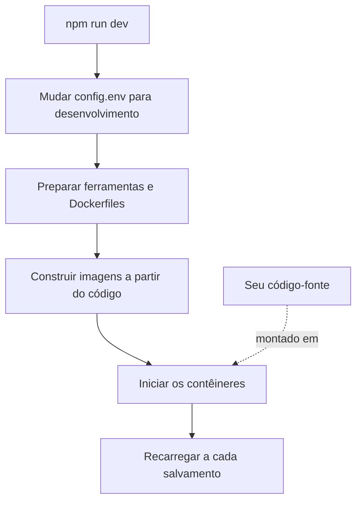

# Desenvolvimento local

Execute o OneUptime a partir do código-fonte no seu próprio computador para trabalhar nele. O stack de desenvolvimento constrói cada serviço a partir da sua cópia do repositório, monta o seu código-fonte nos contêineres e os recarrega quando você salva um arquivo.

Para executar uma versão publicada, use o [Docker Compose](/docs/installation/docker-compose).

## Como o stack de desenvolvimento funciona

`npm run dev` prepara a sua cópia do repositório e depois inicia o stack definido em `Scripts/Dev/docker-compose.dev.yml`:



| Etapa | O que acontece |
| --- | --- |
| Mudar para desenvolvimento | Define `ENVIRONMENT=development` em `config.env`. |
| Preparar | Pede a sua senha de sudo, instala as ferramentas que faltam (Git, curl, Node.js, Docker, gomplate, ts-node), executa `git pull` no seu branch atual, adiciona ao `config.env` as novas configurações de `config.example.env` e gera um `Dockerfile` a partir de cada `Dockerfile.tpl`. |
| Construir | Constrói uma imagem para cada serviço a partir do código-fonte. A primeira construção demora um pouco. |
| Executar | Inicia os contêineres com o seu código-fonte montado neles. |
| Recarregar | O App reinicia a sua API quando um arquivo do servidor muda e reconstrói os painéis enquanto você os edita. |

Quando a pasta `ee/` do repositório existe, o App carrega dela a Enterprise Edition. Defina `ONEUPTIME_EDITION=community` em `config.env` para executar a Community Edition.

## Antes de começar

| Você precisa de | Observações |
| --- | --- |
| **Docker** | Docker Desktop no macOS e no Windows, ou Docker Engine com o plugin Docker Compose v2 no Linux. |
| **Node.js 26 ou posterior, e npm** | A versão que o `package.json` do repositório pede, e a que a CI usa. |
| **Git** | Para clonar o repositório. |
| **Acesso sudo** | `npm run dev` pede a sua senha antes de instalar qualquer coisa. |
| **As portas 80 e 443 livres** | O stack serve o OneUptime em `http://localhost` (porta 80), e HTTPS na porta 443. |

## Iniciar o stack de desenvolvimento

:::steps
### Clonar o repositório

```bash
git clone https://github.com/OneUptime/oneuptime.git
cd oneuptime
```

### Criar o config.env

```bash
cp config.example.env config.env
```

Os valores de exemplo funcionam como estão para o desenvolvimento. Você pode alterá-los, mas não precisa.

### Iniciar o stack

```bash
npm run dev
```

O comando pede a sua senha de sudo, depois constrói as imagens e inicia os contêineres em segundo plano. Acompanhe o App iniciar com `docker logs -f oneuptime-app-1`.

### Abrir o OneUptime

Abra `http://localhost` e cadastre-se. A primeira conta se torna o administrador mestre, que pode abrir o Admin Dashboard em `http://localhost/admin`.
:::

## Trabalhar no código

Edite os arquivos em `packages/` e salve: os contêineres captam a alteração.

Antes de abrir um pull request, verifique a sua alteração no seu computador, fora dos contêineres. Para isso, instale as dependências uma vez: execute `npm install` na raiz do repositório, para o ESLint e as ferramentas de migração, e depois `npm run install-modules`, que apaga e reinstala os `node_modules` de cada pacote e demora um pouco.

:::steps
### Compilar o que você alterou

Execute o compilador em cada pacote que você alterou, por exemplo no App:

```bash
cd packages/App
npm run compile
```

### Executar o lint só nos seus arquivos

Na raiz do repositório, passe os arquivos que você alterou:

```bash
npx eslint --fix packages/App/path/to/File.ts
```

Evite `npm run lint` e `npm run fix-lint`: eles executam o lint no repositório inteiro.

### Executar os testes que cobrem a sua alteração

No pacote, execute os arquivos de teste relevantes em vez da suíte inteira:

```bash
cd packages/App
npx jest Tests/path/to/YourChange.test.ts
```
:::

### Migrações de banco de dados

| Banco de dados | Como adicionar uma migração |
| --- | --- |
| PostgreSQL | Altere o modelo e depois execute `npm run generate-postgres-migration` em vez de escrever a migração à mão. Registre o novo arquivo em `packages/Common/Server/Infrastructure/Postgres/SchemaMigrations/Index.ts`: ele só é executado depois de listado ali. `npm run check-postgres-schema-drift` mostra qualquer instrução que ainda falte. |
| ClickHouse | Escreva a migração à mão em `packages/App/FeatureSet/Workers/DataMigrations`, seguindo as existentes. |

## Referência

### Comandos

Execute-os na raiz do repositório.

| Tarefa | Comando |
| --- | --- |
| Iniciar o stack, ou aplicar alterações do `config.env` | `npm run dev` |
| Reconstruir as imagens, após uma mudança de dependências | `npm run build`, depois `npm run dev` |
| Reconstruir as imagens do zero | `npm run force-build-dev`, depois `npm run dev` |
| Listar os contêineres em execução | `docker ps` |
| Acompanhar os logs de um serviço | `docker logs -f oneuptime-app-1` |
| Parar o stack e remover os seus contêineres | `npm run down` |

`npm run down` mantém os seus dados: os volumes do PostgreSQL e do ClickHouse continuam existindo.

### Portas

O stack de desenvolvimento publica os armazenamentos de dados, para que você possa se conectar a eles com as suas próprias ferramentas. As senhas estão em `config.env`.

| Serviço | Endereço | Entrar com |
| --- | --- | --- |
| OneUptime | `http://localhost` | A conta que você criou |
| PostgreSQL | `localhost:5400` | Usuário `postgres`, banco `oneuptimedb`, senha `DATABASE_PASSWORD` |
| ClickHouse | `localhost:8189` (HTTP), `localhost:9034` (nativo) | Usuário `default`, banco `oneuptime`, senha `CLICKHOUSE_PASSWORD` |
| Valkey | `localhost:6310` | Senha `VALKEY_PASSWORD` |

## Solução de problemas

:::details npm run dev para no git pull
`npm run dev` executa `git pull` no seu branch atual antes de construir. O Git se recusa num branch sem upstream, ou quando o pull sobrescreveria as suas alterações não commitadas. Defina o upstream do branch (por exemplo, enviando-o com `git push -u origin <branch>`) ou faça commit do seu trabalho e execute `npm run dev` de novo.
:::

:::details npm run dev para ao instalar uma ferramenta
Instale você mesmo essa ferramenta, por exemplo o gomplate ou o ts-node, e execute `npm run dev` de novo: ele pula toda ferramenta que já está instalada.
:::

:::details Um serviço falha depois que você alterou as dependências dele
As imagens ainda contêm as dependências antigas. Reconstrua-as com `npm run build` e inicie o stack de novo com `npm run dev`. Se não bastar, reconstrua do zero com `npm run force-build-dev`.
:::

:::details A porta 80 ou 443 já está em uso
Outro programa no seu computador, muitas vezes um servidor web local, ocupa a porta. Pare-o e execute `npm run dev` de novo.
:::

## Próximos passos

:::cards
- [Arquitetura auto-hospedada](/docs/self-hosted/architecture): Como os serviços que você acabou de iniciar se encaixam.
- [Docker Compose](/docs/installation/docker-compose): Executar uma versão publicada num servidor.
- [Referência da API](/docs/api-reference/api-reference): Chamar a API da sua instância local.
:::
