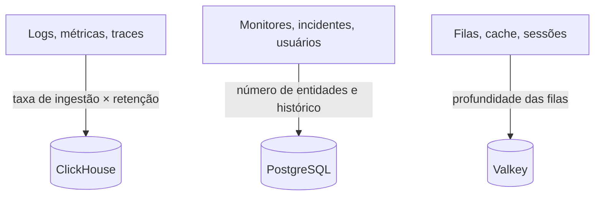

# Dimensionamento e planejamento de capacidade

Planeje CPU, memória e disco para um OneUptime auto-hospedado no Kubernetes com o [chart do Helm](https://artifacthub.io/packages/helm/oneuptime/oneuptime). Dimensione separadamente os três armazenamentos de dados – **ClickHouse**, **PostgreSQL** e **Valkey** – e a aplicação, comece por uma das camadas abaixo e ajuste quando tiver números reais.

> [!IMPORTANT]
> Os padrões do chart não são um dimensionamento de produção. Os serviços que ele executa por padrão não definem **nenhuma solicitação nem limite de CPU ou memória**, e o PostgreSQL e o ClickHouse recebem volumes pequenos de **25 Gi**, para que o chart se instale em qualquer cluster. Para qualquer coisa além de um teste, defina você mesmo os recursos e o armazenamento, com os números desta página.

Usa em vez disso a instalação com Docker Compose em um único servidor? O dimensionamento dela é mais simples: veja os [requisitos](/docs/installation/docker-compose#requirements) (recomendados 16 GB de memória, 8 núcleos e 400 GB de disco).

:::cards
- [O que faz cada armazenamento crescer](#what-drives-each-datastore): Três armazenamentos que crescem com três coisas diferentes.
- [Camadas iniciais](#starting-tiers): Pontos de partida pequeno, médio e grande.
- [Alta disponibilidade](#high-availability): Réplicas e failover para cada armazenamento.
- [Retenção](#retention-and-how-it-affects-storage): A configuração que multiplica o seu disco.
:::

## Dimensione a sua instalação

:::steps
1. Descubra quanta telemetria você envia: os GB de logs, métricas e traces por dia. Meça-a numa instalação pequena, se puder.
2. Decida por quantos dias mantê-la. A retenção multiplica o disco do ClickHouse (veja [Retenção](#retention-and-how-it-affects-storage)).
3. Calcule o disco do ClickHouse com a [fórmula de armazenamento](#storage-formula) e depois o do PostgreSQL e o do Valkey nas seções deles.
4. Escolha a [camada inicial](#starting-tiers) mais próxima dos seus números e defina CPU, memória e armazenamento dela nos seus values do Helm.
5. Ative a [alta disponibilidade](#high-availability) nos armazenamentos que precisarem dela e depois acompanhe o uso real e ajuste.
:::

## O que faz cada armazenamento crescer

O OneUptime precisa de três armazenamentos de dados em produção. Cada um cresce com algo diferente, então dimensione-os de forma independente.



| Armazenamento | O que guarda | O que determina o tamanho |
| --- | --- | --- |
| **ClickHouse** | Toda a telemetria – logs, métricas, traces, exceções, perfis | A telemetria: **taxa de ingestão × retenção**. É ~95% do seu armazenamento e o custo principal. |
| **PostgreSQL** | Configuração e estado – monitores, incidentes, alertas, usuários, equipes, projetos, workflows, páginas de status, dashboards | **Número de entidades e histórico**, não o volume de telemetria. Cresce devagar. |
| **Valkey** | Cache, filas de trabalho e sessões | **Profundidade das filas e sessões ativas**. Limitado pela memória e modesto. Não é uma fonte da verdade. |

O OneUptime nunca precisa de armazenamento de objetos (S3, MinIO) para funcionar e não move telemetria antiga para armazenamento de objetos. Você só precisa de armazenamento de objetos se escolher backups em armazenamento de objetos: o plugin Barman Cloud para o CloudNativePG, ou o [clickhouse-backup](https://github.com/Altinity/clickhouse-backup) para o ClickHouse. O backup do CloudNativePG do próprio chart (`postgresOperator.cnpg.backup`) tira snapshots de volume e não precisa de armazenamento de objetos. O CloudNativePG nunca apaga snapshots antigos: remova-os você mesmo, senão eles não param de crescer.

## ClickHouse – o fator principal

Quase todo o seu armazenamento e boa parte da memória vão para o ClickHouse, porque cada linha de log, ponto de métrica, span de trace e exceção fica lá.

### Fórmula de armazenamento

```text
ClickHouse disk ≈ (daily raw telemetry GB ÷ compression) × retention days × replicas × 1.3 (headroom)
```

A compressão depende do sinal:

| Sinal | Compressão típica | O que a altera |
| --- | --- | --- |
| Logs | Cerca de 5:1 | Logs comprimem bem. |
| Métricas | Cerca de 2:1 | Uma alta **cardinalidade** de rótulos aumenta disco e memória mais rápido do que o volume bruto. Mantenha baixa a cardinalidade dos rótulos. |
| Traces | Entre os dois | Os atributos de span que você envia. |

### Exemplo prático

Uma frota de **10 clusters**, cada um com cerca de 10 nós e 100 pods registrando logs no nível INFO, produz aproximadamente **50–150 GB de logs brutos por cluster em 30 dias** (cerca de 1,7–5 GB por dia por cluster). Na frota toda, somando métricas e traces e depois da compressão, reserve aproximadamente **5–15 GB por dia de telemetria comprimida**.

| Retenção | Uma réplica | 2 réplicas + 30% de folga |
| --- | --- | --- |
| 30 dias | ~150–450 GB | **~0,4–1,2 TB** |
| 90 dias | ~0,45–1,35 TB | **~1,2–3,5 TB** |

O armazenamento cresce **de forma linear com a retenção**: uma janela de 90 dias custa cerca de três vezes uma de 30.

### Memória e tipo de disco

- **Use NVMe ou SSD.** A telemetria é pesada em escrita, com rajadas de leituras de agregação; o ClickHouse sofre em discos giratórios.
- **Dê ao ClickHouse memória de sobra.** Consultas de agregação consomem muita memória. Como regra geral, dimensione a memória para 25–50% dos seus dados comprimidos *quentes* (consultados recentemente), com um mínimo prático de 16 GB para qualquer frota de produção real.
- **Controle a cardinalidade das métricas.** Ela é a maior alavanca isolada sobre a memória e o disco do ClickHouse. Imponha convenções de rótulos de baixa cardinalidade onde você coleta métricas e acompanhe o número de séries ativas.

## PostgreSQL – configuração e estado

O PostgreSQL guarda a sua configuração e o seu estado operacional, não telemetria, então cresce devagar e fica pequeno perto do ClickHouse. Mesmo instalações grandes costumam ficar na casa das dezenas de GB. O volume padrão de **25 Gi** basta para instalações pequenas; planeje 50–100 GB para as maiores, com folga para o histórico de incidentes e alertas.

Com muitas réplicas de app, workers e probes, as conexões com o banco podem acabar antes do armazenamento. Cada pod abre até 50 conexões por padrão, e o PostgreSQL incluído permite 500. Justamente para isso, o chart inclui um pooler de conexões **PgBouncer** opcional (`pgbouncer.enabled`): ative-o em instalações com muitas réplicas.

## Valkey – cache, filas e sessões

A camada de cache executa o [Valkey](https://valkey.io), o fork do Redis 7.2 com licença BSD, como cache, fila de trabalho e armazenamento de sessões. Qualquer servidor compatível com o protocolo Redis pode substituí-lo, e o dimensionamento abaixo vale nos dois casos. Ele é **limitado pela memória**, e a persistência fica **desativada por padrão**: não é uma fonte da verdade e pode ser reconstruído. Dimensione-o pela profundidade das filas e pelas sessões simultâneas; 2–8 GB de memória atendem a maioria das instalações. A política de remoção dele é `noeviction`, então acompanhe a memória se as filas se acumularem sob carga contínua.

## Processamento da aplicação

Além dos armazenamentos de dados, dimensione as cargas de trabalho sem estado. Cada uma roda **sem solicitações nem limites de recursos** até você defini-los, e com uma réplica, exceto o telemetry writer, que tem duas.

| Carga de trabalho | Chave dos values | Cresce com |
| --- | --- | --- |
| App: dashboard, API e ingestão | `app` | Usuários, chamadas de API e telemetria recebida |
| Workers, quando separados do app | `worker` | Telemetria e processamento de jobs em segundo plano |
| Probes | `probes` | O número de monitores ativos |
| Gateway de entrada | `nginx` | O volume de requisições |
| Telemetry writer, quando ativado | `telemetryWriter` | Não com a carga: ele agrupa cada inserção de telemetria no ClickHouse, então é dimensionado pelo que o ClickHouse aguenta |

O chart inclui o **KEDA**, para que o app, os workers, os probes e o Runner escalem conforme a fila acumulada. Ative `keda.enabled` junto com o `keda.enabled` de cada serviço (por exemplo, `app.keda.enabled`). Num cluster que ainda não tem KEDA, a primeira instalação precisa de uma passagem extra: veja o [guia do KEDA](https://github.com/OneUptime/oneuptime/blob/master/HelmChart/Docs/Keda.md) do chart. Serviços que o KEDA não gerencia podem usar em vez disso um autoscaler por CPU ou memória (`autoscaling`).

## Camadas iniciais

Escolha como ponto de partida a camada mais próxima do seu ambiente, depois acompanhe o uso real (`kubectl top pods`, o crescimento do disco do ClickHouse e do PostgreSQL) e ajuste.

- **Pequena / PoC** – 1–3 clusters, ≤30 nós, ≤5 GB/dia de telemetria bruta, 30 dias de retenção.
- **Média / Frota de produção** – ~10 clusters, ~100 nós, 10–30 GB/dia de telemetria bruta, 30–90 dias de retenção.
- **Grande / Várias frotas** – 50+ clusters, 500+ nós, 100+ GB/dia de telemetria bruta, 90 dias de retenção.

| | Pequena / PoC | Média / Frota de produção | Grande / Várias frotas |
| --- | --- | --- | --- |
| **ClickHouse** | 4 vCPU / 16 GB / 200 GB NVMe | 8 vCPU / 32 GB / 1–3 TB NVMe | 16+ vCPU / 64–128 GB / 5–15 TB NVMe, **com shards** |
| **PostgreSQL** | 2 vCPU / 4 GB / 50 GB SSD | 4 vCPU / 8 GB / 100 GB SSD | 8 vCPU / 16–32 GB / 250 GB SSD (+ PgBouncer) |
| **Valkey** | 1 vCPU / 2 GB | 2 vCPU / 4 GB | 4 vCPU / 8–16 GB |
| **Retenção considerada** | 30 dias | 30–90 dias | 90 dias |

Essas camadas dimensionam o backend do OneUptime. O agente que você instala em cada cluster monitorado é tratado na página [Agente do Kubernetes](/docs/telemetry/kubernetes-agent), que também mostra como reduzir o volume de dados que ele envia.

## Alta disponibilidade

Os armazenamentos de dados embutidos no chart rodam por padrão como **instâncias únicas**. Para alta disponibilidade em produção:

| Armazenamento | Para alta disponibilidade |
| --- | --- |
| **PostgreSQL** | Ative o operador [CloudNativePG](https://cloudnative-pg.io) incluído (`postgresOperator.cnpg.enabled`) com **3 instâncias** (`postgresOperator.cnpg.instances`): um primário e dois hot standbys, com failover automático. |
| **ClickHouse** | Ative o operador [Altinity](https://github.com/Altinity/clickhouse-operator) incluído (`clickhouseOperator.altinity.enabled`) com **2 ou mais réplicas por shard** (`clickhouseOperator.altinity.cluster.replicasCount`). O ClickHouse Keeper incluído roda em **3 nós** para o quórum. Adicione shards (`shardsCount`) quando o disco ou a memória de um nó virar o limite. |
| **Valkey** | O chart não o replica. Aponte o OneUptime para um Redis ou Valkey externo gerenciado com failover automático (`externalValkey`). O OneUptime se conecta a um único host e porta, então use o endpoint primário do serviço, não um em modo cluster. |

> [!WARNING]
> Ativar qualquer um dos operadores numa instalação existente inicia um banco de dados novo e vazio: nenhum deles copia os dados do banco de instância única que substitui. Migre os seus dados como descrevem os guias do chart – para o [PostgreSQL](https://github.com/OneUptime/oneuptime/blob/master/HelmChart/Docs/MigratePostgresStandaloneToOperator.md) e para o [ClickHouse](https://github.com/OneUptime/oneuptime/blob/master/HelmChart/Docs/MigrateClickhouseStandaloneToOperator.md).

## A retenção e como ela afeta o armazenamento

A retenção da telemetria é um **TTL do ClickHouse contado em dias**. Toda edição tem o padrão do projeto, em **Configurações do projeto > Telemetria e APM > Retenção de dados** (**Retenção Padrão (Dias)**); quando nada está definido, ele é de 15 dias. A [Enterprise Edition](/docs/self-hosted/enterprise) acrescenta substituições: por sinal (logs, traces, métricas, perfis), por severidade do log e status do trace, e por serviço ou recurso.

Logs e métricas são apagados um dia por vez, na primeira meia-noite (horário do servidor do ClickHouse) depois do fim da retenção, o que evita que o ClickHouse reescreva cada dia deles a cada poucas horas enquanto expira. Pouco antes da meia-noite, ainda fica no disco até um dia a mais do que a janela de retenção: dimensione logs e métricas para **dias de retenção + 1**.

Como a retenção multiplica o armazenamento do ClickHouse, decida-a antes de dimensionar o disco. O OneUptime **não** arquiva nem move telemetria antiga para armazenamento de objetos. Para uma retenção de conformidade de vários anos, aumente a janela de retenção e dimensione o armazenamento do ClickHouse de acordo, ou exporte para um arquivo externo de sua escolha.

## Meça antes de se comprometer

O volume de telemetria varia enormemente com o detalhamento dos logs das aplicações, o número de namespaces, o intervalo de coleta e se há logging DEBUG ativado em algum lugar. Trate as camadas acima como pontos de partida: **colete dados do seu ambiente por pelo menos quatro semanas**, meça os GB reais por dia de cada sinal e depois dimensione a retenção e o armazenamento a partir de dados reais.

## Próximos passos

:::cards
- [Docker Compose](/docs/installation/docker-compose): Requisitos para uma instalação em um único servidor.
- [Arquitetura auto-hospedada](/docs/self-hosted/architecture): Como os componentes se encaixam.
- [Agente do Kubernetes](/docs/telemetry/kubernetes-agent): O coletor que envia a telemetria de um cluster.
- [Enterprise Edition](/docs/self-hosted/enterprise): As substituições de retenção e os outros recursos Enterprise.
:::
