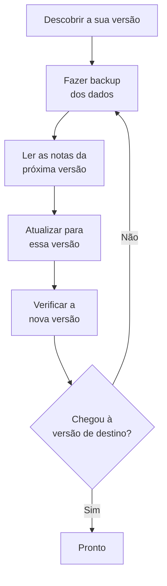

# Atualização

Atualize uma instalação auto-hospedada do OneUptime – com Docker Compose, ou com Kubernetes e Helm – para uma versão mais recente. Siga o procedimento abaixo e leia as notas de cada versão principal entre a que você executa e a que quer alcançar.

:::cards
- [Como atualizar](#como-atualizar): O procedimento, para Docker Compose e Kubernetes.
- [Notas de cada versão](#encontrar-as-notas-da-sua-versão): O que cada versão principal pede de você, num relance.
- [Imagens da Community Edition e da Enterprise Edition](#imagens-da-community-edition-e-da-enterprise-edition): Qual imagem executar a partir da 14.
- [Atualização do OneUptime 13 → 14](#atualização-do-oneuptime-13-14): A versão principal mais recente.
:::

## Como atualizar

Três regras tornam uma atualização segura:

- **Atualize uma versão principal de cada vez** (por exemplo 6 → 7 → 8). Não pule nenhuma versão principal.
- **Pule à vontade as versões secundárias e de correção** (por exemplo 8.1 → 8.4), desde que siga as notas de versão delas.
- **Faça um backup antes de cada atualização**, e verifique que consegue restaurá-lo.



:::steps
### Descubra a sua versão atual

Como administrador master, abra o rótulo da edição no cabeçalho do painel do administrador: **This installation** mostra a versão que você executa. A instância também a informa em `/version`:

```bash
curl http://localhost/version
```

Substitua `http://localhost` pelo endereço da sua instância. A resposta é JSON, como `{"version":"14.0.22","commit":"..."}`.

### Faça backup dos seus dados

Faça backup do PostgreSQL, e do ClickHouse se precisar da telemetria dele. No Docker Compose, veja [Backup e restauração](/docs/installation/docker-compose#backup-e-restauração). No Kubernetes, use os seus snapshots de volumes ou os backups do CloudNativePG do chart.

### Leia as notas da próxima versão principal

Você as encontra na [tabela abaixo](#encontrar-as-notas-da-sua-versão). Faça o que elas pedem antes de atualizar: alguns passos, como renomear valores do Helm, precisam ser feitos primeiro.

### Execute a atualização

:::tabs
@tab Docker Compose
```bash
git checkout release
git pull
npm run update
```
`npm run update` acrescenta as novas configurações ao seu `config.env` sem alterar as suas, baixa as novas imagens e reinicia o OneUptime.
@tab Kubernetes
```bash
helm repo update
helm upgrade my-oneuptime oneuptime/oneuptime -f values.yaml
```
Use o seu próprio nome de release e o seu próprio arquivo de valores. O chart executa as migrações do banco de dados em um Job próprio antes que os novos pods atendam tráfego.
:::

### Verifique a nova versão

No Docker Compose, `npm run update` termina com **OneUptime is up!** No Kubernetes, espere até que todos os pods estejam `Running` e prontos:

```bash
kubectl get pods -n <namespace>
```

Depois verifique a sua versão de novo, como no primeiro passo. Se ainda não chegou à versão de destino, volte a [Faça backup dos seus dados](#faça-backup-dos-seus-dados) e passe para a próxima versão principal.
:::

### Encontrar as notas da sua versão

| Atualização | O que você precisa fazer |
| --- | --- |
| [13 → 14](#atualização-do-oneuptime-13-14) | Escolher uma edição. As instalações Docker Compose que definem `IS_ENTERPRISE_EDITION=true` passam para `APP_TAG=enterprise-release`. Ativar uma licença na Enterprise Edition. Salvar de novo os monitores IPv6 Ping, Port e SSL. As correções de código por IA passam para o Runner global: mantê-lo ligado e, no Helm, mover `runner.keda` para `globalRunner.keda`. |
| [12 → 13](#atualização-do-oneuptime-12-13) | Normalmente nada: o Redis passa a ser o Valkey, e os nomes antigos das configurações continuam funcionando. Executa o Docker Compose à mão? Acrescente `--remove-orphans`. Usa um cache próprio? Leia [Se você opera o seu próprio cache](#se-você-opera-o-seu-próprio-cache). |
| [11 → 12](#atualização-do-oneuptime-11-12) | Reimplantar os Runbook Agents como Runners. No Docker Compose, definir `ONEUPTIME_RUNNER_KEY`. No Helm, renomear `aiAgent:` para `runner:`. Conceder de novo as permissões de Runner que as chaves de API tinham diretamente. |
| [10 → 11](#atualização-do-oneuptime-10-11) | O SCIM e as configurações de conformidade de equipes exigem a Enterprise Edition. Para manter o histórico de telemetria, renomeie as tabelas antigas do ClickHouse antes de atualizar. |
| [9 → 10](#atualização-do-oneuptime-9-10) | Nada. |
| [8 → 9](#atualização-do-oneuptime-8-9) | No Helm, remover as substituições de `oneuptimeIngress` dos seus valores. |
| [7 → 8](#atualização-do-oneuptime-7-8) | No Helm, passar para a nova estrutura de valores do Postgres, Redis e ClickHouse. Fazer um backup antes. |

## Imagens da Community Edition e da Enterprise Edition

O OneUptime agora distribui a aplicação em duas imagens. A **Community Edition** é de código aberto sob a licença Apache 2.0 e inclui o login único SAML e OIDC, o SSO global e «Require SSO for login». A **Enterprise Edition** acrescenta os módulos enterprise do diretório `ee/` do repositório: SCIM, conformidade de equipes, logs de auditoria e os painéis Health enterprise do painel do administrador. Antes desta mudança, as duas edições executavam o mesmo código, e `IS_ENTERPRISE_EDITION` decidia quais recursos estavam ativados. Agora quem decide é a imagem, e a imagem Community não contém o diretório `ee/`.

A página [Edição Enterprise](/docs/self-hosted/enterprise) tem a comparação completa de recursos, os detalhes da licença e o que acontece quando você troca de edição.

### O que fazer antes de atualizar

- **Community Edition sem SCIM:** nada. Atualize como de costume.
- **Community Edition com funções personalizadas, listas de IPs permitidos, controles de acesso das páginas de status ou Powered by OneUptime oculto:** funções personalizadas, listas de IPs permitidos e controles de acesso das páginas de status passaram para a Enterprise Edition. O que você configurou continua valendo, e você pode remover, mas não criar nem alterar. As páginas de status voltam a mostrar Powered by OneUptime. Mude para a imagem Enterprise para continuar a gerenciá-los.
- **Helm com `image.type: enterprise-edition`:** nada. O chart já baixa as imagens `enterprise-`, que agora contêm os módulos enterprise.
- **Docker Compose com `IS_ENTERPRISE_EDITION=true`:** passe para a imagem Enterprise ao atualizar definindo `APP_TAG=enterprise-release` (ou `enterprise-<version>`) em `config.env`. `APP_TAG=release` é a imagem Community, e `IS_ENTERPRISE_EDITION=true` já não ativa nada. `npm run update` faz essa mudança por você enquanto `IS_ENTERPRISE_EDITION=true` (`release` passa a `enterprise-release`, um `13.0.7` fixado passa a `enterprise-13.0.7`) e imprime o que mudou. A aplicação agora **se recusa a iniciar** quando `IS_ENTERPRISE_EDITION=true` está definido na imagem Community, em vez de parar em silêncio o provisionamento SCIM e o registro de auditoria. O erro diz o que definir: `APP_TAG=enterprise-<version>` para manter a Enterprise Edition, ou `IS_ENTERPRISE_EDITION=false` para executar a Community Edition.
- **Imagem Community com SCIM já configurado:** o provisionamento SCIM para com esta atualização, incluindo o desprovisionamento. Passe para a imagem Enterprise para mantê-lo. Caso contrário, leia [Passar de Enterprise para Community](/docs/self-hosted/enterprise#passar-de-enterprise-para-community) antes de atualizar. Ela explica o que para e quem remover primeiro. Para executar a Community Edition, defina também `IS_ENTERPRISE_EDITION=false`. O login único não é afetado: a imagem Community também o oferece.

A sua configuração nunca é apagada, e trocar de edição não exige nenhuma migração em nenhuma direção.

### A licença depois da atualização

A Enterprise Edition agora verifica a sua licença:

- **Uma instalação com chave de licença** continua funcionando. Ela verifica a licença com o OneUptime ao iniciar e uma vez por dia. Se a licença expirar, tudo continua funcionando durante um período de carência de 30 dias, depois do qual acontece o mesmo que numa instalação sem licença.
- **Uma instalação sem licença**, por exemplo uma que executava a Enterprise Edition só com `IS_ENTERPRISE_EDITION=true`, recebe um período de teste de 14 dias desde a primeira inicialização desta versão. **Se você usa SCIM ou o registro de auditoria, ative uma licença antes que o teste termine.** Depois do teste, o provisionamento SCIM para e o registro de auditoria deixa de gravar. A configuração enterprise também passa a ser somente leitura e os painéis Health enterprise ficam bloqueados. O login único não é afetado. Tudo volta a funcionar, sem reiniciar, assim que você ativa uma licença. O teste serve para avaliação: o uso em produção da Enterprise Edition exige uma assinatura do OneUptime Enterprise. Veja [Quando uma licença expira ou está ausente](/docs/self-hosted/enterprise#quando-uma-licença-expira-ou-está-ausente).
- **As instalações isoladas da rede** podem ativar com um token de licença assinado em vez de uma chave. Veja [Ativação offline](/docs/self-hosted/enterprise#ativação-offline-instalações-isoladas-da-rede).

### Clientes do OneUptime Cloud

Para você nada muda. O OneUptime Cloud executa a Enterprise Edition, e o seu plano continua decidindo quais recursos você recebe: SSO, OIDC, SCIM e conformidade de equipes a partir do plano Scale, e logs de auditoria no plano Enterprise. Os projetos do plano Scale agora veem as configurações de SSO, OIDC, SCIM e conformidade de equipes que antes mostravam um convite para mudar de plano.

### Mudanças na API e nos endpoints

- `GET /api/global-config/license` só devolve a chave de licença, o token de licença, a lista de instâncias, o ID da instância e os detalhes da versão aos administradores master. Os demais chamadores recebem a edição e o estado da licença.
- As instalações auto-hospedadas já não servem os endpoints do servidor de licenças em `/api/enterprise-license/`. Só o oneuptime.com os usa.
- Os endpoints de SCIM mantêm exatamente os mesmos caminhos na Enterprise Edition, então a configuração do provedor de identidade não muda. Na Community Edition eles devolvem `404`. Na Enterprise Edition eles recusam as solicitações enquanto a licença estiver vencida (depois do teste ou do período de carência), e voltam a responder assim que uma licença é ativada.
- Os endpoints de SSO e OIDC (as URLs de login e ACS do SAML, as URIs de redirecionamento do OIDC e os endpoints do SSO global) mantêm exatamente os mesmos caminhos e são servidos pelas duas edições em qualquer estado da licença.

## Atualização do OneUptime 13 → 14

O OneUptime 14 divide a aplicação em duas edições, e a imagem que você baixa decide qual delas você executa. A **Community Edition** (Apache-2.0, as tags `release` e `<version>`) inclui SAML SSO, OpenID Connect, o SSO global e «Require SSO for login». Ela não contém o diretório `ee/` do repositório, então o provisionamento SCIM, as configurações de conformidade de equipes, os logs de auditoria, os painéis **Health** do painel do administrador e a **Query Console** do painel do administrador simplesmente não estão nessa imagem. A **Enterprise Edition** (as tags `enterprise-release` e `enterprise-<version>`) os contém, e verifica uma licença Enterprise durante a execução, algo que o OneUptime 13 nunca fez. O login único não depende dessa licença.

[Imagens da Community Edition e da Enterprise Edition](#imagens-da-community-edition-e-da-enterprise-edition), acima, é a referência desta mudança: o que cada edição contém, o que definir em cada tipo de implantação e o que a licença faz. Esta seção é a atualização em si. Atualize a partir da 13 – se ainda estiver na 12, faça primeiro 12 → 13.

Nada é apagado, em nenhuma das duas edições. O login único funciona da mesma forma nas duas: a sua configuração de SSO e OIDC e as suas configurações de «Require SSO for login» são mantidas como estão. A sua configuração de SCIM e os logs de auditoria gravados até agora continuam no banco de dados. A Community Edition simplesmente não os serve, e trocar de edição não exige nenhuma migração em nenhuma direção.

### O que você precisa fazer

1. **Decida qual edição esta instalação executa.** Se você usa provisionamento SCIM, configurações de conformidade de equipes ou logs de auditoria, ou quer os painéis **Health** do painel do administrador, essa é a Enterprise Edition. Caso contrário, não há nada a decidir: a Community Edition é o que você já tem, e ela inclui SAML SSO e OpenID Connect.
2. **No Helm, indique a edição no seu arquivo de valores:** `image.type: enterprise-edition` (o padrão é `community-edition`). Não mexa em `image.tag` – o chart acrescenta o prefixo `enterprise-` sozinho, então `image.tag: release` baixa `oneuptime/app:enterprise-release`. Esse valor não é novo. Se você já executa `enterprise-edition`, não há nada a mudar: a tag que você já baixa agora contém `ee/`.
3. **No Docker Compose, defina `APP_TAG=enterprise-release`** (ou `enterprise-<version>` para fixar uma versão) em `config.env`. `APP_TAG=release` é a imagem Community. Esta é a única coisa que bloqueia uma instalação na 13: na 13, uma instalação Enterprise com Compose era `APP_TAG=release` mais `IS_ENTERPRISE_EDITION=true`, e essa combinação agora **se recusa a iniciar** em vez de subir como Community Edition com o provisionamento SCIM e o registro de auditoria parados em silêncio. `npm run update` reescreve `APP_TAG` por você enquanto `IS_ENTERPRISE_EDITION=true` (`release` passa a `enterprise-release`, um `13.0.8` fixado passa a `enterprise-13.0.8`) e imprime o que mudou. Se, em vez disso, você baixa as imagens à mão, defina antes `APP_TAG` você mesmo.
4. **Na Enterprise Edition, ative uma licença.** Uma instalação sem licença recebe um período de teste de 14 dias, contado desde a primeira inicialização da Enterprise Edition – numa atualização, esse é o dia em que você atualiza, não o dia em que instalou o OneUptime pela primeira vez. Um administrador master a ativa pelo rótulo da edição no cabeçalho do painel do administrador; as instalações isoladas da rede ativam com um token assinado. Veja [Licenciamento](/docs/self-hosted/enterprise#licenciamento).
5. **Se esta instalação vai executar a Community Edition enquanto o seu provedor de identidade desprovisiona usuários via SCIM, revise quem tem acesso antes de atualizar.** O desprovisionamento SCIM para, então as pessoas que você remove no seu provedor de identidade mantêm as contas no OneUptime e, a menos que «Require SSO for login» se aplique a elas, qualquer pessoa que ainda acesse a caixa de correio de uma dessas contas pode definir uma senha com «Esqueci minha senha» e entrar. Remova esses usuários primeiro: [Passar de Enterprise para Community](/docs/self-hosted/enterprise#passar-de-enterprise-para-community).
6. **Se você monitora endereços IPv6 com monitores Ping, Port ou SSL, salve esses monitores de novo depois de atualizar.** Os destinos salvos antes da 14 podem ter sido armazenados truncados – veja [Monitores IPv6 Ping, Port e SSL](#monitores-ipv6-ping-port-e-ssl).
7. **Se a OneUptime AI corrige código nos seus repositórios, mantenha o Runner global ligado.** Agora ele cuida das correções de código por IA que o Runner compartilhado fazia, e o serviço `runner` do Docker Compose e o deployment `runner` do chart deixaram de existir. Se você definiu `GLOBAL_RUNNER_REPLICAS=0` ou `globalRunner.enabled: false`, ligue-o de novo, ou [escolha um Runner próprio](/docs/ai/ai-agent#escolha-o-runner-do-repositório) para esses repositórios no Code. No Helm, tire `runner:` dos seus values e mova `runner.keda` para `globalRunner.keda`.

### Edições: o que mudou e o que não mudou

| | Até a 13 | A partir da 14 |
| --- | --- | --- |
| Código Enterprise | em todas as imagens; `IS_ENTERPRISE_EDITION=true` o ativava | em `ee/`, e só nas imagens `enterprise-` |
| Seletor no Helm | `image.type` | `image.type` – o mesmo, mas agora as imagens são diferentes |
| Seletor no Compose | `IS_ENTERPRISE_EDITION=true` | `APP_TAG=enterprise-release` |
| Licença Enterprise | nunca verificada em execução | verificada na inicialização e uma vez por dia |
| Endpoints de SSO e OIDC | os mesmos caminhos nas duas edições | os mesmos caminhos nas duas edições, seja qual for o estado da licença |
| Endpoints de SCIM | os mesmos caminhos nas duas edições | os mesmos caminhos na Enterprise; `404` na Community |
| A sua configuração enterprise | armazenada, aplicada | armazenada em ambos os casos, aplicada na Enterprise |

Uma migração é executada: uma coluna anulável `enterpriseEditionFirstSeenAt` na tabela `GlobalConfig`, que tem uma única linha, então é instantânea. Não há nenhuma migração do ClickHouse, nada é removido e trocar de edição não exige migração em nenhuma direção.

### O calendário da licença na Enterprise Edition

- **Uma instalação sem licença** executa um teste de 14 dias, contado desde a primeira inicialização da Enterprise Edition. Durante o teste, todos os recursos enterprise funcionam, e o rótulo da edição avisa antes que ele termine. O teste serve para avaliação: o uso em produção da Enterprise Edition exige uma assinatura nos termos da OneUptime Enterprise License.
- **Uma licença que expira** recebe um período de carência de 30 dias a partir da data de expiração, durante o qual todos os recursos enterprise funcionam e o rótulo da edição avisa.
- **Depois do teste, ou depois desse período de carência**, e até que uma licença seja ativada: as solicitações SCIM do seu provedor de identidade são recusadas e o registro de auditoria deixa de gravar. A configuração enterprise passa a ser somente leitura – você ainda pode consultá-la, apagá-la e redefinir um bearer token do SCIM, que é o que um incidente exige – e os painéis Health e a Query Console do painel do administrador ficam bloqueados.
- **Nada é apagado, e o monitoramento principal nunca é afetado.** Monitores, alertas, incidentes, plantão, páginas de status e telemetria ficam fora da licença, assim como o login: o login por SSO e OIDC, «Require SSO for login» e o login com senha de todos os usuários, administradores master incluídos, funcionam da mesma forma em qualquer estado da licença. Ativar uma licença restaura o provisionamento SCIM e o registro de auditoria com a configuração que você já tem, sem reiniciar.
- **Uma chave de licença que você já tem é aceita**, como licença «unverified»: a data de expiração e o limite de assentos vêm do que o servidor de licenças já informou a esta instalação, e ela recebe o mesmo período de carência de 30 dias depois dessa expiração. As licenças emitidas daqui em diante são assinadas e verificadas pela própria aplicação. Você não precisa de uma chave nova para esta atualização.
- **Uma chave cuja expiração esta instalação nunca registrou** continua funcionando durante o teste em vez de parar. O servidor de licenças grava a chave e a data de expiração separadamente, então uma instalação pode ter uma chave cuja expiração nunca lhe foi informada. Essa instalação é tratada exatamente como uma sem licença: todos os recursos enterprise funcionam durante o teste de 14 dias, contado desde a primeira inicialização da Enterprise Edition, e depois do teste param as mesmas coisas indicadas acima. O limite de assentos não é aplicado enquanto a licença estiver nesse estado, porque o registro de licença que a instalação tem já está incompleto. Um administrador master que reativa a licença pelo rótulo da edição, ou a sincronização diária de licenças que recupera a expiração do oneuptime.com, a restaura sem reiniciar.

A tabela completa de estados está em [Quando uma licença expira ou está ausente](/docs/self-hosted/enterprise#quando-uma-licença-expira-ou-está-ausente).

### Docker Compose: escolher a tag da imagem

```bash
git checkout release # Please make sure you're on release branch.
git pull
npm run update
```

- **`npm run update` move `APP_TAG` enquanto `IS_ENTERPRISE_EDITION=true`**, para a imagem Enterprise da mesma versão, e imprime o que mudou. Ele mantém os seus comentários e aspas, deixa de lado um `APP_TAG` que já é uma tag `enterprise-` e não muda nada numa segunda execução.
- **Baixar as imagens à mão pula essa etapa**, e a aplicação então para na inicialização com um erro que diz exatamente o que definir: `APP_TAG=enterprise-<version>` para manter a Enterprise Edition, ou `IS_ENTERPRISE_EDITION=false` para executar a Community Edition.
- **Para passar de propósito para a Community Edition**, defina `APP_TAG=release` e `IS_ENTERPRISE_EDITION=false`. Leia antes o item 5 acima se o seu provedor de identidade desprovisiona usuários via SCIM.
- Nada mais em `config.env` precisa mudar para esta versão.

### Helm: escolher o tipo de imagem

```bash
helm repo update
helm upgrade my-oneuptime oneuptime/oneuptime -f values.yaml
```

- **Uma instalação que já está em `image.type: enterprise-edition` não precisa mudar nenhum valor.** O chart antepõe o prefixo à tag há muito tempo; a novidade é que as imagens `enterprise-` contêm `ee/`. A licença se aplica a ela a partir desta versão, conforme o calendário acima.
- **`image.tag: release` é o padrão**, então um chart que ficou na tag flutuante passa para a 14 na próxima atualização sem nenhuma mudança de valores. Se essa instalação tem SCIM configurado em `community-edition`, defina `image.type: enterprise-edition` na mesma atualização.
- **O chart continua emitindo `IS_ENTERPRISE_EDITION`**, derivado de `image.type` para que os dois nunca possam divergir. Ele não controla nada. Forçá-lo para `true` via `extraEnv` numa imagem Community só faz a aplicação se recusar a iniciar. Nunca defina `ONEUPTIME_EDITION` pelo chart.
- **As sondas do chart voltam a respeitar `probes.<key>.allowPrivateNetworkMonitors`** ([#3879](https://github.com/OneUptime/oneuptime/issues/3879)). Nada muda a menos que você o defina – o padrão continua `false` – e ele se aplica aos monitores de todos os projetos da instância, porque as sondas do chart são sondas globais. Loopback, link-local e `169.254.169.254` continuam bloqueados, seja qual for o valor.

### Outras mudanças na 14

Estas mudanças alteram o comportamento do OneUptime depois da atualização, e a maioria não exige nada de você. Leia-as se você usa funções personalizadas ou chaves de API formadas por permissões avulsas, estados próprios de incidentes, alertas ou manutenções, Terraform ou a API, SSO, ou os aplicativos de Slack e Microsoft Teams.

:::details Leia as demais mudanças da 14
- **A ingestão OTLP confirma um lote só depois que a fila o aceita.** A 13 respondia primeiro `200` e enfileirava depois, então um lote que a fila recusava se perdia em silêncio. A 14 responde em vez disso `503` com `Telemetry queue unavailable. Please retry.`, e o endpoint gRPC devolve `UNAVAILABLE`; ambos podem ser repetidos, e os exportadores repetem. Isso vale para logs, métricas, traces e perfis. Não é preciso fazer nada, mas as novas tentativas dos exportadores e a contrapressão da fila agora ficam visíveis onde antes os dados sumiam – vale saber se você dimensiona a capacidade de ingestão.
- **Os painéis Health e a Query Console do painel do administrador exigem a Enterprise Edition**, junto com os alertas de saúde do PostgreSQL e do Valkey. Na 13 eles vinham só com `IS_ENTERPRISE_EDITION=true`, então é uma perda visível para uma instalação Community que os usava. O monitoramento de capacidade do ClickHouse e a sua limpeza, o estado das migrações, as sondas globais e o pacote de suporte estão nas duas edições.
- **Os monitores HTTPS que chegam a um endereço IP pelo proxy de uma sonda voltam a funcionar.** A sonda enviava o IP como nome de servidor TLS, que não é um nome de servidor válido e que o Node recusa sem apelação, então um monitor em `https://<private IP>` a partir de uma sonda global com `PROBE_ALLOW_PRIVATE_NETWORK_MONITORS` falhava no handshake. A sonda agora omite o nome de servidor para um destino IP e verifica o certificado contra o próprio IP. Os destinos por nome de host não mudam.
- **A CLI `oneuptime` informa a sua versão real** com `--version` em vez de um marcador.
- **Um novo alerta ou episódio começa no estado que a sua criação indica.** A API, o Terraform (`current_alert_state_id`, `current_incident_state_id`) e os workflows podem indicar o estado em que começa um alerta, um episódio de alertas ou um episódio de incidentes, como faz o campo **Estado Inicial** do painel. Antes, esse estado era substituído pelo estado de criação do projeto; uma configuração do Terraform que o definia recebia um valor diferente do planejado. Uma criação que não indica nenhum estado ainda começa no estado de criação, e um estado de outro projeto é recusado. Veja [O estado em que um novo registro começa](/docs/api-reference/api-reference#o-estado-em-que-um-novo-registro-começa).
- **Um registro criado já confirmado ou resolvido não aciona ninguém.** Um incidente, alerta ou episódio criado num estado posterior – por **Estado Inicial**, pelo estado inicial de um modelo, pela API, pelo Terraform ou por um workflow – não executa mais as suas políticas de plantão; o feed dele diz isso no lugar delas. Um criado já resolvido também deixa de ser agrupado num episódio, remediado, investigado pela OneUptime AI ou de receber um canal no Slack ou no Microsoft Teams, e um incidente criado resolvido deixa em paz o status e o monitoramento dos seus monitores e não inicia nenhum SLA. Um criado confirmado inicia o seu SLA já como respondido. Os registros criados no estado de criação, como todos os abertos por um monitor, não mudam. Veja [Declarado já confirmado ou resolvido](/docs/incidents/declaring-incidents#declarado-já-confirmado-ou-resolvido).
- **Um estado depois do seu estado resolvido conta como resolvido em todo lugar.** Um incidente, alerta ou episódio num estado que você colocou depois do estado resolvido – um estado **Closed** abaixo de **Resolvido**, por exemplo – contava como resolvido em alguns lugares e como aberto em outros. Todos eles seguem agora uma única regra: o estado resolvido do projeto, e todo estado depois dele, é resolvido. Os registros num estado assim saem das listas **Incidentes ativos** e **Alertas ativos** e dos seus contadores no menu lateral, das listas de incidentes e alertas dos painéis, dos episódios ativos e das listas de registros abertos do aplicativo móvel; os resumos do Slack e do Microsoft Teams os contam como resolvidos, e as linhas do tempo das páginas de status mostram uma linha assim como resolvida. Um monitor ou uma regra de taxa de consumo de SLO cujo incidente ou alerta está num estado assim abre um novo na próxima vez que dispara, onde antes considerava o antigo ainda aberto. Mover um incidente direto para um estado assim o resolve como faz **Resolvido**, e movê-lo para além de **Resolvido** já não reabre um episódio nem inicia um novo SLA para o incidente. Os projetos cujos estados próprios ficam todos acima do estado resolvido não notam nenhuma mudança. Veja [A lista de incidentes ativos](/docs/incidents/states-and-severities#a-lista-de-incidentes-ativos).
- **Um estado depois do seu estado confirmado conta como confirmado em todo lugar.** Um incidente, alerta ou episódio num estado que você colocou entre os seus estados confirmado e resolvido – um estado **Investigating** abaixo de **Confirmado**, por exemplo – já parava os chamados de plantão, mas o aplicativo móvel e o Microsoft Teams ainda ofereciam **Acknowledge** para ele, e confirmar um alerta ou episódio nesse estado (pelo Teams, pelo Slack ou por uma página de plantão) o levava de volta para **Confirmado**. Todos eles seguem agora uma única regra: o estado confirmado do projeto, todo estado depois dele e um estado resolvido contam como confirmados. **Acknowledge** já não é oferecido em lugar nenhum para um registro assim, e confirmá-lo é recusado ("... is already acknowledged.") em vez de levá-lo de volta; um plantonista que confirma o próprio chamado para ele simplesmente encerra o chamado. Mover um registro direto para um estado assim agora marca o SLA do incidente como respondido – onde antes ficava sem resposta até o incidente ser resolvido, o que podia violar a meta de resposta – e conta como a sua confirmação no tempo até a confirmação da visão geral, na métrica **Time to Acknowledge**, nas medições e no MTTA dos resumos do Slack e do Microsoft Teams. Um registro resolvido sem ter sido confirmado agora conta como confirmado no momento em que foi resolvido, como a visão geral já mostrava. Os filtros de lista **Confirmado** também mostram os registros nesses estados, e o atributo `isAcknowledgedState` da métrica **Time in State** é `true` para eles. Os projetos cujos estados próprios ficam todos acima do estado confirmado não notam nenhuma mudança. Veja [O que a confirmação faz](/docs/incidents/states-and-severities#o-que-a-confirmação-faz).
- **Os episódios percorrem os seus estados pela regra que incidentes e alertas seguem.** Um episódio de incidentes ou de alertas podia ser levado de volta para cima na sua lista de estados – um episódio resolvido devolvido para **Confirmado**, por exemplo – pela linha do tempo de estados do painel, pelo Slack, pelo Microsoft Teams, pela API ou pelo Terraform, e a mudança passava para os seus incidentes ou alertas. Agora uma mudança para um estado que vem antes do atual do episódio na ordem é recusada com o erro que um incidente recebe ("Episode cannot transition to Acknowledged state from Resolved state because Acknowledged is before Resolved in the order of incident states."), e nada muda. A opção **Reabrir episódios resolvidos recentemente** de uma regra de agrupamento ainda reabre um episódio, como mudança feita pelo próprio OneUptime. Para corrigir um estado definido por engano, exclua a linha dele na linha do tempo de estados do episódio, como num incidente; o episódio volta ao estado da última linha que restar, e excluir a linha que o resolveu apaga o horário de resolução. Um episódio só move cada um dos seus incidentes ou alertas para onde o estado deles iria: um que já está nesse estado, ou além dele, fica onde está.
- **Uma escrita do estado atual de um registro segue a mesma regra.** Atualizar o estado atual de um incidente, alerta, episódio ou evento de manutenção programada pela API ou pelo Terraform (`currentIncidentStateId`, `currentAlertStateId`, `currentScheduledMaintenanceStateId`) é recusado antes de salvar qualquer coisa quando leva o registro de volta para cima na sua lista, com o mesmo erro. Antes, a escrita chegava ao registro e a linha do tempo de estados depois a recusava, deixando o registro num estado que a sua linha do tempo nunca teve. Escrever o estado de um episódio de incidentes agora o registra na linha do tempo de estados do episódio e move os seus incidentes, como a escrita do estado de um episódio de alertas já fazia. Um plano do Terraform que define um estado anterior falha no apply; defina os estados na ordem deles, ou mude o estado com uma linha da linha do tempo de estados.
- **Change State no Slack e no Microsoft Teams oferece só os estados para os quais um registro pode ir em seguida.** Um registro no último estado que pode alcançar recebe a resposta "There is no later state to move this incident to." em vez de um formulário em que toda escolha seria recusada. O menu **Alterar estado para** no cabeçalho do painel segue a mesma regra.
- **O erro para um evento de manutenção programada levado de volta para cima na sua lista se lê como os outros:** "Scheduled Maintenance cannot transition to Scheduled state from Ongoing state because Scheduled is before Ongoing in the order of scheduled maintenance states." (antes dizia `ScheduledMaintenance` e `scheduledMaintenance states`). Um script que comparava o texto antigo precisa do novo. Veja [A ordem é uma restrição real](/docs/incidents/states-and-severities#a-ordem-é-uma-restrição-real-não-uma-preferência-de-exibição).
- **Resolver um incidente devolve só os monitores que ele retém.** O OneUptime agora registra se um incidente retém o status dos seus monitores. Um incidente já resolvido uma vez e depois reaberto deixa de devolver os seus monitores a operacionais quando é resolvido de novo, então um status que eles receberam nesse meio-tempo – das suas sondas, de uma manutenção ou definido à mão – permanece; alterar os monitores dele, ou o status em que os coloca, enquanto está aberto faz com que ele volte a retê-los. Os incidentes de antes da atualização devolvem os seus monitores na próxima resolução, como sempre fizeram. Veja [O que a resolução faz](/docs/incidents/states-and-severities#o-que-a-resolução-faz).
- **O episódio de um incidente ou alerta é definido só pelos membros do episódio.** `incidentEpisodeId` e `alertEpisodeId` (e as relações `incidentEpisode` e `alertEpisode`) são somente leitura. A API, o Terraform (`incident_episode_id`, `alert_episode_id`), as ferramentas MCP e os workflows podiam escrevê-los sem adicionar o registro ao episódio: a visão geral do episódio listava então um incidente ou alerta que a sua página **Membros** não tinha, e um criado com um episódio definido nunca era agrupado. Uma criação ou atualização que envia um deles agora é recusada, com uma mensagem que remete aos membros do episódio: adicione o registro com `POST /api/incident-episode-member` (ou `/api/alert-episode-member`) e exclua esse membro para retirá-lo, e a referência ao episódio acompanha. A leitura não muda. Uma configuração do Terraform que define `incident_episode_id` ou `alert_episode_id` precisa retirá-lo assim que você atualizar o provider, que agora só os lê; os recursos `oneuptime_incident_episode_member` e `oneuptime_alert_episode_member` gerenciam a associação. Veja [O episódio em que um incidente ou alerta está](/docs/api-reference/api-reference#o-episódio-em-que-um-incidente-ou-alerta-está).
- **As novas regras de escalonamento de chamadas recebidas tocam por 20 segundos, não 30.** Muitos telefones mandam uma chamada não atendida para a caixa postal em até 30 segundos, e uma caixa postal que atende encerra ali a chamada em vez de passá-la para a regra seguinte. O campo **Tempo de toque (em segundos)** do painel, a API (`escalateAfterSeconds`) e o provider do Terraform (`escalate_after_seconds`) agora iniciam uma nova regra em 20. As regras que já existem mantêm o seu tempo de toque: a atualização só muda o valor padrão da coluna. Uma configuração do Terraform que omite `escalate_after_seconds` vai planejar `30 -> 20` para as regras que gerencia assim que você atualizar o provider; defina `escalate_after_seconds = 30` para manter 30. Veja [Política de chamadas recebidas](/docs/on-call/incoming-call-policy).
- **Os resumos do Slack e do Microsoft Teams mantêm a sua hora do dia quando muda o horário de verão.** Um resumo agora tem um fuso horário, e a sua programação é lida nesse relógio. Até agora era lida em UTC, então um resumo marcado para as 09:00 em Berlim chegava ali às 08:00 quando voltava o horário de inverno. A atualização dá a cada resumo existente o fuso horário do perfil do seu criador, o relógio que o painel lhe mostrava, ou UTC quando ele não tem um criador que tenha um (foi criado por uma chave de API), que é onde era lido até agora. Nenhum envio seguinte se desloca durante a atualização; a partir do próximo envio, um resumo que tinha se deslocado uma hora volta à hora do dia do seu primeiro resumo, e um resumo mensal do dia 29 ao 31 deixa de escorregar para o dia 28. A API e o Terraform (`timezone`) aceitam o nome de um fuso horário IANA; um resumo criado sem ele recebe o fuso horário do perfil do seu criador, ou UTC quando é criado por uma chave de API, e um nome que não é um fuso horário é recusado. Veja [Resumos](/docs/workspace-connections/slack#resumos).
- **A entrada «atualizado» do feed de um incidente ou alerta registra só o que mudou.** Salvar o cartão **Detalhes do incidente** depois de mudar só o título, ou um cliente da API, um workflow ou um script que reescrevia um incidente ou alerta como estava, adicionava uma entrada que repetia o título, a descrição, a causa raiz, as notas de remediação e os rótulos que ele tinha – publicada também nos canais do Slack e do Microsoft Teams do incidente ou alerta –, e toda escrita que trazia os rótulos ou o interruptor **Enviar lembretes** reiniciava o intervalo dos lembretes mesmo quando nada mudava, então um incidente editado com frequência ficava adiando os seus lembretes. Agora cada linha é escrita para um valor que mudou, e nada para um salvamento que não mudou nada; a regra dos lembretes é reaplicada, e o intervalo reinicia, só quando mudam a severidade ou os rótulos ou quando **Enviar lembretes** é alternado. Um texto que se lê igual conta como igual (sem contar as quebras de linha e os espaços nas pontas), e os rótulos como o mesmo conjunto em qualquer ordem. Os alertas agora também registram uma causa raiz alterada na sua página, que antes se perdia a menos que o título mudasse junto, e uma descrição, uma causa raiz ou notas de remediação esvaziadas. Remover todos os rótulos é registrado como "All labels removed.". Veja [O que o feed registra](/docs/incidents/notes-owners-and-feed#o-que-o-feed-registra).
- **A entrada «atualizado» do feed de um evento de manutenção programada ou de um monitor também registra só o que mudou.** Salvar o cartão **Maintenance Details** ou **Recursos afetados** de um evento, ou os detalhes de um monitor, sem mudar nada, ou um cliente da API, um workflow, o Terraform ou um script que reescrevia um evento ou monitor como estava, adicionava uma entrada que repetia o título (o nome de um monitor), a janela, a descrição, os lembretes, as páginas de status, os recursos afetados e os rótulos que ele tinha – publicada também nos seus canais do Slack e do Microsoft Teams –, e toda escrita que trazia os rótulos de um evento ou o seu interruptor **Enviar lembretes** reiniciava o intervalo dos seus lembretes. Agora cada linha é escrita para um valor que mudou, e nada para um salvamento que não mudou nada; a regra dos lembretes de um evento só é reaplicada quando mudam os seus rótulos ou quando **Enviar lembretes** é alternado. Um horário conta como igual quando indica o mesmo instante, seja qual for a forma como está escrito, e os lembretes, as páginas de status, os recursos afetados e os rótulos como o mesmo conjunto em qualquer ordem. Esvaziar a descrição, os lembretes, as páginas de status ou os rótulos de um evento, ou a descrição ou os rótulos de um monitor, agora é registrado, e o nome, a descrição e os nomes dos rótulos de um monitor aparecem como foram digitados em vez de serem lidos como Markdown. Um evento movido de **Agendado** direto para um estado próprio colocado entre **Em andamento** e **Encerrado** agora começa como **Em andamento** faz: os seus monitores passam para o seu **Alterar status do monitor para**, onde até agora ficavam como estavam. Veja [Eventos de manutenção programada](/docs/status-pages/subscribers#eventos-de-manutenção-programada).
- **Um evento de manutenção num estado próprio antes de Em andamento começa na sua hora, e é listado como próximo.** Um evento de manutenção programada movido de **Agendado** para um estado próprio colocado acima de **Em andamento** – uma etapa "Confirmed", por exemplo – nunca era iniciado no seu **Começa em**: os seus monitores não entravam em manutenção e os seus proprietários e assinantes não eram avisados, até que alguém o movesse à mão. Ele também sumia dos próximos eventos das suas páginas de status e dos feeds RSS e Atom delas, da manutenção programada do aplicativo do Microsoft Teams, e os lembretes dos seus assinantes antes do evento eram descartados. Agora ele começa na sua hora como um evento deixado em **Agendado**, e até lá é listado e lembrado como um que está por vir. Um evento num estado assim cujo início já passou é iniciado em até um minuto depois da atualização – e encerrado um minuto depois se o seu **Termina em** também já passou –, avisando os seus proprietários e assinantes como em todo início e fim; então, antes de atualizar, avance ou exclua todo evento assim que tenha ficado para trás. Um estado próprio colocado antes de **Agendado** – um rascunho ou uma etapa de aprovação – continua dependendo de uma pessoa, como antes. Quatro mudanças menores vêm junto. Toda mudança de estado de um evento calcula na hora o status dos sites de rede que ele cobre, mesmo quando volta atrás porque a entrada do estado em que está foi excluída da sua **Linha do tempo de estado**, onde até agora uma volta atrás esperava a varredura de cinco minutos. Um evento está concluído em **Concluído** e em todo estado próprio colocado depois dele – "Archived": os lembretes dos seus proprietários deixam de ser reprogramados para ele depois de uma mudança na regra de lembretes, o Microsoft Teams o trata como fechado quando procura reações para transformar em notas, e o seu feed e a linha do tempo da página de status o marcam como concluído. O cartão **Medições** do evento trata um evento num estado próprio colocado depois de **Encerrado** como terminado, como o seu cabeçalho faz, e «a entrada no estado encerrado» e «a entrada no estado concluído» são as passagens para um estado em que o evento está terminado ou concluído, então um evento concluído direto a partir de **Em andamento** registra ali o seu fim. E um estado que carrega mais de um dos quatro indicadores padrão agora se lê da mesma forma no cabeçalho do evento e no servidor. Os projetos sem estados próprios veem só as mudanças nos sites de rede e nas medições. Veja [Eventos de manutenção programada](/docs/status-pages/subscribers#eventos-de-manutenção-programada).
- **Um evento de manutenção num estado próprio depois de Em andamento conta como em andamento em todo lugar.** Um evento de manutenção programada movido de **Em andamento** para um estado próprio colocado acima de **Encerrado** – uma etapa "Verifying", por exemplo – mantinha os seus monitores em manutenção, mas nada mais o considerava em andamento: a visão geral das suas páginas de status o omitia por completo, os sites de rede e as séries de telemetria que ele cobre deixavam de ser silenciados, os alertas de taxa de consumo de SLO sobre os seus monitores disparavam, as listas **Em andamento** sob **Manutenção programada** e **Início**, os seus selos do menu e o bloco **Manutenção em andamento** o omitiam, o aplicativo do Microsoft Teams não o listava, e nada o encerrava no seu **Termina em**: ele ficava nesse estado, com os seus monitores em manutenção, até que alguém o movesse. Todos eles seguem agora uma única regra: um evento está em andamento no estado em andamento e em todo estado próprio colocado entre **Em andamento** e **Encerrado**. Um evento assim é encerrado no seu **Termina em** como um em andamento, avisando os seus assinantes se **Quando o evento termina** estiver ativado, então um evento que ficou em "Verifying" depois do seu fim é encerrado em até um minuto depois da atualização. Um estado próprio colocado depois de **Encerrado** – "Reviewing" – está terminado: mover um evento para ele a partir de **Em andamento** ou de "Verifying" agora o encerra como **Encerrado** faz, onde até agora os seus monitores ficavam em manutenção para sempre, e o cabeçalho do evento já não oferece **Marcar como Encerrado** para ele. Um estado colocado antes de **Em andamento** ainda espera o início. Mover à mão um evento para um estado próprio que o inicia ou o encerra dispara **Notificar assinantes da página de status** como **Marcar como Em andamento** ou **Marcar como Encerrado** fariam. A página de eventos agendados da página de status e os seus feeds RSS e Atom também listam um evento em andamento que começou antes da janela de histórico da página. Os projetos cujos estados próprios ficam todos antes de **Em andamento** não notam nenhuma mudança. Três correções menores vêm junto: mover o **Começa em** de um evento move com ele o seu primeiro lembrete quando a sua regra de lembretes espera o início; remover o seu último recurso afetado além dos monitores é registrado no seu feed como "No other affected resources."; e um **Começa em** ou um **Termina em** escrito sem fuso horário é comparado como UTC, como é armazenado, então um servidor que não roda em UTC deixa de registrar uma mudança que não houve. Veja [Eventos de manutenção programada](/docs/status-pages/subscribers#eventos-de-manutenção-programada).
- **Salvar de novo um segredo como está não muda nada.** Um segredo de monitor, uma variável de workflow, um segredo ou credencial de runbook, a chave de API de um provedor LLM, um client secret OIDC e os demais valores que o OneUptime armazena criptografados são criptografados de novo a cada salvamento, então um salvamento que devolvia um deles sem mudança parecia uma alteração: executava os workflows **On Update** do registro, enviava o registro aos painéis abertos e adicionava uma entrada ao log de auditoria. Um valor reescrito como está agora conta como inalterado; um valor novo ainda faz as três coisas, e continua armazenado criptografado.
- **No OneUptime Cloud, as chaves de API param de funcionar abaixo do seu plano, e o SCIM só remove pessoas.** As chaves de API de um projeto exigem **Growth** e as suas conexões SCIM – as do projeto e as das suas páginas de status – exigem **Scale**. Até agora elas continuavam funcionando depois do fim de um teste ou da mudança do projeto para um plano inferior. Agora toda solicitação feita com uma das chaves de API do projeto – a API REST, o Terraform, a CLI, os clientes MCP conectados com uma chave de API – é recusada com `402` e uma mensagem que indica o plano, e toda solicitação SCIM que adicionaria ou alteraria pessoas ou grupos é recusada com `402` no formato de erro do SCIM. O SCIM continua desativando, excluindo e removendo pessoas em todo plano, então quem sai ainda perde o seu acesso. Nada é apagado: elas voltam a funcionar por completo, como estão, assim que o projeto volta ao plano, em até um minuto. Os proprietários do projeto recebem um e-mail quando uma mudança de plano as interrompe, e os proprietários dos projetos que já estavam abaixo desses planos recebem um único e-mail depois desta atualização dizendo o que parou e como reativá-lo. **Configurações do projeto** > **Cobrança e faturas** > **Cobrança** informa quantas um plano inferior interrompe ou limita. As pessoas que fazem login, os clientes MCP conectados por login, as chaves de ingestão de telemetria, as chaves de sondas e as chaves de agentes não são afetados, e as instalações auto-hospedadas (sem planos) não notam nenhuma mudança. Veja [Chaves de API e SCIM abaixo do seu plano](/docs/api-reference/api-reference#chaves-de-api-e-scim-abaixo-do-plano).
- **Um interruptor escrito como texto é o interruptor que é armazenado, e um salvamento que não muda nada não dispara nada.** A API, o Terraform e os workflows podem enviar um campo liga/desliga como texto ou como número: `"true"`, `"yes"`, `"on"`, `"1"` ou `1` para ligado, `"false"`, `"no"`, `"off"`, `"0"` ou `0` para desligado. O banco de dados sempre os armazenou como ligado ou desligado, mas o próprio OneUptime lia o texto: um evento de manutenção programada enviado com `"isVisibleOnStatusPage": "true"` aparecia na sua página de status com as suas imagens deixadas privadas, então ali elas não carregavam, e um monitor enviado com `"isArchived": "false"` continuava não arquivado mas era marcado com quem o havia arquivado, e quando. Agora cada um desses valores é o ligado ou desligado que o banco de dados armazena, em todo lugar onde o OneUptime o lê. Um valor que o banco de dados não pode armazenar, como `"maybe"`, `""` ou `2`, é recusado com `400` e uma mensagem que indica o campo (`isEnabled must be true or false.`) em vez de com um erro do servidor; isso inclui `""` para as opções de alerta e incidente de uma regra de taxa de consumo de SLO, que antes era lido como o valor padrão delas. Reescrever um registro com os valores que ele já tem – um interruptor desligado enviado como desligado, uma contagem de 0 como 0, os mesmos rótulos em outra ordem – já não dispara os seus workflows **On Update**, não envia uma atualização em tempo real e não adiciona uma entrada ao log de auditoria, e uma entrada para uma mudança real lista só os campos alterados. O **Fields to watch** de um workflow agora só percebe os campos que uma atualização muda, e percebe toda mudança deles: um que escuta um interruptor também roda quando o interruptor é desligado, o que antes lhe escapava. Veja [Interruptores](/docs/api-reference/api-reference#chaves-ligadesliga).
- **Os Runners saíram das Configurações do projeto para os Runbooks.** Os Runners agora ficam em **Runbooks → Agentes de runbook** (`…/runbooks/runners`) e as credenciais de Runner em **Runbooks → Agentes de runbook → Credenciais** (`…/runbooks/runner-credentials`), ao lado dos runbooks cujos passos eles executam. As URLs antigas `…/settings/runners` e `…/settings/runner-credentials` redirecionam, então os favoritos continuam funcionando. Nada mais muda: os Runners mantêm os seus IDs, chaves, capacidades e permissões, e continuam executando as correções de código por IA e os comandos de remediação por IA. Uma imagem de Runner anterior a esta versão ainda escreve "Project Settings > Runners" nas suas mensagens de log; leia isso como Runbooks → Agentes de runbook.
- **As atualizações em tempo real terminam com o login que as abriu, e pedem o que toda solicitação pede.** As atualizações em tempo real de uma página aberta – os contadores no cabeçalho, os logs ao vivo, o chat de IA – agora param quando o login dela termina: ao sair, ao trocar a senha, num bloqueio ou quando o token de acesso de 15 minutos expira. Um minuto antes de o token expirar, a página renova o seu login e se reconecta sozinha, então as suas atualizações em tempo real continuam; um login que não pode ser renovado leva a pessoa à página de login, como antes. Um projeto que exige SSO, ou uma instância que o exige, só dá atualizações em tempo real às páginas com login por SSO, e manda uma página sem ele fazer login com SSO, como as suas solicitações já faziam – incluindo as páginas já abertas quando a exigência é ativada. Uma mudança nas permissões de alguém, um bloqueio ou a perda do papel de administrador master chega na hora às suas páginas abertas, em todo servidor de aplicação em vez de só naquele que fez a mudança: cada servidor de aplicação mantém uma conexão a mais com o Valkey, inscrita no canal `oneuptime:realtime:access-changes`. Quando esse canal não está acessível, um servidor se atualiza em até 30 segundos para as permissões, em até um minuto para um bloqueio e dentro dos 15 minutos do token de acesso para uma sessão ou um login SSO recém-exigido. Veja [Usuários, equipes e permissões](/docs/permissions/index).
- **Desativar o provedor de SSO de um projeto, ou excluí-lo, encerra os logins que ele concedeu.** Onde o SSO é exigido, as pessoas que entraram com um provedor SAML ou OIDC que é desativado ou excluído precisam entrar de novo com SSO na próxima solicitação, as suas páginas abertas deixam de receber atualizações em tempo real, e os clientes MCP que elas conectaram com esse login precisam ser reconectados. Reativar o provedor não traz esses logins de volta, e um provedor já desativado no momento da atualização conta como desativado na atualização. Um novo certificado ou client secret mantém todos conectados. Enquanto um projeto exige SSO, o seu último provedor, e o provedor que ele exige, não podem ser desativados nem excluídos até que "Require SSO for Login" seja desativado; quando o servidor inteiro exige SSO, o último provedor de um projeto não pode ser desativado nem excluído até que outro esteja ativo. Veja [SSO](/docs/identity/sso#desligar-ou-excluir-um-provedor).
- **Os provedores de SSO globais e os das páginas de status encerram os seus logins da mesma forma, e ativar "Require SSO for Login" exige um provedor.** Desativar um provedor SAML ou OIDC global, ou excluí-lo, encerra os logins que ele concedeu, como faz o provedor de um projeto, e reativá-lo não os traz de volta; um provedor global já desativado no momento da atualização conta como desativado na atualização. Uma mudança num provedor global ou nos seus projetos vinculados que deixaria um projeto que exige SSO – por conta própria ou porque o servidor inteiro o exige – sem um provedor com que entrar é recusada, indicando os projetos. Ativar "Require SSO for Login", para um projeto ou para o servidor inteiro, é recusado enquanto nenhum provedor fizer as pessoas entrarem ali; a mensagem diz o que configurar primeiro. Desativar o provedor de SSO ou OIDC de uma página de status, ou excluí-lo, desconecta os usuários privados que ele fez entrar, e uma página de status que exige SSO já não mantém sessões abertas com uma senha. Os usuários privados que só o SSO fez entrar entram mais uma vez depois da atualização. Veja [SSO global](/docs/identity/global-sso#desligar-ou-excluir-um-provedor) e [Páginas de status](/docs/status-pages/index#sso-e-oidc).
- **Criar um projeto também segue as regras do SSO, e as mudanças que deixam as pessoas entrar chegam na hora a todo servidor de aplicação.** Enquanto o servidor inteiro exige SSO para entrar, criar um projeto exige um provedor de SSO global ativo que faça as pessoas entrarem em todo projeto, já que um projeto novo ainda não tem provedor próprio; sem ele, a criação de um projeto é recusada, e a mensagem pede a um administrador do servidor que ative um. Os administradores master ainda podem criar projetos. Um projeto criado com "Require SSO for Login" já ativado exige o mesmo. Ativar um provedor ou o vínculo de um provedor global, retirar a restrição de um provedor global aos seus projetos vinculados e desativar "Require SSO for Login", para um projeto ou para o servidor inteiro, agora chegam na hora a todo servidor de aplicação, como as mudanças que encerram logins já chegavam, em vez de quando a resposta em cache de outro servidor expira um minuto depois. Só quando duas mudanças da mesma configuração são salvas exatamente no mesmo instante um servidor de aplicação ainda pode levar até um minuto para se ajustar. Veja [SSO](/docs/identity/sso#exigir-sso-no-seu-projeto) e [SSO global](/docs/identity/global-sso#impor-o-sso).
- **Salvar de novo "Require SSO for Login" ativado é verificado como a sua ativação.** Um salvamento que envia "Require SSO for Login" ativado – para um projeto ou para o servidor inteiro – ou que indica o provedor exigido por um projeto agora é verificado também quando a configuração já tem esse valor, como fazem a API, o Terraform e as outras ferramentas que enviam cada configuração a cada salvamento. Enquanto nenhum provedor fizer as pessoas entrarem ali, ou o provedor exigido por um projeto estiver desativado, um salvamento assim é recusado com a mensagem que a sua ativação dá, seja o que for que mude: ative um provedor primeiro, ou desative a configuração. Desativá-la e esvaziar o provedor exigido nunca são recusados. Veja [SSO](/docs/identity/sso#exigir-sso-no-seu-projeto).
- **Um registro que você não pode ler já não pode ser alterado nem excluído, e uma mudança por ID que não alcança nada diz isso.** Uma alteração ou exclusão – pelo painel, pela API, pelo Terraform, pelas ferramentas MCP ou por um workflow – agora só alcança os registros que o seu chamador pode ler, e um registro lido por meio de outro só por meio de um registro que o seu chamador pode ler. As funções fornecidas pelo OneUptime funcionam como antes: toda função que pode alterar ou excluir um tipo de registro pode lê-lo, as funções de alertas ainda veem a quais incidentes os seus alertas estão vinculados, as funções de telemetria ainda leem as regras dos pipelines de métricas e os source maps, e todos ainda leem o log das notificações enviadas a eles. O que muda diz respeito às funções personalizadas e às chaves de API formadas por permissões avulsas:
  - Uma permissão para alterar ou excluir um tipo de registro exige uma para lê-lo: `EditProjectIncident` sem uma permissão para ler incidentes não altera nenhum incidente. Uma função cujas leituras são restritas a alguns rótulos ou a alguns proprietários só altera e exclui esses registros, por mais amplas que sejam as suas permissões de alteração ou exclusão, e um bloqueio na leitura também retira a alteração e a exclusão.
  - Um registro lido por meio de outro – as notas de um incidente ou alerta, os comunicados e domínios de uma página de status, as regras de escalonamento de uma política de plantão e afins – exige uma permissão para ler esse outro registro: `ReadIncidentInternalNote` sem uma permissão para ler incidentes agora não alcança nenhuma nota, onde antes alcançava as notas de todo incidente. Um bloqueio com rótulos na leitura de incidentes deixa de fora as notas dos incidentes que os têm.
  - Alterar ou excluir um registro pelo seu ID (`PUT` ou `DELETE /api/<resource>/<id>`, e as rotas `update-item` e `delete-item`) responde `404` quando o registro não existe ou o chamador não pode lê-lo, e `422` quando o chamador pode lê-lo mas não alterá-lo. Uma exclusão respondia antes `200` sem excluir nada, e uma atualização `422` nos dois casos. O Terraform lê um `404` durante um destroy como já excluído.

  Dê a uma função personalizada ou a uma chave de API a permissão de leitura ao lado de toda permissão de alteração ou exclusão, e a permissão de leitura do pai ao lado da de uma nota ou de um comunicado. Uma chave de API com Project Admin agora também lê os provedores de SSO e OIDC do projeto que ela já podia alterar. Veja [Alterar ou excluir um registro que você não pode ler](/docs/api-reference/api-reference#alterar-ou-excluir-um-registro-que-você-não-pode-ler) e [Usuários, equipes e permissões](/docs/permissions/index).
- **Um registro lido por meio de outro só é criado sob um registro que o seu criador pode ler.** As notas, a linha do tempo de estados e o feed de um incidente, alerta, episódio ou evento de manutenção programada, os comunicados, domínios, grupos e proprietários de uma página de status, as regras de escalonamento de uma política de plantão e os demais registros lidos por meio de outro são criados – pelo painel, pela API, pelo Terraform ou pelas ferramentas MCP – só sob um que o chamador pode ler, pela regra que a sua leitura segue: os rótulos ou proprietários que a permissão de leitura do chamador alcança, menos o que um bloqueio com rótulos na sua leitura retira. Um que o chamador não pode ler é recusado como se não existisse, com o `400` que indica o campo e o ID, e nada é gravado. Um incidente, alerta ou episódio privado só os aceita dos seus proprietários, diretamente ou por meio de uma equipe, e dos proprietários e administradores do projeto. Um comunicado só é criado em páginas de status que o chamador pode ler, cada uma delas, e um chamador cuja permissão de ler páginas de status alcança só algumas indica pelo menos uma. As funções fornecidas pelo OneUptime funcionam como antes, assim como uma função personalizada ou chave de API que lê em todo o projeto os registros sob os quais cria. O que muda diz respeito às formadas por permissões avulsas: `CreateIncidentInternalNote` sem uma permissão para ler incidentes agora não cria nenhuma nota, onde antes podia adicionar uma a qualquer incidente, e com `ReadProjectIncident` restrita a alguns rótulos ou ao escopo **Próprios** só adiciona notas a esses incidentes. A linha do tempo de status de um monitor segue a mesma regra: um incidente que alguém declara ou altera muda o status dos monitores que essa pessoa pode ler e deixa os outros como estão. Dê a uma função personalizada ou a uma chave de API a permissão de leitura do registro sob o qual ela cria ao lado de cada uma dessas permissões de criação. Veja [Registros que uma solicitação indica](/docs/api-reference/api-reference#os-registros-que-uma-requisição-cita) e [Usuários, equipes e permissões](/docs/permissions/index).
- **Um registro movido para baixo de outro, ou que recebe mais registros em uma lista, só recebe registros que quem o altera pode ler, e uma permissão para criar restrita a rótulos ou ao escopo Próprios vale também para o registro que cria.** Uma alteração que move um registro lido por meio de outro – um comunicado colocado em mais páginas de status, uma regra movida para outro serviço – segue a regra que uma criação segue: todo registro que ela adiciona como pai precisa ser um que o chamador pode ler, senão a alteração é recusada com o `400` que indica o campo e o ID, e nada é gravado. Os registros que uma criação ou alteração lista – os monitores de um incidente, os serviços de um alerta, as páginas de status de um evento de manutenção programada – se atêm à permissão do chamador de ler esse tipo de registro quando ele tem uma, e em qualquer caso a um bloqueio com rótulos na sua leitura. O que uma alteração deixa onde está, como pai ou numa lista, não é verificado de novo. Uma permissão para criar restrita a rótulos só cria registros que têm um dos seus rótulos – para um registro sem rótulos próprios, registros sob um que tem um –, a menos que outra permissão para criar esse tipo de registro alcance o projeto inteiro, e um bloqueio com rótulos numa permissão para criar recusa um registro que tem um dos seus rótulos; ambos são recusados com um `422` que indica os rótulos. Uma permissão para criar com escopo **Próprios** cria um monitor, uma página de status ou outro registro com proprietários próprios só para uma pessoa, que passa a ser sua proprietária, e uma nota só num incidente que essa pessoa ou uma das suas equipes possui. As funções e chaves de API cujas permissões alcançam o projeto inteiro funcionam como antes; dê a uma restrita a rótulos um desses rótulos em todo registro que ela cria. Os proprietários escolhidos ao criar um monitor, incidente, alerta, evento de manutenção programada, página de status ou modelo, e a primeira regra de escalonamento escolhida ao criar uma política de plantão, são adicionados pelo seu criador mesmo quando a leitura dele não alcança o novo registro. Uma escolha que a permissão dele para adicioná-la não alcança – restrita a rótulos que o novo registro não tem, por exemplo – faz a criação ser recusada, e nada é salvo. Veja [Registros que uma solicitação indica](/docs/api-reference/api-reference#os-registros-que-uma-requisição-cita) e [Usuários, equipes e permissões](/docs/permissions/index).
- **O único registro que uma escrita nomeia, e uma alteração dos rótulos de um registro, também se atêm às permissões do chamador.** O único registro que uma criação ou alteração nomeia num campo próprio – o monitor de um alerta, o monitor que um recurso de página de status mostra, o serviço de um orçamento de custos, o incidente ao qual uma execução de runbook está vinculada – segue a regra que os registros que uma escrita lista seguem, sob qualquer um dos seus nomes: um fora da permissão do chamador de ler esse tipo de registro, ou que tem um rótulo que um bloqueio na sua leitura retira, é recusado com o `400` que indica o campo e o ID, e nada é gravado. Uma alteração só o verifica quando nomeia outro registro. As sondas globais e os agentes de IA do OneUptime continuam abertos a todo projeto. Os registros que um serviço preenche para o seu chamador – os monitores, as páginas de status e as políticas de plantão que um modelo de incidente adiciona a um incidente declarado a partir dele – são verificados da mesma forma, antes de qualquer coisa ser salva e antes de o incidente receber o seu número. Uma alteração dos rótulos que um registro tem o mantém dentro da permissão do chamador de alterá-lo: se essa permissão é restrita a rótulos, o registro mantém um deles, e um bloqueio com rótulos na sua alteração recusa dar a ele um dos seus rótulos; ambos são recusados com um `422` que indica os rótulos. Um criador cuja permissão para criar alcança só o que ele possui passa a ser o proprietário logo depois do salvamento, antes que qualquer outra coisa aconteça com o registro, e quando isso falha o registro é removido de novo e a criação é recusada com um `500`. Os proprietários de monitores, incidentes, alertas, eventos de manutenção programada e dos seus modelos agora são lidos por meio do registro que possuem, como os de uma página de status e de um serviço. As funções e chaves de API cujas permissões alcançam o projeto inteiro funcionam como antes; dê a uma função personalizada ou a uma chave de API restrita a rótulos a leitura dos registros que ela nomeia. Veja [Registros que uma solicitação indica](/docs/api-reference/api-reference#os-registros-que-uma-requisição-cita) e [Usuários, equipes e permissões](/docs/permissions/index).
- **O que uma assinatura, o Run Now de uma regra, uma lista de provedores LLM e a aprovação de um plano de comandos da IA alcançam fica dentro do que lhes é permitido.**
  - Uma assinatura de página de status nomeia só recursos da sua própria página de status. Uma inscrição ou alteração feita na página de status nomeia só os recursos que a página mostra, então não um cujo monitor está arquivado, e uma criação ou alteração feita pela equipe, por uma chave de API ou por um workflow nomeia só recursos da página do assinante; qualquer outro recurso é recusado com o `400` que indica o campo e o ID, como é um que não existe. Uma alteração só pergunta pelos recursos que adiciona, então uma assinatura mantém o que já nomeia. Uma assinatura salva antes disto que nomeia um recurso de outra página fica como está: ela é avisada dos eventos só por meio dos recursos da sua própria página, como sempre foi.
  - **Executar agora** nas regras de atribuição de sites, de rótulos de dispositivos e de importação automática de uma rede exige permissões que alcançam o projeto inteiro, como faz o **Executar agora** de toda outra regra: editar a regra, e `EditNetworkDevice` – ou, para uma regra de importação automática, `CreateNetworkDevice`, e `CreateProjectMonitor` quando a regra tem um modelo de monitor. Uma permissão restrita a rótulos ou a recursos próprios é recusada com um `422`, e o mesmo vale para o bloqueio com rótulos de uma equipe sobre os recursos que uma execução altera, no **Executar agora** de toda regra: a execução também alteraria os recursos que têm esses rótulos. Dê a uma função ou chave de API que executa regras essas permissões com escopo em todos os recursos do projeto.
  - Os provedores LLM só são lidos pelos membros do projeto que podem ler as configurações dele (`ProjectOwner`, `ProjectAdmin`, `ProjectMember`, `Viewer`, `SettingsAdmin`, `SettingsMember`, `SettingsViewer` e `ReadProjectLlm`); uma solicitação sem login recebe um `401`. A lista de provedores LLM globais em **Configurações do projeto → IA → Provedores LLM** mostra o nome, a descrição e o preço deles a qualquer pessoa com login.
  - Aprovar um plano de comandos de IA com um comando SSH exige permissão para ler credenciais de runbook (`ReadRunbookCredential`, ou `ProjectOwner` ou `ProjectAdmin`), como nomear uma credencial num passo de runbook exige; sem ela, a aprovação é recusada com um `422` e nada é executado. Salvar uma regra de remediação automática que deixa a OneUptime AI executar os seus comandos sem perguntar – a OneUptime AI compondo comandos, **Corrigir sem perguntar** e uma lista de comandos permitidos – exige a mesma permissão quando o salvamento ativa isso (incluindo ativar uma regra assim) ou adiciona padrões à lista de permitidos ou Runners. As regras que já funcionam assim continuam funcionando, e restringi-las ou desativar isso não exige mais nada. Ativar **Executa comandos de remediação por IA** para um Runner que guarda credenciais SSH exige a mesma permissão; um Runner que já os executa continua fazendo isso. `ProjectMember` e as funções de runbook aprovam planos assim assim que `ReadRunbookCredential` é adicionada à equipe deles.
  Veja [Deixar os assinantes escolherem recursos e tipos de evento](/docs/status-pages/subscribers#deixar-o-assinante-escolher-recursos-e-tipos-de-evento), [Executar regras em recursos existentes](/docs/configuration/run-rules-now#antes-de-começar) e [Usuários, equipes e permissões](/docs/permissions/index).
- **Na Enterprise Edition, o status de compliance de uma equipe só é lido por quem pode ler as regras de compliance dela.** A página Compliance da equipe (`GET /api/team/compliance-status/:teamId`) agora exige o mesmo que a leitura das regras: `ProjectOwner`, `ProjectAdmin`, `ProjectMember`, `Viewer` ou `ReadProjectTeam`, e nenhum bloqueio de equipe sobre elas. Um membro cujas equipes concedem apenas outros papéis, como `MonitorViewer`, não podia ler as regras, mas as via nessa página junto com a disponibilidade de cada membro; agora é recusado com `422`. Qualquer pessoa no projeto continua vendo os membros de uma equipe. Veja [Usuários, equipes e permissões](/docs/permissions/index).
- **Quem é proprietário de um recurso, e uma configuração que guarda credenciais, só são nomeados por quem pode lê-los.** Os proprietários de todo recurso – políticas e escalas de plantão, grupos de monitores, painéis, políticas de chamadas recebidas, workflows, runbooks, sondas, hosts e clusters, SLOs e o resto – agora são listados, lidos, adicionados e removidos por meio do recurso que possuem, como os de um monitor, de uma página de status e de um serviço: uma função ou chave de API restrita a rótulos alcança os proprietários dos recursos que têm os seus rótulos, um bloqueio com rótulos na leitura do recurso deixa de fora os proprietários dele, e uma permissão só sobre proprietários não alcança nenhum. Os proprietários das políticas de chamadas recebidas agora seguem as funções da própria política (`SettingsAdmin`, `SettingsMember`, `SettingsViewer`) em vez das de plantão. Uma criação ou alteração que nomeia um servidor SMTP, um provedor de chamadas e SMS, uma credencial de runbook, credenciais SNMP, uma conexão de videochamada ou uma chave de API – o servidor SMTP ou o provedor de chamadas e SMS de uma página de status, o provedor de uma política de chamadas recebidas, a credencial que um cluster Kubernetes dá à OneUptime AI, as credenciais SNMP de um dispositivo de rede ou de um site, a conexão de uma videochamada, a chave da permissão de uma chave de API, a credencial dos passos SSH e Kubernetes de um runbook – exige uma permissão para ler esse tipo de configuração, e do contrário é recusada com o `400` que indica o campo e o ID; uma alteração que mantém a configuração que um registro já nomeia não é verificada. Uma função que edita páginas de status mas não pode ler os servidores SMTP nem os provedores de chamadas e SMS do projeto, como `StatusPageAdmin`, já não escolhe um para uma página de status; quem escreve runbooks precisa de `ReadRunbookCredential` para nomear uma credencial num passo. Buscar números para comprar, e listar os números que um provedor de chamadas e SMS possui, exigem a mesma leitura do provedor que nomeiam. Onde um projeto foi comprado – o seu revendedor, o seu plano de revendedor e a sua licença – é definido só pelo OneUptime: a criação de um projeto que envia `resellerId`, `resellerPlanId`, `resellerLicenseId` ou as relações deles é recusada com um `400` que indica o campo, como uma alteração deles já era. Veja [Registros que uma solicitação indica](/docs/api-reference/api-reference#os-registros-que-uma-requisição-cita) e [Usuários, equipes e permissões](/docs/permissions/index).
- **Adicionar e remover proprietários segue o escopo `Owned`.** Uma permissão para adicionar e remover os proprietários de um recurso – como `MonitorAdmin`, `MonitorMember` ou `ProjectMember`, dada a uma equipe diretamente ou por meio de uma função personalizada – limitada ao escopo `Owned` agora só os adiciona e remove nos recursos dos quais suas pessoas ou as equipes delas são proprietárias, por mais recursos que possam ler. Antes ela alcançava os proprietários de todos os recursos que podiam ler. Os proprietários continuam sendo lidos por meio do recurso, e as permissões sobre o projeto inteiro, as chaves de API e os passos de workflow adicionam e removem qualquer proprietário. Dê a quem gerencia os proprietários de recursos que não são seus essa permissão sobre o projeto inteiro, ou restrita a rótulos. Veja [Usuários, equipes e permissões](/docs/permissions/index).
- **O escopo `Owned` restringe todo recurso que tem proprietários.** Grupos de monitores, agendamentos de plantão, episódios de alertas e de incidentes, políticas de chamadas recebidas, modelos de incidentes e de manutenção, sondas, Runners e agentes de IA também têm proprietários, e uma permissão limitada ao escopo `Owned` – como `MonitorAdmin`, `OnCallMember` ou `ProjectMember` – agora só altera e exclui aqueles dos quais suas pessoas ou as equipes delas são proprietárias, e só adiciona e remove proprietários neles. O que pertence a um deles vai junto: as camadas de um agendamento, as pessoas nelas e o seu link de calendário compartilhado, as regras de escalonamento de uma política de chamadas recebidas, as notas, as mudanças de estado e os membros com uma função em um episódio, e os monitores de um grupo de monitores. Incidentes e alertas, um de cada vez ou muitos de uma vez, só são adicionados a um episódio onde a pessoa ou a equipe dela é proprietária deles. Grupos de monitores, episódios e políticas de chamadas recebidas além disso só são lidos onde se é proprietário; sondas, Runners, agentes de IA, agendamentos de plantão e modelos continuam sendo lidos por inteiro, para que possam ser escolhidos, exceto a chave de um Runner, que só aparece onde se é proprietário. Quem cria um deles com uma permissão limitada ao escopo `Owned` passa a ser seu proprietário; um do qual ninguém é proprietário só é alterado por uma permissão sobre o projeto inteiro, então torne suas equipes proprietárias daqueles de que cuidam: um episódio que uma regra de agrupamento abre recebe os proprietários de episódio da regra. Veja [Usuários, equipes e permissões](/docs/permissions/index).
- **Toda concessão e todo escopo restringem o que alcançam, e uma leitura por ID de um registro que você não pode ler responde `404`.** A mesma regra agora vale nos lugares aonde ainda não chegava:
  - Ler um registro pelo seu ID (`POST /api/<resource>/<id>/get-item`) responde `404` quando o registro não existe, está em outro projeto ou é um que o chamador não pode ler – a mesma resposta para cada caso, como uma alteração ou exclusão por ID já dá. Antes respondia `200` com um corpo vazio. O painel mostra um registro assim como não encontrado, como antes. As ferramentas MCP respondem com um erro de não encontrado que remete à ferramenta de listagem, e a CLI sai com o código `3`. O provider do Terraform remove do seu estado um recurso que já não pode ler quando atualiza, e o plano seguinte o cria de novo: dê à chave de API que o Terraform usa as permissões, e os rótulos, para ler todo recurso que ele gerencia (veja [Solução de problemas](/docs/terraform/troubleshooting#um-recurso-sai-do-estado-e-o-próximo-apply-o-cria-de-novo)).
  - Uma permissão **All Operational Resources** restrita a rótulos (`ReadAllOperationalResources`, `EditAllOperationalResources`, `DeleteAllOperationalResources`) alcançava todo monitor, incidente, página de status e outro recurso operacional do projeto, fossem quais fossem os seus rótulos. Agora ela alcança os que têm um dos seus rótulos, como faz a permissão própria de cada recurso restrita aos mesmos rótulos, e um bloqueio com rótulos sobre ela retira do que ela concede os recursos que têm esses rótulos. Uma equipe ou chave de API que precisa de todo recurso tem a permissão no escopo **Todos**.
  - Quando uma função pode ler incidentes só no escopo **Próprios**, os registros lidos por meio de um incidente – as suas notas, a linha do tempo de estados, o feed e afins – são os dos incidentes que as suas pessoas ou as equipes delas possuem, tanto para ler quanto para alterar e excluir, seja qual for o escopo da permissão para os próprios registros. O mesmo vale para alertas, episódios, manutenções programadas, monitores, políticas de plantão, páginas de status e todo outro registro por meio do qual outros são lidos: as notas de um episódio, ou os comunicados de uma página de status, alcançavam antes os de todo episódio ou página de status.
  - Excluir telemetria – logs, traces, métricas, exceções, perfis e gravações de sessões – se atém aos recursos cuja telemetria o chamador pode tanto ler quanto excluir, menos os que um bloqueio com rótulos retira, e é feito em um projeto de cada vez: uma solicitação sobre todos os projetos do chamador é recusada. A exclusão de uma linha pelo seu ID que não alcança nada responde `404`, ou `422` quando o chamador pode ler a linha mas não excluí-la.
  - Os provedores de login SAML e OIDC de uma página de status são lidos por `ProjectOwner`, `ProjectAdmin`, `ProjectMember`, `Viewer` e pelas permissões **Read Status Page SSO** e **Read Status Page OIDC**, e já não por todo membro que pode ler a página de status. A própria página de login da página de status não é afetada.

  Veja [Ler um registro pelo seu ID](/docs/api-reference/api-reference#ler-um-registro-pelo-seu-id) e [Usuários, equipes e permissões](/docs/permissions/index).
- **Runbook Member executa runbooks e não constrói nenhum.** `RunbookMember` podia criar e excluir runbooks, Runners e os proprietários deles, embora não pudesse editá-los. Agora ele abre os runbooks e as suas execuções e os executa – inicia uma execução, conclui ou pula os passos dela, a cancela – e não cria, altera nem exclui nenhum deles: dê `RunbookAdmin` às pessoas que constroem runbooks. Uma função também só executa os runbooks que os seus rótulos e o seu escopo de recursos próprios alcançam, lidos com a concessão própria dessa função: antes, um `RunbookMember` restrito a alguns rótulos podia executar todo runbook do projeto, pela página do runbook, pela sua API ou aprovando uma sugestão de remediação. **Executar agora** fica bloqueado, com o motivo na sua dica, para quem não pode executar runbooks. `WorkflowMember` já não adiciona nem remove os proprietários de um workflow. Veja [Permissões](/docs/runbooks/configuration#permissões).
- **As funções de cobrança fazem o que dizem.** `BillingViewer` lê as páginas e os registros de cobrança do projeto – o plano e a assinatura, as faturas, o uso, os saldos, os créditos de IA, as formas de pagamento e os dados de contato para cobrança – e não muda nada. `BillingMember` também baixa faturas e altera os dados de contato para cobrança, e `BillingAdmin` faz o que `BillingMember` faz e liga ou desliga SMS, chamadas telefônicas, WhatsApp e Telegram. Antes, uma equipe ou chave de API só com `BillingViewer` ou `BillingMember` não conseguia ler nada disso, e a página de cobrança falhava para todos, menos os proprietários. **Manage Billing** agora também lê e paga faturas. Mudar o plano, as formas de pagamento ou os saldos, e pagar faturas, ainda exige `ProjectOwner` ou **Manage Billing**: esses botões ficam bloqueados para todos os outros, dizendo quem pode usá-los.
- **Os e-mails aos proprietários seguem os bloqueios das equipes.** Os e-mails que os proprietários de um projeto recebem – mudanças de plano, o corte por plano, limites e créditos de IA, saldos baixos – vão para os membros que têm `ProjectOwner`, e já não para alguém a quem uma equipe o bloqueia. Um convite pendente não é associação.
- **A descrição de cada função diz o que a função faz.** As descrições do seletor de funções foram conferidas com as permissões de cada função. As que prometiam mais do que a função faz – as chaves de API, equipes, rótulos, SSO e domínios de `SettingsAdmin`, os pipelines e chaves de ingestão de `TelemetryAdmin`, as sondas e segredos de `MonitorAdmin`, o SSO de `StatusPageAdmin` – agora dizem o que ela faz, e as que diziam pouco demais, como o «can view most resources» de `ProjectMember`, dizem o que ela altera. Nenhuma outra função perdeu algo que podia fazer: só `RunbookMember` e `WorkflowMember`, acima, perderam. **Create Team** já não é oferecida a `ProjectMember`, `SettingsAdmin` e `SettingsMember`: o nome de uma equipe exige `ProjectAdmin` ou **Create Team**, então eles nunca conseguiam criar uma.
- **Conectar o Slack, o Microsoft Teams ou o GitHub sem concluir diz por quê, na página de onde partiu.** Uma conexão que falhava ao concluir – uma troca de token recusada pelo Slack, uma leitura ou escrita que falhava – podia deixar o navegador esperando sem resposta nenhuma; uma conexão do Slack ou do GitHub recusada terminava numa página de erro simples, e as do Microsoft Teams e do GitHub podiam mostrar o que a Microsoft ou o GitHub tinham respondido. Agora o navegador sempre volta para a página de onde a conexão partiu – Slack ou Microsoft Teams nas Configurações do projeto ou nas suas próprias Configurações de usuário, GitHub em Repositórios de código – que diz, no seu idioma, que a conexão não foi feita e por quê, com o botão de conectar logo ali. O que o provedor respondeu fica só no log do servidor. Um link que já não pode ser usado vai para `/dashboard/connect-return`, que abre a página do provedor no projeto que você tem aberto. Nada a configurar: as URLs de redirecionamento do app do Slack, do registro do app da Microsoft e do GitHub App continuam as mesmas. Veja [Slack](/docs/self-hosted/slack-integration#solução-de-problemas), [Microsoft Teams](/docs/self-hosted/microsoft-teams-integration#a-conexão-não-foi-concluída) e [GitHub](/docs/self-hosted/github-integration#solução-de-problemas).
- **Um administrador do servidor não fica preso a nenhum plano dentro de um projeto.** Onde a cobrança está ativada, uma solicitação que um administrador do servidor fazia num projeto pelas rotas próprias da API – uma notificação de teste, iniciar uma conexão com o GitHub – ficava presa ao plano do projeto, enquanto criar registros nunca ficava. Agora uma única regra vale em todo lugar: um administrador do servidor agindo num projeto não fica preso a nenhum plano, e todos os demais ficam presos ao do projeto. As instalações com a cobrança desativada, o padrão auto-hospedado, não notam nenhuma mudança.
- **Mudar um estado exige a permissão da linha do tempo de estados, e nada mais.** Um incidente, alerta, episódio ou evento de manutenção programada muda de estado, e um monitor muda de status, por meio de uma nova linha na sua linha do tempo de estados, e o registro então assume o novo estado. Essa segunda escrita era feita com as suas próprias permissões, então uma função personalizada com **Create Incident State Timeline** mas sem **Edit Incident** – ou uma equipe com um bloqueio em **Edit Incident** – tinha a sua mudança registrada na linha do tempo e recusada no incidente, que mantinha o estado antigo. O OneUptime agora escreve ele mesmo o estado do registro assim que a linha da linha do tempo é permitida, então essas funções mudam estados. Se você usava um bloqueio na edição para impedir uma equipe de mudar estados, bloqueie em vez disso a permissão de criação da linha do tempo de estados. Uma nota publicada com uma mudança ainda exige a permissão própria da nota. Uma mudança de estado que falhou depois de começar também já não segura a mudança seguinte do mesmo registro: a seguinte segue na hora, onde antes esperava uns dez segundos e então seguia sem a trava que impede duas mudanças de se cruzarem. Veja [Mudar um estado](/docs/permissions/index#alterar-um-estado).
- **Confirmar alertas enquanto você declara um incidente exige o que confirmá-los exige em qualquer outro lugar.** Declarar um incidente a partir de alertas com a caixa para confirmá-los marcada – `acknowledgeAlertsToLink` na API – exigia **Edit Alert** além de **Create Alert State Timeline** para cada alerta que confirmava, mais do que confirmar os mesmos alertas um a um nas suas próprias páginas. Agora exige só **Create Alert State Timeline**, restrita pelos seus rótulos, pelos proprietários e pela privacidade de cada alerta como na página do alerta, então uma função personalizada com essa permissão mas sem **Edit Alert** – ou uma equipe com um bloqueio em **Edit Alert** – confirma os alertas enquanto declara. Um bloqueio em **Create Alert State Timeline** continua impedindo uma equipe de fazer isso, e as funções embutidas não notam nenhuma mudança. A caixa do painel pede o mesmo, e o Terraform não declara incidentes a partir de alertas, então nada muda ali. Veja [Confirmar os alertas enquanto você declara](/docs/incidents/linked-alerts#confirmar-os-alertas-ao-declarar).
- **Os números de telefone de uma política de chamadas recebidas seguem as funções da política.** Consultar números – `POST /api/notification/phone-number/search` e `/list-owned` – exige permissão para ler políticas de chamadas recebidas e para ler configurações de chamadas e SMS, então **Visualizador** e as funções **Settings** agora podem consultar números, e uma função personalizada só com **Read Incoming Call Policy**, que era deixada entrar e depois ouvia que a configuração não tinha sido encontrada, é recusada com "Looking up phone numbers needs permission to read incoming call policies and call and SMS settings." Comprar, vincular e liberar um número – `/purchase`, `/assign-existing` e `/release` – exigem permissão para editar políticas de chamadas recebidas, que **Administrador de configurações** e **Membro de configurações** agora têm aqui, como têm na própria política. O bloqueio sem rótulos de uma equipe sobre qualquer uma das permissões a retira, onde antes era ignorado. Os botões **Adicionar número de telefone** e **Liberar** do painel continuam na tela, bloqueados, para qualquer pessoa que a API recusaria. Comprar um número ainda cobra na sua própria conta da Twilio e não exige nenhuma permissão de cobrança. O Terraform não gerencia números de telefone, então nada muda ali. Veja [Quem pode adicionar e liberar números de telefone](/docs/on-call/incoming-call-policy#quem-pode-adicionar-e-liberar-números-de-telefone).
- **Os formulários do Slack e do Microsoft Teams agem como o membro do OneUptime que os usa.** O `/incident` e o `/maintenance` do Slack, os cartões `create incident` e `create maintenance` do Microsoft Teams e os seletores **Execute On-Call Policy** listavam toda severidade, monitor, status de monitor, política de plantão e rótulo do projeto, e o `/incident` do Slack ficava aberto a qualquer pessoa no workspace, conectada ou não. Agora quem não tem a conta de chat conectada ao OneUptime é convidado a conectá-la, quem não pode declarar um incidente, criar um evento ou executar uma política fica sabendo antes de qualquer formulário abrir, cada lista contém só o que esse membro pode ler, e o envio é feito com as permissões do próprio membro: um registro que ele não pode ler, ou um de outro projeto, é recusado como um que o projeto não tem, e nada é criado. As visualizações de monitores e políticas de plantão do Teams também leem como o membro, e escalonar uma política a partir de um cartão exige a permissão para executar uma. Nenhuma configuração do projeto traz de volta a declaração pelo Slack sem uma conta conectada. A API REST e o Terraform não mudam. Veja [Slack](/docs/workspace-connections/slack#criar-incidentes-e-manutenções-pelo-slack) e [Microsoft Teams](/docs/workspace-connections/microsoft-teams#criar-incidentes-e-manutenções-pelo-microsoft-teams).
- **Os botões do Slack e do Microsoft Teams agem como o membro do OneUptime que os pressiona.** **Acknowledge**, **Resolve**, **Change State**, **Mark as Ongoing**, **Mark as Complete**, **Add Note** e **Execute On-Call Policy** em incidentes, alertas, episódios e eventos de manutenção programada, e as notas salvas a partir de uma mensagem com uma reação, agora fazem a mudança que o painel faz para a mesma ação, com as permissões do próprio membro, e a atribuem a ele. Um membro que não pode fazer essa mudança no OneUptime, um registro fora dos seus rótulos ou de outro projeto, e uma mudança que o plano do projeto não inclui são recusados, e nada muda. **Acknowledge** e **Resolve** do Microsoft Teams exigiam permissão para editar o incidente ou alerta; como o painel de estados do painel, agora exigem permissão para mudar o estado dele (**Create Incident State Timeline**, **Create Alert State Timeline**), então revise as funções personalizadas que têm uma das duas e não a outra. **Change State** lista só os estados que o membro pode ler. **Escalate** do Teams executa a sua política para o incidente, alerta ou episódio de que trata o seu cartão, e um cartão que não trata de nenhum deles recebe uma resposta no lugar. Executar uma política de plantão arquivada, também pelo **Executar política de plantão** de um registro ou pela API, não aciona ninguém, e o seu log de execução diz por quê, como declarar um incidente com uma delas já fazia. Veja [Slack](/docs/workspace-connections/slack#agir-sobre-incidentes-alertas-e-eventos-pelo-slack) e [Microsoft Teams](/docs/workspace-connections/microsoft-teams#agir-sobre-incidentes-alertas-e-eventos-pelo-microsoft-teams).
- **As ações do Ask AI são feitas como a pessoa que pediu.** Confirmar ou resolver um incidente ou alerta, acionar uma política de plantão, executar um runbook, mudar a severidade de um incidente, iniciar uma investigação de IA e escrever código num repositório a partir do Ask AI agora fazem a mudança que o painel faz para a mesma ação, com as permissões, os rótulos e os proprietários da própria pessoa que pede, e a atribuem a ela. Confirmar e resolver exigiam permissão para editar o incidente ou alerta; como o painel de estados do painel, agora exigem permissão para mudar o estado dele (**Create Incident State Timeline**, **Create Alert State Timeline**). Acionar exigia permissão para editar incidentes e agora exige permissão para executar políticas de plantão (**Create On-Call Duty Policy Execution Log**), e executar um runbook exigia permissão para editar runbooks e agora exige permissão para iniciar execuções de runbook (**Create Runbook Execution**), então revise as funções personalizadas que têm a permissão antiga e não a nova. Uma ação recusada não muda nada, e o Ask AI diz por quê. As respostas da IA no Slack e no Microsoft Teams, e as investigações de IA autônomas, não tomam nenhuma dessas ações. Veja [Ask AI](/docs/ai/ask-ai#as-ações-são-feitas-como-você).
- **Uma credencial SSH só chega a um Runner que executa os comandos da OneUptime AI por meio de alguém que pode ler credenciais de runbook.** Criar uma credencial SSH de runbook com um Runner que tem **Executa comandos de remediação por IA** ativado, ou adicionar um Runner assim a uma credencial, agora exige permissão para ler credenciais de runbook (`ReadRunbookCredential`, ou `ProjectOwner` ou `ProjectAdmin`), como já exige ativar esse interruptor para um Runner que guarda credenciais SSH; sem ela, o salvamento é recusado com um `422` que indica o Runner. As credenciais mantêm os Runners que lhes foram atribuídos antes da atualização, e remover Runners, salvar uma credencial com os Runners que ela tem e as credenciais Kubernetes não exigem mais nada. Criar uma credencial assim e ativar o interruptor, por alguém sem essa permissão, são salvos um de cada vez num projeto: um salvamento assim que espera demais por outro, ou que não consegue alcançar o Valkey, é recusado com um `400` pedindo para tentar de novo em um instante. Salvar um Runner sem mudar o seu interruptor – editando a descrição dele, por exemplo – nunca espera e não exige Valkey, seja quem for que o salva. Os passos de um workflow agem como um Project Admin, mas nunca recebem emprestada a leitura das credenciais de runbook, nem de nenhuma outra configuração que guarda credenciais: um passo que deixaria os comandos da OneUptime AI usarem uma credencial de runbook, ou que nomeia um servidor SMTP, um provedor de chamadas e SMS, credenciais SNMP, uma conexão de videochamada, uma chave de API ou uma credencial de runbook, é recusado, e o seu log de execução diz que uma pessoa que pode lê-los precisa fazer a mudança. Atualizando da 14.0.26 até a 14.0.31: essas versões perguntavam, em vez disso, sobre a pessoa que salvou por último os passos de um workflow, registrada numa coluna somente leitura `lastSavedByUserId` nos workflows. Essa coluna é removida na inicialização, a API e o Terraform já não a devolvem, e um passo é recusado seja quem for que salvou o workflow. Veja [As credenciais de runbook foram removidas](#as-credenciais-de-runbook-foram-removidas) e [O que os passos de um workflow podem fazer](/docs/workflows/configuration#o-que-os-passos-de-um-workflow-podem-fazer).
- **Os Parâmetros adicionais de um provedor LLM são lidos como a sua chave de API, e a sua URL base só é alterada por quem pode lê-los.** Os **Parâmetros adicionais** de um provedor são enviados ao provedor com cada solicitação e podem conter um token ou um cabeçalho, então agora só os proprietários e administradores do projeto os leem (`ProjectOwner`, `ProjectAdmin`), como já acontecia com a **Chave de API**. Os outros membros, e as chaves de API que têm as funções deles, recebem um `422` quando pedem `additionalParams`; em vez disso podem ler o novo campo somente leitura `hasAdditionalParams`, que diz se há parâmetros salvos e é calculado a partir deles a cada leitura. Os membros que podem editar um provedor ainda podem substituir a chave de API e os parâmetros dele. A chave de API e os parâmetros são enviados para a **URL base** do provedor, então alterar `baseUrl` agora também exige `ProjectOwner` ou `ProjectAdmin`; qualquer outra pessoa recebe um `422` que indica quem pode alterá-la. O provider do Terraform e o servidor MCP deixam de fora o que uma chave de API não pode ler, então uma chave de API do Terraform que gerencia `additional_params` ou `base_url` precisa de `ProjectOwner` ou `ProjectAdmin`. Todo mundo que lê um provedor lê a sua **URL base**, então mantenha chaves e tokens fora dela. Veja [Quem pode ver um provedor](/docs/ai/llm-provider#configurando-um-provedor-de-llm).
- **As sondas e os agentes de IA só são lidos pelos membros do seu projeto.** Ler as sondas ou os agentes de IA de um projeto exige uma função que pode lê-los, como **Visualizador**, **Visualizador de configurações**, **Read Probe** ou **Read AI Agent** (e as funções de monitores, para as sondas), e uma solicitação sem um usuário com login ou uma chave de API recebe como resposta um `401`. Quem pode ler, criar ou editar monitores, as sondas de um monitor, dispositivos de rede, as varreduras de descoberta deles ou sites de rede lê o que um seletor de sondas mostra das sondas do projeto – nome, descrição, ícone, status e se os novos monitores começam com ela – mas não a chave, a versão, os rótulos ou o relatório de captura de pacotes de uma sonda. A chave de uma sonda fica com os proprietários e administradores do projeto. A lista de sondas globais responde só a usuários com login.
- **Uma atualização ou exclusão indica o seu projeto.** Uma atualização ou exclusão dos registros de um projeto, feita por um usuário com login, que não indica nenhum projeto (sem o cabeçalho `tenantid`), ou que pede sobre todos os projetos dele (o cabeçalho `is-multi-tenant-query`), é recusada com um `400` que diz para passar o ID do projeto. Uma solicitação assim falhava antes com um `500`. As chaves de API agem no seu próprio projeto, e o Dashboard e o aplicativo móvel sempre enviam o projeto com uma alteração, então nenhum dos dois é afetado. Veja [As alterações são feitas em um projeto de cada vez](/docs/api-reference/api-reference#as-alterações-são-feitas-em-um-projeto-por-vez).
- **Uma instrução do banco de dados que a aplicação para de esperar é cancelada.** Quando uma instrução passa de `DATABASE_QUERY_TIMEOUT_MS` (35 segundos por padrão), a aplicação agora a cancela no banco de dados e fecha a conexão em que ela rodava, em vez de só desistir dela. Atrás do PgBouncer, uma instrução assim continuava rodando, e uma criação da qual fazia parte podia ser confirmada pela solicitação seguinte que usasse essa conexão, depois de a primeira ter sido informada de que falhou. Uma solicitação cuja instrução demora tanto agora espera até 5 segundos a mais, para o banco de dados confirmar o cancelamento, e então falha como antes. O PgBouncer do chart agora recusa uma instrução que esperou 30 segundos na sua fila por uma conexão livre com o servidor (`pgbouncer.queryWaitTimeoutSeconds`; o padrão do próprio PgBouncer é 120 segundos), então ela nunca começa depois de a aplicação ter desistido dela. Se você opera o seu próprio PgBouncer ou um endpoint gerenciado com pool, defina o `query_wait_timeout` dele abaixo de `DATABASE_QUERY_TIMEOUT_MS`, e mantenha `statement_timeout` definido na função do banco de dados da aplicação: ele ainda encerra uma instrução cujo cancelamento não consegue chegar ao banco de dados. Uma mudança nas configurações de login SSO, ou nos Runners e credenciais que a OneUptime AI pode usar, cuja escrita foi cancelada agora devolve a sua trava na hora em vez de segurar outras mudanças assim por até um minuto.
- **Um `ENCRYPTION_SECRET` deixado em um valor de exemplo não assina mais os tokens de login.** Uma instalação cujo `ENCRYPTION_SECRET` não está definido, é `secret` ou é o `please-change-this-to-random-value` que o `config.example.env` define assinava seus tokens de login com esse valor público. Agora ela os assina com uma chave aleatória que gera na primeira inicialização e guarda em seu banco de dados, então, depois da atualização, ela pede mais uma vez os logins que não consegue renovar sozinha: o SSO e a senha de uma página de status ou de um painel. Uma instalação que definiu o próprio `ENCRYPTION_SECRET`, como mostra [Gere segredos aleatórios](/docs/installation/docker-compose#gere-segredos-aleatórios), não percebe nenhuma mudança.
- **As listas de campos de um workflow têm nomes claros, e um registro relacionado observado é ouvido.** O **Listen on** de um gatilho **On Update** agora se chama **Fields to watch**, e **Select Fields** se chama **Fields to pass on**. Ambos são escolhidos em uma lista, e um workflow salvo mantém os campos que tinha. Um gatilho que observava um registro relacionado em si, como `{"currentIncidentState": true}`, nunca era executado, porque uma atualização altera o `currentIncidentStateId` do registro: agora ele é executado quando esse ID muda, então verifique qualquer workflow que tenha ficado parado em silêncio. **Executar fluxo de trabalho** encontra um registro pelo número ou pelo nome, além do ID, e envia como JSON o JSON digitado para um gatilho: o **JSON** de um gatilho Manual chega como um objeto, de modo que uma etapa posterior lê um campo dele sem uma etapa **Text to JSON**.
- **Os cookies de login ficam no HTTPS, e uma instalação em HTTPS pede aos navegadores que fiquem lá.** O OneUptime definia seus cookies sem `Secure`, então um navegador que tinha feito login por HTTPS ainda enviava sua sessão com qualquer requisição por HTTP simples ao mesmo endereço. Agora todo cookie que o OneUptime define enquanto o navegador está em HTTPS é `Secure`, e uma instalação com `HTTP_PROTOCOL=https` envia `Strict-Transport-Security` para o seu `HOST`: um navegador que o viu acessa esse nome só por HTTPS, em todas as portas, durante um ano (`HSTS_MAX_AGE_SECONDS`, que o `config.example.env` agora lista; `0` faz os navegadores o esquecerem). Páginas de status e painéis em domínios personalizados recebem cookies `Secure` sempre que são servidos por HTTPS, e nenhum `Strict-Transport-Security`. Os cookies que um navegador tinha de antes da atualização são substituídos quando a sessão dele se renova, ou no próximo login. Com `HTTP_PROTOCOL=https`, é preciso fazer login por HTTPS: um login por HTTP simples em `HOST` não mantém mais ninguém conectado. Atrás do seu próprio proxy, verifique se ele envia `X-Forwarded-Proto`, como fazem o Caddy e o exemplo de Nginx em [Configurar HTTPS](/docs/installation/docker-compose#configurar-https). Uma instalação servida por HTTP simples (`HTTP_PROTOCOL=http`) não percebe nenhuma mudança.
- **O OneUptime recusa um `ONEUPTIME_SECRET` deixado em um valor de exemplo.** Os próprios serviços do OneUptime provam uns aos outros com o `ONEUPTIME_SECRET` que uma chamada vem de um deles, e um valor que o repositório fornece para ele agora é recusado venha de quem vier: não definido, `secret` ou um valor de exemplo do `config.example.env` (todos contêm `please-change-this`). Uma instalação que manteve um deles não precisa mudar nada para o app e os workers: em vez disso, eles se chamam com uma chave derivada da própria chave de assinatura de tokens da instalação. O `npm start` e o `npm run update` agora dão ao `ONEUPTIME_SECRET` um valor aleatório no `config.env` quando ele ainda tem um valor de exemplo. Se você inicia os contêineres de outra forma, ou define `oneuptimeSecret` com um valor de exemplo no Helm, e um script seu chama o OneUptime com o `ONEUPTIME_SECRET`, dê a ele um valor aleatório longo, como mostra [Gere segredos aleatórios](/docs/installation/docker-compose#gere-segredos-aleatórios). Uma instalação que definiu o próprio `ONEUPTIME_SECRET` não percebe nenhuma mudança.
- **Os próprios serviços do OneUptime enviam o `ONEUPTIME_SECRET` em um cabeçalho, e só para as rotas que o aceitam.** Essas rotas o leem apenas do cabeçalho de requisição `clusterkey`. Uma requisição cuja URL o contém é recusada. As rotas que nada no OneUptime chamava foram removidas: as estatísticas das filas e os jobs com falha (`GET .../queue/stats`, `GET .../queue/size`, `GET .../queue/failed`) e os monitores pendentes (`GET /monitor/pending-count/...`, `GET /monitor/pending-list/...`). O pacote de suporte do painel do administrador mostra as filas. Um script seu que chama uma rota com o `ONEUPTIME_SECRET` agora o envia no cabeçalho `clusterkey`, e se alguma vez o colocou em uma URL, troque o `ONEUPTIME_SECRET` no app e em cada serviço que o usa. Os próprios serviços de uma instalação não precisam de nenhuma mudança, nem durante uma atualização gradual.
- **O PostgreSQL só responde no próprio servidor, e uma instalação nova começa com uma senha de banco de dados própria.** O `docker-compose.yml` publicava a porta 5400 do PostgreSQL em todos os endereços do servidor. Agora ela só é publicada em `127.0.0.1`, onde o `npm run backup` e o `restore.sh` a alcançam como antes, e o stack de desenvolvimento publica do mesmo jeito suas portas de PostgreSQL, ClickHouse e Valkey. O que se conectava à porta 5400 a partir de outra máquina agora precisa de um túnel SSH, ou de um endereço privado publicado como mostra [Backup e restauração](/docs/installation/docker-compose#backup-e-restauração). Em uma instalação nova, o `npm start` substitui um `DATABASE_PASSWORD` que ainda é o segredo de exemplo do `config.example.env` por um valor aleatório antes que o PostgreSQL crie o banco de dados. Uma instalação cujo banco de dados já existe mantém a senha, e o `npm start` avisa enquanto ela for o segredo de exemplo: [Troque a senha do banco de dados](/docs/installation/docker-compose#troque-a-senha-do-banco-de-dados) mostra como trocá-la. Se você comentou a linha da porta no `docker-compose.yml`, o `git pull` para nesse arquivo: execute `git checkout docker-compose.yml` e faça o pull de novo. Instalações com Helm não notam nenhuma mudança.
- **O Runner incluído não executa mais os comandos de um repositório e tem apenas o que precisa.** O Runner que o Docker Compose (o serviço `runner`) e o chart do Helm (`runner.enabled`) iniciam atende as correções de código por IA de todos os projetos sem um Runner próprio. Ele não executa mais os comandos de preparação, compilação e teste de um repositório de código, e o agente de código dele não tem nenhuma ferramenta de comandos: a correção é escrita, o pull request abre com a verificação mostrada como ignorada e a CI do seu repositório verifica a mudança. Ele também inicia apenas com a URL do OneUptime, a chave e as configurações de telemetria dele, em vez de todo o ambiente do app; as configurações que você deu a ele com `runner.extraEnv` ou um override do Compose continuam. Para que as correções sejam compiladas e testadas antes de o pull request abrir, [execute um Runner próprio](/docs/ai/ai-agent#execute-um-runner-próprio): ele as verifica como antes. Os Runners que você mesmo instalou não percebem nenhuma mudança.
- **Códigos de dois fatores errados são contados para a conta, venham de onde vierem.** Quando a senha de um login está certa, cada código errado de um aplicativo autenticador é contado para essa conta, de qualquer endereço ou rede em que seja digitado: depois de cinco seguidos, cada código seguinte espera antes de ser verificado, um minuto no início e o dobro depois de cada código errado, até uma hora. Os códigos de backup têm a sua própria contagem, então códigos errados do aplicativo nunca os seguram, e uma chave de segurança nunca é segurada. O dono da conta recebe um e-mail quando as esperas começam, no máximo uma vez por dia. Um login com o código certo, uma nova senha ou a redefinição da autenticação em dois fatores por um administrador mestre encerra a espera, e os códigos errados são esquecidos um dia depois do último. Quem acerta o código em até cinco tentativas não nota nenhuma mudança. Veja [Sua conta](/docs/introduction/your-account).
- **Uma sonda global e o Runner incluído não se autenticam mais com uma chave que o repositório traz.** Uma sonda global executa os monitores de todos os projetos da instalação, e o Runner incluído atende às correções de código com IA de todos os projetos, então as chaves que apresentam devem ser as da própria instalação, nunca um valor que seja público no repositório do OneUptime. `REGISTER_PROBE_KEY` (que registra uma sonda global), a chave da própria sonda global (`GLOBAL_PROBE_1_KEY`, `GLOBAL_PROBE_2_KEY`) e o `ONEUPTIME_RUNNER_KEY` do Runner agora são recusados quando não estão definidos, valem `secret` ou são um espaço reservado de `config.example.env` (todos contêm `please-change-this`). `npm start` e `npm run update` dão a cada um um valor aleatório em `config.env` enquanto ainda tiver um espaço reservado, e a sonda incluída se registra de novo com sua nova chave sem perder seus monitores. O chart do Helm já gera valores aleatórios para todas elas. Se você inicia os contêineres de outra forma, ou executa uma sonda global ou o Runner no cluster com uma dessas chaves em um espaço reservado, defina-a com um valor aleatório longo, como mostra [Gere segredos aleatórios](/docs/installation/docker-compose#gere-segredos-aleatórios): até lá, essa sonda ou Runner não consegue se registrar. Sondas e Runners que você mesmo instalou, que já têm as próprias chaves, e uma instalação que definiu as próprias chaves, não notam mudança alguma.
- **As sondas, os Runners, o agente de infraestrutura e os próprios serviços do OneUptime só seguem redirecionamentos no servidor que chamam.** Uma requisição que leva uma das chaves deles segue um redirecionamento para o mesmo endereço, ou para esse endereço passado de `http` para `https`, e para nenhum outro lugar: um redirecionamento para outro servidor faz a requisição falhar, com um erro que nomeia esse servidor. Se o seu endereço do OneUptime redireciona para outro nome de host, por exemplo de um domínio antigo para um novo, defina `ONEUPTIME_URL` nas suas sondas e nos seus Runners, e `--oneuptime-url` no agente de infraestrutura, como o endereço para o qual ele redireciona. Um endereço que responde diretamente, ou que só passa de `http` para `https`, não percebe nenhuma mudança.
- **O ClickHouse e o Valkey incluídos recebem senhas próprias.** Quando `CLICKHOUSE_PASSWORD` ou `VALKEY_PASSWORD` em `config.env` ainda é o espaço reservado de `config.example.env`, o `npm start` e o `npm run update` agora lhe dão um valor aleatório, também numa instalação existente. Isso só é feito enquanto `CLICKHOUSE_HOST` ou `VALKEY_HOST` indicar o ClickHouse ou o Valkey que o Docker Compose executa: ambos recebem sua senha a cada início, então o mesmo início os recria com a nova, e o ClickHouse mantém seus dados. Uma ferramenta sua que faz login em qualquer um deles precisa do novo valor de `config.env`. Um espaço reservado para um ClickHouse ou cache que você executa em outro lugar fica como está, e o `npm start` avisa. Na inicialização, o app agora também avisa quando `REGISTER_PROBE_KEY` não está definida ou é um valor que o repositório traz, ou quando a senha de um armazenamento de dados é um deles. A chave de uma sonda, de um Runner ou de um agente de IA não pode mais ser definida com um valor assim, e um Runner seu que tenha uma deixa de se conectar até que você redefina a chave dele no painel e dê a nova ao Runner. Com o Helm e o operador Altinity (`clickhouseOperator.altinity.enabled`), uma nova instalação dá ao usuário do ClickHouse do próprio operador uma senha aleatória em vez da que o chart dele traz para todas as instalações. Uma instalação existente mantém sua senha, e o `helm upgrade` mostra como alterá-la.
- **O e-mail recebido precisa de um segredo de webhook só seu.** Depois que `INBOUND_EMAIL_DOMAIN` é definida, o OneUptime só aceita um e-mail do SendGrid quando a URL do webhook termina com `INBOUND_EMAIL_WEBHOOK_SECRET`. Enquanto ela estiver vazia ou for um marcador do guia de configuração, todo e-mail é recusado com `503` e nenhum chega a um Incoming Email Monitor ou a um workflow; o app avisa isso ao iniciar, e o `helm upgrade` também. Se a Destination URL nas configurações do Inbound Parse do SendGrid já termina com um valor aleatório longo e só seu, defina `INBOUND_EMAIL_WEBHOOK_SECRET` com esse valor; caso contrário, primeiro faça essa URL terminar com um novo e depois defina o segredo com esse mesmo valor, como mostra [Configure o OneUptime](/docs/self-hosted/sendgrid-inbound-email#configure-o-oneuptime). Com Docker Compose, defina-a em `config.env` e execute `npm start`; com Helm, defina `inboundEmail.webhookSecret` e execute `helm upgrade`. O SendGrid tenta de novo um e-mail recusado por até três dias, então os e-mails enviados nesse meio-tempo chegam assim que ela é definida. Uma instalação que já definiu seu próprio segredo não percebe nenhuma mudança.
- **O Runner incluído se registra com a própria chave e não tem `ONEUPTIME_SECRET`.** O Runner que o Docker Compose (o serviço `runner`) e o chart do Helm (`runner.enabled`) iniciam agora se registra com o próprio `ONEUPTIME_RUNNER_KEY`, que o app também recebe, então o contêiner dele não tem mais `ONEUPTIME_SECRET`, a chave com que os próprios serviços do OneUptime chamam uns aos outros. `npm run update` e `helm upgrade` configuram isso. Se você inicia os contêineres de outra forma, dê ao app o `ONEUPTIME_RUNNER_KEY` do Runner, defina `ONEUPTIME_RUNNER_SHARED` como `true` no Runner e tire `ONEUPTIME_SECRET` do ambiente dele. Um Runner de uma versão anterior, ou um que ainda recebe `ONEUPTIME_SECRET`, continua se registrando com ela, e o app registra nos logs que ele deve ser atualizado.
- **Os Runners globais cuidam das correções de código da OneUptime AI, e o Runner compartilhado deixa de existir.** O Runner global incluído, e todo Runner global que um administrador principal adiciona, agora trabalha em todo repositório de código em **Runner global**: um que o escolhe na sua configuração de Runner no Code, ou que não escolhe nenhum Runner num projeto sem Runner padrão, enquanto o projeto usar Runners globais. Os projetos que desligam os Runners globais, e os repositórios que escolhem o próprio Runner, não percebem nenhuma mudança. Num Runner global, uma correção nunca executa os comandos de preparação, compilação e teste do próprio repositório, e o agente de código não tem nenhuma ferramenta de comandos: a correção é escrita e aberta para revisão com a verificação mostrada como ignorada, como antes no Runner compartilhado. Um Runner próprio continua compilando e testando as correções: veja [Execute um Runner próprio](/docs/ai/ai-agent#execute-um-runner-próprio). Um Runner global só alcança servidores Git na internet, por HTTPS, exceto num OneUptime auto-hospedado, onde pode alcançar os servidores Git privados que o próprio servidor pode alcançar. Ele continua sem executar nunca etapas Bash, SSH ou kubectl, os comandos da OneUptime AI nem uma etapa que precise de uma credencial. Um Runner global só age pela correção que assumiu: recebe os detalhes dessa correção, e o token do repositório dela, só enquanto trabalha nela. Em todo Runner, o token que uma correção recebe para um repositório do GitHub agora alcança só esse repositório, não todo repositório que o app do GitHub alcança, e o Runner o revoga quando a correção termina. O Runner compartilhado à parte, que as notas acima chamam de Runner incluído, deixa de existir. O Docker Compose não tem mais o serviço `runner` e não usa mais `ONEUPTIME_RUNNER_KEY`, `ONEUPTIME_RUNNER_PORT` nem `ONEUPTIME_RUNNER_ONEUPTIME_URL`: o `npm run update` remove o contêiner antigo (o `docker compose up -d --remove-orphans` remove, se você roda o Compose manualmente), e você pode apagar essas três linhas do `config.env`. O chart do Helm não tem mais o deployment `runner` e ignora os valores `runner.*`, que o esquema dele continua aceitando para que arquivos de values antigos continuem funcionando: tire `runner:` dos seus values e mova `runner.keda` para `globalRunner.keda`, que tem os mesmos campos. Um Runner ainda iniciado como o Runner compartilhado, com `ONEUPTIME_RUNNER_SHARED` definido como `true`, agora registra no log que o Runner compartilhado deixou de existir e se encerra: remova-o da sua implantação. Se você definiu `GLOBAL_RUNNER_REPLICAS=0` ou `globalRunner.enabled: false`, isso agora também para as correções de código por IA nos repositórios em **Runner global**: ligue de novo o Runner global, ou escolha um Runner próprio para esses repositórios no Code. A página Agentes de IA globais do Painel de administração, em **Configurações → IA**, foi removida: para os Runners globais, abra **Configurações**, depois **Runners globais**. Um Runner que você iniciou com o ID e a chave de um agente de IA global daquela página não assume mais trabalho, e diz isso: inicie-o com o ID e a chave de um Runner global em vez disso. Os agentes de IA que um projeto criou antes da 12.0 continuam funcionando como antes. Veja [Runners globais](/docs/runbooks/agents#runners-globais).
- **As chaves erradas de sondas e Runners são contadas.** Um endereço só pode enviar dez chaves erradas diferentes para uma sonda, um Runner ou um agente de IA em quinze minutos, e só dez valores errados diferentes de `REGISTER_PROBE_KEY`. Depois disso, as requisições dele para essa sonda, esse Runner ou esse agente, ou os registros dele, recebem `429` até o fim dos quinze minutos, mesmo com a chave certa. Uma sonda ou um Runner que ainda envia a chave que tinha antes de uma redefinição envia uma só chave errada, por mais vezes que chame, então nunca é recusado por isso. As chaves enviadas de um endereço de rede privada, ou seja, de onde chamam as sondas e o Runner incluídos, não são contadas de forma alguma, então nada enviado ao lado deles pode fazer com que sejam recusados.
- **Toda instalação executa um Runner global próprio.** Um novo serviço `global-runner` no Docker Compose, e um deployment `globalRunner` no chart Helm, executam as etapas JavaScript de todos os projetos que não escolhem um Runner próprio, cada uma em um sandbox que só alcança a internet. Ele tem a própria chave, `GLOBAL_RUNNER_KEY`, à qual `npm start` e `npm run update` dão um valor aleatório e que o chart gera, e nada mais do servidor. Etapas que escolhem um Runner o mantêm, e um segredo de runbook existente só chega a ele depois que você liga o interruptor **Runners globais podem usar este segredo** dele. Para desligá-lo, defina `GLOBAL_RUNNER_REPLICAS=0` no `config.env`, ou `globalRunner.enabled` como `false` no chart. Consulte [Runners globais](/docs/runbooks/agents#runners-globais).
- **Os segredos de runbook e as credenciais que as etapas de runbook usavam são variáveis de runbook.** Os runbooks têm variáveis, como os workflows: globais em **Runbooks → Configurações → Variáveis globais**, que qualquer runbook pode usar, e as próprias de um runbook nas suas **Configurações → Variáveis**. Uma variável é um valor simples ou um segredo, que é criptografado, nunca lido de volta e oculto no que as etapas imprimem. Cada segredo de runbook agora é uma variável global secreta com o mesmo nome, com seu valor, seus Runners e seu interruptor para Runners globais, agora chamado **Runners globais podem usá-lo**, e `{{runbookSecrets.NAME}}` ainda a lê. Uma etapa SSH agora executa um script bash e entra com uma variável secreta, e uma etapa Kubernetes agora é uma etapa kubectl que executa um script de comandos kubectl com uma variável de kubeconfig. Cada etapa salva foi levada a essa forma, com o que sua credencial guardava copiado para variáveis globais secretas, e faz o que fazia. As credenciais continuaram, na página **AI Access** em **Runbooks → Agentes de runbook**, para os próprios comandos do OneUptime AI, e uma etapa Kubernetes levada a essa forma manteve sua credencial e sua ação, então um Runner anterior a esta versão ainda a executava como antes, até que [as credenciais de runbook fossem removidas](#as-credenciais-de-runbook-foram-removidas). Uma etapa kubectl nova, e uma levada a essa forma depois que seu script ou seu kubeconfig muda, precisa de um Runner desta versão: um mais antigo faz essa etapa falhar e avisa, então atualize seus Runners. Consulte [Variáveis de runbook](/docs/runbooks/variables).
- **Os visitantes mantêm o próprio endereço em mais configurações.** O OneUptime conta um visitante pelo endereço de onde ele se conecta, para os limites de login, os outros limites por endereço e as allowlists de IP. O ingress agora escuta em IPv6 além de IPv4, e o IPv6 pode ser ativado na rede do Docker Compose no `docker-compose.override.yml` (Docker Engine 27 ou mais recente), para que um visitante que chega por IPv6 mantenha o próprio endereço em vez de um a partir do qual o Docker o repassa. Se um proxy reverso seu no mesmo servidor é a porta de entrada, publique o ingress apenas em `127.0.0.1` (`ONEUPTIME_HTTP_PORT=127.0.0.1:8080`), para que os visitantes alcancem o OneUptime somente pelo proxy. `npm start` avisa enquanto ele ainda estiver publicado em todos os endereços. Com Helm, `nginx.service.externalTrafficPolicy: Local` mantém o endereço de cada visitante através de um balanceador de carga que o repassa; enquanto isso não estiver definido, `helm install` e `helm upgrade` avisam. **Painel do administrador → Integridade do OneUptime** avisa quando várias pessoas entram a partir de um mesmo endereço de rede privada. Redes e Services ficam como estão até você definir um desses ajustes. `NGINX_LISTEN_OPTIONS`, que o nginx recusava com qualquer valor, agora funciona. Veja [Endereços dos visitantes](/docs/installation/docker-compose#endereços-dos-visitantes).
- **Um repositório de código escolhe o seu Runner, e os Runners perdem a opção de correções de código por IA.** As configurações de um repositório em Código escolhem o Runner em que a IA trabalha nele, e um que não escolhe nenhum trabalha em um Runner global enquanto o projeto dele os usar. A atualização mantém a escolha de cada projeto: os repositórios dele escolhem o Runner em que ele tinha **Runs AI Code Fixes** ativado (o que deu sinal de vida mais recentemente), e a opção é removida. Agora um Runner só assume trabalho de código para os repositórios que o escolhem, e só ele recebe um token para eles; um que nenhum repositório escolhe não assume nenhum. Consulte [Escolha o Runner do repositório](/docs/ai/ai-agent#escolha-o-runner-do-repositório).
- **A OneUptime AI corrige com qualquer runbook, ou só com os que uma regra permite, e uma regra escolhe o Runner dela.** Uma regra de remediação automática não pergunta mais **Corrigir com**: a OneUptime AI corrige o que ela abrange pelo agente de IA no cluster ou host afetado, pode executar o runbook do projeto que se encaixa - qualquer um, ou só os **Runbooks** que a regra cita em **Mais campos** - e executa comandos próprios no **Runner** que a regra escolhe ali. Sem regras, a OneUptime AI também propõe, para a sua aprovação, o runbook que se encaixa em cada novo incidente ou alerta. Uma regra salva com **Corrigir com** em **Runbooks** continua iniciando os runbooks dela a cada correspondência (**Executá-los sempre**). Os Runners perdem o interruptor **Executa comandos de remediação por IA**: escolher um Runner para uma regra, ou para o acesso de IA de um cluster Kubernetes, é o que permite que os comandos da OneUptime AI sejam executados nele, e escolher um que tem credenciais SSH exige permissão para ler as credenciais de runbook. A atualização mantém cada regra fazendo o que fazia: uma regra em que a IA monta comandos e que não citava nenhum Runner cita os Runners do projeto dela em que era executada, e escolhe aquele em que era executada quando havia só um. O interruptor de nenhum Runner muda, então um cluster vinculado a um Runner com ele desligado pede, na página do agente de IA dele, que você escolha o Runner de novo. Veja [Quais incidentes são investigados e corrigidos](/docs/ai/ai-sre#quais-incidentes-são-investigados-e-corrigidos).
- **Uma etapa de runbook pede aprovação antes de rodar.** O interruptor de aprovação fica na etapa que ele segura, **Exigir aprovação antes de executar esta etapa**, e não na etapa anterior. A atualização move as aprovações de cada runbook para que cada uma pare onde parava: uma aprovação depois de uma etapa passa a ser uma aprovação antes da próxima etapa, uma aprovação depois de uma etapa seguida de uma etapa Manual passa a ser a própria parada dessa etapa Manual, e uma depois da última etapa passa a ser uma etapa Manual no fim, **Approve the result**. Execuções já iniciadas terminam como começaram. Na API e no Terraform, o interruptor é `requireApprovalBeforeRunning`; `requireApproval` continua funcionando e significa uma aprovação depois dessa etapa, então uma configuração do Terraform que o liga planeja uma atualização no local de `steps` depois da atualização, e aplicá-la não muda nada em como o runbook roda. Veja [Tratamento de falhas e aprovações](/docs/runbooks/authoring#tratamento-de-falhas-e-aprovações).
- **Um repositório de código que não escolhe nenhum Runner segue o Runner padrão do projeto.** Antes ele trabalhava em um Runner global mesmo em um projeto com um Runner padrão, e um repositório que a GitHub App importava começava em uma cópia do padrão, que um padrão posterior não movia. Agora um repositório que não escolhe nenhum trabalha no Runner padrão do projeto e acompanha a mudança, como uma etapa de runbook; em um projeto sem padrão, trabalha em um Runner global como antes. A atualização mantém cada repositório onde ele trabalha: um que não escolhe nenhum em um projeto que já tem um Runner padrão passa a escolher **Runner global**, e um repositório que escolheu um Runner o mantém. Na API e no Terraform, `isGlobalRunnerPicked` indica que um repositório escolheu **Runner global**. Veja [Escolha o Runner do repositório](/docs/ai/ai-agent#escolha-o-runner-do-repositório).
- **Enquanto o servidor inteiro exige SSO, as páginas de login oferecem só SSO, e os seus provedores globais têm uma única página.** Com "Require SSO for Login" ligado para o servidor inteiro, as páginas de login, de login único e de cadastro mostram um botão para cada provedor de SSO global ligado, e nada de senha, chave de acesso, login com a Microsoft ou cadastro. O servidor também os recusa, inclusive para um script que faz login com senha, e só a senha ou a chave de acesso de um administrador mestre ainda fazem o login dele, em `/accounts/admin-login`. Quem fez login com uma senha faz login com SSO para abrir um projeto, em uma página que agora também oferece os provedores globais que fazem login nele. No Admin Dashboard, as listas Global SSO e Global OIDC são uma única página de login único nas configurações, com "Require SSO for Login" abaixo dos provedores, e os endereços antigos a abrem. Veja [SSO global](/docs/identity/global-sso#impor-o-sso).
- **Uma permissão com escopo Próprios alcança o que pertence à sua própria equipe.** A permissão de uma equipe com escopo **Próprios** alcançava os recursos que pertenciam à pessoa que age ou a qualquer equipe dela: quem estava em uma equipe que pode alterar os incidentes que lhe pertencem e em outra que só pode ver os incidentes que lhe pertencem podia alterar também os incidentes da segunda equipe. Agora a permissão com escopo Próprios de cada equipe alcança o que pertence à pessoa e o que pertence a essa equipe, nunca o que pertence só a outra equipe da pessoa – para ler, alterar e excluir um recurso, para adicionar ou remover os seus proprietários (então a primeira equipe não pode virar proprietária dos incidentes da segunda por esse caminho), para uma nota ou outro registro que recebe os proprietários do registro ao qual pertence, e para a telemetria. A permissão com escopo Próprios de uma função personalizada alcança o que pertence a cada equipe que recebeu a função. Nada muda para uma permissão sobre o projeto inteiro ou restrita a rótulos, nem para o que pertence à própria pessoa. Quem dependia de outra equipe ser proprietária precisa que a sua própria equipe também se torne proprietária desses recursos, ou de uma permissão sobre o projeto inteiro. Veja [Escopo](/docs/permissions/index#escopo-até-onde-vai-uma-permissão-concedida).
- **A permissão de uma equipe restrita a rótulos volta a ficar restrita a eles, seja qual for o escopo com que está salva.** A coluna de escopo chegou com o padrão Todos, então toda permissão que uma instalação mais antiga tinha restringido a rótulos foi salva como Todos, assim como uma que um chamador da API ou do Terraform grava com rótulos e sem escopo – e toda verificação lia uma linha dessas como se alcançasse o projeto inteiro, enquanto o painel a mostrava como **Apenas os recursos com certos rótulos**. Agora ela alcança o que o painel mostra: os recursos que têm um dos seus rótulos. Uma equipe que deve alcançar todo recurso precisa da permissão sem rótulos. Project Owner, Project Admin e as funções Settings e de cobrança alcançam o projeto inteiro, como antes.
- **Excluir um rótulo remove as permissões restritas só a ele.** A permissão de uma equipe, de uma chave de API ou de uma função personalizada cujos rótulos são todos excluídos não alcança mais nada quando eles somem, mas, sem nenhum rótulo restante, era lida como uma permissão sobre o projeto inteiro. Agora ela é removida antes do rótulo, o que deixa o que cada um pode fazer como estava antes da exclusão. Uma permissão que mantém outro dos seus rótulos continua.
- Veja [Mudanças na API e nos endpoints](#mudanças-na-api-e-nos-endpoints) acima para os endpoints que mudaram ou ficaram mais restritos, incluindo `GET /api/global-config/license` e os endpoints do servidor de licenças que as instalações auto-hospedadas já não servem.
:::

### Os passos de workflow agem como um Project Admin

Os passos Find, Create, Update e Delete de um workflow, e os seus gatilhos On Create, On Update e On Delete, agiam até agora como o próprio OneUptime: nenhuma verificação de permissão, de coluna ou de plano se aplicava a eles. Agora eles agem como um **Administrador do projeto** do projeto do workflow, no plano do projeto. Veja [O que os passos de um workflow podem fazer](/docs/workflows/configuration#o-que-os-passos-de-um-workflow-podem-fazer).

O que muda para um workflow existente:

- Um passo que cria, altera ou exclui uma equipe, um membro de equipe, uma permissão de equipe, uma função personalizada ou uma permissão de chave de API é recusado, seja o que for que concederia, **Proprietário do projeto** e **Administrador do projeto** incluídos: os passos de um workflow não mudam quem tem acesso ao projeto. Quem faz essas alterações é uma pessoa que gerencia as equipes e as chaves de API do projeto.
- Um passo que editava ou excluía uma entrada do feed, gravava um log de notificações, definia um valor que o OneUptime guarda para si (um CNAME verificado, os interruptores de proteção de uma equipe, a função principal do incidente, os campos de notificação e de lembrete, quem está de plantão agora, os resultados de um SLO, o token de redefinição de senha de um usuário privado…) ou movia um registro para outro pai é recusado. A lista está naquela página.
- Um passo **Create One Incident** que declarava a partir de um modelo enviando `createdIncidentTemplateId` é recusado. Escolha em vez disso o modelo na configuração **Incident Template** do passo, e retire `createdIncidentTemplateId` do seu **JSON Object**. O passo então declara o incidente a partir do modelo como o painel faz – tudo o que o passo define prevalece, inclusive um estado –, adiciona os proprietários do modelo e registra o modelo. O log de execução de um passo que ainda envia a coluna remete à configuração. Veja [Declarar um incidente a partir de um modelo](/docs/workflows/components#declarar-um-incidente-a-partir-de-um-modelo).
- Um passo que seleciona quem criou uma sonda ou um agente de IA é recusado.
- Um passo que nomeia um servidor SMTP, um provedor de chamadas e SMS, credenciais SNMP, uma conexão de videochamada, uma chave de API ou uma credencial de runbook é recusado – um que define o servidor SMTP de uma página de status, por exemplo, ou que concede uma permissão a uma chave de API. Um passo nunca recebe emprestada a leitura das configurações que guardam credenciais: uma pessoa que pode lê-las precisa fazer essa mudança. Um passo que mantém a que um registro já nomeia, ou que a apaga, não é recusado.
- No OneUptime Cloud, um passo que cria ou altera o que o plano do projeto não inclui é recusado com o plano de que precisa, como o painel é.
- Um passo Update já não grava o projeto: um registro fica no seu projeto, como antes.

Um passo recusado segue a sua saída **Error** sem fazer a mudança recusada, e o seu log de execução indica o passo e o motivo (um passo Create Many para no registro recusado, mantendo os que criou antes). Depois da atualização, revise as **Execuções** dos seus workflows em busca de passos recusados.

O que não muda: a API, o Terraform e o servidor MCP já submetiam os seus chamadores a essas verificações, e continuam submetendo, então nada muda para eles. Os passos de workflow que falam com outros sistemas (API, e-mail, chat, Custom Code, IA) não são afetados. Quem pode editar ou executar um workflow não muda.

O log de auditoria agora registra as mudanças que os passos de um workflow fazem e indica o workflow, pelo nome que ele tinha naquele momento. Antes eram eventos do sistema, registrados só quando **Armazenar Eventos do Sistema** estava ativado. As duas novas colunas do log de auditoria, `workflowId` e `workflowName`, são adicionadas na inicialização; as entradas gravadas antes da atualização se leem como antes.

As ações do Slack e do Microsoft Teams também ficam presas ao plano do projeto: acionar uma política de plantão pelo chat num plano que não inclui plantão é recusado com o plano de que precisa, como no painel.

### Monitores IPv6 Ping, Port e SSL

Um destino Ping ou Port colado com espaços em volta – que é o que se obtém ao copiar um endereço de um looking glass ou da configuração de um roteador – era armazenado truncado: `2001:518:2800:9::2 ` virava o host `2001` com a porta `518`. As duas metades são válidas, então nada falhava e nenhum erro era mostrado; o monitor simplesmente vigiava um host que ninguém digitou. Os endereços IPv4 nunca foram afetados, porque não há dois-pontos onde dividir. A 14 corrige a análise, junto com os monitores Ping IPv6 em sondas macOS e FreeBSD que falhavam na hora e para sempre (e eram relatados como quedas reais) e os monitores SSL IPv6 que falhavam com `ENOTFOUND`.

Não há migração para os destinos já armazenados, então **reabra cada monitor IPv6 Ping, Port e SSL depois da atualização e salve-o de novo**, e confira o destino que ele mostra. Espere que os monitores que falhavam permanentemente em sondas macOS ou FreeBSD comecem a relatar a verdade, o que pode resolver incidentes ou abrir novos.

### Pesquisas de registros e traces por valor de atributo usam um índice

Registros e traces filtrados por um valor de atributo, como `@http.route:/orders` ou um valor clicado na barra lateral de facetas, liam os atributos de cada linha de registro ou span do intervalo de tempo. Em uma instalação movimentada, uma pesquisa de algumas horas ou mais podia parar no limite de consulta de 45 segundos. A 14 adiciona um índice sobre os valores de atributo das tabelas de registros e de spans, então essas pesquisas leem só as partes da tabela que podem conter o valor. A lista, o gráfico, as contagens de facetas e a exportação retornam os mesmos resultados de antes, mais cedo.

Ajuda mais com um valor que poucas linhas têm, como um caminho de requisição ou um id de usuário, tenant, pedido ou sessão. Um valor que a maioria das linhas tem, como `GET`, ganha pouco, e curingas, "contém", exclusões, comparações e `@k:*` leem tanto quanto antes.

Não há nada a fazer. Na inicialização, o OneUptime adiciona o índice a `LogItemV3` e `SpanItemV3` sem reescrevê-las e indexa os novos registros e spans conforme chegam. Depois, o ClickHouse indexa em segundo plano os que você já tem, junto com a ingestão e as pesquisas: ele lê os atributos de cada linha uma vez, mais ou menos o trabalho de uma pesquisa sobre tudo o que você guarda. Os dias mais antigos ficam mais rápidos à medida que ele os alcança. O índice aumenta em alguns por cento o tamanho dessas duas tabelas, 4% nas nossas medições.

Para acompanhar a indexação em segundo plano, execute isto no `clickhouse-client`. Ele lista cada tabela que ainda está sendo indexada com o número de partes que faltam, e nada quando a indexação termina:

```sql
SELECT table, parts_to_do
FROM system.mutations
WHERE command LIKE '%idx_attribute_values%'
  AND NOT is_done;
```

Se a indexação deixar uma instalação muito grande lenta, interrompa-a (`oneuptime` é o nome padrão do cluster):

```sql
KILL MUTATION ON CLUSTER 'oneuptime'
WHERE command LIKE '%idx_attribute_values%';
```

Os dias que ela ainda não alcançou passam a ser pesquisados como antes, até serem mesclados de novo ou expirarem.

### Chart do agente Kubernetes: o agente de IA do Kubernetes

O chart `kubernetes-agent` agora executa por padrão o **Agente de IA do Kubernetes**: um pequeno pod somente leitura (`component=ai-agent`, imagem `oneuptime/kubernetes-ai-agent`) que permite à OneUptime AI executar `kubectl` enquanto investiga um incidente ou alerta nesse cluster. Ele substitui o Runner interno ao cluster que `aiAccess.enabled=true` instalava. Ele não tem relação com o AI Agent descontinuado no OneUptime 12 ([Se você executava o AI Agent avulso](#se-você-executava-o-ai-agent-avulso)).

- **Atualize o servidor OneUptime antes do chart.** O agente de IA precisa de uma API que servidores mais antigos não têm. Diante de um deles, ele registra "This OneUptime server does not have the Kubernetes AI agent API" e tenta de novo a cada 5 minutos – e a atualização do chart já removeu o antigo Runner interno ao cluster. Até poder atualizar o servidor, instale a versão do chart que corresponde a ele (`--version <your OneUptime version>`).
- **Espelhe a imagem, ou desative o agente, se as suas atualizações esperam.** A atualização do chart adiciona um pod que baixa `docker.io/oneuptime/kubernetes-ai-agent`. Se os seus nós baixam imagens por um espelho ou por uma lista de imagens permitidas e você atualiza com `--wait` ou `--atomic`, com o Terraform ou com o Flux, espelhe a imagem e defina `aiAgent.image.repository` (e `aiAgent.imagePullSecrets` para um registry privado), ou passe `--set aiAgent.enabled=false`. Do contrário o pod nunca fica pronto, a atualização expira, e `--atomic` reverte o release inteiro.
- **As configurações `aiAccess` são levadas adiante.** O acesso de escrita, a lista de namespaces, o interruptor das operações em nós e `aiAccess.extraEnv` continuam valendo até você definir o valor `aiAgent.*` correspondente, que sempre prevalece. `aiAccess.enabled=false` não desliga o agente de IA – `--set aiAgent.enabled=false` desliga – e `aiAccess.image` e `aiAccess.resources` não são levados adiante.
- **As configurações de IA dos clusters são mantidas**, com duas mudanças feitas pela atualização do servidor: um cluster cujo Runner alguém tinha desvinculado ou excluído (o Runner interno ao cluster ou qualquer outro) começa com o acesso ao kubectl desativado, e **Automático** ou **Ignorar aprovação** num cluster cujo projeto nunca ativou **Enable AI Command Execution** vira **Pedir aprovação**.
- **Para voltar a um chart anterior, use `helm rollback`**, não `helm upgrade --version <older version>`: o esquema de um chart mais antigo recusa os valores `aiAgent` armazenados no release. Dentro de uma semana depois da atualização, o rollback traz de volta o Runner interno ao cluster, e ele se reconecta sozinho assim que o agente de IA tiver parado. Depois disso, o OneUptime pode ter removido o Runner antigo, e o restaurado só é usado quando você o vincula de novo ao cluster com a API ou o Terraform (o **AI Access Runner** do cluster; um Project Owner, um Project Admin ou **Edit AI Rule** pode fazer isso), ou quando você atualiza o chart de novo.

```bash
helm repo update
helm upgrade kubernetes-agent oneuptime/kubernetes-agent \
  --namespace oneuptime-agent --reset-then-reuse-values \
  --set aiAgent.enabled=true
```

Use o seu próprio nome de release e namespace se forem diferentes. A seção [Atualizar o agente](/docs/telemetry/kubernetes-agent#atualizando-o-agente) da página do agente Kubernetes tem os detalhes, e [AI SRE – Acesso ao cluster](/docs/ai/ai-sre#acesso-ao-cluster-deixe-a-oneuptime-ai-executar-o-kubectl) explica o que o agente pode fazer e como deixá-lo corrigir o que encontra.

### O que a IA pode fazer é definido no agente de IA

A investigação e as correções num cluster Kubernetes ou num recurso de infraestrutura agora são configurações próprias do agente de IA – `aiAgent.investigation` e `aiAgent.fixes` do chart, ou `ONEUPTIME_AI_INVESTIGATION` e `ONEUPTIME_AI_FIXES` onde um agente de IA de recurso roda. O agente as informa, o OneUptime as aplica, e a página do agente de IA as mostra somente para leitura: **Alterar** mostra o comando de cada opção em vez de salvar qualquer coisa.

- **As configurações que você escolheu permanecem.** Um cluster ou recurso cujas configurações de IA alguém escolheu na página do seu agente de IA as mantém até que a configuração do agente dele as nomeie. Um agente ou chart anterior a esta versão não informa nada, e a página as define como antes.
- **Uma configuração que as nomeia prevalece.** O OneUptime então recusa uma mudança feita em qualquer outro lugar – a página do agente de IA, a API, o Terraform – até a configuração deixar de nomeá-las. A lista de comandos permitidos continua na página.
- **Nada escolhido ainda: os padrões do agente.** Investigação ativada, e correções em **Pedir aprovação** quando o agente tem acesso de escrita, senão **Desativado**.
- Um cluster cujos comandos de IA passam por um Runner que você vinculou mantém as suas configurações na página.

[AI SRE – Acesso ao cluster](/docs/ai/ai-sre#acesso-ao-cluster-deixe-a-oneuptime-ai-executar-o-kubectl) e [Agentes de IA de infraestrutura](/docs/ai/infrastructure-ai-agents#o-que-a-ia-pode-fazer-definido-pelo-agente) têm os comandos.

### As credenciais de runbook foram removidas

A página **AI Access** em **Runbooks → Agentes de runbook** deixou de existir, e com ela as credenciais de runbook que guardava. Eram o meio pelo qual os próprios comandos do OneUptime AI chegavam a um servidor por SSH, ou a um cluster Kubernetes a partir de um Runner fora dele. Hosts e clusters Kubernetes agora têm agentes de IA próprios, que executam os comandos do OneUptime AI com o próprio acesso, e as etapas de runbook entram com [variáveis de runbook](/docs/runbooks/variables).

O que muda depois da atualização:

- **As credenciais são excluídas.** Uma etapa de runbook que ainda citava uma é levada antes a variáveis de runbook secretas, como a mudança para variáveis levou as outras, e é executada como antes. Uma etapa Kubernetes levada a essa forma antes não mantém mais credencial nem ação para um Runner mais antigo: toda etapa kubectl precisa de um Runner da 14.0.79 ou posterior.
- **O OneUptime AI não executa nenhum comando SSH.** Um plano que contém um não é mais aprovado, e um comando na fila antes da atualização falha e diz por quê. Um host é corrigido pelo seu [agente de IA](/docs/ai/infrastructure-ai-agents), ou por um runbook cuja etapa SSH entra com uma variável.
- **A ligação de um cluster a um Runner fora dele é removida.** O OneUptime AI chega ao cluster pelo seu agente de IA do Kubernetes, que o chart do agente Kubernetes instala, e as configurações de IA dele seguem a configuração desse agente como as de qualquer outro cluster. Um cluster ainda ligado ao seu Runner anterior dentro do cluster o mantém até que o chart seja atualizado.
- **As quatro permissões de Runbook Credential são removidas** de cada equipe, chave de API e função personalizada que as tinha. Nada mais do que elas têm muda.
- **API e Terraform.** `RunbookCredential` e o recurso do Terraform `oneuptime_runbook_credential` deixaram de existir, assim como `aiAccessCredentialId` (`ai_access_credential_id`) de um cluster Kubernetes. Um salvamento que dá a uma etapa de runbook um `credentialId` é recusado: escreva a etapa como um script que entra com uma variável.

O endereço antigo da página **AI Access** abre **Runbooks → Agentes de runbook**.

### Habilitar IA é o único interruptor de IA

**Configurações do projeto → IA → AI Features** tinha três interruptores. **Enable Auto-Remediation** e **Enable AI Command Execution (for Runners)** saíram: a remediação automática e os comandos de IA nos Runners rodam sempre que **Habilitar IA** está ativado. Desativar **Habilitar IA** os para junto com todos os outros recursos de IA, incluindo as regras de remediação automática que iniciam um runbook sem IA. Um projeto que já tem **Habilitar IA** desativado para, portanto, de executar essas regras depois da atualização; ative **Habilitar IA** para mantê-las.

Os dois interruptores seguravam algumas correções. Para que nada comece a mudar os seus sistemas sem uma pessoa quando eles desaparecem, a atualização do servidor passa essas correções a perguntar antes:

- Num projeto que tinha desativado **Enable Auto-Remediation**, as regras **Full Auto** viram **Suggest**, e os clusters e recursos definidos como **Automático** ou **Ignorar aprovação** viram **Pedir aprovação**.
- Num projeto que nunca ativou **Enable AI Command Execution**, as regras **Full Auto** que deixam a IA compor comandos viram **Suggest**. Um cluster Kubernetes que a IA alcança por meio de um Runner que você vinculou a ele (com uma credencial Kubernetes) passa de **Automático** ou **Ignorar aprovação** para **Pedir aprovação**. Os clusters alcançados pelo agente de IA do Kubernetes mantêm o seu modo, assim como os recursos: eles nunca precisaram desse interruptor.

Nada é desativado. As regras, os clusters e os recursos que um dos interruptores mantinha em silêncio começam a propor correções, e cada correção ainda espera por uma pessoa. Para manter a remediação automática fora de um projeto, desative **Habilitar IA**, ou desative **Corrigir novos incidentes automaticamente** e **Corrigir novos alertas automaticamente** (Incidentes ou Alertas → IA → Configurações; veja [Corrigir novos incidentes e alertas tem um interruptor próprio](#corrigir-novos-incidentes-e-alertas-tem-um-interruptor-próprio)). Os clientes da API e as configurações do Terraform que definem `enableAutoRemediation` ou `enableAiCommandExecution` (`enable_auto_remediation` ou `enable_ai_command_execution` no Terraform) devem parar de defini-los.

### Os novos projetos começam com todos os recursos de IA ativados

Um projeto criado depois da atualização começa com todos os recursos de IA ativados, não só a investigação automática de incidentes e alertas: os rascunhos de postmortem (Incidentes → IA → Configurações), e o AI Insights com os seus pull requests de correção e o arquivamento automático de exceções de negação esperada (IA → Insights → Configurações). Os pull requests que a OneUptime AI abre para incidentes e alertas fazem parte da correção, que começa desativada; veja [Os interruptores de pull request passaram para as regras de remediação automática](#os-interruptores-de-pull-request-passaram-para-as-regras-de-remediação-automática).

Os projetos que já existem mantêm as configurações que têm; a atualização não ativa nada. Ativado também não significa em execução: cada recurso ainda precisa de um provedor LLM (e de créditos de IA no OneUptime Cloud), e os que abrem pull requests precisam de um repositório conectado e de um Runner com a capacidade de correção de código. Desative qualquer um deles na sua página de configurações, ou todos com **Habilitar IA**.

Um projeto criado pela API que define um desses campos como `false` o mantém desativado. O padrão do provider do Terraform para esses atributos ainda é `false`, então um projeto criado com o Terraform começa com eles desativados, a menos que a sua configuração os defina como `true`.

### A IA não tem limites por padrão

Todo limite no trabalho que a IA faz sozinha agora é opcional, e um limite que ninguém definiu não se aplica. Onde um projeto existente deixou uma dessas configurações vazia, ele recebia um padrão e agora não recebe nenhum limite:

| Configuração | Antes | Agora |
| --- | --- | --- |
| **Minimum Severity To Investigate** (alertas) | Os dois níveis de severidade mais altos do projeto | Toda severidade |
| **Re-investigation Cooldown (Minutes)** (incidentes e alertas) | 30 minutos | Sem espera: todo incidente e alerta é investigado |
| **Max Concurrent Incident Investigations**, **Max Concurrent Alert Investigations** | 3, e um valor que você definia ficava limitado a 1–25 | Sem limite: toda investigação começa na hora |
| **Daily Incident AI Fix Task Limit**, **Daily Alert AI Fix Task Limit** | 25 por dia UTC | Sem limite |
| Trabalho da IA fora de incidentes e alertas: a triagem de insights, e as tarefas de correção para exceções, insights e desempenho | 3 execuções ao mesmo tempo, 25 tarefas de correção por dia UTC | Sem limite |
| **Máximo de pull requests de correção abertas** (a página **Configurações** de um repositório) | 5 | Sem teto |

Os valores que um projeto já definiu são mantidos exatamente, e nada é migrado. Eles funcionam como antes, exceto que um teto de concorrência já não fica limitado a 25: pode ser qualquer número a partir de 1. As investigações só esperam na fila por uma vaga livre numa faixa que tem teto, e uma investigação na fila ainda expira depois de 30 minutos. 0 ainda pausa onde pausava: um limite diário de tarefas de correção de 0 pausa as tarefas de correção daquela faixa, e um **Máximo de pull requests de correção abertas** de 0 bloqueia os pull requests de correção de IA naquele repositório. Uma espera ainda fica limitada a no máximo 1440 minutos (um dia).

Para manter os limites antigos, defina-os você mesmo: **Minimum Severity To Investigate**, a espera, os tetos de concorrência e os limites diários de tarefas de correção em **Incidentes → IA → Configurações** e **Alertas → IA → Configurações**, e **Máximo de pull requests de correção abertas** na página **Configurações** de cada repositório. O trabalho da IA fora de incidentes e alertas não tem configuração, então roda sem esses limites. Nada muda para **Daily Incident AI Token Limit** e **Daily Alert AI Token Limit** (0 ainda pausa aquela faixa) nem para o limite de tempo das investigações: eles já ficavam sem valor por padrão, o que significa sem limite.

As páginas de IA também mudaram nos menus laterais de Incidentes e Alertas. A seção **IA** de cada menu, logo depois de **Episódios** e recolhida até você abri-la, reúne tudo o que a OneUptime AI faz para aquele tipo de sinal: **Insights** e **Registros**, que são novas, depois **Configurações**, a página que se chamava **Investigação**, e **Regras de remediação automática**, a página que se chamava **Remediação**. Os endereços delas passaram de `…/settings/ai` e `…/settings/auto-remediation-rules` para `…/ai/settings` e `…/ai/auto-remediation-rules`. Os endereços antigos abrem as novas páginas, então os favoritos continuam funcionando.

### Os AI Logs ganham um índice para os limites diários de IA

Os limites diários de IA de um projeto (**Configurações do projeto → IA → AI Features → Mais configurações**) e os limites diários de tokens de incidentes e alertas somam os AI Logs do dia antes de cada chamada de IA. Até agora isso lia todo AI Log que o projeto já tinha escrito, e uma instalação auto-hospedada guarda todos. A atualização adiciona um índice nos AI Logs (`LlmLog`), sobre o projeto e o horário de cada chamada, então cada verificação lê só os do dia. A página dos AI Logs também lista os logs de um projeto mais rápido.

Nada a fazer: o índice é construído online durante a atualização (`CREATE INDEX CONCURRENTLY`), e as chamadas de IA continuam funcionando enquanto ele é construído. Numa tabela de AI Logs grande isso leva alguns minutos. A construção espera no máximo dois minutos atrás de uma mesma transação longa, como um backup, e dura no máximo quinze. Se ela não conseguir terminar, a atualização se conclui mesmo assim, os limites continuam funcionando sem o índice, e o log diz isso e como construí-lo. Execute isto no banco de dados do OneUptime, fora de uma transação, a qualquer momento:

```sql
CREATE INDEX CONCURRENTLY IF NOT EXISTS "IDX_LLM_LOG_PROJECT_CREATED_AT"
  ON "LlmLog" ("projectId", "createdAt");
```

Se o log disser que ficou para trás uma cópia inacabada (INVALID), remova-a primeiro com `DROP INDEX CONCURRENTLY IF EXISTS "IDX_LLM_LOG_PROJECT_CREATED_AT";`. Isso acontece quando um backup roda durante a atualização: o backup segura a tabela até terminar. Um índice que você constrói assim antes de atualizar é mantido como está.

No Helm com `migrate.hook: true`, `helm upgrade` espera as migrações, por padrão por 5 minutos. Se a sua tabela de AI Logs for muito grande, execute esta atualização com `--timeout 20m`.

### Corrigir novos incidentes e alertas tem um interruptor próprio

**Incidentes → IA → Configurações** e **Alertas → IA → Configurações** têm cada um um novo interruptor, **Corrigir novos incidentes automaticamente** e **Corrigir novos alertas automaticamente**. Enquanto ele está desativado, nada novo desse tipo é corrigido: nenhuma correção de cluster Kubernetes ou de host, e nenhuma regra de remediação automática. Ele começa desativado, também para novos projetos, porque deixa a OneUptime AI mudar a sua infraestrutura. **Habilitar IA** ainda desliga toda a IA de uma vez.

A atualização mantém cada projeto corrigindo o que corrigia antes:

- O interruptor fica ativado para incidentes (ou alertas) num projeto que tinha uma regra de remediação automática ativada para eles, ou correções ativadas para qualquer um dos seus clusters Kubernetes ou hosts. Em todos os outros lugares ele fica desativado.
- Com regras configuradas, só os incidentes que correspondem a uma delas são corrigidos agora. Até agora a OneUptime AI corrigia todo incidente nos clusters e hosts aos quais estava vinculada, dissessem as regras o que dissessem, então um projeto com regras ativadas e correções ativadas para um cluster ou host ganha mais uma regra, **Fix every incident with OneUptime AI** (ou **Fix every alert with OneUptime AI**), que corresponde a todos e deixa a OneUptime AI corrigi-los. Exclua-a para corrigir só o que as suas outras regras encontram.
- Uma regra de remediação automática agora faz três perguntas: quais incidentes (as suas condições), **Corrigir com** (**OneUptime AI** ou **Runbooks**) e **Aprovação** (**Perguntar antes de corrigir** ou **Corrigir sem perguntar**). Uma regra existente sem configuração de IA é uma regra **Runbooks** e executa os seus runbooks como antes; uma que deixava a IA compor comandos ou escolher um runbook continua fazendo isso. As outras configurações delas (a lista de comandos permitidos, os Runners de comandos, a janela de verificação e a resolução automática) são mantidas, e são definidas pela API ou pelo Terraform: o painel já não as mostra.
- As regras saíram de uma página própria para **Mais configurações** na página de configurações de IA, ao lado das novas **Regras de investigação**, que restringem quais incidentes (ou alertas) são investigados; sem nenhuma, todos são. `…/ai/auto-remediation-rules` e `…/settings/auto-remediation-rules` abrem a página de configurações de IA.

Os clientes da API e as configurações do Terraform podem ativar a correção com `enableAutomaticIncidentRemediation` e `enableAutomaticAlertRemediation` do projeto (`enable_automatic_incident_remediation` e `enable_automatic_alert_remediation` no Terraform), e dizer com o que uma regra corrige no seu `remediationAction` (`OneUptimeAI` ou `Runbooks`). Uma regra criada sem ele, com runbooks e sem configuração de IA, é uma regra **Runbooks**, como teria rodado antes.

### Os interruptores de pull request passaram para as regras de remediação automática

**Open a fix pull request when an investigation finds a code change** e **Open a pull request that adds missing telemetry** não são mais interruptores de **Incidentes → IA → Configurações** e **Alertas → IA → Configurações**. Agora cada regra de remediação automática os tem, como **Pull requests de correção** e **Pull requests de telemetria** em **Mais campos**, ambos ativados em uma regra nova. Um pull request continua se abrindo sozinho só enquanto **Corrigir novos incidentes automaticamente** (ou **Corrigir novos alertas automaticamente**) estiver ativado:

- Sem regras, os dois pull requests são abertos, em qualquer repositório conectado.
- Com regras, um pull request só é aberto para um incidente (ou alerta) que corresponde a uma regra, quando uma regra correspondente o tem ativado, e só nos repositórios que as regras correspondentes nomeiam em **Repositórios de código**. Uma regra que não nomeia nenhum permite todos os repositórios conectados; as regras de investigação nomeiam da mesma forma os repositórios que o OneUptime AI pode ler.

Cada projeto mantém a sua escolha:

- Um projeto com a correção desativada, ou com os dois interruptores ativados, mantém as suas regras como estão, e os interruptores delas começam ativados.
- Em um projeto com a correção ativada e um interruptor desativado, esse interruptor é desativado em cada uma das suas regras desse tipo. Sem nenhuma regra habilitada desse tipo, ele recebe uma, **All incidents** (ou **All alerts**): ela corresponde a todos, corrige sem perguntar como o OneUptime AI corrigia sem regras, e mantém os dois interruptores como o projeto os tinha. Ative um interruptor nela, ou exclua-a, para abrir esses pull requests.
- **Open Fix PR from this analysis** em uma investigação não muda.

O **Runner** de uma regra lista os seus próprios Runners e **Runner global**. **AI agent on the cluster or host** saiu da lista: os comandos no cluster ou host afetado sempre passam pelo agente de IA dele, seja qual for a escolha da regra. Uma regra que não tinha escolhido nenhum mostra **Runner global** e corrige como antes: a OneUptime AI não executa comandos Bash em um Runner global.

Os clientes de API e as configurações do Terraform perdem os campos do projeto `enableAutomaticIncidentCodeFixes`, `enableIncidentInstrumentationFixTasks`, `enableAutomaticAlertCodeFixes` e `enableAlertInstrumentationFixTasks` (`enable_automatic_incident_code_fixes` e os demais no Terraform): remova-os da sua configuração. `openCodeFixPullRequests` e `openTelemetryPullRequests` de uma regra de remediação automática (`open_code_fix_pull_requests` e `open_telemetry_pull_requests`) são `true` a menos que você os defina, e uma regra de qualquer um dos tipos nomeia os seus repositórios em `codeRepositories` (`code_repositories`), vazio para todos os repositórios conectados.

### As regras de investigação e as regras de remediação automática agora são regras de IA

**Incidentes → IA → Configurações** e **Alertas → IA → Configurações** tinham duas tabelas de regras em **Mais configurações**: as regras de investigação, que restringiam quais incidentes (ou alertas) o OneUptime AI investiga, e as regras de remediação automática, que restringiam quais ele corrige e como. Não há correção sem investigação, então agora elas são uma só tabela, **Regras de IA**: as condições de uma regra são escritas uma vez, e a regra diz quando o OneUptime AI investiga o que corresponde a ela, e se e como ele o corrige. Veja [Quais incidentes são investigados e corrigidos](/docs/ai/ai-sre#quais-incidentes-são-investigados-e-corrigidos).

A atualização deixa a IA de cada projeto continuar fazendo o que fazia, tanto com incidentes como com alertas:

- Uma regra de investigação e uma regra de remediação automática que correspondem aos mesmos incidentes — as mesmas condições, ambas ativadas ou ambas desativadas — e permitem os mesmos servidores MCP, os mesmos repositórios de código e o mesmo provedor de LLM viram uma só regra: a regra de remediação automática, que agora também investiga, após a espera da regra de investigação. Ela mantém o nome, a correção, os runbooks, o Runner e os interruptores de pull request.
- Qualquer outra regra de investigação vira uma regra de IA que investiga e não corrige, com o nome, as condições, a espera, os servidores MCP, os repositórios de código e o provedor de LLM dela.
- Qualquer outra regra de remediação automática corrige como antes. Onde uma regra de investigação ativada decidia o que é investigado, ela não investiga — a coluna **Investiga e corrige** dela diz **Não investiga** —, então o que é investigado não muda. Onde nenhuma decidia, ela também investiga, a menos que escolha um provedor de LLM; e se uma regra ativada agora investiga, o projeto recebe também **Investigate every incident** (ou **Investigate every alert**), que investiga cada um e não corrige nada, para que todo incidente continue sendo investigado — a menos que uma regra que investiga já corresponda a todos.
- Onde uma regra de investigação ativada decidia o que é investigado e nenhuma regra de remediação automática ativada decidia o que é corrigido, todo incidente era corrigido enquanto a correção estava ativada. Um projeto com a correção ativada recebe **Fix every incident** (ou **Fix every alert**), que corrige cada um como o OneUptime AI fazia sem regras e não investiga; um projeto com a correção desativada não recebe nenhuma regra que corrija. Se mais tarde ativar a correção nesse projeto, adicione antes uma regra que corrija: com regras, o OneUptime AI só corrige o que corresponde a uma regra que corrige.

Clientes de API e configurações do Terraform: uma regra de IA é um `AutoRemediationRule`, em `/api/auto-remediation-rule`, com a rota, as permissões e os IDs que as regras de remediação automática tinham. `investigates` e `fixes` dizem o que ela faz — `false` e `true` se você não os definir, então um cliente escrito antes continua criando regras que só corrigem — e `onlyIfOpenAfterMinutes` é a espera dela. No Terraform ela é `oneuptime_ai_rule`; `oneuptime_auto_remediation_rule` continua funcionando, mas está obsoleto, e um bloco `moved` troca uma regra de um para o outro sem substituí-la. A rota das regras de investigação, `/api/ai-investigation-rule`, responde `410 Gone` com o que usar no lugar, e `oneuptime_investigation_rule` não existe mais: escreva uma regra assim como um `oneuptime_ai_rule` com `investigates` em `true` e `fixes` em `false`.

As permissões das regras são as das regras de remediação automática, renomeadas **Create AI Rule**, **Edit AI Rule**, **Delete AI Rule** e **Read AI Rule**. Uma função personalizada que as tem agora também pode gerenciar as regras que só investigam, o que antes exigia um Project Owner ou um Project Admin.

### Verificar a edição e a licença

- O **rótulo da edição no cabeçalho do painel do administrador** indica a edição em execução e, na Enterprise Edition, também o estado da licença.
- **Compose:** `docker compose images` lista as tags que você executa – toda imagem do OneUptime tem o prefixo `enterprise-` na Enterprise Edition.
- **Helm:** `kubectl get pods -n <namespace> -o jsonpath='{..image}'` imprime as imagens que os pods executam; vale a mesma regra do prefixo.
- Os endpoints de SCIM distinguem os dois casos: `404` significa que esta imagem não tem `ee/` (a Community Edition), enquanto `402` ou `403` significa que a Enterprise Edition está rodando com uma licença que precisa de atenção.

### Voltar para a 13

- As duas edições e as duas versões leem os mesmos dados, e a única mudança de esquema é uma coluna anulável que a 13 ignora, então voltar as imagens não exige nenhum trabalho no banco de dados.
- **Docker Compose:** defina `APP_TAG` de volta para a tag da 13 que você executava (`13.0.8`, ou `enterprise-13.0.8`) e execute `npm run update`. Na 13 é `IS_ENTERPRISE_EDITION=true` que ativa os recursos enterprise, então coloque-o de volta se você o tinha.
- **Helm:** `helm rollback my-oneuptime`, ou fixe `image.tag` em `13.0.8`.
- A sua configuração enterprise não é tocada pela execução da 14, então um rollback a encontra como estava.

> [!TIP]
> Na Enterprise Edition, ative a licença no dia em que você atualiza, e não no fim do teste. É a ativação que mantém o provisionamento SCIM e o registro de auditoria funcionando, e o teste é contado a partir desta atualização, não da data da sua instalação original.

## Atualização do OneUptime 12 → 13

O OneUptime 13 substitui o Redis pelo [Valkey](https://valkey.io) como mecanismo de cache e de filas incluído. O Redis 7.4 abandonou a licença BSD e a maioria dos contribuidores originais do Redis passou para o Valkey, que é um fork do Redis 7.2 e fala o mesmo protocolo. Nada mudou acima do socket – e você ainda pode apontar o OneUptime para um Redis de verdade, ou para um serviço gerenciado compatível com Redis, se preferir.

Tudo o que você configura agora leva o nome dele: as configurações são `VALKEY_*`, os valores do Helm são `valkey:` / `externalValkey:` e os objetos Kubernetes são `<release>-valkey*`. **Todos os nomes antigos ainda funcionam**, então um `config.env` ou `values.yaml` não modificado se atualiza e continua rodando. Não há nenhuma configuração que você seja obrigado a editar, nem dados a migrar – o cache não é uma fonte da verdade, e o Postgres e o ClickHouse não são tocados.

O que você precisa fazer depende de como fez a implantação:

- **Docker Compose:** atualize do jeito de sempre, com uma opção que importa – veja [Atualizações com Docker Compose](#atualizações-com-docker-compose).
- **Helm:** nenhuma mudança de valores, mas o pod do cache é recriado e volta vazio – veja [Atualizações com Helm](#atualizações-com-helm).
- **Você aponta o OneUptime para um cache que você mesmo opera** (Redis gerenciado, ElastiCache, Memorystore, o seu próprio Valkey): leia [Se você opera o seu próprio cache](#se-você-opera-o-seu-próprio-cache). Esta é a única configuração que pode deixar de alcançar o seu servidor em silêncio.
- **Você tem painéis, alertas, políticas de rede ou scripts baseados nos nomes dos objetos Kubernetes:** esses nomes mudam – veja [Atualizações com Helm](#atualizações-com-helm).

### O que mudou, e o que não mudou

| | Até a 12 | A partir da 13 |
| --- | --- | --- |
| Mecanismo | `redis:7.0.12` | `valkey/valkey:9.1-alpine` |
| Configurações | `REDIS_*` | `VALKEY_*` – `REDIS_*` ainda é lido |
| Serviço do Compose | `redis` | `valkey` – ainda responde pelo nome de host `redis` |
| Valores do Helm | `redis:`, `externalRedis:` | `valkey:`, `externalValkey:` – as chaves antigas ainda são aplicadas |
| Objetos Kubernetes | `<release>-redis`, `<release>-redis-master` | `<release>-valkey`, `<release>-valkey-master` |
| Secret gerado | `redis-password` em `<release>-redis` | `valkey-password` em `<release>-valkey` |
| Secret do cache externo | `<release>-external-redis` | `<release>-external-valkey` |

As dez configurações renomeadas são `VALKEY_HOST`, `VALKEY_PORT`, `VALKEY_DB`, `VALKEY_USERNAME`, `VALKEY_PASSWORD`, `VALKEY_IP_FAMILY`, `VALKEY_TLS_CA`, `VALKEY_TLS_CERT`, `VALKEY_TLS_KEY` e `VALKEY_TLS_SENTINEL_MODE`. Quando uma configuração está presente com as duas grafias, a aplicação prefere a `VALKEY_*`. O chart do Helm resolve o conflito ao contrário: uma chave legada `redis:` prevalece sobre o novo padrão, então um arquivo de valores que você nunca tocou continua se comportando exatamente como antes.

**O cache reinicia uma vez**, nos dois tipos de implantação, porque o contêiner é substituído. Ele não guarda nada em disco (`appendonly no`, `save ""`), então volta frio: os valores em cache se perdem, e os jobs do BullMQ que estavam esperando, adiados ou em backoff são perdidos. Os jobs repetíveis e de cron se registram de novo sozinhos ao reconectar. Atualize num momento tranquilo se a telemetria em trânsito ou as novas tentativas de workflows importam para você.

### Atualizações com Docker Compose

A atualização padrão é tudo de que você precisa:

```bash
git checkout release # Please make sure you're on release branch.
git pull
npm run update
```

- **Use `--remove-orphans` se você executa o compose à mão.** `npm run update` e `npm run start` já o passam, e é ele que remove o contêiner `redis` antigo. Se você deixar esse contêiner rodando, dois contêineres respondem pelo nome de host `redis` – as conexões caem ao acaso no antigo.
- **O seu `config.env` não é reescrito.** `npm run update` normalmente acrescenta toda configuração que encontra em `config.example.env` e que falta no seu arquivo, mas reconhece estas dez como renomeações e deixa os seus valores – incluindo o seu `REDIS_PASSWORD` – exatamente onde estão. Ele imprime quais manteve.
- Renomear as suas próprias chaves para `VALKEY_*` é opcional e pode ser feito depois com segurança. Defina só uma grafia por configuração.
- **Se você define variáveis de cache num `docker-compose.override.yml`, renomeie-as para `VALKEY_*`.** O arquivo base agora define `VALKEY_HOST` a partir do seu `REDIS_HOST`, e a aplicação lê `VALKEY_HOST` primeiro, então um override que define só `REDIS_HOST` já não prevalece.

### Atualizações com Helm

```bash
helm repo update
helm upgrade my-oneuptime oneuptime/oneuptime -f values.yaml
```

- **Nenhuma mudança de valores é necessária.** `redis:` e `externalRedis:` ainda funcionam – o que você define neles é sobreposto aos novos padrões `valkey:` / `externalValkey:` – e `helm upgrade` imprime um aviso `DEPRECATED VALUES` listando as chaves antigas que encontrou. Renomeie-as quando for conveniente.
- **Nada é regenerado.** O chart lê a senha do seu Secret `<release>-redis` existente e a leva para `<release>-valkey`, em vez de criar uma nova.
- **Os dois Secrets antigos são mantidos.** `<release>-redis` e, se você traz o seu próprio cache, `<release>-external-redis` têm a anotação `helm.sh/resource-policy: keep`, então ficam para trás guardando cópias agora sem uso. Exclua-os quando a atualização tiver se firmado – mas leia antes [Voltar atrás](#voltar-para-a-12).
- **Os nomes dos objetos mudam.** Atualize tudo o que se baseia em `<release>-redis` ou `<release>-redis-master`: painéis do Grafana, regras de alerta, NetworkPolicies, ServiceMonitors, jobs de backup.
- O Service também é publicado com o seu nome antigo, `<release>-redis-master`, para que os pods que ainda não foram reiniciados se reconectem sozinhos em vez de não resolverem nada durante todo o rollout. Defina `valkey.legacyServiceAlias: false` para retirá-lo quando todas as cargas de trabalho tiverem sido reiniciadas.
- **Se você tinha `persistence.enabled: true`**, o novo StatefulSet pede um volume novo `data-<release>-valkey-0`. O antigo `data-<release>-redis-0` nunca guardou nada, então exclua-o para parar de pagar por ele.

### Se você opera o seu próprio cache

Apontar o OneUptime para um cache que ele não opera continua totalmente suportado, e o servidor do outro lado pode ser Valkey, Redis ou um serviço gerenciado compatível com Redis. O que muda é o nome do bloco que o configura.

- Renomeie `externalRedis:` para `externalValkey:` no seu arquivo de valores. É opcional – a chave antiga ainda é aplicada – mas é o que o chart documenta agora.
- O chart gera de novo o Secret com o novo nome, `<release>-external-valkey`. O antigo `<release>-external-redis` é mantido e deixa de ser atualizado, então, se algum dos seus manifestos o referencia pelo nome, aponte-o para o novo.
- **Os overrides `extraEnv` deixam de alcançar o cache – e isto falha em silêncio.** Se você aponta para um cache gerenciado com `extraEnv: [{name: REDIS_HOST, ...}]` em vez do bloco `externalValkey:`, a sua entrada ainda ganha o lugar de `REDIS_HOST`, mas a aplicação agora lê `VALKEY_HOST` primeiro – e o chart o define para o seu próprio cache interno ao cluster. O seu override está presente na especificação do pod e é ignorado. Renomeie essas entradas para `VALKEY_*`, ou mova as configurações para `externalValkey:`, que é a forma suportada. `helm upgrade` avisa sobre as entradas `extraEnv` de todo o chart; ele não consegue ver as listas `<service>.extraEnv` por serviço, então confira-as você mesmo. O equivalente no Compose é um arquivo de override que define só `REDIS_HOST`.

### Verificar a atualização

- **Painel do administrador → Integridade do OneUptime → Valkey** deve mostrar «Connected», com um valor de memória. É a mesma verificação de alcance que os e-mails de aviso de saúde usam.
- **Compose:** `docker compose ps` lista um serviço `valkey` e nenhum contêiner `redis`.
- **Helm:** `kubectl get pods,svc -n <namespace>` mostra `<release>-valkey-0` como Running e o Service `<release>-valkey-master`. Execute `helm get notes my-oneuptime` para rever os avisos de descontinuação que a atualização imprimiu.
- Para uma análise mais profunda, `HelmChart/Public/diagnose.sh` informa a memória do cache, as remoções e a conectividade, e entende tanto os nomes antigos quanto os novos dos objetos.

### Voltar para a 12

- **Helm:** `helm rollback` funciona, porque o chart da 12 encontra ainda no lugar o Secret `<release>-redis` que tinha criado e reutiliza a senha dele. É por isso que os Secrets antigos são mantidos – não os exclua até ter certeza de que vai ficar na 13.
- **Docker Compose:** mantenha a grafia `REDIS_*` em `config.env` até ter certeza. O OneUptime 12 só lê `REDIS_*`, então voltar com um `config.env` cujas chaves você renomeou deixa o cache sem nenhuma senha configurada, e ele sobe totalmente aberto na rede do compose, com a aplicação sem conseguir se autenticar. Manter as duas grafias, com valores idênticos, também funciona.
- Voltar atrás reinicia o cache de novo, com o mesmo custo de partida a frio.

### Nomes que continuaram Redis de propósito

Não são descuidos, e nenhum deles exige ação:

- **A API mantém o seu formato.** `components.redis` e `summary.redis` no payload de saúde da instância, a rota `/api/admin/health/redis` e o valor de mecanismo `redis` na Query Console do administrador são chaves de protocolo, não texto exibido. Tudo o que você automatizou com base neles continua funcionando.
- **O vocabulário do protocolo Redis:** `redis-cli`, o campo `redis_version` em `INFO`, e a chave armazenada da linha de base de memória com que as notificações de saúde comparam. Renomear essa chave descartaria o histórico de toda instância.
- **O nome de host padrão continua sendo `redis`**, para manifestos escritos à mão e configurações com um simples `docker run`. Ele só é usado quando nem `VALKEY_HOST` nem `REDIS_HOST` estão definidos, o que nunca acontece no nosso próprio Compose ou Helm.
- Os nomes internos de classes e os nomes de colunas do Postgres, que nenhum leitor vê e cuja renomeação custaria uma migração.

## Atualização do OneUptime 11 → 12

O OneUptime 12 junta dois componentes em um. O **Runbook Agent** (o contêiner que você instalava nos seus próprios hosts para executar os passos dos runbooks) e o **AI Agent** (o serviço que trabalhava nas correções de código por IA) agora são um único componente: o **OneUptime Runner**, distribuído como a imagem Docker `oneuptime/runner`. As imagens antigas `oneuptime/runbook-agent` e `oneuptime/ai-agent` já não são construídas nem publicadas – as tags existentes continuam disponíveis para download, mas nunca receberão outra atualização.

Um Runner é um contêiner instalado que pode ter várias **capacidades**, ativadas por Runner no painel: **Executa runbooks** (ativada por padrão), **Runs AI Code Fixes** (desativada por padrão) e **Executa comandos de remediação por IA** (desativada por padrão). As mudanças de capacidades são adotadas no próximo heartbeat do Runner – sem precisar reiniciar. Veja [Runners](/docs/runbooks/agents) para saber como o componente funciona no dia a dia.

O que você precisa fazer depende de como fez a implantação:

- **Todos:** leiam [O que acontece automaticamente](#o-que-acontece-automaticamente) e [Páginas do painel que mudaram de lugar](#páginas-do-painel-que-mudaram-de-lugar).
- **Você instalou Runbook Agents nos seus hosts:** reimplante-os na nova imagem – veja [Reimplante os seus Runbook Agents](#reimplante-os-seus-runbook-agents).
- **Docker Compose:** renomeações de variáveis de ambiente mais **um passo relevante para a segurança** – veja [Implantações com Docker Compose](#implantações-com-docker-compose).
- **Helm:** uma renomeação no arquivo de valores que falha na validação se for pulada – veja [Implantações com Helm](#implantações-com-helm).
- **Chaves de API que receberam permissões de agente diretamente:** conceda-as de novo – veja [Permissões: as equipes migram, as chaves de API não](#permissões-as-equipes-migram-as-chaves-de-api-não).

### O que acontece automaticamente

Nenhum trabalho manual no banco de dados. Na primeira inicialização, a v12 executa uma migração que:

- Renomeia as tabelas e colunas do Postgres (`RunbookAgent` → `Runner`, `RunbookAgentJob` → `RunnerJob`, além das tabelas de proprietários, de rótulos e de junção correspondentes). Os IDs, as chaves e o histórico de jobs dos Runners não são tocados – é uma renomeação, não um novo registro.
- Migra toda concessão de permissão **de equipe** dos nomes de permissão antigos `…RunbookAgent…` para os novos nomes `…Runner…`, então as funções das equipes continuam funcionando sem nova atribuição. (As concessões diretas a chaves de API são a exceção – veja abaixo.)

A API também continua compatível:

- As solicitações a `/api/runbook-agent`, `/api/runbook-agent-job`, `/api/runbook-agent-owner-team` e `/api/runbook-agent-owner-user` são reescritas no servidor para os seus equivalentes `/runner…`, então os scripts existentes continuam funcionando.
- O caminho de ingestão voltado aos agentes `/runbook-agent-ingest` ainda é servido ao lado do novo `/runner-ingest`, então **os contêineres Runbook Agent que você ainda não reimplantou continuam enviando heartbeats e executando os passos Bash e JavaScript** contra um servidor v12. Cada um registra no servidor um aviso de descontinuação que indica o agente que deve ser reimplantado.

### Reimplante os seus Runbook Agents

Os seus agentes existentes continuam executando os passos Bash e JavaScript sem mudanças, então isso não bloqueia a atualização – mas faça-o logo depois:

- **Os passos SSH e Kubernetes (novos na v12) falham nos agentes antigos.** O servidor não impede os agentes antigos de pegá-los: um agente ainda na imagem `runbook-agent` vai pegar um job SSH ou Kubernetes e fazê-lo falhar com `Unsupported step type` – normalmente no meio de um incidente, quando o runbook roda. Reimplante o agente **antes** de escrever passos SSH ou Kubernetes direcionados a ele.
- A imagem antiga não recebe mais nenhuma atualização, de nenhum tipo.

Reimplantar significa executar de novo o comando de instalação com a nova imagem e os novos nomes de variáveis. O ID e a chave do agente ficam **inalterados** (a mesma linha do banco de dados) – troque os nomes, mantenha os valores:

```bash
docker rm -f oneuptime-runbook-agent

docker run --name oneuptime-runner --restart unless-stopped \
  -e ONEUPTIME_RUNNER_ID=<agent-id> \
  -e ONEUPTIME_RUNNER_KEY=<agent-key> \
  -e ONEUPTIME_URL=https://oneuptime.yourdomain.com \
  -d oneuptime/runner:release
```

(Ou abra o Runner em **Runbooks → Agentes de runbook** e use **Mostrar instruções de configuração** para um comando já preenchido.)

Se você ajustou o agente com variáveis de ambiente, renomeie-as – os nomes antigos são **ignorados em silêncio** pela nova imagem:

| Antigo (Runbook Agent) | Novo (Runner) |
| --- | --- |
| `RUNBOOK_AGENT_ID` | `ONEUPTIME_RUNNER_ID` |
| `RUNBOOK_AGENT_KEY` | `ONEUPTIME_RUNNER_KEY` |
| `RUNBOOK_AGENT_POLL_INTERVAL_MS` | `ONEUPTIME_RUNNER_POLL_INTERVAL_MS` |
| `RUNBOOK_AGENT_HEARTBEAT_INTERVAL_MS` | `ONEUPTIME_RUNNER_HEARTBEAT_INTERVAL_MS` |
| `RUNBOOK_AGENT_JOB_HEARTBEAT_INTERVAL_MS` | `ONEUPTIME_RUNNER_JOB_HEARTBEAT_INTERVAL_MS` |
| `RUNBOOK_AGENT_CONCURRENCY` | `ONEUPTIME_RUNNER_CONCURRENCY` |

### Se você executava o AI Agent avulso

A página **Configurações → IA → Agentes de IA** saiu e a imagem `oneuptime/ai-agent` já não é construída. Se você tinha instalado você mesmo um contêiner AI Agent, substitua-o por um Runner:

:::steps
1. Crie um Runner em **Runbooks → Agentes de runbook** e instale-o com o comando que **Mostrar instruções de configuração** fornece.
2. Ative **Runs AI Code Fixes** nele. A mudança é aplicada no próximo heartbeat.
:::

As credenciais antigas do AI Agent ainda iniciam a nova imagem `oneuptime/runner` por meio de um fallback legado (só correções de código, com um aviso no log dizendo para você criar um Runner de verdade) – trate isso como uma ponte durante a migração, não como um destino.

### Implantações com Docker Compose

O serviço do compose `ai-agent` agora é `runner`. Se você atualiza com o fluxo padrão `npm run update`, as novas variáveis são acrescentadas automaticamente ao seu `config.env` e a stack inicia – mas leia o aviso sobre a chave abaixo. As renomeações, se você gerencia `config.env` ou overrides à mão:

| Antigo | Novo |
| --- | --- |
| `AI_AGENT_KEY` | `ONEUPTIME_RUNNER_KEY` |
| `AI_AGENT_ONEUPTIME_URL` | `ONEUPTIME_RUNNER_ONEUPTIME_URL` |
| `AI_AGENT_PORT` | `ONEUPTIME_RUNNER_PORT` |
| `DISABLE_TELEMETRY_FOR_AI_AGENT` | `DISABLE_TELEMETRY_FOR_RUNNER` |
| `ENABLE_PROFILING_FOR_AI_AGENT` | `ENABLE_PROFILING_FOR_RUNNER` |

As linhas antigas `AI_AGENT_*` podem ficar em `config.env`; nada mais as lê.

**Importante – defina `ONEUPTIME_RUNNER_KEY` com um valor aleatório.** A mesclagem do modelo a acrescenta com o marcador literal `please-change-this-to-random-value`; o seu valor antigo de `AI_AGENT_KEY` **não** é levado adiante. Esta chave registra o Runner da instância inteira e autentica o protocolo de correção de código por IA – incluindo a emissão de tokens de acesso aos repositórios –, então deixar no lugar o marcador publicamente conhecido é uma falha de segurança. Antes de iniciar a v12, defina-a com um valor aleatório longo (reutilizar o seu valor antigo de `AI_AGENT_KEY` é aceitável).

**Remova o contêiner órfão `ai-agent`.** `npm start` executa o compose com `--remove-orphans` e o limpa. Se você executa `docker compose up -d` à mão, acrescente `--remove-orphans` (ou remova o contêiner antigo com `docker rm -f`) – do contrário o AI Agent antigo continua rodando e continua pegando trabalho de correção de código ao lado do novo Runner.

### Implantações com Helm

- Renomeie o bloco `aiAgent:` nos seus overrides de valores para `runner:`. Todas as subchaves (`enabled`, `replicaCount`, `resources`, `keda` e assim por diante) continuam iguais. É uma quebra definitiva: o esquema do chart recusa chaves desconhecidas, então `helm upgrade` **falha na validação** enquanto restar um bloco `aiAgent:`.
- Os nomes das cargas de trabalho mudam de `<release>-ai-agent` para `<release>-runner` – atualize tudo o que se baseia nos nomes antigos (painéis, alertas, políticas de rede).
- A chave do secret do release muda de `ai-agent-key` para `runner-key`. Uma nova chave é gerada na atualização e o Runner interno ao cluster se registra de novo automaticamente, então não há nada a fazer, a menos que algo externo referenciasse o valor antigo do secret.
- Mantido de propósito: a métrica de escalonamento do KEDA ainda se chama `oneuptime_ai_agent_queue_size` – não a renomeie em scalers personalizados.

### Permissões: as equipes migram, as chaves de API não

Doze permissões foram renomeadas (`CreateRunbookAgent` → `CreateRunner`, `EditRunbookAgent` → `EditRunner`, `DeleteRunbookAgent` → `DeleteRunner`, `ReadRunbookAgent` → `ReadRunner`, e os mesmos quatro verbos para `…RunbookAgentOwnerTeam` → `…RunnerOwnerTeam` e `…RunbookAgentOwnerUser` → `…RunnerOwnerUser`). As concessões feitas por meio de **equipes** são migradas automaticamente. As concessões vinculadas **diretamente a uma chave de API** não são – uma chave que tinha uma dessas doze permissões perde esse acesso depois da atualização. Conceda de novo as novas permissões `…Runner…` a essas chaves no painel. As famílias de permissões `RunbookSecret`, `RunbookCredential` e `RunbookExecution` mantiveram os seus nomes.

Além disso, a v12 fecha uma brecha: iniciar uma execução de runbook agora exige um chamador autenticado com `ProjectOwner`, `ProjectAdmin`, `ProjectMember`, `CreateRunbookExecution`, `RunbookAdmin` ou `RunbookMember` – avançar ou cancelar uma também aceita `EditRunbookExecution`. O disparo sem autenticação já não funciona, e as funções somente leitura (por exemplo `RunbookViewer`) já não podem iniciar execuções – a automação pela API que dispara runbooks precisa de `CreateRunbookExecution`.

### Páginas do painel que mudaram de lugar

Não há redirecionamentos das URLs antigas – atualize os favoritos e os links das wikis internas:

| Página | Local antigo | Novo local |
| --- | --- | --- |
| Runners (antes «Agents») | Runbooks → Configurações → Agents (`…/runbooks/settings/agents`) | Configurações → Runners (`…/settings/runners`) |
| Credenciais de Runner | Runbooks → Configurações → Credenciais (`…/runbooks/settings/credentials`) | Configurações → Credenciais de Runner (`…/settings/runner-credentials`) |
| Agentes de IA | Configurações → IA → Agentes de IA (`…/settings/ai-agents`) | Removida – os Runners com a capacidade **Runs AI Code Fixes** a substituem |

Os segredos de runbook continuam onde estavam, em Runbooks → Configurações → Segredos.

É ali que as páginas estavam na 12 e na 13. Na 14 as duas páginas de Runner mudaram de novo, para **Runbooks → Agentes de runbook** (`…/runbooks/runners`) e **Runbooks → Agentes de runbook → Credenciais** (`…/runbooks/runner-credentials`); as URLs da 12 e da 13 na tabela redirecionam para lá. Veja [Outras mudanças na 14](#outras-mudanças-na-14).

### Novo na 12, nada a ativar por acidente

A v12 acrescenta comandos de remediação compostos pela IA: a IA pode propor um plano de comandos e entregá-lo a um Runner para execução. Tudo isso fica desativado por padrão e continua desativado até você aceitar duas vezes – a configuração **AI command execution** no nível do projeto e a capacidade por Runner **Executa comandos de remediação por IA** precisam estar ambas ativadas, e só participam os runbooks e regras que você configura para isso. A atualização não muda nada aqui.

> [!TIP]
> Como em toda atualização de versão principal, faça backup do Postgres antes de atualizar (voltar para a v11 significa restaurar esse backup), teste primeiro em staging e atualize passo a passo – 11 → 12, sem pular a partir de versões principais mais antigas.

## Atualização do OneUptime 10 → 11

O OneUptime 11 tem duas mudanças que precisam da sua atenção antes de atualizar:

1. **O provisionamento SCIM e as configurações de conformidade de equipes passaram para a Enterprise Edition** – se você os usa numa build Community auto-hospedada, leia isto primeiro.
2. **O armazenamento de telemetria no ClickHouse foi reconstruído** – relevante se você quer levar adiante o histórico de telemetria.

Esta página explica as duas coisas – o que muda, quem precisa agir e (para a reconstrução da telemetria) cada consulta necessária para migrar o histórico.

### O SCIM e as configurações de conformidade de equipes agora exigem a Enterprise Edition

Na v11, os seguintes recursos de gestão de acesso passaram para a **OneUptime Enterprise Edition** e já não fazem parte da build gratuita e de código aberto (Community):

- **Provisionamento de usuários SCIM** – projeto e página de status
- **Configurações de conformidade de equipes**

SAML SSO, OpenID Connect (OIDC) e o SSO global (para toda a instância), tanto para o login nos projetos quanto para o login nas páginas de status, fazem parte da Community Edition – veja [Imagens da Community Edition e da Enterprise Edition](#imagens-da-community-edition-e-da-enterprise-edition).

**O que você verá depois de atualizar:** se você configurou SCIM ou configurações de conformidade de equipes numa build da Community Edition, as páginas de configurações mostram um convite para mudar de plano em vez do formulário de configuração, e a configuração já não pode ser alterada. A sua configuração existente fica **preservada no banco de dados** – nada é apagado – e volta a funcionar assim que a instância executa a Enterprise Edition.

**Disponibilidade:**

- **Auto-hospedado:** exige a build **Enterprise Edition**.
- **OneUptime Cloud:** exige o plano **Scale** (ou superior).

**Se você depende do SCIM e usa auto-hospedagem**, escreva para [support@oneuptime.com](mailto:support@oneuptime.com) pedindo uma licença da Enterprise Edition, mencione que atualizou da v10 para a v11, e nós ajudaremos você a colocá-lo de volta no ar. Se a sua equipe está no meio da atualização e isso está bloqueando o provisionamento, fale conosco antes de atualizar a produção para planejarmos isso com você.

### O que muda na v11 (armazenamento de telemetria)

A telemetria (logs, traces, métricas, exceções, perfis, logs de monitores, logs de auditoria) passa para novas tabelas do ClickHouse com particionamento por tempo, codecs de compressão por coluna e as novas colunas do modelo de entidades:

| Tabela antiga | Tabela nova |
| --- | --- |
| `LogItemV2` | `LogItemV3` |
| `MetricItemV2` | `MetricItemV3` |
| `SpanItemV2` | `SpanItemV3` |
| `ExceptionItemV2` | `ExceptionItemV3` |
| `ProfileItemV2` | `ProfileItemV3` |
| `ProfileSampleItemV2` | `ProfileSampleItemV3` |
| `MonitorLogV2` | `MonitorLogV3` |
| `AuditLogV1` | `AuditLogV2` |

Duas colunas são renomeadas em toda tabela de telemetria: `serviceId` → `primaryEntityId` e `serviceType` → `primaryEntityType`. É uma renomeação definitiva – **se você consulta diretamente a API de análise do OneUptime com filtros `serviceId`/`serviceType`, atualize-os para os novos nomes.** Os painéis, monitores e alertas dentro do OneUptime são migrados automaticamente.

A troca é **só para frente**: as novas tabelas começam vazias, toda telemetria ingerida depois da atualização vai para elas na hora, e o histórico se preenche naturalmente com o passar do tempo. As tabelas antigas são **removidas automaticamente** durante a atualização para recuperar o espaço em disco delas – se você quer ter a opção de levar o histórico adiante, renomeie-as **antes** de atualizar ([Antes de atualizar, renomeie as tabelas antigas](#antes-de-atualizar-renomeie-as-tabelas-antigas)).

> [!IMPORTANT]
> **Já está na 11.0.0 ou na 11.0.1?** Essas versões mantinham as tabelas antigas (elas se esvaziavam por TTL, e a cópia podia ser executada «a qualquer momento depois da atualização»). Qualquer atualização posterior **as remove na inicialização**. Se você ainda quer a cópia do histórico e ainda não a fez, renomeie as tabelas antigas ([Antes de atualizar, renomeie as tabelas antigas](#antes-de-atualizar-renomeie-as-tabelas-antigas)) antes de aplicar a atualização.

### Quem precisa fazer algo

- **Instalações novas:** nada a fazer.
- **Atualizações que não precisam da telemetria anterior à atualização na interface:** nada a fazer. As páginas de telemetria simplesmente mostram os dados a partir do momento da atualização; as tabelas antigas são removidas durante a atualização.
- **Atualizações que querem ver a telemetria anterior à atualização:** renomeie as tabelas antigas **antes** da atualização ([Antes de atualizar, renomeie as tabelas antigas](#antes-de-atualizar-renomeie-as-tabelas-antigas)), e depois execute a cópia manual a qualquer momento.

Como sempre: atualize as versões principais passo a passo (10 → 11, sem pular), e faça backup do Postgres e do ClickHouse antes de atualizar.

### Opcional: levar adiante o histórico de telemetria

O primeiro passo é executado **antes da atualização**; todo passo seguinte é executado **depois que a atualização tiver iniciado por completo** (as novas tabelas e as suas visões materializadas precisam existir). Conecte-se diretamente no seu host do ClickHouse – o protocolo nativo não tem timeouts de HTTP, então instruções de várias horas não são problema:

```bash
clickhouse-client --database oneuptime
```

Bom saber antes de começar:

- A cópia pode ser executada com segurança enquanto o OneUptime está no ar. A nova telemetria é gravada nas novas tabelas de forma independente; o histórico copiado se preenche por trás dela.
- Em grande escala, conte com horas (centenas de GB).
- Toda instrução abaixo leva um `insert_deduplication_token`, e as novas tabelas vêm com uma janela de deduplicação – então **executar de novo uma instrução que falhou no meio é seguro** (os blocos já inseridos são pulados, inclusive nos rollups de métricas), desde que você a execute de novo razoavelmente logo. Com uma ingestão ao vivo pesada, a janela (os últimos 10.000 blocos de inserção por tabela) acaba descartando os tokens antigos.
- Copiar as métricas também reconstrói automaticamente os rollups pré-agregados dos painéis (cada linha copiada alimenta de novo as visões materializadas dos rollups) – isso deixa a cópia das métricas mais lenta do que as outras; execute-a por último.

:::details A cópia, passo a passo
:::steps
#### Antes de atualizar, renomeie as tabelas antigas

A atualização remove as tabelas antigas na inicialização, então tire do alcance dela, primeiro, as tabelas de onde você quer copiar. Pare o OneUptime (reduza a implantação a zero) para que nada possa gravar nelas nem recriá-las, e então renomeie-as – `RENAME TABLE` é uma operação instantânea de metadados, e `IF EXISTS` deixa o lote pular as tabelas que a sua instalação nunca teve (implantações anteriores à metade da 10.0.x podem não ter `AuditLogV1` ou algumas tabelas `…V2` – não há histórico desse tipo para copiar):

```sql
RENAME TABLE IF EXISTS LogItemV2 TO LogItemV2_backup;
RENAME TABLE IF EXISTS MetricItemV2 TO MetricItemV2_backup;
RENAME TABLE IF EXISTS SpanItemV2 TO SpanItemV2_backup;
RENAME TABLE IF EXISTS ExceptionItemV2 TO ExceptionItemV2_backup;
RENAME TABLE IF EXISTS ProfileItemV2 TO ProfileItemV2_backup;
RENAME TABLE IF EXISTS ProfileSampleItemV2 TO ProfileSampleItemV2_backup;
RENAME TABLE IF EXISTS MonitorLogV2 TO MonitorLogV2_backup;
RENAME TABLE IF EXISTS AuditLogV1 TO AuditLogV1_backup;
RENAME TABLE IF EXISTS MetricItemAggMV1mByHost TO MetricItemAggMV1mByHost_backup;
```

Depois atualize e deixe o OneUptime iniciar por completo antes de continuar.

> [!WARNING]
> Se você voltar para a v10 depois de renomear (a v10 recria tabelas vazias com os nomes antigos na inicialização), renomeie as tabelas `_backup` de volta para os nomes originais antes de reiniciar a v10 – do contrário, a telemetria ingerida durante o rollback vai para as tabelas recriadas e é removida na atualização seguinte.

#### Liste as partições de origem

Cada tabela antiga tem no máximo 16 partições. Para cada tabela de origem:

```sql
SELECT DISTINCT _partition_id FROM LogItemV2_backup ORDER BY _partition_id;
```

#### Gere a instrução de cópia

Os conjuntos de colunas podem diferir um pouco entre instalações (implantações mais antigas podem não ter colunas adicionadas recentemente), então gere a instrução a partir do seu esquema ao vivo em vez de copiar e colar uma fixa. Defina `src` e `dst` na cláusula `WITH` com um dos pares de tabelas da tabela acima (a origem leva o sufixo `_backup` do primeiro passo), e execute:

```sql
WITH 'LogItemV2_backup' AS src, 'LogItemV3' AS dst
SELECT concat(
  'INSERT INTO ', dst, ' (`', arrayStringConcat(groupArray(name), '`, `'), '`)',
  ' SELECT ', arrayStringConcat(groupArray(selectExpr), ', '),
  ' FROM ', src,
  ' WHERE _partition_id = ''{PARTITION}''',
  ' ORDER BY ', (SELECT sorting_key FROM system.tables WHERE database = currentDatabase() AND name = dst), ', _id',
  ' SETTINGS max_execution_time = 0, max_partitions_per_insert_block = 0, insert_deduplication_token = ''v3copy:', dst, ':{PARTITION}'', deduplicate_blocks_in_dependent_materialized_views = 1'
) AS copy_sql
FROM (
  SELECT name,
    multiIf(name = 'primaryEntityId', 'serviceId', name = 'primaryEntityType', 'serviceType', name) AS srcName,
    if(srcName = name, concat('`', name, '`'), concat('`', srcName, '` AS `', name, '`')) AS selectExpr,
    position
  FROM system.columns
  WHERE database = currentDatabase() AND table = dst
    AND srcName IN (SELECT name FROM system.columns WHERE database = currentDatabase() AND table = src)
  ORDER BY position
);
```

A instrução gerada copia só as colunas que as duas tabelas têm em comum (as colunas novas recebem os seus padrões), renomeia `serviceId`/`serviceType` na hora, ordena as linhas de forma determinística para que uma nova tentativa produza blocos idênticos e deduplicáveis, e suspende os limites de tempo de execução e de número de partições, como uma instrução desse tamanho precisa.

#### Execute-a, uma partição de cada vez

Pegue a instrução gerada e substitua `{PARTITION}` (aparece duas vezes – no `WHERE` e no token) por cada ID de partição que você listou. Execute as instruções uma de cada vez, e depois liste, gere e execute de novo para cada par de tabelas.

> [!NOTE]
> Se uma tabela de origem não existia na sua instalação, o primeiro passo a pulou, e listar as partições dela falha com `UNKNOWN_TABLE` – simplesmente pule o par; não há histórico desse tipo para copiar.

Se uma instrução falhar no meio, execute de novo a **mesma** instrução logo – os blocos já confirmados são deduplicados. Se for executá-la de novo muito mais tarde, compare antes as contagens de linhas ([Verifique a cópia](#verifique-a-cópia)).

#### Opcional: copie os rollups de métricas por host

As linhas brutas de métricas copiadas reconstroem automaticamente os rollups no nível de serviço, mas não o rollup **por host** (as linhas antigas não têm chave de entidade de host). A tabela de rollup antiga que você renomeou no primeiro passo é a única fonte desse histórico; leve-o adiante calculando a nova chave a partir do nome de host:

```sql
INSERT INTO MetricItemAggMV1mByHostV2 (projectId, name, hostEntityKey, bucketTime, valueSumState, valueCountState, valueMinState, valueMaxState, retentionDate)
SELECT
  projectId,
  name,
  substring(lower(hex(SHA256(concat(projectId, '|host|host.name=', lower(trimBoth(hostIdentifier)))))), 1, 16) AS hostEntityKey,
  bucketTime,
  valueSumState,
  valueCountState,
  valueMinState,
  valueMaxState,
  retentionDate
FROM MetricItemAggMV1mByHost_backup
ORDER BY projectId, name, hostIdentifier, bucketTime, _id
SETTINGS max_execution_time = 0, insert_deduplication_token = 'v3copy:MetricItemAggMV1mByHostV2:all';
```

O `ORDER BY` importa: ele faz uma nova execução produzir blocos de inserção idênticos para que o token de deduplicação possa reconhecê-los. Sem ele, uma nova tentativa poderia ser pulada em silêncio ou contada em dobro. (Caso extremo: nomes de host que contêm `\`, `|` ou `=` – caracteres que não são válidos em nomes de host pelo RFC-1123 – calculariam uma chave diferente da da aplicação; ignore, a menos que você saiba que tem hosts assim.)

#### Verifique a cópia

Compare os totais por par de tabelas (a tabela nova também contém as linhas posteriores à atualização, então deve ser maior ou igual à antiga):

```sql
SELECT
  (SELECT count() FROM LogItemV2_backup) AS old_rows,
  (SELECT count() FROM LogItemV3) AS new_rows;
```

#### Remova os backups

As tabelas renomeadas mantêm o seu TTL de retenção, então se esvaziam e encolhem sozinhas – mas quando você estiver satisfeito com a cópia, remova-as para recuperar o espaço em disco na hora:

```sql
DROP TABLE IF EXISTS LogItemV2_backup SETTINGS max_table_size_to_drop = 0;
DROP TABLE IF EXISTS MetricItemV2_backup SETTINGS max_table_size_to_drop = 0;
DROP TABLE IF EXISTS SpanItemV2_backup SETTINGS max_table_size_to_drop = 0;
DROP TABLE IF EXISTS ExceptionItemV2_backup SETTINGS max_table_size_to_drop = 0;
DROP TABLE IF EXISTS ProfileItemV2_backup SETTINGS max_table_size_to_drop = 0;
DROP TABLE IF EXISTS ProfileSampleItemV2_backup SETTINGS max_table_size_to_drop = 0;
DROP TABLE IF EXISTS MonitorLogV2_backup SETTINGS max_table_size_to_drop = 0;
DROP TABLE IF EXISTS AuditLogV1_backup SETTINGS max_table_size_to_drop = 0;
DROP TABLE IF EXISTS MetricItemAggMV1mByHost_backup SETTINGS max_table_size_to_drop = 0;
```

(`max_table_size_to_drop = 0` suspende a proteção de remoção de 50 GB do servidor para essa única instrução.)
:::
:::

> [!TIP]
> Como em toda atualização de versão principal, teste primeiro num ambiente de staging e confirme que a telemetria está chegando às novas tabelas antes de contar com a cópia em produção.

## Atualização do OneUptime 9 → 10

Nenhuma mudança exige ação manual: siga [Como atualizar](#como-atualizar).

## Atualização do OneUptime 8 → 9

O chart do Helm já não provisiona um recurso Ingress do Kubernetes. O OneUptime inclui um contêiner de gateway de entrada que já encerra o TLS, gerencia os domínios das páginas de status e roteia o tráfego da plataforma, então um controlador de ingress no cluster já não é necessário.

- Remova qualquer substituição de `oneuptimeIngress` dos seus arquivos `values.yaml` personalizados antes de atualizar. Essas chaves agora são ignoradas e causam erros de validação se forem deixadas.
- Confirme que `nginx.service.type` reflete como você quer expor o gateway de entrada incluído (por exemplo `LoadBalancer`, `NodePort` ou `ClusterIP` com um balanceador de carga externo).
- Verifique se os registros DNS das páginas de status ou dos hosts principais ainda apontam para o Service ou para o balanceador de carga que fica na frente do gateway de entrada do OneUptime.
- Depois da atualização, confirme que os certificados TLS continuam sendo renovados pelo gateway embutido e que os domínios das páginas de status resolvem corretamente.

## Atualização do OneUptime 7 → 8

Se você roda no Kubernetes, há mudanças importantes que quebram a compatibilidade:

- Não usamos mais os charts da Bitnami para Postgres, Redis e ClickHouse por causa das [mudanças de licença da Bitnami](https://github.com/bitnami/charts/issues/35164)
- Essas mudanças não são retrocompatíveis. Você precisa seguir a nova estrutura do `values.yaml` do chart do Helm.
- Faça backup dos seus dados (Postgres, ClickHouse e quaisquer volumes persistentes) antes de atualizar.

> [!TIP]
> Teste primeiro a atualização num ambiente de staging. Confirme que as suas cargas de trabalho estão saudáveis e que os dados estão intactos antes de atualizar a produção.

## Próximos passos

:::cards
- [Docker Compose](/docs/installation/docker-compose): Instalar, fazer backup e atualizar uma instância num único servidor.
- [Edição Enterprise](/docs/self-hosted/enterprise): As edições, a licença e a troca entre elas.
- [Dimensionamento e planejamento de capacidade](/docs/installation/sizing): Planejar os recursos antes que a sua instalação cresça.
- [Arquitetura](/docs/self-hosted/architecture): Como os componentes se encaixam.
:::
