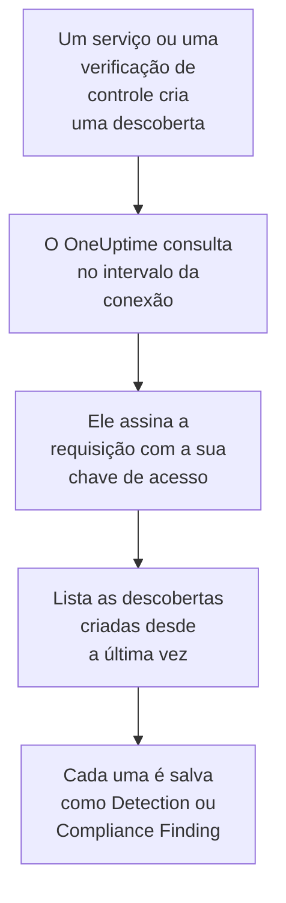

# AWS Security Hub

Importe as descobertas do [AWS Security Hub](https://aws.amazon.com/security-hub/) para os eventos de segurança do OneUptime: descobertas do GuardDuty, do Inspector, do Macie e do IAM Access Analyzer, as verificações de controle do próprio Security Hub e as descobertas de produtos de parceiros. Lá você as pesquisa ao lado dos seus logs, traces e métricas, correlaciona-as com todas as outras fontes e aciona o plantão para as que importam. O OneUptime as lê com uma chave de acesso que você cria, autorizada a uma única ação somente leitura, e não altera nada na AWS. Não há agente, regra do EventBridge nem exportação para o S3 para configurar.

:::cards
- [Configurar a conexão](#configurar-a-conexão): Uma política do IAM, uma chave de acesso e o formulário da conexão.
- [O que é importado](#o-que-é-importado): Como cada descoberta vira um evento de segurança.
- [Como a consulta funciona](#como-a-consulta-funciona): A janela que cada consulta lê, e por que ela se sobrepõe 30 minutos à anterior.
- [Solução de problemas](#solução-de-problemas): O que cada erro significa e o que mudar.
:::

## Como funciona



A cada minuto, o OneUptime consulta cada conexão habilitada cujo intervalo de consulta já passou. Uma consulta chama o `GetFindings` do Security Hub na sua região, assinando a requisição com [Signature Version 4](https://docs.aws.amazon.com/IAM/latest/UserGuide/reference_sigv-create-signed-request.html), para as descobertas criadas desde a última consulta. Ela salva cada uma como um evento [OCSF](https://schema.ocsf.io/): uma verificação de controle como um Compliance Finding (classe `2003`), e qualquer outra descoberta como um Detection Finding (classe `2004`). As regras de detecção, os monitores e os painéis então a tratam como um evento de segurança de qualquer outra fonte.

## Antes de começar

- No OneUptime, a função Project Owner, Project Admin ou Security Admin. As funções Security Member e Security Viewer veem as conexões e o histórico de execuções delas, mas não podem alterá-las.
- Uma conta da AWS com o Security Hub habilitado na região que você conecta. O Security Hub é regional: uma conexão lê as descobertas que uma conta tem em uma região.
- Para ler as descobertas de todas as contas e regiões por uma única conexão, a conta de administrador delegado do Security Hub, na região de origem dela, com a [agregação entre regiões](https://docs.aws.amazon.com/securityhub/latest/userguide/finding-aggregation.html) ativada. **Security Hub → Settings → Regions** mostra a região de origem.
- HTTPS de saída do aplicativo e dos workers do OneUptime para `securityhub.<region>.amazonaws.com`, ou `securityhub.<region>.amazonaws.com.cn` na China, e um relógio correto nos hosts deles: a AWS recusa uma requisição assinada com mais de 5 minutos de diferença.

## Configurar a conexão

A conexão assina as suas requisições com uma chave de acesso do IAM. A identidade da chave precisa de uma única ação, `securityhub:GetFindings`, e de nada mais: a conexão nunca altera uma descoberta.

:::steps
### Permitir a leitura das descobertas

No [console do IAM](https://console.aws.amazon.com/iam/), abra **Policies → Create policy**, escolha **JSON** e cole esta política. Dê um nome a ela, por exemplo `OneUptimeSecurityHubRead`:

```json
{
  "Version": "2012-10-17",
  "Statement": [
    {
      "Effect": "Allow",
      "Action": "securityhub:GetFindings",
      "Resource": "*"
    }
  ]
}
```

O `GetFindings` não pode ser limitado a um recurso, então `Resource` fica `*`. A política gerenciada `AWSSecurityHubReadOnlyAccess` também funciona, mas permite mais.

### Criar uma chave de acesso

1. Abra **Users → Create user**, dê um nome ao usuário, por exemplo `oneuptime-security-hub`, deixe o acesso ao console desativado e anexe a política. Para as descobertas de outras contas, faça isso na conta de administrador delegado.
2. Abra o usuário, depois **Security credentials → Access keys → Create access key**, e escolha **Third-party service**.
3. Copie o **ID da chave de acesso** e a **Chave de acesso secreta**. A AWS só mostra o segredo uma vez.

### Adicionar a conexão no OneUptime

Abra **Produtos → Security Events → Conexões** (`/dashboard/{projectId}/security-events/connections`), clique em **Adicionar conexão**, escolha **AWS Security Hub** e clique em **Próximo**. Preencha as configurações da tabela abaixo, clique em **Próximo** e cole o segredo em **Chave de acesso secreta**.

### Testar antes de salvar

Clique em **Testar estas configurações** em **Testar antes de salvar**. O teste assina uma requisição com os valores do formulário, sem salvar nada, então uma chave errada ou uma permissão que falta aparece antes de a conexão existir. Depois clique em **Próximo**, dê um **Nome** à conexão e crie-a.
:::

| Configuração | O que informar |
| --- | --- |
| **Região** | O código da região, por exemplo `us-east-1`, `eu-central-1` ou `us-gov-west-1`: para as descobertas de outras contas, a região de origem da conta de administrador. |
| **ID da chave de acesso** | O ID da chave: de 16 a 128 letras ou dígitos, normalmente 20, começando com `AKIA`, ou com `ASIA` para credenciais temporárias. |
| **Chave de acesso secreta** | O segredo da chave. Ele é criptografado, nunca devolvido pela API e nunca mostrado de novo. Substitua-o com **Atualizar credenciais** na conexão. |
| **Session token** | Só para credenciais temporárias, que precisam dele: uma chave `ASIA` é recusada sem ele, e uma chave `AKIA` é recusada com ele. |

Credenciais temporárias de `aws sts assume-role` ou `aws sts get-session-token` expiram, depois de no máximo 12 horas para uma função assumida, e a consulta para até você colar novas com **Atualizar credenciais**. Uma chave de longa duração com esta política restrita, rotacionada no seu próprio calendário, continua consultando sem intervenção. Para passar de credenciais temporárias para uma chave de longa duração, informe a nova chave em **Atualizar credenciais** e ative **Remove the stored Session token**.

A etapa **Consulta periódica** também tem uma **Descrição** opcional, o **Intervalo de consulta (minutos)**, um número inteiro de `1` a `1440` que começa em `5`, e **Habilitado**, que começa ativado.

## O que é importado

Cada descoberta vira um evento, com o fornecedor `Amazon Web Services` e o produto `AWS Security Hub`. Uma descoberta com um objeto `Compliance`, uma verificação de controle em relação a um padrão como AWS Foundational Security Best Practices ou CIS, vira um Compliance Finding (classe OCSF `2003`). Qualquer outra descoberta vira um Detection Finding (classe OCSF `2004`).

| Campo da descoberta | Coluna do OneUptime |
| --- | --- |
| `Id`, um ARN para as descobertas que a AWS cria | UID do evento, que também serve para descartar duplicatas |
| `CreatedAt`, senão `UpdatedAt`, senão `FirstObservedAt` | Horário do evento |
| `Title` | Nome da regra |
| `GeneratorId`, como o tipo de descoberta do GuardDuty ou o ID do controle | ID da regra |
| `Title`, senão `Description` | Mensagem |
| `Severity.Label`, senão uma faixa de `Severity.Normalized` | Gravidade |
| `Workflow.Status`: `NEW`, `NOTIFIED`, `RESOLVED` ou `SUPPRESSED`, senão o antigo `WorkflowState` | Status |
| `Types` sob `TTPs/`: `TTPs/Initial Access/...` vira `TA0001` | Táticas e técnicas do MITRE ATT&CK |
| O usuário do IAM de um recurso de chave de acesso ou de usuário, `Network.SourceIpV4` ou `SourceIpV6`, `Process.Name` ou `Process.Path` | Usuário, IP e processo do ator |
| `Process.Name` e `Process.Path` | Nome e caminho do processo. Uma descoberta não informa nem a linha de comando nem o processo pai. |
| O ID da instância de um recurso `AwsEc2Instance`, `Network.DestinationIpV4` ou `DestinationIpV6`, `Network.DestinationPort`, o primeiro `Resources[].Id` | Host, IP, porta e recurso do alvo |
| Esses, cada `Resources[].Id`, `AwsAccountId`, os domínios da rede, os nomes de malware e os valores de inteligência de ameaças | Observáveis |
| A descoberta inteira, achatada em chaves com pontos, como `Compliance.Status` e `Remediation.Recommendation.Url` | `attributes` |

Quando uma descoberta não tem `Severity.Label`, o `Severity.Normalized` decide: `0` é Informational, de `1` a `39` Low, de `40` a `69` Medium, de `70` a `89` High, e de `90` a `100` Critical. Uma descoberta que o Security Hub atualiza depois, com um novo `Workflow.Status` ou um controle que agora passa, mantém o seu `Id`, então não é importada de novo: o evento mantém a descoberta como ela era quando foi importada.

## Como a consulta funciona

Cada consulta lista as descobertas criadas na sua janela, da mais antiga para a mais nova, 100 por página, e segue o `NextToken` até ler a janela inteira:

```text
POST https://securityhub.{region}.amazonaws.com/findings
    {"Filters": {"CreatedAt": [{"Start": "{window start}", "End": "{window end}"}]},
     "SortCriteria": [{"Field": "CreatedAt", "SortOrder": "asc"}],
     "MaxResults": 100}
```

- **O horário de criação é o cursor.** As descobertas são listadas por `CreatedAt`, nunca por `FirstObservedAt`. O GuardDuty cria uma descoberta quando já viu atividade suficiente, e uma verificação de controle quando o Security Hub verifica o recurso pela primeira vez, horas ou dias depois de a atividade começar. Um cursor pelo horário de observação as pularia.
- **A primeira consulta olha 24 horas para trás**, para que uma nova conexão mostre logo as descobertas recentes dela.
- **Cada consulta seguinte começa 30 minutos antes do cursor salvo.** O `CreatedAt` é definido pelo serviço que encontrou o problema, e a descoberta chega ao Security Hub depois: o GuardDuty envia novas descobertas em até cinco minutos, e uma entrega pelo EventBridge que falhou é repetida por até 24 horas. A sobreposição lê essas descobertas na consulta seguinte. Uma que chega mais de 30 minutos depois do seu `CreatedAt` pode ficar para trás do cursor: importe o intervalo de tempo dela para recuperá-la.
- **Uma consulta lê no máximo 24 horas além do cursor.** Uma conexão cujo cursor ficou para trás se atualiza em uma série de janelas de 24 horas, e a **Integridade** dela mostra **Catching up**.
- **As duplicatas são descartadas pelo `Id` da descoberta** dentro do projeto, para que a sobreposição, uma janela repetida e uma importação nunca salvem uma descoberta duas vezes.

### Quando uma janela contém mais do que uma consulta consegue ler

Uma consulta envia no máximo 20 requisições de 100 descobertas: 2.000 descobertas. Quando uma janela contém mais, a execução fica **Parcial**, com um aviso como este:

```text
Stopped after 20 findings requests (the per-run request limit) before the window was fully read. The last finding read was created at 2026-09-14T08:12:44.000Z.
```

As descobertas são lidas da mais antiga para a mais nova, então o OneUptime move o cursor para o horário de criação da última descoberta lida, e a consulta seguinte começa ali, sem a sobreposição de 30 minutos, com o mesmo tamanho de janela. Uma conta movimentada se atualiza cerca de 2.000 descobertas por consulta, em vez de reler as mesmas. A sobreposição volta quando o cursor já avançou 30 minutos além desse ponto.

Quando uma execução não consegue passar do cursor salvo de jeito nenhum, por exemplo porque só os 30 minutos de sobreposição já contêm mais de 2.000 descobertas, o OneUptime encurta a janela em vez disso:

1. **Reduzir.** A consulta seguinte lê uma janela com a metade do tamanho, a partir do mesmo ponto de partida, e continua dividindo pela metade até que uma janela seja lida por inteiro, até um minuto. O aviso da execução diz isso: `This window holds more records than one poll can read; the next poll reads a {n} minute window from the same starting point.`
2. **Voltar a crescer.** Depois que uma janela é lida por inteiro, a seguinte volta a ter o dobro do tamanho, até 24 horas.
3. **Passar de um único minuto.** Se até um minuto contém mais do que uma consulta consegue ler, a consulta passa dele, para que as descobertas mais novas continuem chegando, e a sobreposição das consultas seguintes não volta mais até ele. A execução continua **Parcial**, e **Último erro** mostra `More records were created in the one minute from {cursor} to {end} than one poll can read. Polling moved past this minute so newer records keep arriving; use Import this time range in Diagnostics on this minute to recover what one run can read.` Importe esse minuto com **Import this time range** para recuperar o que uma execução consegue ler.

Uma execução que falha por completo, com um erro da AWS, mantém o cursor e o tamanho da janela, e a consulta seguinte relê a mesma janela. A única exceção é uma requisição que expirou: o cursor fica, mas a janela seguinte tem a metade do tamanho, porque uma janela pesada demais para ser respondida a tempo expiraria em toda tentativa. Mudar o **Intervalo de consulta (minutos)** não muda nada disso: ele decide com que frequência uma consulta começa, não onde a janela dela começa.

### Executar, pré-visualizar e importar sob demanda

Clique em **Diagnóstico** em uma conexão para ver as execuções recentes dela e trabalhar com ela manualmente. Quem pode alterar a conexão pode iniciar essas ações; quem pode vê-la pode ler o histórico.

- **Executar agora** inicia uma consulta na hora, com o cursor de sempre, mesmo quando a conexão não está **Habilitado**.
- **Preview findings** lê um intervalo de tempo de até 7 dias e não importa nada.
- **Import this time range** importa um intervalo de até 7 dias, depois que você confirma, sem mover o cursor. As descobertas já importadas são puladas.
- **Copy diagnostics** em uma execução copia o relatório dela para o suporte. Ele nunca inclui credenciais.

## Testar conexão

**Testar conexão** na linha de uma conexão, e **Testar estas configurações** no formulário, rodam no processo da API, não em um worker em segundo plano, para que um teste responda mesmo quando o problema são os workers. Ele faz estas verificações, em ordem:

| Verificação | O que ela verifica |
| --- | --- |
| **Configuração** | Cada configuração está presente e bem formada. Nada é contatado quando isso falha. |
| **Authenticate with AWS** | A AWS aceita uma requisição `GetFindings` assinada para uma descoberta criada nas últimas 24 horas. A AWS verifica a assinatura antes da política do IAM, então uma recusa da política ainda passa nesta verificação: a chave está certa. |
| **Read findings** | O Security Hub responde a essa requisição: a identidade pode chamar `securityhub:GetFindings`, e o Security Hub está habilitado na região. |
| **Findings available to import** | Quantas descobertas foram criadas nas últimas 24 horas e nos últimos 7 dias, uma página de 100 cada, então `100+` significa mais. Nenhuma em 7 dias é um aviso, não uma falha. |
| **Background workers**, **Poll scheduler**, **Security event storage** | O lado do próprio OneUptime: um processo pega os jobs da fila Worker, o job de consulta roda a cada minuto e o armazenamento de eventos de segurança responde. |
| **Scheduled polling** | Para uma conexão salva: a consulta está ativada, nenhuma execução está presa esperando um worker e as consultas rodam no horário. |

Cada requisição de um teste tem um prazo de 20 segundos. Um teste nunca importa nada nem move o cursor, e cada verificação que falha diz o que mudar.

## Solução de problemas

O **Último erro** da conexão guarda a mensagem de erro completa, com as credenciais ocultadas, atrás de um prefixo que nomeia a etapa que falhou. Quando uma conexão tem um erro, selecione **Ver erro** na coluna **Ações** dela para lê-lo, e **Copiar erro** na caixa de diálogo para copiá-lo. Toda mensagem começa com `AWS Security Hub findings request`; leia o que vem depois.

:::details Last Error diz `failed (HTTP 401)` ou `failed (HTTP 403)`
A AWS recusou a requisição. A mensagem cita o código de erro da AWS, ou as próprias palavras da AWS quando ela não enviou código:

- `AccessDeniedException`, ou `is not authorized to perform`: a chave está certa, mas a identidade dela não pode chamar `securityhub:GetFindings`. Anexe a política de [Configurar a conexão](#configurar-a-conexão). Um limite de permissões ou uma política de controle de serviço também pode negá-la.
- `InvalidAccessException`, ou `is not subscribed to AWS Security Hub`: o Security Hub não está habilitado para esta conta nesta **Região**, ou a conta não é a administradora dele ali.
- `InvalidSignatureException` ou `SignatureDoesNotMatch`, ou `The request signature we calculated does not match`: a **Chave de acesso secreta** não pertence ao **ID da chave de acesso**. Crie uma nova chave de acesso e salve-a com **Atualizar credenciais**.
- `UnrecognizedClientException` ou `InvalidClientTokenId`, ou `The security token included in the request is invalid`: a AWS não conhece o **ID da chave de acesso**. Ele foi digitado errado, excluído, desativado ou é de outra partição, ou é uma chave temporária sem o seu **Session token**.
- `ExpiredTokenException`, ou `The security token included in the request is expired`: as credenciais temporárias expiraram. Emita novas, ou troque para uma chave de longa duração.
- `RequestTimeTooSkewed` ou `RequestExpired`, ou `Signature expired`: o relógio dos hosts do OneUptime está mais de 5 minutos fora. Corrija o NTP nos hosts do aplicativo e dos workers.
- Nenhum código: a AWS não disse se foi a chave ou a política que a recusou. Verifique primeiro a chave, depois a política.
:::

:::details Last Error diz `failed (HTTP ...)` com outro status
- `HTTP 404`: nenhum endpoint do Security Hub respondeu nesta **Região**. Compare-a com o menu de regiões do console da AWS: `us-east-1`, não `us-east1` nem `N. Virginia`.
- `HTTP 429`: a conta atingiu o limite do Security Hub, 3 requisições `GetFindings` por segundo em uma região. A consulta seguinte tenta de novo. Se continuar acontecendo, procure outra ferramenta ou conexão que leia a mesma conta e região.
- `HTTP 5xx`: o Security Hub teve um problema do lado dele. A consulta seguinte tenta de novo.
- `HTTP 400`: o Security Hub recusou a consulta, que o OneUptime monta, e não as suas configurações. Envie a mensagem ao suporte do OneUptime.
:::

:::details Last Error diz `returned`, `timed out` ou `Could not reach data source`
- `returned a non-JSON body` ou `returned an unrecognized response shape`: respondeu algo diferente do Security Hub, por exemplo a página de login de um proxy ou um gateway que reescreve as respostas. Isso é relatado em vez de ser tomado como uma janela vazia, para que o cursor nunca passe de descobertas que ninguém leu.
- `timed out after 60 seconds with no response`, ou `failed: Could not reach data source`: a requisição não recebeu resposta. Os endpoints do Security Hub são públicos, então verifique DNS, firewalls e proxies entre o aplicativo e os workers do OneUptime e `securityhub.<region>.amazonaws.com`.
:::

:::details Last Polled é Never e Last Error está vazio
Nenhuma consulta terminou para essa conexão. Rode **Testar conexão**: as verificações **Background workers** e **Poll scheduler** dele nomeiam a causa. Em uma instalação auto-hospedada, a causa comum é `DISABLE_QUEUE_WORKERS=true` no aplicativo, sem um deployment separado de workers que pegue os jobs: defina como `false`, ou rode o deployment de workers (Helm: `worker.enabled: true`).
:::

:::details Uma execução está Partial
- `Stopped after 20 findings requests`: a janela continha mais do que as 2.000 descobertas que uma execução lê. Nada se perde: a consulta seguinte começa depois da última descoberta lida. Uma conexão que continua **Parcial** consulta após consulta está se atualizando de um atraso, e os seus **Última consulta** e **Último evento importado** continuam avançando. Se ela nunca se atualiza, a conta cria mais de 2.000 descobertas por intervalo de consulta: encurte o **Intervalo de consulta (minutos)**.
- `More records were created in the one minute from ... than one poll can read`: a consulta passou desse minuto. Importe-o com **Import this time range** em **Diagnóstico**. Uma importação lê tanto quanto uma consulta.
:::

:::details O teste passa, mas nada é importado
Leia **Findings available to import** no relatório do teste. `0` nos últimos 7 dias significa que o Security Hub não criou nenhuma descoberta nesta conta e região: verifique se o GuardDuty, o Inspector ou um padrão de segurança está ativado ali. Para ver as descobertas de outras contas e regiões, conecte a conta de administrador na região de origem dela.
:::

:::details Uma descoberta do console do Security Hub nunca chegou
Compare o `CreatedAt` dela com o `ProcessedAt`, quando o Security Hub a recebeu. Uma descoberta que chegou mais de 30 minutos depois do seu `CreatedAt` pode ficar para trás do cursor: importe o `CreatedAt` dela com **Import this time range**.
:::

## O que você ganha

- **Pesquisa.** Filtre as descobertas por gravidade, status, regra, conta, recurso ou qualquer observável no explorador de eventos de segurança, ao lado de todas as outras fontes.
- **Correlação.** Os usuários, instâncias, IPs, ARNs de recursos e IDs de conta de cada descoberta são indexados como observáveis, então uma pesquisa encontra tudo o que os menciona.
- **Regras de detecção.** Regras Sigma que rodam em uma programação sobre os seus eventos de segurança, e abrem alertas que acionam o plantão.
- **Monitores.** Os monitores de eventos de segurança contam os eventos correspondentes, por exemplo novas descobertas críticas do GuardDuty ou controles com falha, e abrem incidentes ou alertas acima de um limite.

Os eventos de segurança são cobrados como o resto da sua telemetria, por GB ingerido. Veja os [preços](https://oneuptime.com/pricing).

## Próximos passos

:::cards
- [Eventos de segurança](/docs/telemetry/security-events): Pesquise, correlacione e alerte sobre o que você importa.
- [Okta System Log](/docs/integrations/okta): Importe também os logins do seu provedor de identidade.
- [Funções](/docs/permissions/reference#funções): O que as funções Security podem ver e alterar.
- [Visão geral das integrações](/docs/integrations/index): As outras ferramentas que você pode conectar.
:::
