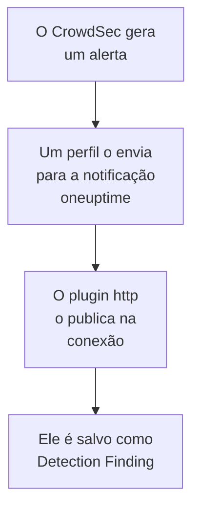

# CrowdSec

Receba os alertas do [CrowdSec](https://www.crowdsec.net/) nos eventos de segurança do OneUptime à medida que o CrowdSec os gera, e bloqueie com o CrowdSec os endereços da lista de bloqueio do seu projeto. O próprio plugin de notificação do CrowdSec envia cada alerta para uma conexão do CrowdSec, que abre casos a partir das detecções do CrowdSec. Depois que você ativa o bloqueio, o OneUptime bane cada endereço que você bloqueia pela Local API do CrowdSec, e cada bouncer que a lê bloqueia o endereço.

:::cards
- [Configurar a conexão](#configurar-a-conexão): Uma conexão, e a notificação que envia para ela os alertas do CrowdSec.
- [O que é recebido](#o-que-é-recebido): Como cada alerta do CrowdSec vira um evento de segurança.
- [Bloquear endereços com o CrowdSec](#bloquear-endereços-com-o-crowdsec): Bana no CrowdSec os endereços da sua lista de bloqueio.
- [Ler as listas de bloqueio do CrowdSec](#ler-as-listas-de-bloqueio-do-crowdsec): As listas que o CrowdSec Console serve, como um feed de inteligência de ameaças.
- [Solução de problemas](#solução-de-problemas): O que cada erro significa e o que mudar.
:::

## Como funciona



A Local API do CrowdSec entrega cada alerta que um perfil envia para uma notificação ao plugin dessa notificação. A notificação da conexão usa o plugin `http` do CrowdSec: ele publica o alerta, no JSON do próprio CrowdSec, na ingestão de eventos de segurança com a sua chave de ingestão, nomeando a conexão. O OneUptime o salva como um evento [OCSF](https://schema.ocsf.io/) Detection Finding (classe `2004`), o confronta com as suas regras de detecção e abre um caso a partir de cada uma das detecções do próprio CrowdSec que atinge o nível de **Abrir casos a partir de** da conexão. Nada é consultado: um alerta chega segundos depois de o CrowdSec gerá-lo.

## Antes de começar

- No OneUptime, a função Proprietário do projeto, Administrador do projeto ou Administrador de segurança. As funções Membro de segurança e Visualizador de segurança veem as conexões, mas não podem alterá-las.
- CrowdSec 1.5 ou posterior, com a Local API dele e o plugin de notificação `http` que vem com ele. Esta página foi escrita com base no CrowdSec v1.8.2.
- HTTPS de saída do host que executa a Local API do CrowdSec para o seu OneUptime.
- Para também bloquear endereços: uma Local API que o OneUptime consiga alcançar, e uma máquina para o OneUptime (veja [Bloquear endereços com o CrowdSec](#bloquear-endereços-com-o-crowdsec)).

## Configurar a conexão

:::steps
### Adicionar a conexão no OneUptime

Abra **Produtos → Eventos de segurança → Conexões** (`/dashboard/{projectId}/security-events/connections`), clique em **Adicionar conexão**, escolha **CrowdSec** e clique em **Próximo**. Para receber só os alertas, deixe vazias todas as configurações da tabela abaixo; para também bloquear endereços, preencha-as.

### Testar antes de salvar

Clique em **Testar estas configurações** em **Testar antes de salvar**. Sem uma Local API definida, o teste diz isso e não contata nada; com uma, ele alcança a Local API e entra como a máquina, e não salva nada. Depois clique em **Próximo**, dê à conexão um **Nome** na etapa **Alertas**, escolha o valor de **Abrir casos a partir de** e crie-a.

### Salvar a notificação no host do CrowdSec

Criar a conexão abre o **Enviar alertas** dela, que você abre de novo pela linha da conexão. Em **Escolha uma chave de ingestão**, escolha uma chave e depois salve a notificação que ele mostra, com a sua chave e a sua conexão já preenchidas, no host que executa a Local API do CrowdSec:

```yaml title="/etc/crowdsec/notifications/oneuptime.yaml"
type: http
name: oneuptime

# info or quieter: at debug, CrowdSec logs each request's headers.
log_level: info

format: |
  {{.|toJson}}

url: https://oneuptime.com/security-events/v1/ingest?connection=YOUR_CONNECTION_ID&format=crowdsec
method: POST
headers:
  Content-Type: application/json
  x-oneuptime-token: YOUR_INGESTION_TOKEN
```

### Enviar para ela os alertas dos seus perfis

Em `/etc/crowdsec/profiles.yaml`, adicione `oneuptime` às `notifications` de cada perfil cujos alertas o OneUptime deve receber e depois recarregue o CrowdSec:

```yaml title="/etc/crowdsec/profiles.yaml"
notifications:
  - oneuptime
```

```bash
sudo systemctl reload crowdsec
```

### Enviar um alerta de teste

```bash
sudo cscli notifications test oneuptime
```

**Enviar alertas** diz quando ele chega, e **Ver alertas** o abre nos eventos de segurança. É um evento de gravidade Informational, e não abre nenhum caso.
:::

| Configuração | O que informar |
| --- | --- |
| **URL da Local API** | Somente para bloquear endereços: onde o OneUptime acessa a Local API do CrowdSec, como `https://crowdsec.example.com:8080`. Use `https` sempre que a conexão atravessar uma rede. |
| **ID da máquina** | Somente para bloquear endereços: a máquina com que o OneUptime faz login, adicionada no host do CrowdSec com `sudo cscli machines add oneuptime --auto -f -`. |
| **Bloquear endereços com o CrowdSec** | Desativada em uma conexão nova. Ativada, bane no CrowdSec os endereços e intervalos da sua lista de bloqueio, e precisa das outras três configurações (veja [Bloquear endereços com o CrowdSec](#bloquear-endereços-com-o-crowdsec)). |
| **Senha da máquina** | Somente para bloquear endereços: a senha que o `cscli` mostrou para a máquina. Ela é criptografada, nunca devolvida pela API e nunca mais mostrada. Substitua-a com **Atualizar credenciais** na conexão. |

A etapa **Alertas** também tem uma **Descrição** opcional, e **Habilitado**, que começa ativado. Uma conexão que não está habilitada guarda como eventos os alertas que recebe, e não abre nenhum caso a partir deles.

Em um contêiner, a notificação vai na pasta montada em `/etc/crowdsec/notifications/`, e um reinício do contêiner a lê. Uma instalação no Kubernetes a declara nos valores do Helm em `config.notifications`, com `profiles.yaml` ao lado em `config`.

## O que é recebido

Cada alerta que o CrowdSec envia vira um evento Detection Finding (classe OCSF `2004`), com fornecedor e produto `CrowdSec`:

| Campo do CrowdSec | Coluna do OneUptime |
| --- | --- |
| `uuid`, ou um hash de um alerta sem ele | UID do evento, que também serve para descartar duplicatas |
| `stop_at`, ou `start_at` | Horário do evento |
| `scenario` | ID da regra, e o nome da regra: o título do cenário no CrowdSec Hub, ou o nome dele |
| `source.ip`, ou `source.value` de um alerta `Ip` | IP principal |
| `target_fqdn` ou `target_host` do alerta ou dos eventos dele, senão a `machine` que os eventos dele nomeiam | Host de destino |
| `target_user`, `target_uri` | Usuário e recurso de destino |
| O `type` da primeira decisão | Status: `Blocked` para um banimento, `Challenge` para um captcha, `Logged` sem decisão ou no modo de simulação |
| O comportamento do cenário | Gravidade, e as táticas e técnicas MITRE ATT&CK dele |
| Todo o resto, como `source.cn`, `source.as_name` e `events_count` | `attributes`: os campos do alerta achatados em chaves com pontos, os 10 primeiros eventos dele inteiros, e a leitura do OneUptime em `crowdsec.` |

Um alerta do CrowdSec não tem gravidade própria, então o OneUptime a tira do que o cenário detecta, como o CrowdSec Hub o rotula (`ssh:bruteforce`, `http:exploit`):

| Comportamento | Gravidade |
| --- | --- |
| Um exploit, como uma CVE ou o que o componente AppSec bloqueou, ou o que um atacante faz depois de entrar | High |
| Força bruta, negação de serviço, fraude, um login impossível, ou um comportamento que o OneUptime não sabe classificar | Medium |
| Varreduras, sondagens, rastreamentos, bots, spam e mudanças de auditoria na nuvem | Low |
| Os cenários de teste do próprio CrowdSec | Informational |

Com **Abrir casos a partir de** em **Alta e acima**, os exploits do CrowdSec abrem casos, e os banimentos do dia a dia de scanners e de quem tenta adivinhar senhas continuam como eventos para as suas regras de detecção. Só as detecções do próprio CrowdSec abrem casos. Uma decisão que alguém adicionou com `cscli` ou no Console do CrowdSec, um endereço de uma lista de bloqueio do CrowdSec, o alerta de teste e os próprios banimentos do OneUptime que voltam são Informational, e não abrem nenhum. Um alerta enviado duas vezes, como faz o `cscli notifications reinject`, é salvo uma vez só.

## Bloquear endereços com o CrowdSec

Ative **Bloquear endereços com o CrowdSec** em uma conexão, e os endereços e intervalos da [lista de bloqueio](/docs/telemetry/security-cases#lista-de-bloqueio) do seu projeto são banidos no CrowdSec. Cada bouncer que lê a Local API dele, como os bouncers de firewall, nginx e Traefik, os bloqueia onde roda, como bloqueia os banimentos do próprio CrowdSec. Os bloqueios passam pelas mesmas aprovações, os mesmos limites da resposta automática e o mesmo **Revogar** que qualquer outro lugar onde a sua lista de bloqueio é aplicada.

A chave fica desativada em uma conexão nova. Para ativá-la:

1. No host do CrowdSec, adicione uma máquina para o OneUptime; o comando mostra a senha dela:

   ```bash
   sudo cscli machines add oneuptime --auto -f -
   ```

2. Deixe o OneUptime alcançar a Local API, que escuta em `127.0.0.1:8080` salvo indicação em contrário: defina `api.server.listen_uri` no `config.yaml` do CrowdSec, sirva-a por TLS ou atrás de um proxy `https`, e libere os endereços do OneUptime no seu firewall.
3. Edite a conexão, preencha **URL da Local API** e **ID da máquina**, coloque a senha em **Senha da máquina**, ative **Bloquear endereços com o CrowdSec** e salve. **Testar conexão** então verifica se a máquina faz login e lê os banimentos do OneUptime, sem alterar nada.

Como um banimento é criado, e como ele termina:

- Cada bloqueio é uma decisão de banimento, criada como o `cscli decisions add` cria uma, sob o cenário `oneuptime/blocklist`. O CrowdSec a guarda como uma decisão manual, então ela nunca é compartilhada com a Central API do CrowdSec, a menos que você compartilhe decisões manuais. O OneUptime só lê e remove os próprios banimentos, nunca um que uma pessoa ou o CrowdSec criou.
- Um bloqueio com fim é um banimento até exatamente esse fim, e o CrowdSec o revoga sozinho nesse momento, consiga o OneUptime alcançá-lo ou não. Um bloqueio até ser revogado é um banimento de 7 dias, renovado quando restam 3 dias ou menos, então um banimento que o OneUptime não mantém mais termina em até uma semana.
- **Revogar** remove o banimento na próxima passagem, em até um minuto. Um banimento removido no CrowdSec, pelo `cscli decisions delete` ou por um flush, é criado de novo na próxima passagem enquanto o bloqueio durar.
- Um endereço ou um intervalo em uma das listas de permissão do CrowdSec nunca é banido: o bloqueio o mostra como não aplicado ali, nomeando a lista de permissão, e um banimento já criado é removido assim que uma lista de permissão contém o endereço.
- Os endereços do seu próprio projeto, como os seus **Proxies confiáveis**, balanceadores de carga e redes de borda, nunca são bloqueados em lugar nenhum, inclusive no CrowdSec.
- O CrowdSec só bane: um desafio não é aplicado ali, e um domínio, uma URL ou um arquivo não é enviado a ele.

Quando a Local API não pode ser alcançada, nada muda no CrowdSec: os banimentos que ele mantém ficam, e terminam quando terminam. **Aplicado por** na **Lista de bloqueio** diz quando o CrowdSec manteve cada bloqueio pela última vez, e o OneUptime tenta de novo depois de 1 minuto e depois espera o dobro a cada vez, até 30 minutos. Um bloqueio novo espera até poder ser criado.

## Ler as listas de bloqueio do CrowdSec

O CrowdSec Console serve as listas de bloqueio que a sua organização assina como uma integração Raw IP List: um endereço por linha, protegido por usuário e senha. Um [feed de inteligência de ameaças](/docs/telemetry/threat-intelligence) as lê e compara os seus eventos com elas:

1. No CrowdSec Console, crie uma integração Raw IP List, com a agregação de IP desativada: o OneUptime compara endereços, não intervalos. Copie o endpoint, o usuário e a senha dela.
2. No OneUptime, abra **Produtos → Eventos de segurança → Detecções → Inteligência de ameaças**, clique em **Criar: Feed de inteligência de ameaças** e escolha **Lista de indicadores**.
3. Cole o endpoint como **URL da lista**, escolha **Usuário e senha** em **Login** e cole os dois. No plano Community do CrowdSec, que permite um download por dia, defina **Intervalo de consulta (minutos)** como `1440`.

As listas são do CrowdSec: você pode usá-las nas suas próprias ferramentas, mas não redistribuí-las. O OneUptime não oferece nenhuma lista própria.

## Testar conexão

**Testar conexão** na linha de uma conexão, e **Testar estas configurações** no formulário, rodam no processo da API, não em um worker em segundo plano. Eles fazem estas verificações, em ordem:

| Verificação | O que ela verifica |
| --- | --- |
| **Configuração** | As configurações estão todas vazias ou todas preenchidas, e bem formadas. Nada é contatado quando isso falha. |
| **Reach CrowdSec's Local API** | `GET /health` responde. Sem uma Local API definida, a verificação diz que a conexão só recebe alertas, e as três seguintes não rodam. |
| **Sign in to the Local API** | `POST /v1/watchers/login` aceita a máquina e a senha dela. |
| **Read CrowdSec's allowlists** | `GET /v1/allowlists` responde, e quantos endereços e intervalos elas contêm. Uma Local API anterior à 1.6.8, que não tem nenhuma, passa. |
| **Block with CrowdSec** | Só com **Bloquear endereços com o CrowdSec** ativada: a máquina consegue ler de volta os banimentos do OneUptime, e quantos estão em vigor. A verificação não altera nada. |
| **Background workers**, **Security event storage** | O lado do próprio OneUptime: um processo pega os jobs da fila Worker, que salvam o que o CrowdSec envia, e o armazenamento de eventos de segurança responde. |
| **Alerts received** | Para uma conexão salva: quando chegou o último alerta. Nenhum ainda é um aviso, que explica como enviar um alerta de teste. |

Um teste nunca bane nem remove nada. **Copiar relatório** copia a lista de verificações como JSON, sem a senha nem tokens.

## Solução de problemas

A **Integridade** da conexão mostra **Aguardando alertas** até o primeiro alerta chegar, depois **Recebendo alertas**, por mais que o próximo demore; **Casos pausados** significa que a conexão não está habilitada. O CrowdSec escreve o que o plugin respondeu no próprio log, `/var/log/crowdsec.log`, como `HTTP server returned non 200 status code`.

:::details Nenhum alerta chega
- Rode `sudo cscli notifications list`: `oneuptime` precisa estar listada, e ativa em um perfil. Uma notificação que nenhum perfil nomeia não envia nada.
- `401`: a chave de ingestão em `x-oneuptime-token` está ausente, errada ou expirada, e `422`: ela está desativada. Escolha uma chave em **Enviar alertas** e copie a notificação de novo.
- `400`: o endereço não nomeia nenhuma conexão do CrowdSec deste projeto. Copie o endereço do **Enviar alertas** da conexão: ele termina no ID da conexão.
- Nada no log: o host do CrowdSec não consegue alcançar o seu OneUptime. Verifique o HTTPS de saída dele, e o proxy dele.
:::

:::details Testar conexão falha em Reach CrowdSec's Local API
`CrowdSec Local API health check could not be completed` significa que nada respondeu: a Local API escuta em `127.0.0.1` por padrão, então o OneUptime não consegue alcançá-la até que `api.server.listen_uri` e o seu firewall permitam. Um aviso de que ela responde por `http` significa que a senha da máquina atravessa a rede sem criptografia: sirva a Local API por TLS, ou coloque um proxy `https` na frente dela.
:::

:::details Testar conexão falha em Sign in to the Local API
`CrowdSec Local API login failed (HTTP 401)` termina com o que fazer: verifique o ID da máquina e a senha com `sudo cscli machines list`, valide uma máquina ainda não validada com `sudo cscli machines validate oneuptime`, ou adicione uma máquina que faça login com senha. Salve uma senha nova com **Atualizar credenciais**.
:::

:::details Um bloqueio não é aplicado no CrowdSec
Passe o mouse sobre o **Aplicado por** dele: ele nomeia uma lista de permissão que contém o endereço, um desafio que o CrowdSec não aplica, ou o erro da Local API. Enquanto a Local API não pode ser alcançada, o OneUptime continua tentando, e os banimentos que o CrowdSec já mantém continuam em vigor.
:::

:::details O CrowdSec envia os alertas, mas nenhum é salvo
O que o CrowdSec envia é salvo pelos workers em segundo plano: em uma instalação auto-hospedada com `DISABLE_QUEUE_WORKERS=true` no aplicativo e sem um deployment separado de workers, os alertas são recebidos e nunca salvos. **Testar conexão** mostra isso como uma verificação **Background workers** que falhou. Defina como `false`, ou rode o deployment de workers (Helm: `worker.enabled: true`).
:::

## Próximos passos

:::cards
- [Eventos de segurança](/docs/telemetry/security-events): Pesquise, correlacione e alerte sobre o que o CrowdSec envia.
- [Casos de segurança](/docs/telemetry/security-cases): Trabalhe nos casos que as detecções do CrowdSec abrem, e bloqueie a partir deles.
- [Inteligência de ameaças](/docs/telemetry/threat-intelligence): Compare os seus eventos com as listas de bloqueio do CrowdSec.
- [Visão geral das integrações](/docs/integrations/index): As outras ferramentas que você pode conectar.
:::
