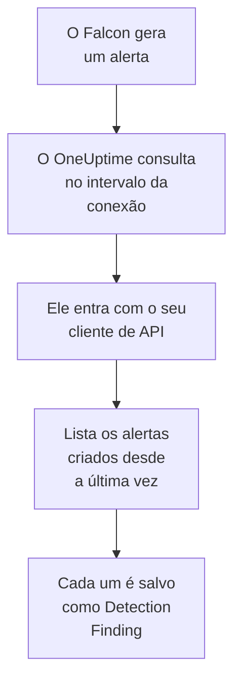

# CrowdStrike Falcon

Importe os alertas do [CrowdStrike Falcon](https://www.crowdstrike.com/platform/), das detecções de endpoint, identidade e nuvem, para os eventos de segurança do OneUptime. Lá você os pesquisa ao lado dos seus logs, traces e métricas, correlaciona-os com todas as outras fontes e aciona o plantão para os que importam. O OneUptime os lê pela Alerts API do Falcon com um cliente de API que você cria, e nunca escreve no Falcon.

:::cards
- [Configurar a conexão](#configurar-a-conexão): Um cliente de API com um único escopo e o formulário da conexão.
- [O que é importado](#o-que-é-importado): Como cada alerta do Falcon vira um evento de segurança.
- [Como a consulta funciona](#como-a-consulta-funciona): A janela que cada consulta lê, e o que um CID movimentado faz com ela.
- [Solução de problemas](#solução-de-problemas): O que cada erro significa e o que mudar.
:::

## Como funciona



A cada minuto, o OneUptime consulta cada conexão habilitada cujo intervalo de consulta já passou. Uma consulta entra na sua nuvem do Falcon com o ID e o segredo do cliente de API, pede à Alerts API os alertas criados desde a última consulta e salva cada um como um evento [OCSF](https://schema.ocsf.io/) Detection Finding (classe `2004`). Regras de detecção, monitores e painéis então o tratam como um evento de segurança de qualquer outra fonte.

## Antes de começar

- No OneUptime, a função Project Owner, Project Admin ou Security Admin. As funções Security Member e Security Viewer veem as conexões e o histórico de execuções delas, mas não podem alterá-las.
- Um ID de cliente do Falcon (CID) e um usuário do console do Falcon que possa gerenciar clientes de API: a função Falcon Administrator, ou uma função personalizada com a permissão API clients and keys.
- HTTPS de saída do aplicativo e dos workers do OneUptime para o host de API da sua nuvem do Falcon, listado em **Falcon cloud** abaixo.

## Configurar a conexão

:::steps
### Criar um cliente de API

1. No console do Falcon, abra **Support and resources → API clients and keys** e selecione **Create API client**.
2. Dê um nome, por exemplo `OneUptime security events`. Em **API scopes**, ative **Alerts → Read** e deixe todos os outros escopos desativados: a conexão nunca escreve no Falcon.
3. Crie o cliente. O Falcon mostra uma única vez o ID do cliente, o segredo e a URL base dele. Copie os três agora: o segredo pode ser redefinido depois, mas nunca mais é mostrado.

### Encontrar a sua nuvem do Falcon

A URL base que o Falcon mostrou diz em qual nuvem o seu CID está. A página **API clients and keys** também a mostra, ao lado de cada cliente. Um cliente de uma nuvem é recusado pelas outras.

| URL base que o Falcon mostra | Nuvem do Falcon |
| --- | --- |
| `https://api.crowdstrike.com` | US-1 |
| `https://api.us-2.crowdstrike.com` | US-2 |
| `https://api.eu-1.crowdstrike.com` | EU-1 |
| `https://api.laggar.gcw.crowdstrike.com` | US-GOV-1 |

### Adicionar a conexão no OneUptime

Abra **Produtos → Security Events → Conexões** (`/dashboard/{projectId}/security-events/connections`), clique em **Adicionar conexão**, escolha **CrowdStrike Falcon** e clique em **Próximo**. Preencha as configurações da tabela abaixo, clique em **Próximo** e cole o segredo em **Segredo do cliente**.

### Testar antes de salvar

Clique em **Testar estas configurações** em **Testar antes de salvar**. O teste entra e lê alertas com os valores do formulário, e não salva nada, então a nuvem errada ou um escopo que falta aparecem antes de a conexão existir. Depois clique em **Próximo**, dê à conexão um **Nome** e crie-a.
:::

| Configuração | O que informar |
| --- | --- |
| **Client ID** | O ID do cliente de API, como o Falcon o mostrou quando você criou o cliente. |
| **Falcon cloud** | A nuvem do seu CID: **US-1 (api.crowdstrike.com)**, **US-2 (api.us-2.crowdstrike.com)**, **EU-1 (api.eu-1.crowdstrike.com)** ou **US-GOV-1 (api.laggar.gcw.crowdstrike.com)**. Toda requisição vai para o host de API dessa nuvem. |
| **Segredo do cliente** | O segredo do cliente de API. Ele é criptografado, nunca devolvido pela API e nunca mais mostrado. Substitua-o com **Atualizar credenciais** na conexão. |

A etapa **Consulta periódica** também tem uma **Descrição** opcional, o **Intervalo de consulta (minutos)**, um número inteiro de `1` a `1440` que começa em `5`, e **Habilitado**, que começa ativado. Uma conexão que não está habilitada ainda pode ser testada, e consultada manualmente.

## O que é importado

A conexão lê os alertas do Falcon: o que o console do Falcon lista em **Endpoint security → Endpoint detections** e **Next-Gen SIEM → Alerts**, de cada produto que os gera. Cada alerta vira um evento Detection Finding (classe OCSF `2004`), com o fornecedor `CrowdStrike` e o produto `Falcon`:

| Campo do Falcon | Coluna do OneUptime |
| --- | --- |
| `composite_id` | UID do evento, que também serve para descartar duplicatas |
| `created_timestamp` | Horário do evento |
| `display_name`, ou `name` | Nome da regra |
| `pattern_id` | ID da regra |
| `description`, ou o nome da regra | Mensagem |
| `severity_name`, ou `severity` de 0 a 100 | Gravidade |
| `status`, como `new`, `in_progress` ou `closed` | Status |
| `tactic_id`, `technique_id` | Táticas e técnicas do MITRE ATT&CK |
| `device.hostname`, `device.local_ip`, `user_name`, `filename` ou `cmdline` | Host, IP, usuário e processo principais |
| `filename`, `filepath` e `cmdline`; `parent_details.filename`, `parent_details.filepath` e `parent_details.cmdline` | Nome, caminho e linha de comando do processo; nome, caminho e linha de comando do processo pai |
| `device.hostname`, `device.local_ip`, `device.external_ip`, `user_name`, `sha256` | Observáveis |
| Todo o resto, como `device.platform_name`, `falcon_host_link`, `product` e `timestamp` | `attributes`, achatado em chaves com pontos |

O horário do evento é, de propósito, quando o Falcon criou o alerta: o horário do comportamento por trás dele, `timestamp`, fica em `attributes.timestamp`.

## Como a consulta funciona

- **O horário de criação é o cursor.** Os alertas são listados por `created_timestamp`, nunca pelo horário do comportamento por trás deles. O Falcon pode gerar um alerta bem depois da atividade que ele descreve, e um cursor pelo horário de atividade pularia cada um desses alertas.
- **A primeira consulta olha 24 horas para trás**, para que uma nova conexão mostre logo os alertas recentes dela.
- **Cada consulta seguinte começa 1 minuto antes do cursor salvo**, para que um alerta criado na fronteira entre duas janelas nunca se perca.
- **Uma consulta lê no máximo 24 horas além do cursor.** Uma conexão cujo cursor ficou para trás se atualiza em uma série de janelas de 24 horas.
- **As duplicatas são descartadas por `composite_id`** dentro do projeto, para que a sobreposição e uma janela repetida nunca salvem um alerta duas vezes.
- **Cada janela custa** uma requisição de token, guardado durante a vida útil dele, e depois uma consulta de alertas e uma busca de alertas a cada 1.000 alertas, cada uma com o próprio tempo limite.

### Quando uma janela contém mais do que uma consulta consegue ler

Uma consulta envia no máximo 20 requisições. Com uma requisição de token e duas requisições a cada 1.000 alertas, ela lê no máximo 9.000 alertas. Quando uma janela contém mais, a execução fica **Parcial**, com um aviso como este:

```text
Stopped after 19 requests before reading the whole window. Alerts are read oldest first; every alert created before 2026-09-14T08:12:44.995Z was read.
```

A consulta de alertas é ordenada por `created_timestamp`, do mais antigo para o mais novo, então o OneUptime move o cursor para o horário de criação do último alerta lido, e a consulta seguinte começa ali, com o mesmo tamanho de janela, a partir do deslocamento `0`. Um CID movimentado se atualiza cerca de 9.000 alertas por consulta, em vez de reler os mesmos. Os alertas criados nesse mesmo instante são lidos duas vezes, e a verificação de duplicatas descarta a segunda cópia.

A consulta de alertas do Falcon não consegue paginar além de 10.000 resultados (`limit` mais `offset`). O limite de requisições interrompe uma execução em 9.000 alertas, antes desse teto. Se o teto um dia interromper uma leitura, ela é tratada do mesmo jeito: a execução fica **Parcial**, o cursor vai para o último alerta lido e a consulta seguinte começa de novo no deslocamento `0`.

Quando uma execução não consegue passar do cursor salvo de jeito nenhum, por exemplo porque mais de 9.000 alertas compartilham o minuto de sobreposição, o OneUptime encurta a janela em vez disso:

1. **Reduzir.** A consulta seguinte lê uma janela com a metade do tamanho, a partir do mesmo ponto de partida, e continua dividindo pela metade até que uma janela seja lida por inteiro, até um minuto. O aviso da execução diz isso: `This window holds more records than one poll can read; the next poll reads a {n} minute window from the same starting point.`
2. **Voltar a crescer.** Depois que uma janela é lida por inteiro, a seguinte volta a ter o dobro do tamanho, até 24 horas.
3. **Passar de um único minuto.** Se até um minuto contém mais do que uma consulta consegue ler, a consulta passa dele, para que os alertas mais novos continuem chegando. A execução continua **Parcial**, e **Último erro** mostra `More records were created in the one minute from {cursor} to {end} than one poll can read. Polling moved past this minute so newer records keep arriving; use Import this time range in Diagnostics on this minute to recover what one run can read.` Importe esse minuto com **Import this time range** para recuperar o que uma execução consegue ler.

Uma execução que falha por completo, com um erro do Falcon, mantém o cursor e o tamanho da janela, e a consulta seguinte relê a mesma janela. A única exceção é uma requisição que expirou: o cursor fica, mas a janela seguinte tem a metade do tamanho, porque uma janela pesada demais para ser respondida a tempo expiraria a cada tentativa. Mudar o **Intervalo de consulta (minutos)** não muda nada disso: ele decide com que frequência uma consulta começa, não onde a janela dela começa.

### Executar, pré-visualizar e importar sob demanda

Clique em **Diagnóstico** em uma conexão para ver as execuções recentes dela e trabalhar com ela manualmente. Quem pode alterar a conexão pode iniciar essas ações; quem pode vê-la pode ler o histórico.

- **Executar agora** inicia uma consulta na hora, com o cursor de sempre, mesmo quando a conexão não está **Habilitado**.
- **Preview alerts** lê um intervalo de tempo de até 7 dias e não importa nada.
- **Import this time range** importa um intervalo de até 7 dias, depois que você confirma, sem mover o cursor. Os alertas já importados são pulados.
- **Copy diagnostics** em uma execução copia o relatório dela para o suporte. Ele nunca inclui credenciais.

## Testar conexão

**Testar conexão** na linha de uma conexão, e **Testar estas configurações** no formulário, rodam no processo da API, não em um worker em segundo plano, para que um teste responda mesmo quando o problema são os workers. Ele faz estas verificações, em ordem:

| Verificação | O que ela verifica |
| --- | --- |
| **Configuração** | **Client ID**, **Falcon cloud** e **Segredo do cliente** estão presentes e bem formados. Nada é contatado quando isso falha. |
| **Authenticate with CrowdStrike Falcon** | `POST /oauth2/token` com o ID e o segredo do cliente de API, no host da sua nuvem, devolve um token. |
| **Read alerts from the Falcon Alerts API** | Uma consulta de alertas para um único alerta (`limit=1`) nas últimas 24 horas é aceita, o que comprova o escopo **Alerts → Read**. |
| **Alerts available to import** | Quantos alertas foram criados nas últimas 24 horas e nos últimos 7 dias. Nenhum em 7 dias é um aviso, não uma falha: a consulta importa os novos alertas conforme o Falcon os cria. |
| **Background workers**, **Poll scheduler**, **Security event storage** | O lado do próprio OneUptime: um processo pega os jobs da fila Worker, o job de consulta roda a cada minuto e o armazenamento de eventos de segurança responde. |
| **Scheduled polling** | Para uma conexão salva: a consulta está ativada, nenhuma execução está presa esperando um worker e as consultas rodam no horário. |

Cada requisição de um teste tem um prazo de 20 segundos. Um teste nunca importa nada nem move o cursor, e cada verificação que falha diz o que mudar. **Copiar relatório** copia a lista de verificações como JSON, sem credenciais nem tokens.

## Solução de problemas

O **Último erro** da conexão, e cada verificação que falha, guardam a mensagem de erro completa, com as credenciais ocultadas, atrás de um prefixo que nomeia a etapa que falhou. Quando uma conexão tem um erro, selecione **Ver erro** na coluna **Ações** dela para lê-lo, e **Copiar erro** na caixa de diálogo para copiá-lo. Leia o prefixo primeiro.

:::details Last Error começa com `CrowdStrike Falcon token request`
- `CrowdStrike Falcon token request failed (HTTP 401)` ou `(HTTP 403)`: o Falcon recusou o ID e o segredo do cliente de API, antes de a Alerts API ser contatada. Verifique que **Falcon cloud** é a nuvem do seu CID, já que um cliente de outra nuvem é recusado aqui, que **Client ID** é o do cliente e que **Segredo do cliente** é o segredo emitido com ele. Se o segredo se perdeu, redefina-o no console do Falcon e salve-o com **Atualizar credenciais**.
- `CrowdStrike Falcon token request returned ...`: o Falcon respondeu com algo inutilizável, um corpo que não é JSON ou sem `access_token`. Normalmente é um proxy ou um gateway no meio, não as credenciais.
:::

:::details Last Error começa com `CrowdStrike Falcon alerts`
- `CrowdStrike Falcon alerts query failed (HTTP 403)`: o token foi aceito, mas o cliente de API não tem o escopo **Alerts → Read**. Ative-o para o cliente em **API clients and keys** e salve. Ele vale para o próximo token, então teste de novo depois de um minuto.
- `CrowdStrike Falcon alerts query failed (HTTP 401)`: a Alerts API recusou o token, o que quase sempre significa que **Falcon cloud** não é a nuvem que emitiu o cliente.
- `CrowdStrike Falcon alerts query failed (HTTP 429)` ou `CrowdStrike Falcon alerts fetch failed (HTTP 429)`: o Falcon está limitando a taxa desse cliente de API. O cliente HTTP do OneUptime não guarda cabeçalhos de resposta em um erro, então a mensagem normalmente termina com `the X-RateLimit-RetryAfter header was not available` em vez de citá-lo. As consultas agendadas tentam de novo sozinhas. Se continuar acontecendo, dê ao OneUptime um cliente de API próprio, em vez de um compartilhado com outras ferramentas.
- `CrowdStrike Falcon alerts query failed (HTTP 400)`: o Falcon recusou a consulta. A conexão envia um filtro FQL fixo em `created_timestamp`, então copie o relatório e envie-o para o suporte do OneUptime.
- `CrowdStrike Falcon alerts query returned ...` ou `CrowdStrike Falcon alerts fetch returned ...`: o Falcon respondeu `200`, com um corpo que não é JSON ou em um formato que a conexão não conhece. Isso é relatado em vez de tratado como uma janela vazia, para que o cursor nunca passe de alertas que ninguém leu.
- `CrowdStrike Falcon alerts fetch failed (HTTP ...)`: os alertas foram listados, mas a busca deles falhou, pelos mesmos motivos da consulta. Um `403` aqui significa que o escopo foi removido entre as duas chamadas.
:::

:::details Last Error diz que a requisição não pôde ser concluída
`CrowdStrike Falcon token request could not be completed`, `CrowdStrike Falcon alerts query could not be completed` e `CrowdStrike Falcon alerts fetch could not be completed` significam que nada voltou: um tempo limite esgotado, uma falha de DNS ou tráfego de saída bloqueado. Verifique o HTTPS de saída do aplicativo e dos workers do OneUptime para o host de API da sua nuvem, como `api.crowdstrike.com`.
:::

:::details Last Error nomeia uma nuvem desconhecida
`CrowdStrike Falcon cloud "..." is not one of us-1, us-2, eu-1, us-gov-1` significa que a nuvem salva não é uma que a conexão conhece. Edite a conexão e escolha uma nuvem da lista.
:::

:::details Uma execução está Partial
- `Stopped after 19 requests before reading the whole window`: a janela continha mais do que os 9.000 alertas que uma execução lê. Nada se perde: a consulta seguinte começa depois do último alerta lido. Uma conexão que continua **Parcial** consulta após consulta está se atualizando de um atraso, e o **Última consulta** e o **Último evento importado** dela continuam avançando. A contagem pode passar um pouco de 19 quando o token foi renovado durante a execução.
- `Falcon returned alerts out of created_timestamp order, so this run cannot name a point to resume from.`: a consulta ignorou a ordem do mais antigo para o mais novo, então a execução não consegue mover o cursor para o último alerta dela, e a consulta seguinte lê uma janela mais curta em vez disso. Se isso se repetir, envie o relatório da execução para o suporte do OneUptime.
- `More records were created in the one minute from ... than one poll can read`: a consulta passou desse minuto. Importe-o com **Import this time range** em **Diagnóstico**. Uma importação lê tanto quanto uma consulta.
:::

:::details Last Polled é Never e Last Error está vazio
Nenhuma consulta rodou, então nada chegou ao Falcon. **Testar conexão** mostra isso como uma verificação **Background workers** ou **Poll scheduler** que falhou. Em uma instalação auto-hospedada, a causa comum é `DISABLE_QUEUE_WORKERS=true` no aplicativo, sem um deployment separado de workers que pegue os jobs: defina como `false`, ou rode o deployment de workers (Helm: `worker.enabled: true`).
:::

:::details O teste passa, mas nenhum evento aparece
Leia **Alerts available to import**: um aviso ali significa que o Falcon não criou nenhum alerta nos últimos 7 dias, então ainda não há nada para importar. Caso contrário, abra **Diagnóstico**, verifique a janela e as contagens da última consulta e use **View events in this time range** em uma execução para abrir o intervalo de tempo dos alertas que ela importou.
:::

## O que você ganha

- **Pesquisa.** Filtre os alertas do Falcon por gravidade, status, tática do MITRE, host, usuário ou qualquer observável no explorador de eventos de segurança, ao lado dos logs e das métricas desse host.
- **Correlação.** Os nomes de host, IPs, usuários e hashes de arquivo de cada alerta são indexados como observáveis, então uma pesquisa encontra tudo o que menciona um host em todas as fontes.
- **Regras de detecção.** Regras Sigma que rodam em uma programação sobre os seus eventos de segurança, e abrem alertas que acionam o plantão.
- **Monitores.** Os monitores de eventos de segurança contam os eventos correspondentes, e abrem incidentes ou alertas acima de um limite.

Os eventos de segurança são cobrados como o resto da sua telemetria, por GB ingerido. Veja os [preços](https://oneuptime.com/pricing).

## Próximos passos

:::cards
- [Eventos de segurança](/docs/telemetry/security-events): Pesquise, correlacione e alerte sobre o que você importa.
- [Microsoft Defender XDR](/docs/integrations/microsoft-defender-xdr): Importe também os alertas das cargas de trabalho do Defender da Microsoft.
- [Funções](/docs/permissions/reference#funções): O que as funções Security podem ver e alterar.
- [Visão geral das integrações](/docs/integrations/index): As outras ferramentas que você pode conectar.
:::
