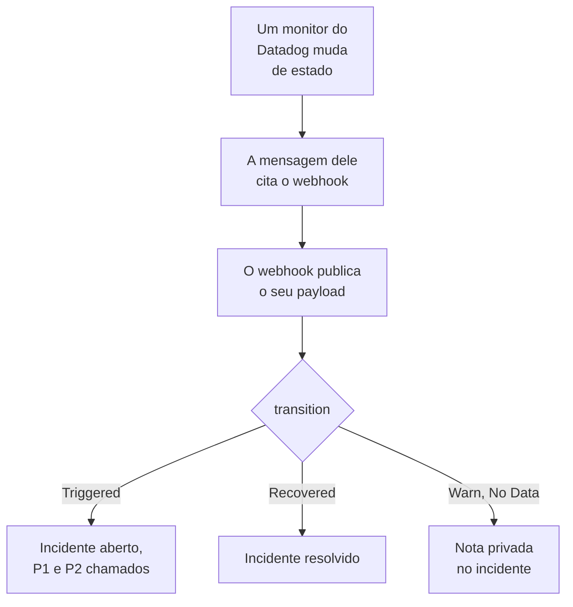

# Datadog

Envie os alertas dos monitores do [Datadog](https://www.datadoghq.com) para o OneUptime, para que cada um vire um incidente ou um alerta, chame a sua equipe de plantão quando for urgente e seja resolvido quando o monitor do Datadog se recuperar. O Datadog envia os alertas pela [integração Webhooks](https://docs.datadoghq.com/integrations/webhooks/) dele, então não há nada a instalar em nenhum dos lados.

:::cards
- [Escolher como o OneUptime recebe os alertas](#escolher-como-o-oneuptime-recebe-os-alertas): Um modelo de workflow ou um monitor Incoming Request.
- [Começar pelo modelo](#começar-pelo-modelo): Escolha quem chamar, copie a URL e veja o que cada alerta faz.
- [Receber alertas com um monitor](#receber-alertas-com-um-monitor): Um incidente por alerta, resolvido na recuperação.
- [Configurar o Datadog](#configurar-o-datadog): Um webhook e os monitores que o notificam.
- [Solução de problemas](#solução-de-problemas): Quando os alertas não chegam ou os incidentes continuam abertos.
:::

## Como funciona



Um monitor do Datadog notifica os webhooks que a mensagem dele menciona quando muda de estado: quando dispara, avisa, se recupera ou fica sem dados. O corpo JSON do webhook é você quem escreve, com as [variáveis de template](https://docs.datadoghq.com/integrations/webhooks/#usage) do Datadog, então este guia lhe dá um que nomeia cada alerta e diz o que aconteceu com ele.

## Antes de começar

- Uma conta do Datadog em que você possa configurar integrações e editar monitores.
- No OneUptime, permissão para criar workflows, ou monitores se você seguir esse caminho. No OneUptime Cloud, os workflows precisam do plano **Growth** ou superior.

## Escolher como o OneUptime recebe os alertas

Configure primeiro o OneUptime: ele lhe dá a URL para a qual o Datadog envia.

| Caminho | Use quando |
| --- | --- |
| O modelo de workflow (recomendado) | Você quer cada alerta como um incidente ou um alerta em uma gravidade que vem da prioridade do monitor, com o plantão chamado para P1 e P2, com os avisos anotados nele, e resolvido na recuperação. Não há nada a construir. |
| Um monitor Incoming Request | Você quer incidentes sem um workflow, em qualquer plano, e um monitor cujo status acompanha o Datadog. |

Os dois recebem o mesmo JSON do mesmo webhook, então você pode começar com um e trocar depois mudando uma URL no Datadog.

## Começar pelo modelo

A caixa de diálogo **Criar um fluxo de trabalho** tem dois modelos do Datadog, em **Datadog** na lista de categorias: **Declare an incident when a Datadog monitor triggers**, e **Create an alert when a Datadog monitor triggers** para alertas. Os dois fazem o mesmo, cada um com o seu tipo de registro.

:::steps
1. Vá para **Fluxos de trabalho** e clique em **Criar fluxo de trabalho**. Em **Ou começar a partir de um modelo**, escolha **Datadog** na lista de categorias, clique em **Declare an incident when a Datadog monitor triggers**, ou em **Create an alert when a Datadog monitor triggers**, e depois em **Usar este modelo**.
2. Em **Who to page for P1 and P2 monitors**, escolha as políticas de plantão a acionar, ou nenhuma para não acionar ninguém, e clique em **Criar fluxo de trabalho**. O workflow abre no **Construtor**, desativado.
3. Clique no gatilho **Webhook**, depois em **Copiar URL**, e guarde a URL para o Datadog.
4. Ative **Habilitado** no topo do **Construtor**. Um workflow desativado responde ao Datadog com `400`.
:::

Depois [configure o Datadog](#configurar-o-datadog) para enviar os alertas dele para essa URL. A etapa `read-event-1` do workflow abre com a mesma configuração, para quando você voltar a ela no **Construtor**.

### O que o workflow faz

Depois do gatilho **Webhook**, a etapa **Check With JavaScript** `read-event-1` lê o `transition` que o Datadog envia, e **Incident From Another Tool**, ou **Alert From Another Tool** no modelo de alertas, faz o que ele significa, pela chave de ciclo do alerta. O Datadog mantém essa chave desde o momento em que um alerta dispara até ele se recuperar, e na próxima vez que disparar a chave é nova, então cada vez ganha um incidente próprio. O incidente guarda a chave no seu campo personalizado `datadogAlertCycleKey`.

| Transição | O que o workflow faz |
| --- | --- |
| `Triggered`, `Re-Triggered` | Declara um incidente com o título `Datadog: <monitor>`, na gravidade que corresponde à prioridade do monitor, fora das suas páginas de status. A descrição dele aponta para o alerta no Datadog e mostra a prioridade, o host, o escopo e a mensagem do monitor. Uma notificação para um alerta que já tem incidente não abre um segundo e não chama ninguém de novo. |
| `Recovered` | Resolve o incidente do alerta, a menos que ele já esteja resolvido. O motivo fica na linha do tempo dele. |
| `Warn`, `Re-Warn`, `No Data`, `Re-No Data` | Adiciona uma nota privada ao incidente do alerta, dizendo qual é agora o estado do monitor. |
| `Renotify` | Nada: o alerta ainda está aberto. |

Um aviso ou uma recuperação de um alerta sem incidente não muda nada. Todo o resto, como uma requisição de outra ferramenta, é deixado como está: `read-event-1` segue por **No**, e as **Etapas** da execução dizem por quê. Nada volta para o Datadog: ele resolve os próprios alertas quando o sinal se recupera, e é isso que resolve o incidente.

### Prioridades e chamadas

Um novo incidente chama as políticas de plantão que você escolheu quando o monitor dele é P1 ou P2, ou não tem prioridade. P3, P4 e P5 abrem um incidente e não chamam ninguém. Em um projeto novo, as prioridades são mapeadas nestas gravidades de incidente e de alerta:

| Prioridade do Datadog | Incidente | Alerta | Plantão |
| --- | --- | --- | --- |
| P1 | Critical Incident | High | Chamado |
| P2 | Critical Incident | High | Chamado |
| Sem prioridade | Critical Incident | High | Chamado |
| P3 | Major Incident | Low | Não chamado |
| P4 | Minor Incident | Low | Não chamado |
| P5 | Minor Incident | Low | Não chamado |

Com gravidades próprias, P1, P2 e sem prioridade vão para a sua mais grave, P3 para a do meio, e P4 e P5 para a sua menos grave.

- Para mapear uma prioridade para uma das suas pelo nome, edite `SEVERITY_BY_NAME` na etapa `read-event-1`, como `{ P3: 'Minor Incident' }`.
- Para chamar o plantão também para P3, defina **Compare with** da etapa `if-page-1` **If / Else** como `3`.

## Receber alertas com um monitor

Um [monitor Incoming Request](/docs/monitor/incoming-request-monitor) lhe dá uma URL, e os critérios dele decidem o que cada alerta faz.

:::steps
### Criar o monitor

Vá em **Monitores** e clique em **Criar monitor**. Escolha **Incoming Request** em **Tipo de monitor**, dê o nome `Datadog` e clique em **Próximo**.

### Declarar um incidente para cada alerta

Na etapa **Critérios**, abra o primeiro critério, o que marca o monitor como offline. Defina o filtro dele como **Corpo da Requisição**, **Contém**, `"transition":"Triggered"`. Esse critério já declara um incidente quando o filtro corresponde. Preencha o incidente:

- **Título do Incidente**: `{{requestBody.title}}`.
- **Descrição do incidente**, em **Descrição**: `{{requestBody.body}}` e depois `Datadog: {{requestBody.link}}` em uma linha própria.
- **Gravidade**: a gravidade de incidente que esses alertas devem ter.
- **Políticas de plantão**, em **Plantão**: as políticas a acionar.
- **Resolver incidente automaticamente**, em **Mais campos**: deixe ativado, como já vem. Sem isso, as recuperações são ignoradas e os incidentes continuam abertos.

### Abrir um incidente por alerta

No mesmo critério, abra **Configurações** e ative **Group incidents and alerts by a payload field**. Preencha como abaixo, para que cada alerta tenha o próprio incidente e a recuperação dele o resolva:

| Campo | Valor |
| --- | --- |
| **Open a separate incident for each…** | `requestBody.alert_key` |
| **Field that signals recovery** | `requestBody.transition` |
| **Value that means recovered** | `Recovered` |

### Colocar o monitor online de novo

Abra o segundo critério, o que marca o monitor como online, e defina o filtro dele como **Corpo da Requisição**, **Contém**, `"transition":"Recovered"`.

### Copiar a URL

Clique em **Criar monitor**. A página **Visão geral** do monitor mostra o **Heartbeat URL** dele. Copie-o para o Datadog:

```text
https://oneuptime.com/heartbeat/<secret key>
```

Uma instalação auto-hospedada tem o próprio host no lugar de `oneuptime.com`.
:::

O payload abaixo põe em `alert_key` o ID do monitor do Datadog e as tags do grupo que alertou, para que cada grupo de um monitor de alertas múltiplos tenha o próprio incidente e a recuperação desse grupo o resolva. Um monitor que dispara de novo ou renotifica enquanto o incidente dele está aberto não abre um segundo. Veja [Receber alertas de outro sistema](/docs/monitor/incoming-request-monitor#receber-alertas-de-outro-sistema) para o que cada configuração faz.

> [!NOTE]
> Uma notificação **Warn** ou **No Data** não abre nenhum incidente com esses filtros. Para ser acionado também por avisos, clique em **Adicionar critérios**, dê ao novo critério o filtro **Corpo da Requisição**, **Contém**, `"transition":"Warn"`, um incidente com a própria **Gravidade** e as mesmas configurações de agrupamento, e depois arraste-o para cima do primeiro critério. Os critérios são verificados de cima para baixo, e o primeiro que corresponde decide.

## Configurar o Datadog

:::steps
### Adicionar o webhook

No Datadog, abra o [bloco da integração Webhooks](https://app.datadoghq.com/integrations/webhooks) e instale-a se ainda não estiver instalada. Adicione um webhook com estas configurações e salve-o:

- **Name**: `oneuptime`. Os monitores mencionam o webhook por esse nome, como `@webhook-oneuptime`.
- **URL**: a URL que você copiou do OneUptime.
- **Payload**:

  ```json
  {
    "alert_key": "$ALERT_ID $ALERT_SCOPE",
    "alert_cycle_key": "$ALERT_CYCLE_KEY",
    "transition": "$ALERT_TRANSITION",
    "alert_priority": "$ALERT_PRIORITY",
    "title": "$EVENT_TITLE",
    "body": "$TEXT_ONLY_MSG",
    "host": "$HOSTNAME",
    "scope": "$ALERT_SCOPE",
    "priority": "$PRIORITY",
    "link": "$LINK"
  }
  ```

### Mencionar o webhook nos seus monitores

Em cada monitor do Datadog que deve acionar pelo OneUptime, adicione `@webhook-oneuptime` à mensagem de notificação do monitor e salve o monitor. O Datadog passa então a enviar ao OneUptime os alertas e as recuperações desse monitor.
:::

| Variável | O que o Datadog coloca nela |
| --- | --- |
| `$ALERT_ID` | O ID do monitor do Datadog que alertou. |
| `$ALERT_SCOPE` | As tags do grupo que alertou, como `host:web-1`. |
| `$ALERT_CYCLE_KEY` | Um ID que continua o mesmo desde o momento em que um alerta dispara até ele se recuperar. |
| `$ALERT_TRANSITION` | O que aconteceu: `Triggered`, `Re-Triggered`, `Warn`, `Recovered`, `No Data` ou `Renotify`, entre outros. |
| `$ALERT_PRIORITY` | A prioridade do monitor do Datadog, de `P1` a `P5`, ou nada para um monitor sem prioridade. |
| `$EVENT_TITLE` | O título do evento, como `[Triggered] High CPU`. |
| `$TEXT_ONLY_MSG` | A mensagem do monitor, sem Markdown. |
| `$LINK` | Um link para o evento no Datadog. |

Um payload serve aos dois jeitos: o modelo usa `alert_cycle_key` e `alert_priority`, e o monitor usa `alert_key`. Mantenha todos, e você pode trocar depois mudando só a URL.

## Testar

Envie um alerta para a URL que você copiou, como o Datadog faria:

```bash
curl -X POST "<url>" \
  -H "Content-Type: application/json" \
  -d '{
    "alert_key": "1234 host:web-1",
    "alert_cycle_key": "7151157925468446720",
    "transition": "Triggered",
    "alert_priority": "P1",
    "title": "[Triggered] High CPU",
    "body": "CPU is above 90% on web-1.",
    "host": "web-1",
    "scope": "host:web-1",
    "priority": "normal",
    "link": "https://app.datadoghq.com/event/event?id=1"
  }'
```

Com o modelo, um incidente abre, com o título `Datadog: High CPU`, e as políticas de plantão que você escolheu são chamadas. Com o monitor, um incidente abre, com o título `[Triggered] High CPU`. Envie a mesma requisição com `transition` em `Recovered` e o incidente é resolvido.

Depois teste a partir do Datadog: abra um monitor que mencione o webhook, clique em **Test Notifications** e envie a notificação **Alert** dele. Para ver que ela chegou, abra **Registros → Execuções** do workflow, ou a linha do tempo do monitor do OneUptime.

## Solução de problemas

:::details Nada chega ao OneUptime
- Verifique que a mensagem do monitor do Datadog menciona `@webhook-oneuptime`, escrito como o webhook se chama.
- O monitor responde `200` na hora, antes de verificar qualquer coisa, mesmo com uma chave secreta errada. Veja a linha do tempo do monitor para saber se os alertas chegam.
- Um workflow desativado responde `400`. Ative **Habilitado** no topo do **Construtor** dele.
:::

:::details O workflow roda, mas não abre nada
Abra a execução em **Registros → Execuções**. A entrada `read-event-1` em **Etapas** diz por que ela seguiu por **No**.

- `Datadog named no alert cycle key`: adicione `"alert_cycle_key": "$ALERT_CYCLE_KEY"` ao payload do webhook no Datadog.
- `Datadog named no transition`: adicione `"transition": "$ALERT_TRANSITION"` ao payload do webhook no Datadog.
:::

:::details O plantão não é chamado
- Só os monitores P1 e P2 e os monitores sem prioridade chamam. Veja [Prioridades e chamadas](#prioridades-e-chamadas).
- Uma notificação para um alerta que já tem incidente não chama ninguém de novo.
- Com ninguém escolhido na caixa de diálogo **Criar um fluxo de trabalho**, o workflow não tem nenhuma etapa que chame.
:::

:::details Os incidentes abrem mas nunca são resolvidos
- O monitor do Datadog também precisa notificar o webhook das recuperações dele. Uma mensagem que menciona o webhook só para os alertas, dentro de uma condição, não envia nenhuma recuperação.
- Com o modelo, abra a execução da recuperação em **Registros → Execuções**: a última etapa dela diz por quê. O `alert_cycle_key` da recuperação deve ser o do alerta, então mantenha `$ALERT_CYCLE_KEY` como está no payload.
- Com o monitor, o incidente do critério precisa de **Resolver incidente automaticamente**, em **Mais campos**.
- **Value that means recovered** deve ser exatamente `Recovered`. A comparação diferencia maiúsculas de minúsculas.
- O `alert_key` da recuperação deve ser o do alerta: mantenha `$ALERT_ID $ALERT_SCOPE` como está no payload.
:::

:::details Um campo mostra o nome de uma variável, ou nada
O Datadog só preenche as variáveis que se aplicam ao evento. Envie uma notificação de teste e veja o que chegou: na linha do tempo do monitor, ou para um workflow em **Registros → Execuções**.
:::

:::details Todos os alertas de um monitor se juntam em um incidente
Com o monitor, cada grupo precisa do próprio `alert_key`. Verifique que o payload o monta a partir de `$ALERT_ID` e de `$ALERT_SCOPE`, e que o caminho de agrupamento é `requestBody.alert_key`.
:::

## Segurança

- **Trate a URL como uma senha.** Quem a tiver pode abrir incidentes. Se ela vazar, redefina-a: **Redefinir URL** no gatilho **Webhook** do workflow, ou **Redefinir chave secreta de requisição recebida** na página **Configurações** do monitor. Depois atualize a **URL** do webhook no Datadog.
- **Os links vão para o Datadog.** O modelo aponta um alerta só em um site do Datadog, diga o que disser uma requisição, e escreve o que o Datadog enviou como texto.
- **Auto-hospedado?** O Datadog envia os webhooks pela internet, então o seu OneUptime precisa estar acessível a partir dela por HTTPS.

## Próximos passos

:::cards
- [Modelos de workflow](/docs/workflows/authoring): Crie um workflow a partir de um modelo e altere-o no Construtor.
- [Monitor de requisições recebidas](/docs/monitor/incoming-request-monitor): Cada configuração do monitor que recebe os seus alertas.
- [New Relic](/docs/integrations/new-relic): O mesmo modelo, para os problemas do New Relic.
- [Regras de escalonamento](/docs/on-call/escalation-rules): Decida quem uma política de plantão aciona, e quando.
- [Visão geral das integrações](/docs/integrations/index): As outras ferramentas que você pode conectar.
:::
