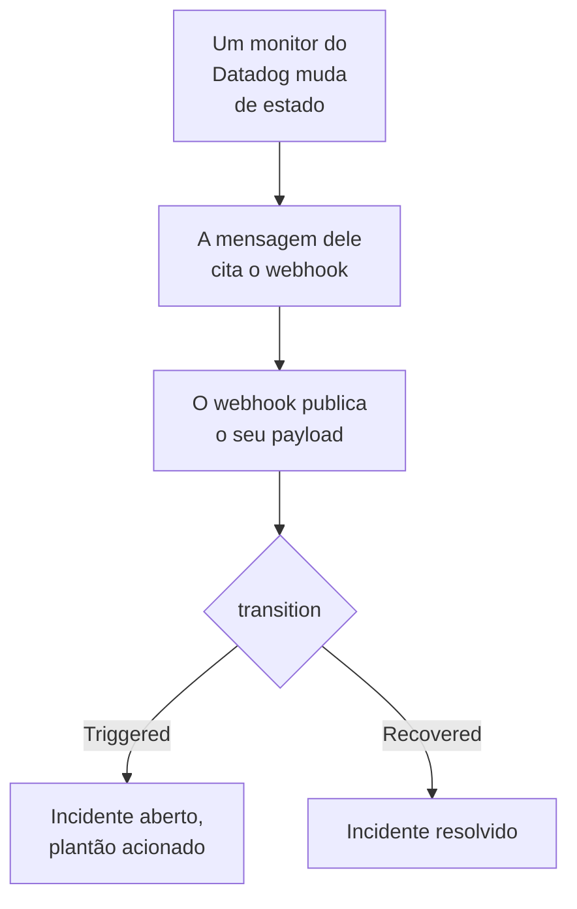

# Datadog

Envie os alertas dos monitores do [Datadog](https://www.datadoghq.com) para o OneUptime, para que cada alerta vire um incidente que chama a sua equipe de plantão e seja resolvido quando o monitor do Datadog se recuperar. O Datadog envia os alertas pela [integração Webhooks](https://docs.datadoghq.com/integrations/webhooks/) dele, então não há nada a instalar em nenhum dos lados.

:::cards
- [Escolher como o OneUptime recebe os alertas](#escolher-como-o-oneuptime-recebe-os-alertas): Um monitor Incoming Request ou um workflow próprio.
- [Receber alertas com um monitor](#receber-alertas-com-um-monitor): Um incidente por alerta, resolvido na recuperação.
- [Configurar o Datadog](#configurar-o-datadog): Um webhook e os monitores que o notificam.
- [Solução de problemas](#solução-de-problemas): Quando os alertas não chegam ou os incidentes continuam abertos.
:::

## Como funciona



Um monitor do Datadog notifica os webhooks que a mensagem dele menciona quando muda de estado: quando dispara, avisa, se recupera ou fica sem dados. O corpo JSON do webhook é você quem escreve, com as [variáveis de template](https://docs.datadoghq.com/integrations/webhooks/#usage) do Datadog, então este guia lhe dá um que nomeia cada alerta e diz o que aconteceu com ele.

## Antes de começar

- Uma conta do Datadog em que você possa configurar integrações e editar monitores.
- No OneUptime, permissão para criar monitores, ou workflows se escolher esse caminho.

## Escolher como o OneUptime recebe os alertas

Configure primeiro o OneUptime: ele lhe dá a URL para a qual o Datadog envia.

| Caminho | Use quando |
| --- | --- |
| Um monitor Incoming Request (recomendado) | Você quer que cada alerta seja um incidente que chama o plantão e é resolvido quando o monitor do Datadog se recupera. Não há nada a construir. |
| Um workflow com um gatilho Webhook | Você precisa de uma lógica própria: filtrar alertas, remodelá-los ou chamar outros sistemas antes. Um workflow declara um incidente para cada alerta que recebe, e não o resolve na recuperação. |

Os dois recebem o mesmo JSON do mesmo webhook, então você pode começar com um e trocar depois mudando uma URL no Datadog.

## Receber alertas com um monitor

Um [monitor Incoming Request](/docs/monitor/incoming-request-monitor) lhe dá uma URL, e os critérios dele decidem o que cada alerta faz.

:::steps
### Criar o monitor

Vá em **Monitores** e clique em **Criar monitor**. Escolha **Incoming Request** em **Tipo de monitor**, dê o nome `Datadog` e clique em **Próximo**.

### Declarar um incidente para cada alerta

Na etapa **Critérios**, abra o primeiro critério, o que marca o monitor como offline. Defina o filtro dele como **Corpo da Requisição**, **Contém**, `"transition":"Triggered"`. Esse critério já declara um incidente quando o filtro corresponde. Preencha o incidente:

- **Título do Incidente**: `{{requestBody.title}}`.
- **Descrição do incidente**, em **Descrição**: `{{requestBody.body}}` e depois `Datadog: {{requestBody.link}}` em uma linha própria.
- **Gravidade**: a gravidade de incidente que esses alertas devem ter.
- **Políticas de plantão**, em **Plantão**: as políticas a acionar.
- **Resolver incidente automaticamente**, em **Mais campos**: deixe ativado, como já vem. Sem isso, as recuperações são ignoradas e os incidentes continuam abertos.

### Abrir um incidente por alerta

No mesmo critério, abra **Configurações** e ative **Group incidents and alerts by a payload field**. Preencha como abaixo, para que cada alerta tenha o próprio incidente e a recuperação dele o resolva:

| Campo | Valor |
| --- | --- |
| **Open a separate incident for each…** | `requestBody.alert_key` |
| **Field that signals recovery** | `requestBody.transition` |
| **Value that means recovered** | `Recovered` |

### Colocar o monitor online de novo

Abra o segundo critério, o que marca o monitor como online, e defina o filtro dele como **Corpo da Requisição**, **Contém**, `"transition":"Recovered"`.

### Copiar a URL

Clique em **Criar monitor**. A página **Visão geral** do monitor mostra o **Heartbeat URL** dele. Copie-o para o Datadog:

```text
https://oneuptime.com/heartbeat/<secret key>
```

Uma instalação auto-hospedada tem o próprio host no lugar de `oneuptime.com`.
:::

O payload abaixo põe em `alert_key` o ID do monitor do Datadog e as tags do grupo que alertou, para que cada grupo de um monitor de alertas múltiplos tenha o próprio incidente e a recuperação desse grupo o resolva. Um monitor que dispara de novo ou renotifica enquanto o incidente dele está aberto não abre um segundo. Veja [Receber alertas de outro sistema](/docs/monitor/incoming-request-monitor#receber-alertas-de-outro-sistema) para o que cada configuração faz.

> [!NOTE]
> Uma notificação **Warn** ou **No Data** não abre nenhum incidente com esses filtros. Para ser acionado também por avisos, clique em **Adicionar critérios**, dê ao novo critério o filtro **Corpo da Requisição**, **Contém**, `"transition":"Warn"`, um incidente com a própria **Gravidade** e as mesmas configurações de agrupamento, e depois arraste-o para cima do primeiro critério. Os critérios são verificados de cima para baixo, e o primeiro que corresponde decide.

## Configurar o Datadog

:::steps
### Adicionar o webhook

No Datadog, abra o [bloco da integração Webhooks](https://app.datadoghq.com/integrations/webhooks) e instale-a se ainda não estiver instalada. Adicione um webhook com estas configurações e salve-o:

- **Name**: `oneuptime`. Os monitores mencionam o webhook por esse nome, como `@webhook-oneuptime`.
- **URL**: a URL que você copiou do OneUptime.
- **Payload**:

  ```json
  {
    "alert_key": "$ALERT_ID $ALERT_SCOPE",
    "transition": "$ALERT_TRANSITION",
    "title": "$EVENT_TITLE",
    "body": "$TEXT_ONLY_MSG",
    "host": "$HOSTNAME",
    "priority": "$PRIORITY",
    "link": "$LINK"
  }
  ```

### Mencionar o webhook nos seus monitores

Em cada monitor do Datadog que deve acionar pelo OneUptime, adicione `@webhook-oneuptime` à mensagem de notificação do monitor e salve o monitor. O Datadog passa então a enviar ao OneUptime os alertas e as recuperações desse monitor.
:::

| Variável | O que o Datadog coloca nela |
| --- | --- |
| `$ALERT_ID` | O ID do monitor do Datadog que alertou. |
| `$ALERT_SCOPE` | As tags do grupo que alertou, como `host:web-1`. |
| `$ALERT_TRANSITION` | O que aconteceu: `Triggered`, `Re-Triggered`, `Warn`, `Recovered`, `No Data` ou `Renotify`, entre outros. |
| `$EVENT_TITLE` | O título do evento, como `[Triggered] High CPU`. |
| `$TEXT_ONLY_MSG` | A mensagem do monitor, sem Markdown. |
| `$LINK` | Um link para o evento no Datadog. |

## Testar

Envie um alerta ao OneUptime, como o Datadog faria:

```bash
curl -X POST "https://oneuptime.com/heartbeat/<secret key>" \
  -H "Content-Type: application/json" \
  -d '{
    "alert_key": "1234 host:web-1",
    "transition": "Triggered",
    "title": "[Triggered] High CPU",
    "body": "CPU is above 90% on web-1.",
    "host": "web-1",
    "priority": "normal",
    "link": "https://app.datadoghq.com/event/event?id=1"
  }'
```

Um incidente abre, com o título `[Triggered] High CPU`. Envie a mesma requisição com `transition` em `Recovered` e o incidente é resolvido.

Depois teste a partir do Datadog: abra um monitor que mencione o webhook, clique em **Test Notifications** e envie a notificação **Alert** dele. Veja a linha do tempo do monitor do OneUptime para confirmar que chegou.

## Receber alertas com um workflow

Use um [workflow](/docs/workflows/index) quando precisar de etapas próprias entre o Datadog e o incidente.

:::steps
### Criar o workflow

Vá em **Fluxos de trabalho**, clique em **Criar fluxo de trabalho** e depois em **Começar do zero**. Dê o nome `Datadog alerts` e clique em **Criar fluxo de trabalho**.

### Adicionar o gatilho Webhook

Clique no bloco tracejado **Escolha o que inicia este fluxo de trabalho** e escolha **Webhook**. Clique no gatilho, depois em **Copiar URL**, e use essa URL no webhook do Datadog.

### Verificar que o monitor disparou

Clique em **Adicionar componente**, adicione um bloco **If / Else** e ligue a ele o ponto **Out** do gatilho. Defina **Value to check** como `{{local.components.webhook-1.returnValues.request-body.transition}}`, **Comparison** como **is equal to** e **Compare with** como `Triggered`.

### Declarar o incidente

Adicione um bloco **Create One Incident** e ligue a ele o lado **Yes** do bloco **If / Else**. Em **Incident Template**, escolha um modelo que defina a gravidade e as políticas de plantão a acionar (veja [Modelos de incidentes](/docs/incidents/settings#modelos-de-incidentes)). Em **JSON Object**, defina o que vem do Datadog:

```json
{
  "title": "{{local.components.webhook-1.returnValues.request-body.title}}",
  "description": "{{local.components.webhook-1.returnValues.request-body.body}}\nDatadog: {{local.components.webhook-1.returnValues.request-body.link}}"
}
```

Sem modelo, **JSON Object** também precisa de `incidentSeverityId`, o ID de uma das gravidades de incidente do projeto.

### Ativar o workflow

Ative **Habilitado** no topo do **Construtor**. Um workflow desativado responde ao Datadog com `400`.
:::

Cada notificação `Triggered` declara um novo incidente. Uma recuperação segue pelo lado **No** do bloco **If / Else**, onde nada está ligado, então a execução termina ali. Para um incidente por alerta, resolvido na recuperação, use o monitor.

## Solução de problemas

:::details Nada chega ao OneUptime
- Verifique que a mensagem do monitor do Datadog menciona `@webhook-oneuptime`, escrito como o webhook se chama.
- O monitor responde `200` na hora, antes de verificar qualquer coisa, mesmo com uma chave secreta errada. Veja a linha do tempo do monitor para saber se os alertas chegam.
- Um workflow desativado responde `400`. Ative **Habilitado** no topo do **Construtor** dele.
:::

:::details Os incidentes abrem mas nunca são resolvidos
- O monitor do Datadog também precisa notificar o webhook das recuperações dele. Uma mensagem que menciona o webhook só para os alertas, dentro de uma condição, não envia nenhuma recuperação.
- O incidente do critério precisa de **Resolver incidente automaticamente**, em **Mais campos**.
- **Value that means recovered** deve ser exatamente `Recovered`. A comparação diferencia maiúsculas de minúsculas.
- O `alert_key` da recuperação deve ser o do alerta: mantenha `$ALERT_ID $ALERT_SCOPE` como está no payload.
:::

:::details Um campo mostra o nome de uma variável, ou nada
O Datadog só preenche as variáveis que se aplicam ao evento. Envie uma notificação de teste e veja o que chegou: na linha do tempo do monitor, ou para um workflow em **Registros → Execuções**.
:::

:::details Todos os alertas de um monitor se juntam em um incidente
Cada grupo precisa do próprio `alert_key`. Verifique que o payload o monta a partir de `$ALERT_ID` e de `$ALERT_SCOPE`, e que o caminho de agrupamento é `requestBody.alert_key`.
:::

## Segurança

- **Trate a URL como uma senha.** Quem a tiver pode abrir incidentes. Se ela vazar, redefina-a: **Redefinir chave secreta de requisição recebida** na página **Configurações** do monitor, ou **Redefinir URL** no gatilho **Webhook** do workflow. Depois atualize a **URL** do webhook no Datadog.
- **Auto-hospedado?** O Datadog envia os webhooks pela internet, então o seu OneUptime precisa estar acessível a partir dela por HTTPS.

## Próximos passos

:::cards
- [Monitor de requisições recebidas](/docs/monitor/incoming-request-monitor): Cada configuração do monitor que recebe os seus alertas.
- [Prometheus Alertmanager](/docs/integrations/prometheus-alertmanager): A mesma configuração, para o Alertmanager.
- [Regras de escalonamento](/docs/on-call/escalation-rules): Decida quem uma política de plantão aciona, e quando.
- [Visão geral das integrações](/docs/integrations/index): As outras ferramentas que você pode conectar.
:::
