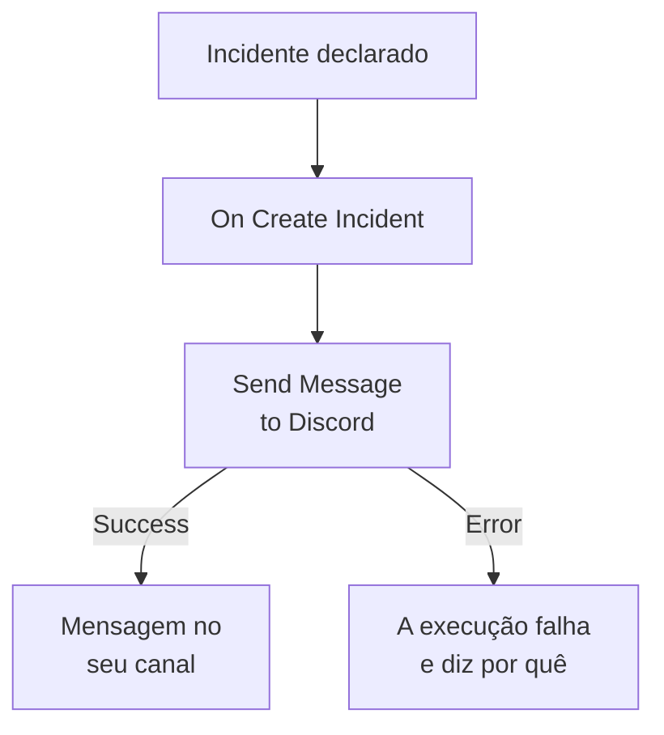

# Discord

Publique uma mensagem em um canal do [Discord](https://discord.com) quando um incidente é aberto, para que quem acompanha esse canal saiba na hora. A etapa de workflow **Send Message to Discord** do OneUptime publica pelo webhook do canal, e um modelo pronto monta o workflow inteiro para você. Esta integração é de **saída**: o OneUptime publica no canal e não lê o que é dito nele.

:::cards
- [Como funciona](#como-funciona): O que o workflow faz quando um incidente é aberto.
- [Configuração](#configurar-a-integração): Um webhook no Discord e depois o workflow: pelo modelo ou do zero.
- [Dicas](#dicas): Formatação, mensagens longas e mais eventos.
- [Solução de problemas](#solução-de-problemas): O que os erros da etapa significam e o que mudar.
:::

## Como funciona



A etapa publica o **Message Text** no webhook do canal. Ela segue pela saída **Success** quando o Discord aceita a mensagem, e pela saída **Error**, com o motivo do Discord, quando o Discord a recusa. Sem nada ligado a **Error**, como no modelo, uma execução que não conseguiu publicar falha, e as suas **Etapas** dizem por quê.

## Antes de começar

- No Discord, a permissão **Manage Webhooks** no canal.
- No OneUptime, o direito de criar workflows e variáveis. No OneUptime Cloud, os workflows precisam do plano **Growth** ou superior.

## Configurar a integração

:::steps
### Criar um webhook no Discord

1. No Discord, abra as configurações do canal com **Edit Channel**, depois **Integrations → Webhooks**, e selecione **New Webhook**.
2. Dê um nome a ele, por exemplo `OneUptime`, e verifique se ele publica no canal certo.
3. Selecione **Copy Webhook URL**.

Quem tiver a URL pode publicar no canal, então guarde-a com o mesmo cuidado que uma senha.

### Criar o workflow

Comece pelo modelo, que monta o workflow inteiro para você, ou do zero.

:::tabs
@tab Pelo modelo
1. Abra **Fluxos de trabalho** e clique em **Criar fluxo de trabalho**.
2. Digite `Discord` em **Pesquisar modelos…**, clique em **Tell Discord when an incident opens** e depois em **Usar este modelo**.
3. Mantenha o nome **Notify Discord on new incident** ou mude-o, e clique em **Próximo**.
4. Cole a URL em **Discord Webhook URL** e clique em **Criar fluxo de trabalho**.

O workflow abre no **Construtor** com duas etapas: **On Create Incident** e **Send Message to Discord**, que publica o número, o título, a gravidade e o estado do incidente. A URL é salva como a variável secreta `discordWebhookUrl` do workflow.
@tab Do zero
1. Salve a URL como uma variável global secreta: vá em **Fluxos de trabalho → Variáveis globais**, clique em **Criar: Fluxo de trabalho Variável**, dê o nome `DISCORD_WEBHOOK_URL` e clique em **Próximo**. Cole a URL em **Conteúdo**, ative **Segredo** e clique em **Criar: Fluxo de trabalho Variável**.
2. Vá em **Fluxos de trabalho**, clique em **Criar fluxo de trabalho**, escolha **Começar do zero**, dê um nome ao workflow e clique em **Criar fluxo de trabalho**.
3. No **Construtor**, clique em **Escolha o que inicia este fluxo de trabalho** e escolha **On Create Incident** em **Populares**. Clique no gatilho: os seus **Fields to pass on** começam com **Título**, então clique em **Adicionar campo** e escolha os outros campos que a sua mensagem mostra, por exemplo **Incident Number With Prefix**.
4. Clique em **Adicionar componente**, pesquise `discord` e clique em **Send Message to Discord**. Conecte a saída **Success** do gatilho a ela.
5. Clique na nova etapa. Em **Discord Incoming Webhook URL**, clique em **{ }** e escolha `DISCORD_WEBHOOK_URL` em **Global variables**. Em **Message Text**, escreva a mensagem e insira os campos do incidente com **{ }**.
:::

Uma mensagem feita do zero lê os campos do incidente com referências como estas:

```text
🚨 **Incident {{local.components.incident-on-create-1.returnValues.model.incidentNumberWithPrefix}} declared**
**Title:** {{local.components.incident-on-create-1.returnValues.model.title}}
```

### Ativar e testar

Ative o interruptor **Habilitado** no topo do **Construtor**. A partir daí, cada novo incidente é publicado no canal.

Para testar sem abrir um incidente, clique em **Executar fluxo de trabalho** e escolha um incidente que você já tem em **Incidente**: os mais recentes são listados, e digitar o número dele ou parte do título encontra outro. Clique em **Executar fluxo de trabalho manualmente** e confirme com **Executar**. O painel **Execução do Fluxo de Trabalho** acompanha a execução, e a mensagem aparece no canal. Se a etapa seguir por **Error**, a execução falha, e a entrada da etapa em **Etapas** diz por quê: veja [Solução de problemas](#solução-de-problemas).
:::

## Dicas

- **Formatar com o Markdown do Discord.** O texto é enviado como foi digitado, então o Markdown do Discord funciona nele: asteriscos em volta de uma palavra a deixam em negrito, e uma URL aparece como link.
- **Respeitar o limite de 2.000 caracteres.** O Discord aceita mensagens de até 2.000 caracteres. Uma mais longa é cortada, e termina com "… (truncated — see OneUptime for the full text)", em vez de ser recusada.
- **Publicar mais do que novos incidentes.** Monte outro workflow sobre **On Update Incident** para mudanças de estado, ou sobre **On Create Alert** para alertas, com a mesma etapa. Para publicar só alguns incidentes, coloque um bloco **If / Else** antes da etapa.
- **Só os endereços do Discord.** A etapa publica em uma URL `https` em `discord.com` ou `discordapp.com`, e não segue redirecionamentos, então uma URL que aponta para qualquer outro lugar interrompe a execução.

## Solução de problemas

Quando a etapa segue por **Error**, a execução falha, e a entrada da etapa nas **Etapas** da execução traz o motivo do Discord.

:::details O Discord responde "Unknown Webhook" ou "Invalid Webhook Token"
O webhook foi excluído, ou a URL foi copiada errada. Crie um novo webhook e substitua a URL: no workflow do modelo, a variável `discordWebhookUrl`; em um workflow seu, o conteúdo de `DISCORD_WEBHOOK_URL`.
:::

:::details O Discord responde "You are being rate limited"
O Discord limita com que frequência um webhook pode publicar. Uma rajada de incidentes pode atingir esse limite: publique menos mensagens, por exemplo só para algumas gravidades.
:::

:::details A execução para com "Discord Webhook URL must be an https URL on discord.com or discordapp.com"
**Discord Incoming Webhook URL** contém algo diferente de um webhook do Discord, ou a variável que ele lê está vazia. Cole de novo a URL de **Copy Webhook URL**.
:::

## Próximos passos

:::cards
- [Componentes de workflow](/docs/workflows/components#discord): Cada configuração da etapa e o que as saídas dela significam.
- [Telegram](/docs/integrations/telegram): A mesma ideia, em um chat do Telegram.
- [Execuções de workflow](/docs/workflows/runs-and-logs): Leia o que cada execução do workflow fez.
- [Visão geral das integrações](/docs/integrations/index): O padrão de saída e as outras ferramentas que você pode conectar.
:::
