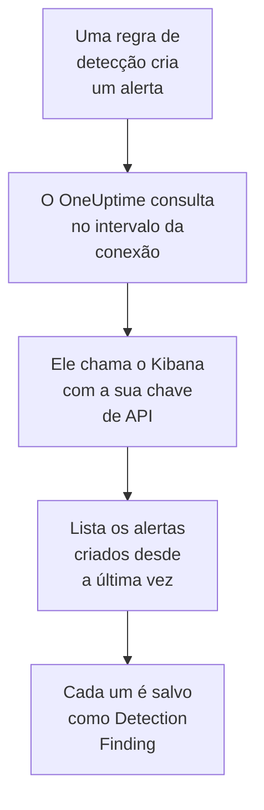

# Elastic Security

Importe os alertas de detecção que as suas regras do [Elastic Security](https://www.elastic.co/security) geram para os eventos de segurança do OneUptime. Lá você os pesquisa ao lado dos seus logs, traces e métricas, correlaciona-os com todas as outras fontes e aciona o plantão para os que importam. O OneUptime os lê pela API do mecanismo de detecção do Kibana com uma chave de API que você cria, e não altera nada no Elastic.

:::cards
- [Configurar a conexão](#configurar-a-conexão): Uma chave de API, os privilégios dela e o formulário da conexão.
- [O que é importado](#o-que-é-importado): Como cada alerta de detecção vira um evento de segurança.
- [Como a consulta funciona](#como-a-consulta-funciona): A janela que cada consulta lê, e o que um espaço movimentado faz com ela.
- [Solução de problemas](#solução-de-problemas): O que cada erro significa e o que mudar.
:::

## Como funciona



A cada minuto, o OneUptime consulta cada conexão habilitada cujo intervalo de consulta já passou. Uma consulta pede ao Kibana os alertas de detecção criados no seu espaço desde a última consulta, 1.000 por vez, e salva cada um como um evento [OCSF](https://schema.ocsf.io/) Detection Finding (classe `2004`). Todos os tipos de regra contam: consulta personalizada, limite, EQL, correspondência de indicadores, machine learning e novos termos. As regras de detecção, os monitores e os painéis então tratam os alertas como eventos de segurança de qualquer outra fonte.

## Antes de começar

- No OneUptime, a função Project Owner, Project Admin ou Security Admin. As funções Security Member e Security Viewer veem as conexões e o histórico de execuções delas, mas não podem alterá-las.
- Elastic Security 8.x ou posterior, no Elastic Cloud ou na sua própria stack do Elastic, com regras de detecção rodando em um espaço do Kibana.
- Um acesso ao Kibana que consiga ver os alertas de detecção desse espaço: os privilégios de índice `read` e `view_index_metadata` em `.alerts-security.alerts-<space-id>`, e um privilégio da funcionalidade Security do Kibana que permita ler os alertas ali.
- Um Kibana que o OneUptime consiga alcançar por HTTPS. O OneUptime Cloud se conecta pela internet, então o Kibana precisa de um endereço público, como os das implantações do Elastic Cloud: endereços privados são recusados. Um OneUptime auto-hospedado se conecta a partir dos contêineres do aplicativo e dos workers, e consegue alcançar um Kibana na sua rede privada, a menos que `DATA_SOURCE_BLOCK_PRIVATE_ADDRESSES` seja `true`.

## Configurar a conexão

:::steps
### Criar uma chave de API

1. No Kibana, abra **Stack Management → API keys** e selecione **Create API key**.
2. Dê um nome a ela, por exemplo `oneuptime-security-events`. Uma chave tem os privilégios do usuário que a cria, a menos que você lhe dê menos: ela só precisa dos que estão acima.
3. Escolha quando ela expira, ou nunca. Uma chave que expira interrompe a conexão até que você a substitua.
4. Crie a chave e copie o valor **Base64** dela, que o Kibana só mostra uma vez. Não o ID da chave, nem o par `id:api_key`.

### Encontrar o ID do seu espaço

Os alertas são guardados por espaço. Abra o espaço onde as suas regras rodam: o ID dele é a parte do endereço do Kibana depois de `/s/`, por exemplo `security` em `https://kibana.example.com/s/security/app/security`. O espaço padrão não tem a parte `/s/` e não precisa de ID.

### Adicionar a conexão no OneUptime

Abra **Produtos → Security Events → Conexões** (`/dashboard/{projectId}/security-events/connections`), clique em **Adicionar conexão**, escolha **Elastic Security** e clique em **Próximo**. Preencha as configurações da tabela abaixo, clique em **Próximo** e cole a chave em **Chave de API**.

### Testar antes de salvar

Clique em **Testar estas configurações** em **Testar antes de salvar**. O teste se autentica e lê alertas com os valores do formulário, sem salvar nada, então um espaço errado ou um privilégio que falta aparece antes de a conexão existir. Depois clique em **Próximo**, dê um **Nome** à conexão e crie-a.
:::

| Configuração | O que informar |
| --- | --- |
| **Kibana URL** | O endereço de onde o Kibana é servido, por exemplo `https://kibana.example.com` ou `https://<deployment>.kb.<region>.cloud.es.io`. Sem caminho: nem `/app/security`, nem `/api`, nem a parte `/s/<space>`. |
| **Kibana space** | O ID do espaço, não o nome dele: letras, dígitos, hifens e sublinhados. Deixe vazio para o espaço padrão. |
| **Chave de API** | O valor **Base64** da chave, sozinho: o OneUptime adiciona o esquema `ApiKey` por conta própria. Ele é criptografado, nunca devolvido pela API e nunca mostrado de novo. Substitua-o com **Atualizar credenciais** na conexão. |

A etapa **Consulta periódica** também tem uma **Descrição** opcional, o **Intervalo de consulta (minutos)**, um número inteiro de `1` a `1440` que começa em `5`, e **Habilitado**, que começa ativado.

## O que é importado

Cada alerta de detecção vira um evento Detection Finding (classe OCSF `2004`), com o fornecedor `Elastic` e o produto `Elastic Security`:

| Campo do alerta | Coluna do OneUptime |
| --- | --- |
| `_id`, o ID do alerta | UID do evento, que também serve para descartar duplicatas |
| `kibana.alert.original_time`, senão `kibana.alert.start`, senão `@timestamp` | Horário do evento |
| `kibana.alert.rule.name` | Nome da regra |
| `kibana.alert.rule.uuid`, senão `kibana.alert.rule.rule_id` | ID da regra |
| `kibana.alert.reason`, senão o nome da regra, senão `kibana.alert.rule.description` | Mensagem |
| `kibana.alert.severity`, senão uma faixa de `kibana.alert.risk_score` | Gravidade |
| `kibana.alert.workflow_status`: `open`, `acknowledged` ou `closed` | Status |
| `kibana.alert.rule.threat`, subtécnicas incluídas | Táticas e técnicas do MITRE ATT&CK |
| `user.name`, `host.name`, `source.ip` ou `host.ip`, `process.name` ou `process.executable` | Usuário, host, IP e processo do ator |
| `process.name`, `process.executable` e `process.command_line`; `process.parent.name`, `process.parent.executable` e `process.parent.command_line` | Nome, caminho e linha de comando do processo; nome, caminho e linha de comando do processo pai |
| `user.target.name`, `destination.domain`, `destination.ip`, `destination.port`, `file.path` | Usuário, host, IP, porta e recurso do alvo |
| Esses, e `related.*`, `dns.question.name`, `url.domain` e os hashes de arquivos | Observáveis |
| O alerta inteiro, achatado em chaves com pontos, com `_index` e `_id` | `attributes` |

O horário de um alerta é, de propósito, o da atividade de que ele trata. O `@timestamp` dele, quando a regra o criou, é o que a consulta lê, então um alerta criado hoje sobre a atividade de ontem aparece na data de ontem no explorador de eventos de segurança. Quando um alerta não tem gravidade, a pontuação de risco dele decide: a partir de `74` Critical, a partir de `48` High, a partir de `22` Medium, e abaixo disso Low.

## Como a consulta funciona

Cada consulta lista os alertas criados na sua janela, do mais antigo para o mais novo, 1.000 por página. Em um espaço que não seja o padrão, o caminho começa com `/s/{Kibana space}`:

```text
POST {Kibana URL}/api/detection_engine/signals/search
    {"query": {"range": {"@timestamp": {"gte": "{window start}", "lt": "{window end}"}}},
     "size": 1000, "sort": [{"@timestamp": "asc"}]}
```

- **O horário de criação é o cursor.** Os alertas são listados pelo próprio `@timestamp`, quando a execução da regra os criou, nunca pelo horário da atividade de que tratam. Uma regra que roda de hora em hora cria alertas sobre uma atividade de até uma hora atrás, e um cursor pelo horário de atividade pularia todos eles.
- **A primeira consulta olha 24 horas para trás**, para que uma nova conexão mostre logo os alertas recentes dela.
- **Cada consulta seguinte começa 1 minuto antes do cursor salvo**, para que um alerta criado na fronteira entre duas janelas nunca se perca.
- **Uma consulta lê no máximo 24 horas além do cursor.** Uma conexão cujo cursor ficou para trás se atualiza em uma série de janelas de 24 horas, e a **Integridade** dela mostra **Catching up**.
- **As duplicatas são descartadas pelo `_id` do alerta** dentro do projeto, para que a sobreposição, uma janela repetida e uma importação nunca salvem um alerta duas vezes.

A pesquisa de alertas do Kibana aceita um tamanho e uma ordenação, mas nenhum token de página. Então o OneUptime pagina movendo o início do intervalo para o último alerta de cada página, e deixa de fora, por `_id`, os alertas que já leu naquele instante. Uma execução de regra costuma marcar muitos alertas com o mesmo horário, e esse grupo é lido página por página, nenhum duas vezes e nenhum pulado.

### Quando uma janela contém mais do que uma consulta consegue ler

Uma consulta lê no máximo 10.000 alertas, em no máximo 20 requisições. Quando uma janela contém mais, a execução fica **Parcial**, com um aviso como este:

```text
Stopped after collecting 10000 alerts; the window holds more.
```

Os alertas são lidos do mais antigo para o mais novo, então o OneUptime move o cursor para o horário de criação do último alerta lido, e a consulta seguinte começa ali, com o mesmo tamanho de janela. Um espaço movimentado se atualiza 10.000 alertas por consulta, em vez de reler os mesmos. Os alertas criados nesse mesmo instante são lidos duas vezes, e a verificação de duplicatas descarta a segunda cópia.

Os IDs deixados de fora vão em cada requisição, e o Kibana limita o tamanho de uma requisição. Quando mais alertas compartilham um instante do que uma requisição consegue deixar de fora, cerca de 7.800, a execução para ali como **Parcial**, com um aviso que nomeia o instante.

Quando uma execução não consegue passar do cursor salvo de jeito nenhum, o OneUptime encurta a janela em vez disso:

1. **Reduzir.** A consulta seguinte lê uma janela com a metade do tamanho, a partir do mesmo ponto de partida, e continua dividindo pela metade até que uma janela seja lida por inteiro, até um minuto. O aviso da execução diz isso: `This window holds more records than one poll can read; the next poll reads a {n} minute window from the same starting point.`
2. **Voltar a crescer.** Depois que uma janela é lida por inteiro, a seguinte volta a ter o dobro do tamanho, até 24 horas.
3. **Passar de um único minuto.** Se até um minuto contém mais do que uma consulta consegue ler, a consulta passa dele, para que os alertas mais novos continuem chegando. A execução continua **Parcial**, e **Último erro** mostra `More records were created in the one minute from {cursor} to {end} than one poll can read. Polling moved past this minute so newer records keep arriving; use Import this time range in Diagnostics on this minute to recover what one run can read.` Importe esse minuto com **Import this time range** para recuperar o que uma execução consegue ler.

Uma execução que falha por completo, com um erro do Kibana, mantém o cursor e o tamanho da janela, e a consulta seguinte relê a mesma janela. A única exceção é uma requisição que expirou: o cursor fica, mas a janela seguinte tem a metade do tamanho, porque uma janela pesada demais para ser respondida a tempo expiraria em toda tentativa. Mudar o **Intervalo de consulta (minutos)** não muda nada disso: ele decide com que frequência uma consulta começa, não onde a janela dela começa.

### Executar, pré-visualizar e importar sob demanda

Clique em **Diagnóstico** em uma conexão para ver as execuções recentes dela e trabalhar com ela manualmente. Quem pode alterar a conexão pode iniciar essas ações; quem pode vê-la pode ler o histórico.

- **Executar agora** inicia uma consulta na hora, com o cursor de sempre, mesmo quando a conexão não está **Habilitado**.
- **Preview alerts** lê um intervalo de tempo de até 7 dias e não importa nada.
- **Import this time range** importa um intervalo de até 7 dias, depois que você confirma, sem mover o cursor. Os alertas já importados são pulados.
- **Copy diagnostics** em uma execução copia o relatório dela para o suporte. Ele nunca inclui credenciais.

## Testar conexão

**Testar conexão** na linha de uma conexão, e **Testar estas configurações** no formulário, rodam no processo da API, não em um worker em segundo plano, para que um teste responda mesmo quando o problema são os workers. Ele faz estas verificações, em ordem:

| Verificação | O que ela verifica |
| --- | --- |
| **Configuração** | Cada configuração está presente e bem formada. Nada é contatado quando isso falha. |
| **Authenticate with Kibana** | O `/api/status` do Kibana responde por completo. O Kibana também responde, com menos, a quem ele não autenticou, então uma resposta curta faz esta verificação falhar. |
| **Read detection alerts** | Um alerta criado nas últimas 24 horas pode ser lido. Isso prova os privilégios e o espaço. |
| **Alerts available to import** | Quantos alertas foram criados nas últimas 24 horas e nos últimos 7 dias, com `+` onde o Elasticsearch contou só uma parte deles. Nenhum em 7 dias é um aviso, não uma falha. |
| **Background workers**, **Poll scheduler**, **Security event storage** | O lado do próprio OneUptime: um processo pega os jobs da fila Worker, o job de consulta roda a cada minuto e o armazenamento de eventos de segurança responde. |
| **Scheduled polling** | Para uma conexão salva: a consulta está ativada, nenhuma execução está presa esperando um worker e as consultas rodam no horário. |

Cada requisição de um teste tem um prazo de 20 segundos. Um teste nunca importa nada nem move o cursor, e cada verificação que falha diz o que mudar.

## Enviar eventos de segurança ao Elastic Security

O OneUptime também pode enviar o que encontra ao Elasticsearch, como documentos do Elastic Common Schema (ECS) em um fluxo de dados, para que os alertas, linhas do tempo e regras de detecção do Elastic Security vejam as detecções do OneUptime ao lado das suas. Uma detecção é um documento com `event.kind` `alert`, e todos os outros eventos têm `event.kind` `event`.

:::steps
### Crie uma chave de API que possa gravar

No Kibana, abra **Stack Management → API keys**, clique em **Create API key**, dê a ela os privilégios abaixo e copie o valor **Encoded** dela.

### Adicione o destino

Abra **Produtos → Security Events → Conexões**. Em **Enviar para o seu SIEM**, clique em **Adicionar destino**, escolha Elastic Security em **SIEM** e clique em **Próximo**. Preencha a **URL do Elasticsearch**, o endpoint do Elasticsearch da implantação e não o do Kibana, e cole a chave em **Chave de API**. **Fluxo de dados** é opcional: vazio, os documentos vão para `logs-oneuptime.security-default`, que o Elasticsearch cria na primeira gravação.

### Envie um evento de teste e comece a enviar

Clique em **Enviar um evento de teste**: um documento chega ao fluxo de dados. Depois, em **O que enviar**, mantenha **Somente detecções** ou escolha **Todos os eventos de segurança**, e clique em **Começar a enviar**.
:::

Os privilégios da chave, para o fluxo de dados padrão:

```json title="oneuptime-writer-role.json"
{
  "oneuptime-writer": {
    "indices": [
      {
        "names": [
          "logs-oneuptime.security-*"
        ],
        "privileges": [
          "create_doc",
          "auto_configure"
        ]
      }
    ]
  }
}
```

- Os documentos vão em lotes de até 500, cada um com o id do próprio evento, então um evento enviado duas vezes é armazenado uma vez.
- Um documento que o Elasticsearch não consegue mapear fica de fora e é citado em **Ver erro**, e um que ele não pode aceitar agora (`429`) é enviado de novo.
- Os alertas que o OneUptime importou do Elastic Security nunca são enviados de volta a ele.

## Solução de problemas

O **Último erro** da conexão guarda a mensagem de erro completa, com as credenciais ocultadas, atrás de um prefixo que nomeia a etapa que falhou. Quando uma conexão tem um erro, selecione **Ver erro** na coluna **Ações** dela para lê-lo, e **Copiar erro** na caixa de diálogo para copiá-lo. Leia o prefixo primeiro.

:::details Last Error começa com `Elastic Security status request`
- `Elastic Security status request failed (HTTP ...)`: o Kibana recusou a requisição de status.
  - `HTTP 401`: o Kibana não aceitou a chave de API. Ela não é o valor **Base64**, ou expirou ou foi invalidada. Crie uma nova chave e salve-a com **Atualizar credenciais**.
  - `HTTP 404`: a **Kibana URL** tem um caminho, ou não é o Kibana.
  - `HTTP 503`: o Kibana se declara indisponível, normalmente porque não consegue alcançar o Elasticsearch.
  - `HTTP 3xx`: o Kibana redirecionou a requisição, e redirecionamentos são recusados. Use o endereço de onde o Kibana é servido.
- `Elastic Security status request returned ...`: respondeu algo diferente do Kibana, por exemplo uma página de login ou um proxy.
- Quando só o teste falha, dizendo que o Kibana `answered without authenticating the request`, a chave não chegou ao Kibana. Verifique se ela é o valor **Base64**, e se nenhum proxy na frente do Kibana remove o cabeçalho `Authorization`.
:::

:::details Last Error começa com `Elastic Security alerts search`
- `Elastic Security alerts search failed (HTTP ...)`: o Kibana recusou a pesquisa de alertas.
  - `HTTP 403`: a chave entra, mas não consegue ler os alertas do espaço. Dê a ela os privilégios de [Antes de começar](#antes-de-começar).
  - `HTTP 404`: nenhum espaço tem esse ID de **Kibana space**, ou o Elastic Security não está habilitado nele.
  - `HTTP 429` ou `HTTP 5xx`: o Kibana ou o Elasticsearch está limitando requisições ou falhando. A consulta seguinte tenta de novo.
- `Elastic Security alerts search returned ...`: o Kibana respondeu `200`, mas sem uma página de alertas legível, por exemplo com um erro próprio. A mensagem o cita. Isso é relatado em vez de ser tomado como uma janela vazia, para que o cursor nunca passe de alertas que ninguém leu.
:::

:::details Last Error termina com `did not complete`
`Elastic Security alerts search did not complete`, e o mesmo para a requisição de status, significa que a requisição não recebeu resposta: um tempo limite esgotado, um nome que não resolve, uma conexão recusada, ou um endereço privado recusado. Verifique se o aplicativo do OneUptime e os workers conseguem alcançar o Kibana, com o esquema e a porta certos. Depois de um tempo limite esgotado, a consulta seguinte lê uma janela com a metade do tamanho.
:::

:::details Last Polled é Never e Last Error está vazio
Nenhuma consulta terminou para essa conexão. Rode **Testar conexão**: as verificações **Background workers** e **Poll scheduler** dele nomeiam a causa. Em uma instalação auto-hospedada, a causa comum é `DISABLE_QUEUE_WORKERS=true` no aplicativo, sem um deployment separado de workers que pegue os jobs: defina como `false`, ou rode o deployment de workers (Helm: `worker.enabled: true`).
:::

:::details Uma execução está Partial
- `Stopped after collecting 10000 alerts; the window holds more`: a janela continha mais do que os 10.000 alertas que uma execução lê. Nada se perde: a consulta seguinte começa depois do último alerta lido. Uma conexão que continua **Parcial** consulta após consulta está se atualizando de um atraso, e os seus **Última consulta** e **Último evento importado** continuam avançando. Se ela nunca se atualiza, o espaço cria mais de 10.000 alertas por intervalo de consulta: encurte o **Intervalo de consulta (minutos)**.
- `More records were created in the one minute from ... than one poll can read`: a consulta passou desse minuto. Importe-o com **Import this time range** em **Diagnóstico**. Uma importação lê tanto quanto uma consulta.
:::

:::details O teste passa, mas nada é importado
Leia **Alerts available to import** no relatório do teste. `0` nos últimos 7 dias significa que nenhuma regra criou um alerta nesse espaço: verifique se há regras habilitadas ali, e se **Kibana space** é o espaço em que elas rodam. Se existem alertas, amplie o intervalo de tempo no explorador de eventos de segurança: os alertas aparecem no horário da sua atividade, que pode ser bem anterior à criação deles.
:::

## O que você ganha

- **Pesquisa.** Filtre os alertas por gravidade, status, regra, técnica do MITRE ATT&CK, usuário, host ou qualquer observável no explorador de eventos de segurança, ao lado de todas as outras fontes.
- **Correlação.** Os usuários, hosts, IPs, domínios e hashes de cada alerta são indexados como observáveis, então uma pesquisa encontra tudo o que os menciona.
- **Regras de detecção.** Regras Sigma que rodam em uma programação sobre os seus eventos de segurança, e abrem alertas que acionam o plantão.
- **Monitores.** Os monitores de eventos de segurança contam os eventos correspondentes, por exemplo novos alertas críticos, e abrem incidentes ou alertas acima de um limite.

Os eventos de segurança são cobrados como o resto da sua telemetria, por GB ingerido. Veja os [preços](https://oneuptime.com/pricing).

## Próximos passos

:::cards
- [Eventos de segurança](/docs/telemetry/security-events): Pesquise, correlacione e alerte sobre o que você importa.
- [Splunk Enterprise Security](/docs/integrations/splunk): Importe também os eventos notáveis de um search head do Splunk.
- [Funções](/docs/permissions/reference#funções): O que as funções Security podem ver e alterar.
- [Visão geral das integrações](/docs/integrations/index): As outras ferramentas que você pode conectar.
:::
