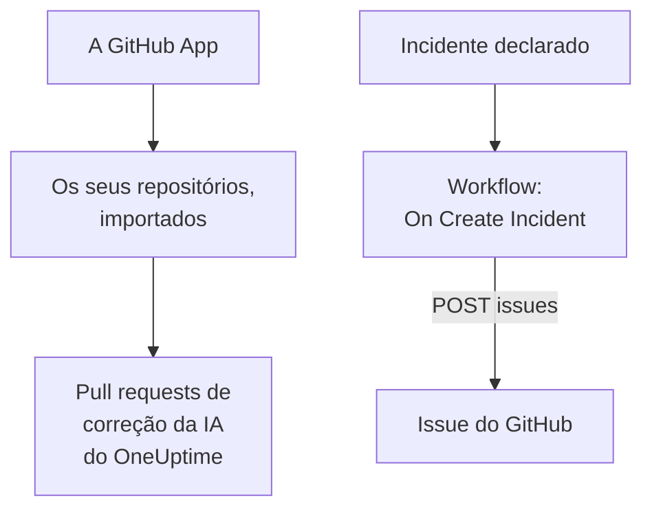

# GitHub

O OneUptime trabalha com o [GitHub](https://github.com) de duas formas. Conecte os seus repositórios pela GitHub App do OneUptime, e a IA do OneUptime abre pull requests que corrigem o que ela encontra, e responde quando você a menciona em uma issue ou em um pull request. Ou crie um workflow que abre uma issue do GitHub para cada incidente, para que o trabalho de acompanhamento fique registrado no repositório dono do serviço.

:::cards
- [Escolher como conectar](#escolher-como-conectar): A GitHub App ou um workflow, e o que cada um faz.
- [Conectar os seus repositórios](#conectar-os-seus-repositórios): A GitHub App, para pull requests de correção.
- [Abrir uma issue para cada incidente](#abrir-uma-issue-do-github-para-cada-incidente): Um workflow, dois blocos.
- [Solução de problemas](#solução-de-problemas): Quando o GitHub recusa uma requisição.
:::

## Como funciona



As duas são independentes, e você pode usar uma, a outra ou as duas. A GitHub App trabalha nos repositórios em que você a instala. O workflow só precisa de um token, e chama a [API REST](https://docs.github.com/en/rest/issues/issues#create-an-issue) do GitHub como qualquer outra API.

## Escolher como conectar

| Forma | O que faz | Do que precisa |
| --- | --- | --- |
| A GitHub App | Importa os seus repositórios. A IA do OneUptime abre neles pull requests que corrigem exceções, traces lentos e as causas que as investigações dela encontram, e responde a menções em issues e pull requests. | Uma organização ou conta em que instalar o app. No OneUptime Cloud, o plano **Growth**. |
| Um workflow | Abre uma issue do GitHub para cada incidente, no repositório que você escolher. | Um token do GitHub que possa criar issues, e um workflow de dois blocos. |

## Conectar os seus repositórios

Abra **Produtos → Código** e clique em **Conectar o GitHub**. O GitHub pergunta onde instalar o app e quais repositórios ele pode usar. Cada repositório da instalação é importado, e se mantém em dia quando você adiciona repositórios à instalação ou os retira.

Se o app já estiver instalado na conta, para outro projeto ou direto pelo GitHub, clique em **Conectar uma instalação existente**, abaixo de **Conectar o GitHub**, em vez de instalá-lo de novo. Isso exige uma conta do GitHub que administre a instalação: o dono de uma conta pessoal, ou alguém com permissão de admin em todos os repositórios que a instalação pode acessar, como tem um proprietário da organização.

Uma instância auto-hospedada precisa primeiro de uma GitHub App própria: [Integração com GitHub](/docs/self-hosted/github-integration) mostra como criá-la. A partir daí, a IA abre pull requests nos seus repositórios a partir de [Código](/docs/ai/ai-agent), e a página [GitHub App](/docs/ai/github-app) mostra o que o app faz quando você o menciona em uma issue ou em um pull request.

## Antes de começar

O restante desta página monta o workflow. Ele precisa de:

- Um token do GitHub que possa criar issues no repositório: um personal access token fine-grained para esse repositório, com a permissão **Issues** em **Read and write**, ou um token clássico com o escopo `repo`. Crie um nas [configurações de tokens](https://github.com/settings/tokens) do GitHub.
- No OneUptime, permissão para criar workflows e variáveis globais. No OneUptime Cloud, os workflows exigem o plano **Growth** ou superior.

## Guardar o token

:::steps
1. Vá para **Fluxos de trabalho → Variáveis globais** e clique em **Criar: Fluxo de trabalho Variável**.
2. Dê o nome `GITHUB_TOKEN` e clique em **Próximo**.
3. Cole o token em **Conteúdo**, ative **Segredo** e clique em **Criar: Fluxo de trabalho Variável**.
:::

Uma variável secreta é substituída por `[REDACTED]` nos logs de execução, então o token nunca aparece em uma execução.

## Abrir uma issue do GitHub para cada incidente

:::steps
### Criar o workflow

Vá em **Fluxos de trabalho**, clique em **Criar fluxo de trabalho** e depois em **Começar do zero**. Dê o nome `Incidents to GitHub` e clique em **Criar fluxo de trabalho**.

### Adicionar o gatilho

Clique no bloco tracejado **Escolha o que inicia este fluxo de trabalho** e escolha **On Create Incident**. Clique no gatilho: os seus **Fields to pass on** começam com **Título**, então clique em **Adicionar campo** e escolha **Descrição** e **Incident Number With Prefix**.

### Abrir a issue

Clique em **Adicionar componente**, adicione um bloco **API Post (JSON)** e conecte a ele o ponto **Success** do gatilho. Defina a **URL** dele como `https://api.github.com/repos/your-org/your-repo/issues`, com o dono e o nome do seu repositório. Em **Mais campos**, defina os **Request Headers** dele como:

```json
{
  "Authorization": "Bearer {{global.variables.GITHUB_TOKEN}}",
  "Accept": "application/vnd.github+json",
  "X-GitHub-Api-Version": "2022-11-28"
}
```

E o **Request Body** como:

```json
{
  "title": "{{local.components.incident-on-create-1.returnValues.model.title}}",
  "body": "{{local.components.incident-on-create-1.returnValues.model.description}}\n\nOpened by OneUptime for incident {{local.components.incident-on-create-1.returnValues.model.incidentNumberWithPrefix}}.",
  "labels": ["incident"]
}
```

### Testar e depois ativar

Clique em **Executar fluxo de trabalho**, escolha um incidente de teste em **Incidente** e execute. A etapa **API Post (JSON)** mostra uma resposta `201` com a nova issue, com o `number` e o `html_url` dela. Depois ative **Habilitado** no topo do **Construtor**.
:::

A issue continua aberta quando o incidente é resolvido, já que o trabalho de acompanhamento costuma durar mais que o incidente. Para tickets que acompanham o incidente nos dois sentidos, veja [Jira](/docs/integrations/jira).

## Dicas

- **GitHub Enterprise Server.** Envie a requisição para o seu servidor em vez disso: `https://your-github-host/api/v3/repos/your-org/your-repo/issues`. Um servidor em um endereço de rede privado precisa de um OneUptime auto-hospedado cujo administrador o permita: veja [Acesso de rede para fora](/docs/workflows/configuration#acesso-de-rede-para-fora).
- **Atribua.** Adicione `"assignees": ["octocat"]` ou `"milestone": 3` ao corpo. O GitHub descarta sem aviso rótulos, responsáveis e marcos quando o token não pode fazer push no repositório.
- **Só alguns incidentes.** Coloque um bloco **If / Else** entre o gatilho e o bloco de API, e abra issues só no lado **Yes** dele, por exemplo para uma gravidade.

## Solução de problemas

A etapa **API Post (JSON)** segue por **Error** quando o GitHub recusa a requisição. O **Response Status** e o **Response Body** dela na execução dizem por quê.

:::details O GitHub responde 401
O token está errado, expirou ou foi revogado. Crie um novo e substitua o conteúdo de `GITHUB_TOKEN`.
:::

:::details O GitHub responde 403
O token não pode criar issues ali: um token fine-grained sem **Issues** em **Read and write** para este repositório, um token que a sua organização não aprovou, ou um token clássico não autorizado para o single sign-on da sua organização. Um 403 cujo corpo fala de um limite de taxa significa que o token enviou requisições demais: espere, ou abra issues para menos incidentes.
:::

:::details O GitHub responde 404
O dono ou o repositório na **URL** está errado, ou o token não consegue ver o repositório. O GitHub responde 404, e não 403, para um repositório privado que um token não consegue ver.
:::

:::details O GitHub responde 410 ou 422
- `410`: as issues estão desativadas nas configurações do repositório.
- `422`: o GitHub não consegue ler o corpo. Verifique se ele é um JSON válido, se `title` está definido, e se `labels` e `assignees` são listas.
:::

## Próximos passos

:::cards
- [GitHub App](/docs/ai/github-app): Peça à IA do OneUptime uma mudança, uma revisão ou um review direto do GitHub.
- [GitLab](/docs/integrations/gitlab): O mesmo workflow, para issues do GitLab.
- [Componentes de workflow](/docs/workflows/components#api): Cada configuração dos blocos de API.
- [Visão geral das integrações](/docs/integrations/index): Os padrões por trás de cada integração.
:::
