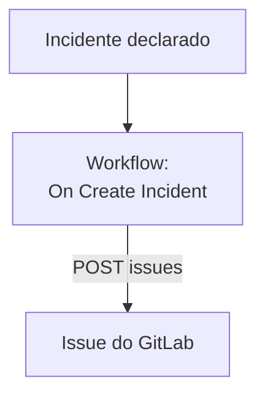

# GitLab

Abra uma issue do [GitLab](https://gitlab.com) para cada incidente do OneUptime, para que o trabalho de acompanhamento fique registrado no projeto dono do serviço. Um workflow chama a [API de issues](https://docs.gitlab.com/api/issues/#new-issue) do GitLab, no GitLab.com ou em um GitLab próprio.

:::cards
- [Guardar o token](#guardar-o-token): Mantenha o token do GitLab fora dos seus workflows.
- [Abrir uma issue para cada incidente](#abrir-uma-issue-do-gitlab-para-cada-incidente): Um workflow, dois blocos.
- [Dicas](#dicas): Um GitLab próprio, caminhos de projeto e responsáveis.
- [Solução de problemas](#solução-de-problemas): Quando o GitLab recusa uma requisição.
:::

> [!NOTE]
> A IA do OneUptime também trabalha em repositórios do GitLab: conecte-os no Código com um token de acesso, e ela abre um merge request para cada correção. Veja [Conectar um repositório](/docs/ai/ai-agent#conectar-um-repositório).

## Como funciona



O workflow roda uma vez para cada novo incidente. O bloco **API Post (JSON)** dele envia o título e a descrição do incidente para as issues do projeto, assinados com um token de acesso.

## Antes de começar

- O ID do projeto do GitLab. Na página de visão geral do projeto, selecione o menu de ações, os três pontos verticais, e depois **Copy project ID**.
- Um token de acesso do GitLab com o escopo `api`, para um usuário ou bot cuja função no projeto possa criar issues: um token de acesso de projeto, de grupo ou pessoal. Crie-o em **Settings → Access tokens** no projeto, no grupo ou nas configurações do seu usuário.
- No OneUptime, permissão para criar workflows e variáveis globais. No OneUptime Cloud, os workflows exigem o plano **Growth** ou superior.

## Guardar o token

:::steps
1. Vá para **Fluxos de trabalho → Variáveis globais** e clique em **Criar: Fluxo de trabalho Variável**.
2. Dê o nome `GITLAB_TOKEN` e clique em **Próximo**.
3. Cole o token em **Conteúdo**, ative **Segredo** e clique em **Criar: Fluxo de trabalho Variável**.
:::

Uma variável secreta é substituída por `[REDACTED]` nos logs de execução, então o token nunca aparece em uma execução.

## Abrir uma issue do GitLab para cada incidente

:::steps
### Criar o workflow

Vá em **Fluxos de trabalho**, clique em **Criar fluxo de trabalho** e depois em **Começar do zero**. Dê o nome `Incidents to GitLab` e clique em **Criar fluxo de trabalho**.

### Adicionar o gatilho

Clique no bloco tracejado **Choose what starts this workflow** e escolha **On Create Incident**. Clique no gatilho: os seus **Fields to pass on** começam com **Título**, então clique em **Adicionar campo** e escolha **Descrição** e **Incident Number With Prefix**.

### Abrir a issue

Clique em **Adicionar componente**, adicione um bloco **API Post (JSON)** e conecte a ele o ponto **Success** do gatilho. Defina a **URL** dele como `https://gitlab.com/api/v4/projects/12345678/issues`, com o ID do seu projeto no lugar de `12345678`. Em **Mais campos**, defina os **Request Headers** dele como:

```json
{
  "PRIVATE-TOKEN": "{{global.variables.GITLAB_TOKEN}}"
}
```

E o **Request Body** como:

```json
{
  "title": "{{local.components.incident-on-create-1.returnValues.model.title}}",
  "description": "{{local.components.incident-on-create-1.returnValues.model.description}}\n\nOpened by OneUptime for incident {{local.components.incident-on-create-1.returnValues.model.incidentNumberWithPrefix}}.",
  "labels": "incident,oneuptime"
}
```

### Testar e depois ativar

Clique em **Executar fluxo de trabalho**, escolha um incidente de teste em **Incidente** e execute. A etapa **API Post (JSON)** mostra uma resposta `201` com a nova issue, com o `iid` e o `web_url` dela. Depois ative **Habilitado** no topo do **Construtor**.
:::

O bloco envia JSON, então não precisa de cabeçalho `Content-Type`. O GitLab cria os rótulos que ainda não conhece, então `incident` e `oneuptime` não precisam de nenhuma preparação. A issue continua aberta quando o incidente é resolvido, já que o trabalho de acompanhamento costuma durar mais que o incidente.

## Dicas

- **Um GitLab próprio.** Envie a requisição para o seu servidor em vez disso: `https://gitlab.example.com/api/v4/projects/12345678/issues`. Um servidor em um endereço de rede privado precisa de um OneUptime auto-hospedado cujo administrador o permita: veja [Acesso de rede para fora](/docs/workflows/configuration#acesso-de-rede-para-fora).
- **O caminho do projeto no lugar do ID.** O caminho funciona no lugar do ID, com a `/` escrita como `%2F`: `projects/your-group%2Fyour-project/issues`. A URL é enviada exatamente como está escrita, então codifique-a você mesmo.
- **Atribua.** Adicione `"assignee_ids": [42]` ou `"due_date": "2026-12-31"` ao corpo, ou `"confidential": true` para mostrá-la só aos membros do projeto.
- **Só alguns incidentes.** Coloque um bloco **If / Else** entre o gatilho e o bloco de API, e abra issues só no lado **Yes** dele, por exemplo para uma gravidade.

## Solução de problemas

A etapa **API Post (JSON)** segue por **Error** quando o GitLab recusa a requisição. O **Response Status** e o **Response Body** dela na execução dizem por quê.

:::details O GitLab responde 401
O token está errado, expirou ou foi revogado. Crie um novo e substitua o conteúdo de `GITLAB_TOKEN`.
:::

:::details O GitLab responde 403
O token não tem o escopo `api`, ou a função do usuário dele no projeto não pode criar issues. O corpo cita `insufficient_scope` quando é o escopo.
:::

:::details O GitLab responde 404
O ID do projeto na **URL** está errado, ou o token não consegue ver o projeto. O GitLab responde 404, e não 403, para um projeto privado que um token não consegue ver.
:::

:::details O GitLab responde 400
O GitLab não consegue ler o corpo: falta `title`, ou um campo tem o tipo errado. O corpo cita o campo.
:::

## Próximos passos

:::cards
- [GitHub](/docs/integrations/github): O mesmo workflow para o GitHub, e a GitHub App.
- [Componentes de workflow](/docs/workflows/components#api): Cada configuração dos blocos de API.
- [Execuções de workflow](/docs/workflows/runs-and-logs): Leia o que cada requisição enviou e recebeu.
- [Visão geral das integrações](/docs/integrations/index): Os padrões por trás de cada integração.
:::
