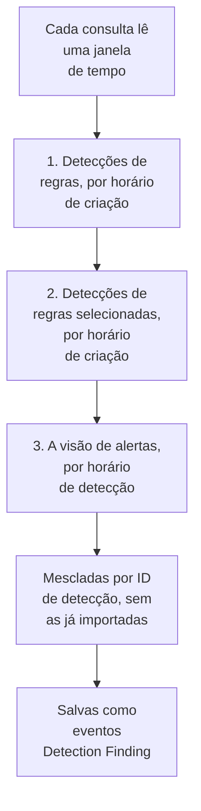

# Google SecOps

Traga os alertas e as detecções do [Google SecOps](https://cloud.google.com/security/products/security-operations) (antigo Chronicle) para os eventos de segurança do OneUptime. Lá você os pesquisa ao lado dos seus logs, traces e métricas, correlaciona-os com todas as outras fontes e aciona o plantão para os que importam.

:::cards
- [Escolher como conectar](#escolher-como-conectar): Um webhook de um playbook do SOAR, o conector gerenciado ou o encaminhamento de UDM.
- [Configurar o conector gerenciado](#configurar-o-conector-gerenciado): Uma chave de conta de serviço e o formulário da conexão.
- [Como o conector consulta](#como-o-conector-consulta): Três leituras de cada janela, e os orçamentos delas.
- [Solução de problemas](#solução-de-problemas): O que o Last Error diz e o que fazer.
- [Enviar eventos de segurança ao Google SecOps](#enviar-eventos-de-segurança-ao-google-secops): As detecções do OneUptime, no Google SecOps.
:::

## Escolher como conectar

| Caminho | O que chega | Use quando |
| --- | --- | --- |
| Um webhook de um playbook do SOAR | Cada alerta que um playbook publica, em segundos | Você roda playbooks do SOAR e quer os alertas deles no OneUptime sem consultas. |
| O conector gerenciado | Os alertas, e as detecções de regras se você quiser, consultados em um intervalo | Você quer que o OneUptime os busque por você, sem nada a configurar no SecOps. |
| O encaminhamento de eventos UDM | Eventos UDM brutos, para pesquisa e correlação completas | Você já exporta eventos UDM e quer todos eles. |

Cada caminho normaliza o que chega para [OCSF](https://schema.ocsf.io/), o Open Cybersecurity Schema Framework em que o OneUptime armazena todo evento de segurança, para que regras de detecção e painéis funcionem da mesma forma qualquer que seja a fonte.

## Antes de começar

- Para o conector gerenciado, no OneUptime, a função Project Owner, Project Admin ou Security Admin. As funções Security Member e Security Viewer podem ler as conexões, mas não criá-las.
- Para o webhook e o encaminhamento de UDM, uma chave de ingestão: abra **Configurações do projeto → Telemetria e APM → Chaves de ingestão** e clique em **Criar chave de ingestão**.
- Para o conector gerenciado, permissão para criar uma conta de serviço do Google Cloud no projeto ao qual a sua instância do SecOps está vinculada.

## Enviar alertas de um playbook do SOAR

Os playbooks do SOAR do Google SecOps podem publicar alertas em qualquer endpoint HTTP. Aponte um para a ingestão de eventos de segurança do OneUptime.

:::steps
### Adicionar uma ação HTTP request

No seu playbook do SOAR do SecOps, adicione uma ação **HTTP request** que rode com os novos alertas.

### Apontá-la para o OneUptime

Defina o **Method** dela como `POST` e a **URL** como `https://oneuptime.com/security-events/v1/ingest`, ou `https://<your-host>/security-events/v1/ingest` em uma instalação auto-hospedada. Adicione estes cabeçalhos:

```text
Content-Type: application/json
x-oneuptime-token: <your telemetry ingestion key>
```

Envie o JSON do alerta como **Body**. Uma detecção, os detalhes da regra com os eventos UDM correspondentes em `collectionElements`, é reconhecida sozinha, salva como um evento Detection Finding, e os usuários, hosts e IPs dos eventos correspondentes dela são mantidos como observáveis.

### Verificar que os alertas chegam

Rode o playbook. Os alertas dele aparecem em **Produtos → Security Events** em segundos.
:::

## Encaminhar eventos UDM

Para pesquisa e correlação completas, encaminhe os próprios eventos UDM, por exemplo a partir de um pipeline de exportação do BigQuery, de uma Cloud Function ou de qualquer encaminhador que você já rode:

```bash
curl -X POST "https://oneuptime.com/security-events/v1/ingest?format=udm" \
  -H "Content-Type: application/json" \
  -H "x-oneuptime-token: <your telemetry ingestion key>" \
  -d '{
    "events": [
      {
        "metadata": {
          "event_type": "USER_LOGIN",
          "event_timestamp": "2026-08-21T10:00:00Z",
          "vendor_name": "Google",
          "product_name": "Google SecOps"
        },
        "principal": { "user": { "userid": "alice" }, "ip": ["203.0.113.7"] },
        "target": { "hostname": "vpn-gw-01" },
        "security_result": [{ "severity": "HIGH", "action": ["BLOCK"] }]
      }
    ]
  }'
```

- `format` pode ser `udm`, `ocsf`, `google-secops-alert` ou `generic`. Se você o omitir, o formato é detectado evento por evento.
- O corpo pode ser um evento, uma lista de eventos ou `{ "events": [...] }`.
- `x-oneuptime-service-name` nomeia o serviço de telemetria ao qual os eventos pertencem. Sem ele, eles pertencem ao serviço com o nome do produto do payload.

## Configurar o conector gerenciado

O OneUptime consulta as detecções e os alertas do seu locatário em um intervalo, sem configuração no SOAR. O Google SecOps é um provedor das Security Event Connections, então ele é criado, testado, consultado e diagnosticado na mesma página e do mesmo jeito que qualquer outro conector gerenciado.

:::steps
### Criar uma chave de conta de serviço

No Google Cloud, crie uma conta de serviço no projeto ao qual a sua instância do SecOps está vinculada e conceda a ela a função **Chronicle API Viewer** (`roles/chronicle.viewer`). Essa função inclui as permissões `legacySearchDetections`, `legacySearchCuratedDetections`, `countAllCuratedRuleSetDetections` e `legacyFetchAlertsView` com que o conector lê.

Na aba **Keys** da conta de serviço, adicione uma chave do tipo **JSON** e faça o download. Você cola o arquivo inteiro na conexão. O `token_uri` dela precisa ser uma URL `https` em um host do Google, o que uma chave baixada do Google Cloud já é.

### Encontrar a região e o nome do recurso da instância

No Google SecOps, abra **SIEM Settings → Profile**. O nome do recurso da instância tem o formato `projects/{project}/locations/{location}/instances/{instance}`, em que o componente da instância é o ID da instância do SecOps; um nome de exibição da conexão ou o nome de uma conta de serviço não o substitui. A região é o endpoint regional que atende essa localização, e ela precisa corresponder ao segmento locations do nome do recurso da instância, ou a conexão é recusada ao salvar.

### Adicionar a conexão

Abra **Produtos → Security Events → Conexões** (`/dashboard/{projectId}/security-events/connections`), selecione **Adicionar conexão**, escolha **Google SecOps** e preencha o formulário com as configurações da tabela abaixo.

### Testar antes de salvar

Selecione **Testar estas configurações** em **Testar antes de salvar** antes de salvar. O teste roda com os valores do formulário sem salvar nada, então uma chave malformada, uma função que falta ou uma instância errada são detectadas antes de a conexão existir. No formulário de edição, o mesmo botão testa a **Região**, o **Nome do recurso da instância** e o **Data to import** mostrados na tela com a chave salva; um campo de credencial deixado em branco mantém a chave salva. Quando algo testado difere do que a conexão tem salvo, inclusive uma chave recém-informada, nenhuma linha do histórico de execuções é registrada, porque a conexão ainda não tem essas configurações.
:::

| Configuração | Onde encontrar | Obrigatória |
| --- | --- | --- |
| **Região** | O endpoint regional do Google SecOps (`us`, `europe`, `asia-southeast1`, ...) que corresponde à localização no nome do recurso da sua instância. Não há padrão, para que um locatário fora dos EUA não salve o endpoint errado por acidente. | Sim |
| **Nome do recurso da instância** | No Google SecOps, **SIEM Settings → Profile**: `projects/{project}/locations/{location}/instances/{instance}`. | Sim |
| **Fechar os alertas quando o caso deles for fechado** | Na última etapa do formulário, desativado até você ativá-lo. Ativado, fechar um caso fecha os alertas do Google SecOps dele: veja [Fechar os alertas quando o caso deles for fechado](#fechar-os-alertas-quando-o-caso-deles-for-fechado). | Não |
| **JSON da conta de serviço** | Google Cloud, a aba **Keys** da conta de serviço. Cole o arquivo de chave JSON inteiro. Somente gravação: criptografado em repouso, nunca devolvido pela API, nunca mais mostrado na página. Use **Atualizar credenciais** na conexão para trocá-lo. | Sim |
| **Data to import** | Os **Alertas** são sempre importados, porque a API de alertas do Google sempre os devolve. Selecione **Detecções** para importar também as correspondências de regras que não geraram alerta. Isso não encaminha eventos UDM brutos: encaminhe-os você mesmo, como acima. | Alertas sempre |

A etapa de consulta do formulário pede um **Nome**, uma **Descrição** opcional, a configuração **Habilitado** da conexão e o **Intervalo de consulta (minutos)**: um número inteiro de `1` a `1440`, padrão `5`. Qualquer valor fora desse intervalo é recusado ao salvar.

As novas detecções são importadas como eventos Detection Finding atribuídos a um serviço de telemetria `Google SecOps`.

## Ler a saúde da conexão

A lista de conexões mostra **Nome**, **Provedor** (com a seleção Data to import da conexão embaixo), **Status** (Enabled ou Disabled), **Integridade**, **Intervalo (minutos)**, **Última consulta**, **Última consulta bem-sucedida** e **Último evento importado**. Quando uma conexão tem um erro, **Ver erro** aparece na coluna **Ações** dela, ao lado de **Testar conexão**, **Executar agora**, **Diagnóstico**, **Editar** e **Atualizar credenciais**. Enabled significa que a consulta automática está configurada. Last Polled registra uma tentativa; uma janela vazia bem-sucedida não comprova que uma detecção específica foi importada.

**Integridade** mostra **Last poll succeeded** só depois que um evento é importado. Até lá, uma conexão que funciona mostra **Polling, no events imported yet**, o estado a investigar com Testar conexão. Os outros estados são **No records returned**, **Partial import**, **Catching up**, **Last poll failed**, **Poll overdue**, **Schedule paused** e **Aguardando a primeira consulta**; passe o mouse sobre um estado para ver o que ele significa.

> [!NOTE]
> O conector usa as APIs legadas de detecções e alertas `v1alpha` do Chronicle, que o Google entrega como pré-GA. Quando uma consulta falha, o campo **Último erro** da conexão guarda a mensagem de erro completa, com as credenciais ocultadas, atrás de um prefixo que nomeia a etapa que falhou, inclusive no caso em que o Chronicle responde `200` e põe a recusa no corpo. Selecione **Ver erro** na coluna **Ações** da conexão para ler a mensagem e depois **Copiar erro** na caixa de diálogo para copiá-la para o suporte.

## Como o conector consulta



Uma vez por minuto, um worker em segundo plano enfileira uma consulta para cada conexão habilitada cujo intervalo já passou desde a última consulta. Cada consulta é uma execução no histórico da conexão, feita por um worker. Ela lê uma janela de tempo de três formas e mescla os resultados por ID de detecção, para que um registro devolvido por mais de uma passada seja salvo uma única vez:

1. **Detecções de regras por horário de criação.** `legacy:legacySearchDetections` com `ruleId=-` (cada revisão de cada regra) e `listBasis=CREATED_TIME`, seguindo `nextPageToken` até a página ser a última.
2. **Detecções de regras selecionadas por horário de criação.** `legacy:legacySearchCuratedDetections`, do mesmo jeito, uma vez por regra selecionada (escrita pelo Google). Esse endpoint aceita um único ID de regra selecionada (`ur_...`) e não tem curinga de "todas as regras", então a passada chama primeiro `:countAllCuratedRuleSetDetections` para a semana anterior à janela até o fim dela, e pesquisa cada regra selecionada que produziu detecções. Uma regra selecionada que não disparou nessa semana não tem nada a importar. Um locatário sem acesso às regras selecionadas responde a essa passada com `400`, `403` ou `404`; isso é registrado como um aviso na execução, não como uma falha.
3. **A visão de alertas por horário de detecção.** `legacy:legacyFetchAlertsView`, que cobre alertas de telemetria, alertas do SOAR e alertas de inteligência de máquina, além dos alertas de regras. O endpoint não tem paginação, então uma resposta que o Google limita é dividida em janelas menores e lida de novo.

A visão de alertas só consegue filtrar por horário de detecção, e o Google muitas vezes deixa um alerta legível bem depois do horário de detecção dele (atraso de ingestão, regras agendadas, novas execuções sobre dados atrasados). Por isso uma consulta agendada também **varre a visão de alertas nas 24 horas antes da janela dela**, só alertas, registrada como a verificação **Read late alerts by detection time**. Os registros já importados são pulados, então as repetições dessa varredura aparecem em **Already imported**. A varredura é feita na medida do possível: quando o Google a limita, o orçamento dela se esgota ou ela falha, a execução recebe um aviso, mas a consulta não fica Partial nem Falhou e o cursor avança mesmo assim, porque o dia que ela revisita já foi lido por consultas anteriores.

Consultar por **horário de criação** é todo o desenho. Uma regra do Google SecOps roda em uma programação (a cada 10 minutos, a cada hora, todo dia), e a detecção que ela cria traz um `detectionTime` que é o fim da janela de tempo da regra ou o horário do evento correspondente, enquanto `createdTime` é quando o mecanismo de detecção de fato a produziu. Uma detecção criada às 10:05 para uma janela que termina às 09:00 tem um horário de detecção que já está atrás de um cursor que passou das 09:00 várias consultas atrás, então um conector que consulta por horário de detecção nunca a vê, nem nenhum evento que chegue atrasado. Ler por horário de criação faz cada consulta perguntar "o que o Google criou desde a última vez que olhei", que é a pergunta que tem resposta. Cada execução registra o atraso de criação dela, quantos registros buscados foram criados mais de um intervalo de consulta (mais um minuto) depois do horário de detecção deles, e a maior diferença, para que o efeito fique visível em Diagnostics.

A primeira consulta de uma nova conexão olha **24 horas** para trás por horário de criação. Cada consulta seguinte retoma a partir do cursor salvo da conexão com uma sobreposição de **1 minuto**; um registro criado na fronteira de uma janela é lido pelas duas consultas e salvo uma vez, porque as consultas pulam os eventos já salvos com o mesmo identificador de origem. Cada consulta agendada lê no máximo **24 horas** além do cursor, então uma conexão com um cursor salvo mais antigo se atualiza em janelas consecutivas de 24 horas (Health mostra **Catching up**) em vez de descartar as detecções intermediárias. Use **Import this time range** em Diagnostics para os registros criados antes da primeira janela de 24 horas.

### Quando uma janela contém mais do que uma consulta consegue ler

O conector dá a cada consulta orçamentos fixos: a passada de detecções de regras tem **20** páginas de pesquisa, a passada de regras selecionadas até **200** requisições (a contagem mais pelo menos uma página por regra selecionada que disparou na última semana, primeiro as regras mais ativas), a visão de alertas e a varredura de alertas atrasados dela dividem **16** requisições, e a leitura inteira para depois de **4 minutos**. A passada de regras selecionadas não começa mais nenhuma regra selecionada depois de gastos 60% desse tempo, para que a visão de alertas ainda rode. Quando uma consulta não consegue pesquisar todas as regras selecionadas ativas, ela registra um aviso dizendo quantas não foram pesquisadas em vez de segurar o cursor, porque uma janela mais curta ainda teria todas essas regras a pesquisar. Uma passada que um orçamento interrompeu no meio é registrada como uma verificação de aviso que nomeia o orçamento (por exemplo `Read rule detections by created time was stopped by the request budget after 20 requests.`), e uma passada que o orçamento nunca deixou começar é uma verificação pulada com o mesmo motivo nos avisos da execução, nunca um sucesso. Uma janela com mais detecções do que isso não pode ser lida em uma consulta, e a consulta nunca relê a mesma janela para sempre:

1. **Reduzir.** Os endpoints de pesquisa do Google devolvem primeiro as detecções mais novas, então uma consulta que para cedo não tem um ponto de onde retomar. A consulta é registrada como **Parcial**, o cursor fica onde estava e a consulta seguinte lê uma janela com a metade do tamanho a partir do mesmo ponto de partida, com o aviso `This window holds more records than one poll can read; the next poll reads a {n} minute window from the same starting point.` A divisão pela metade continua até um minuto, até que uma janela caiba.
2. **Voltar a crescer.** Cada consulta completa dobra a janela seguinte, até o máximo de 24 horas, para que uma rajada custe algumas consultas curtas em vez de uma conexão lenta para sempre.
3. **Passar de um único minuto.** Se até um minuto contém mais detecções do que uma consulta consegue ler, a consulta move o cursor para além desse minuto para que as detecções mais novas continuem chegando. A execução fica **Parcial** e o mesmo texto abre o **Último erro**: `More records were created in the one minute from {start} to {end} than one poll can read. Polling moved past this minute so newer records keep arriving; use Import this time range in Diagnostics on this minute to recover what one run can read.` Para recuperar o que uma execução consegue ler, abra **Diagnóstico**, escolha um intervalo personalizado que cubra esse minuto (os campos do intervalo usam o seu horário local; a mensagem está em UTC) e rode **Import this time range**; uma importação tem os mesmos limites por execução que uma consulta. As detecções já importadas são puladas.

Uma consulta Partial também guarda os avisos dela no **Último erro**, onde eles ficam até uma consulta completa limpá-los. Uma consulta que falha por completo (um erro, não registros demais) mantém o cursor e o tamanho da janela e é tentada de novo no ciclo seguinte. A única exceção é uma requisição que expirou: a consulta seguinte lê uma janela com a metade do tamanho a partir do mesmo ponto de partida (`The source did not answer in time for this window; the next poll reads a {n} minute window from the same starting point.`), porque uma janela pesada demais para ser respondida a tempo expiraria de outro modo a cada nova tentativa. Encurtar o intervalo de consulta não muda nada disso: a janela é decidida pelo cursor e pelo resultado da última consulta, não pela frequência das consultas.

## Testar conexão

**Testar conexão**, na linha da conexão ou em **Diagnóstico**, roda de forma síncrona no processo da API. Ele não precisa de um worker em segundo plano, e é exatamente por isso que consegue dizer quando nenhum worker está rodando. A lista de verificações:

1. **Configuração**: cada campo está presente e bem formado: uma **Região** suportada que corresponde à localização da instância, um **Nome do recurso da instância** no formato certo e uma chave **JSON da conta de serviço** com `client_email`, uma `private_key` legível e um `token_uri` do Google. Nada é contatado se isso falhar.
2. **Authenticate with Google**: a chave é trocada por um token de acesso no endpoint OAuth do Google, antes de o Chronicle ser contatado.
3. **Read rule detections**, **Read curated rule detections** e **Read the alerts view**: uma sondagem de um único registro de cada passada nas últimas 24 horas. A verificação de regras selecionadas lê as contagens das regras selecionadas dos últimos 7 dias e sonda a regra selecionada com mais detecções; se nenhuma regra selecionada disparou nessa semana, ela passa sem nada a sondar. Uma leitura de regras selecionadas respondida com `400`, `403` ou `404` é um aviso, porque o locatário pode simplesmente não ter acesso às regras selecionadas.
4. **Detections available to import**: o que o Google tem com a seleção **Data to import** salva e com a outra (só Alertas, ou Alertas e **Detecções**) nas últimas 24 horas e nos últimos 7 dias: a contagem de correspondências da visão de alertas e uma página de pesquisa por horário de criação por intervalo, informada como um número ou como `1000+`. Quando a seleção salva não tem nada mas a outra tem, a verificação avisa: as suas regras criam detecções, mas os alertas não estão habilitados nelas. Edite a conexão e selecione **Detecções** em **Data to import**, ou habilite os alertas nas regras do Google SecOps.
5. **Background workers**, **Poll scheduler** e **Security event storage**: se algum processo está consumindo a fila Worker do OneUptime, se o job de consulta de cada minuto está registrado e se o armazenamento de eventos de segurança responde à mesma busca de duplicatas que a consulta faz antes de cada inserção, para que um banco de dados analítico quebrado falhe aqui com um nome, e não uma hora depois como erro de consulta.
6. **Scheduled polling** (só conexões salvas): se a consulta está habilitada, se uma execução enfileirada está presa esperando um worker e se a conexão está sendo consultada no horário.

Cada requisição de um teste tem um prazo de 20 segundos. Os testes não mexem no cursor de consulta nem no armazenamento de eventos. Uma conexão salva testada com as configurações salvas dela ganha uma linha do histórico de execuções do tipo test, e os detalhes da linha mostram a mesma lista de verificações.

## Pré-visualizar, executar e importar sob demanda

Abra **Diagnóstico** em uma conexão para ver as execuções recentes e operar o conector. Os proprietários do projeto, os administradores do projeto e os administradores de segurança podem iniciar operações. Os membros e leitores de segurança podem ler o histórico.

- **Executar agora** enfileira uma consulta na hora, usando o cursor e o caminho de ingestão normais, mesmo quando a consulta agendada está desabilitada. Os estados na fila e em execução continuam visíveis enquanto o worker executa a requisição. Se uma execução continuar na fila, verifique que há workers processando a fila Worker; a verificação **Background workers** do Testar conexão diz se algum processo está fazendo isso.
- **Preview detections** lê um intervalo de tempo escolhido sem importar nem mudar o cursor. Use a última hora, 24 horas, 7 dias ou um intervalo personalizado de até 7 dias. O intervalo corresponde à visão de alertas do SecOps, que lê por horário de detecção, e as duas passadas de pesquisa leem as detecções criadas nele além das detecções cujo horário de detecção cai nele, então pré-visualizar ontem mostra também detecções criadas ontem sobre eventos mais antigos. A pré-visualização mostra o horário de detecção e o horário de criação separadamente. Os resultados seguem a seleção **Data to import** salva da conexão.
- **Import this time range** importa o intervalo escolhido, depois que você confirma, sem mover o cursor de consulta. É também assim que você recupera um minuto que a consulta pulou, como descrito acima. Pré-visualize o intervalo primeiro. Consultas e importações repetidas pulam os eventos já salvos com o mesmo identificador de origem no projeto. As importações podem acionar as regras de detecção e os monitores configurados, exatamente como a consulta agendada.

Os detalhes de cada execução mostram a **Requested window (UTC)**, a seleção **Data to import** da conexão e cinco contagens:

| Contagem | O que ela conta |
| --- | --- |
| **Returned by Google SecOps** | Os registros que o Google devolveu nas três passadas, depois de mesclados por ID. |
| **Imported into OneUptime** | As linhas gravadas no armazenamento de eventos. |
| **Already imported** | Os registros pulados porque o mesmo identificador de origem já está salvo neste projeto; a sobreposição de 1 minuto e as novas execuções tornam isso normal. |
| **Rejeitado** | Os objetos devolvidos que não são detecções do Google SecOps. Eles são contados e geram aviso, nunca são tentados de novo e não seguram o cursor. |
| **Falhou** | Os registros que não puderam ser normalizados. Uma consulta os tenta de novo em uma janela mais curta. |

Os **Provider details** acrescentam o **Time basis read**, os registros **Returned by each pass** (detecções de regras, detecções de regras selecionadas e a visão de alertas) e o **Creation lag**. Depois vêm as verificações, uma por passada, os avisos e exemplos de detecções. Os detalhes de uma consulta agendada mostram também a **Window read by this poll** e o que a **Next scheduled poll reads**, e uma consulta Partial diz se manteve o ponto de partida e reduziu a janela seguinte ou se passou de um único minuto que ela nomeia. **Sucesso**, **No records returned**, **Parcial** e **Falhou** são resultados distintos.

Use **View events in this time range** em uma execução para abrir o intervalo de tempo de evento das detecções que ela devolveu. Do contrário, uma detecção criada hoje com o horário de detecção de ontem pode ficar escondida por um filtro de eventos recentes. O histórico de execuções preserva as falhas depois que uma consulta completa posterior limpa o Last Error. Use **Copy diagnostics** ao contatar o suporte; as credenciais da conta de serviço e os tokens nunca são incluídos.

## Por que não vejo eventos?

Siga estes pontos em ordem. Cada um se distingue do seguinte em **Diagnóstico** ou com **Testar conexão**.

1. **Data to import.** Por padrão só os **Alertas** são importados, e uma detecção de regra só é um alerta quando os alertas estão habilitados na regra no Google SecOps. Um locatário cujas regras criam detecções sem alertas consulta honestamente vazio para sempre. Rode **Testar conexão**: a verificação **Detections available to import** conta com e sem **Detecções** e diz quando selecioná-las acrescentaria registros. Edite a conexão e selecione **Detecções** em **Data to import**, ou habilite os alertas nas regras.
2. **Frequência de execução das regras e latência de detecção.** As detecções são criadas quando a regra roda, o que pode ser até uma hora ou um dia depois dos eventos que elas descrevem. O conector consulta por horário de criação, então elas chegam na primeira consulta depois que o Google as cria, não no horário de detecção delas. Uma regra que você acabou de habilitar ainda não criou nada, e um locatário tranquilo não tem nada a criar. A verificação de disponibilidade informa quantas detecções foram criadas nas últimas 24 horas e nos últimos 7 dias; zero com e sem **Detecções** significa que o Google ainda não tem nada para o OneUptime importar.
3. **Leia as contagens da última execução.** Em Diagnostics, **Returned by Google SecOps** com zero em **Imported into OneUptime** e uma contagem **Already imported** correspondente é o conector funcionando como projetado: essas detecções foram importadas por uma consulta anterior. Os registros **Rejeitado** são objetos que o Google devolveu e que nem são detecções.
4. **Alguma consulta está rodando?** Last Polled mostrando `Never` com um Last Error vazio significa que nenhuma consulta terminou para essa conexão. Testar conexão informa **Background workers** (os processos que consomem a fila Worker), **Poll scheduler** (o registro do agendador de cada minuto) e **Scheduled polling** (a programação própria dessa conexão, inclusive uma consulta atrasada ou uma execução presa na fila). Veja a entrada de solução de problemas abaixo para as configurações de deployment que causam isso.
5. **Procure no lugar certo.** Os eventos são salvos pelo horário de detecção, que pode ser horas ou dias antes do momento em que foram criados e importados, então um filtro de "última hora" em Security Events esconde uma detecção importada há um minuto sobre algo de ontem. Use **View events in this time range** em uma execução em Diagnostics: ele abre o intervalo de tempo de evento das detecções que essa execução devolveu.

## Como a gravidade é definida

O Google SecOps guarda a gravidade de uma detecção em lugares diferentes conforme quem escreveu a regra, e o OneUptime os lê nesta ordem, usando o primeiro que nomeia uma gravidade:

1. **A gravidade do próprio Google** (`detection[].severity`). O Google a define nas regras selecionadas, como Applied Threat Intelligence e os conjuntos de regras selecionadas.
2. **A gravidade do alerta** (a `severity` da Collection), para alertas do SOAR e corpos de webhook.
3. **A gravidade `meta` da regra.** Para uma regra YARA-L personalizada, o Google deixa `detection[].severity` vazio e devolve a seção `meta` da regra como `ruleLabels`. O OneUptime lê o rótulo `severity`, que é o valor que o painel de regras do Google SecOps mostra. Info, Informational, Low, Medium, High e Critical são reconhecidos, em maiúsculas ou minúsculas.
4. **O resultado `$risk_score` da regra**, se a regra não define nenhuma gravidade, classificado com as [faixas recomendadas pelo Google](https://docs.cloud.google.com/chronicle/docs/yara-l/outcome-syntax): 90–100 Critical, 80–89 High, 50–79 Medium, 20–49 Low, 1–19 Informational. O OneUptime só usa uma pontuação que a própria regra define. Ele ignora o `riskScore` que o Google preenche para regras sem um (40 para regras que geram alertas, 15 nos outros casos), porque esse padrão não diz nada sobre a gravidade da detecção.

Uma detecção que nenhum desses classifica aparece como Unknown. Para classificar uma regra personalizada, adicione uma gravidade à seção `meta` dela no Google SecOps, por exemplo `severity = "High"`, ou defina `$risk_score` na seção `outcome` dela. As detecções que a regra criar depois disso são importadas com essa gravidade.

## Fechar os alertas quando o caso deles for fechado

Com **Fechar os alertas quando o caso deles for fechado** ativado, fechar um [caso de segurança](/docs/telemetry/security-cases#fechar-um-caso) fecha os alertas do Google SecOps de onde ele veio. Cada alerta é marcado como fechado com o veredito do caso, um True Positive como malicioso e um False Positive ou Benign Positive como não malicioso, junto com a nota de fechamento do caso e um link de volta para o caso. A linha do tempo do caso diz quantos alertas foram fechados.

- A conta de serviço precisa de `chronicle.legacies.legacyUpdateAlert`, que o papel `roles/chronicle.editor` tem. O papel `roles/chronicle.viewer` lê alertas, mas não consegue fechá-los, e um `403` aparece no caso.
- Um alerta que o Google SecOps não tem mais é ignorado. Quando o Google SecOps não pode ser alcançado, o OneUptime tenta de novo por cerca de uma hora e depois escreve no caso o que não conseguiu fechar.

## Vigie seus outros eventos em busca dos indicadores dele

Um [feed de inteligência de ameaças](/docs/telemetry/threat-intelligence#como-o-google-secops-é-lido) cuja **Origem** é **Google SecOps** lê, por esta conexão, os indicadores que a inteligência de ameaças do Google SecOps encontrou nos eventos dele, e vigia o resto dos eventos do seu projeto em busca deles: os logins, os fluxos de rede e os eventos de endpoint que o Google SecOps nunca viu.

## Enviar eventos de segurança ao Google SecOps

O OneUptime também pode enviar o que encontra ao Google SecOps, para que o SIEM em que sua equipe trabalha veja as detecções do OneUptime ao lado das próprias. Cada evento de segurança é importado como um evento UDM: um login como `USER_LOGIN`, a inicialização de um processo como `PROCESS_LAUNCH`, uma conexão de rede como `NETWORK_CONNECTION` e todo o resto como `GENERIC_EVENT`, com sua severidade, suas tags do MITRE ATT&CK e a regra que o encontrou.

:::steps
### Criar uma chave que possa importar eventos

No Google Cloud, crie uma conta de serviço no projeto ao qual sua instância do SecOps está vinculada e conceda a ela um papel com a permissão `chronicle.events.import`, como **Chronicle API Editor** (`roles/chronicle.editor`). Na aba **Keys**, adicione uma chave do tipo **JSON** e faça o download.

### Adicionar o destino

Abra **Produtos → Security Events → Conexões**. Em **Enviar para o seu SIEM**, clique em **Adicionar destino**, escolha Google SecOps em **SIEM** e clique em **Próximo**. Escolha a **Região**, preencha o **Nome do recurso da instância** como para o conector acima e cole a chave em **JSON da conta de serviço**.

### Enviar um evento de teste

Clique em **Enviar um evento de teste**. Um `GENERIC_EVENT` do produto `OneUptime Security Events` vai para o Google SecOps com as configurações do formulário, e nada é salvo. Ele aparece no Google SecOps em poucos minutos.

### Escolher o que enviar

Em **O que enviar**, mantenha **Somente detecções**, ou seja, o que suas regras e sua inteligência de ameaças encontraram e os alertas gerados pelos seus produtos conectados, ou escolha **Todos os eventos de segurança**. Clique em **Começar a enviar**.
:::

- Um destino envia os eventos que chegam a partir do momento em que é salvo, nunca o histórico do projeto, e envia os novos a cada minuto.
- Os alertas que o OneUptime importou do Google SecOps nunca são enviados de volta a ele.
- Quando o Google SecOps não responde ou recusa um lote, o destino mantém sua posição e tenta de novo na próxima execução. Seu **Status** passa a indicar **Com falha**, e **Ver erro** mostra o que o Google SecOps respondeu.

## Solução de problemas

:::details Detecções de regras personalizadas mostram a gravidade Unknown enquanto as de regras selecionadas são classificadas
A regra não define nenhuma gravidade. Adicione `severity = "Low"`, `"Medium"`, `"High"` ou `"Critical"` à seção `meta` da regra, ou defina `$risk_score` na seção `outcome` dela (veja [Como a gravidade é definida](#como-a-gravidade-é-definida)). As versões anteriores a essa mudança também ignoravam a gravidade `meta` de uma regra personalizada; atualizar reclassifica as detecções que essas versões importaram, usando os rótulos de regra salvos com cada detecção.
:::

:::details Os alertas aparecem no Google SecOps, mas nunca no OneUptime
Atualize para uma versão que leia as detecções de regras selecionadas uma regra selecionada por vez e que varra a visão de alertas atrás de alertas atrasados. As versões anteriores enviavam `ruleId=-` para `legacySearchCuratedDetections`, que não tem curinga, então o Google respondia a cada pesquisa de regras selecionadas com um sucesso vazio; e elas liam a visão de alertas só nos poucos minutos de horário de detecção da própria consulta, então um alerta que o Google deixava legível mais tarde nunca era visto. As duas coisas pareciam uma conexão saudável e tranquila. Depois de atualizar, use **Import this time range** em Diagnostics para importar os últimos 7 dias.
:::

:::details O Google devolve zero registros
Verifique em Diagnostics a janela de tempo exata, a base de tempo e a seleção **Data to import** salva, e rode Testar conexão para ler as contagens de disponibilidade com e sem **Detecções**. Uma correspondência de regra sem alerta exige a caixa **Detecções**. Pré-visualize um período que cubra tanto o horário de detecção quanto o horário de criação dela. A primeira consulta agendada olha 24 horas para trás por horário de criação; use **Import this time range** para registros mais antigos.
:::

:::details Health mostra Partial import
Abra a última execução em **Diagnóstico** e leia os avisos dela; os mesmos avisos estão no Last Error. `This window holds more records than one poll can read; ...` significa que a consulta está reduzindo a janela dela a partir do mesmo ponto de partida e não precisa de nenhuma ação: ela volta a crescer quando as consultas se completam. `More records were created in the one minute from ...` significa que a consulta passou desse minuto; importe-o com **Import this time range** para recuperar as detecções que ela pulou. Um aviso que diz que uma passada foi interrompida, ou não rodou, por causa do orçamento de requisições ou do orçamento de tempo da consulta nomeia a passada que foi cortada. Encurtar o intervalo de consulta não muda a janela. Um Last Error em branco, por si só, não comprova uma cobertura completa.
:::

:::details Health mostra Poll overdue
As consultas agendadas não estão rodando no horário. Verifique a fila de workers e rode Testar conexão para ver as verificações **Background workers** e **Scheduled polling**.
:::

:::details Status mostra Disabled
A consulta agendada pula a conexão. Os usuários autorizados ainda podem testar, pré-visualizar, rodar uma consulta com **Executar agora** ou importar a partir de Diagnostics.
:::

:::details Last Polled é `Never` e Last Error está vazio
Nenhuma consulta terminou para essa conexão. Abra **Diagnóstico**: quando o histórico de execuções dela não tem nenhuma consulta, ou só uma presa na fila, o worker em segundo plano não executou o job de consulta, então nada nunca chegou ao Chronicle. Em deployments auto-hospedados, a causa comum é `DISABLE_QUEUE_WORKERS=true` no contêiner do aplicativo sem um deployment separado de workers esvaziando as filas. Defina `DISABLE_QUEUE_WORKERS=false` (o padrão do `config.example.env` com que o Docker Compose é distribuído), ou rode o deployment dedicado de workers (Helm: `worker.enabled: true`, que é `false` por padrão). Testar conexão informa isso como uma verificação **Background workers**, **Poll scheduler** ou **Scheduled polling** que falhou. Uma consulta que rodou mas parou antes de chegar à conexão é, em vez disso, uma execução com falha nesse histórico: `Another poll or import for this source is still running in this project` significa que outra consulta ou importação do Google SecOps neste projeto segurava o bloqueio da origem, e a conexão volta para a fila no ciclo seguinte. Um agendador que nem conseguiu enfileirar uma consulta grava `Scheduler could not queue a poll:` e o motivo no Last Error.
:::

:::details Last Error está preenchido
Uma consulta foi tentada e algo nela falhou, uma consulta não conseguiu ler a janela inteira, ou o agendador não conseguiu enfileirar uma consulta. Para uma consulta que falhou, o campo guarda a mensagem de erro completa, com as credenciais ocultadas. Quando uma conexão tem um erro, selecione **Ver erro** na coluna **Ações** dela para abrir a mensagem completa e depois **Copiar erro** na caixa de diálogo para copiá-la para o suporte. O campo é limpo na próxima consulta completa, o que também remove a ação **Ver erro**; o histórico de execuções a mantém. Leia o prefixo primeiro. Uma mensagem que começa com `More records were created in the one minute from` é esse minuto pulado, e não uma falha; veja **Health mostra Partial import** acima. Só quatro prefixos trazem um status HTTP, então uma mensagem sem status não é prova de uma falha do lado do OneUptime:

- `Google token exchange failed (HTTP ...)`: a credencial da conta de serviço foi recusada no endpoint OAuth do Google, antes de o Chronicle sequer ser contatado. Normalmente é uma chave malformada, revogada ou de outro projeto.
- `Google token exchange returned ...`: esse mesmo endpoint OAuth respondeu, mas com algo inutilizável: nenhum `access_token`, ou um corpo que não é JSON. Ainda antes do Chronicle, e normalmente é um proxy ou um gateway no meio, e não a chave em si.
- `Google SecOps detections search failed (HTTP ...)`: o próprio Chronicle recusou a pesquisa por horário de criação (`legacySearchDetections` ou `legacySearchCuratedDetections`). Um `403` normalmente significa que falta à conta de serviço a função **Chronicle API Viewer** no projeto ao qual a instância está vinculada; na passada de regras selecionadas, um `400`, `403` ou `404` é rebaixado para aviso, porque o locatário pode simplesmente não ter acesso às regras selecionadas.
- `Google SecOps detections search returned ...`: o Chronicle respondeu `200` à pesquisa, mas o corpo não era uma página de detecções legível: vazio, não JSON ou em um formato que o analisador não reconhece. Isso é relatado em vez de contado como uma janela tranquila, para que o cursor não avance além do que se perdeu.
- `Google SecOps curated rule detection counts failed (HTTP ...)`: o Chronicle recusou `countAllCuratedRuleSetDetections`, a chamada que nomeia as regras selecionadas que a passada de regras selecionadas pesquisa. Um `400`, `403` ou `404` é rebaixado para aviso pelo mesmo motivo da pesquisa de regras selecionadas; qualquer outra coisa faz a consulta falhar.
- `Google SecOps curated rule detection counts returned ...`: o Chronicle respondeu `200` às contagens de regras selecionadas, mas o corpo estava vazio, não era JSON ou estava em um formato que o analisador não reconhece. Isso é relatado em vez de lido como "nenhuma regra selecionada disparou", para que as detecções de regras selecionadas não sejam puladas em silêncio.
- `Google SecOps alerts fetch failed (HTTP ...)`: o próprio Chronicle recusou a requisição à visão de alertas. Um `403` normalmente significa que falta à conta de serviço a função **Chronicle API Viewer** no projeto ao qual a instância está vinculada; um `404` normalmente significa que o nome do recurso da instância aponta para outra instância, ou que o prefixo da região não é um que o Chronicle atende.
- `Google SecOps alerts fetch returned ...`: o Chronicle respondeu `200`, mas o corpo não era um fluxo legível de alertas de detecção: vazio, não JSON ou em um formato que o analisador não reconhece. Isso é relatado de propósito em vez de contado como uma janela vazia: tratar um corpo que não pôde ser lido como "nenhum alerta" faria o cursor avançar além de tudo o que se perdeu.
- `Google SecOps alerts query was rejected by Chronicle on an HTTP 200`: o Chronicle aceitou a requisição, executou-a e recusou a consulta dentro do corpo que devolveu (`validSnapshotQuery` ou `validBaselineQuery` como false, ou `queryValidationErrors`). É a recusa do Google, e não há nenhum status HTTP nela.
- `timed out after 60 seconds with no response`: nem o endpoint OAuth do Google nem o Chronicle responderam antes de o cliente desistir (um teste de conexão usa um prazo de 20 segundos por requisição e informa a mesma frase com esse número). Nada voltou, então a mensagem não culpa nenhum dos lados; verifique a saída de rede do worker do OneUptime e também o locatário.
- Uma mensagem que não corresponde a nada acima não veio do Google. Uma que começa com o nome de um campo, `Region`, `Instance resource name` ou `Service account JSON`, significa que as configurações salvas não passam na validação: edite a conexão ou substitua a chave com **Atualizar credenciais**. Uma conexão trazida do conector anterior do Google SecOps cujas configurações salvas não passam mais nas regras atuais cai aqui até ser editada. Caso contrário, a falha foi do lado do OneUptime: normalmente as detecções chegaram e o que falhou foi gravá-las no armazenamento de telemetria.
:::

:::details Last Error cita `Unknown name "pageSize": Cannot bind query parameter`
A mensagem diz `Google SecOps alerts fetch failed (HTTP 400)` e identifica um parâmetro de requisição não suportado na visão de alertas. A versão upstream **13.0.0** já substituiu `pageSize` por `alertListOptions.maxReturnedAlerts` nesse endpoint. Se esse erro ainda aparecer, inspecione as imagens reais do aplicativo e dos workers, inclusive builds personalizados e workers implantados separadamente. Trocar a chave da conta de serviço não corrige um parâmetro de consulta não suportado. Uma troca de token OAuth bem-sucedida confirma que a credencial foi aceita; a recusa do parâmetro, sozinha, não comprova nem a autenticação nem a autorização.
:::

### Uma requisição de alertas ainda devolve `400 INVALID_ARGUMENT`

Uma troca de token OAuth bem-sucedida confirma que o Google aceitou a credencial da conta de serviço. Ela não confirma o nome do recurso da instância do SecOps nem a permissão para ler essa instância. Uma resposta genérica `Request contains an invalid argument` não identifica qual argumento falhou.

A versão upstream **13.0.0** já usa `alertListOptions.maxReturnedAlerts` na visão de alertas. Se um deployment que informa essa versão ainda envia `pageSize` ali, verifique as imagens reais usadas por cada worker que consulta, inclusive workers implantados separadamente e builds personalizados.

1. Verifique as **versões das imagens do aplicativo e dos workers em execução**. Atualizar um arquivo-fonte local do conector ou reenviar o JSON da conta de serviço não atualiza um contêiner implantado. Implante uma imagem que contenha a correção do conector em cada aplicativo ou worker dedicado que rode o job de consulta. Se você monta a sua própria imagem, monte-a de novo com o código corrigido e implante uma nova tag imutável; reiniciar um pod com a imagem antiga não basta.
2. Confira a requisição à visão de alertas com a [referência da API do Google](https://docs.cloud.google.com/chronicle/docs/reference/rest/v1alpha/projects.locations.instances.legacy/legacyFetchAlertsView). Ela usa `timeRange.startTime`, `timeRange.endTime`, `snapshotQuery=` (um valor vazio inclui todos os status de alerta), `alertListOptions.maxReturnedAlerts` e `includeNonAlertingDetections` definido explicitamente a partir da seleção **Data to import** salva. Ela não deve enviar `pageSize` nem `pageToken` a esse endpoint. As duas passadas por horário de criação usam [`legacySearchDetections`](https://docs.cloud.google.com/chronicle/docs/reference/rest/v1alpha/projects.locations.instances.legacy/legacySearchDetections) e `legacySearchCuratedDetections`, em que `ruleId`, `listBasis`, `alertState`, `pageSize` e `pageToken` são os parâmetros documentados, e as falhas delas trazem em vez disso o prefixo da pesquisa de detecções. `legacySearchCuratedDetections` sempre recebe um único ID de regra selecionada, nunca `-`. Não substitua isso por um filtro que exclua os alertas fechados, porque assim se perdem detecções.
3. Compare o recurso completo `projects/{project}/locations/{location}/instances/{instance}` com os valores das configurações do seu locatário do Google SecOps. O componente da instância deve ser o ID da instância do SecOps; um nome de exibição da conexão ou o nome de uma conta de serviço não o substitui. Confirme que o endpoint regional corresponde à localização da instância.
4. Espere o próximo intervalo de consulta configurado depois que a implantação terminar. **Última consulta** deve avançar e **Último erro** deve ser limpo em uma consulta completa. Se a janela tiver detecções, elas devem aparecer em **Produtos → Security Events**; uma janela tranquila pode legitimamente ingerir zero eventos.

Se o mesmo erro continuar, abra **Ver erro** na coluna **Ações** da conexão, use **Copiar erro** na caixa de diálogo e envie ao suporte essa mensagem, a tag ou o digest da imagem, a região e o nome do recurso da instância. As credenciais na mensagem registrada estão ocultadas; não envie separadamente a chave privada da conta de serviço, a asserção JWT nem o token de acesso. Os erros registrados antes da atualização podem já estar truncados; uma consulta com falha posterior registra a mensagem completa. Uma consulta com falha mantém a janela dela para nova tentativa, e uma consulta Partial reduz a janela seguinte ou passa de um único minuto que ela nomeia no Last Error. A atualização agendada processa até 24 horas por execução.

## Atualizar a partir do conector anterior do Google SecOps

O Google SecOps tinha o próprio cartão de conexões, a própria API e o próprio consultor. Agora ele é um provedor das Security Event Connections, e a atualização move as conexões existentes para você.

- **As conexões são movidas automaticamente.** Quando a versão atualizada roda as migrações de dados dela, cada conexão do Google SecOps é copiada para as Security Event Connections com o provedor `google-secops`. Ela mantém o ID, o nome, a **Região**, o **Nome do recurso da instância**, a chave da conta de serviço, o estado **Habilitado**, o intervalo de consulta, a seleção **Data to import**, o cursor de consulta, Last Polled, Last Successful Poll, Last Event Imported e Last Error, para que a consulta retome de onde parou. O conector mantém a identidade `Google` / `Google SecOps` com que o anterior importava, então as detecções já importadas contam como **Already imported** em vez de serem salvas duas vezes.
- **O histórico recente de execuções vem junto.** As 500 execuções mais recentes de cada conexão são copiadas para o histórico de execuções dela em **Diagnóstico**. Uma execução que ainda estava na fila ou rodando é copiada como falha com `This operation was still in progress when Google SecOps moved to Security Event Connections, so its outcome was not recorded here. Check the imported security events before running it again.`
- **As linhas anteriores são desabilitadas, não excluídas.** Assim, um worker antigo ainda rodando durante uma implantação gradual não consegue consultar a mesma instância uma segunda vez. Voltar para uma versão com o conector anterior exige habilitar essas linhas de novo.
- **Uma conexão que não pode ser movida fica onde estava.** Uma sem chave salva, ou cuja chave não pode ser descriptografada com o `ENCRYPTION_SECRET` deste servidor, é pulada e nomeada no log do worker; adicione-a de novo em **Produtos → Security Events → Conexões**. Uma cujas configurações salvas não passam mais na validação atual é movida mesmo assim, e as consultas dela falham com uma mensagem que nomeia o campo até você editá-la. Uma que um erro passageiro do banco de dados interrompeu é movida quando a migração roda de novo na próxima inicialização de um worker, e a consulta retoma a partir do cursor copiado.
- **As rotas da API mudaram.** As rotas `/google-secops-connection` e `/google-secops-connection-run`, inclusive `/google-secops-connection/test` e `/google-secops-connection/:connectionId/run`, são substituídas por `/security-event-connection` e `/security-event-connection-run` com o provedor `google-secops`; as operações são `/security-event-connection/test` e `/security-event-connection/:connectionId/run`. Os campos de nível superior anteriores passam para `config` e `secrets`:

  ```json
  {
    "data": {
      "name": "Google SecOps production",
      "provider": "google-secops",
      "config": {
        "region": "us",
        "instanceResourceName": "projects/{project}/locations/{location}/instances/{instance}"
      },
      "secrets": {
        "serviceAccountJson": "<the service account key file, as a JSON string>"
      },
      "alertingOnly": true,
      "pollIntervalInMinutes": 5,
      "isEnabled": true
    }
  }
  ```

  `alertingOnly` é o inverso do `includeNonAlertingDetections` anterior: defina-o como `false` para importar também as **Detecções**. `secrets` é somente gravação, como era o `serviceAccountJson`.

- **Os eventos trazem um novo atributo de conexão.** As detecções importadas antes da mudança mantêm o atributo `oneuptime.google_secops.connection_id`. As detecções importadas depois trazem `oneuptime.security_connection.id` (com `oneuptime.security_connection.provider` definido como `google-secops`), como todo conector gerenciado. Os dois contêm o mesmo ID de conexão, então filtre pelos dois para pesquisar atravessando a atualização. **View events in this time range** em uma execução trazida usa o atributo com que os eventos dela foram gravados.

## O que você ganha

- **Pesquisa.** Filtre os eventos por gravidade, classe OCSF, ator, alvo ou qualquer observável no explorador de eventos de segurança.
- **Correlação.** Os usuários, hosts, IPs e domínios de cada evento são indexados como observáveis, então uma pesquisa encontra tudo o que menciona um host, ao lado dos logs e das métricas desse host.
- **Regras de detecção.** Regras Sigma que rodam em uma programação sobre os seus eventos de segurança, abrem alertas que acionam o plantão e gravam eventos Detection Finding.
- **Monitores.** Os monitores de eventos de segurança contam os eventos correspondentes, e abrem incidentes ou alertas acima de um limite.
- **Painéis e IA.** Widgets de eventos de segurança nos painéis, entre eles uma visão de fluxo Sankey, e as ferramentas de IA `search_security_events` e `security_event_summary` para perguntas em linguagem natural.

Os eventos de segurança são cobrados como o resto da sua telemetria, por GB ingerido. Veja os [preços](https://oneuptime.com/pricing).

## Próximos passos

:::cards
- [Eventos de segurança](/docs/telemetry/security-events): Pesquise, correlacione e alerte sobre o que você importa.
- [Microsoft Sentinel](/docs/integrations/microsoft-sentinel): Importe também os incidentes de um workspace do Sentinel.
- [Funções](/docs/permissions/reference#funções): O que as funções Security podem ver e alterar.
- [Visão geral das integrações](/docs/integrations/index): As outras ferramentas que você pode conectar.
:::
