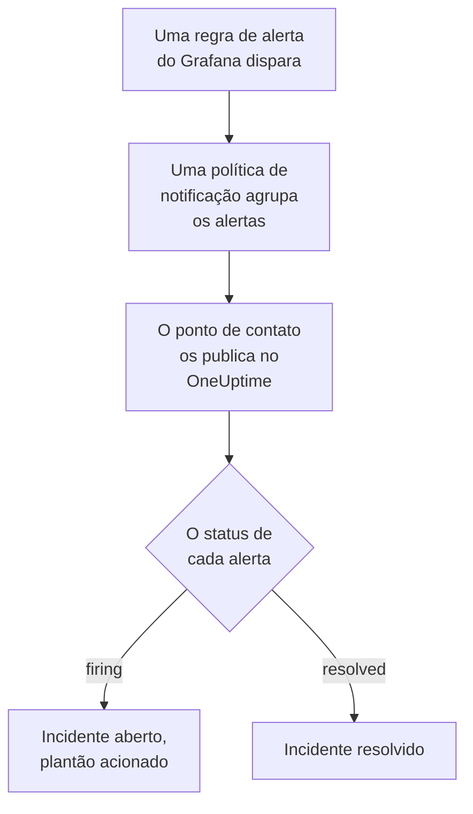

# Grafana

Envie os alertas do [Grafana](https://grafana.com) para o OneUptime, para que cada alerta disparado vire um incidente que chama a sua equipe de plantão e seja resolvido quando o alerta se recuperar. O Grafana envia os alertas por um ponto de contato webhook, então não há nada a instalar em nenhum dos lados.

:::cards
- [Escolher como o OneUptime recebe os alertas](#escolher-como-o-oneuptime-recebe-os-alertas): Um monitor Incoming Request ou um workflow próprio.
- [Receber alertas com um monitor](#receber-alertas-com-um-monitor): Um incidente por alerta, resolvido na recuperação.
- [Configurar o Grafana](#configurar-o-grafana): Um ponto de contato webhook e a política que o usa.
- [Solução de problemas](#solução-de-problemas): Quando os alertas não chegam ou os incidentes continuam abertos.
:::

## Como funciona



As políticas de notificação do Grafana agrupam os alertas que disparam, e um ponto de contato webhook publica cada grupo como uma notificação JSON. Ela tem o mesmo formato de uma notificação do [Prometheus Alertmanager](/docs/integrations/prometheus-alertmanager): um `status`, uma lista `alerts` em que cada alerta tem o próprio `status` e o próprio `fingerprint`, e os `commonLabels` e `commonAnnotations` que os alertas dela compartilham. O Grafana adiciona um `title` e uma `message` escritos para pessoas.

## Antes de começar

- Grafana 9 ou posterior, com o Grafana Alerting, o padrão desde o Grafana 9. Ele precisa conseguir alcançar o seu OneUptime por HTTPS.
- No OneUptime, permissão para criar monitores, ou workflows se escolher esse caminho.

## Escolher como o OneUptime recebe os alertas

Configure primeiro o OneUptime: ele lhe dá a URL para a qual o Grafana envia.

| Caminho | Use quando |
| --- | --- |
| Um monitor Incoming Request (recomendado) | Você quer que cada alerta seja um incidente que chama o plantão e é resolvido quando o alerta se recupera. Não há nada a construir. |
| Um workflow com um gatilho Webhook | Você precisa de uma lógica própria: filtrar alertas, remodelá-los ou chamar outros sistemas antes. Um workflow abre um incidente por notificação, não por alerta, e não o resolve na recuperação. |

Os dois recebem o mesmo JSON do mesmo ponto de contato, então você pode começar com um e trocar depois mudando uma URL no Grafana.

## Receber alertas com um monitor

Um [monitor Incoming Request](/docs/monitor/incoming-request-monitor) lhe dá uma URL, e os critérios dele decidem o que cada notificação faz.

:::steps
### Criar o monitor

Vá em **Monitores** e clique em **Criar monitor**. Escolha **Incoming Request** em **Tipo de monitor**, dê o nome `Grafana` e clique em **Próximo**.

### Declarar um incidente para cada alerta disparado

Na etapa **Critérios**, abra o primeiro critério, o que marca o monitor como offline. Defina o filtro dele como **Corpo da Requisição**, **Contém**, `"status":"firing"`. Esse critério já declara um incidente quando o filtro corresponde. Preencha o incidente:

- **Título do Incidente**: `{{requestBody.commonLabels.alertname}}`.
- **Descrição do incidente**, em **Descrição**: `{{requestBody.message}}`, o texto que o Grafana escreve para a notificação.
- **Gravidade**: a gravidade de incidente que esses alertas devem ter.
- **Políticas de plantão**, em **Plantão**: as políticas a acionar.
- **Resolver incidente automaticamente**, em **Mais campos**: deixe ativado, como já vem. Sem isso, as recuperações são ignoradas e os incidentes continuam abertos.

### Abrir um incidente por alerta

No mesmo critério, abra **Configurações** e ative **Group incidents and alerts by a payload field**. Preencha como abaixo, para que cada alerta tenha o próprio incidente e a recuperação dele o resolva:

| Campo | Valor |
| --- | --- |
| **Open a separate incident for each…** | `requestBody.alerts[*].fingerprint` |
| **Field that signals recovery** | `requestBody.alerts[*].status` |
| **Value that means recovered** | `resolved` |

### Colocar o monitor online de novo

Abra o segundo critério, o que marca o monitor como online, e defina o filtro dele como **Corpo da Requisição**, **Contém**, `"status":"resolved"`.

### Copiar a URL

Clique em **Criar monitor**. A página **Visão geral** do monitor mostra o **Heartbeat URL** dele. Copie-o para o Grafana:

```text
https://oneuptime.com/heartbeat/<secret key>
```

Uma instalação auto-hospedada tem o próprio host no lugar de `oneuptime.com`.
:::

Cada alerta de uma notificação abre o próprio incidente, até o limite de **Max incidents per request** (`100`, a menos que você o mude), e o `status` de cada alerta decide quando o incidente dele é resolvido. O `fingerprint` do Grafana identifica um alerta pelos rótulos dele, então é o valor pelo qual agrupar. Veja [Receber alertas de outro sistema](/docs/monitor/incoming-request-monitor#receber-alertas-de-outro-sistema) para o que cada configuração faz.

> [!WARNING]
> Não agrupe por um rótulo que todos os alertas de uma notificação compartilham. A política de notificação padrão do Grafana agrupa os alertas por `grafana_folder` e `alertname`, então todos os alertas de uma notificação têm o mesmo `alertname`: agrupar por `requestBody.alerts[*].labels.alertname` junta a notificação inteira em um incidente.

`{{requestBody.commonLabels.alertname}}` e `{{requestBody.message}}` descrevem a notificação inteira, que com a política padrão é uma única regra de alerta. A chave de agrupamento também é uma variável, `{{fingerprint}}`, mas é um hash que não diz nada a quem responde. Veja [Modelos de incidentes e alertas](/docs/monitor/incident-alert-templating) para todas as variáveis que você pode usar.

## Configurar o Grafana

:::steps
### Adicionar um ponto de contato webhook

No Grafana, vá em **Alerting → Contact points** e clique em **+ Add contact point**. No Grafana 11 e posteriores, **Alerting** fica em **Alerts & IRM**, e **Contact points** é uma aba de **Notification configuration**.

Dê ao ponto de contato o nome `OneUptime`, escolha **Webhook** em **Integration** e cole em **URL** a URL que você copiou. Deixe **HTTP Method** em `POST` e clique em **Save contact point**.

### Enviar os alertas para ele

Vá em **Alerting → Notification policies**. Defina `OneUptime` como ponto de contato da política padrão, ou adicione uma política filha que corresponda aos alertas que o OneUptime deve receber, com `OneUptime` como ponto de contato.
:::

O Grafana envia `Content-Type: application/json`, de que o monitor precisa para ler os campos de uma notificação. A configuração **Max Alerts** do ponto de contato limita os alertas de uma notificação: deixe-a em `0`, sem limite, ou no máximo no **Max incidents per request** do monitor.

## Testar

1. No Grafana, abra o ponto de contato `OneUptime` e clique em **Test**. O Grafana envia um alerta de teste disparado, e um incidente abre no OneUptime. Um alerta de teste nunca se recupera, então resolva esse incidente manualmente.
2. Deixe uma regra de alerta real disparar, por exemplo baixando o limite dela por um momento, e veja o incidente dela abrir e depois ser resolvido quando você voltar o limite.

## Receber alertas com um workflow

Use um [workflow](/docs/workflows/index) quando precisar de etapas próprias entre o Grafana e o incidente.

:::steps
### Criar o workflow

Vá em **Fluxos de trabalho**, clique em **Criar fluxo de trabalho** e depois em **Começar do zero**. Dê o nome `Grafana alerts` e clique em **Criar fluxo de trabalho**.

### Adicionar o gatilho Webhook

Clique no bloco tracejado **Escolha o que inicia este fluxo de trabalho** e escolha **Webhook**. Clique no gatilho, depois em **Copiar URL**, e use essa URL no ponto de contato do Grafana.

### Verificar que a notificação está disparando

Clique em **Adicionar componente**, adicione um bloco **If / Else** e ligue a ele o ponto **Out** do gatilho. Defina **Value to check** como `{{local.components.webhook-1.returnValues.request-body.status}}`, **Comparison** como **is equal to** e **Compare with** como `firing`.

### Declarar o incidente

Adicione um bloco **Create One Incident** e ligue a ele o lado **Yes** do bloco **If / Else**. Em **Incident Template**, escolha um modelo que defina a gravidade e as políticas de plantão a acionar (veja [Modelos de incidentes](/docs/incidents/settings#modelos-de-incidentes)). Em **JSON Object**, defina o que vem do Grafana:

```json
{
  "title": "{{local.components.webhook-1.returnValues.request-body.title}}",
  "description": "{{local.components.webhook-1.returnValues.request-body.message}}"
}
```

Sem modelo, **JSON Object** também precisa de `incidentSeverityId`, o ID de uma das gravidades de incidente do projeto.

### Ativar o workflow

Ative **Habilitado** no topo do **Construtor**. Um workflow desativado responde ao Grafana com `400`.
:::

Uma execução trata uma notificação, então declara um único incidente, não importa quantos alertas a notificação tenha. Uma notificação `resolved` segue pelo lado **No** do bloco **If / Else**, onde nada está ligado, então a execução termina ali. Para um incidente por alerta, resolvido na recuperação, use o monitor.

## Solução de problemas

:::details Nada chega ao OneUptime
- Clique em **Test** no ponto de contato: o Grafana mostra um erro quando não consegue alcançar a URL. O log do servidor do Grafana tem os detalhes.
- O monitor responde `200` na hora, antes de verificar qualquer coisa, mesmo com uma chave secreta errada. Veja a linha do tempo do monitor para saber se as notificações chegam.
- Um workflow desativado responde `400`. Ative **Habilitado** no topo do **Construtor** dele.
:::

:::details Os incidentes abrem mas nunca são resolvidos
- O incidente do critério precisa de **Resolver incidente automaticamente**, em **Mais campos**.
- **Field that signals recovery** deve ser `requestBody.alerts[*].status`, e **Value that means recovered** exatamente `resolved`. A comparação diferencia maiúsculas de minúsculas.
- Os caminhos de agrupamento devem começar com `requestBody.`, e só o primeiro `[*]` de um caminho lê uma lista. Um caminho que quebra qualquer uma das regras não corresponde a nada, sem nenhum erro.
:::

:::details Um único incidente para uma notificação cheia de alertas
Você agrupou por um rótulo que é igual para todos os alertas de uma notificação, como `alertname` com a política padrão. Agrupe por `requestBody.alerts[*].fingerprint` em vez disso.
:::

:::details O incidente mostra uma referência em vez de um valor
Uma referência a um campo que a notificação não tem fica como está escrita, com as chaves. Compare o nome do campo com o que o Grafana enviou: para um workflow, abra a execução em **Registros → Execuções** e compare com o que o gatilho recebeu.
:::

O guia do [Prometheus Alertmanager](/docs/integrations/prometheus-alertmanager#solução-de-problemas) cobre mais casos, e eles também valem para as notificações do Grafana.

## Segurança

- **Trate a URL como uma senha.** Quem a tiver pode abrir incidentes. Se ela vazar, redefina-a: **Redefinir chave secreta de requisição recebida** na página **Configurações** do monitor, ou **Redefinir URL** no gatilho **Webhook** do workflow. Depois atualize a **URL** do ponto de contato no Grafana.
- **Auto-hospedado?** Deixe o Grafana alcançar o seu OneUptime por HTTPS através do seu firewall.

## Próximos passos

:::cards
- [Monitor de requisições recebidas](/docs/monitor/incoming-request-monitor): Cada configuração do monitor que recebe os seus alertas.
- [Prometheus Alertmanager](/docs/integrations/prometheus-alertmanager): A mesma configuração, com um dead man's switch para os seus alertas.
- [Monitor de métricas](/docs/monitor/metrics-monitor): Alerte sobre as mesmas métricas no próprio OneUptime.
- [Visão geral das integrações](/docs/integrations/index): As outras ferramentas que você pode conectar.
:::
