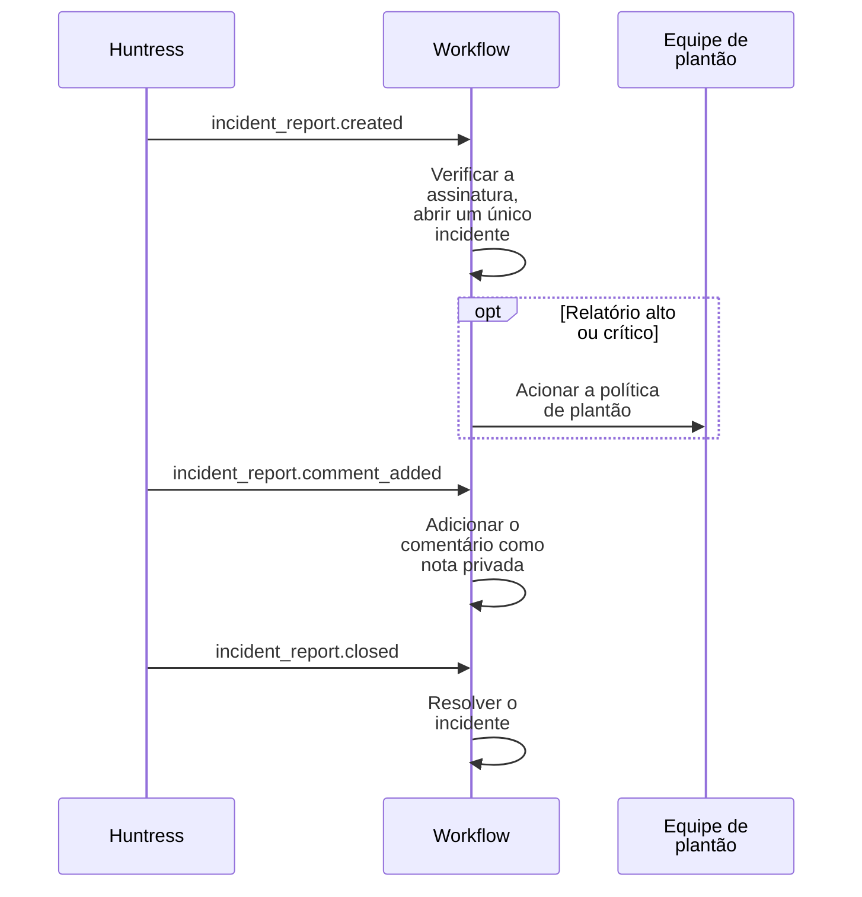

# Integração com o Huntress

Acione a sua equipe de plantão para os relatórios de incidente do Huntress, com um workflow. Quando o SOC do Huntress envia um relatório de incidente sobre um endpoint ou uma identidade, o workflow abre um único incidente para ele, aciona a política de plantão que você escolher, adiciona os comentários feitos no Huntress como notas privadas e resolve o incidente quando o relatório é fechado no Huntress.

Esta integração é de **entrada**: o Huntress envia cada evento de um relatório de incidente para a URL própria do workflow, assinado com o segredo de assinatura do endpoint. O OneUptime nunca chama o Huntress, então não precisa de nenhuma chave de API do Huntress.

:::cards
- [Como funciona](#como-funciona): O que o workflow faz com cada evento de um relatório.
- [Configuração](#configurar-a-integração): Criar o workflow, adicionar o endpoint no Huntress, salvar o segredo de assinatura, enviar um teste.
- [O gatilho](#o-gatilho-huntress-incident-report): Os valores que um relatório passa ao workflow, e as configurações do gatilho.
- [Solução de problemas](#solução-de-problemas): O que os erros do gatilho significam e o que mudar.
:::

## Como funciona

O Huntress envia um evento sobre um relatório de incidente quando o relatório é enviado, quando alguém o comenta e quando ele é fechado. O gatilho **Huntress Incident Report** inicia o workflow uma vez para cada evento, e o seu **Event** diz qual foi: `created`, `comment-added` ou `closed`.

1. **Verificar.** Uma solicitação precisa estar assinada com o segredo de assinatura do endpoint, no máximo cinco minutos antes de chegar. Todo o resto é recusado, e as configurações do gatilho dizem por quê.
2. **Iniciar o workflow.** Cada evento inicia uma execução, com os campos do relatório como valores do gatilho. Um evento que o Huntress reenvia não inicia mais nada.
3. **Abrir um único incidente.** Com `created`, o workflow abre um incidente com o nome do relatório, como `Huntress: Incident on DESKTOP-01 (Acme Corp)`. A descrição traz o resumo do relatório, a severidade no Huntress, a organização, o host ou a identidade afetados, os indicadores que o Huntress encontrou e um link para o relatório no Huntress. O incidente recebe um rótulo com a organização do relatório e aciona a política de plantão que você escolher quando o relatório é alto ou crítico.
4. **Acompanhar o relatório.** Com `comment-added`, o comentário vira uma nota privada no incidente. Com `closed`, o incidente é resolvido, com o motivo na sua linha do tempo.

O incidente guarda o número do relatório nos seus campos personalizados, como `huntressReportId`: é assim que o workflow o encontra de novo quando o Huntress comenta ou fecha o relatório. Os incidentes abertos assim nunca aparecem em uma página de status, e as suas regras de incidentes (de plantão, de responsáveis, de rótulos e de privacidade) valem para eles como para qualquer outro incidente.

## Antes de começar

- No OneUptime, uma função que possa criar e editar workflows, como **Proprietário do projeto**, **Administrador do projeto** ou **Administrador de fluxos de trabalho**.
- No Huntress, a função **Account Admin**: só administradores da conta podem adicionar webhooks.
- Uma política de plantão para acionar.
- No OneUptime Cloud, um plano com workflows: Growth ou superior. Cada evento que o Huntress envia é uma execução de workflow.
- Em uma instalação auto-hospedada, um OneUptime que o Huntress alcance pela internet via HTTPS: o Huntress só envia webhooks para URLs `https://`.

## Configurar a integração

:::steps
### Criar o workflow

Abra **Fluxos de trabalho** e clique em **Criar fluxo de trabalho**. Em **Ou começar a partir de um modelo**, escolha a categoria **Huntress**, escolha **Open an incident for each Huntress incident report**, clique em **Usar este modelo** e crie o workflow. Ele abre no **Construtor**, desativado.

### Escolher quem acionar

Clique na etapa **Page an On-Call Policy**, escolha as **Políticas de plantão** a acionar e salve a etapa.

### Adicionar um endpoint de webhook no Huntress

Clique no gatilho **Huntress Incident Report** e, em **Adicionar um endpoint de webhook no Huntress**, clique em **Copiar URL**. A URL tem a forma `https://oneuptime.com/workflow/huntress/<key>`; em uma instalação auto-hospedada, ela começa com o seu próprio host.

No Huntress, abra o menu no canto superior direito e escolha **Integrations**. Clique em **Add an Integration**, escolha **Webhooks** e clique em **Add Endpoint**. Cole a URL, ative **Incident Reports** e salve. Deixe **Escalations**, **Platform Actions** e **Account Notices** desativados: o gatilho aceita esses eventos e não inicia nada por eles.

### Salvar o segredo de assinatura do endpoint

No Huntress, abra o menu do endpoint (⋯) e escolha **View Signing Secret**. Copie-o inteiro: ele começa com `whsec_`. No gatilho, clique em **Salvar segredo de assinatura**, cole-o e clique em **Salvar segredo de assinatura**. O segredo é criptografado e nunca mais é exibido.

Enquanto o segredo não for salvo, o gatilho recusa toda solicitação. O Huntress reenvia mais tarde um evento recusado, então um evento recusado agora chega mesmo assim.

### Ativar o workflow e enviar um teste

Ative **Habilitado** no alto do **Construtor**. No Huntress, abra o menu do endpoint (⋯) e escolha **Send Test**. Em poucos segundos, o gatilho mostra **Recebendo relatórios**.

> [!NOTE]
> Seja qual for o conteúdo do teste, o gatilho mostra que ele chegou. Um teste que traz um relatório de incidente inicia o workflow como qualquer outro relatório.
:::

## O que o workflow faz

O modelo segue um caminho para cada **Event**, com um **Switch / Case** depois do gatilho:

| Event | O que o workflow faz |
| --- | --- |
| `created` | Abre um incidente com a **Incident Severity ID** do gatilho, com o rótulo da sua **Organization Label ID**. Para um relatório alto ou crítico, **Page an On-Call Policy** aciona a sua política; um relatório baixo não aciona ninguém. Um relatório que já tem um incidente não abre outro. |
| `comment-added` | Encontra o incidente do relatório e adiciona o comentário a ele como nota privada. |
| `closed` | Encontra o incidente do relatório e o resolve, a menos que ele já esteja resolvido. O motivo fica na sua linha do tempo: o Huntress fechou o relatório. |

É um workflow como qualquer outro, então você pode mudar o que ele faz: acionar só para relatórios críticos mudando o que o **If / Else** depois de **Create One Incident** compara, publicar cada relatório em um canal de chat com uma etapa do Slack ou do Microsoft Teams, ou mandar cada organização para a própria política de plantão com um **Switch / Case** sobre **Organization**. Cada execução aparece nas execuções do workflow, com o que cada etapa fez.

### Severidades

O Huntress dá a cada relatório de incidente uma de três severidades. A **Incident Severity ID** do gatilho é a severidade de incidente com que o relatório abre: a que a configuração dela escolhe, ou então a ordem das suas severidades de incidente, como **Incidentes → Configurações → Severidade do incidente** as lista:

| Severidade no Huntress | O que o Huntress quer dizer | Configuração | Severidade de incidente quando a configuração está vazia |
| --- | --- | --- | --- |
| Critical | Atacantes ativos no teclado, malware perigoso ou comprometimento ativo, a conter imediatamente. | **Severidade para relatórios críticos** | A mais alta |
| High | Malware confirmado que exige correção urgente, ou comprometimento de identidade que pede ação. | **Severidade para relatórios altos** | A segunda |
| Low | Programas potencialmente indesejados, restos de malware e descobertas mais antigas sobre identidades. | **Severidade para relatórios baixos** | A terceira |

Um projeto com menos severidades usa a mais baixa para o restante. Um relatório sem severidade é tratado como alto. Se uma severidade que você escolheu for excluída, a ordem volta a decidir.

### Organizações

A **Organization Label ID** do gatilho é um rótulo com o nome da organização do Huntress do relatório, como _Acme Corp_, que ele cria na primeira vez que chega um relatório dessa organização. Um workflow recebe os relatórios de todas as organizações da sua conta do Huntress, e **Somente estas organizações** do gatilho restringe isso: um nome ou ID de organização por linha, com os nomes ignorando maiúsculas e minúsculas.

> [!TIP]
> Para acionar a equipe de cada cliente, adicione uma regra de plantão de incidentes por organização, como "Se **Rótulos de incidentes** tem algum de _Acme Corp_", que execute a política desse cliente. Veja [Regras de plantão de incidente](/docs/incidents/settings#regras-de-plantão-de-incidente).

## O gatilho Huntress Incident Report

O gatilho abre no Huntress: a sua URL, uma marca ao lado de cada etapa de configuração concluída e o que o Huntress enviou por último. As suas configurações, todas opcionais, ficam recolhidas em **Mais campos**: **Somente estas organizações**, **Severidade para relatórios críticos**, **Severidade para relatórios altos** e **Severidade para relatórios baixos**.

| Valor | O que contém |
| --- | --- |
| **Event** | `created`, `comment-added` ou `closed`. Um relatório já fechado ou descartado é `closed`, seja qual for o evento que o trouxe. |
| **Report ID** | O número do relatório no Huntress. |
| **Severity** | `critical`, `high` ou `low`. |
| **Status** | O status do relatório no Huntress, como `sent`, `closed` ou `dismissed`. |
| **Subject** | O assunto do relatório, como o Huntress o escreve. |
| **Summary** | O que o analista do SOC escreveu. |
| **Organization**, **Organization ID** | A organização do Huntress de que o relatório trata. |
| **Affected** | O host ou a identidade de que o relatório trata. |
| **Platform**, **Indicators** | Onde o Huntress o encontrou, e o que encontrou. |
| **Comment** | O comentário que alguém adicionou, com `comment-added`. |
| **Report URL** | Onde o relatório abre no Huntress. |
| **Incident Title**, **Incident Description** | Um título e uma descrição em Markdown para um incidente sobre o relatório. |
| **Note** | Markdown para uma nota sobre o evento: o comentário, ou que o Huntress fechou o relatório. |
| **Incident Severity ID**, **Organization Label ID** | A severidade de incidente e o rótulo, como acima. |
| **Received At** | Quando o OneUptime recebeu o evento. |

**Summary** e **Comment** são textos que os analistas do Huntress escreveram. Para colocá-los em um incidente ou em uma nota, use **Incident Description** e **Note**: eles mantêm a formatação, e nada neles carrega uma imagem ou menciona alguém.

Para testar o workflow sem o Huntress, clique em **Executar fluxo de trabalho** no **Construtor** e digite um **Event**, um **Report ID** e os campos de que precisar. Use o mesmo **Report ID** para acompanhar um relatório de `created` até `closed`.

## Conexões do Huntress criadas antes

O Huntress era configurado antes em **Incidentes → Integrações → Huntress**. Cada conexão do Huntress virou um workflow com o mesmo nome, ativado, que faz o que a conexão fazia: aciona as mesmas políticas de plantão para os mesmos relatórios, adiciona os mesmos rótulos e resolve (ou só anota) do mesmo jeito. A sua URL continua sendo a da conexão, `https://oneuptime.com/api/huntress/webhook/<connection-id>`, e o seu segredo de assinatura é o mesmo, então não há nada a mudar no Huntress. Os incidentes que a conexão abriu guardam o número do relatório, então o workflow os encontra quando o Huntress comenta ou fecha esses relatórios.

## Segurança

- **Somente solicitações assinadas.** O gatilho confere os cabeçalhos `svix-id`, `svix-timestamp` e `svix-signature` que o Huntress envia com o corpo da solicitação exatamente como chegou. Uma solicitação que não está assinada com o segredo salvo, ou que foi assinada mais de cinco minutos antes ou depois, é recusada.
- **O segredo continua secreto.** Ele é guardado criptografado, a API nunca o devolve e ele nunca mais é exibido. **Substituir segredo de assinatura** no gatilho salva outro, como o segredo de um endpoint novo.
- **A URL é um endereço, não uma senha.** Ela termina na chave do workflow; só uma solicitação assinada com o segredo do endpoint inicia o workflow.
- **Um endpoint por workflow.** Cada workflow tem a própria URL e o próprio segredo. Para receber os relatórios de uma segunda conta do Huntress, crie um segundo workflow.

## Usar e-mail em vez disso

O Huntress também envia os relatórios de incidente por e-mail, e um [monitor de e-mails recebidos](/docs/monitor/incoming-email-monitor) pode abrir incidentes a partir desses e-mails, por exemplo quando o assunto contém `Critical Incident Report`. Mas ele trata os e-mails como o status de um único monitor: enquanto o incidente dele está aberto, o relatório seguinte não abre nenhum, e o incidente é resolvido pelos critérios do monitor, não quando o Huntress fecha o relatório. O workflow abre um incidente por relatório e resolve cada um junto com o relatório, então prefira-o. Assim que o workflow receber relatórios, pare de enviar os e-mails ao monitor, ou cada relatório acionará duas vezes.

## Solução de problemas

Quando o gatilho recusa uma solicitação, as configurações dele mostram o motivo em **A última solicitação foi recusada**. No Huntress, **View Delivery Attempts** no menu do endpoint (⋯) lista cada entrega com a resposta do OneUptime.

:::details "A request arrived but was refused, because no signing secret is saved for this workflow yet"
Salve o segredo de assinatura do endpoint: veja [Configurar a integração](#configurar-a-integração). O Huntress reenvia a solicitação recusada.
:::

:::details "The request's signature does not match the signing secret"
O segredo salvo não é o deste endpoint. Cada endpoint tem o seu: no Huntress, abra o menu do endpoint (⋯), escolha **View Signing Secret**, copie-o inteiro e salve-o com **Substituir segredo de assinatura**.
:::

:::details "The request was signed more than five minutes from now"
Os relógios do Huntress e do seu servidor OneUptime diferem em mais de cinco minutos, ou a solicitação é uma repetição. Em uma instalação auto-hospedada, verifique se o relógio do servidor está certo.
:::

:::details "A request arrived while this workflow is off"
Ative **Habilitado** no alto do **Construtor**. O Huntress reenvia a solicitação recusada, e então ela inicia o workflow.
:::

:::details "No Huntress workflow has this address."
O workflow foi excluído ou arquivado, o gatilho dele não é mais **Huntress Incident Report**, ou a URL do endpoint no Huntress não é a do workflow. Copie a URL do gatilho e cole-a de novo no endpoint no Huntress.
:::

:::details Nenhum incidente foi aberto
Abra as execuções do workflow e a execução do relatório. Se **Create One Incident** falhou porque a severidade do incidente está vazia, o projeto não tem severidades de incidente: adicione uma em **Incidentes → Configurações → Severidade do incidente**.
:::

:::details Ninguém foi acionado
Um relatório baixo abre um incidente sem acionar ninguém. Caso contrário, a execução do relatório diz o que **Page an On-Call Policy** fez, e a página **Execuções de plantão** do incidente mostra o que cada política fez.
:::

## Próximos passos

:::cards
- [Gatilhos de workflow](/docs/workflows/triggers): As outras formas de iniciar um workflow.
- [Regras de plantão de incidente](/docs/incidents/settings#regras-de-plantão-de-incidente): Acionar a equipe de cada organização, pelo rótulo dela.
- [Estados e severidades de incidentes](/docs/incidents/states-and-severities): Ordenar as severidades com que os relatórios do Huntress abrem.
- [Visão geral das integrações](/docs/integrations/index): As outras ferramentas que você pode conectar.
:::
