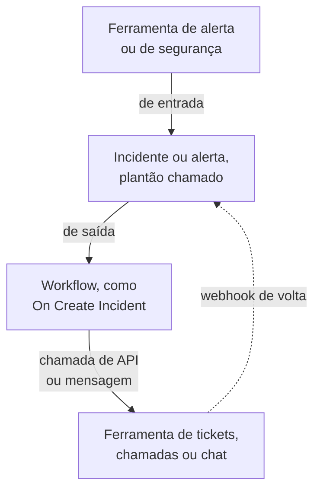

# Visão geral das integrações

O OneUptime funciona com as ferramentas que a sua equipe já usa. As ferramentas de alerta abrem incidentes nele, e ele abre tickets, chamadas de plantão e mensagens de chat em outras ferramentas. Algumas ferramentas se conectam por um formulário, e outras por um modelo de workflow pronto. Qualquer outra ferramenta com um webhook ou uma API se conecta por um workflow que você monta.

:::cards
- [Escolher como conectar](#escolher-como-conectar): As quatro formas de integrar e quando usar cada uma.
- [Catálogo](#catálogo): Cada ferramenta com um guia, agrupada pelo que faz.
- [Montar a sua própria integração](#montar-a-sua-própria-integração): Os padrões de entrada e de saída, para qualquer outra ferramenta.
- [Proteger as credenciais](#proteger-as-credenciais): As variáveis secretas e os cabeçalhos que cada ferramenta espera.
:::

## Como as integrações funcionam

Toda integração move dados em um sentido ou nos dois. **De entrada**: outra ferramenta avisa o OneUptime de que algo está errado, e o OneUptime abre um incidente ou um alerta e chama a equipe de plantão. **De saída**: algo acontece no OneUptime, e um workflow avisa outra ferramenta: abre um ticket, chama alguém ou publica uma mensagem.



Uma integração bidirecional, como Jira ou Dynamics 365, usa os dois sentidos: um workflow envia o incidente para fora, e outro, iniciado pelo webhook da outra ferramenta, traz as mudanças de volta.

## Escolher como conectar

| Forma | Ideal para | Exemplos |
| --- | --- | --- |
| Uma conexão integrada | Ferramentas às quais o OneUptime se conecta sozinho. Você preenche um formulário e não há nada a montar. | [Slack](/docs/workspace-connections/slack), [Microsoft Teams](/docs/workspace-connections/microsoft-teams), as conexões de [Eventos de segurança](/docs/telemetry/security-events) |
| Um modelo de workflow | Ferramentas de tickets, sincronizadas nos dois sentidos, problemas de monitoramento, relatórios de incidentes de segurança e mensagens de chat. Você escolhe um modelo e preenche algumas configurações. | [Jira](/docs/integrations/jira), [Microsoft Dynamics 365](/docs/integrations/microsoft-dynamics-365), [Huntress](/docs/integrations/huntress), [Zabbix](/docs/integrations/zabbix) |
| Um monitor Incoming Request | Ferramentas de alerta que enviam um webhook. Você recebe um incidente por alerta, encaminhado ao plantão e resolvido quando o alerta se recupera, sem workflow. | [Zabbix](/docs/integrations/zabbix), [Prometheus Alertmanager](/docs/integrations/prometheus-alertmanager), [Grafana](/docs/integrations/grafana) |
| Um workflow que você monta | Qualquer ferramenta com um webhook ou uma API REST, e qualquer lógica sua. | [PagerDuty](/docs/integrations/pagerduty), [Opsgenie](/docs/integrations/opsgenie), [ServiceNow](/docs/integrations/servicenow) |

Comece pelo topo da tabela: quanto mais alta uma forma, menos há para manter.

## Catálogo

### Ferramentas de monitoramento e alertas

| Ferramenta | Sentido | O que faz |
| --- | --- | --- |
| [Zabbix](/docs/integrations/zabbix) | Ambos | Transforma os problemas do Zabbix em incidentes ou alertas, os resolve na recuperação e reconhece ou fecha os problemas a partir do OneUptime. |
| [Prometheus Alertmanager](/docs/integrations/prometheus-alertmanager) | De entrada | Transforma as notificações do Alertmanager em incidentes. |
| [Grafana](/docs/integrations/grafana) | De entrada | Transforma os alertas do Grafana em incidentes. |
| [Datadog](/docs/integrations/datadog) | De entrada | Transforma os alertas dos monitores do Datadog em incidentes. |

### Ferramentas de segurança

| Ferramenta | Sentido | O que faz |
| --- | --- | --- |
| [Huntress](/docs/integrations/huntress) | De entrada | Chama o plantão para os relatórios de incidente do Huntress e resolve o incidente quando o relatório é fechado. |
| [Google SecOps](/docs/integrations/google-secops) | Ambos | Traz as detecções e os indicadores do Google SecOps para Eventos de segurança, e envia para ele o que o OneUptime encontra. |
| [Microsoft Sentinel](/docs/integrations/microsoft-sentinel) | Ambos | Traz os incidentes do Microsoft Sentinel para Eventos de segurança, e envia para ele o que o OneUptime encontra. |
| [Microsoft Defender XDR](/docs/integrations/microsoft-defender-xdr) | De entrada | Traz os alertas do Microsoft Defender XDR para Eventos de segurança. |
| [CrowdStrike Falcon](/docs/integrations/crowdstrike-falcon) | De entrada | Traz os alertas do CrowdStrike Falcon para Eventos de segurança. |
| [Splunk Enterprise Security](/docs/integrations/splunk) | Ambos | Traz os eventos notáveis do Splunk para Eventos de segurança, e envia para ele o que o OneUptime encontra. |
| [Elastic Security](/docs/integrations/elastic-security) | Ambos | Traz os alertas de detecção do Elastic Security para Eventos de segurança, e envia para ele o que o OneUptime encontra. |
| [AWS Security Hub](/docs/integrations/aws-security-hub) | De entrada | Traz as descobertas do AWS Security Hub para Eventos de segurança. |
| [Okta System Log](/docs/integrations/okta) | De entrada | Traz os logins, as mudanças de conta e as detecções de ameaças do Okta para Eventos de segurança. |

### Tickets e gestão de serviços de TI

| Ferramenta | Sentido | O que faz |
| --- | --- | --- |
| [Jira](/docs/integrations/jira) | Ambos | Abre um item do Jira para cada incidente ou alerta, e traz de volta as mudanças de status e os comentários. |
| [Microsoft Dynamics 365](/docs/integrations/microsoft-dynamics-365) | Ambos | Abre um caso do Dynamics 365 para cada incidente ou alerta, e traz de volta as mudanças de status e as notas. |
| [ServiceNow](/docs/integrations/servicenow) | De saída | Abre um incidente no ServiceNow para cada incidente do OneUptime e o resolve junto com o incidente. |
| [GitHub](/docs/integrations/github) | De saída | Abre uma issue no GitHub para um incidente. |
| [GitLab](/docs/integrations/gitlab) | De saída | Abre uma issue no GitLab para um incidente. |

### Ferramentas de chamadas

| Ferramenta | Sentido | O que faz |
| --- | --- | --- |
| [PagerDuty](/docs/integrations/pagerduty) | De saída | Dispara um incidente no PagerDuty para cada incidente do OneUptime e o resolve junto com o incidente. |
| [Opsgenie](/docs/integrations/opsgenie) | De saída | Cria um alerta no Opsgenie para cada incidente do OneUptime e o fecha junto com o incidente. |

### Ferramentas de chat

| Ferramenta | Sentido | O que faz |
| --- | --- | --- |
| [Slack](/docs/workspace-connections/slack) | Ambos | Uma conexão integrada: canais de incidente, ações a partir do Slack e plantão. |
| [Microsoft Teams](/docs/workspace-connections/microsoft-teams) | Ambos | Uma conexão integrada: canais de incidente, ações a partir do Teams e plantão. |
| [Mattermost](/docs/workflows/components#mattermost) | De saída | Publica as atualizações de incidentes em um canal do Mattermost. |
| [Discord](/docs/integrations/discord) | De saída | Publica as atualizações de incidentes em um canal do Discord. |
| [Telegram](/docs/integrations/telegram) | De saída | Envia uma mensagem para um chat do Telegram quando um alerta dispara. |
| [IRC](/docs/integrations/irc) | De saída | Publica as atualizações de incidentes em um canal de IRC. |

> [!TIP]
> O Slack e o Microsoft Teams também têm etapas de workflow. Use a conexão integrada para os canais de incidente e o plantão, e uma etapa de workflow quando você só precisa de uma mensagem em um canal.

### Plataformas de hospedagem

| Ferramenta | Sentido | O que faz |
| --- | --- | --- |
| [Vercel](/docs/integrations/vercel) | De entrada | Adicione o OneUptime pelo Vercel Marketplace: traces, logs, monitores de disponibilidade e uma página de status para seus projetos da Vercel. |

## Migrar de outra ferramenta

Para sair de outra ferramenta de plantão, de uptime ou de páginas de status, traga a sua equipe em vez de conectar as duas. **Configurações do projeto → Avançado → Importar de outra ferramenta** lê a sua conta com uma chave de API, mostra o que encontrou e cria o que você marcar. Cada ferramenta tem um guia:

- Ferramentas de plantão e de incidentes: [Opsgenie](/docs/moving-to-oneuptime/opsgenie), [PagerDuty](/docs/moving-to-oneuptime/pagerduty), [incident.io](/docs/moving-to-oneuptime/incident-io), [Splunk On-Call](/docs/moving-to-oneuptime/splunk-on-call) e [Grafana OnCall](/docs/moving-to-oneuptime/grafana-oncall).
- Ferramentas de uptime e de páginas de status: [UptimeRobot](/docs/moving-to-oneuptime/uptimerobot), [Atlassian Statuspage](/docs/moving-to-oneuptime/atlassian-statuspage), [Better Stack](/docs/moving-to-oneuptime/better-stack), [Pingdom](/docs/moving-to-oneuptime/pingdom), [StatusCake](/docs/moving-to-oneuptime/statuscake) e [Uptime Kuma](/docs/moving-to-oneuptime/uptime-kuma).

## Montar a sua própria integração

Uma ferramenta sem guia ainda se encaixa em um de dois padrões. Se ela pode enviar um webhook, use o padrão de entrada. Se ela tem uma API REST, use o padrão de saída. Os dois são workflows: veja [Visão geral dos workflows](/docs/workflows/index) para começar.

### De entrada: outra ferramenta envia dados para o OneUptime

Para uma ferramenta de alerta, comece com um [monitor Incoming Request](/docs/monitor/incoming-request-monitor#receber-alertas-de-outro-sistema): ele abre um incidente por alerta e o resolve na recuperação, sem nada a montar. Monte um workflow quando você precisar de uma lógica própria:

:::steps
1. Abra **Fluxos de trabalho**, clique em **Criar fluxo de trabalho** e depois em **Começar do zero**. Dê um nome ao workflow e clique em **Criar fluxo de trabalho**.
2. Clique no bloco tracejado **Escolha o que inicia este fluxo de trabalho** e escolha **Webhook**. Clique no gatilho e depois em **Copiar URL**.
3. Na outra ferramenta, envie o webhook dela para essa URL como um `POST` com `Content-Type: application/json`.
4. Adicione os blocos que agem sobre ele. Eles leem a requisição com referências como `{{local.components.webhook-1.returnValues.request-body.status}}`: um bloco **If / Else** para verificar um campo e depois **Create One Incident** para declarar um incidente.
5. Ative **Habilitado** no topo do **Construtor**, envie um teste a partir da outra ferramenta e abra **Registros → Execuções** para ver o que chegou.
:::

A URL é a única credencial, então trate-a como uma senha. Veja [Webhook](/docs/workflows/triggers#webhook).

### De saída: o OneUptime envia dados para outra ferramenta

:::steps
1. Salve a chave de API da ferramenta como uma variável global secreta, como mostrado [abaixo](#proteger-as-credenciais).
2. Crie um workflow, clique no bloco tracejado e escolha um gatilho de evento, como **On Create Incident**. Clique no gatilho: os seus **Fields to pass on** começam com **Título**, então clique em **Adicionar campo** e escolha os outros campos a enviar, como **Descrição**.
3. Clique em **Adicionar componente** e adicione um bloco **API Post (JSON)**. Ligue a ele o ponto **Success** do gatilho.
4. Preencha a **URL**, os **Request Headers** com o cabeçalho `Authorization` e o **Request Body** com os campos do incidente, como `{{local.components.incident-on-create-1.returnValues.model.title}}`.
5. Clique em **Executar fluxo de trabalho**, escolha um incidente em **Incidente** e execute. Uma execução de teste envia a requisição de verdade. Depois, ative **Habilitado**.
:::

Quando a ferramenta precisa dos dados em outro formato, adicione um bloco [Run Custom JavaScript](/docs/workflows/components#custom-code) entre os dois. A receita é a mesma para Zendesk, New Relic, AWS (via SNS), StatusCake e todas as outras: só mudam a URL e o corpo.

## Proteger as credenciais

Nunca cole uma chave de API ou um token em um bloco. Salve-o uma vez como uma variável global secreta:

:::steps
1. Vá para **Fluxos de trabalho → Variáveis globais** e clique em **Criar: Fluxo de trabalho Variável**.
2. Dê um nome a ela, como `JIRA_AUTH`, e clique em **Próximo**.
3. Cole a chave em **Conteúdo**, ative **Segredo** e clique em **Criar: Fluxo de trabalho Variável**.
:::

Qualquer bloco a lê como `{{global.variables.JIRA_AUTH}}`. O conteúdo de uma variável não pode ser lido de novo depois de salvo, e o de uma variável secreta é substituído por `[REDACTED]` nos logs de execução. Para tokens que expiram, como os do Microsoft Entra ID, uma [variável OAuth 2.0](/docs/workflows/variables#variáveis-oauth-20-tokens-que-se-renovam-sozinhos) busca um novo sozinha. Veja [Variáveis de workflow](/docs/workflows/variables#variáveis-globais).

### Guia rápido de autenticação

A maioria das integrações de saída coloca a chave em um cabeçalho da requisição. As formas comuns:

| Esquema | O que enviar | Usado por |
| --- | --- | --- |
| Token Bearer | `Authorization: Bearer {{global.variables.TOKEN}}` | GitHub e a maioria das APIs modernas |
| Autenticação Basic | `Authorization: Basic {{global.variables.BASE64_USER_PASS}}` | Jira Cloud, ServiceNow |
| Cabeçalho de chave de API | `Authorization: GenieKey {{global.variables.OPSGENIE_KEY}}` | Opsgenie |
| Cabeçalho de token privado | `PRIVATE-TOKEN: {{global.variables.GITLAB_TOKEN}}` | GitLab |
| Chave no corpo | `routing_key` no corpo JSON | Events API do PagerDuty |
| Credenciais de cliente OAuth 2.0 | `Authorization: Bearer {{local.variables.dynamicsAccessToken}}`, de uma variável OAuth 2.0 | Microsoft Dynamics 365 |

Para a autenticação Basic, codifique `username:password`, ou `email:api_token`, uma vez, e salve o resultado como o segredo. No macOS ou no Linux:

```bash
printf '%s' 'you@example.com:your_api_token' | base64 | tr -d '\n'
```

Use `printf`, não `echo`: o `echo` adiciona uma quebra de linha, que é codificada junto com o resto e invalida as credenciais. O `tr` mantém um resultado longo em uma linha só.

## Instalações auto-hospedadas

Um OneUptime auto-hospedado chama outras ferramentas a partir da sua rede, e outras ferramentas o chamam a partir das delas:

- **De saída:** as requisições de workflow para endereços de rede privada são recusadas, a menos que um administrador as permita. Veja [Acesso de rede de saída](/docs/workflows/configuration#acesso-de-rede-para-fora).
- **De entrada:** os webhooks de uma ferramenta precisam alcançar o seu OneUptime por HTTPS, então uma ferramenta na nuvem precisa de um endereço público para chamar.
- **As integrações integradas** têm cada uma um guia de configuração: [Slack](/docs/self-hosted/slack-integration), [Microsoft Teams](/docs/self-hosted/microsoft-teams-integration), [GitHub](/docs/self-hosted/github-integration), [Twilio](/docs/self-hosted/twilio-integration), [SendGrid Inbound Email](/docs/self-hosted/sendgrid-inbound-email) e [Push Notifications](/docs/self-hosted/push-notifications).

## Próximos passos

:::cards
- [Visão geral dos workflows](/docs/workflows/index): Como os workflows rodam e como montar o primeiro.
- [Monitor de requisições recebidas](/docs/monitor/incoming-request-monitor): Receba alertas de qualquer ferramenta sem workflow.
- [Jira](/docs/integrations/jira): Uma integração bidirecional completa, a partir de modelos.
- [Variáveis de workflow](/docs/workflows/variables): Passe dados entre blocos e mantenha os segredos fora deles.
:::
