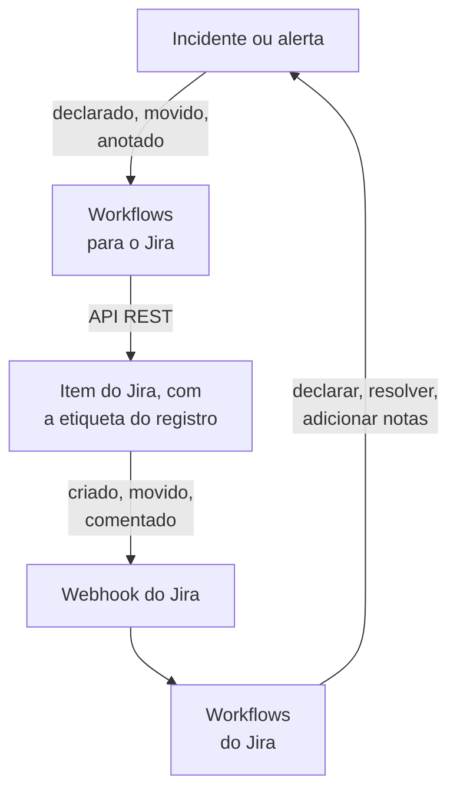

# Jira

Mantenha os itens do [Jira](https://www.atlassian.com/software/jira) em dia com os seus incidentes e alertas do OneUptime, nos dois sentidos. Modelos de workflow prontos abrem um item para cada incidente ou alerta, movem o item conforme o registro avança e copiam as notas para ele como comentários. Outros declaram incidentes a partir de itens novos e trazem de volta mudanças de status, comentários e edições. Não há plugin: os workflows chamam a API REST do Jira, e o Jira chama as URLs de webhook deles.

:::cards
- [Começar a partir de um modelo](#começar-a-partir-de-um-modelo): Os 17 modelos, o que pedem e como configurá-los.
- [Como os modelos funcionam](#como-os-modelos-funcionam): Como itens e registros continuam ligados, sem loops.
- [Montar você mesmo](#montar-você-mesmo): Cada sentido à mão, para quando um modelo não serve.
- [Solução de problemas](#solução-de-problemas): O que significam as respostas do Jira.
:::

> [!NOTE]
> A Atlassian está renomeando coisas no Jira Cloud: um **projeto** agora é um **espaço** em boa parte da interface, e um **item** é um **item de trabalho**. Os sites usam as duas palavras, então, onde o termo importa, você encontra as duas aqui.

## Como funciona



Cada modelo é um pequeno workflow, então você pega só os sentidos que quiser, para incidentes, alertas ou ambos. Os modelos OneUptime → Jira partem de um evento no OneUptime e chamam a API REST do Jira. Os modelos Jira → OneUptime partem de um webhook do Jira. Todos encontram os registros uns dos outros por duas etiquetas no item.

Tudo nesta página foi escrito para o **Jira Cloud**. [Jira Data Center](#jira-data-center) lista o que muda em um Jira autogerenciado.

## Antes de começar

- Um site do Jira Cloud, como `https://your-domain.atlassian.net`, e um projeto onde abrir os itens.
- Um usuário do Jira para a integração e um token de API para ele. Dê ao usuário **Browse Projects**, **Create Issues**, **Edit Issues**, **Add Comments** e **Transition Issues** no projeto.
- Um administrador do Jira, para registrar os webhooks de que os modelos Jira → OneUptime precisam.
- No OneUptime, permissão para criar workflows. No OneUptime Cloud, os workflows exigem o plano **Growth** ou superior.

## Começar a partir de um modelo

A janela **Criar um fluxo de trabalho** tem 17 modelos do Jira, em **Jira** na lista de categorias dela: nove para incidentes e depois oito para alertas, cada grupo sob o seu próprio título. Eles compartilham uma convenção, as etiquetas no item do Jira, então qualquer combinação deles funciona junta.

### Modelos para incidentes

| Modelo | O que faz | O que pede |
| --- | --- | --- |
| **OneUptime → Jira** | | |
| Create a Jira issue when an incident is declared | Abre um item para cada incidente novo e adiciona a ele o ID do incidente como etiqueta. Os incidentes declarados a partir do Jira, e os incidentes privados, são ignorados. | API URL, API token, project key, issue type, OneUptime URL |
| Move the Jira issue when the incident is acknowledged or resolved | Avança o item ligado: para um status In Progress quando o incidente é reconhecido, e para um status Done quando é resolvido. Nunca o faz voltar. | API URL, API token |
| Copy incident private notes to the Jira issue | Publica cada nota privada nova como comentário no item ligado, como comentário interno no Jira Service Management. | API URL, API token |
| Copy incident public notes to the Jira issue | Publica cada nota pública nova como comentário no item ligado. | API URL, API token |
| Comment on the Jira issue when the incident is edited | Quando o título, a gravidade, a descrição, a causa raiz ou as notas de correção do incidente mudam, publica como o incidente está agora, como comentário interno no Jira Service Management. | API URL, API token |
| **Jira → OneUptime** | | |
| Declare an incident when a Jira issue is created | Declara um incidente para cada item novo, fora das suas páginas de status, com uma gravidade escolhida pela prioridade do item, e depois etiqueta o item para ligar os dois. | Site URL, API URL, API token e um webhook do Jira para **Issue created** |
| Acknowledge or resolve the incident when its Jira issue moves | Reconhece o incidente quando o item ligado passa para um status In Progress, e o resolve quando o item passa para um status Done. | Um webhook do Jira para **Issue updated** |
| Add Jira comments to the incident as private notes | Copia cada comentário de um item ligado para o incidente, como nota privada. | Site URL, API URL, API token e um webhook do Jira para **Comment created** |
| Add Jira issue changes to the incident as private notes | Registra cada edição de um item ligado, como a prioridade, o responsável ou o resumo, no incidente como nota privada. As mudanças de status ficam com o modelo acima. | Site URL e um webhook do Jira para **Issue updated** |

### Modelos para alertas

Os modelos para alertas fazem os mesmos trabalhos para os alertas. Há um a menos, porque os alertas não têm notas públicas. [O que muda para os alertas](#o-que-muda-para-os-alertas) lista o resto.

| Modelo | O que faz | O que pede |
| --- | --- | --- |
| **OneUptime → Jira** | | |
| Create a Jira issue when an alert is created | Abre um item para cada alerta novo, incluindo cada alerta que um monitor gera, e adiciona a ele o ID do alerta como etiqueta. Os alertas criados a partir do Jira, e os alertas privados, são ignorados. | API URL, API token, project key, issue type, OneUptime URL |
| Move the Jira issue when the alert is acknowledged or resolved | Avança o item ligado: para um status In Progress quando o alerta é reconhecido, e para um status Done quando é resolvido. Nunca o faz voltar. | API URL, API token |
| Copy alert private notes to the Jira issue | Publica cada nota privada nova como comentário no item ligado, como comentário interno no Jira Service Management. | API URL, API token |
| Comment on the Jira issue when the alert is edited | Quando o título, a gravidade, a descrição, a causa raiz ou as notas de correção do alerta mudam, publica como o alerta está agora, como comentário interno no Jira Service Management. | API URL, API token |
| **Jira → OneUptime** | | |
| Create an alert when a Jira issue is created | Cria um alerta para cada item novo, com uma gravidade escolhida pela prioridade do item, e depois etiqueta o item para ligar os dois. | Site URL, API URL, API token e um webhook do Jira para **Issue created** |
| Acknowledge or resolve the alert when its Jira issue moves | Reconhece o alerta quando o item ligado passa para um status In Progress, e o resolve quando o item passa para um status Done. | Um webhook do Jira para **Issue updated** |
| Add Jira comments to the alert as private notes | Copia cada comentário de um item ligado para o alerta, como nota privada. | Site URL, API URL, API token e um webhook do Jira para **Comment created** |
| Add Jira issue changes to the alert as private notes | Registra cada edição de um item ligado, como a prioridade, o responsável ou o resumo, no alerta como nota privada. As mudanças de status ficam com o modelo acima. | Site URL e um webhook do Jira para **Issue updated** |

Nenhum dos modelos OneUptime → Jira envia ao Jira um incidente marcado como [**Incidente privado**](/docs/incidents/declaring-incidents#etapa-1-detalhes-do-incidente), nem um alerta marcado como **Alerta privado**: nem o registro, nem o estado, nem as notas, nem as edições dele, a menos que você ative isso. Veja [Limitações](#limitações).

### O que muda para os alertas

Cada modelo para alertas é montado como o seu gêmeo para incidentes, etapa por etapa. Onde os alertas diferem dos incidentes, os modelos também diferem:

- **Sem notas públicas.** Os alertas só têm notas privadas, então cada comentário que os modelos para alertas publicam é um comentário interno no Jira Service Management.
- **Sem página de status.** Um alerta nunca chega a uma página de status, então **Create an alert when a Jira issue is created** grava a gravidade, o título, a descrição e `customFields.jiraIssueKey`, e nada mais.
- **Duas gravidades, então Medium vira Low.** Um projeto novo tem duas gravidades de alerta, High e Low, enquanto tem três gravidades de incidente. O modelo de criação distribui as prioridades do Jira entre as gravidades que o projeto tem. Com as duas padrão, Highest, High, Critical e Blocker viram High, e qualquer outra prioridade vira Low, inclusive Medium e Major. Para mandar Medium para High, troque `medium: 1` por `medium: 0` em `PRIORITY_RANK` no script `prepare-alert-1`.
- **Links e etiquetas dos alertas.** O item aponta para `/dashboard/<project id>/alerts/<alert id>` e recebe a etiqueta `oneuptime-alert-<alert id>`.
- **Os números dizem o que numeram.** Com o prefixo padrão `#`, um alerta e um incidente podem ser ambos `#12`, então os modelos escrevem `Alert #12` ou `Incident #12`. Um número com prefixo próprio, como `ALT-12`, é escrito como está.
- **Alertas privados.** Um alerta marcado como **Alerta privado**, à mão ou por uma regra de privacidade de alertas, fica fora do Jira, a menos que você defina `SYNC_PRIVATE_ALERTS` como `true`.

**Os monitores geram alertas sozinhos, e podem gerar muitos.** **Create a Jira issue when an alert is created** abre um item para cada um. A menos que cada alerta mereça um ticket, coloque uma condição antes da etapa do Jira. Para abrir itens só para os alertas High:

1. Abra o **Construtor** do workflow e adicione um bloco **If / Else**.
2. Defina **Value to check** como `{{local.components.alert-on-create-1.returnValues.model.alertSeverity.name}}`, **Comparison** como **is equal to** e **Compare with** como `High`.
3. Remova a linha de `alert-on-create-1` para `prepare-issue-1` arrastando a ponta dela para fora do ponto (veja [Organizar](/docs/workflows/authoring#organizar-o-canvas)). Ligue o **Success** do gatilho ao bloco **If / Else**, e o **Yes** dele a `prepare-issue-1`.

Um alerta que segue o lado **No** encerra a execução ali, e nenhum item é aberto para ele.

### O que os modelos pedem

A etapa **Configurar** do assistente de criação pede até cinco valores. As tabelas acima mostram quais cada modelo precisa.

- **Jira Site URL** — o endereço em que você abre o Jira, como `https://your-domain.atlassian.net`. No Jira Data Center, a URL base dele, como `https://jira.example.com:8443` ou `https://example.com/jira`. Os modelos que trazem o Jira para o OneUptime colocam o link do item na descrição ou na nota que escrevem, e esse link sempre vai para este site, diga o evento o que disser. Por isso o campo aceita o endereço de um site e nada mais: um esquema, um host, uma porta se houver e, no Data Center, o caminho em que o Jira roda. Ele recusa o endereço de uma página do site, uma query ou um nome de usuário, e diz o que digitar no lugar. Uma barra no final não é problema. Se a variável for esvaziada depois, o item é citado sem link.
- **Jira API URL** — para onde o workflow envia as requisições ao Jira: o seu site, como `https://your-domain.atlassian.net`, sem barra no final. Com um token de API com escopos, o que inclui todo token de conta de serviço, use `https://api.atlassian.com/ex/jira/<cloudId>` no lugar. O seu `cloudId` está no JSON de `https://your-domain.atlassian.net/_edge/tenant_info`. Com um token clássico, é o mesmo endereço da **Jira Site URL**, então, nos modelos que pedem os dois, o assistente o preenche a partir da **Jira Site URL** até você digitar nele.
- **Jira API Token (base64 of email:token)** — não o token sozinho, mas o e-mail da conta e o token codificados juntos, que é como o Jira Cloud aceita a autenticação Basic. [Criar o token de API](#criar-o-token-de-api) mostra como. Os tokens expiram, por padrão um ano depois de criados, então anote a data em algum lugar.
- **Jira Project Key** — o projeto (espaço) em que os itens novos são abertos: o `OPS` de `OPS-123`.
- **Jira Issue Type** — o tipo de item a criar, escrito exatamente como está nesse projeto, como `Task`, `Bug` ou `Incident`.
- **OneUptime URL** — o endereço em que você abre o OneUptime: `https://oneuptime.com`, ou o seu próprio host. A descrição do item aponta com ele de volta para o incidente ou o alerta.

### Criar o token de API

:::steps
1. Crie um token para um usuário do Jira dedicado, uma conta comum da Atlassian usada só pela integração, e não para uma pessoa: itens e comentários são atribuídos ao dono do token. Entre como esse usuário e crie o token em [id.atlassian.com/manage-profile/security/api-tokens](https://id.atlassian.com/manage-profile/security/api-tokens). Um token clássico (**Create API token**) funciona com a URL do seu site. Um token com escopos (**Create API token with scopes**) só funciona com o endereço `api.atlassian.com` acima. Os escopos clássicos `read:jira-work` e `write:jira-work` cobrem todas as chamadas que os modelos fazem.
2. Codifique o e-mail dessa conta e o token:

   ```bash
   printf '%s' 'jira-bot@example.com:your_api_token' | base64 | tr -d '\n'
   ```

   Use `printf`, não `echo`: o `echo` adiciona uma quebra de linha, que é codificada junto com o resto, e o Jira deixa de aceitar as credenciais. Na URL do seu site isso raramente aparece como um `401` (veja [Limitações](#limitações)). O `tr` mantém a saída em uma linha: o `base64` do GNU no Linux quebra a cada 76 caracteres, e um token atual é longo o bastante para ser quebrado.

3. Cole a saída em **Jira API Token (base64 of email:token)**.
:::

Uma **conta de serviço** da Atlassian também funciona. Um administrador da organização a cria, junto com o token dela, em [admin.atlassian.com](https://admin.atlassian.com) em **Directory → Service accounts**. Esse token sempre tem escopos, então a **Jira API URL** precisa ser o endereço `https://api.atlassian.com/ex/jira/<cloudId>` (a **Jira Site URL** continua sendo o seu site), e o e-mail que você codifica é o da própria conta de serviço. Dê à conta de serviço as permissões de projeto listadas acima, como faria com qualquer usuário.

### Criar os workflows

:::steps
1. Abra **Fluxos de trabalho → Criar fluxo de trabalho**. Em **Ou começar a partir de um modelo**, escolha **Jira** na lista de categorias, ou digite `Jira` em **Pesquisar modelos…**, e clique no modelo que você quer. Ele se abre e mostra o que faz e as configurações que vai pedir. Clique em **Usar este modelo**.
2. **Nome** é preenchido a partir do modelo. Mude-o se quiser.
3. **Configurar** pede os valores acima. Eles são salvos como variáveis próprias do workflow, em **Variáveis do fluxo** no menu dele. O token de API é salvo como segredo: ele é ocultado em **Registros → Execuções** e só vai no cabeçalho `Authorization` das chamadas ao Jira.
4. Clique em **Criar fluxo de trabalho**. Todo workflow é criado desativado: ative **Habilitado** no topo do **Construtor** dele.
:::

Comece com **Create a Jira issue when an incident is declared**, ou com **Create a Jira issue when an alert is created** para os alertas: todo outro modelo OneUptime → Jira do mesmo tipo encontra o item pela etiqueta que este adiciona. Ative-o, declare um incidente de teste ou crie um alerta de teste, e abra **Registros → Execuções** do workflow. A última etapa da execução deve dizer `✅ Created Jira issue` e citar o novo item.

Cada workflow guarda a sua própria cópia desses valores. Quando você trocar o token, atualize `jiraBasicAuthToken` em **Variáveis do fluxo** em cada workflow do Jira que o pediu. Se o Jira mudar de endereço, atualize `jiraSiteUrl` e `jiraBaseUrl` da mesma forma.

### Ligar os modelos de webhook

Os modelos Jira → OneUptime, quatro para incidentes e quatro para alertas, partem de um [gatilho Webhook](/docs/workflows/triggers#webhook), então é preciso dizer ao Jira para onde enviar os eventos dele. Faça nesta ordem:

1. Crie o workflow e **ative-o primeiro**. Um workflow desativado responde ao Jira com `400`, e o Jira não tenta de novo uma entrega recusada com um `4xx`. Os eventos enviados antes de você ativá-lo se perdem, não ficam na fila.
2. Abra o **Construtor** do workflow, clique no bloco de gatilho **Webhook** (`webhook-1`) e clique em **Copiar URL** no topo das configurações dele. A URL tem esta forma:

   ```text
   https://<your OneUptime host>/workflow/trigger/<webhook secret key>
   ```

3. No Jira, vá para **Settings → System → WebHooks** (em **Advanced**) e clique em **Create a WebHook**. Cole a URL, marque o evento da tabela abaixo, em **Issue related events**, e informe um filtro JQL para que só os itens do seu projeto o disparem. Deixe **Exclude body** desmarcado: o workflow lê tudo do corpo.

| Modelo | Evento do Jira | Filtro JQL |
| --- | --- | --- |
| **Incidentes** | | |
| Declare an incident when a Jira issue is created | **Issue created** | `project = OPS AND (labels is EMPTY OR labels != oneuptime)` |
| Acknowledge or resolve the incident when its Jira issue moves | **Issue updated** | `project = OPS` |
| Add Jira comments to the incident as private notes | **Comment created** | `project = OPS` |
| Add Jira issue changes to the incident as private notes | **Issue updated** | `project = OPS` |
| **Alertas** | | |
| Create an alert when a Jira issue is created | **Issue created** | `project = OPS AND (labels is EMPTY OR labels != oneuptime)` |
| Acknowledge or resolve the alert when its Jira issue moves | **Issue updated** | `project = OPS` |
| Add Jira comments to the alert as private notes | **Comment created** | `project = OPS` |
| Add Jira issue changes to the alert as private notes | **Issue updated** | `project = OPS` |

Troque `OPS` pela chave do seu projeto. O filtro dos dois modelos que criam um registro impede que os itens abertos pelo OneUptime cheguem até eles: eles os ignorariam de qualquer forma, mas um evento que nunca chega não custa nenhuma execução. `labels != oneuptime` sozinho também descartaria todo item sem etiquetas, e é por isso que `labels is EMPTY` está ali. Os outros modelos só agem sobre itens ligados, então `project = OPS AND labels = oneuptime` é um filtro mais estrito para eles.

Cada workflow tem a sua própria URL, então cada um precisa do seu próprio webhook do Jira. Dois modelos em **Issue updated** significam dois webhooks, e quatro se você também usar as versões para alertas.

**Usa os dois modelos que criam um registro?** **Declare an incident when a Jira issue is created** e **Create an alert when a Jira issue is created** escutam ambos **Issue created**. Cada um verifica as etiquetas do item com o Jira antes de criar qualquer coisa, mas as duas entregas chegam juntas, então um item novo pode ganhar um incidente e um alerta. Registre os dois para itens diferentes, por projeto ou por tipo de item:

```text
project = OPS AND issuetype = Incident AND (labels is EMPTY OR labels != oneuptime)
project = OPS AND issuetype = Alert AND (labels is EMPTY OR labels != oneuptime)
```

Use tipos de item que existem no seu projeto, escritos como o Jira os escreve.

Antes de confiar nisso:

- **O Jira só chama via HTTPS, nas portas permitidas dele.** O OneUptime Cloud atende. Uma instalação auto-hospedada precisa ser acessível pela internet via HTTPS em uma porta da lista do Jira.
- **Quem tiver a URL pode disparar o workflow.** Os webhooks do Jira não trazem nada que um workflow possa verificar, então a URL é o único segredo. Quem a tiver pode declarar incidentes ou criar alertas (os modelos que criam um registro perguntam ao Jira se o item citado existe e ainda não está ligado, mas pegam o título, a descrição e a prioridade da requisição) e pode avançar ou anotar incidentes e alertas cujo ID ou chave de item do Jira conheça. O que uma requisição dessas diz é gravado como texto (veja [Limitações](#limitações)), e o link para o item vai para o site que a sua **Jira Site URL** indica, diga a requisição o que disser. Guarde a URL só no Jira. Se ela vazar, clique no gatilho **Webhook** no **Construtor** do workflow, clique em **Redefinir URL** e cole a nova URL no webhook do Jira. A URL antiga deixa de funcionar na hora.
- **Cada evento é uma execução.** No OneUptime Cloud, cada entrega conta para as execuções de workflow do seu plano, inclusive as que um modelo ignora. O filtro JQL mantém esse número baixo. Veja [Limites do plano](/docs/workflows/configuration#limites-do-plano).

### Verificar que funciona

Todo modelo termina com uma etapa **Log** que diz o que aconteceu, então a última etapa de uma execução em **Registros → Execuções** é o lugar para olhar:

- `✅` — ele fez o trabalho e cita o item, o incidente ou o alerta.
- `ℹ️` — ele ignorou o evento de propósito e diz por quê: o item não está ligado a um registro desse tipo, a nota veio do Jira, o registro é privado ou não há status do Jira mapeado para o novo estado.
- `❌` — uma chamada falhou. Para uma chamada ao Jira, a linha inclui a resposta do Jira.
- `⚠️` — um modelo que cria um registro a partir de um item do Jira o criou, mas o Jira não aceitou as etiquetas de ligação, então os outros modelos ainda não conseguem encontrá-lo. Adicione as etiquetas à mão.

Uma execução ignorada ainda termina como **Executed**. Os eventos ignorados são normais: a maioria dos eventos do Jira não é dos que um modelo específico trata. Veja [Execuções de workflow](/docs/workflows/runs-and-logs).

## Como os modelos funcionam

### Como os dois lados continuam ligados

É o Jira que guarda a ligação. Um item que pertence a um incidente ou a um alerta tem duas etiquetas:

- `oneuptime`, que marca o item como ligado.
- `oneuptime-incident-<incident id>` para um incidente, ou `oneuptime-alert-<alert id>` para um alerta, que identifica o registro. O ID é a última parte do endereço do registro no painel: `/dashboard/<project id>/incidents/<incident id>`.

Os dois modelos que criam um item adicionam as duas etiquetas ao abri-lo, e os dois modelos que criam um registro a partir de um item do Jira as adicionam assim que o registro existe. Todos os outros modelos passam de um lado para o outro por elas: os OneUptime → Jira procuram no Jira a etiqueta do registro, e os Jira → OneUptime leem o ID do registro nas etiquetas do item. Então não as renomeie nem as remova. Para ligar um item aberto à mão, adicione você mesmo as duas etiquetas, mas só quando o registro ainda não tiver item.

**Um item está ligado a um incidente ou a um alerta, nunca aos dois.** Os modelos que criam um registro ignoram qualquer item que tenha `oneuptime`, ou uma etiqueta que comece com `oneuptime-incident-` ou `oneuptime-alert-`, e os modelos de um tipo ignoram os itens ligados ao outro. Quando você ligar um item à mão, dê a ele uma única etiqueta de registro, não uma de cada.

**Um registro tem um só item.** Os modelos que publicam em um item ou o avançam só agem quando exatamente um item tem a etiqueta do registro. Clonar um item no Jira copia as etiquetas dele, então o clone de um item ligado reivindica o mesmo registro. A partir daí esses modelos param, e cada execução termina com um aviso de item ignorado que cita os dois itens:

```text
More than one Jira issue is labelled oneuptime-incident-<id> (OPS-17, OPS-30). A cloned issue copies the label: remove it from every issue except the one filed for the incident.
```

O outro sentido não tem essa verificação: as mudanças de status, os comentários e as edições do clone chegam ao registro como se tivessem sido feitos no original. Então, ao clonar um item ligado, remova as duas etiquetas do clone.

Os incidentes e alertas criados a partir do Jira também guardam a chave do item em `customFields.jiraIssueKey`, gravada quando são criados. É assim que os modelos que criam um item sabem que o registro já tem um.

### Como os modelos evitam loops

Cada gravação em um sentido é um evento no outro: um comentário publicado no Jira volta como um webhook **Comment created**, e uma nota adicionada no OneUptime dispara o gatilho de notas. Três coisas interrompem o eco:

- **Marcadores no texto.** Todo comentário que os modelos publicam no Jira começa com `Synced from OneUptime`. Toda nota escrita a partir do Jira, e a causa raiz de toda mudança de estado feita a partir do Jira, começa com `Synced from Jira`. Cada sentido ignora o texto que traz o marcador do outro lado, mesmo em um comentário que alguém escreveu citando um.
- **Etiquetas nos itens novos.** Os itens abertos pelo OneUptime têm a etiqueta `oneuptime`, e os modelos que criam um registro os ignoram. Eles perguntam ao Jira as etiquetas do item antes de criar qualquer coisa, em vez de confiar no evento. Os registros criados a partir do Jira têm `customFields.jiraIssueKey`, e os modelos que criam um item os ignoram.
- **Os estados só avançam, nos dois lados.** Os modelos de status gravam uma nova linha na linha do tempo de estados do registro, como faz o botão **Resolver**, e sempre para um estado posterior. Os modelos de transição também nunca fazem um item voltar. Assim, quando um lado resolve, o outro já se encontra concluído e não muda nada.

Mantenha os marcadores ao editar os modelos. Eles são as constantes `FROM_ONEUPTIME` e `FROM_JIRA` no bloco auxiliar no topo de cada script. Um comentário ou uma nota escritos sem o marcador são copiados de volta na hora.

### Como o modelo de transição escolhe um status

O Jira não tem uma chamada «mover para Done». Um item avança por uma transição, e as transições que ele tem dependem do fluxo de trabalho e do status dele. Então **Move the Jira issue when the incident is acknowledged or resolved**, e o gêmeo dele para alertas, leem as transições abertas para o item e escolhem uma pelo status a que ela leva:

- **Só para a frente.** O Jira classifica os status em três categorias, To Do, In Progress e Done, e o modelo nunca escolhe uma transição para uma categoria anterior à do item, nem mesmo para um status citado em `STATE_TO_JIRA_STATUS`. Reconhecer um incidente cujo item já está em Done termina com `Jira issue OPS-17 is already Done, so it was not moved back to an In Progress status.`
- **Os nomes habituais primeiro.** Para um registro resolvido, vence um status chamado Done, Resolved, Closed, Complete, Completed ou Fixed. Para um reconhecido, vence In Progress ou Work in Progress. Um status com outro nome na categoria certa é usado quando é o único que serve.
- **Nunca um palpite que abandone o trabalho.** Um status cujo nome pareça Canceled, Declined, Rejected, Won't Do, Duplicate, Obsolete, Waiting, Pending, Escalated, On Hold ou Blocked nunca é escolhido, a menos que `STATE_TO_JIRA_STATUS` o cite. Assim, uma solicitação do Jira Service Management que pode ir para Resolved ou para Canceled vai para Resolved.
- **Dois caminhos para o mesmo status.** Quando duas transições levam ao mesmo status, ele usa a que não tem tela.

Quando ainda assim fica em dúvida, ele não move nada e diz por quê: dois status servem igualmente bem, ou nenhuma das transições é das que ele pode escolher sozinho.

```text
Jira issue OPS-17 could move to Released or Deployed for a Done status. Name the one to use in STATE_TO_JIRA_STATUS.
Jira issue OPS-17 has no transition from In Review to a Done status that can be chosen without naming it in STATE_TO_JIRA_STATUS.
```

Então cite o status em `STATE_TO_JIRA_STATUS`, no topo do script `plan-transition-1`, pelos nomes dos seus estados do OneUptime. Um estado listado ali move o item para esse status pelo nome, qualquer que seja a categoria, desde que não seja para trás:

```javascript
const STATE_TO_JIRA_STATUS = {
  Resolved: "Resolved",
  Acknowledged: "In Progress",
};
```

### Mudar o que um modelo faz

Abra o **Construtor** do workflow e clique no bloco que você quer mudar. As configurações que você mais provavelmente vai querer mexer são constantes perto do topo de um script, o **JavaScript Code** de um bloco **Run Custom JavaScript**, logo abaixo do bloco auxiliar comum. As versões para incidentes e para alertas de um modelo mantêm as mesmas constantes nos mesmos blocos:

| Constante | Modelo e bloco | O que controla |
| --- | --- | --- |
| `STATE_TO_JIRA_STATUS` | Move the Jira issue when the incident (or alert) is acknowledged or resolved — `plan-transition-1` | Mapeia um nome de estado do OneUptime para um nome de status do Jira, como `{ Resolved: 'Resolved', Acknowledged: 'In Progress' }`. Os estados não listados seguem pelo significado: reconhecido move o item para um status In Progress, resolvido para um Done, e qualquer outro estado é ignorado. Cite um status aqui quando o log da execução pedir — veja [Como o modelo de transição escolhe um status](#como-o-modelo-de-transição-escolhe-um-status). |
| `PREFERRED_STATUS`, `NEVER_GUESS` | Move the Jira issue when the incident (or alert) is acknowledged or resolved — `plan-transition-1` | Os nomes de status que o modelo prefere quando segue pelo significado, e os que ele nunca escolhe, a menos que `STATE_TO_JIRA_STATUS` os cite. Os dois são expressões regulares comparadas com o nome do status, sem diferenciar maiúsculas. |
| `SYNC_PRIVATE_INCIDENTS` | Cada modelo de incidentes OneUptime → Jira — `prepare-issue-1`, `plan-transition-1` ou `build-comment-1` | `false` mantém fora do Jira os incidentes marcados como **Incidente privado**: nenhum item é aberto para eles, o item deles não é movido, e nem as notas nem as edições deles são publicadas. Defina como `true` para enviá-los mesmo assim. Cada modelo tem a sua própria cópia, então defina-a em cada modelo que deve enviá-los. |
| `SYNC_PRIVATE_ALERTS` | Cada modelo de alertas OneUptime → Jira — `prepare-issue-1`, `plan-transition-1` ou `build-comment-1` | O mesmo para os alertas marcados como **Alerta privado**: `false` os mantém fora do Jira das mesmas formas, e `true` os envia mesmo assim. Defina-a em cada modelo de alertas que deve enviá-los. |
| `JIRA_STATUS_TO_STATE` | Acknowledge or resolve the incident (or alert) when its Jira issue moves — `decide-state-1` | Mapeia um nome de status do Jira para um nome de estado do OneUptime, como `{ 'In Review': 'Monitoring' }`. Os status não listados seguem pela categoria de status do Jira: In Progress reconhece o incidente ou o alerta, Done o resolve, e To Do não corresponde a nada. |
| `PRIORITY_RANK` | Declare an incident when a Jira issue is created — `prepare-incident-1`; Create an alert when a Jira issue is created — `prepare-alert-1` | Mapeia uma prioridade do Jira, escrita em minúsculas, para `0` (a sua gravidade mais grave), `1` ou `2` (a menos grave), com as intermediárias distribuídas pela faixa. As prioridades não listadas ficam no meio. Com as duas gravidades de alerta que um projeto novo tem, `0` é High e tanto `1` quanto `2` são Low, então Medium vira Low, a menos que você o mude para `medium: 0`. |
| `EVENTS` | Add Jira comments to the incident (or alert) as private notes — `read-comment-1` | Os eventos de comentário que viram notas. Adicione `'comment_updated'` para copiar também as edições — cada edição vira uma nota nova — e marque também **Comment updated** no webhook do Jira. |
| `IGNORED_FIELDS` | Add Jira issue changes to the incident (or alert) as private notes — `read-changes-1` | Os campos do Jira, em minúsculas, cujas mudanças não merecem uma nota. Uma mudança fica de fora quando o ID ou o nome do campo dela está na lista, e é assim que `'rank'` pega Rank, um campo personalizado que chega com um ID como `customfield_10019`. O status está na lista porque o modelo de status cuida dele. |

Os nomes de estado e de status usados como chaves precisam ser escritos exatamente como são chamados, maiúsculas incluídas. Evite `{{` no código: um script é preenchido como qualquer outra configuração antes de rodar, então duas chaves de abertura seguidas seriam lidas como uma referência.

Para enviar mais campos nos itens novos, edite o **Request Body** do bloco `create-issue-1` dos modelos que criam um item. Ele contém o projeto, o tipo, o resumo, as etiquetas e a descrição do item, e você pode adicionar uma prioridade, componentes, um responsável ou campos personalizados dentro de `fields`, nos formatos que [Preencher mais campos](#preencher-mais-campos) descreve. Mantenha as duas etiquetas. O texto do resumo e da descrição está no script `prepare-issue-1`. A descrição traz a gravidade, o estado e a descrição do registro e, depois, a causa raiz e as notas de correção dele quando existem: um monitor as preenche quando gera um incidente ou um alerta, e muitas vezes elas o explicam.

As notas privadas e os comentários de edição são marcados como internos pela entrada `properties`, `sd.public.comment`, no **Request Body** do bloco `post-comment-1` deles. Só o Jira Service Management a lê. Apague-a só se os clientes tiverem de ver esses comentários.

### Limitações

- **Só o Jira Cloud.** Os modelos chamam a REST API v3 do Jira Cloud com autenticação Basic. O Data Center não tem v3 e aceita um token de acesso pessoal como `Bearer`, então cada bloco de API precisa das mudanças de [Jira Data Center](#jira-data-center): caminhos `/rest/api/2/...`, strings simples em vez de corpos em Atlassian Document Format, e o cabeçalho. Os blocos `find-issue-1` são os que mais mudam: o Data Center não tem `/search/jql`, então eles precisam fazer um `POST` para `/rest/api/2/search` no lugar.
- **Os incidentes declarados a partir do Jira são discretos.** Eles são criados ocultos das suas páginas de status, sem avisar os assinantes das páginas de status, porque o texto de um item não foi escrito para clientes. Para mostrar um, ative **Visível na página de status** na página **Configurações** do incidente (veja [Manter um incidente fora da página de status](/docs/incidents/states-and-severities#manter-um-incidente-fora-da-página-de-status)), ou mude `isVisibleOnStatusPage` e `shouldStatusPageSubscribersBeNotifiedOnIncidentCreated` no bloco `create-incident-1` do modelo.
- **Os incidentes e alertas privados ficam no OneUptime.** Os modelos OneUptime → Jira os ignoram, e cada item ignorado é registrado em **Registros → Execuções**. Para enviá-los mesmo assim, defina `SYNC_PRIVATE_INCIDENTS` ou `SYNC_PRIVATE_ALERTS` como `true`. Tornar um registro privado depois interrompe a sincronização a partir daí, mas não retira o que o Jira já tem. Os modelos Jira → OneUptime não verificam isso, então comentários, edições e mudanças de status em um item ligado ainda chegam a um registro privado.
- **Nada volta para trás.** Reabrir um item do Jira não muda nada no OneUptime, e um status da categoria To Do não corresponde a nenhum estado. Veja [A ordem é uma restrição real](/docs/incidents/states-and-severities#a-ordem-é-uma-restrição-real-não-uma-preferência-de-exibição). Os modelos de transição também nunca movem um item para uma categoria de status anterior.
- **Cada alerta ganha um item.** Exceto os alertas privados, o modelo de alertas que cria itens abre um para cada alerta, inclusive cada um que um monitor gera. [O que muda para os alertas](#o-que-muda-para-os-alertas) mostra como adicionar uma condição.
- **Os primeiros segundos podem não encontrar o item.** A busca do Jira se atualiza um instante depois que um item muda, então uma nota, uma mudança de estado ou uma edição nos primeiros segundos depois que um registro é criado pode não encontrar o item novo e terminar com o aviso `No Jira issue is labelled …`. Essa execução não é repetida. O mesmo vale logo depois que um registro é criado a partir do Jira, até as etiquetas dele serem adicionadas.
- **Privado e público significam coisas diferentes no Jira.** Em um projeto do Jira Service Management, as notas privadas e os comentários de edição, que trazem a causa raiz e a correção, viram comentários internos, enquanto as notas públicas de um incidente viram comentários que o cliente pode ver. Em qualquer outro tipo de projeto, todos eles são comentários comuns que qualquer pessoa que veja o item pode ler.
- **Os comentários de edição seguem os salvamentos, não as mudanças.** Os formulários de detalhes de incidentes e alertas enviam o título e a gravidade toda vez que são salvos, então salvar um depois de mudar só as etiquetas, ou a configuração de privacidade, também publica um comentário, com os mesmos valores do anterior. O gatilho entrega ao workflow o registro como ele está agora, não o que mudou.
- **A formatação não passa para o outro lado.** As notas são publicadas no Jira como texto simples, então o Markdown chega com os caracteres brutos. O texto formatado do Jira chega ao OneUptime como a marcação wiki que os webhooks do Jira enviam, como `*bold*`, e é lido exatamente como foi escrito: uma imagem, um link, HTML, um diagrama ou uma menção de chat como `<!channel>` digitados em um item, um comentário, um status ou um nome aparecem como os seus caracteres e não fazem nada, porque um word joiner invisível vem depois do caractere que os iniciaria. Uma cópia do texto mantém o word joiner. O link para o item vai para o site que a **Jira Site URL** do workflow indica. Um workflow mantém os scripts com que foi criado, então um criado a partir de uma versão anterior de um modelo escreve o texto como essa versão fazia: crie-o de novo a partir do modelo para ter isso.
- **Os workflows criados antes da Jira Site URL ligam o item ao site que o evento indica.** Um workflow mantém os scripts e as configurações com que foi criado, então um workflow de criação a partir de item, de comentários ou de mudanças de item feito antes de o modelo dele pedir a **Jira Site URL** ainda pega o site do link do endereço do item no evento. Para apontar para o seu próprio site, crie o workflow de novo a partir do modelo, que pede a **Jira Site URL**. Ative o novo workflow, cole a URL de webhook dele no webhook do Jira no lugar da antiga (cada workflow tem a sua própria URL) e depois apague o workflow antigo.
- **Um token errado ou expirado raramente avisa.** Na URL do seu site, o Jira responde a uma chamada que não consegue autenticar como responderia a um visitante anônimo, não com um `401`. Então um token errado ou expirado aparece como o `The target project doesn't exist or you don't have permission to create issues in it` do modelo de criação (um `400`), como `Issue does not exist or you do not have permission to see it` (um `404`), ou como o aviso `No Jira issue is labelled oneuptime-incident-<id>, or the Jira credentials cannot see it.` Um `401` puro é sobretudo o que o endereço `api.atlassian.com` responde. Para testar o valor, envie-o para `/rest/api/3/myself`: ele responde com o nome e o e-mail da conta quando o valor funciona, e `401` quando não funciona.

  ```bash
  curl -H 'Authorization: Basic <the encoded value>' https://your-domain.atlassian.net/rest/api/3/myself
  ```

- **O mesmo evento pode chegar duas vezes.** O Jira tenta de novo uma entrega que falhou com um erro de servidor ou que excedeu o tempo. Se o OneUptime já tinha iniciado a execução, os modelos de comentários e de mudanças de item adicionam uma segunda nota. Os modelos que criam um registro não criam um segundo: eles perguntam primeiro ao Jira as etiquetas do item, e quando uma nova tentativa chega, a primeira execução já etiquetou o item. Isso não ajuda quando a primeira execução criou o registro, mas o Jira recusou as etiquetas: a execução termina com uma linha `⚠️`, e você deve adicionar as etiquetas à mão.

## Montar você mesmo

Os modelos cobrem os casos comuns. Para montar um sentido você mesmo, ou mudá-lo além das constantes, esta seção monta os dois sentidos à mão, para incidentes. [Fazer o mesmo para os alertas](#fazer-o-mesmo-para-os-alertas) adapta isso aos alertas.

### Salvar as credenciais do Jira

O Jira Cloud aceita autenticação Basic montada a partir do e-mail da conta e de um token de API, codificados juntos, como em [O que os modelos pedem](#o-que-os-modelos-pedem).

1. Vá para **Fluxos de trabalho → Variáveis globais** e clique em **Criar: Fluxo de trabalho Variável**. Dê o nome `JIRA_AUTH`, cole o valor codificado em **Conteúdo**, ative **Segredo** e crie-a.
2. Crie uma segunda variável, `JIRA_URL`, com `https://your-domain.atlassian.net` sem barra no final, e deixe **Segredo** desativado.

Qualquer bloco pode então enviar `Basic {{global.variables.JIRA_AUTH}}` como cabeçalho `Authorization`, e o token nunca aparece no workflow nem nas execuções dele. Com um token com escopos, `JIRA_URL` passa a ser `https://api.atlassian.com/ex/jira/<cloudId>`, e cada caminho abaixo se apoia nela sem mudanças.

Os tokens expiram depois de um ano por padrão e não se renovam. Para não ter de trocar um à mão, uma organização com o gerenciamento centralizado de usuários da Atlassian pode dar a uma conta de serviço uma [credencial OAuth 2.0](https://support.atlassian.com/user-management/docs/create-oauth-2-0-credential-for-service-accounts/): um client ID e um segredo que um workflow troca por um token de curta duração, como faz a página do [Microsoft Dynamics 365](/docs/integrations/microsoft-dynamics-365).

### Abrir um item do Jira para cada incidente

:::steps
1. Crie do zero um workflow chamado `Incidents to Jira`. Clique no bloco tracejado e adicione o gatilho **On Create Incident**. Os seus **Fields to pass on** começam com **Título**: clique em **Adicionar campo** e escolha **Descrição** e **Número do incidente**. O ID é sempre repassado. Deixe o **Identifier** dele como `incident-on-create-1`.
2. Clique em **Adicionar componente**, adicione um bloco **API Post (JSON)** e ligue a ele o ponto **Success** do gatilho. Defina o **Identifier** dele como `create-issue`, a **URL** como `{{global.variables.JIRA_URL}}/rest/api/3/issue` e, em **Mais campos**, os **Request Headers** como `{"Authorization": "Basic {{global.variables.JIRA_AUTH}}", "Accept": "application/json"}`.
3. Defina o **Request Body** dele como o item, e troque `OPS` e `Bug` pela chave do seu projeto e por um tipo de item desse projeto:

   ```json
   {
     "fields": {
       "project": { "key": "OPS" },
       "issuetype": { "name": "Bug" },
       "summary": "OneUptime #{{local.components.incident-on-create-1.returnValues.model.incidentNumber}}: {{local.components.incident-on-create-1.returnValues.model.title}}",
       "labels": ["oneuptime"],
       "description": {
         "type": "doc",
         "version": 1,
         "content": [
           {
             "type": "paragraph",
             "content": [
               {
                 "type": "text",
                 "text": "{{local.components.incident-on-create-1.returnValues.model.description}}"
               }
             ]
           }
         ]
       }
     }
   }
   ```

4. Ative **Habilitado**, declare um incidente de teste e abra **Registros → Execuções**. A etapa `create-issue` mostra um `201` e um corpo com o `id`, a `key` e o `self` do novo item.
:::

A descrição parece pesada porque a API v3 do Jira Cloud aceita texto formatado em **Atlassian Document Format**, uma árvore de documento em vez de uma string. O corpo acima contém o menor documento válido: um parágrafo com um nó de texto. O mesmo vale para `environment` e para os campos personalizados de texto com várias linhas. Um bloco posterior lê a nova chave como `{{local.components.create-issue.returnValues.response-body.key}}`.

### Preencher mais campos

Dentro de `fields`, você pode adicionar:

- **Prioridade**: `"priority": { "id": "20000" }`, com um ID de prioridade do seu site.
- **Responsável**: `"assignee": { "id": "<accountId>" }`. O Jira Cloud identifica as pessoas pelo ID da conta Atlassian.
- **Etiquetas**: `"labels": ["oneuptime", "sev1"]`, uma lista de strings sem espaços.
- **Componentes**: `"components": [{ "id": "10000" }]`.
- **Campos personalizados**: `"customfield_10034": "..."`, pelo ID próprio do campo. Uma lista de seleção única aceita `{"value": "red"}`, e um campo de texto com várias linhas um documento como a descrição.

Pergunte ao Jira o que um projeto precisa em vez de adivinhar. A primeira chamada lista os tipos de item de um projeto, e a segunda os campos de um deles, quais são obrigatórios e os IDs `customfield_NNNNN` deles:

```bash
curl -u 'you@example.com:your_api_token' \
  'https://your-domain.atlassian.net/rest/api/3/issue/createmeta/OPS/issuetypes'

curl -u 'you@example.com:your_api_token' \
  'https://your-domain.atlassian.net/rest/api/3/issue/createmeta/OPS/issuetypes/10001'
```

### Levar o ID do incidente para o Jira

Cada metade de uma sincronização bidirecional precisa que um sistema guarde o ID do outro. Mantenha o ID do incidente no item: o Jira então o devolve em cada evento, e o workflow de entrada o lê da requisição. Coloque-o em uma etiqueta, a mesma que os [modelos](#como-os-dois-lados-continuam-ligados) usam, para que os seus workflows e os modelos encontrem os itens uns dos outros:

```json
"labels": ["oneuptime", "oneuptime-incident-{{local.components.incident-on-create-1.returnValues.model._id}}"]
```

Um administrador do Jira pode, em vez disso, adicionar um campo personalizado de texto curto, chamado por exemplo OneUptime Incident ID, que você define como `"customfield_10050": "{{local.components.incident-on-create-1.returnValues.model._id}}"`. Ele é mais simples de ler de volta do que uma etiqueta.

Para dar a todos no Jira um caminho de volta, adicione depois de `create-issue` um bloco **API Post (JSON)** que publique um link remoto em `{{global.variables.JIRA_URL}}/rest/api/3/issue/{{local.components.create-issue.returnValues.response-body.key}}/remotelink`:

```json
{
  "globalId": "system=https://oneuptime.com&id={{local.components.incident-on-create-1.returnValues.model._id}}",
  "object": {
    "url": "https://oneuptime.com/dashboard/{{local.components.incident-on-create-1.returnValues.model.projectId.value}}/incidents/{{local.components.incident-on-create-1.returnValues.model._id}}",
    "title": "OneUptime incident #{{local.components.incident-on-create-1.returnValues.model.incidentNumber}}"
  }
}
```

Para isso, em **Fields to pass on** do gatilho, clique em **Adicionar campo** e escolha **ID do Projeto**, e mantenha o `.value`: uma coluna que guarda o ID de outro registro chega como `{"_type": "ObjectID", "value": "..."}`. O `globalId` torna a chamada segura de repetir: o Jira atualiza o link que o tem em vez de adicionar um segundo.

### Comentar e fazer a transição conforme o incidente avança

Monte isso como um segundo workflow, para que uma falha aqui nunca impeça a abertura dos itens.

:::steps
1. Crie um workflow chamado `Incident updates to Jira`, com o gatilho **On Update Incident**. Em **Fields to watch**, clique em **Adicionar campo** e escolha **Current Incident State**. Em **Fields to pass on**, clique em **Adicionar campo**, abra **Current Incident State** e escolha **Nome**.
2. Adicione um bloco **If / Else**: **Value to check** `{{local.components.incident-on-update-1.returnValues.model.currentIncidentState.name}}`, **Comparison** **is equal to**, **Compare with** `Resolved`, ou o nome do seu estado resolvido.
3. Depois do lado **Yes** dele, encontre o item com um bloco **API Post (JSON)** cujo **Identifier** seja `find-issue`, publicando em `{{global.variables.JIRA_URL}}/rest/api/3/search/jql`:

   ```json
   {
     "jql": "project = OPS AND labels = \"oneuptime-incident-{{local.components.incident-on-update-1.returnValues.model._id}}\"",
     "fields": ["key"],
     "maxResults": 1
   }
   ```

4. Leia o ID do item como `{{local.components.find-issue.returnValues.response-body.issues[0].id}}` e use-o nas chamadas abaixo.
:::

Envie a JQL no corpo em vez de colocá-la na URL: uma URL é enviada exatamente como foi escrita, sem ser codificada por você, e a JQL é cheia de espaços, aspas e sinais `=`. Uma consulta precisa ser limitada, e é por isso que a cláusula `project =` está ali. No Cloud o endpoint é `/rest/api/3/search/jql`; o antigo `/rest/api/3/search` não existe mais.

- **Comentário**: um bloco **API Post (JSON)** para `{{global.variables.JIRA_URL}}/rest/api/3/issue/<id>/comment`, com um documento como `body`: `{"body": {"type": "doc", "version": 1, "content": [{"type": "paragraph", "content": [{"type": "text", "text": "Resolved in OneUptime."}]}]}}`.
- **Transição**: um bloco **API Get (JSON)** em `{{global.variables.JIRA_URL}}/rest/api/3/issue/<id>/transitions` lista as transições abertas a partir do status do item, cada uma com um `id`, um `name` e o status a que leva, `to`. Um bloco **API Post (JSON)** para a mesma URL com `{"transition": {"id": "31"}}` executa uma, e responde `204`.

Um ID de transição pertence ao fluxo de trabalho do Jira do item, então um administrador do Jira que edite esse fluxo pode quebrar um ID fixado no código. Ler a lista na hora da execução, como os modelos fazem, evita isso.

### Receber as mudanças do Jira

Primeiro monte o workflow que recebe:

1. Crie um workflow chamado `Jira to OneUptime`, com o gatilho **Webhook**.
2. Abra o **Construtor** do workflow, clique no gatilho **Webhook** e clique em **Copiar URL** no topo das configurações dele. A URL tem esta forma:

   ```text
   https://oneuptime.com/workflow/trigger/<webhook secret key>
   ```

   Uma instalação auto-hospedada usa o próprio host. Trate a URL como uma senha: quem a tiver pode iniciar o workflow. Se ela vazar, clique em **Redefinir URL** no mesmo lugar, e a URL antiga deixa de funcionar na hora.

3. A partir do gatilho, adicione um bloco **Update One Incident**. Defina a **Query** dele como `{"_id": "{{local.components.webhook-1.returnValues.request-body.oneuptimeIncidentId}}"}` e o **Data (JSON Object)** como a mudança, por exemplo um novo `currentIncidentStateId`. Um bloco **Find One Incident State** com a consulta `{"name": "Resolved"}` dá a você esse ID como `{{local.components.incident-state-find-one-1.returnValues.model._id}}`.

Ative-o e depois faça o Jira chamá-lo, a partir de uma regra de automação ou de um webhook:

:::tabs
@tab Automation rule
1. No Jira, abra a automação do projeto: **Space settings → Automation**, ou **Project settings → Automation** nos sites mais antigos. Para vários projetos, use **Settings → System → Global automation**.
2. Crie uma regra com o gatilho **Work item transitioned** (**Issue transitioned** nos sites mais antigos), configurada para rodar quando o status passar para **Done**. O gatilho **Work item updated** deixa as mudanças de status de fora.
3. Adicione a ação **Send web request**: **Web request URL** a URL do workflow, **HTTP method** `POST`, um cabeçalho `Content-Type: application/json` e um corpo **Custom data**:

   ```json
   {
     "oneuptimeIncidentId": "{{issue.customfield_10050}}",
     "issueKey": "{{issue.key}}",
     "status": "{{issue.status.name}}"
   }
   ```

   Com uma etiqueta em vez de um campo personalizado, envie `"labels": "{{issue.labels}}"` e extraia o ID com um bloco **Run Custom JavaScript**.

4. Ative a regra e mova um item de teste para Done. Confira o log de auditoria da regra no Jira e **Registros → Execuções** no OneUptime.

Para ter certeza de que uma requisição vem da sua regra, adicione um segundo cabeçalho, `X-OneUptime-Secret`, com um valor que você inventar, e use nele a opção **Hide** da ação. No workflow, coloque um bloco **If / Else** antes da atualização: **Value to check** `{{local.components.webhook-1.returnValues.request-headers.x-oneuptime-secret}}`, **Comparison** **is equal to** e **Compare with** o mesmo valor, guardado em uma variável global secreta.

Send web request só chama as portas 80, 8080, 443, 6017, 8443, 8444, 7990, 8090, 8085, 8060, 8900 e 9900. O Jira Cloud conta as execuções de regras contra uma cota mensal que depende do seu plano, então uma regra em toda transição de um projeto movimentado vai somando.
@tab Jira webhook
1. Como administrador do Jira, vá para **Settings → System → WebHooks** (em **Advanced**) e clique em **Create a WebHook**.
2. Cole a URL do workflow, marque **Issue updated** e informe um filtro JQL, como `project = OPS AND labels = oneuptime`.
3. No workflow, leia o payload próprio do Jira: `issue` contém o item, e `changelog.items` contém cada campo alterado, antes e depois. Para uma mudança de status, pegue o elemento cujo `field` é `status`. Um bloco **Run Custom JavaScript** é a forma mais fácil de lê-lo.

Um webhook pode ter um segredo, e então o Jira assina o corpo em um cabeçalho `X-Hub-Signature`. Um workflow não consegue verificá-lo, porque o gatilho Webhook entrega um corpo já lido como JSON. O Jira tenta de novo uma entrega com falha até cinco vezes, então o workflow precisa lidar com o mesmo evento duas vezes.
:::

De qualquer forma, a URL do workflow é uma credencial: guarde-a no Jira e redefina-a se ela vazar.

### Fazer o mesmo para os alertas

Comece pelos modelos para alertas de [Começar a partir de um modelo](#começar-a-partir-de-um-modelo). Para montar à mão um workflow de alertas, siga as etapas acima com a versão para alertas de cada bloco e campo:

| Incidente | Alerta |
| --- | --- |
| **On Create Incident** (`incident-on-create-1`) | **On Create Alert** (`alert-on-create-1`) |
| **On Update Incident** (`incident-on-update-1`) | **On Update Alert** (`alert-on-update-1`) |
| **On Create Incident Internal Note** | **On Create Alert Internal Note** |
| **On Create Incident Public Note** | Nenhum: os alertas não têm notas públicas |
| `incidentNumber`, `currentIncidentState`, `incidentSeverity` | `alertNumber`, `currentAlertState`, `alertSeverity` |
| **Find One Incident State** | **Find One Alert State** |
| **Update One Incident** | **Update One Alert** |
| Etiqueta `oneuptime-incident-<incident id>` | Etiqueta `oneuptime-alert-<alert id>` |
| `/dashboard/<project id>/incidents/<incident id>` | `/dashboard/<project id>/alerts/<alert id>` |

Um workflow tem exatamente um gatilho, então incidentes e alertas precisam de um workflow cada. Para fazer o mesmo trabalho no Jira para os dois, monte-o uma vez em um workflow com um gatilho **Manual** e inicie-o a partir dos dois com um bloco **Execute Workflow**.

## Jira Data Center

O Jira autogerenciado funciona da mesma forma com um punhado de substituições. O Jira Server chegou ao fim do suporte em fevereiro de 2024, então o Data Center é o destino autogerenciado.

| Cloud | Data Center |
| --- | --- |
| `/rest/api/3/...` | `/rest/api/2/...`: não há v3 no Data Center |
| `POST /rest/api/3/search/jql` para buscar com JQL | `POST /rest/api/2/search`: não há `/search/jql` no Data Center. O corpo mantém `jql`, `fields` e `maxResults`; envie `expand` como lista, `["transitions"]` |
| `description` como documento Atlassian Document Format | `description` como string simples em marcação wiki |
| `Authorization: Basic base64(email:api_token)` | `Authorization: Bearer <personal access token>` |
| Token de API de id.atlassian.com | **Profile → Personal access tokens → Create token** na sua própria conta do Jira |
| Ação de automação **Send web request** | Ação de automação **Send outgoing web request** |

Então o bloco que cria o item vira um `POST` para `/rest/api/2/issue`, com uma descrição simples:

```json
{
  "fields": {
    "project": { "key": "OPS" },
    "issuetype": { "name": "Bug" },
    "summary": "OneUptime #123: Checkout is down",
    "description": "Plain text goes straight in here."
  }
}
```

Outras diferenças a prever:

- **A Jira Site URL é a sua URL base**, como **Administration → System → General configuration** a mostra, com a porta e o caminho em que o Jira roda: `https://jira.example.com:8443` ou `https://example.com/jira`. Os modelos apontam um item para `<base URL>/browse/<key>`. O campo aceita um caminho de um só segmento, como `/jira`, e recusa um mais longo, que seria o endereço de uma página do Jira e não a URL base dele.
- **Os tokens de acesso pessoal** existem a partir do Jira Core e do Jira Software 8.14 e do Jira Service Management 4.15. Eles expiram, por padrão depois de 365 dias. A autenticação Basic com senha ainda funciona, mas algumas tentativas de login com falha ativam um CAPTCHA que bloqueia a conta na REST API até alguém resolvê-lo em um navegador. Prefira um token.
- **A automação vem embutida** a partir do Jira Data Center 10.0. Antes, era o app Automation for Jira, instalado à parte.
- **A entrega de webhooks é assíncrona** a partir do Data Center 10.0, então os eventos podem chegar fora de ordem. Faça o workflow que os recebe lidar com isso.

## Solução de problemas

Abra primeiro a etapa que falhou em **Registros → Execuções**. O Jira responde com um corpo JSON que diz o que ele recusou, e o bloco de API o guarda em `response-body`.

:::details 401 Unauthorized
Codifique `email:api_token` de novo com `printf`, não `echo`, e atualize o token: uma quebra de linha no final é a causa habitual. Depois verifique se a conta do token pode criar itens no projeto. No Data Center, verifique se você envia `Bearer`, não `Basic`. Na URL de um site do Cloud, credenciais erradas costumam se parecer mais com o caso seguinte.
:::

:::details O Jira diz que um projeto ou um item que existe não existe, ou uma busca não encontra nada
Na URL de um site do Cloud, isso geralmente é causado pelas credenciais, não pelos dados: o Jira responde a uma chamada que não consegue autenticar como responderia a um visitante anônimo. Envie o valor codificado para `/rest/api/3/myself`, como [Limitações](#limitações) mostra. Se ele responder `401`, codifique-o de novo ou troque o token. Se responder com a conta certa, falta a essa conta uma permissão no projeto: **Browse Projects** para ver os itens dele, **Create Issues** para abrir um.
:::

:::details 400 Bad Request citando um campo
O tipo de item não existe no projeto, ou o projeto tem um campo obrigatório que você não está enviando. Rode as chamadas `createmeta` de [Preencher mais campos](#preencher-mais-campos) para esse projeto e esse tipo de item e compare. Um `400` sobre `description` significa que a API v3 do Cloud recebeu uma string em vez de um documento Atlassian Document Format.
:::

:::details 404 Not Found
Verifique a URL base e a versão da API: `/rest/api/3/...` no Cloud, `/rest/api/2/...` no Data Center.
:::

:::details 429 Too Many Requests
O Jira está limitando a velocidade com que você o chama. A resposta traz `Retry-After`, em segundos. As gravações em um mesmo item têm um limite apertado, então um workflow que comenta e faz uma transição em sequência rápida pode atingi-lo. Coloque um bloco **Sleep** entre as chamadas, ou leve o trabalho em massa para um workflow agendado.
:::

:::details A chamada de transição responde 400
O ID de transição não está aberto a partir do status atual do item. Busque `/transitions` para esse item e use um ID da resposta.
:::

:::details O Jira mostra que a regra ou o webhook rodou, mas nada chega ao OneUptime
Verifique a porta primeiro: o Jira só chama as portas permitidas dele. Depois envie você mesmo uma requisição para a URL do workflow com `curl` e procure-a em **Registros → Execuções**. Se a sua chega e a do Jira não, o problema está do lado do Jira. Se a execução está lá, mas foi recusada, verifique se o workflow está ativado.
:::

:::details O workflow roda, mas o incidente não muda
Um bloco **Update One Incident** informa `Items Updated: 0` quando a consulta dele não encontrou nada, e isso é um sucesso, não um erro. Verifique se o ID na requisição é mesmo o do incidente do OneUptime e se a consulta é por `_id`.
:::

:::details Uma referência aparece como foi escrita em um item do Jira
Uma referência que não se resolve é enviada como foi escrita, com chaves e tudo, em vez de ser esvaziada. Na aba **Etapas** da execução, a configuração em que ela estava fica marcada como **Did not resolve**: geralmente um identificador de bloco digitado errado ou uma variável renomeada.
:::

## Próximos passos

:::cards
- [Microsoft Dynamics 365](/docs/integrations/microsoft-dynamics-365): A mesma sincronização bidirecional para os casos do Dynamics 365.
- [Variáveis de workflow](/docs/workflows/variables): Os segredos, e como ler os valores de um bloco no seguinte.
- [Configuração e segurança de workflow](/docs/workflows/configuration): A segurança dos webhooks, o acesso de rede de saída e os limites do plano.
- [Visão geral das integrações](/docs/integrations/index): As outras ferramentas que você pode conectar.
:::
