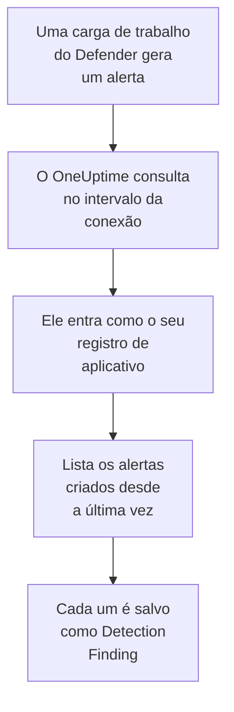

# Microsoft Defender XDR

Importe os alertas de cada carga de trabalho do [Microsoft Defender XDR](https://learn.microsoft.com/en-us/defender-xdr/), de endpoints, identidades, e-mail e aplicativos de nuvem, para os eventos de segurança do OneUptime. Lá você os pesquisa ao lado dos seus logs, traces e métricas, correlaciona-os com todas as outras fontes e aciona o plantão para os que importam. O OneUptime os lê pela API de segurança do Microsoft Graph com um registro de aplicativo que você cria: nenhum agente, playbook ou workspace do Sentinel é necessário.

:::cards
- [Configurar a conexão](#configurar-a-conexão): Um registro de aplicativo, uma permissão e o formulário da conexão.
- [O que é importado](#o-que-é-importado): Como cada alerta do Defender vira um evento de segurança.
- [Como a consulta funciona](#como-a-consulta-funciona): A janela que cada consulta lê, e o que um locatário movimentado faz com ela.
- [Solução de problemas](#solução-de-problemas): O que cada erro significa e o que mudar.
:::

## Como funciona



A cada minuto, o OneUptime consulta cada conexão habilitada cujo intervalo de consulta já passou. Uma consulta entra no Microsoft Entra ID como o seu registro de aplicativo, pede ao Microsoft Graph os alertas criados desde a última consulta ([List alerts_v2](https://learn.microsoft.com/en-us/graph/api/security-list-alerts_v2)) e salva cada um como um evento [OCSF](https://schema.ocsf.io/) Detection Finding (classe `2004`). Regras de detecção, monitores e painéis então o tratam como um evento de segurança de qualquer outra fonte.

## Antes de começar

- No OneUptime, a função Project Owner, Project Admin ou Security Admin. As funções Security Member e Security Viewer veem as conexões e o histórico de execuções delas, mas não podem alterá-las.
- Um locatário do Microsoft Entra com uma licença do Microsoft Defender XDR: qualquer carga de trabalho do Defender integrada ao portal do Microsoft Defender, como Defender for Endpoint, for Identity, for Office 365 ou for Cloud Apps.
- Uma função do Entra que possa registrar aplicativos, como Administrador de Aplicativos, e um Administrador Global ou um Administrador de Funções com Privilégios para conceder o consentimento do administrador.
- HTTPS de saída do aplicativo e dos workers do OneUptime para `login.microsoftonline.com` e `graph.microsoft.com`, ou para `login.microsoftonline.us` e `graph.microsoft.us` no Azure Government.

## Configurar a conexão

A conexão entra com o [fluxo de credenciais do cliente do OAuth 2.0](https://learn.microsoft.com/en-us/entra/identity-platform/v2-oauth2-client-creds-grant-flow): como aplicativo, nunca como pessoa, com uma única permissão de aplicativo.

:::steps
### Registrar um aplicativo

1. Entre no [portal do Azure](https://portal.azure.com) e abra **Microsoft Entra ID**.
2. Vá em **App registrations → New registration**. Dê o nome `OneUptime Security Events`, deixe **Supported account types** em **Accounts in this organizational directory only**, deixe o URI de redirecionamento vazio e selecione **Register**.
3. Na página **Overview** do aplicativo, copie o **ID do aplicativo (cliente)** e o **ID do diretório (tenant)**.

### Permitir que ele leia alertas

1. Vá em **API permissions → Add a permission → Microsoft Graph → Application permissions**, escolha `SecurityAlert.Read.All` e selecione **Add permissions**. É a permissão com menos privilégios que a chamada [List alerts_v2](https://learn.microsoft.com/en-us/graph/api/security-list-alerts_v2#permissions) aceita para um aplicativo: não adicione `SecurityAlert.ReadWrite.All`.
2. Selecione **Grant admin consent for** o seu locatário e confirme. O status da permissão deve mostrar **Granted**: sem consentimento, toda leitura é recusada com `403`.

### Criar um segredo do cliente

Vá em **Certificates & secrets → Client secrets → New client secret**, escolha quando ele expira e selecione **Add**. Copie o **Value** do segredo, não o **Secret ID** dele, antes de sair da página: ele nunca mais é mostrado.

Anote quando o segredo expira. Nesse dia, a consulta para com `Microsoft Defender XDR token request failed (HTTP 401)` até você substituí-lo com **Atualizar credenciais**.

### Adicionar a conexão no OneUptime

Abra **Produtos → Security Events → Conexões** (`/dashboard/{projectId}/security-events/connections`), clique em **Adicionar conexão**, escolha **Microsoft Defender XDR** em **EDR / XDR** e clique em **Próximo**. Preencha as configurações da tabela abaixo, clique em **Próximo** e cole o valor do segredo em **Segredo do cliente**.

### Testar antes de salvar

Clique em **Testar estas configurações** em **Testar antes de salvar**. O teste entra e lê alertas com os valores do formulário, e não salva nada, então um segredo errado ou um consentimento que falta aparecem antes de a conexão existir. Depois clique em **Próximo**, dê à conexão um **Nome** e crie-a.
:::

| Configuração | Onde encontrar |
| --- | --- |
| **ID do diretório (tenant)** | A página **Overview** do aplicativo. O GUID do locatário, ou um domínio verificado como `contoso.onmicrosoft.com`. |
| **ID do aplicativo (cliente)** | A página **Overview** do aplicativo. O GUID do aplicativo que tem `SecurityAlert.Read.All`. |
| **Nuvem** | **Nuvem pública do Azure**, que também atende o Microsoft 365 GCC, ou **Azure Government (EUA)** para GCC High (`login.microsoftonline.us` e `graph.microsoft.us`). O Microsoft 365 DoD e a nuvem 21Vianet na China não são suportados. |
| **Segredo do cliente** | O **Value** do segredo. Ele é criptografado, nunca devolvido pela API e nunca mais mostrado. Substitua-o com **Atualizar credenciais** na conexão. |

A etapa **Consulta periódica** também tem uma **Descrição** opcional, o **Intervalo de consulta (minutos)**, um número inteiro de `1` a `1440` que começa em `5`, e **Habilitado**, que começa ativado.

## O que é importado

Cada [alerta](https://learn.microsoft.com/en-us/graph/api/resources/security-alert) do Defender XDR vira um evento Detection Finding (classe OCSF `2004`), com o fornecedor `Microsoft` e o produto `Microsoft Defender XDR`, atribuído ao serviço de telemetria `Microsoft Defender XDR`:

| Coluna OCSF | Campo do alerta |
| --- | --- |
| `eventUid` | `id`, o ID do alerta do Graph, que também serve para descartar duplicatas |
| `time` | `firstActivityDateTime`, ou `createdDateTime` quando ele não existe |
| `message`, `ruleName` | `title` |
| `ruleId` | `detectorId`, ou `alertPolicyId` quando ele não existe |
| `severityName` | `severity`: `informational`, `low`, `medium` ou `high`, e `unknown` continua Unknown |
| `statusName` | `status`: `new` vira New, `inProgress` In Progress, `resolved` Resolved |
| `mitreTechniques` | `mitreTechniques` |
| `mitreTactics` | `categories` ou `category`, quando é uma tática do ATT&CK: `CredentialAccess` vira `TA0006`. As outras categorias ficam em `attributes`. |
| `principalHost`, `principalUser`, `principalIp`, `principalProcess` | A `evidence` com a função `source`, `attacker` ou `compromised`, ou então a primeira de cada tipo |
| `processName`, `processPath`, `processCommandLine`, `parentProcessName`, `parentProcessPath` | A evidência de processo de onde vem `principalProcess`: seu `imageFile`, `processCommandLine` e `parentProcessImageFile`. O Graph não informa a linha de comando do processo pai. |
| `targetHost`, `targetUser`, `targetIp`, `targetResource` | A `evidence` com uma função de alvo, como `destination` ou `attacked`. URLs, caixas de correio e recursos de nuvem preenchem `targetResource`. |
| `observables` | Cada nome de host, IP, usuário, nome de arquivo, SHA-1 e SHA-256, URL, domínio, caixa de correio e ID de recurso em `evidence` |
| `attributes` | O alerta inteiro, achatado em chaves com pontos como `evidence.0.hostName`, `serviceSource` e `incidentId` |

Os alertas de cada `serviceSource` são importados, inclusive os do Microsoft Sentinel quando o Sentinel está conectado ao portal do Defender. Os incidentes não são importados, mas cada alerta mantém o `incidentId` e o `incidentWebUrl` dele em `attributes`.

## Como a consulta funciona

Cada consulta lista os alertas criados na janela dela, 100 por página, e segue o `@odata.nextLink` do Graph até ter lido a janela inteira:

```text
GET https://graph.microsoft.com/v1.0/security/alerts_v2?$filter=createdDateTime ge {start} and createdDateTime lt {end}&$top=100
```

- **O horário de criação é o cursor.** O Defender muitas vezes cria um alerta horas depois do `firstActivityDateTime` dele, e um cursor pelo horário de atividade pularia cada um desses alertas.
- **A primeira consulta olha 24 horas para trás**, para que uma nova conexão mostre logo os alertas recentes dela.
- **Cada consulta seguinte começa 1 minuto antes do cursor salvo**, para que um alerta criado na fronteira entre duas janelas seja lido duas vezes e importado uma.
- **Uma consulta lê no máximo 24 horas além do cursor.** Uma conexão cujo cursor ficou para trás, enquanto os workers estavam parados ou o locatário estava limitado, se atualiza em uma série de janelas de 24 horas.
- **As duplicatas são descartadas pelo `id` do alerta** entre os eventos do projeto vindos de `Microsoft` / `Microsoft Defender XDR`, para que a sobreposição, uma janela repetida e uma importação nunca salvem um alerta duas vezes.
- **Uma execução que falha não muda nada.** Depois de um erro de rede, ou de um status de erro do Graph, o cursor e o tamanho da janela ficam como estavam, e a consulta seguinte relê a mesma janela. A única exceção é uma requisição que expirou: o cursor fica, mas a janela seguinte tem a metade do tamanho, porque uma janela pesada demais para ser respondida a tempo expiraria a cada tentativa.

### Quando uma janela contém mais do que uma consulta consegue ler

Uma consulta lê no máximo 20 páginas de 100 alertas: 2.000 alertas. Quando esse limite a interrompe antes do fim da janela, a execução fica **Parcial**, com este aviso:

```text
Stopped after 20 alerts requests (the per-run request limit) before reading the whole window. Microsoft Graph lists alerts newest first and documents no way to sort them oldest first, so this run cannot name a point to resume from.
```

A [List alerts_v2](https://learn.microsoft.com/en-us/graph/api/security-list-alerts_v2) documenta `$filter`, `$top`, `$skip` e `$count`, mas não `$orderby`, e devolve primeiro os alertas mais novos. Os 2.000 alertas que uma execução interrompida leu são os mais novos da janela dela, então mover o cursor além deles pularia os mais antigos que ela nunca alcançou. O OneUptime encurta a janela em vez disso:

1. **Reduzir.** A consulta seguinte lê uma janela com a metade do tamanho, a partir do mesmo ponto de partida, e continua dividindo pela metade até que uma janela seja lida por inteiro, até um minuto. O aviso da execução diz isso: `This window holds more records than one poll can read; the next poll reads a {n} minute window from the same starting point.` Os alertas já importados da janela mais longa são pulados como duplicatas.
2. **Voltar a crescer.** Depois que uma janela é lida por inteiro, o cursor vai para o fim dela, e a janela seguinte volta a ter o dobro do tamanho, até 24 horas.
3. **Passar de um único minuto.** Se até um minuto contém mais de 2.000 alertas, a consulta passa dele, para que os alertas mais novos continuem chegando. A execução continua **Parcial**, e **Último erro** mostra `More records were created in the one minute from {cursor} to {end} than one poll can read. Polling moved past this minute so newer records keep arriving; use Import this time range in Diagnostics on this minute to recover what one run can read.` Importe esse minuto com **Import this time range** para recuperar o que uma execução consegue ler.

Uma execução **Parcial** por outro motivo, como um alerta que não pôde ser lido como evento de segurança, é tentada de novo do mesmo jeito, a partir do mesmo ponto de partida. Mudar o **Intervalo de consulta (minutos)** não muda nada disso: ele decide com que frequência uma consulta começa, não onde a janela dela começa.

### Executar, pré-visualizar e importar sob demanda

Clique em **Diagnóstico** em uma conexão para ver as execuções recentes dela e trabalhar com ela manualmente. Quem pode alterar a conexão pode iniciar essas ações; quem pode vê-la pode ler o histórico.

- **Executar agora** inicia uma consulta na hora, com o cursor de sempre, mesmo quando a conexão não está **Habilitado**.
- **Preview alerts** lê um intervalo de tempo de até 7 dias e não importa nada.
- **Import this time range** importa um intervalo de até 7 dias, depois que você confirma, sem mover o cursor. Os alertas já importados são pulados.
- **Copy diagnostics** em uma execução copia o relatório dela para o suporte. Ele nunca inclui credenciais.

## Testar conexão

**Testar conexão** na linha de uma conexão, e **Testar estas configurações** no formulário, rodam no processo da API, não em um worker em segundo plano, para que um teste responda mesmo quando o problema são os workers. Ele faz estas verificações, em ordem:

| Verificação | O que ela verifica |
| --- | --- |
| **Configuração** | As quatro configurações estão presentes e bem formadas. Nada é contatado quando isso falha. |
| **Authenticate with Microsoft Entra** | O Microsoft Entra ID emite um token para o Microsoft Graph, na nuvem que você escolheu. Falha com um segredo errado ou expirado, um ID de locatário ou de cliente errado, ou a nuvem errada. |
| **Read alerts from Microsoft Graph** | Um alerta criado nas últimas 24 horas pode ser lido (`$top=1`). Um `403` aqui é a permissão `SecurityAlert.Read.All` que falta, o consentimento do administrador que falta ou um locatário sem Defender XDR. |
| **Alerts available to import** | Quantos alertas foram criados nas últimas 24 horas e nos últimos 7 dias, uma página de 100 para cada, então `100+` significa mais. Nenhum em 7 dias é um aviso, não uma falha. |
| **Background workers**, **Poll scheduler**, **Security event storage** | O lado do próprio OneUptime: um processo pega os jobs da fila Worker, o job de consulta roda a cada minuto e o armazenamento de eventos de segurança responde. |
| **Scheduled polling** | Para uma conexão salva: a consulta está ativada, nenhuma execução está presa esperando um worker e as consultas rodam no horário. |

Cada requisição de um teste tem um prazo de 20 segundos. Um teste nunca importa nada nem move o cursor, e cada verificação que falha diz o que mudar.

## Solução de problemas

O **Último erro** da conexão guarda a mensagem de erro completa, com as credenciais ocultadas, atrás de um prefixo que nomeia a etapa que falhou. Quando uma conexão tem um erro, selecione **Ver erro** na coluna **Ações** dela para lê-lo, e **Copiar erro** na caixa de diálogo para copiá-lo. Leia o prefixo primeiro.

:::details Last Error começa com `Microsoft Defender XDR token request`
- `Microsoft Defender XDR token request failed (HTTP ...)`: o Microsoft Entra ID se recusou a emitir um token, então o Graph nunca foi contatado. A mensagem termina com uma dica, conforme o código `error` do Entra:
  - `invalid_client` (`AADSTS7000215`): o segredo está errado, expirou ou pertence a outro aplicativo. Crie um novo em **Certificates & secrets** e salve-o com **Atualizar credenciais**.
  - `unauthorized_client` (`AADSTS700016`): o **ID do aplicativo (cliente)** não está nesse **ID do diretório (tenant)**, ou a **Nuvem** está errada.
  - `AADSTS90002`: esse locatário não existe.
  - `invalid_scope`: o escopo do Graph não existe na nuvem que você escolheu. Verifique **Nuvem**.
- `Microsoft Defender XDR token request returned ...`: o Microsoft Entra ID respondeu com algo inutilizável, um corpo que não é JSON ou sem `access_token`. Normalmente é um proxy ou um gateway no meio, não as credenciais.
- `Microsoft Defender XDR token request did not complete: ...`: o endpoint de tokens não pôde ser alcançado, ou não respondeu a tempo. Verifique o HTTPS de saída do aplicativo e dos workers do OneUptime para `login.microsoftonline.com`, ou `login.microsoftonline.us`.
:::

:::details Last Error começa com `Microsoft Defender XDR alerts request`
- `Microsoft Defender XDR alerts request failed (HTTP ...)`: o Graph se recusou a listar os alertas. A mensagem nomeia o código de erro do Graph, e uma dica:
  - `403` (`Authorization_RequestDenied`): falta `SecurityAlert.Read.All` ou o consentimento do administrador dela, ou o locatário não tem licença do Defender XDR. O consentimento leva alguns minutos para valer.
  - `401` (`InvalidAuthenticationToken`) depois de um token ter sido emitido: normalmente a **Nuvem** não corresponde ao locatário.
  - `429` (`TooManyRequests`): o Graph está limitando o aplicativo, e a consulta seguinte relê a mesma janela. A mensagem não consegue citar o `Retry-After` do Graph, porque o cliente HTTP do OneUptime não guarda cabeçalhos de resposta em um erro. Se continuar acontecendo, aumente o **Intervalo de consulta (minutos)**.
  - `5xx`: um problema do lado do Graph. A consulta seguinte tenta de novo.
  - `400`: o Graph não quis executar a consulta, que o OneUptime monta, e não as suas configurações. Copie a mensagem para o suporte do OneUptime.
- `Microsoft Defender XDR alerts request returned ...`: o Graph respondeu `200`, mas com algo que o conector não conseguiu usar: um corpo que não é JSON, nenhuma lista `value` ou um `@odata.nextLink` que não é um link `https://` no host do Graph da sua nuvem. Um link assim é recusado, para que o token nunca seja enviado para outro lugar. Isso é relatado em vez de tratado como uma janela vazia, para que o cursor nunca passe de alertas que ninguém leu.
- `Microsoft Defender XDR alerts request did not complete: ...`: o Graph não pôde ser alcançado, ou não respondeu a tempo: 60 segundos para uma consulta, 20 para um teste. Verifique o HTTPS de saída para `graph.microsoft.com`, ou `graph.microsoft.us`.
:::

:::details O teste passa, mas Last Polled é Never
O job de consulta nunca rodou. Leia as verificações **Background workers** e **Poll scheduler**. Em uma instalação auto-hospedada, a causa comum é `DISABLE_QUEUE_WORKERS=true` no aplicativo, sem um deployment separado de workers que pegue os jobs: defina como `false`, ou rode o deployment de workers (Helm: `worker.enabled: true`, que é `false` por padrão).
:::

:::details As consultas funcionam, mas falta um alerta que você conhece
Compare o `createdDateTime` do alerta no portal do Defender com a janela da execução em **Diagnóstico**: as janelas são pelo horário de criação, não pelo horário de atividade.

- Um alerta criado antes de a conexão existir é mais antigo do que o primeiro olhar de 24 horas para trás. Importe-o com **Import this time range**.
- Uma execução **Parcial** foi interrompida pelo limite de 2.000 alertas. A consulta seguinte lê uma janela mais curta a partir do mesmo início, então o alerta é importado assim que uma janela que o contém é lida por inteiro.
- Se **Último erro** nomear um minuto que a consulta pulou, importe esse minuto com **Import this time range**.
:::

:::details O mesmo alerta aparece duas vezes
A sobreposição de 1 minuto não causa isso: a segunda leitura conta como duplicata e não é salva. Dois eventos com o mesmo `eventUid` foram importados com produtos diferentes, como o mesmo alerta chegando também por uma conexão do Microsoft Sentinel. As duplicatas são descartadas por fornecedor e produto.
:::

## O que você ganha

- **Pesquisa.** Filtre os alertas do Defender por gravidade, status, técnica do MITRE, host, usuário, IP ou qualquer observável no explorador de eventos de segurança, ao lado dos logs e das métricas desse host.
- **Correlação.** As evidências de cada alerta, os dispositivos, usuários, IPs, arquivos e URLs dele, são indexadas como observáveis, então uma pesquisa encontra tudo o que menciona um host em todas as fontes.
- **Regras de detecção.** Regras Sigma que rodam em uma programação sobre os seus eventos de segurança, e abrem alertas que acionam o plantão.
- **Monitores.** Os monitores de eventos de segurança contam os eventos correspondentes, e abrem incidentes ou alertas acima de um limite.

Os eventos de segurança são cobrados como o resto da sua telemetria, por GB ingerido. Veja os [preços](https://oneuptime.com/pricing).

## Próximos passos

:::cards
- [Eventos de segurança](/docs/telemetry/security-events): Pesquise, correlacione e alerte sobre o que você importa.
- [Microsoft Sentinel](/docs/integrations/microsoft-sentinel): Importe também os incidentes de um workspace do Sentinel.
- [Funções](/docs/permissions/reference#funções): O que as funções Security podem ver e alterar.
- [Visão geral das integrações](/docs/integrations/index): As outras ferramentas que você pode conectar.
:::
