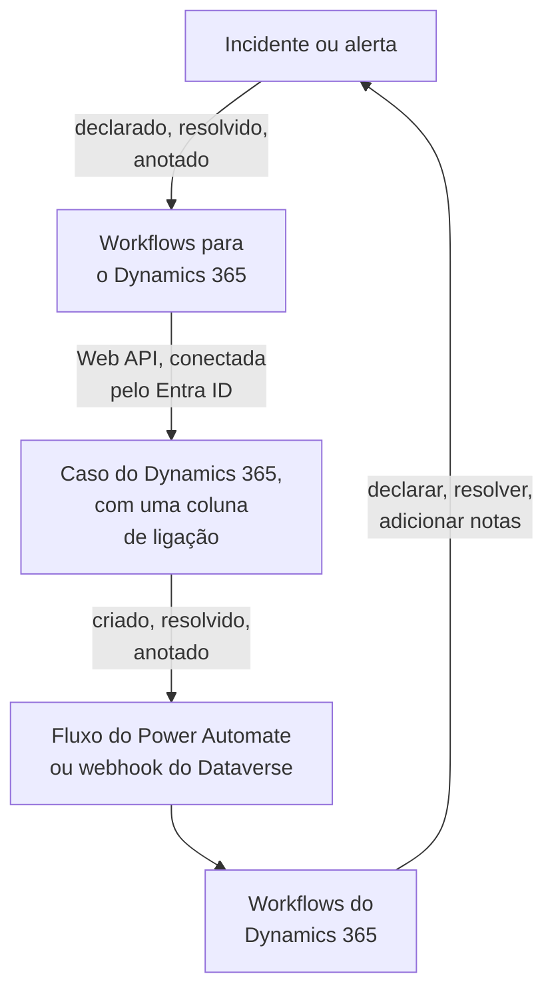

# Microsoft Dynamics 365

Mantenha os casos do [Microsoft Dynamics 365](https://www.microsoft.com/dynamics-365) em dia com os seus incidentes e alertas do OneUptime, nos dois sentidos. Modelos de workflow prontos abrem um caso para cada incidente ou alerta, fecham-no quando o registro é resolvido e copiam as notas para ele. Outros declaram incidentes a partir de casos novos e trazem de volta as resoluções e as notas. Não há plugin: os workflows chamam a Web API do Dataverse, e o Dynamics 365 chama as URLs de webhook deles.

:::cards
- [Preparar o Dynamics 365](#preparar-o-dynamics-365): Um registro de aplicativo, um usuário de aplicativo e uma coluna de ligação.
- [Começar a partir de um modelo](#começar-a-partir-de-um-modelo): Os 13 modelos, o que pedem e como configurá-los.
- [Como os modelos funcionam](#como-os-modelos-funcionam): Como casos e registros continuam ligados, sem loops.
- [Montar você mesmo](#montar-você-mesmo): Cada sentido à mão, para quando um modelo não serve.
:::

## Como funciona



Cada modelo é um pequeno workflow, então você pega só os sentidos que quiser, para incidentes, alertas ou ambos. Os modelos OneUptime → Dynamics 365 chamam a Web API do Dataverse, conectados como aplicativo pelo Microsoft Entra ID. Os modelos Dynamics 365 → OneUptime começam quando um fluxo do Power Automate ou um webhook do Dataverse os chama. Uma coluna de texto que você adiciona à tabela Case liga cada caso ao seu registro.

## Antes de começar

- Um ambiente do Dynamics 365 com a tabela **Case**. Os casos vêm do Dynamics 365 Customer Service: um ambiente do Dataverse sem ele não tem a tabela `incident` em que gravar.
- Permissão para registrar um aplicativo no **Microsoft Entra ID** e para criar um usuário de aplicativo no ambiente. Muitas vezes são dois administradores diferentes.
- No OneUptime, permissão para criar workflows. No OneUptime Cloud, os workflows exigem o plano **Growth** ou superior.

> [!NOTE]
> Esta página usa os nomes do Dataverse, não os rótulos dos formulários do Dynamics. Um caso é a tabela `incident`, a coleção dela em uma URL é `incidents`, a chave é `incidentid` e a coluna de título é `title`. O número do caso que você vê é `ticketnumber`.

## Preparar o Dynamics 365

Tanto os modelos quanto um workflow que você monte precisam disto. O OneUptime entra como aplicativo, não como pessoa, com o fluxo de credenciais de cliente do OAuth 2.0.

:::steps
### Registrar um aplicativo no Microsoft Entra ID

1. Entre no [portal do Azure](https://portal.azure.com) como administrador do locatário do seu ambiente do Dynamics e abra **Microsoft Entra ID**.
2. Vá para **App registrations → New registration**. Dê o nome `OneUptime Integration`, deixe **Supported account types** em **Accounts in this organizational directory only** e selecione **Register**.
3. Na página **Overview** do aplicativo, copie o **Application (client) ID** e o **Directory (tenant) ID**.
4. Vá para **Certificates & secrets → Client secrets → New client secret** e copie o **Value** do segredo, não o ID dele, antes de sair da página: ele nunca mais é mostrado. Um segredo do cliente dura no máximo 24 meses, então anote quando ele expira.

Não adicione permissões de API nem conceda consentimento de administrador: sem um usuário conectado, eles não fazem nada. O Dynamics 365 decide o que o aplicativo pode fazer, pelo usuário de aplicativo dele.

### Criar o usuário de aplicativo

1. No [centro de administração do Power Platform](https://admin.powerplatform.microsoft.com/), selecione **Manage → Environments** e depois o seu ambiente.
2. Selecione **Settings → Users + permissions → Application users**, depois **+ New app user** e **+ Add an app**. Escolha o registro e selecione **Add**.
3. Escolha uma **Business unit** e depois dê a ele uma função de segurança personalizada pelo ícone de edição ao lado de **Security roles**. No nível Organization, a função precisa de:
   - **Case**: Create, Read, Write, Append e Append To.
   - **Note**: Create, Read e Append, para os modelos de notas.
   - **Activity**: Create, Read e Append, porque fechar um caso registra uma Case Resolution, que é uma atividade.
   - **Account**, e **Contact** se os casos forem abertos em nome de um contato: Read e Append To.
4. Selecione **Save** e depois **Create**.

Um usuário de aplicativo só pode ter uma função personalizada: copie uma existente e reduza-a. Sem esse usuário, o Microsoft Entra ID ainda emite tokens, mas toda chamada ao Dynamics 365 falha com `403` e `0x80072560`, «The user isn't a member of the organization».

### Adicionar uma coluna de ligação à tabela Case

O Dataverse não tem nada parecido com as etiquetas do Jira, então um caso e um registro do OneUptime se encontram por uma coluna que você adiciona.

1. Em [make.powerapps.com](https://make.powerapps.com), escolha o seu ambiente, abra **Tables → Case → Columns** e selecione **New column**.
2. Dê o nome `OneUptime Link`, mantenha **Data type** como **Single line of text** e salve. O comprimento máximo padrão de 100 é mais que suficiente: os modelos gravam no máximo 55 caracteres.
3. Abra a nova coluna e copie o **Logical name** dela, como `new_oneuptimelink`. O prefixo vem do editor da sua solução, então o seu pode ser diferente, como `cr4f2_oneuptimelink`.

Adicione a coluna ao formulário Case se os agentes precisarem ver a ligação.
:::

## Começar a partir de um modelo

A janela **Criar um fluxo de trabalho** tem 13 modelos do Dynamics 365, em **Dynamics 365** na lista de categorias dela: sete para incidentes e depois seis para alertas, cada grupo sob o seu próprio título. Eles compartilham a coluna de ligação, então qualquer combinação deles funciona junta.

### Modelos para incidentes

| Modelo | O que faz | O que pede |
| --- | --- | --- |
| **OneUptime → Dynamics 365** | | |
| Create a Dynamics 365 case when an incident is declared | Abre um caso para cada incidente novo, com uma prioridade escolhida pela gravidade dele e o ID do incidente na coluna de ligação. Os incidentes declarados a partir do Dynamics 365, e os incidentes privados, são ignorados. | As cinco configurações do Dynamics 365, o cliente dos casos novos e a URL do OneUptime |
| Resolve the Dynamics 365 case when the incident is resolved | Fecha o caso ligado como **Problem Solved** quando o incidente é resolvido, registrando uma Case Resolution como faz a resolução à mão. Nunca reabre um caso. | As cinco configurações do Dynamics 365 |
| Copy incident private notes to the Dynamics 365 case | Adiciona cada nota privada nova ao caso ligado como nota. | As cinco configurações do Dynamics 365 |
| Copy incident public notes to the Dynamics 365 case | Adiciona cada nota pública nova ao caso ligado como nota, para que os agentes possam dizer aos clientes o que a página de status mostra. | As cinco configurações do Dynamics 365 |
| **Dynamics 365 → OneUptime** | | |
| Declare an incident when a Dynamics 365 case is created | Declara um incidente para cada caso novo, fora das suas páginas de status, com uma gravidade escolhida pela prioridade do caso, e depois grava o ID do incidente na coluna de ligação do caso. | As cinco configurações do Dynamics 365, e um fluxo ou um webhook para os casos novos |
| Resolve the incident when its Dynamics 365 case is resolved | Resolve o incidente quando o caso ligado é resolvido. | As cinco configurações do Dynamics 365, e um fluxo ou um webhook para as mudanças de status dos casos |
| Add Dynamics 365 case notes to the incident as private notes | Copia cada nota que um agente adiciona a um caso ligado para o incidente, como nota privada. | As cinco configurações do Dynamics 365, e um fluxo ou um webhook para as notas novas |

### Modelos para alertas

Os modelos para alertas fazem os mesmos trabalhos para os alertas. Há um a menos, porque os alertas não têm notas públicas, e **Create an alert when a Dynamics 365 case is created** não grava nenhuma configuração de página de status, porque um alerta nunca chega a uma página de status.

| Modelo | O que faz | O que pede |
| --- | --- | --- |
| **OneUptime → Dynamics 365** | | |
| Create a Dynamics 365 case when an alert is created | Abre um caso para cada alerta novo, incluindo cada alerta que um monitor gera. Os alertas criados a partir do Dynamics 365, e os alertas privados, são ignorados. | As cinco configurações do Dynamics 365, o cliente dos casos novos e a URL do OneUptime |
| Resolve the Dynamics 365 case when the alert is resolved | Fecha o caso ligado como **Problem Solved** quando o alerta é resolvido. | As cinco configurações do Dynamics 365 |
| Copy alert private notes to the Dynamics 365 case | Adiciona cada nota privada nova ao caso ligado como nota. | As cinco configurações do Dynamics 365 |
| **Dynamics 365 → OneUptime** | | |
| Create an alert when a Dynamics 365 case is created | Cria um alerta para cada caso novo, com uma gravidade escolhida pela prioridade do caso, e depois grava o ID do alerta na coluna de ligação do caso. | As cinco configurações do Dynamics 365, e um fluxo ou um webhook para os casos novos |
| Resolve the alert when its Dynamics 365 case is resolved | Resolve o alerta quando o caso ligado é resolvido. | As cinco configurações do Dynamics 365, e um fluxo ou um webhook para as mudanças de status dos casos |
| Add Dynamics 365 case notes to the alert as private notes | Copia cada nota que um agente adiciona a um caso ligado para o alerta, como nota privada. | As cinco configurações do Dynamics 365, e um fluxo ou um webhook para as notas novas |

Nenhum dos modelos OneUptime → Dynamics 365 envia ao Dynamics 365 um incidente marcado como **Incidente privado**, nem um alerta marcado como **Alerta privado**: nem o registro, nem o estado, nem as notas dele, a menos que você ative isso. Veja [Mudar o que um modelo faz](#mudar-o-que-um-modelo-faz).

**Os monitores geram alertas sozinhos, e podem gerar muitos.** **Create a Dynamics 365 case when an alert is created** abre um caso para cada um. A menos que cada alerta mereça um caso, coloque um bloco **If / Else** entre o gatilho e o resto do workflow, por exemplo sobre `{{local.components.alert-on-create-1.returnValues.model.alertSeverity.name}}`, e ligue para a frente só o lado **Yes** dele.

### O que os modelos pedem

A etapa **Configurar** do assistente de criação pede até sete valores: todo modelo pede os cinco primeiros, as configurações do Dynamics 365, e os dois modelos que criam um caso pedem também os dois últimos. Ela verifica o formato de cada configuração do Dynamics 365 antes de qualquer coisa ser criada e diz o que digitar no lugar, porque um valor no formato errado não dá erro em lugar nenhum até uma execução.

- **Dynamics 365 Environment URL** — o endereço do seu ambiente, como `https://yourorg.crm.dynamics.com`, no [centro de administração do Power Platform](https://admin.powerplatform.microsoft.com/) em **Environments**, o seu ambiente, **Environment URL**. Só o endereço: não o endpoint da Web API, que termina em `/api/data/v9.2`, e sem barra no final.
- **Directory (Tenant) ID** — da página **Overview** do registro do aplicativo.
- **Application (Client) ID** — da mesma página.
- **Client Secret Value** — o **Value** do segredo do cliente, em **Certificates & secrets**. Não o **Secret ID** dele, que é um GUID: o assistente recusa um GUID aqui.
- **Case Link Column** — o nome lógico da coluna de ligação, como `new_oneuptimelink`.
- **Customer for New Cases** — só os dois modelos que criam um caso pedem isso. Todo caso precisa de um cliente, e um incidente do OneUptime não tem nenhum, então todos os casos novos são abertos em nome de um só: cole o ID de uma conta, ou `contacts(<id>)` para um contato. Abra o registro no Dynamics 365: o ID dele é a parte depois de `id=` no endereço.
- **OneUptime URL** — só os dois modelos que criam um caso pedem isso: o endereço em que você abre o OneUptime, como `https://oneuptime.com`. A descrição do caso aponta com ele de volta para o incidente ou o alerta.

**Como os modelos entram.** O assistente salva o locatário, o client ID e o segredo em uma única [variável OAuth 2.0](/docs/workflows/variables#variáveis-oauth-20-tokens-que-se-renovam-sozinhos), `dynamicsAccessToken`, em **Variáveis do fluxo** do workflow: Client Credentials, a URL do token `https://login.microsoftonline.com/<tenant>/oauth2/v2.0/token`, o escopo `<environment URL>/.default` e o segredo do cliente, enviado no corpo da requisição e guardado criptografado. Toda chamada ao Dynamics 365 envia `Authorization: Bearer {{local.variables.dynamicsAccessToken}}`. O OneUptime busca o token na primeira vez que uma etapa precisa dele, busca um novo antes que ele expire e o substitui por `[REDACTED]` nos logs de execução e nos rastros das etapas.

Para verificar a conexão antes de qualquer execução, abra **Variáveis do fluxo**, clique em **Visualizar** em `dynamicsAccessToken` e clique em **Atualizar agora**. **Access Token Fetched** significa que o registro do aplicativo está certo. Caso contrário, o erro do Microsoft Entra ID diz o que está errado, como `AADSTS7000215: Invalid client secret provided`.

Cada workflow guarda a sua própria cópia. Quando você trocar o segredo do cliente, abra `dynamicsAccessToken` em cada workflow do Dynamics 365 e use **Atualizar credenciais**.

### Criar os workflows

:::steps
1. Abra **Fluxos de trabalho → Criar fluxo de trabalho**. Em **Ou começar a partir de um modelo**, escolha **Dynamics 365** na lista de categorias, ou digite `Dynamics` em **Pesquisar modelos…**, e clique no modelo que você quer. Ele se abre e mostra o que faz e as configurações que vai pedir. Clique em **Usar este modelo**.
2. **Nome** é preenchido a partir do modelo. Mude-o se quiser.
3. **Configurar** pede os valores acima.
4. Clique em **Criar fluxo de trabalho**. Todo workflow é criado desativado: ative **Habilitado** no topo do **Construtor** dele.
:::

Comece com **Create a Dynamics 365 case when an incident is declared**, ou com **Create a Dynamics 365 case when an alert is created** para os alertas: todo outro modelo OneUptime → Dynamics 365 do mesmo tipo encontra o caso pela ligação que este grava. Ative-o, declare um incidente de teste ou crie um alerta de teste, e abra **Registros → Execuções** do workflow. A última etapa da execução deve dizer `✅ Opened Dynamics 365 case CAS-01001-X1Y2Z3 for INC-42, linked as oneuptime-incident-<id>.`

### Ligar os modelos Dynamics 365 → OneUptime

Os modelos Dynamics 365 → OneUptime, três para incidentes e três para alertas, partem de um [gatilho Webhook](/docs/workflows/triggers#webhook), então é preciso dizer ao Dynamics 365 para onde enviar os eventos dele. Faça nesta ordem:

1. Crie o workflow e **ative-o primeiro**. Um workflow desativado recusa as entregas, e elas não ficam na fila.
2. Abra o **Construtor** do workflow, clique no bloco de gatilho **Webhook** (`webhook-1`) e clique em **Copiar URL** no topo das configurações dele. A URL tem esta forma:

   ```text
   https://<your OneUptime host>/workflow/trigger/<webhook secret key>
   ```

3. Faça o Dynamics 365 enviar para ela, a partir de um fluxo do Power Automate ou de um webhook do Dataverse.

Cada modelo só precisa saber qual linha mudou. Ele lê essa linha de novo no Dynamics 365 antes de fazer qualquer coisa, então nunca pega da requisição o título, o status ou a ligação de um caso, e não importa qual dos dois a envie.

:::tabs
@tab Power Automate flow
No [Power Automate](https://make.powerautomate.com), crie um **Automated cloud flow** com o gatilho **When a row is added, modified or deleted** do **Microsoft Dataverse**, configurado como abaixo, com **Scope** em **Organization**. Adicione a ação embutida **HTTP**: **Method** `POST`, **URI** a URL do workflow, um cabeçalho `Content-Type: application/json` e o corpo abaixo, com o ID da linha escolhido no conteúdo dinâmico do gatilho.

| Modelo | Change type | Table name | Select columns | Body |
| --- | --- | --- | --- | --- |
| Declarar um incidente / criar um alerta quando um caso é criado | Added | Cases | | `{"incidentid": "<Case>"}` |
| Resolver o incidente / o alerta quando o caso dele é resolvido | Modified | Cases | `statecode,statuscode` | `{"incidentid": "<Case>"}` |
| Adicionar as notas do caso ao incidente / ao alerta como notas privadas | Added | Notes | | `{"annotationid": "<Note>"}` |

Para enviar só alguns casos, use **Filter rows** do gatilho, como `prioritycode eq 1` para os casos de prioridade alta. Você também pode enviar toda a saída do gatilho: os modelos leem dela o ID da linha e o `SdkMessage` da mesma forma.
@tab Dataverse webhook
Registre a URL com a [Plug-in Registration Tool](https://learn.microsoft.com/en-us/power-apps/developer/data-platform/register-web-hook): **Register New WebHook**, com autenticação **HttpHeader** e um cabeçalho seu; a própria URL é o segredo. Depois registre nele uma etapa para cada evento abaixo, com **Event Pipeline Stage of Execution** em **PostOperation** e **Execution Mode** em **Asynchronous**.

| Modelo | Message | Primary Entity | Filtering Attributes |
| --- | --- | --- | --- |
| Declarar um incidente / criar um alerta quando um caso é criado | `Create` | `incident` | |
| Resolver o incidente / o alerta quando o caso dele é resolvido | `Close`, e `Update` para mudanças de status feitas por outros | `incident` | `statecode, statuscode` (Update) |
| Adicionar as notas do caso ao incidente / ao alerta como notas privadas | `Create` | `annotation` | |

Resolver um caso gera a mensagem **Close**, não **Update**, e é por isso que esse modelo precisa das duas. Um webhook envia o contexto de execução do plug-in, que identifica a linha em `PrimaryEntityId`, ou, para **Close**, na `IncidentResolution` dele, e os modelos a leem dali. Um webhook do Dataverse só chama as portas 80 e 443, e não tem filtro de linhas próprio: todo caso novo chega ao modelo de criação, a menos que você o restrinja com `ONLY_PRIORITIES`.
:::

Antes de confiar em qualquer um dos dois:

- **Quem tiver a URL pode disparar o workflow.** Como os modelos leem de novo cada linha no Dynamics 365, uma requisição só pode fazê-los olhar para um caso ou uma nota reais. Ela ainda pode fazer os modelos de criação agirem sobre um caso que ainda não está ligado. Guarde a URL só no fluxo ou no webhook. Se ela vazar, clique no gatilho **Webhook** no **Construtor** do workflow, clique em **Redefinir URL** e cole a nova URL no fluxo ou no webhook. A URL antiga deixa de funcionar na hora.
- **Cada evento é uma execução**, inclusive os que um modelo ignora. No OneUptime Cloud, cada um conta para as execuções de workflow do seu plano, e filtrar no fluxo mantém esse número baixo. Veja [Limites do plano](/docs/workflows/configuration#limites-do-plano).
- **Usa os dois modelos que criam um registro a partir de um caso?** **Declare an incident when a Dynamics 365 case is created** e **Create an alert when a Dynamics 365 case is created** agem ambos sobre cada caso que recebem. Cada um verifica primeiro a coluna de ligação, mas duas entregas para um mesmo caso novo chegam juntas, então o caso pode acabar com um incidente e um alerta. Envie aos dois casos diferentes, por exemplo por tipo de caso.

### Verificar que funciona

Todo modelo termina com uma etapa **Log** que diz o que aconteceu, então a última etapa de uma execução em **Registros → Execuções** é o lugar para olhar:

- `✅` — ele fez o trabalho e cita o caso, o incidente ou o alerta.
- `ℹ️` — ele ignorou o evento de propósito e diz por quê: o caso não está ligado a um registro desse tipo, a nota veio do outro lado, o registro é privado ou não há status de caso mapeado para o novo estado.
- `❌` — uma chamada falhou. Para uma chamada ao Dynamics 365, a linha inclui a resposta do Dynamics 365.
- `⚠️` — um modelo que cria um registro a partir de um caso o criou, mas o Dynamics 365 não aceitou a ligação, então os outros modelos ainda não conseguem encontrá-lo. Digite a ligação à mão na coluna do caso.

Se uma execução parar na primeira etapa do Dynamics 365 com `Could not get an OAuth 2.0 access token for {{local.variables.dynamicsAccessToken}}`, as configurações de conexão estão erradas, e a mensagem cita a resposta do Microsoft Entra ID. Veja [O que os modelos pedem](#o-que-os-modelos-pedem).

## Como os modelos funcionam

### Como os dois lados continuam ligados

É o caso que guarda a ligação. Um caso que pertence a um incidente tem `oneuptime-incident-<incident id>` na coluna de ligação, e um que pertence a um alerta tem `oneuptime-alert-<alert id>`. O ID é a última parte do endereço do registro no painel.

Os modelos que criam um caso a gravam ao abrir o caso, e os modelos que criam um registro a partir de um caso a gravam assim que o registro existe. Todos os outros modelos passam de um lado para o outro por ela: os OneUptime → Dynamics 365 procuram o caso pela ligação, e os Dynamics 365 → OneUptime leem o ID do registro no caso. Para ligar um caso aberto à mão, digite você mesmo o valor na coluna de ligação dele, mas só quando o registro ainda não tiver caso.

**Um caso está ligado a um incidente ou a um alerta, nunca aos dois.** Uma só coluna serve aos dois tipos. Os modelos para incidentes ignoram um caso ligado a um alerta, e vice-versa, e os modelos que criam um registro a partir de um caso deixam de lado qualquer caso cuja coluna de ligação tenha qualquer coisa.

**Um registro tem um só caso.** Os modelos que gravam em um caso só agem quando exatamente um caso tem a ligação do registro. Se a ligação for copiada para um segundo caso, eles param, e cada execução termina com um aviso de item ignorado que cita os dois:

```text
More than one Dynamics 365 case holds the link oneuptime-incident-<id> (CAS-01001-X1Y2Z3, CAS-01002-K4L5M6). Clear it on every case except the one opened for the incident.
```

Os incidentes e alertas criados a partir de um caso também guardam o ID e o número do caso em `customFields.dynamicsCaseId` e `customFields.dynamicsCaseNumber`, gravados quando são criados. É assim que os modelos que criam um caso sabem que o registro já tem um.

### Como os modelos evitam loops

Cada gravação em um sentido é um evento no outro: uma nota adicionada a um caso volta como uma nota nova, e uma nota privada adicionada no OneUptime dispara o gatilho de notas. Quatro coisas interrompem o eco:

- **Marcadores no texto.** Toda nota que os modelos adicionam a um caso tem o título `Synced from OneUptime: …`, assim como o assunto de toda Case Resolution que eles registram. Toda nota escrita a partir do Dynamics 365, e a causa raiz de toda mudança de estado feita a partir dele, começa com `Synced from Dynamics 365`. Cada sentido ignora o texto que traz o marcador do outro lado, mesmo em uma nota que alguém escreveu citando um.
- **A ligação desde o primeiro salvamento.** Um caso que o OneUptime abre tem a ligação desde o momento em que existe, então, quando o **Create** dele volta, o modelo que cria um registro a partir de um caso o encontra ligado e não faz nada.
- **`customFields.dynamicsCaseId`.** Um registro criado a partir de um caso o tem, e os modelos que criam um caso ignoram esses registros.
- **Os estados só avançam, nos dois lados.** Resolver o registro fecha o caso, e o **Close** do caso então encontra o registro já resolvido. Quando o caso é resolvido primeiro, o registro é resolvido, e a atualização dele encontra o caso já fechado. Um caso já resolvido ou cancelado nunca é reaberto.

Mantenha os marcadores ao editar os modelos. Eles são as constantes `FROM_ONEUPTIME` e `FROM_DYNAMICS` no bloco auxiliar no topo de cada script.

### Mudar o que um modelo faz

Abra o **Construtor** do workflow e clique no bloco que você quer mudar. As configurações que você mais provavelmente vai querer mexer são constantes perto do topo de um script, o **JavaScript Code** de um bloco **Run Custom JavaScript**, logo abaixo do bloco auxiliar comum. As versões para incidentes e para alertas mantêm as mesmas constantes nos mesmos blocos.

| Constante | Modelo e bloco | O que controla |
| --- | --- | --- |
| `SYNC_PRIVATE_INCIDENTS`, `SYNC_PRIVATE_ALERTS` | Cada modelo OneUptime → Dynamics 365 — `prepare-case-1`, `plan-case-1`, `build-note-1` | `false` mantém os registros privados fora do Dynamics 365: nenhum caso é aberto para eles, o caso deles não muda e as notas deles não são adicionadas. Defina como `true` em cada modelo que deve enviá-los. |
| `SEVERITY_TO_PRIORITY`, `DEFAULT_PRIORITY` | Criar um caso do Dynamics 365 — `prepare-case-1` | As gravidades do projeto são distribuídas pelas prioridades de caso pela ordem delas: a mais grave abre um caso High (`1`), a menos grave um Low (`3`), e as intermediárias casos Normal (`2`). Cite uma gravidade pelo nome, em minúsculas, para escolher você mesmo a prioridade dela, como `{ 'major incident': 1 }`. `DEFAULT_PRIORITY` (`2`) é para uma gravidade que a lista do projeto não tem, ou para um projeto com uma só. |
| `CASE_ORIGIN`, `CASE_TYPE` | Criar um caso do Dynamics 365 — `prepare-case-1` | O `caseorigincode` (`3`, Web) e o `casetypecode` (`2`, Problem) do caso novo. Para definir qualquer outra coluna, adicione-a a `CASE` no mesmo script, pelo nome lógico dela. |
| `MAX_TITLE_LENGTH`, `MAX_DESCRIPTION_LENGTH` | Criar um caso do Dynamics 365 — `prepare-case-1` | Os limites da própria tabela Case, 200 e 2000 caracteres. A descrição mantém o link de volta para o OneUptime, por mais que seja cortada. Aumente-os se a sua tabela Case permitir mais. |
| `RESOLVED_CASE_STATUS` | Resolver o caso do Dynamics 365 — `plan-case-1` | O status com que um registro resolvido fecha o caso: `5` é Problem Solved, `1000` Information Provided. |
| `STATE_TO_CASE_STATUS` | Resolver o caso do Dynamics 365 — `plan-case-1` | Move o caso quando o registro chega a outro estado, pelo nome do estado: `{ Acknowledged: 4 }` o move para Researching quando o incidente é reconhecido. Os status ativos do Dynamics 365 são `1` In Progress, `2` On Hold, `3` Waiting for Details e `4` Researching. Um estado resolvido listado aqui fecha o caso com o status que ele cita. |
| `PRIORITY_RANK` | Criar a partir de um caso do Dynamics 365 — `prepare-incident-1`, `prepare-alert-1` | Mapeia uma prioridade de caso (`1` High, `2` Normal, `3` Low) para `0` (a sua gravidade mais grave), `1` ou `2` (a menos grave). As prioridades não listadas ficam no meio. Com as duas gravidades de alerta que um projeto novo tem, Normal vira Low, a menos que você troque `2: 1` por `2: 0`. |
| `ONLY_PRIORITIES` | Criar a partir de um caso do Dynamics 365 — `prepare-incident-1`, `prepare-alert-1` | Vazia, aceita todo caso que o fluxo ou o webhook enviar. `[1]` cria registros só para os casos de prioridade alta. |
| `CASE_STATUS_TO_STATE`, `CASE_STATE_TO_STATE_FLAG` | Resolver quando o caso do Dynamics 365 é resolvido — `decide-state-1` | Um status de caso, pelo nome, para um estado do OneUptime, como `{ Researching: 'Acknowledged' }`. Caso contrário, o estado do caso decide: Resolved resolve o registro. Adicione `2: 'isResolvedState'` para resolvê-lo também quando o caso dele for cancelado. |
| `MESSAGES` | Cada modelo Dynamics 365 → OneUptime — `read-event-1` | Os eventos sobre os quais o modelo age. Adicione `'Update'` à lista do modelo de notas para copiar também as notas editadas: cada edição vira uma nota nova. |
| `MAX_NOTE_LENGTH` | Os modelos de notas — `build-note-1`, `read-note-1` | A nota mais longa que cada um grava: 100.000 caracteres no Dynamics 365, que é o limite da própria nota, e 30.000 no OneUptime. |

Os nomes de estado e de status usados como chaves precisam ser escritos exatamente como são chamados, maiúsculas incluídas. Evite `{{` no código: um script é preenchido como qualquer outra configuração antes de rodar, então duas chaves de abertura seguidas seriam lidas como uma referência.

### Limitações

- **A nuvem comercial da Microsoft.** A URL do token é `login.microsoftonline.com`. Para as nuvens US Government (GCC High, DoD) ou China, abra `dynamicsAccessToken`, use **Editar definições** e troque a URL do token pelo host de login da sua nuvem, como `login.microsoftonline.us`.
- **O Dynamics 365 pode se recusar a resolver um caso.** As suas configurações do Customer Service podem impedir que um caso seja resolvido enquanto ele tiver atividades abertas ou casos filhos abertos, e uma regra de negócio ou um plug-in também podem recusar. A execução termina com `❌ Dynamics 365 did not resolve the case`, com o motivo dado pelo Dynamics 365, e o caso fica como estava.
- **Registros e casos nunca voltam para trás.** Reabrir um caso não muda nada no OneUptime, e um registro resolvido nunca é reaberto. Um caso já resolvido ou cancelado nunca é reaberto para ser fechado de novo.
- **Notas e descrições são texto simples.** Uma nota escrita no editor de texto formatado do Dynamics 365 chega ao OneUptime como o texto que ele mostra, e o mesmo vale para a descrição de um caso escrita no editor ou tirada de um e-mail: os parágrafos e as quebras de linha ficam, enquanto a formatação, as imagens e os estilos próprios do e-mail se perdem. Uma nota do OneUptime chega ao Dynamics 365 com os caracteres brutos, Markdown incluído. O texto que vem do Dynamics 365 — o título e a descrição de um caso, uma nota, os nomes de status, prioridades, clientes e pessoas — é lido exatamente como foi escrito: uma imagem, um link, HTML, um diagrama ou uma menção de chat como `<!channel>` digitados nele aparecem como os seus caracteres e não fazem nada, porque um word joiner invisível vem depois do caractere que os iniciaria. Uma cópia do texto mantém o word joiner. Um workflow mantém os scripts com que foi criado, então um criado a partir de uma versão anterior de um modelo escreve o texto como essa versão fazia: crie-o de novo a partir do modelo para ter isso. Os anexos ficam no Dynamics 365; a nota no OneUptime cita o arquivo.
- **As notas editadas não são copiadas**, só as novas, a menos que você adicione `'Update'` a `MESSAGES`.
- **Os incidentes e alertas privados ficam no OneUptime**, mas os modelos Dynamics 365 → OneUptime não verificam isso: as notas e as mudanças de status em um caso ligado ainda chegam a um registro privado.
- **Cada caso ganha um registro.** A menos que você filtre o fluxo ou defina `ONLY_PRIORITIES`, os modelos que criam um registro a partir de um caso criam um incidente ou um alerta para cada caso novo que recebem. Em um ambiente de atendimento movimentado, isso é muito.
- **O mesmo evento pode chegar duas vezes.** Um webhook do Dataverse tenta de novo uma vez quando o OneUptime responde `502`, `503` ou `504`. Um **Create** repetido que chega depois de a primeira execução ter ligado o caso é deixado de lado. Um que chega enquanto a primeira execução ainda está em andamento pode criar um segundo registro.

## Montar você mesmo

Os modelos cobrem os casos comuns. Para montar um sentido você mesmo, esta seção monta os dois à mão, para incidentes, depois de [Preparar o Dynamics 365](#preparar-o-dynamics-365). [Fazer o mesmo para os alertas](#fazer-o-mesmo-para-os-alertas) adapta isso aos alertas.

### Entrar com uma variável OAuth 2.0

Crie o token uma vez, para todos os workflows, como uma [variável OAuth 2.0](/docs/workflows/variables#variáveis-oauth-20-tokens-que-se-renovam-sozinhos):

1. Vá para **Fluxos de trabalho → Variáveis globais**, abra o menu **Mais** (**⋯**) ao lado de **Criar: Fluxo de trabalho Variável** e escolha **Create OAuth 2.0 Variable**. Dê o nome `DYNAMICS_TOKEN`.
2. Em **Provedor**, escolha **Microsoft Entra ID**, troque `{tenant-id}` na **URL do token** pelo seu Directory (tenant) ID e escolha **Client Credentials**.
3. Em **Credenciais**, informe o **Client ID** e o **Client Secret**. Em **Avançado**, defina o escopo como `https://yourorg.crm.dynamics.com/.default` e depois crie a variável.

Qualquer bloco então envia `Bearer {{global.variables.DYNAMICS_TOKEN}}` no cabeçalho `Authorization`. O OneUptime busca o token, busca um novo antes que ele expire e o mantém fora dos logs de execução.

O escopo precisa ser a URL do seu ambiente seguida de `/.default`. Uma URL de ambiente errada é a causa habitual de `AADSTS70011: The provided value for the input parameter 'scope' is not valid`.

### Abrir um caso para cada incidente

:::steps
1. Crie do zero um workflow chamado `Incidents to Dynamics 365`. Clique no bloco tracejado e adicione o gatilho **On Create Incident**. Os seus **Fields to pass on** começam com **Título**: clique em **Adicionar campo** e escolha **Descrição** e **Número do incidente**. O ID é sempre repassado.
2. Clique em **Adicionar componente**, adicione um bloco **API Post (JSON)** e ligue a ele o ponto **Success** do gatilho. Defina o **Identifier** dele como `create-case` e a **URL** como `https://yourorg.crm.dynamics.com/api/data/v9.2/incidents?$select=incidentid,ticketnumber`.
3. Em **Mais campos**, defina os **Request Headers** dele como:

   ```json
   {
     "Authorization": "Bearer {{global.variables.DYNAMICS_TOKEN}}",
     "OData-MaxVersion": "4.0",
     "OData-Version": "4.0",
     "Accept": "application/json",
     "If-None-Match": "null",
     "Prefer": "return=representation"
   }
   ```

4. Defina o **Request Body** dele como o caso, com o GUID da conta a que os seus casos pertencem:

   ```json
   {
     "title": "OneUptime #{{local.components.incident-on-create-1.returnValues.model.incidentNumber}}: {{local.components.incident-on-create-1.returnValues.model.title}}",
     "description": "{{local.components.incident-on-create-1.returnValues.model.description}}",
     "caseorigincode": 3,
     "prioritycode": 1,
     "new_oneuptimelink": "oneuptime-incident-{{local.components.incident-on-create-1.returnValues.model._id}}",
     "customerid_account@odata.bind": "/accounts(00000000-0000-0000-0000-000000000000)"
   }
   ```

5. Ative **Habilitado**, declare um incidente de teste e abra **Registros → Execuções**. A etapa `create-case` mostra um `201` e um corpo com o novo `incidentid` e o `ticketnumber`.
:::

Todo caso precisa de um cliente, então `customerid` é obrigatório. Ele pode apontar para uma conta ou para um contato, e é por isso que você escreve `customerid_account@odata.bind` ou `customerid_contact@odata.bind`, exatamente assim. `Prefer: return=representation` faz a resposta ser `201` com o próprio caso, para que o bloco seguinte possa ler `{{local.components.create-case.returnValues.response-body.incidentid}}`. Sem ele, o Dynamics 365 responde `204` sem corpo.

`new_oneuptimelink` é a coluna de ligação de [Preparar o Dynamics 365](#preparar-o-dynamics-365), com o mesmo valor que os modelos gravam, para que os seus workflows e os modelos encontrem os casos uns dos outros. Use o nome lógico da sua coluna.

### Mapear prioridade e status

O Dynamics 365 vem com `severitycode` com uma única opção, então defina `prioritycode` no lugar, e ramifique pela gravidade do incidente com um bloco **If / Else** para ter uma prioridade por gravidade. Envie estas colunas como números:

| Coluna | Valores |
| --- | --- |
| `prioritycode` | `1` High, `2` Normal, `3` Low |
| `caseorigincode` | `1` Phone, `2` Email, `3` Web, `2483` Facebook, `3986` Twitter, `700610000` IoT |
| `casetypecode` | `1` Question, `2` Problem, `3` Request |
| `statecode` | `0` Active, `1` Resolved, `2` Cancelled |
| `statuscode` | `1` In Progress, `2` On Hold, `3` Waiting for Details, `4` Researching, `5` Problem Solved, `6` Cancelled, `1000` Information Provided, `2000` Merged |

`statuscode` pode ser personalizado, então o seu ambiente pode ter valores próprios.

### Resolver o caso quando o incidente é resolvido

Monte isso como um segundo workflow, para que uma falha aqui nunca impeça a abertura dos casos.

:::steps
1. Crie um workflow chamado `Close Dynamics 365 cases`, com o gatilho **On Update Incident**. Em **Fields to watch**, clique em **Adicionar campo** e escolha **Current Incident State**. Em **Fields to pass on**, clique em **Adicionar campo**, abra **Current Incident State** e escolha **Is Resolved State**.
2. Adicione um bloco **If / Else**: **Value to check** `{{local.components.incident-on-update-1.returnValues.model.currentIncidentState.isResolvedState}}`, **Comparison** **is true**.
3. Depois do lado **Yes** dele, adicione um bloco **API Get (JSON)** com o **Identifier** `find-case`, os mesmos cabeçalhos sem `Prefer` e esta **URL**:

   ```text
   https://yourorg.crm.dynamics.com/api/data/v9.2/incidents?$select=incidentid&$filter=new_oneuptimelink%20eq%20'oneuptime-incident-{{local.components.incident-on-update-1.returnValues.model._id}}'
   ```

4. Adicione depois dele um bloco **API Post (JSON)** para `https://yourorg.crm.dynamics.com/api/data/v9.2/CloseIncident`, com os mesmos cabeçalhos e este corpo:

   ```json
   {
     "IncidentResolution": {
       "@odata.type": "Microsoft.Dynamics.CRM.incidentresolution",
       "subject": "Resolved in OneUptime",
       "incidentid@odata.bind": "/incidents({{local.components.find-case.returnValues.response-body.value[0].incidentid}})"
     },
     "Status": 5
   }
   ```
:::

A URL é enviada exatamente como foi escrita, então os espaços em `$filter` são escritos como `%20`. Uma consulta responde com uma lista `value`, e `value[0]` é o primeiro caso dela. `Status` é um `statuscode` do estado Resolved: `5` é Problem Solved.

Use `CloseIncident` para resolver, em vez de um `PATCH` de `statecode`: ele registra a Case Resolution que um caso resolvido deve ter, e um `PATCH` é recusado onde um administrador configurou transições de status. Para qualquer outra coisa, como uma prioridade ou um título, envie um bloco **API Patch (JSON)** para `https://yourorg.crm.dynamics.com/api/data/v9.2/incidents(<the case id>)` com um cabeçalho `If-Match: *`, que impede que ele crie um caso novo, e só as colunas que você muda.

### Receber as mudanças do Dynamics 365

Primeiro monte o workflow que recebe:

1. Crie um workflow chamado `Dynamics 365 to OneUptime`, com o gatilho **Webhook**.
2. Abra o **Construtor** do workflow, clique no gatilho **Webhook** e clique em **Copiar URL** no topo das configurações dele. A URL tem esta forma:

   ```text
   https://oneuptime.com/workflow/trigger/<webhook secret key>
   ```

   Em uma instalação auto-hospedada, a URL tem o seu próprio host. Trate a URL como uma senha: quem a tiver pode iniciar o workflow. Se ela vazar, clique em **Redefinir URL** no mesmo lugar, e a URL antiga deixa de funcionar na hora.

3. Adicione um bloco **If / Else** que verifique um segredo compartilhado antes de tudo: **Value to check** `{{local.components.webhook-1.returnValues.request-headers.x-oneuptime-secret}}`, **Comparison** **is equal to**, **Compare with** um valor que você inventar, guardado em uma variável global secreta.
4. Depois do lado **Yes** dele, adicione um bloco **Update One Incident**. Defina a **Query** dele como `{"_id": "{{local.components.webhook-1.returnValues.request-body.oneuptimeIncidentId}}"}` e o **Data (JSON Object)** como a mudança, por exemplo um novo `currentIncidentStateId`. Um bloco **Find One Incident State** com a consulta `{"name": "Resolved"}` dá a você esse ID como `{{local.components.incident-state-find-one-1.returnValues.model._id}}`.

Ative-o e depois faça o Dynamics 365 chamá-lo:

:::tabs
@tab Power Automate flow
1. No [Power Automate](https://make.powerautomate.com), crie um **Automated cloud flow** com o gatilho **When a row is added, modified or deleted** do **Microsoft Dataverse**: **Change type** `Modified`, **Table name** `Cases`, **Scope** `Organization` e **Select columns** `statecode,statuscode`, para que ele só dispare nas mudanças de status.
2. Adicione **Get a row by ID** em `Cases`, com o ID da linha vindo do gatilho: uma atualização só traz as colunas que mudaram.
3. Adicione a ação embutida **HTTP**: **Method** `POST`, **URI** a URL do workflow, os cabeçalhos `Content-Type: application/json` e `X-OneUptime-Secret: <your secret>`, e um corpo montado a partir da linha: `oneuptimeIncidentId` é a coluna de ligação sem `oneuptime-incident-`, como `replace(<link column>, 'oneuptime-incident-', '')`, ao lado de `ticketnumber` e `statecode`.
4. Salve o fluxo e ative-o.

O conector do Microsoft Dataverse é premium: o dono do fluxo precisa da licença, e o fluxo para se ela expirar. A entrega costuma levar segundos.
@tab Dataverse webhook
1. Registre a URL do workflow com a [Plug-in Registration Tool](https://learn.microsoft.com/en-us/power-apps/developer/data-platform/register-web-hook): **Register New WebHook**, com autenticação **HttpHeader** e o cabeçalho `X-OneUptime-Secret`.
2. Registre uma etapa para a mensagem **Update** em `incident`, com **Filtering Attributes** limitado às colunas de que você precisa, **PostOperation** e **Asynchronous**.
3. No workflow, leia o payload: ele é o contexto de execução do plug-in, em que `InputParameters` é uma lista de pares `{key, value}` e a linha alterada fica em `Target`. Um bloco **Run Custom JavaScript** é a forma mais fácil de lê-lo.

O Dataverse só chama as portas 80 e 443, espera 60 segundos por uma resposta e tenta de novo uma vez, só em `502`, `503` e `504`. Uma atualização só traz as colunas que mudaram, então registre uma pós-imagem para as outras.
:::

### Fazer o mesmo para os alertas

Os alertas funcionam da mesma forma. Troque o tipo de registro, e nada mais muda:

| Incidente | Alerta |
| --- | --- |
| **On Create Incident** (`incident-on-create-1`) | **On Create Alert** (`alert-on-create-1`) |
| **On Update Incident** (`incident-on-update-1`) | **On Update Alert** (`alert-on-update-1`) |
| `incidentNumber`, `currentIncidentState`, `incidentSeverity` | `alertNumber`, `currentAlertState`, `alertSeverity` |
| **Find One Incident State** | **Find One Alert State** |
| **Update One Incident** | **Update One Alert** |

Um workflow tem exatamente um gatilho, então incidentes e alertas precisam de um workflow cada. Para fazer o mesmo trabalho no Dynamics 365 para os dois, monte-o uma vez em um workflow com um gatilho **Manual** e inicie-o a partir dos dois com um bloco **Execute Workflow**.

## Solução de problemas

Abra primeiro a etapa que falhou em **Registros → Execuções**. Os dois endpoints da Microsoft respondem com um corpo JSON que explica o problema, e o bloco de API o guarda em `response-body`.

:::details 400 com AADSTS70011, o escopo não é válido
O escopo não é a URL do seu ambiente seguida de `/.default`. Copie a URL do centro de administração do Power Platform e tire qualquer barra no final e qualquer caminho `/api/data/...`.
:::

:::details 401 Unauthorized do Dynamics 365
O cabeçalho `Authorization` está faltando ou malformado. Ele precisa trazer `Bearer`, um espaço e depois o token.
:::

:::details 403 Forbidden com 0x80072560
«The user isn't a member of the organization»: o usuário de aplicativo está faltando, ou pertence a outro registro de aplicativo. O token está certo. Crie o usuário como em [Preparar o Dynamics 365](#preparar-o-dynamics-365).
:::

:::details 403 Forbidden com um erro de privilégio
O usuário de aplicativo existe, mas falta à função de segurança dele um privilégio de que a chamada precisa, como Create, Read ou Write em **Case**.
:::

:::details 400 Bad Request sobre o cliente
`customerid` é obrigatório. Envie `customerid_account@odata.bind` ou `customerid_contact@odata.bind`, exatamente assim, com um endereço como `/accounts(<guid>)`.
:::

:::details 404 Not Found em CloseIncident
`CloseIncident` vem com o Dynamics 365 Customer Service, não com o Dataverse sozinho. Procure-o no `$metadata` do seu ambiente.
:::

:::details 412 Precondition Failed com DuplicateRecord
Uma regra de detecção de duplicatas encontrou uma correspondência. Restrinja a regra, ou pare de enviar o campo em que ela se baseia.
:::

:::details 429 Too Many Requests
Os limites de proteção do serviço do Dataverse permitem cerca de 6.000 requisições, e 20 minutos de tempo de execução, por usuário em qualquer intervalo de cinco minutos. A resposta traz `Retry-After`, em segundos. Coloque um bloco **Sleep** em um workflow que faz rajadas, ou leve o trabalho para um workflow agendado.
:::

:::details Nada chega ao OneUptime
Envie você mesmo uma requisição para a URL do webhook com `curl` e procure-a em **Registros → Execuções**. Se a sua chega e a do Dynamics 365 não, olhe antes na cadeia: o histórico de execuções do próprio fluxo, ou os System Jobs com falha de um webhook do Dataverse.
:::

:::details O workflow roda, mas o incidente não muda
Um bloco **Update One Incident** informa `Items Updated: 0` quando a consulta dele não encontrou nada, e isso é um sucesso, não um erro. Verifique se o ID na requisição é mesmo o do incidente do OneUptime e se a consulta é por `_id`.
:::

## Próximos passos

:::cards
- [Jira](/docs/integrations/jira): A mesma sincronização bidirecional para os itens do Jira.
- [Variáveis de workflow](/docs/workflows/variables#variáveis-oauth-20-tokens-que-se-renovam-sozinhos): As variáveis OAuth 2.0 e os tokens que elas mantêm em dia.
- [Configuração e segurança de workflow](/docs/workflows/configuration): A segurança dos webhooks, o acesso de rede de saída e os limites do plano.
- [Endereços IP](/docs/configuration/ip-addresses): Os endereços de saída do OneUptime, se o Dynamics 365 estiver atrás de uma lista de permissões.
:::
