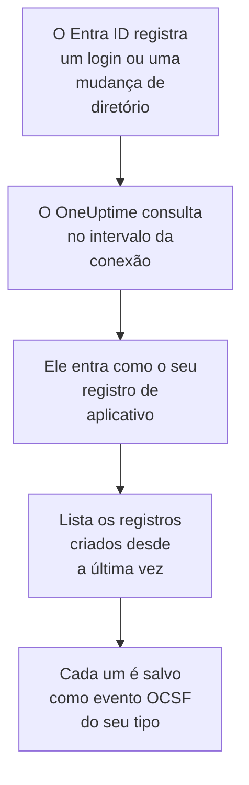

# Microsoft Entra ID

Importe os logins e as mudanças de diretório do [Microsoft Entra ID](https://learn.microsoft.com/en-us/entra/identity/) para os eventos de segurança do OneUptime e, se quiser, a atividade do Exchange, do SharePoint, do OneDrive e do Teams do [log de auditoria do Microsoft 365](https://learn.microsoft.com/en-us/purview/audit-log-activities). Lá você os pesquisa ao lado dos seus logs, traces e métricas, correlaciona-os com todas as outras fontes e aciona o plantão para os que importam. O OneUptime os lê com um registro de aplicativo que você cria, e não muda nada no seu locatário.

:::cards
- [Configurar a conexão](#configurar-a-conexão): Um registro de aplicativo, as permissões dele e o formulário da conexão.
- [O que é importado](#o-que-é-importado): Quais registros, e como cada um vira um evento de segurança.
- [Como a consulta funciona](#como-a-consulta-funciona): A janela que cada consulta lê, e por que ela se sobrepõe 30 minutos à anterior.
- [Solução de problemas](#solução-de-problemas): O que cada erro significa e o que mudar.
:::

## Como funciona

A cada minuto, o OneUptime consulta cada conexão habilitada cujo intervalo de consulta já passou. Uma consulta entra no Microsoft Entra ID como o seu registro de aplicativo e lê, nesta ordem, as mudanças de diretório ([List directoryAudits](https://learn.microsoft.com/en-us/graph/api/directoryaudit-list)) e os logins ([List signIns](https://learn.microsoft.com/en-us/graph/api/signin-list)) registrados desde a última consulta e, quando a opção **Log de auditoria do Microsoft 365** está ativada, o conteúdo novo do log de auditoria ([Office 365 Management Activity API](https://learn.microsoft.com/en-us/office/office-365-management-api/office-365-management-activity-api-reference)). Cada registro é salvo como um evento [OCSF](https://schema.ocsf.io/): um login como um evento Authentication, uma função atribuída como um evento User Access Management, um veredito de phishing como um Detection Finding.

## Antes de começar

- No OneUptime, a função Project Owner, Project Admin ou Security Admin. As funções Security Member e Security Viewer veem as conexões e o histórico de execuções delas, mas não podem alterá-las.
- Para os logins, o Microsoft Entra ID P1 ou P2, que o Microsoft 365 E3, E5 e Business Premium incluem: o Microsoft Graph só entrega logins a esses locatários. As mudanças de diretório são lidas em qualquer locatário.
- Uma função do Entra que possa registrar aplicativos, como Administrador de Aplicativos, e um Administrador Global ou um Administrador de Funções com Privilégios para conceder o consentimento do administrador.
- Para o log de auditoria do Microsoft 365, a auditoria ativada no locatário, como ela vem por padrão: no [portal do Microsoft Purview](https://purview.microsoft.com), **Audit** não deve oferecer **Start recording user and admin activity**.
- HTTPS de saída do aplicativo e dos workers do OneUptime para `login.microsoftonline.com`, `graph.microsoft.com` e `manage.office.com`, ou para `login.microsoftonline.us`, `graph.microsoft.us` e `manage.office365.us` no Azure Government.

## Configurar a conexão

A conexão entra com o [fluxo de credenciais do cliente do OAuth 2.0](https://learn.microsoft.com/en-us/entra/identity-platform/v2-oauth2-client-creds-grant-flow): como aplicativo, nunca como pessoa, com permissões somente leitura.

:::steps
### Registrar um aplicativo

1. Entre no [centro de administração do Microsoft Entra](https://entra.microsoft.com) e abra **App registrations**.
2. Selecione **New registration**. Dê o nome `OneUptime Security Events`, deixe **Supported account types** em **Accounts in this organizational directory only**, deixe o URI de redirecionamento vazio e selecione **Register**.
3. Na página **Overview** do aplicativo, copie o **ID do aplicativo (cliente)** e o **ID do diretório (tenant)**.

### Permitir que ele leia os logs

1. Vá em **API permissions → Add a permission → Microsoft Graph → Application permissions**, escolha `AuditLog.Read.All` e selecione **Add permissions**. A Microsoft documenta que a lista de logins dela também pode pedir `Directory.Read.All`: adicione-a se os logins forem recusados com `403` depois de concedido o consentimento.
2. Para o log de auditoria do Microsoft 365, adicione uma segunda permissão: **Add a permission → Office 365 Management APIs → Application permissions**, depois `ActivityFeed.Read`.
3. Para que os playbooks possam desativar, ativar e desconectar usuários (veja [Contenção](/docs/telemetry/security-cases#contenção)), adicione do mesmo jeito `User.Read.All`, `User.EnableDisableAccount.All` e `User.RevokeSessions.All`. A Microsoft só deixa um app que também tenha a função Privileged Authentication Administrator mudar a conta de um administrador.
4. Selecione **Grant admin consent for** o seu locatário e confirme. O status de cada permissão deve mostrar **Granted**: sem consentimento, toda leitura é recusada com `403`.

### Criar um segredo do cliente

Vá em **Certificates & secrets → Client secrets → New client secret**, escolha quando ele expira e selecione **Add**. Copie o **Value** do segredo, não o **Secret ID** dele, antes de sair da página: ele nunca mais é mostrado. No dia em que expira, a consulta para com `Microsoft Entra ID token request failed (HTTP 401)` até você substituí-lo com **Atualizar credenciais**.

### Adicionar a conexão no OneUptime

Abra **Produtos → Security Events → Conexões** (`/dashboard/{projectId}/security-events/connections`), clique em **Adicionar conexão**, escolha **Microsoft Entra ID** em **Identidade** e clique em **Próximo**. Preencha as configurações da tabela abaixo, clique em **Próximo** e cole o valor do segredo em **Segredo do cliente**. Na etapa **Consulta periódica**, ative **Log de auditoria do Microsoft 365** para lê-lo também.

### Testar antes de salvar

Clique em **Testar estas configurações** em **Testar antes de salvar**. O teste entra e lê cada log com os valores do formulário, e não salva nada, então um segredo errado ou um consentimento que falta aparecem antes de a conexão existir. Depois clique em **Próximo**, dê à conexão um **Nome** e crie-a.
:::

| Configuração | Onde encontrar |
| --- | --- |
| **ID do diretório (tenant)** | A página **Overview** do aplicativo. O GUID do locatário, ou um domínio verificado como `contoso.onmicrosoft.com`. Com **Log de auditoria do Microsoft 365** ativado, o GUID: a Management API só identifica um locatário por ele. |
| **ID do aplicativo (cliente)** | A página **Overview** do aplicativo. O GUID do aplicativo que tem `AuditLog.Read.All`. |
| **Nuvem** | **Nuvem pública do Azure**, ou **Azure Government (EUA)** para GCC High (`login.microsoftonline.us`, `graph.microsoft.us` e `manage.office365.us`). |
| **Log de auditoria do Microsoft 365** | Opcional, desativado por padrão. Ativado, cada consulta também lê o log de auditoria do Microsoft 365. O aplicativo precisa de `ActivityFeed.Read`. |
| **Segredo do cliente** | O **Value** do segredo. Ele é criptografado, nunca devolvido pela API e nunca mais mostrado. Substitua-o com **Atualizar credenciais** na conexão. |

A etapa **Consulta periódica** também tem uma **Descrição** opcional, o **Intervalo de consulta (minutos)**, um número inteiro de `1` a `1440` que começa em `5`, e **Habilitado**, que começa ativado.

## O que é importado

Todo evento tem o fornecedor `Microsoft` e o produto `Microsoft Entra ID`. O atributo `entra.log` dele diz de qual log veio um login ou uma mudança, e o `microsoft365.contentType` de um registro do Microsoft 365 o tipo de conteúdo dele.

| Registro | Classe OCSF | Severidade |
| --- | --- | --- |
| Um login que funcionou | Authentication (`3002`), status `Success` | Informational |
| Um login à espera de uma segunda etapa, como MFA (`50074`, `50076`) ou um pedido para trocar a senha | Authentication (`3002`), status `Interrupted` | Informational: uma etapa, não uma falha |
| Um login que falhou, com o motivo e o código de erro do Entra | Authentication (`3002`), status `Failure` | Low |
| Um login que o Identity Protection classificou como risco médio ou alto | Authentication (`3002`) | Medium ou High |
| Um usuário, grupo ou função alterado, pela categoria dele | Account Change (`3001`), Group Management (`3006`), User Access Management (`3005`), ou Entity Management (`3004`) para o resto | Medium para uma função privilegiada, como Global Administrator; Low para uma mudança que falhou |

Com **Log de auditoria do Microsoft 365** ativado, os registros sobre os quais uma equipe de segurança age são importados dele, e o resto, como um arquivo aberto ou um e-mail lido, só é contado:

| Registro do Microsoft 365 | Classe OCSF | Severidade |
| --- | --- | --- |
| Um cmdlet do Exchange, como `New-InboxRule` ou `Set-Mailbox`, uma regra de caixa de entrada criada no Outlook, ou e-mail enviado como outra pessoa | API Activity (`6003`) | Medium quando encaminha e-mail, com `microsoft365.forwardsMail` definido como `true` |
| Uma permissão de caixa de correio concedida, como `Add-MailboxPermission` | User Access Management (`3005`) | Low |
| Um arquivo compartilhado no SharePoint ou no OneDrive | File Hosting Activity (`6006`) | Low com um convidado ou um link que qualquer pessoa pode abrir, com `microsoft365.sharedOutside` definido como `true` |
| Um administrador de conjunto de sites adicionado ou removido | User Access Management (`3005`) | Low |
| E-mail com malware ou phishing encontrado pelo Microsoft Defender for Office 365 | Detection Finding (`2004`) | High para malware, Medium para phishing |
| Um alerta que o Microsoft 365 gerou | Detection Finding (`2004`) | A do próprio alerta |
| Um aplicativo, um bot ou um conector adicionado a uma equipe | Application Lifecycle (`6002`) | Low |

As tarefas internas do próprio Exchange, executadas com a conta de sistema dele, ficam de fora a menos que encaminhem e-mail. Todo evento mantém o registro inteiro, achatado em chaves com pontos como `status.errorCode` ou `Parameters.ForwardTo`, para que uma regra leia qualquer campo pelo nome que a Microsoft dá a ele. As regras da biblioteca para o Entra ID os leem como são importados aqui.

Os mesmos logins e mudanças de diretório podem chegar ao OneUptime como logs, exportados por uma configuração de diagnóstico do Azure e lidos por [Seus logs](/docs/telemetry/security-events#encontrar-eventos-de-segurança-nos-seus-logs). Cada registro recebe o mesmo ID de evento pelos dois caminhos, mas um registro lido pelos dois é salvo duas vezes: leia o Entra ID por um único caminho.

## Como a consulta funciona

- **Os registros são lidos pelo momento em que o Entra ID os registrou**, `activityDateTime` para uma mudança e `createdDateTime` para um login.
- **A primeira consulta olha 24 horas para trás**, para que uma nova conexão mostre logo os registros recentes dela.
- **Cada consulta seguinte começa 30 minutos antes do cursor salvo.** A Microsoft documenta que os dois logs chegam com minutos de atraso, então a sobreposição lê um registro atrasado na consulta seguinte, e as duplicatas são descartadas pelo ID do registro dentro do projeto.
- **Uma consulta lê no máximo 24 horas além do cursor.** Uma conexão cujo cursor ficou para trás se atualiza em uma série de janelas de 24 horas.
- **Um locatário sem Microsoft Entra ID P1 ou P2** importa as mudanças de diretório dele, e a verificação **Read sign-ins** de cada execução avisa que os logins não foram lidos.
- **Uma execução que falha não muda nada.** Depois de um erro de rede, ou de um status de erro do Graph, o cursor e o tamanho da janela ficam como estavam, e a consulta seguinte relê a mesma janela. A única exceção é uma requisição que expirou: o cursor fica, mas a janela seguinte tem a metade do tamanho, porque uma janela pesada demais para ser respondida a tempo expiraria a cada tentativa.

O log de auditoria do Microsoft 365 é lido pelo momento em que a Microsoft disponibilizou cada blob de conteúdo, um dia por vez, e não mais para trás que os 7 dias que a Microsoft o guarda. A primeira consulta inscreve o aplicativo em `Audit.Exchange`, `Audit.SharePoint` e `Audit.General`, e a Microsoft disponibiliza os primeiros registros de uma nova assinatura em até 12 horas. O log de auditoria nunca para os logs do Entra ID: uma permissão que falta é um aviso e a janela avança, enquanto uma falha do lado da Microsoft, como `HTTP 503`, deixa a execução **Parcial** para que a janela seja lida de novo.

### Quando uma janela contém mais do que uma consulta consegue ler

Cada log tem um orçamento próprio: 10 páginas de 500 mudanças de diretório, 20 páginas de 500 logins e, para o log de auditoria do Microsoft 365, 120 requisições e 10.000 registros. Uma consulta para depois de 4 minutos. Quando um orçamento para um log antes do fim da janela dele, a execução fica **Parcial**, e o aviso dela nomeia o log e o orçamento. O Microsoft Graph lista primeiro os registros mais novos, então o OneUptime encurta a janela em vez de mover o cursor para além de registros que nunca alcançou:

1. **Reduzir.** A consulta seguinte lê uma janela com a metade do tamanho, a partir do mesmo ponto de partida, e continua dividindo pela metade até que uma janela seja lida por inteiro, até um minuto. O aviso da execução diz isso: `This window holds more records than one poll can read; the next poll reads a {n} minute window from the same starting point.` Os registros já importados da janela mais longa são pulados como duplicatas.
2. **Voltar a crescer.** Depois que uma janela é lida por inteiro, o cursor vai para o fim dela, e a janela seguinte volta a ter o dobro do tamanho, até 24 horas.
3. **Passar de um único minuto.** Se até um minuto contém mais do que uma consulta consegue ler, a consulta passa dele, para que os registros mais novos continuem chegando. A execução continua **Parcial**, e **Último erro** mostra `More records were created in the one minute from {cursor} to {end} than one poll can read. Polling moved past this minute so newer records keep arriving; use Import this time range in Diagnostics on this minute to recover what one run can read.` Importe esse minuto com **Import this time range** para recuperar o que uma execução consegue ler.

Mudar o **Intervalo de consulta (minutos)** não muda nada disso: ele decide com que frequência uma consulta começa, não onde a janela dela começa.

### Executar, pré-visualizar e importar sob demanda

Clique em **Diagnóstico** em uma conexão para ver as execuções recentes dela e trabalhar com ela manualmente. Quem pode alterar a conexão pode iniciar essas ações; quem pode vê-la pode ler o histórico.

- **Executar agora** inicia uma consulta na hora, com o cursor de sempre, mesmo quando a conexão não está **Habilitado**.
- **Preview records** lê um intervalo de tempo de até 7 dias e não importa nada.
- **Import this time range** importa um intervalo de até 7 dias, depois que você confirma, sem mover o cursor. Os registros já importados são pulados. O Microsoft Entra ID guarda 30 dias de logins e mudanças de diretório com P1 ou P2, e 7 dias sem eles.
- **Copy diagnostics** em uma execução copia o relatório dela para o suporte. Ele nunca inclui credenciais.

## Testar conexão

**Testar conexão** na linha de uma conexão, e **Testar estas configurações** no formulário, rodam no processo da API, não em um worker em segundo plano, para que um teste responda mesmo quando o problema são os workers. Ele faz estas verificações, em ordem:

| Verificação | O que ela verifica |
| --- | --- |
| **Configuração** | Cada configuração está presente e bem formada. Nada é contatado quando isso falha. |
| **Authenticate with Microsoft Entra** | O Entra ID emite ao aplicativo um token para o Microsoft Graph, na nuvem que você escolheu. |
| **Read sign-ins** | Os logins das últimas 24 horas podem ser lidos. Um aviso, não uma falha, em um locatário sem P1 ou P2. |
| **Read directory changes** | As mudanças de diretório das últimas 24 horas podem ser lidas. |
| **Read the Microsoft 365 audit log** | Só com a opção ativada: a Management API responde, e em quais tipos de conteúdo o aplicativo está inscrito. |
| **Records available to import** | Quantos logins e mudanças de diretório as últimas 24 horas contêm, no máximo 500 de cada, então `500+` significa mais. Nenhum é um aviso. |
| **Background workers**, **Poll scheduler**, **Security event storage** | O lado do próprio OneUptime: um processo pega os jobs da fila Worker, o job de consulta roda a cada minuto e o armazenamento de eventos de segurança responde. |
| **Scheduled polling** | Para uma conexão salva: a consulta está ativada, nenhuma execução está presa esperando um worker e as consultas rodam no horário. |

Cada requisição de um teste tem um prazo de 20 segundos. Um teste nunca importa nada nem move o cursor, e cada verificação que falha diz o que mudar.

## Solução de problemas

O **Último erro** da conexão guarda a mensagem de erro completa, com as credenciais ocultadas. Quando uma conexão tem um erro, selecione **Ver erro** na coluna **Ações** dela para lê-lo, e **Copiar erro** na caixa de diálogo para copiá-lo. Toda mensagem começa com `Microsoft Entra ID`, depois nomeia a requisição que falhou, e cita o código de erro da Microsoft quando há um.

:::details Último erro diz `token request failed`
- `HTTP 401` com `invalid_client`: o segredo do cliente está errado ou expirou. Crie um novo e salve-o com **Atualizar credenciais**.
- `HTTP 400` que nomeia o ID do aplicativo (cliente) ou o locatário: confira os dois na página **Overview** do aplicativo, e que a **Nuvem** é a do locatário.
:::

:::details Último erro diz `sign-ins request failed (HTTP 403)` ou `audit logs request failed (HTTP 403)`
- Código de erro `Authorization_RequestDenied`: falta ao aplicativo `AuditLog.Read.All`, ou o consentimento não foi concedido. Conceda o consentimento do administrador, espere alguns minutos e teste de novo. Para os logins, conceda também `Directory.Read.All`.
- Código de erro `Authentication_RequestFromNonPremiumTenantOrB2CTenant`: o locatário não tem Microsoft Entra ID P1 ou P2. As mudanças de diretório continuam sendo importadas.
:::

:::details O log de auditoria do Microsoft 365 não é lido
- `subscriptions request failed (HTTP 401)` ou `(HTTP 403)`, com `AF10001`: falta ao aplicativo `ActivityFeed.Read` das Office 365 Management APIs, ou o consentimento não foi concedido.
- De `AF20010` a `AF20013`: a Management API não conhece o **ID do diretório (tenant)**. Use o GUID do locatário.
- `subscription start failed` com `AF20023`: um administrador desativou a assinatura. Um tipo de conteúdo que não pode ser assinado é nomeado nos avisos da execução, e os outros continuam sendo lidos.
- Nenhum registro durante horas depois da primeira consulta: a Microsoft disponibiliza o primeiro conteúdo de uma nova assinatura em até 12 horas.
:::

:::details Último erro diz `did not complete`
A requisição não teve resposta: um tempo esgotado, um nome que não resolve ou um endereço recusado. Verifique se o aplicativo e os workers do OneUptime conseguem alcançar os hosts de [Antes de começar](#antes-de-começar), através de qualquer proxy que você use.
:::

:::details O teste passa, mas Last Polled é Never
O job de consulta nunca rodou. Leia as verificações **Background workers** e **Poll scheduler**. Em uma instalação auto-hospedada, a causa comum é `DISABLE_QUEUE_WORKERS=true` no aplicativo, sem um deployment separado de workers que pegue os jobs: defina como `false`, ou rode o deployment de workers (Helm: `worker.enabled: true`, que é `false` por padrão).
:::

## Próximos passos

:::cards
- [Eventos de segurança](/docs/telemetry/security-events): Pesquise, correlacione e alerte sobre o que você importa.
- [Registro do sistema do Okta](/docs/integrations/okta): Importe os logins de outro provedor de identidade.
- [Google Workspace](/docs/integrations/google-workspace): Importe os logins e as mudanças de administração do Google.
- [Visão geral das integrações](/docs/integrations/index): As outras ferramentas que você pode conectar.
:::
