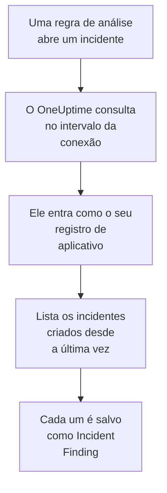

# Microsoft Sentinel

Importe os incidentes que as suas regras de análise do [Microsoft Sentinel](https://learn.microsoft.com/en-us/azure/sentinel/overview) abrem para os eventos de segurança do OneUptime. Lá você os pesquisa ao lado dos seus logs, traces e métricas, correlaciona-os com todas as outras fontes e aciona o plantão para os que importam. O OneUptime os lê com um registro de aplicativo que você cria, e não muda nada no Azure.

:::cards
- [Configurar a conexão](#configurar-a-conexão): Um registro de aplicativo, uma função e o formulário da conexão.
- [O que é importado](#o-que-é-importado): Como cada incidente do Sentinel vira um evento de segurança.
- [Como a consulta funciona](#como-a-consulta-funciona): A janela que cada consulta lê, e o que um workspace movimentado faz com ela.
- [Solução de problemas](#solução-de-problemas): O que cada erro significa e o que mudar.
:::

## Como funciona



A cada minuto, o OneUptime consulta cada conexão habilitada cujo intervalo de consulta já passou. Uma consulta entra no Microsoft Entra ID como o seu registro de aplicativo, pede ao Azure Resource Manager os incidentes criados desde a última consulta e salva cada um como um evento [OCSF](https://schema.ocsf.io/) Incident Finding (classe `2005`). Regras de detecção, monitores e painéis então o tratam como um evento de segurança de qualquer outra fonte.

## Antes de começar

- No OneUptime, a função Project Owner, Project Admin ou Security Admin. As funções Security Member e Security Viewer veem as conexões e o histórico de execuções delas, mas não podem alterá-las.
- Um workspace do Log Analytics com o Microsoft Sentinel habilitado, na nuvem pública do Azure ou no Azure Government (US).
- No Microsoft Entra ID, permissão para criar um registro de aplicativo e um segredo do cliente.
- No grupo de recursos que contém o workspace, permissão para atribuir funções, como Proprietário ou Administrador de Acesso do Usuário.

## Configurar a conexão

A conexão entra com o fluxo de credenciais do cliente do OAuth 2.0: como aplicativo, nunca como pessoa. O acesso dela vem de uma função do Azure, então o registro de aplicativo não precisa de permissões de API.

:::steps
### Registrar um aplicativo

1. Entre no [portal do Azure](https://portal.azure.com) e abra **Microsoft Entra ID**.
2. Vá em **App registrations → New registration**. Dê o nome `OneUptime Sentinel connector`, deixe **Supported account types** em **Accounts in this organizational directory only**, deixe o URI de redirecionamento vazio e selecione **Register**.
3. Na página **Overview** do aplicativo, copie o **ID do aplicativo (cliente)** e o **ID do diretório (tenant)**.
4. Vá em **Certificates & secrets → Client secrets → New client secret**, escolha quando ele expira e selecione **Add**. Copie o **Value** do segredo, não o **Secret ID** dele, antes de sair da página: ele nunca mais é mostrado.

### Permitir que ele leia incidentes

1. No portal do Azure, abra o grupo de recursos que contém o seu workspace do Log Analytics.
2. Selecione **Access control (IAM) → Add → Add role assignment**.
3. Na aba **Role**, escolha **Microsoft Sentinel Reader**.
4. Na aba **Members**, escolha **User, group, or service principal**, clique em **Select members** e escolha o seu registro de aplicativo pelo nome.
5. Selecione **Review + assign**.

A função permite que o aplicativo leia incidentes (`Microsoft.SecurityInsights/incidents/read`) e não escreva nada. A Microsoft recomenda atribuí-la no grupo de recursos em vez de no workspace, para que ela cubra também a solução `SecurityInsights` de onde os incidentes são servidos. Uma nova atribuição pode levar alguns minutos para valer.

### Encontrar os dados do workspace

Abra o workspace do Log Analytics no portal do Azure. A página **Overview** dele mostra o **ID da assinatura**, o **Resource group** e o nome do workspace. O ID de recurso do workspace contém os três:

```text
/subscriptions/{Subscription ID}/resourceGroups/{Resource group}/providers/Microsoft.OperationalInsights/workspaces/{Workspace name}
```

### Adicionar a conexão no OneUptime

Abra **Produtos → Security Events → Conexões** (`/dashboard/{projectId}/security-events/connections`), clique em **Adicionar conexão**, escolha **Microsoft Sentinel** e clique em **Próximo**. Preencha as configurações da tabela abaixo, clique em **Próximo** e cole o valor do segredo em **Segredo do cliente**.

### Testar antes de salvar

Clique em **Testar estas configurações** em **Testar antes de salvar**. O teste entra e lê incidentes com os valores do formulário, e não salva nada, então um segredo errado ou uma função que falta aparecem antes de a conexão existir. Depois clique em **Próximo**, dê à conexão um **Nome** e crie-a.
:::

| Configuração | Onde encontrar |
| --- | --- |
| **ID do diretório (tenant)** | A página **Overview** do aplicativo. O GUID do locatário, ou um domínio verificado como `contoso.onmicrosoft.com`. |
| **ID do aplicativo (cliente)** | A página **Overview** do aplicativo. Um GUID. |
| **ID da assinatura** | A página **Overview** do workspace. Um GUID. |
| **Resource group** | A página **Overview** do workspace. De 1 a 90 letras, dígitos, sublinhados, hifens, pontos ou parênteses, sem terminar em ponto. |
| **Workspace name** | A página **Overview** do workspace. De 3 a 90 letras, dígitos ou hifens, começando e terminando com uma letra ou um dígito. |
| **Nuvem** | **Nuvem pública do Azure** (`login.microsoftonline.com`, `management.azure.com`) ou **Azure Government (EUA)** (`login.microsoftonline.us`, `management.usgovcloudapi.net`). |
| **Segredo do cliente** | O **Value** do segredo. Ele é criptografado, nunca devolvido pela API e nunca mais mostrado. Substitua-o com **Atualizar credenciais** na conexão. |

A etapa **Consulta periódica** também tem uma **Descrição** opcional, o **Intervalo de consulta (minutos)**, um número inteiro de `1` a `1440` que começa em `5`, e **Habilitado**, que começa ativado.

## O que é importado

Cada incidente do Sentinel vira um evento Incident Finding (classe OCSF `2005`, atividade `Create`), atribuído ao serviço de telemetria `Microsoft Sentinel`:

| Coluna OCSF | Campo do incidente do Sentinel |
| --- | --- |
| `time` | `properties.createdTimeUtc`, quando o Sentinel criou o incidente |
| `eventUid` | `name`, o GUID do incidente, que também serve para descartar duplicatas |
| `message`, `ruleName` | `properties.title` |
| `ruleId` | O GUID da regra no fim da primeira entrada de `properties.relatedAnalyticRuleIds` |
| `severityName` | `properties.severity`: `High`, `Medium`, `Low` ou `Informational` |
| `statusName` | `properties.status`: `New`, `Active` ou `Closed` |
| `mitreTactics` | `properties.additionalData.tactics`, como IDs do ATT&CK: `Persistence` vira `TA0003` |
| `principalUser` | `properties.owner.userPrincipalName`, ou `properties.owner.email` |
| `targetResource` | `properties.incidentUrl`, um link para o incidente no portal do Azure |
| `observables` | O UPN, o e-mail e o ID de objeto do responsável, e o nome de cada rótulo |
| `attributes` | O incidente inteiro, achatado em chaves com pontos como `properties.classification` e `properties.firstActivityTimeUtc` |

Incidentes fechados criados na janela de uma consulta também são importados. Filtre por `statusName` no explorador de eventos de segurança para ver só os abertos.

## Como a consulta funciona

Cada consulta lista os incidentes criados na janela dela, dos mais antigos para os mais novos, 50 por página, e segue o `nextLink` da API até ter lido a janela inteira:

```text
GET https://management.azure.com/subscriptions/{sub}/resourceGroups/{rg}/providers/Microsoft.OperationalInsights/workspaces/{ws}/providers/Microsoft.SecurityInsights/incidents
    ?api-version=2024-03-01
    &$filter=(properties/createdTimeUtc ge {windowStart}) and (properties/createdTimeUtc lt {windowEnd})
    &$orderby=properties/createdTimeUtc asc
    &$top=50
```

- **O horário de criação é o cursor.** Uma regra de análise agendada que roda a cada hora abre o incidente dela bem depois da atividade que detectou, e o `firstActivityTimeUtc` do incidente pode ser horas ou dias anterior. Um cursor pelo horário de atividade pularia cada um desses incidentes. Os horários de atividade ficam em `attributes`, e as amostras do diagnóstico mostram os dois.
- **A primeira consulta olha 24 horas para trás**, para que uma nova conexão mostre logo os incidentes recentes dela.
- **Cada consulta seguinte começa 1 minuto antes do cursor salvo**, para que um incidente criado na fronteira entre duas janelas nunca seja pulado.
- **Uma consulta lê no máximo 24 horas além do cursor.** Uma conexão cujo cursor ficou para trás se atualiza em uma série de janelas de 24 horas, e a **Integridade** dela mostra **Catching up**.
- **As duplicatas são descartadas pelo GUID do incidente** (`name`) dentro do projeto, para que a sobreposição, uma janela repetida e uma importação nunca salvem um incidente duas vezes.

### Quando uma janela contém mais do que uma consulta consegue ler

Uma consulta lê no máximo 20 páginas de 50 incidentes: 1.000 incidentes. Quando esse limite a interrompe antes do fim da janela, a execução fica **Parcial**, com um aviso como este:

```text
Stopped after 20 incidents requests (the per-run request limit) before reading the whole window. Incidents are read oldest first; every incident created before 2026-09-14T08:12:44.000Z was read.
```

Os incidentes são lidos do mais antigo para o mais novo, então o OneUptime move o cursor para o horário de criação do último incidente lido, e a consulta seguinte começa ali, com o mesmo tamanho de janela. Um workspace movimentado se atualiza cerca de 1.000 incidentes por consulta, em vez de reler os mesmos. Os incidentes criados nesse mesmo instante são lidos duas vezes, e a verificação de duplicatas descarta a segunda cópia.

Quando uma execução não consegue passar do cursor salvo de jeito nenhum, o OneUptime encurta a janela em vez disso:

1. **Reduzir.** A consulta seguinte lê uma janela com a metade do tamanho, a partir do mesmo ponto de partida, e continua dividindo pela metade até que uma janela seja lida por inteiro, até um minuto. O aviso da execução diz isso: `This window holds more records than one poll can read; the next poll reads a {n} minute window from the same starting point.`
2. **Voltar a crescer.** Depois que uma janela é lida por inteiro, a seguinte volta a ter o dobro do tamanho, até 24 horas.
3. **Passar de um único minuto.** Se até um minuto contém mais do que uma consulta consegue ler, a consulta passa dele, para que os incidentes mais novos continuem chegando. A execução continua **Parcial**, e **Último erro** mostra `More records were created in the one minute from {cursor} to {end} than one poll can read. Polling moved past this minute so newer records keep arriving; use Import this time range in Diagnostics on this minute to recover what one run can read.` Importe esse minuto com **Import this time range** para recuperar o que uma execução consegue ler.

Uma execução que falha por completo, com um erro do Microsoft Entra ID ou do Azure Resource Manager, mantém o cursor e o tamanho da janela, e a consulta seguinte relê a mesma janela. A única exceção é uma requisição que expirou: o cursor fica, mas a janela seguinte tem a metade do tamanho, porque uma janela pesada demais para ser respondida a tempo expiraria a cada tentativa. Mudar o **Intervalo de consulta (minutos)** não muda nada disso: ele decide com que frequência uma consulta começa, não onde a janela dela começa.

### Executar, pré-visualizar e importar sob demanda

Clique em **Diagnóstico** em uma conexão para ver as execuções recentes dela e trabalhar com ela manualmente. Quem pode alterar a conexão pode iniciar essas ações; quem pode vê-la pode ler o histórico.

- **Executar agora** inicia uma consulta na hora, com o cursor de sempre, mesmo quando a conexão não está **Habilitado**.
- **Preview incidents** lê um intervalo de tempo de até 7 dias e não importa nada.
- **Import this time range** importa um intervalo de até 7 dias, depois que você confirma, sem mover o cursor. Os incidentes já importados são pulados.
- **Copy diagnostics** em uma execução copia o relatório dela para o suporte. Ele nunca inclui credenciais.

## Testar conexão

**Testar conexão** na linha de uma conexão, e **Testar estas configurações** no formulário, rodam no processo da API, não em um worker em segundo plano, para que um teste responda mesmo quando o problema são os workers. Ele faz estas verificações, em ordem:

| Verificação | O que ela verifica |
| --- | --- |
| **Configuração** | Cada configuração está presente e bem formada. Nada é contatado quando isso falha. |
| **Authenticate with Microsoft Entra** | O Microsoft Entra ID emite para o seu registro de aplicativo um token para o Azure Resource Manager. |
| **Read incidents** | Um incidente criado nas últimas 24 horas pode ser lido (`$top=1`). Isso comprova a função e os dados do workspace. |
| **Incidents available to import** | Quantos incidentes foram criados nas últimas 24 horas e nos últimos 7 dias, uma página de 50 para cada, então `50+` significa mais. Nenhum em 7 dias é um aviso, não uma falha. |
| **Background workers**, **Poll scheduler**, **Security event storage** | O lado do próprio OneUptime: um processo pega os jobs da fila Worker, o job de consulta roda a cada minuto e o armazenamento de eventos de segurança responde. |
| **Scheduled polling** | Para uma conexão salva: a consulta está ativada, nenhuma execução está presa esperando um worker e as consultas rodam no horário. |

Cada requisição de um teste tem um prazo de 20 segundos. Um teste nunca importa nada nem move o cursor, e cada verificação que falha diz o que mudar.

## Enviar eventos de segurança ao Microsoft Sentinel

O OneUptime também pode enviar o que encontra ao Microsoft Sentinel, pela Logs Ingestion API do Azure Monitor, para uma tabela personalizada do workspace em que o Sentinel roda. As suas regras de análise, consultas de hunting e pastas de trabalho passam a consultar `OneUptimeSecurityEvents_CL` ao lado das suas outras tabelas.

:::steps
### Crie a tabela e a regra de coleta de dados dela

No portal do Azure, abra **Tables → Create → New custom log (DCR-based)** do workspace. Dê à tabela o nome `OneUptimeSecurityEvents`, crie uma nova regra de coleta de dados, e um endpoint de coleta de dados se o formulário pedir. Envie o exemplo abaixo como arquivo de exemplo, mantenha a transformação como está e crie a tabela.

### Deixe um aplicativo enviar para ela

Registre um aplicativo e dê a ele um segredo do cliente, como em [Registrar um aplicativo](#registrar-um-aplicativo). Depois abra a regra de coleta de dados, **Access control (IAM) → Add → Add role assignment**, escolha **Monitoring Metrics Publisher** e selecione o aplicativo.

### Adicione o destino

Abra **Produtos → Security Events → Conexões**. Em **Enviar para o seu SIEM**, clique em **Adicionar destino**, escolha Microsoft Sentinel em **SIEM** e clique em **Próximo**. Preencha o **ID do diretório (tenant)**, o **ID do aplicativo (cliente)** e o **Segredo do cliente**, o **Endpoint de ingestão de logs** da página **Overview** do endpoint de coleta de dados (ou da regra), e o **ID imutável da regra de coleta de dados** da **JSON View** da regra. **Fluxo** é opcional: vazio, ele é `Custom-OneUptimeSecurityEvents_CL`.

### Envie um evento de teste e comece a enviar

Clique em **Enviar um evento de teste**: uma linha chega à tabela em poucos minutos. Depois, em **O que enviar**, mantenha **Somente detecções** ou escolha **Todos os eventos de segurança**, e clique em **Começar a enviar**.
:::

O arquivo de exemplo, uma linha com todas as colunas da tabela:

```json title="oneuptime-security-events-sample.json"
[
  {
    "TimeGenerated": "2026-10-21T10:00:00.000Z",
    "EventId": "0193c0de-cccc-4aaa-8bbb-000000000001",
    "EventUid": "okta-1",
    "ClassName": "Authentication",
    "CategoryName": "Identity & Access Management",
    "ActivityName": "Logon",
    "Severity": "Medium",
    "SeverityId": 3,
    "Status": "Failure",
    "Message": "Failed sign-in for alice",
    "VendorName": "Okta",
    "ProductName": "Okta System Log",
    "RuleId": "",
    "RuleName": "",
    "MitreTactics": [],
    "MitreTechniques": [],
    "PrincipalUser": "alice@example.com",
    "PrincipalHost": "laptop-7",
    "PrincipalIp": "203.0.113.7",
    "TargetUser": "",
    "TargetHost": "app.example.com",
    "TargetIp": "198.51.100.20",
    "TargetPort": 443,
    "TargetResource": "",
    "ProcessName": "",
    "ProcessCommandLine": "",
    "ParentProcessName": "",
    "Observables": [
      "alice@example.com",
      "203.0.113.7"
    ],
    "Attributes": {
      "okta.outcome.reason": "INVALID_CREDENTIALS"
    }
  }
]
```

- A Logs Ingestion API aceita até 1 MB por chamada, então as linhas vão em lotes de até 500. Um lote que o Azure recusa é dividido até que a linha que ele não aceita seja encontrada e deixada de fora, e a limitação (`429`) é tentada de novo.
- Um `403` significa que falta ao aplicativo o **Monitoring Metrics Publisher** na regra, e um `404`, um ID imutável ou um fluxo errado.
- Os incidentes que o OneUptime importou do Microsoft Sentinel nunca são enviados de volta a ele.

## Solução de problemas

O **Último erro** da conexão guarda a mensagem de erro completa, com as credenciais ocultadas, atrás de um prefixo que nomeia a etapa que falhou. Quando uma conexão tem um erro, selecione **Ver erro** na coluna **Ações** dela para lê-lo, e **Copiar erro** na caixa de diálogo para copiá-lo. Leia o prefixo primeiro.

:::details Last Error começa com `Microsoft Sentinel token request`
- `Microsoft Sentinel token request failed (HTTP ...)`: o Microsoft Entra ID se recusou a emitir um token, então o Azure nunca foi contatado. A mensagem cita o código do Entra:
  - `AADSTS7000215` ou `invalid_client`: o **Segredo do cliente** está errado ou expirou, ou é o ID do segredo em vez do valor dele. Crie um novo segredo e salve-o com **Atualizar credenciais**.
  - `AADSTS700016` ou `unauthorized_client`: o **ID do aplicativo (cliente)** não está no **ID do diretório (tenant)** informado. Compare os dois com a página **Overview** do aplicativo.
  - `AADSTS90002` ou `HTTP 404`: esse locatário não existe. O **ID do diretório (tenant)** está errado, ou ele está na outra nuvem: verifique **Nuvem**.
  - `HTTP 429` ou `HTTP 5xx`: o Microsoft Entra ID está limitando as requisições ou está indisponível. A consulta seguinte tenta de novo.
- `Microsoft Sentinel token request returned ...`: o Microsoft Entra ID respondeu com algo inutilizável, por exemplo um corpo que não é JSON ou sem `access_token`. Normalmente é um proxy ou um gateway no meio.
- `Microsoft Sentinel token request failed:`, sem status, ou `Microsoft Sentinel token request timed out after ... seconds with no response`: a requisição não teve resposta. Verifique o DNS, o TLS e o HTTPS de saída do aplicativo e dos workers do OneUptime para `login.microsoftonline.com`.
:::

:::details Last Error começa com `Microsoft Sentinel incidents list`
- `Microsoft Sentinel incidents list failed (HTTP ...)`: o Azure Resource Manager recusou a requisição.
  - `HTTP 401`: ele não aceitou o token. Quase sempre a **Nuvem** não corresponde ao locatário, ou o registro de aplicativo foi excluído. Um token que expira entre duas páginas é renovado e tentado de novo uma vez sozinho.
  - `HTTP 403` ou `AuthorizationFailed`: o aplicativo ainda não tem **Microsoft Sentinel Reader** no grupo de recursos. Atribua a função e espere alguns minutos.
  - `HTTP 404`: nenhum workspace tem esse **ID da assinatura**, esse **Resource group** e esse **Workspace name**, ou o Microsoft Sentinel não está habilitado nele. Copie-os da página **Overview** do workspace.
  - `HTTP 429` ou `HTTP 5xx`: o Azure Resource Manager está limitando as requisições ou está indisponível. A consulta seguinte tenta de novo.
  - `HTTP 400`: o Azure Resource Manager recusou a requisição, que o OneUptime monta, e não as suas configurações. Envie a mensagem para o suporte do OneUptime.
- `Microsoft Sentinel incidents list returned ...`: o Azure respondeu `200`, mas sem uma página de incidentes legível, ou com um `nextLink` para outro host, que a conexão recusa para que o token nunca saia do Azure Resource Manager. Isso é relatado em vez de tratado como uma janela vazia, para que o cursor nunca passe de incidentes que ninguém leu.
- `Microsoft Sentinel incidents list failed:`, sem status, ou `Microsoft Sentinel incidents list timed out after ... seconds with no response`: a requisição não teve resposta. Verifique o HTTPS de saída dos workers do OneUptime para `management.azure.com`, ou `management.usgovcloudapi.net`.
:::

:::details Last Polled é Never e Last Error está vazio
Nenhuma consulta terminou para essa conexão. Rode **Testar conexão**: as verificações **Background workers** e **Poll scheduler** dele nomeiam a causa. Em uma instalação auto-hospedada, a causa comum é `DISABLE_QUEUE_WORKERS=true` no aplicativo, sem um deployment separado de workers que pegue os jobs: defina como `false`, ou rode o deployment de workers (Helm: `worker.enabled: true`).
:::

:::details Uma execução está Partial
- `Stopped after 20 incidents requests (the per-run request limit) before reading the whole window`: a janela continha mais do que os 1.000 incidentes que uma execução lê. Nada se perde: a consulta seguinte começa depois do último incidente lido. Uma conexão que continua **Parcial** consulta após consulta está se atualizando de um atraso, e o **Última consulta** e o **Último evento importado** dela continuam avançando.
- `Microsoft Sentinel returned incidents out of creation-time order, so this run cannot name a point to resume from.`: a API ignorou a ordem do mais antigo para o mais novo, então a execução não consegue mover o cursor para o último incidente dela, e a consulta seguinte lê uma janela mais curta em vez disso. Se isso se repetir, envie o relatório da execução para o suporte do OneUptime.
- `More records were created in the one minute from ... than one poll can read`: a consulta passou desse minuto. Importe-o com **Import this time range** em **Diagnóstico**. Uma importação lê tanto quanto uma consulta.
:::

:::details O teste passa, mas nada é importado
Leia **Incidents available to import** no relatório do teste. `0` nos últimos 7 dias significa que as regras de análise do workspace não abriram nenhum incidente, o que não é uma falha da conexão. No Microsoft Sentinel, verifique que as regras estão habilitadas e configuradas para criar incidentes.
:::

## Azure Government

Defina **Nuvem** como **Azure Government (EUA)**. A conexão então entra em `login.microsoftonline.us` com o escopo `https://management.usgovcloudapi.net/.default`, e lê os incidentes de `management.usgovcloudapi.net`. Todo o resto, inclusive a atribuição da função, é igual.

## O que você ganha

- **Pesquisa.** Filtre os incidentes por gravidade, status, responsável, rótulo ou tática no explorador de eventos de segurança, ao lado de todas as outras fontes.
- **Correlação.** O responsável e os rótulos de cada incidente são indexados como observáveis, então uma pesquisa encontra tudo o que os menciona.
- **Regras de detecção.** Regras Sigma que rodam em uma programação sobre os seus eventos de segurança, e abrem alertas que acionam o plantão.
- **Monitores.** Os monitores de eventos de segurança contam os eventos correspondentes, como novos incidentes High, e abrem incidentes ou alertas acima de um limite.

Os eventos de segurança são cobrados como o resto da sua telemetria, por GB ingerido. Veja os [preços](https://oneuptime.com/pricing).

## Próximos passos

:::cards
- [Eventos de segurança](/docs/telemetry/security-events): Pesquise, correlacione e alerte sobre o que você importa.
- [Microsoft Defender XDR](/docs/integrations/microsoft-defender-xdr): Importe também os alertas de cada carga de trabalho do Defender.
- [Funções](/docs/permissions/reference#funções): O que as funções Security podem ver e alterar.
- [Visão geral das integrações](/docs/integrations/index): As outras ferramentas que você pode conectar.
:::
