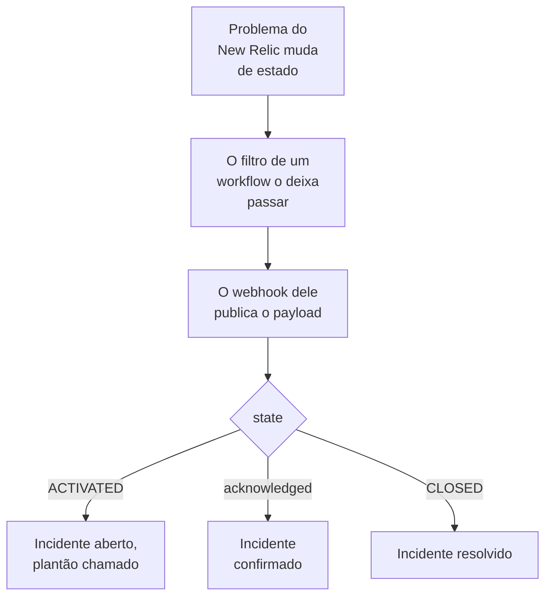

# New Relic

Envie os problemas do [New Relic](https://newrelic.com) para o OneUptime, para que cada problema vire um incidente ou um alerta que chama a sua equipe de plantão, é confirmado quando alguém confirma o problema e é resolvido quando o problema é fechado. O New Relic envia os problemas por um [destino webhook](https://docs.newrelic.com/docs/alerts/get-notified/notification-integrations/), então não há nada a instalar em nenhum dos lados.

:::cards
- [Começar pelo modelo](#começar-pelo-modelo): Escolha quem chamar, copie a URL e veja o que cada problema faz.
- [Configurar o New Relic](#configurar-o-new-relic): Um destino webhook e o workflow que o notifica.
- [Testar](#testar): Envie um problema você mesmo e depois um do New Relic.
- [Solução de problemas](#solução-de-problemas): Quando os problemas não chegam ou os incidentes continuam abertos.
:::

## Como funciona



Um workflow do New Relic escolhe os problemas a enviar pelo filtro dele, e notifica um destino webhook quando um é ativado, confirmado ou fechado, com um payload JSON que o New Relic preenche. O ID do problema é como o OneUptime encontra o incidente que abriu.

## Antes de começar

- Uma conta do New Relic em que você possa criar destinos e workflows.
- No OneUptime, permissão para criar workflows. No OneUptime Cloud, os workflows exigem o plano **Growth** ou superior.

## Começar pelo modelo

Configure o OneUptime primeiro: ele fornece a URL para a qual o New Relic envia. A caixa de diálogo **Criar um fluxo de trabalho** tem dois modelos do New Relic, em **New Relic** na lista de categorias: **Declare an incident for each New Relic issue**, e **Create an alert for each New Relic issue** para alertas. Os dois fazem o mesmo, cada um com o seu tipo de registro.

:::steps
1. Vá para **Fluxos de trabalho** e clique em **Criar fluxo de trabalho**. Em **Ou começar a partir de um modelo**, escolha **New Relic** na lista de categorias, clique em **Declare an incident for each New Relic issue**, ou em **Create an alert for each New Relic issue**, e depois em **Usar este modelo**.
2. Em **Who to page for new New Relic issues**, escolha as políticas de plantão a acionar, ou nenhuma para não acionar ninguém, e clique em **Criar fluxo de trabalho**. O workflow abre no **Construtor**, desativado.
3. Clique no gatilho **Webhook**, depois em **Copiar URL**, e guarde a URL para o New Relic.
4. Ative **Habilitado** no topo do **Construtor**. Um workflow desativado responde ao New Relic com `400`.
:::

Depois [configure o New Relic](#configurar-o-new-relic) para enviar os problemas dele para essa URL. A etapa `read-event-1` do workflow abre com a mesma configuração, para quando você voltar a ela no **Construtor**.

### O que o workflow faz

Depois do gatilho **Webhook**, a etapa **Check With JavaScript** `read-event-1` lê o `state` que o New Relic envia, e **Incident From Another Tool**, ou **Alert From Another Tool** no modelo de alertas, faz o que ele significa, pelo ID do problema. O incidente guarda o ID no seu campo personalizado `newRelicIssueId`.

| O que o New Relic envia | O que o workflow faz |
| --- | --- |
| `state` é `ACTIVATED` ou `CREATED` | Declara um incidente com o título `New Relic: <issue>`, na gravidade que corresponde à prioridade do problema, fora das suas páginas de status. A descrição dele aponta para o problema no New Relic e mostra a prioridade, as entidades, as políticas e as condições. Chama as políticas de plantão que você escolheu. O mesmo problema de novo, como o New Relic elevando-o para CRITICAL, não abre um segundo incidente e não chama ninguém de novo. |
| `state` é `ACTIVATED` e `isAcknowledged` é `true` | Confirma o incidente do problema, o que faz o plantão parar de escalá-lo. O motivo fica na linha do tempo dele. |
| `state` é `CLOSED` | Resolve o incidente do problema, a menos que ele já esteja resolvido. O motivo fica na linha do tempo dele. |

Uma confirmação ou um fechamento de um problema sem incidente não muda nada. Todo o resto, como uma requisição de outra ferramenta, é deixado como está: `read-event-1` segue por **No**, e as **Etapas** da execução dizem por quê. Nada volta para o New Relic: ele fecha os próprios problemas quando o sinal se recupera, e é isso que resolve o incidente.

### Prioridades e chamadas

Todo problema novo chama as políticas de plantão que você escolheu, seja qual for a prioridade: o New Relic eleva um problema de HIGH para CRITICAL no lugar, no mesmo problema, então esperar por CRITICAL nunca chamaria ninguém para um problema que abriu em HIGH e piorou. Para chamar por menos problemas, restrinja o filtro do workflow no New Relic: só o que passa por ele chega ao OneUptime. Em um projeto novo, as prioridades são mapeadas nestas gravidades de incidente e de alerta:

| Prioridade do New Relic | Incidente | Alerta | Plantão |
| --- | --- | --- | --- |
| CRITICAL | Critical Incident | High | Chamado |
| HIGH | Major Incident | Low | Chamado |
| MEDIUM | Minor Incident | Low | Chamado |
| LOW | Minor Incident | Low | Chamado |

Com gravidades próprias, CRITICAL vai para a sua mais grave, HIGH para a do meio, e MEDIUM e LOW para a sua menos grave. Um incidente mantém a gravidade com que abriu quando o New Relic eleva o problema dele.

Para mapear uma prioridade para uma das suas pelo nome, edite `SEVERITY_BY_NAME` na etapa `read-event-1`, como `{ HIGH: 'Critical Incident' }`.

## Configurar o New Relic

:::steps
### Adicionar o destino webhook

No New Relic, vá em **Alerts → Destinations** e adicione um destino **Webhook**. Defina **Webhook name** como `OneUptime` e **Endpoint URL** como a URL que você copiou do OneUptime, e salve. Deixe **Use authorization** desativado: a URL é a única credencial.

### Adicionar o workflow

Vá em **Alerts → Workflows** e clique em **Add a workflow**. Dê a ele o nome `OneUptime`. O filtro dele decide quais problemas chegam ao OneUptime, como só os CRITICAL, ou os de uma equipe.

### Notificar o destino

Adicione ao workflow o destino **Webhook** que você criou. Mantenha o payload que o New Relic preenche e adicione uma linha para `isAcknowledged` depois de `state`, para que o incidente seja confirmado junto com o problema:

```json
{
  "id": {{ json issueId }},
  "issueUrl": {{ json issuePageUrl }},
  "title": {{ json annotations.title.[0] }},
  "priority": {{ json priority }},
  "impactedEntities": {{ json entitiesData.names }},
  "totalIncidents": {{ json totalIncidents }},
  "state": {{ json state }},
  "isAcknowledged": {{ json isAcknowledged }},
  "trigger": {{ json triggerEvent }},
  "isCorrelated": {{ json isCorrelated }},
  "createdAt": {{ createdAt }},
  "updatedAt": {{ updatedAt }},
  "sources": {{ json accumulations.source }},
  "alertPolicyNames": {{ json accumulations.policyName }},
  "alertConditionNames": {{ json accumulations.conditionName }},
  "workflowName": {{ json workflowName }}
}
```

A linha a adicionar é `"isAcknowledged": {{ json isAcknowledged }},`. Depois clique em **Update message**.

### Notificar quando ativado, confirmado e fechado

Clique nos três pontos do destino e escolha **Notify when**. Mantenha **Activated**, **Acknowledged** e **Closed** ativados.

### Ativar o workflow

Clique em **Activate workflow**.
:::

O workflow do OneUptime lê estes campos do payload e deixa os outros como estão:

| Campo | O que o New Relic coloca nele |
| --- | --- |
| `id` | O ID do problema. |
| `issueUrl` | Um link para o problema no New Relic. |
| `title` | O título do problema. |
| `priority` | Quão urgente é o problema: `CRITICAL`, `HIGH`, `MEDIUM` ou `LOW`. |
| `state` | Em que ponto o problema está: `CREATED`, `ACTIVATED` ou `CLOSED`. |
| `isAcknowledged` | `true` quando alguém confirma o problema no New Relic. |
| `impactedEntities` | Os nomes das entidades de que o problema trata. |
| `alertPolicyNames` | Os nomes das políticas por trás do problema. |
| `alertConditionNames` | Os nomes das condições por trás do problema. |

## Testar

Envie um problema para a URL que você copiou, como o New Relic faria:

```bash
curl -X POST "<url>" \
  -H "Content-Type: application/json" \
  -d '{
    "id": "7d4a2e1c-3b5f-4c8e-9a1d-2f6b8c0e4a71",
    "issueUrl": "https://radar-api.service.newrelic.com/accounts/1234567/issues/7d4a2e1c-3b5f-4c8e-9a1d-2f6b8c0e4a71?notifier=WEBHOOK",
    "title": "High CPU on checkout-service",
    "priority": "CRITICAL",
    "impactedEntities": ["checkout-service"],
    "state": "ACTIVATED",
    "isAcknowledged": false,
    "alertPolicyNames": ["Production"],
    "alertConditionNames": ["CPU above 90%"]
  }'
```

Um incidente abre, com o título `New Relic: High CPU on checkout-service`, e as políticas de plantão que você escolheu são chamadas. Envie a mesma requisição com `isAcknowledged` em `true`, e o incidente é confirmado. Envie-a com `state` em `CLOSED`, e o incidente é resolvido.

Depois teste a partir do New Relic: abra a mensagem do webhook do workflow e clique em **Send test notification**. Para ver que ela chegou, abra **Registros → Execuções** do workflow do OneUptime.

## Solução de problemas

:::details Nada chega ao OneUptime
- Verifique que o workflow no New Relic está ativo e que o filtro dele deixa o problema passar.
- Verifique que o **Endpoint URL** do destino é a URL do gatilho **Webhook**.
- Um workflow desativado responde `400`. Ative **Habilitado** no topo do **Construtor** dele.
:::

:::details O workflow roda, mas não abre nada
Abra a execução em **Registros → Execuções**. A entrada `read-event-1` em **Etapas** diz por que ela seguiu por **No**.

- `New Relic named no issue ID`: mantenha a linha `"id": {{ json issueId }},` no payload.
- `is in no state`: mantenha a linha `"state": {{ json state }},` no payload.
:::

:::details Os incidentes não são confirmados
- O payload precisa da linha `"isAcknowledged": {{ json isAcknowledged }},`. Sem ela, um incidente abre e é resolvido junto com o problema dele, mas nunca é confirmado.
- O workflow no New Relic deve manter **Acknowledged** ativado em **Notify when**.
:::

:::details Os incidentes abrem mas nunca são resolvidos
- O workflow no New Relic deve manter **Closed** ativado em **Notify when**.
- Abra a execução do fechamento em **Registros → Execuções**: a última etapa dela diz por quê. O `id` do fechamento deve ser o do problema, então mantenha `"id": {{ json issueId }},` como está no payload.
:::

:::details O plantão é chamado por problemas demais
Todo problema novo que chega ao OneUptime chama o plantão. Restrinja o filtro do workflow no New Relic, para que só cheguem a ele os problemas que devem chamar. Veja [Prioridades e chamadas](#prioridades-e-chamadas).
:::

:::details O plantão não é chamado
- Uma notificação para um problema que já tem incidente não chama ninguém de novo, então uma elevação para CRITICAL não chama ninguém.
- Com ninguém escolhido na caixa de diálogo **Criar um fluxo de trabalho**, o workflow não tem nenhuma etapa que chame.
:::

## Segurança

- **Trate a URL como uma senha.** Quem a tiver pode abrir incidentes. Se ela vazar, clique em **Redefinir URL** no gatilho **Webhook** do workflow. Depois atualize o **Endpoint URL** do destino no New Relic.
- **Os links vão para o New Relic.** O modelo aponta um problema só em um site do New Relic, diga o que disser uma requisição, e escreve o que o New Relic enviou como texto.
- **Auto-hospedado?** O New Relic envia webhooks pela internet, então o seu OneUptime precisa estar acessível a partir dela por HTTPS.

## Próximos passos

:::cards
- [Modelos de workflow](/docs/workflows/authoring): Crie um workflow a partir de um modelo e altere-o no Construtor.
- [Datadog](/docs/integrations/datadog): O mesmo modelo, para os monitores do Datadog.
- [Regras de escalonamento](/docs/on-call/escalation-rules): Decida quem uma política de plantão aciona, e quando.
- [Visão geral das integrações](/docs/integrations/index): As outras ferramentas que você pode conectar.
:::
