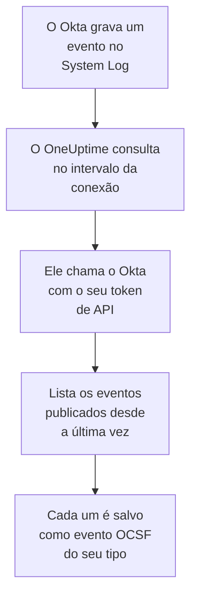

# Registro do sistema do Okta

Importe o [Okta System Log](https://developer.okta.com/docs/reference/system-log-query/) para os eventos de segurança do OneUptime: logins, desafios de MFA, mudanças de contas e grupos, e as detecções de ameaças do próprio Okta. Lá você os pesquisa ao lado dos seus logs, traces e métricas, correlaciona-os com todas as outras fontes e aciona o plantão para os que importam. O OneUptime os lê com um token de API que você cria, e não altera nada no Okta.

:::cards
- [Configurar a conexão](#configurar-a-conexão): Um token de API e o formulário da conexão.
- [O que é importado](#o-que-é-importado): Quais eventos, e como cada um vira um evento de segurança.
- [Como a consulta funciona](#como-a-consulta-funciona): A janela que cada consulta lê, e por que ela se sobrepõe 15 minutos à anterior.
- [Solução de problemas](#solução-de-problemas): O que cada erro significa e o que mudar.
:::

## Como funciona



A cada minuto, o OneUptime consulta cada conexão habilitada cujo intervalo de consulta já passou. Uma consulta pede ao Okta os eventos do System Log publicados desde a última consulta, e salva cada um como um evento [OCSF](https://schema.ocsf.io/): um login como um evento Authentication, uma mudança de conta como um Account Change, e uma detecção do Okta como um Detection Finding. As regras de detecção, os monitores e os painéis então o tratam como um evento de segurança de qualquer outra fonte. Funciona com toda célula do Okta, `okta.com`, `oktapreview.com` e `okta-emea.com`, e com uma organização em um domínio personalizado.

## Antes de começar

- No OneUptime, a função Project Owner, Project Admin ou Security Admin. As funções Security Member e Security Viewer veem as conexões e o histórico de execuções delas, mas não podem alterá-las.
- Um administrador do Okta que possa ver o System Log, para criar o token. Um token pode fazer o que o administrador dele pode, então use um Read-only Administrator: ele lê o System Log e não altera nada. Um administrador somente leitura também vê usuários, grupos, aplicativos e configurações, então guarde o token com o mesmo cuidado que uma senha.
- Idealmente, uma conta de serviço para esse administrador. O Okta desativa um token quando o administrador dele é desativado, e quando ele passa 30 dias sem uso. A consulta o usa a cada poucos minutos, então ele continua em uso enquanto a conexão estiver habilitada.
- Se a sua organização só aceita chamadas de API de uma zona de rede, uma zona que contenha os endereços de onde o OneUptime chama: no OneUptime Cloud, os endereços de saída dele, e em uma instalação auto-hospedada, o endereço público dos seus hosts do aplicativo e dos workers.

## Configurar a conexão

:::steps
### Criar um token de API

1. Entre no **Admin Console** do Okta como o administrador somente leitura.
2. Abra **Security → API**, depois a aba **Tokens**, e selecione **Create token**.
3. Dê um nome a ele, por exemplo `OneUptime security events`. Deixe **Any IP** como a origem permitida das chamadas dele, a menos que a sua organização precise de uma zona.
4. Selecione **Create token** e copie o **Token Value**. O Okta só o mostra uma vez.

Cada token pode usar uma parte do limite de taxa da API da organização, que a linha dele na aba **Tokens** mostra. Uma consulta faz no máximo 20 requisições, então a parte padrão é mais do que suficiente, a menos que outras ferramentas usem o mesmo token.

### Adicionar a conexão no OneUptime

Abra **Produtos → Security Events → Conexões** (`/dashboard/{projectId}/security-events/connections`), clique em **Adicionar conexão**, escolha **Okta System Log** e clique em **Próximo**. Preencha as configurações da tabela abaixo, clique em **Próximo** e cole o token em **API token**.

### Testar antes de salvar

Clique em **Testar estas configurações** em **Testar antes de salvar**. O teste entra e lê eventos com os valores do formulário, sem salvar nada, então uma URL errada ou um filtro inválido aparece antes de a conexão existir. Depois clique em **Próximo**, dê um **Nome** à conexão e crie-a.
:::

| Configuração | O que informar |
| --- | --- |
| **Okta organization URL** | O endereço em que os seus usuários entram, por exemplo `https://acme.okta.com`, `https://acme.oktapreview.com` ou `https://login.example.com`. Ele deve usar `https`, sem caminho. Não o endereço `-admin` do Admin Console, que não serve a API. |
| **Event filter** | Opcional. Um [filtro do System Log](https://developer.okta.com/docs/reference/core-okta-api/#filter) que escolhe os eventos a importar, por exemplo `eventType sw "user.session" or eventType sw "security"`. Vazio importa as famílias abaixo. No máximo 2.000 caracteres, em uma única linha, e não sobre `published`: o OneUptime define o intervalo de tempo por conta própria. |
| **API token** | O valor do token, sozinho: o OneUptime adiciona o esquema `SSWS` por conta própria. Ele é criptografado, nunca devolvido pela API e nunca mostrado de novo. Substitua-o com **Atualizar credenciais** na conexão. |

A etapa **Consulta periódica** também tem uma **Descrição** opcional, o **Intervalo de consulta (minutos)**, um número inteiro de `1` a `1440` que começa em `5`, e **Habilitado**, que começa ativado.

## O que é importado

Sem **Event filter**, o OneUptime importa as famílias de eventos que uma equipe de segurança acompanha, por prefixo de `eventType`. Um filtro seu substitui esta lista, em vez de somar a ela:

| Prefixo | Eventos |
| --- | --- |
| `user.session` | Logins e logouts, acesso ao Admin Console, personificação |
| `user.authentication` | Resultados de autenticação, single sign-on incluído |
| `user.mfa` | Cadastro, desafios e redefinições de fatores |
| `user.account` | Mudanças e redefinições de senha, bloqueios, mudanças de perfil e de privilégios |
| `user.lifecycle` | Usuários criados, ativados, suspensos, desativados e excluídos |
| `security.` | ThreatInsight, relatos de atividade suspeita e as outras detecções do Okta |
| `policy.` | Avaliações de políticas de login, e mudanças de políticas |
| `system.api_token` | Tokens de API criados e revogados |
| `application.user_membership` | Atribuições de aplicativos |
| `group.user_membership` | Mudanças de participação em grupos |

Cada evento vira um evento OCSF, com o fornecedor `Okta` e o produto `Okta System Log`, da classe que o seu `eventType` pede:

| `eventType` | Classe OCSF | Atividade |
| --- | --- | --- |
| `user.session.start` | Authentication (`3002`) | `Logon` |
| `user.session.end` | Authentication (`3002`) | `Logoff` |
| `user.authentication.*` | Authentication (`3002`) | `Logon` |
| `user.mfa.*` | Authentication (`3002`) | `Authentication Ticket` |
| Outros eventos `user.session.*` | Authentication (`3002`) | `Other` |
| `user.account.*`, `user.lifecycle.*` | Account Change (`3001`) | A última parte do tipo de evento, por exemplo `Update Password` |
| `group.*` | Group Management (`3006`) | A última parte do tipo de evento, por exemplo `Add` |
| `security.*`, e uma `policy.evaluate_sign_on` que negou o acesso | Detection Finding (`2004`) | `Create`, com o tipo de evento como nome da regra |
| Todo o resto | `0`, com o nome do tipo de evento | A última parte do tipo de evento |

Um evento que não se encaixa em nenhuma dessas classes mantém mesmo assim todos os campos, e continua pesquisável por qualquer um deles. Todo evento preenche estas colunas:

| Campo do Okta | Coluna do OneUptime |
| --- | --- |
| `uuid` | UID do evento, que também serve para descartar duplicatas |
| `published`, quando o evento aconteceu | Horário do evento |
| `displayMessage`, senão o tipo de evento e `outcome.reason` | Mensagem |
| `severity`: `DEBUG` e `INFO` são Informational, `WARN` Medium, `ERROR` High | Gravidade |
| `outcome.result`, como `SUCCESS`, `FAILURE`, `ALLOW` ou `DENY` | Status |
| `actor.alternateId`, senão `actor.displayName`; `client.ipAddress` | Usuário e IP do ator |
| O `alternateId` do `User` em `target` | Usuário alvo |
| O `alternateId` da `AppInstance` em `target` | Recurso alvo |
| O ator, cada alvo e o IP do cliente | Observáveis |
| O evento inteiro, achatado em chaves com pontos, como `client.userAgent.browser` e `debugContext.debugData.requestUri` | `attributes` |

Um login com falha ou negado em `INFO` é elevado a Low, para que se destaque de um bem-sucedido. O System Log não traz referências do MITRE ATT&CK, então essas colunas ficam vazias.

## Como a consulta funciona

Cada consulta lista os eventos publicados na sua janela, do mais antigo para o mais novo, 1.000 por página, e segue o link `next` que o Okta envia até a última página:

```text
GET {Okta organization URL}/api/v1/logs?since={window start}&until={window end}&sortOrder=ASCENDING&limit=1000&filter={Event filter}
```

- **O horário de publicação é o cursor.** Um evento do System Log é a própria atividade, então `published` é ao mesmo tempo quando ela aconteceu e o que a consulta lê.
- **A primeira consulta olha 24 horas para trás**, para que uma nova conexão mostre logo os eventos recentes dela.
- **Cada consulta seguinte começa 15 minutos antes do cursor salvo.** O Okta avisa que uma requisição com um horário de fim pode deixar de fora eventos atrasados, o que ele chama de raro. A sobreposição os lê na consulta seguinte. Um evento atrasado mais de 15 minutos pode ficar para trás do cursor: importe o intervalo de tempo dele para recuperá-lo.
- **Uma consulta lê no máximo 24 horas além do cursor.** Uma conexão cujo cursor ficou para trás se atualiza em uma série de janelas de 24 horas, e a **Integridade** dela mostra **Catching up**.
- **As duplicatas são descartadas por `uuid`** dentro do projeto, para que a sobreposição, uma janela repetida e uma importação nunca salvem um evento duas vezes.

Um link `next` que aponta para qualquer lugar que não seja a sua **Okta organization URL** nunca é seguido, já que o token vai em toda requisição.

### Quando uma janela contém mais do que uma consulta consegue ler

Uma consulta lê no máximo 10.000 eventos, em no máximo 20 requisições. Quando uma janela contém mais, a execução fica **Parcial**, com um aviso como este:

```text
Stopped after collecting 10000 events; the window holds more. The last event read was published at 2026-09-14T08:12:44.000Z.
```

Os eventos são lidos do mais antigo para o mais novo, então o OneUptime move o cursor para o horário de publicação do último evento lido, e a consulta seguinte começa ali, sem a sobreposição de 15 minutos, com o mesmo tamanho de janela. Uma organização movimentada se atualiza 10.000 eventos por consulta, em vez de reler os mesmos. A sobreposição volta quando o cursor já avançou 15 minutos além desse ponto.

Quando uma execução não consegue passar do cursor salvo de jeito nenhum, por exemplo porque só os 15 minutos de sobreposição já contêm mais de 10.000 eventos, o OneUptime encurta a janela em vez disso:

1. **Reduzir.** A consulta seguinte lê uma janela com a metade do tamanho, a partir do mesmo ponto de partida, e continua dividindo pela metade até que uma janela seja lida por inteiro, até um minuto. O aviso da execução diz isso: `This window holds more records than one poll can read; the next poll reads a {n} minute window from the same starting point.`
2. **Voltar a crescer.** Depois que uma janela é lida por inteiro, a seguinte volta a ter o dobro do tamanho, até 24 horas.
3. **Passar de um único minuto.** Se até um minuto contém mais do que uma consulta consegue ler, a consulta passa dele, para que os eventos mais novos continuem chegando, e a sobreposição das consultas seguintes não volta mais até ele. A execução continua **Parcial**, e **Último erro** mostra `More records were created in the one minute from {cursor} to {end} than one poll can read. Polling moved past this minute so newer records keep arriving; use Import this time range in Diagnostics on this minute to recover what one run can read.` Importe esse minuto com **Import this time range** para recuperar o que uma execução consegue ler, ou restrinja o **Event filter**.

Uma execução que falha por completo, com um erro do Okta, mantém o cursor e o tamanho da janela, e a consulta seguinte relê a mesma janela. A única exceção é uma requisição que expirou: o cursor fica, mas a janela seguinte tem a metade do tamanho, porque uma janela pesada demais para ser respondida a tempo expiraria em toda tentativa. Mudar o **Intervalo de consulta (minutos)** não muda nada disso: ele decide com que frequência uma consulta começa, não onde a janela dela começa.

### Executar, pré-visualizar e importar sob demanda

Clique em **Diagnóstico** em uma conexão para ver as execuções recentes dela e trabalhar com ela manualmente. Quem pode alterar a conexão pode iniciar essas ações; quem pode vê-la pode ler o histórico.

- **Executar agora** inicia uma consulta na hora, com o cursor de sempre, mesmo quando a conexão não está **Habilitado**.
- **Preview log events** lê um intervalo de tempo de até 7 dias e não importa nada.
- **Import this time range** importa um intervalo de até 7 dias, depois que você confirma, sem mover o cursor. Os eventos já importados são pulados. O Okta guarda 90 dias de System Log.
- **Copy diagnostics** em uma execução copia o relatório dela para o suporte. Ele nunca inclui credenciais.

## Testar conexão

**Testar conexão** na linha de uma conexão, e **Testar estas configurações** no formulário, rodam no processo da API, não em um worker em segundo plano, para que um teste responda mesmo quando o problema são os workers. Ele faz estas verificações, em ordem:

| Verificação | O que ela verifica |
| --- | --- |
| **Configuração** | Cada configuração está presente e bem formada. Nada é contatado quando isso falha. |
| **Authenticate with Okta** | O Okta aceita o token para o System Log, com um evento lido e nenhum filtro. |
| **Read System Log events** | Um evento das últimas 24 horas pode ser lido pelo filtro que a consulta usa, o seu ou o padrão, então um **Event filter** inválido falha aqui, e não na primeira consulta. |
| **Events available to import** | Quantos eventos foram publicados nas últimas 24 horas e nos últimos 7 dias, uma página de 1.000 cada, então `1000+` significa mais. Nenhum em 7 dias é um aviso, não uma falha. |
| **Background workers**, **Poll scheduler**, **Security event storage** | O lado do próprio OneUptime: um processo pega os jobs da fila Worker, o job de consulta roda a cada minuto e o armazenamento de eventos de segurança responde. |
| **Scheduled polling** | Para uma conexão salva: a consulta está ativada, nenhuma execução está presa esperando um worker e as consultas rodam no horário. |

Cada requisição de um teste tem um prazo de 20 segundos. Um teste nunca importa nada nem move o cursor, e cada verificação que falha diz o que mudar.

## Solução de problemas

O **Último erro** da conexão guarda a mensagem de erro completa, com as credenciais ocultadas, atrás de um prefixo que nomeia a etapa que falhou. Quando uma conexão tem um erro, selecione **Ver erro** na coluna **Ações** dela para lê-lo, e **Copiar erro** na caixa de diálogo para copiá-lo. Toda mensagem começa com `Okta System Log events request`, e cita o próprio código de erro do Okta depois do status; leia o que vem depois.

:::details Last Error diz `failed (HTTP 400)`
O Okta recusou os parâmetros da requisição, `E0000053`. Quando o token funcionou, é quase sempre o **Event filter**: verifique os operadores dele, `eq`, `ne`, `co`, `sw`, `ew`, `pr`, `gt`, `ge`, `lt` e `le`, os seus `and` e `or`, e as aspas duplas em volta dos valores, ou esvazie-o para usar as famílias padrão. Em uma importação, também pode significar que o intervalo começa há mais de 180 dias.
:::

:::details Last Error diz `failed (HTTP 401)` ou `failed (HTTP 403)`
- `HTTP 401`: o Okta não aceitou o token, `E0000011`. Ele foi revogado, passou 30 dias sem uso, ou foi desativado junto com o administrador dele; ou foi colado com `SSWS` ou com um caractere a mais. Crie um novo token como administrador somente leitura e salve-o com **Atualizar credenciais**.
- `HTTP 403`: o token entra, mas o administrador dele não pode ler o System Log, `E0000006`. Crie-o como Read-only Administrator ou Super Administrator, e verifique se a zona de rede dele permite os endereços de onde o OneUptime chama.
:::

:::details Last Error diz `failed (HTTP ...)` com outro status
- `HTTP 404`: a URL não serve a API do Okta. Use o endereço próprio da organização, por exemplo `https://acme.okta.com`, sem caminho e não o de `-admin`.
- `HTTP 3xx`: o Okta redirecionou a requisição, e redirecionamentos são recusados, já que o token vai em toda requisição. Use o endereço próprio da organização.
- `HTTP 429`: o Okta está limitando o token, `E0000047`. A consulta seguinte tenta de novo. Se continuar acontecendo, aumente a parte do limite de taxa do token na aba **Tokens**, dê ao OneUptime um token próprio, ou consulte com menos frequência.
- `HTTP 5xx`: o Okta falhou, ou a consulta passou do limite de 30 segundos do Okta, `E0000009`. A consulta seguinte tenta de novo; se continuar acontecendo, veja [status.okta.com](https://status.okta.com).
:::

:::details Last Error diz `returned` ou `did not complete`
- `returned a non-JSON body.` ou `returned an unrecognized response shape`: respondeu algo diferente da API do Okta, por exemplo uma página de login ou um proxy, ou o Okta respondeu com um erro. Isso é relatado em vez de ser tomado como uma janela vazia, para que o cursor nunca passe de eventos que ninguém leu.
- `returned a next link outside the Okta organization URL`: um link `next` apontava para outro lugar, e não foi seguido. O próprio Okta nunca faz isso: procure um proxy que reescreve cabeçalhos.
- `did not complete`: a requisição não recebeu resposta: um tempo limite esgotado, um nome que não resolve, um certificado em que o OneUptime não confia, ou um endereço recusado. Verifique se o aplicativo e os workers do OneUptime conseguem alcançar a sua organização por HTTPS, passando pelo proxy que você usa, se houver.
:::

:::details Last Polled é Never e Last Error está vazio
Nenhuma consulta terminou para essa conexão. Rode **Testar conexão**: as verificações **Background workers** e **Poll scheduler** dele nomeiam a causa. Em uma instalação auto-hospedada, a causa comum é `DISABLE_QUEUE_WORKERS=true` no aplicativo, sem um deployment separado de workers que pegue os jobs: defina como `false`, ou rode o deployment de workers (Helm: `worker.enabled: true`).
:::

:::details Uma execução está Partial
- `Stopped after collecting 10000 events`: a janela continha mais do que os 10.000 eventos que uma execução lê. Nada se perde: a consulta seguinte começa depois do último evento lido. Uma conexão que continua **Parcial** consulta após consulta está se atualizando de um atraso, e os seus **Última consulta** e **Último evento importado** continuam avançando. Se ela nunca se atualiza, a organização publica mais eventos correspondentes do que cabem em um intervalo de consulta: restrinja o **Event filter**, ou encurte o **Intervalo de consulta (minutos)**.
- `More records were created in the one minute from ... than one poll can read`: a consulta passou desse minuto. Importe-o com **Import this time range** em **Diagnóstico**. Uma importação lê tanto quanto uma consulta.
:::

:::details O teste passa, mas nada é importado
Leia **Events available to import** no relatório do teste. Com o filtro padrão, uma organização com usuários publica logins o tempo todo, então `0` nos últimos 7 dias significa que a URL é um sandbox ou uma organização sem uso. Com o seu próprio **Event filter**, significa que o filtro não encontrou nada: compare-o com os tipos de evento no System Log do Admin Console.
:::

## O que você ganha

- **Pesquisa.** Filtre logins, resultados de MFA, mudanças de contas e detecções do Okta por gravidade, status, usuário, IP ou qualquer observável no explorador de eventos de segurança, ao lado de todas as outras fontes.
- **Correlação.** Os usuários, aplicativos e IPs de cada evento são indexados como observáveis, então uma pesquisa encontra tudo o que um usuário fez, ao lado dos próprios logs do aplicativo dele.
- **Regras de detecção.** Regras Sigma que rodam em uma programação sobre os seus eventos de segurança, como logins com falha por IP ou negações de MFA por usuário, e abrem alertas que acionam o plantão.
- **Monitores.** Os monitores de eventos de segurança contam os eventos correspondentes, e abrem incidentes ou alertas acima de um limite.

Os eventos de segurança são cobrados como o resto da sua telemetria, por GB ingerido. Veja os [preços](https://oneuptime.com/pricing).

## Próximos passos

:::cards
- [Eventos de segurança](/docs/telemetry/security-events): Pesquise, correlacione e alerte sobre o que você importa.
- [AWS Security Hub](/docs/integrations/aws-security-hub): Importe também as descobertas da sua nuvem.
- [Funções](/docs/permissions/reference#funções): O que as funções Security podem ver e alterar.
- [Visão geral das integrações](/docs/integrations/index): As outras ferramentas que você pode conectar.
:::
