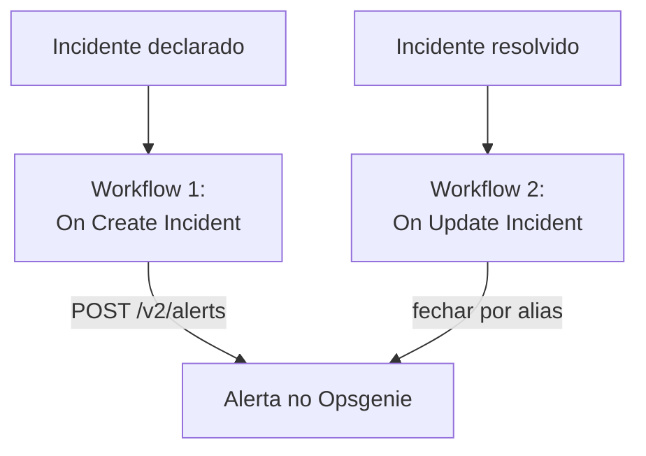

# Opsgenie

Envie os incidentes do OneUptime para o [Opsgenie](https://www.atlassian.com/software/opsgenie). Um workflow cria um alerta no Opsgenie quando um incidente do OneUptime é declarado, e um segundo o fecha quando o incidente do OneUptime é resolvido. Use enquanto o Opsgenie ainda chama a sua equipe e o OneUptime vigia os seus sistemas.

:::cards
- [Salvar a chave de API](#salvar-a-chave-de-api): Mantenha a chave do Opsgenie fora dos seus workflows.
- [Criar alertas no Opsgenie](#criar-um-alerta-no-opsgenie-para-cada-incidente): Um workflow, dois blocos.
- [Fechá-los](#fechar-o-alerta-no-opsgenie): Um segundo workflow que acompanha o estado do incidente.
- [Solução de problemas](#solução-de-problemas): Quando o Opsgenie recusa uma requisição.
:::

> [!IMPORTANT]
> A Atlassian parou de vender o Opsgenie em junho de 2025 e encerra o suporte em abril de 2027. O OneUptime também chama as pessoas, com políticas de plantão, escalas e regras de escalonamento. Para trazer a sua equipe, veja [Migrar do Opsgenie](/docs/moving-to-oneuptime/opsgenie): uma importação traz os seus usuários, equipes, escalas e escalonamentos.

## Como funciona



Os dois workflows chamam a [Alert API do Opsgenie](https://docs.opsgenie.com/docs/alert-api). O primeiro dá ao alerta um `alias` formado a partir do ID do incidente do OneUptime, e o segundo fecha o alerta por esse alias.

## Antes de começar

- Uma integração do Opsgenie do tipo **API** e a **API Key** dela. Adicione uma em **Settings → Integrations** no Opsgenie, ou nas **Integrations** de uma equipe para enviar os alertas a essa equipe.
- A sua região do Opsgenie. As contas na Europa, que entram por `app.eu.opsgenie.com`, usam `api.eu.opsgenie.com`. Todas as outras usam `api.opsgenie.com`.
- No OneUptime, permissão para criar workflows e variáveis globais. No OneUptime Cloud, os workflows exigem o plano **Growth** ou superior.

## Salvar a chave de API

:::steps
1. Vá para **Fluxos de trabalho → Variáveis globais** e clique em **Criar: Fluxo de trabalho Variável**.
2. Dê o nome `OPSGENIE_KEY` e clique em **Próximo**.
3. Cole a chave de API em **Conteúdo**, ative **Segredo** e clique em **Criar: Fluxo de trabalho Variável**.
:::

Uma variável secreta é substituída por `[REDACTED]` nos logs de execução, então a chave nunca aparece em uma execução.

## Criar um alerta no Opsgenie para cada incidente

:::steps
### Criar o workflow

Vá para **Fluxos de trabalho**, clique em **Criar fluxo de trabalho** e depois em **Começar do zero**. Dê o nome `Incidents to Opsgenie` e clique em **Criar fluxo de trabalho**.

### Adicionar o gatilho

Clique no bloco tracejado **Escolha o que inicia este fluxo de trabalho** e escolha **On Create Incident**. Clique no gatilho: os seus **Fields to pass on** começam com **Título**, então clique em **Adicionar campo** e escolha **Descrição**.

### Criar o alerta

Clique em **Adicionar componente**, adicione um bloco **API Post (JSON)** e ligue a ele o ponto **Success** do gatilho. Defina a **URL** dele como `https://api.opsgenie.com/v2/alerts`, ou `https://api.eu.opsgenie.com/v2/alerts` na Europa. Em **Mais campos**, defina os **Request Headers** dele como:

```json
{ "Authorization": "GenieKey {{global.variables.OPSGENIE_KEY}}" }
```

E o **Request Body** como:

```json
{
  "message": "{{local.components.incident-on-create-1.returnValues.model.title}}",
  "alias": "oneuptime-{{local.components.incident-on-create-1.returnValues.model._id}}",
  "description": "{{local.components.incident-on-create-1.returnValues.model.description}}",
  "priority": "P1",
  "source": "OneUptime"
}
```

### Testar e depois ativar

Clique em **Executar fluxo de trabalho**, escolha um incidente de teste em **Incidente** e execute. A etapa **API Post (JSON)** mostra uma resposta `202`, e o alerta aparece no Opsgenie logo depois. Depois, ative **Habilitado** no topo do **Construtor**.
:::

O esquema do Opsgenie é a palavra `GenieKey`, um espaço e depois a chave. O Opsgenie limita `message` a 130 caracteres, e as prioridades dele vão de `P1` a `P5`: para enviar a de cada incidente, veja [Mapear as prioridades](#mapear-as-prioridades).

## Fechar o alerta no Opsgenie

Um workflow tem um só gatilho, então fechar exige um segundo workflow, iniciado quando o estado de um incidente muda.

:::steps
### Adicionar o gatilho On Update Incident

Crie um workflow chamado `Close Opsgenie alerts` e escolha **On Update Incident** como gatilho. Em **Fields to watch**, clique em **Adicionar campo** e escolha **Current Incident State**, para que ele só rode quando o estado mudar. Em **Fields to pass on**, peça se o novo estado é um estado resolvido: clique em **Adicionar campo**, abra **Current Incident State** e escolha **Is Resolved State**. Ou clique em **Editar como JSON** e substitua o JSON por:

```json
{ "_id": true, "currentIncidentState": { "isResolvedState": true } }
```

### Verificar que o incidente está resolvido

Adicione um bloco **If / Else** depois do gatilho. Defina **Value to check** como `{{local.components.incident-on-update-1.returnValues.model.currentIncidentState.isResolvedState}}` e **Comparison** como **is true**.

### Fechar o alerta

Adicione um bloco **API Post (JSON)** depois do lado **Yes**, com os mesmos **Request Headers** e esta **URL**:

```text
https://api.opsgenie.com/v2/alerts/oneuptime-{{local.components.incident-on-update-1.returnValues.model._id}}/close?identifierType=alias
```

Defina o **Request Body** dele como `{ "source": "OneUptime", "note": "Resolved in OneUptime" }`.

### Ativá-lo

Ative **Habilitado** e depois resolva um incidente de teste no OneUptime. O Opsgenie fecha o alerta dele.
:::

`identifierType=alias` diz ao Opsgenie que o endereço identifica o alerta pelo alias, e não pelo ID próprio dele.

## Mapear as prioridades

Para enviar a gravidade de cada incidente como prioridade do Opsgenie, adicione um bloco **Run Custom JavaScript** entre o gatilho e o bloco **API Post (JSON)**.

1. Em **Fields to pass on** do gatilho, clique em **Adicionar campo**, abra **Severidade do incidente** e escolha **Nome**.
2. Defina os **Arguments** do bloco como `{ "severity": "{{local.components.incident-on-create-1.returnValues.model.incidentSeverity.name}}" }` e o **JavaScript Code** dele como:

   ```javascript
   // Your incident severities, by name, to Opsgenie's priorities.
   const PRIORITY = {
     "Critical Incident": "P1",
     "Major Incident": "P2",
     "Minor Incident": "P3",
   };

   return { priority: PRIORITY[args.severity] || "P3" };
   ```

3. No corpo da requisição, defina `"priority"` como `"{{local.components.javascript-1.returnValues.returnValue.priority}}"`.

Os nomes acima são as três gravidades com que um projeto novo começa. Use os seus se você os renomeou.

## Solução de problemas

:::details O Opsgenie responde 401 ou 403
A chave está errada ou pertence à outra região. Verifique se o cabeçalho traz `GenieKey`, um espaço e a chave, se a chave é de uma integração **API** e se o host corresponde à sua região: `api.opsgenie.com` ou `api.eu.opsgenie.com`.
:::

:::details O fechamento responde 404
Nenhum alerta tem esse alias. Os dois workflows precisam montar o alias da mesma forma, `oneuptime-` seguido do `_id` do incidente, e a URL precisa terminar em `?identifierType=alias`.
:::

:::details O alerta nunca aparece, embora a etapa mostre 202
O Opsgenie responde `202` antes de processar a requisição, então uma requisição que ele recusa depois ainda mostra `202`. Procure a requisição nos logs do Opsgenie para ver por que ela foi recusada, por exemplo uma integração desativada.
:::

:::details O workflow nunca roda
Verifique se ele está ativado: **Habilitado**, no topo do **Construtor** dele. Depois abra **Registros → Execuções**: uma execução que seguiu o lado **No** do bloco **If / Else** é uma atualização que não era uma resolução.
:::

## Próximos passos

:::cards
- [Migrar do Opsgenie](/docs/moving-to-oneuptime/opsgenie): Traga a sua equipe, as escalas e os escalonamentos antes do fim do Opsgenie.
- [Regras de escalonamento](/docs/on-call/escalation-rules): Chame as pessoas a partir do próprio OneUptime.
- [PagerDuty](/docs/integrations/pagerduty): Os mesmos dois workflows para o PagerDuty.
- [Visão geral das integrações](/docs/integrations/index): Os padrões por trás de cada integração.
:::
