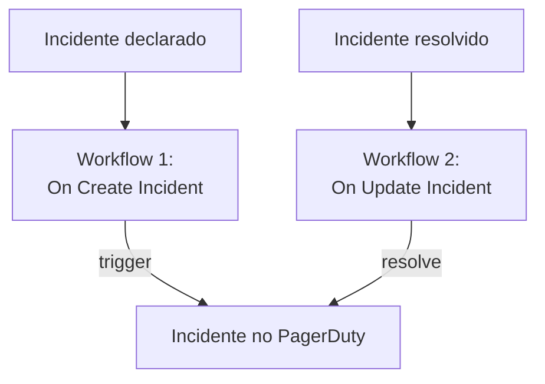

# PagerDuty

Envie os incidentes do OneUptime para o [PagerDuty](https://www.pagerduty.com). Um workflow dispara um incidente no PagerDuty quando um incidente do OneUptime é declarado, e um segundo o resolve quando o incidente do OneUptime é resolvido. Use quando o PagerDuty chama a sua equipe e o OneUptime vigia os seus sistemas.

:::cards
- [Salvar a routing key](#salvar-a-routing-key): Mantenha a chave do PagerDuty fora dos seus workflows.
- [Disparar incidentes no PagerDuty](#disparar-um-incidente-no-pagerduty-para-cada-incidente): Um workflow, dois blocos.
- [Resolvê-los](#resolver-o-incidente-no-pagerduty): Um segundo workflow que acompanha o estado do incidente.
- [Solução de problemas](#solução-de-problemas): Quando o PagerDuty recusa um evento.
:::

> [!TIP]
> O OneUptime também chama as pessoas, com políticas de plantão, escalas e regras de escalonamento. Para tirar a sua equipe do PagerDuty, veja [Migrar do PagerDuty](/docs/moving-to-oneuptime/pagerduty): uma importação traz os seus usuários, escalas e políticas de escalonamento.

## Como funciona



Os dois workflows chamam a [Events API v2](https://developer.pagerduty.com/docs/events-api-v2/overview/) do PagerDuty com a mesma `dedup_key`, formada a partir do ID do incidente do OneUptime. É por essa chave que o PagerDuty sabe que o evento de resolução fecha o incidente que o evento de disparo abriu.

## Antes de começar

- Um serviço do PagerDuty com uma integração Events API v2. No PagerDuty, abra o serviço, depois **Integrations**, clique em **Add an integration** e escolha **Events API V2**. Copie a **Integration Key** dela: a Events API a chama de routing key.
- No OneUptime, permissão para criar workflows e variáveis globais. No OneUptime Cloud, os workflows exigem o plano **Growth** ou superior.

## Salvar a routing key

:::steps
1. Vá para **Fluxos de trabalho → Variáveis globais** e clique em **Criar: Fluxo de trabalho Variável**.
2. Dê o nome `PAGERDUTY_ROUTING_KEY` e clique em **Próximo**.
3. Cole a chave de integração em **Conteúdo**, ative **Segredo** e clique em **Criar: Fluxo de trabalho Variável**.
:::

Uma variável secreta é substituída por `[REDACTED]` nos logs de execução, então a chave nunca aparece em uma execução.

## Disparar um incidente no PagerDuty para cada incidente

:::steps
### Criar o workflow

Vá para **Fluxos de trabalho**, clique em **Criar fluxo de trabalho** e depois em **Começar do zero**. Dê o nome `Incidents to PagerDuty` e clique em **Criar fluxo de trabalho**.

### Adicionar o gatilho

Clique no bloco tracejado **Escolha o que inicia este fluxo de trabalho** e escolha **On Create Incident**. Clique no gatilho: os seus **Fields to pass on** começam com **Título**, então clique em **Adicionar campo** e escolha **Descrição**.

### Enviar o evento de disparo

Clique em **Adicionar componente**, adicione um bloco **API Post (JSON)** e ligue a ele o ponto **Success** do gatilho. Defina a **URL** dele como `https://events.pagerduty.com/v2/enqueue` e o **Request Body** como:

```json
{
  "routing_key": "{{global.variables.PAGERDUTY_ROUTING_KEY}}",
  "event_action": "trigger",
  "dedup_key": "oneuptime-{{local.components.incident-on-create-1.returnValues.model._id}}",
  "payload": {
    "summary": "{{local.components.incident-on-create-1.returnValues.model.title}}",
    "source": "OneUptime",
    "severity": "critical",
    "custom_details": {
      "description": "{{local.components.incident-on-create-1.returnValues.model.description}}"
    }
  }
}
```

### Testar e depois ativar

Clique em **Executar fluxo de trabalho**, escolha um incidente de teste em **Incidente** e execute. A etapa **API Post (JSON)** mostra uma resposta `202` com `"status": "success"`, e o PagerDuty abre um incidente. Depois, ative **Habilitado** no topo do **Construtor**.
:::

O bloco envia JSON, então não precisa de cabeçalho `Content-Type`. A `severity` do PagerDuty é uma entre `critical`, `error`, `warning` e `info`: para enviar a de cada incidente, veja [Mapear as gravidades](#mapear-as-gravidades).

## Resolver o incidente no PagerDuty

Um workflow tem um só gatilho, então resolver exige um segundo workflow, iniciado quando o estado de um incidente muda.

:::steps
### Adicionar o gatilho On Update Incident

Crie um workflow chamado `Resolve PagerDuty incidents` e escolha **On Update Incident** como gatilho. Em **Fields to watch**, clique em **Adicionar campo** e escolha **Current Incident State**, para que ele só rode quando o estado mudar. Em **Fields to pass on**, peça se o novo estado é um estado resolvido: clique em **Adicionar campo**, abra **Current Incident State** e escolha **Is Resolved State**. Ou clique em **Editar como JSON** e substitua o JSON por:

```json
{ "_id": true, "currentIncidentState": { "isResolvedState": true } }
```

### Verificar que o incidente está resolvido

Adicione um bloco **If / Else** depois do gatilho. Defina **Value to check** como `{{local.components.incident-on-update-1.returnValues.model.currentIncidentState.isResolvedState}}` e **Comparison** como **is true**.

### Enviar o evento de resolução

Adicione um bloco **API Post (JSON)** depois do lado **Yes**, com a mesma **URL** e este **Request Body**:

```json
{
  "routing_key": "{{global.variables.PAGERDUTY_ROUTING_KEY}}",
  "event_action": "resolve",
  "dedup_key": "oneuptime-{{local.components.incident-on-update-1.returnValues.model._id}}"
}
```

### Ativá-lo

Ative **Habilitado** e depois resolva um incidente de teste no OneUptime. O PagerDuty resolve o incidente dele.
:::

Verificar `isResolvedState` em vez do nome de um estado continua funcionando quando você renomeia os seus estados. Veja [Estados e severidades de incidentes](/docs/incidents/states-and-severities).

## Mapear as gravidades

Para enviar a gravidade de cada incidente, adicione um bloco **Run Custom JavaScript** entre o gatilho e o bloco **API Post (JSON)**, e leia a resposta dele no corpo.

1. Em **Fields to pass on** do gatilho, clique em **Adicionar campo**, abra **Severidade do incidente** e escolha **Nome**.
2. Defina os **Arguments** do bloco como `{ "severity": "{{local.components.incident-on-create-1.returnValues.model.incidentSeverity.name}}" }` e o **JavaScript Code** dele como:

   ```javascript
   // Your incident severities, by name, to PagerDuty's.
   const SEVERITY = {
     "Critical Incident": "critical",
     "Major Incident": "error",
     "Minor Incident": "warning",
   };

   return { severity: SEVERITY[args.severity] || "info" };
   ```

3. No corpo da requisição, defina `"severity"` como `"{{local.components.javascript-1.returnValues.returnValue.severity}}"`.

Os nomes acima são as três gravidades com que um projeto novo começa. Use os seus se você os renomeou.

## Solução de problemas

:::details O PagerDuty responde 400
O corpo da resposta diz o que o PagerDuty recusou, e a etapa **API Post (JSON)** da execução o mostra. Geralmente a routing key não é uma chave de integração Events API v2: copie-a de novo das **Integrations** do serviço. Um evento sem `summary`, `source` ou `severity` também é recusado.
:::

:::details O evento de resolução não fecha nada
Os dois eventos precisam levar exatamente a mesma `dedup_key`. Verifique se os dois corpos a montam com `oneuptime-` seguido do `_id` do incidente, e se o workflow de resolução está ativado.
:::

:::details O workflow nunca roda
Verifique se ele está ativado: **Habilitado**, no topo do **Construtor** dele. Depois abra **Registros → Execuções**: uma execução que seguiu o lado **No** do bloco **If / Else** é uma atualização que não era uma resolução.
:::

:::details O PagerDuty mostra uma referência em vez de um valor
Uma referência que não se resolve é enviada como foi escrita, com chaves e tudo. Verifique o identificador do bloco, o nome do campo e o nome da variável, que diferencia maiúsculas de minúsculas. Na aba **Etapas** da execução, uma configuração com uma referência assim fica marcada como **Did not resolve**.
:::

## Próximos passos

:::cards
- [Migrar do PagerDuty](/docs/moving-to-oneuptime/pagerduty): Traga a sua equipe, as escalas e as políticas de escalonamento.
- [Regras de escalonamento](/docs/on-call/escalation-rules): Chame as pessoas a partir do próprio OneUptime.
- [Opsgenie](/docs/integrations/opsgenie): Os mesmos dois workflows para o Opsgenie.
- [Visão geral das integrações](/docs/integrations/index): Os padrões por trás de cada integração.
:::
