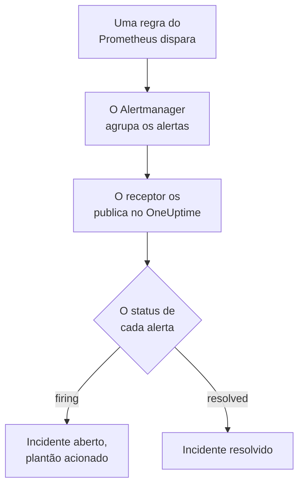

# Prometheus Alertmanager

Envie os alertas do [Prometheus Alertmanager](https://prometheus.io/docs/alerting/latest/alertmanager/) para o OneUptime, para que cada alerta disparado vire um incidente que chama a sua equipe de plantão e seja resolvido quando o alerta se recuperar. O Alertmanager publica as notificações em um receptor webhook, então não há nada a instalar em nenhum dos lados.

:::cards
- [Escolher como o OneUptime recebe os alertas](#escolher-como-o-oneuptime-recebe-os-alertas): Um monitor Incoming Request ou um workflow próprio.
- [Receber alertas com um monitor](#receber-alertas-com-um-monitor): Um incidente por alerta, resolvido na recuperação.
- [Configurar o Alertmanager](#configurar-o-alertmanager): Um receptor webhook e a rota que o usa.
- [Solução de problemas](#solução-de-problemas): Quando os alertas não chegam ou os incidentes continuam abertos.
:::

## Como funciona



O Prometheus avalia as suas regras de alerta e envia ao Alertmanager os alertas que disparam. O Alertmanager os agrupa pelos rótulos do `group_by` da sua rota e publica cada grupo no receptor webhook como uma notificação JSON. A lista `alerts` da notificação contém todos os alertas do grupo, cada um com o próprio `status`, `firing` ou `resolved`, seus rótulos e anotações, e um `fingerprint` que o identifica.

## Antes de começar

- Um Alertmanager cujo `alertmanager.yml` você possa editar e que consiga alcançar o seu OneUptime por HTTPS.
- No OneUptime, permissão para criar monitores, ou workflows se escolher esse caminho.

## Escolher como o OneUptime recebe os alertas

Configure primeiro o OneUptime: ele lhe dá a URL para a qual o Alertmanager envia.

| Caminho | Use quando |
| --- | --- |
| Um monitor Incoming Request (recomendado) | Você quer que cada alerta seja um incidente que chama o plantão e é resolvido quando o alerta se recupera. Não há nada a construir. |
| Um workflow com um gatilho Webhook | Você precisa de uma lógica própria: filtrar alertas, remodelá-los ou chamar outros sistemas antes. Um workflow abre um incidente por notificação, não por alerta, e não o resolve na recuperação. |

Os dois recebem o mesmo JSON do mesmo receptor, então você pode começar com um e trocar depois mudando uma URL no `alertmanager.yml`.

## Receber alertas com um monitor

Um [monitor Incoming Request](/docs/monitor/incoming-request-monitor) lhe dá uma URL, e os critérios dele decidem o que cada notificação faz.

:::steps
### Criar o monitor

Vá em **Monitores** e clique em **Criar monitor**. Escolha **Incoming Request** em **Tipo de monitor**, dê o nome `Alertmanager` e clique em **Próximo**.

### Declarar um incidente para cada alerta disparado

Na etapa **Critérios**, abra o primeiro critério, o que marca o monitor como offline. Defina o filtro dele como **Corpo da Requisição**, **Contém**, `"status":"firing"`. Esse critério já declara um incidente quando o filtro corresponde. Preencha o incidente:

- **Título do Incidente**: `{{requestBody.commonLabels.alertname}} on {{requestBody.commonLabels.instance}}`.
- **Gravidade**: a gravidade de incidente que esses alertas devem ter.
- **Políticas de plantão**, em **Plantão**: as políticas a acionar.
- **Resolver incidente automaticamente**, em **Mais campos**: deixe ativado, como já vem. Sem isso, as recuperações são ignoradas e os incidentes continuam abertos.

### Abrir um incidente por alerta

No mesmo critério, abra **Configurações** e ative **Group incidents and alerts by a payload field**. Preencha como abaixo, para que cada alerta tenha o próprio incidente e a recuperação dele o resolva:

| Campo | Valor |
| --- | --- |
| **Open a separate incident for each…** | `requestBody.alerts[*].fingerprint` |
| **Field that signals recovery** | `requestBody.alerts[*].status` |
| **Value that means recovered** | `resolved` |

### Colocar o monitor online de novo

Abra o segundo critério, o que marca o monitor como online, e defina o filtro dele como **Corpo da Requisição**, **Contém**, `"status":"resolved"`.

### Copiar a URL

Clique em **Criar monitor**. A página **Visão geral** do monitor mostra o **Heartbeat URL** dele. Copie-o para o Alertmanager:

```text
https://oneuptime.com/heartbeat/<secret key>
```

Uma instalação auto-hospedada tem o próprio host no lugar de `oneuptime.com`.
:::

`[*]` lê cada alerta de uma notificação, então uma notificação de três alertas pode abrir três incidentes, até o limite de **Max incidents per request** (`100`, a menos que você o mude). O `status` de cada alerta decide o que acontece com o incidente dele: quando um alerta de uma notificação é resolvido e dois continuam disparando, só o incidente do alerta resolvido é fechado. Veja [Receber alertas de outro sistema](/docs/monitor/incoming-request-monitor#receber-alertas-de-outro-sistema) para o que cada configuração faz.

> [!WARNING]
> Agrupe por um valor que muda de um alerta para outro dentro de uma notificação. O `fingerprint` do Alertmanager é um hash do conjunto inteiro de rótulos de um alerta, então ele sempre muda. Um rótulo do `group_by` da sua rota nunca muda: é ele que põe os alertas em uma mesma notificação. Agrupar por `requestBody.alerts[*].labels.alertname` com a rota abaixo junta todos os alertas de uma notificação em um incidente, que assume o status do primeiro alerta.

## Dar nome aos incidentes

O título acima lê rótulos que todos os alertas da notificação compartilham: `commonLabels` contém esses rótulos, e `commonAnnotations` as anotações que eles compartilham. Com a rota abaixo, que agrupa por `alertname` e `instance`, os dois estão lá. Em **Descrição**, dê ao incidente uma **Descrição do incidente** como esta:

```text
{{requestBody.commonAnnotations.summary}}

{{requestBody.commonAnnotations.description}}
Severity: {{requestBody.commonLabels.severity}}
Alertmanager: {{requestBody.externalURL}}
```

- A chave de agrupamento também é uma variável, nomeada pelo último segmento do caminho dela: `{{fingerprint}}`. É um hash, então não diz nada a quem responde.
- `{{requestBody.alerts[0].annotations.summary}}` lê o primeiro alerta da notificação, que nem sempre é o alerta para o qual o incidente foi aberto.
- Uma referência a um campo que a notificação não tem fica como está escrita, com as chaves, em vez de ser esvaziada.

Veja [Modelos de incidentes e alertas](/docs/monitor/incident-alert-templating) para todas as variáveis que você pode usar.

## Configurar o Alertmanager

:::steps
### Adicionar um receptor webhook

No `alertmanager.yml`, adicione um receptor que envie para a URL que você copiou e torne-o o receptor da rota:

```yaml title="alertmanager.yml"
route:
  receiver: oneuptime
  group_by: ["alertname", "instance"]

receivers:
  - name: oneuptime
    webhook_configs:
      - url: "https://oneuptime.com/heartbeat/<secret key>"
        send_resolved: true
```

`send_resolved: true` é o padrão do Alertmanager, escrito para continuar ativado: sem ele, o OneUptime nunca fica sabendo que um alerta se recuperou. O Alertmanager envia `Content-Type: application/json`, de que o monitor precisa para ler os campos de uma notificação.

### Recarregar o Alertmanager

Recarregue a configuração ou reinicie o Alertmanager:

```bash
curl -X POST http://localhost:9093/-/reload
```
:::

A rota mantém os tempos padrão do Alertmanager. Ela espera `30s` antes de enviar um grupo novo (`group_wait`), `5m` antes de reenviar um grupo que contém alertas novos (`group_interval`) e `4h` antes de repetir uma notificação que não mudou (`repeat_interval`).

## Testar

Envie ao OneUptime uma notificação de dois alertas disparados, como o Alertmanager faria:

```bash
curl -X POST "https://oneuptime.com/heartbeat/<secret key>" \
  -H "Content-Type: application/json" \
  -d '{
    "version": "4",
    "status": "firing",
    "receiver": "oneuptime",
    "groupLabels": { "alertname": "DiskFull", "instance": "web-1" },
    "commonLabels": { "alertname": "DiskFull", "instance": "web-1", "severity": "critical" },
    "commonAnnotations": { "summary": "Disk almost full on web-1" },
    "externalURL": "http://alertmanager:9093",
    "alerts": [
      {
        "status": "firing",
        "labels": { "alertname": "DiskFull", "instance": "web-1", "severity": "critical", "device": "/dev/sda1" },
        "fingerprint": "a1b2c3d4e5f60001"
      },
      {
        "status": "firing",
        "labels": { "alertname": "DiskFull", "instance": "web-1", "severity": "critical", "device": "/dev/sdb1" },
        "fingerprint": "a1b2c3d4e5f60002"
      }
    ]
  }'
```

Dois incidentes são abertos, um por `fingerprint`, cada um com o título `DiskFull on web-1`. Envie a mesma requisição com cada `status` em `resolved` e os dois são resolvidos.

Para testar o caminho inteiro a partir do Alertmanager, dispare um alerta com o `amtool`. O Alertmanager o envia depois do `group_wait` e depois envia a recuperação dele quando o alerta expira alguns minutos mais tarde:

```bash
amtool alert add test_alert severity=warning \
  --annotation=summary="Test from Alertmanager" \
  --alertmanager.url=http://localhost:9093
```

## Receber alertas com um workflow

Use um [workflow](/docs/workflows/index) quando precisar de etapas próprias entre o Alertmanager e o incidente.

:::steps
### Criar o workflow

Vá em **Fluxos de trabalho**, clique em **Criar fluxo de trabalho** e depois em **Começar do zero**. Dê o nome `Alertmanager alerts` e clique em **Criar fluxo de trabalho**.

### Adicionar o gatilho Webhook

Clique no bloco tracejado **Escolha o que inicia este fluxo de trabalho** e escolha **Webhook**. Clique no gatilho, depois em **Copiar URL**, e use essa URL no receptor do `alertmanager.yml`.

### Verificar que a notificação está disparando

Clique em **Adicionar componente**, adicione um bloco **If / Else** e ligue a ele o ponto **Out** do gatilho. Defina **Value to check** como `{{local.components.webhook-1.returnValues.request-body.status}}`, **Comparison** como **is equal to** e **Compare with** como `firing`.

### Declarar o incidente

Adicione um bloco **Create One Incident** e ligue a ele o lado **Yes** do bloco **If / Else**. Em **Incident Template**, escolha um modelo que defina a gravidade e as políticas de plantão a acionar (veja [Modelos de incidentes](/docs/incidents/settings#modelos-de-incidentes)). Em **JSON Object**, defina o que vem do Alertmanager:

```json
{
  "title": "{{local.components.webhook-1.returnValues.request-body.commonLabels.alertname}}",
  "description": "{{local.components.webhook-1.returnValues.request-body.commonAnnotations.summary}}\nAlertmanager: {{local.components.webhook-1.returnValues.request-body.externalURL}}"
}
```

Sem modelo, **JSON Object** também precisa de `incidentSeverityId`, o ID de uma das gravidades de incidente do projeto.

### Ativar o workflow

Ative **Habilitado** no topo do **Construtor**. Um workflow desativado responde ao Alertmanager com `400`.
:::

Uma execução trata uma notificação, então declara um único incidente, não importa quantos alertas a notificação tenha. Uma notificação `resolved` segue pelo lado **No** do bloco **If / Else**, onde nada está ligado, então a execução termina ali. Para um incidente por alerta, resolvido na recuperação, use o monitor.

## Vigiar o próprio Alertmanager

Nenhum dos dois caminhos percebe quando o Prometheus ou o Alertmanager param de funcionar: não receber alertas parece exatamente que está tudo bem. Então envie um alerta que dispara sempre para um segundo monitor, que declara um incidente quando esse alerta para de chegar. O [kube-prometheus-stack](https://github.com/prometheus-community/helm-charts/tree/main/charts/kube-prometheus-stack) vem com um alerta assim, chamado `Watchdog`. Em um Prometheus simples, adicione uma regra de alerta chamada `Watchdog` cuja expressão é sempre verdadeira, como `vector(1)`.

:::steps
### Criar o monitor watchdog

Crie um segundo monitor Incoming Request, chamado `Alertmanager watchdog`. Defina o filtro do primeiro critério dele, o que marca o monitor como offline, como **Incoming Request**, **Not Recieved In Minutes**, `10`, e o filtro do segundo critério como **Incoming Request**, **Recieved In Minutes**, `10`. O painel escreve os dois assim. Copie o **Heartbeat URL** do novo monitor.

### Direcionar o alerta watchdog para ele

Adicione um receptor para a URL do monitor watchdog e uma rota que envie `Watchdog` para ele a cada cinco minutos. Uma rota filha é verificada antes do receptor da rota pai, então `Watchdog` vai para o monitor watchdog e todos os outros alertas continuam indo para o primeiro:

```yaml title="alertmanager.yml"
route:
  receiver: oneuptime
  group_by: ["alertname", "instance"]
  routes:
    - receiver: oneuptime-watchdog
      matchers:
        - alertname = "Watchdog"
      group_wait: 0s
      group_interval: 5m
      repeat_interval: 5m

receivers:
  - name: oneuptime
    webhook_configs:
      - url: "https://oneuptime.com/heartbeat/<secret key>"
        send_resolved: true
  - name: oneuptime-watchdog
    webhook_configs:
      - url: "https://oneuptime.com/heartbeat/<watchdog secret key>"
```
:::

Quando o alerta watchdog fica dez minutos sem chegar, o monitor watchdog fica offline e declara um incidente. A notificação watchdog seguinte coloca o monitor online de novo e resolve o incidente.

## Solução de problemas

:::details Nada chega ao OneUptime
- Procure no log do Alertmanager erros de entrega ao receptor.
- O monitor responde `200` na hora, antes de verificar qualquer coisa, mesmo com uma chave secreta errada. Veja a linha do tempo do monitor para saber se as notificações chegam.
- Um workflow desativado responde `400`. Ative **Habilitado** no topo do **Construtor** dele.
:::

:::details Os incidentes abrem mas nunca são resolvidos
- Verifique que nenhum receptor defina `send_resolved: false`: nesse caso o Alertmanager nunca envia uma recuperação.
- O incidente do critério precisa de **Resolver incidente automaticamente**, em **Mais campos**.
- **Field that signals recovery** deve ser `requestBody.alerts[*].status`, e **Value that means recovered** exatamente `resolved`. A comparação diferencia maiúsculas de minúsculas.
- Os alertas de uma notificação acima de **Max incidents per request** nem são lidos, então as recuperações deles também se perdem.
- Uma recuperação pulada em uma rajada (veja abaixo) deixa o incidente dela aberto para sempre: o Alertmanager repete os alertas disparados, mas nunca uma recuperação. Resolva esse incidente manualmente.
:::

:::details Nenhum incidente abre
Os caminhos de agrupamento devem começar com `requestBody.`, e só o primeiro `[*]` de um caminho lê uma lista. Um caminho que quebra qualquer uma das regras não corresponde a nada, sem nenhum erro.
:::

:::details Um único incidente para uma notificação cheia de alertas
Você agrupou por um rótulo que é igual para todos os alertas de uma notificação, quase sempre um rótulo do `group_by` da sua rota. Agrupe por `requestBody.alerts[*].fingerprint` em vez disso.
:::

:::details O incidente mostra uma referência em vez de um valor
Uma referência a um campo que a notificação não tem fica como está escrita, com as chaves. As regras definem anotações diferentes, então use os campos que as suas regras definem: em `commonAnnotations`, ou nas `annotations` de cada alerta.
:::

:::details Incidentes demais
Agrupe a sua rota por menos rótulos, ou aumente o `group_interval`, para que o Alertmanager envie juntos os alertas relacionados. Baixar **Max incidents per request** limita os incidentes de uma notificação, mas os alertas acima do limite não são lidos, então as recuperações deles também se perdem.
:::

:::details Notificações são puladas durante uma rajada
Quando uma requisição mais nova chega a um monitor antes de uma anterior ser avaliada, o OneUptime avalia só a mais nova, para que um único remetente não possa sobrecarregar um monitor. A última notificação de uma rajada sempre é avaliada, mas uma anterior sobre outros alertas pode ser pulada, porque o Alertmanager envia cada grupo para a mesma URL. Aumente `group_wait` e `group_interval` para espaçar as notificações. Em uma instalação auto-hospedada, defina `INCOMING_REQUEST_INGEST_COALESCE_ENABLED=false` no ambiente do aplicativo OneUptime para avaliar cada requisição.
:::

## Segurança

- **Trate a URL como uma senha.** Quem a tiver pode abrir incidentes. Se ela vazar, redefina-a: **Redefinir chave secreta de requisição recebida** na página **Configurações** do monitor, ou **Redefinir URL** no gatilho **Webhook** do workflow. Depois atualize a `url` do receptor no `alertmanager.yml`.
- **Auto-hospedado?** Deixe o Alertmanager alcançar o seu OneUptime por HTTPS através do seu firewall.

## Próximos passos

:::cards
- [Monitor de requisições recebidas](/docs/monitor/incoming-request-monitor): Cada configuração do monitor que recebe os seus alertas.
- [Grafana](/docs/integrations/grafana): A mesma configuração, para os alertas do Grafana.
- [Regras de escalonamento](/docs/on-call/escalation-rules): Decida quem uma política de plantão aciona, e quando.
- [Visão geral das integrações](/docs/integrations/index): As outras ferramentas que você pode conectar.
:::
