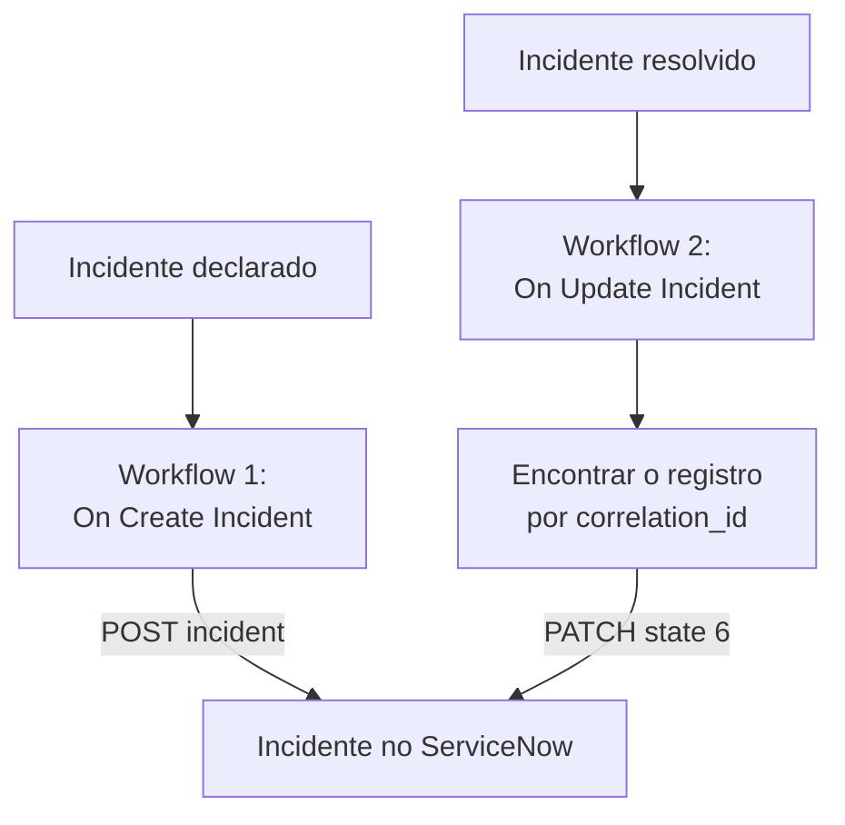

# ServiceNow

Abra um incidente no [ServiceNow](https://www.servicenow.com) para cada incidente do OneUptime e resolva-o quando o incidente do OneUptime for resolvido, para que a sua central de serviços acompanhe o que o seu monitoramento vê. Dois workflows chamam a [Table API](https://developer.servicenow.com/dev.do#!/reference/api/latest/rest/c_TableAPI) do ServiceNow.

:::cards
- [Salvar as credenciais](#salvar-as-credenciais): Mantenha a senha do ServiceNow fora dos seus workflows.
- [Abrir incidentes no ServiceNow](#abrir-um-incidente-no-servicenow-para-cada-incidente): Um workflow, dois blocos.
- [Resolvê-los](#resolver-o-incidente-no-servicenow): Encontrar o registro e depois fechá-lo.
- [Solução de problemas](#solução-de-problemas): Quando o ServiceNow recusa uma requisição.
:::

## Como funciona



O primeiro workflow grava o ID do incidente do OneUptime no `correlation_id` do registro. O segundo encontra o registro por esse ID e depois o resolve.

## Antes de começar

- Uma instância do ServiceNow, como `https://your-instance.service-now.com`.
- Um usuário do ServiceNow para a integração que possa criar e atualizar registros na tabela `incident`, geralmente com a função `itil`. O nome e a senha dele assinam as requisições.
- No OneUptime, permissão para criar workflows e variáveis globais. No OneUptime Cloud, os workflows exigem o plano **Growth** ou superior.

## Salvar as credenciais

A Table API aceita autenticação Basic: o nome e a senha do usuário, codificados juntos.

:::steps
1. Codifique-os uma vez, no macOS ou no Linux:

   ```bash
   printf '%s' 'integration.user:password' | base64 | tr -d '\n'
   ```

   Use `printf`, não `echo`: o `echo` adiciona uma quebra de linha, que é codificada junto com o resto e invalida as credenciais.

2. No OneUptime, vá para **Fluxos de trabalho → Variáveis globais** e clique em **Criar: Fluxo de trabalho Variável**. Dê o nome `SERVICENOW_AUTH` e clique em **Próximo**.
3. Cole o valor codificado em **Conteúdo**, ative **Segredo** e clique em **Criar: Fluxo de trabalho Variável**.
:::

## Abrir um incidente no ServiceNow para cada incidente

:::steps
### Criar o workflow

Vá para **Fluxos de trabalho**, clique em **Criar fluxo de trabalho** e depois em **Começar do zero**. Dê o nome `Incidents to ServiceNow` e clique em **Criar fluxo de trabalho**.

### Adicionar o gatilho

Clique no bloco tracejado **Escolha o que inicia este fluxo de trabalho** e escolha **On Create Incident**. Clique no gatilho: os seus **Fields to pass on** começam com **Título**, então clique em **Adicionar campo** e escolha **Descrição**.

### Criar o registro

Clique em **Adicionar componente**, adicione um bloco **API Post (JSON)** e ligue a ele o ponto **Success** do gatilho. Defina a **URL** dele como `https://your-instance.service-now.com/api/now/table/incident`. Em **Mais campos**, defina os **Request Headers** dele como:

```json
{
  "Authorization": "Basic {{global.variables.SERVICENOW_AUTH}}",
  "Accept": "application/json"
}
```

E o **Request Body** como:

```json
{
  "short_description": "OneUptime: {{local.components.incident-on-create-1.returnValues.model.title}}",
  "description": "{{local.components.incident-on-create-1.returnValues.model.description}}",
  "urgency": "1",
  "impact": "1",
  "correlation_id": "oneuptime-{{local.components.incident-on-create-1.returnValues.model._id}}"
}
```

### Testar e depois ativar

Clique em **Executar fluxo de trabalho**, escolha um incidente de teste em **Incidente** e execute. A etapa **API Post (JSON)** mostra uma resposta `201` com o novo registro, o `sys_id` e o `number` dele, como `INC0012345`. Depois, ative **Habilitado** no topo do **Construtor**.
:::

`urgency` e `impact` aceitam `1` para alto, `2` para médio e `3` para baixo, e o ServiceNow calcula a prioridade a partir dos dois. Qualquer outra coluna da tabela `incident` pode ir no corpo, com o nome da coluna.

## Resolver o incidente no ServiceNow

Um workflow tem um só gatilho, então resolver exige um segundo workflow, iniciado quando o estado de um incidente muda.

:::steps
### Adicionar o gatilho On Update Incident

Crie um workflow chamado `Resolve ServiceNow incidents` e escolha **On Update Incident** como gatilho. Em **Fields to watch**, clique em **Adicionar campo** e escolha **Current Incident State**, para que ele só rode quando o estado mudar. Em **Fields to pass on**, peça se o novo estado é um estado resolvido: clique em **Adicionar campo**, abra **Current Incident State** e escolha **Is Resolved State**. Ou clique em **Editar como JSON** e substitua o JSON por:

```json
{ "_id": true, "currentIncidentState": { "isResolvedState": true } }
```

### Verificar que o incidente está resolvido

Adicione um bloco **If / Else** depois do gatilho. Defina **Value to check** como `{{local.components.incident-on-update-1.returnValues.model.currentIncidentState.isResolvedState}}` e **Comparison** como **is true**.

### Encontrar o registro

Adicione um bloco **API Get (JSON)** depois do lado **Yes**, com os mesmos **Request Headers** e esta **URL**:

```text
https://your-instance.service-now.com/api/now/table/incident?sysparm_query=correlation_id=oneuptime-{{local.components.incident-on-update-1.returnValues.model._id}}&sysparm_fields=sys_id&sysparm_limit=1
```

### Resolver o registro

Adicione um bloco **API Patch (JSON)** depois do **Success** do bloco de busca, com os mesmos **Request Headers** e esta **URL**:

```text
https://your-instance.service-now.com/api/now/table/incident/{{local.components.api-get-1.returnValues.response-body.result[0].sys_id}}
```

Defina o **Request Body** dele como:

```json
{
  "state": "6",
  "close_code": "Solution provided",
  "close_notes": "Resolved in OneUptime"
}
```

### Ativá-lo

Ative **Habilitado** e depois resolva um incidente de teste no OneUptime. O incidente dele no ServiceNow passa para Resolved.
:::

`state` `6` é Resolved nos estados de incidente padrão do ServiceNow. `close_code` precisa ser um dos códigos de resolução da sua instância. Muitas instâncias não resolvem um incidente sem um código de resolução e notas, então envie os dois.

## Solução de problemas

:::details O ServiceNow responde 401
As credenciais estão erradas. Codifique `username:password` de novo com `printf`, não `echo`, e substitua o conteúdo de `SERVICENOW_AUTH`.
:::

:::details O ServiceNow responde 403
O usuário não pode gravar na tabela `incident`. Dê a ele a função `itil`, ou uma função com os mesmos direitos, e verifique se nenhuma regra de controle de acesso bloqueia a Table API para ele.
:::

:::details O ServiceNow responde 400, ou a resolução não muda nada
Um nome de coluna ou um valor não se encaixa na sua instância: uma lista `state` personalizada, ou um `close_code` que a sua instância não tem. Compare com a tabela `incident` em **System Definition → Tables** no ServiceNow e com o formulário do próprio registro.
:::

:::details A resolução responde 404
A etapa de busca não encontrou nenhum registro, então a URL manteve a referência como foi escrita. Verifique se o primeiro workflow gravou `correlation_id` e se os dois workflows o montam da mesma forma: `oneuptime-` seguido do `_id` do incidente.
:::

## Próximos passos

:::cards
- [Jira](/docs/integrations/jira): Uma integração bidirecional, mantida em dia por modelos prontos.
- [Componentes de workflow](/docs/workflows/components#api): Cada configuração dos blocos de API.
- [Execuções de workflow](/docs/workflows/runs-and-logs): Leia o que cada requisição enviou e recebeu.
- [Visão geral das integrações](/docs/integrations/index): Os padrões por trás de cada integração.
:::
